# Internet Routing: How a Packet Finds Its Way Across the Internet

**Course:** EDA387/DIT663 Computer Networks, lecture "Internet Routing (Review)". Part A repeats the basics from the earlier course EDA344: IP, addresses, forwarding and routing inside one network. Part B, "Beyond EDA344", is new: routing **between** networks (BGP) and routing security. Many slides come from Philip Levis and David Mazières; the BGP part is based on a lecture by Rob Sherwood.

**Revised:** 21 October 2026

**† Supplementary material:** content that comes only from hidden PowerPoint slides. It may not be part of this year's examinable material.

**How to read this guide.** Every part starts with **In one sentence**, the whole idea in one line. Then comes the explanation in small steps, a **Kid example** (the same idea told with everyday things), pictures, and a **Remember** list with what you must know for the exam. **Technical clarification** marks a place where the slides are wrong or unclear, and gives the correct version. **Additional context** adds something useful that is not on the slides.

---

## Glossary

| Term | Full name | Meaning in simple words |
|---|---|---|
| Adj-RIB-In / Adj-RIB-Out | Adjacent Routing Information Base, incoming / outgoing | BGP's two lists: the routes a router **heard** from its neighbours (In), and the routes it will **tell** its neighbours (Out). |
| Aggregation | — | Saying one short, big address block instead of many small ones, so routers need fewer lines in their tables. |
| ARP | Address Resolution Protocol | Asks on the local network "who has this IP address?" and learns the matching hardware (MAC) address. |
| AS | Autonomous System | One network (or a group of networks) run by one organisation, such as a university or an Internet provider. |
| ASN | Autonomous System Number | The ID number of an AS; first 16 bits long, now 32 bits. |
| ASPA | Autonomous System Provider Authorisation | A signed list in which an AS names its real providers, so others can spot fake or leaked paths. |
| Bellman-Ford equation | — | *Dₓ(y) = minᵥ { c(x,v) + Dᵥ(y) }*: "my best cost to *y* = the cheapest of (cost to a neighbour + that neighbour's cost to *y*)". |
| BGP | Border Gateway Protocol | The protocol that connects all the separate networks (ASes) of the Internet; today version 4. |
| CIDR | Classless Inter-Domain Routing | Writing an address block as "address/length", for example 171.67.0.0/16, instead of the old classes A, B and C. |
| Count to infinity | — | A distance-vector bug: after a link breaks, routers keep raising their distance step by step, almost forever. |
| Datagram network | — | A network with no set-up phase: every packet travels on its own (like separate letters). |
| Default route | — | The "send everything else here" line in a routing table, written 0.0.0.0/0. |
| DF / MF | Don't Fragment / More Fragments | Two flag bits in the IPv4 header: DF = "do not cut me into pieces", MF = "more pieces follow". |
| DHCP | Dynamic Host Configuration Protocol | Gives a new computer its IP address, subnet mask, gateway and DNS server automatically. |
| Dijkstra's algorithm | — | Finds the cheapest path from one router to all others; used in link-state routing. (Not the token-ring algorithm by the same person.) |
| Distance vector (DV) | — | Routing where each router tells **only its neighbours** how far it thinks every destination is. |
| DSCP | Differentiated Services Code Point | A 6-bit field in the IPv4 header that marks how important a packet is (for example voice calls). |
| eBGP / iBGP | external / internal BGP | BGP talk between routers of **different** ASes (eBGP) or of the **same** AS (iBGP). |
| ECN | Explicit Congestion Notification | A 2-bit IPv4 field that lets a router say "I am getting crowded" without throwing packets away. |
| EGP | Exterior Gateway Protocol | Any protocol for routing **between** ASes; in practice this means BGP. |
| Forwarding | — | The quick job a router does for every packet: look at the destination, look in the table, send it out the right port. |
| Fragmentation | — | Cutting an IP packet into smaller pieces so that each piece fits through a link. |
| Hijack (prefix hijack) | — | An AS announces addresses that are not its own, and steals their traffic. |
| ICMP | Internet Control Message Protocol | IP's helper for error and test messages, such as ping, "time exceeded" and "unreachable". |
| IGP | Interior Gateway Protocol | A protocol for routing **inside** one AS, such as RIP or OSPF. |
| Link state (LS) | — | Routing where every router tells **all** routers about its own links, so everyone can draw the whole map. |
| Loc-RIB | Local Routing Information Base | The BGP routes a router has actually **chosen** to use. |
| LOCAL_PREF | Local preference | A BGP number used inside one AS to say "prefer this route". Higher wins. |
| Longest prefix match | — | The forwarding rule: if several table lines match, use the most detailed one (the longest prefix). |
| LSP / LSA | Link State Packet / Link State Advertisement | The message a link-state router floods: "these are my links and their costs". |
| MED | Multi-Exit Discriminator | A BGP hint from a neighbour AS: "of my several entrances, please use this one". Lower wins. |
| MTU | Maximum Transmission Unit | The biggest packet a link can carry (Ethernet: 1,500 bytes). |
| NLRI | Network Layer Reachability Information | The list of address blocks that a BGP UPDATE message is talking about. |
| OSPF | Open Shortest Path First | A link-state routing protocol used inside an AS; it splits big networks into areas. |
| Path vector | — | Routing where each announcement carries the full list of ASes on the path (this is BGP). |
| PMTUD | Path MTU Discovery | Finding the biggest packet that can cross the whole path without being cut, using DF and ICMP errors. |
| Poison reverse | — | Split horizon plus telling a neighbour "for you, this destination is at distance infinity". |
| PSTN | Public Switched Telephone Network | The old wired telephone network, where each call got its own wire path. |
| RIP | Routing Information Protocol | A simple distance-vector protocol inside an AS; 16 hops means "unreachable". |
| RIR | Regional Internet Registry | One of the five organisations that hand out IP addresses for a part of the world. |
| ROA | Route Origin Authorisation | A signed note: "AS *X* is allowed to announce address block *P*, up to length *maxLength*". |
| Route leak | — | A real route is passed on to networks that should never have received it (it breaks the business rules). |
| ROV | Route Origin Validation | Checking BGP announcements against ROAs; the answer is Valid, Invalid or NotFound. |
| RPKI | Resource Public Key Infrastructure | A system of certificates that proves who owns which IP addresses and AS numbers. |
| Source routing | — | The sender writes the whole path into the packet. |
| Split horizon | — | "Never tell a neighbour about a route you learned from that same neighbour." |
| Stub / multihomed / transit AS | — | An AS with one neighbour / with several neighbours but carrying no one else's traffic / with several neighbours and carrying other people's traffic. |
| Supernetting | — | Joining neighbouring address blocks into one bigger CIDR block. |
| TTL | Time To Live | A counter in the IPv4 header; every router subtracts 1, and at 0 the packet is thrown away, so it cannot loop forever. |
| Valley-free rule | — | A route learned from a provider or a peer is passed on **only to customers**. |
| VCI | Virtual Circuit Identifier | The short label that names a virtual circuit on one link. |
| Virtual circuit | — | A path set up **before** data is sent; afterwards packets carry only a short label (like a phone call). |
| Wedgie | — | A BGP setup that has more than one stable result and can get stuck in the wrong one. |

## Contents

- [Before you start: five words you need](#before-you-start-five-words-you-need)
- [1. The Internet Protocol and the IPv4 packet](#1-the-internet-protocol-and-the-ipv4-packet)
  - [1.1 The Internet Protocol](#11-the-internet-protocol)
  - [1.2 The IPv4 header](#12-the-ipv4-header)
  - [1.3 Fragmentation and reassembly](#13-fragmentation-and-reassembly)
- [2. IPv4 addressing and address services](#2-ipv4-addressing-and-address-services)
  - [2.1 IP addresses: classes, subnets and CIDR](#21-ip-addresses-classes-subnets-and-cidr)
  - [2.2 From IP addresses to hardware addresses: ARP](#22-from-ip-addresses-to-hardware-addresses-arp)
  - [2.3 ICMP: errors and diagnostics](#23-icmp-errors-and-diagnostics)
  - [2.4 DHCP: getting an address automatically](#24-dhcp-getting-an-address-automatically)
- [3. Forwarding, Internet structure and intra-domain routing](#3-forwarding-internet-structure-and-intra-domain-routing)
  - [3.1 Forwarding, switching and source routing](#31-forwarding-switching-and-source-routing)
  - [3.2 Internet structure and autonomous systems](#32-internet-structure-and-autonomous-systems)
  - [3.3 Intra-domain routing: link state and distance vector](#33-intra-domain-routing-link-state-and-distance-vector)
- [4. Inter-domain routing with BGP](#4-inter-domain-routing-with-bgp)
  - [4.1 Why a separate inter-domain protocol?](#41-why-a-separate-inter-domain-protocol)
  - [4.2 BGP basics](#42-bgp-basics)
  - [4.3 BGP messages, attributes and route selection](#43-bgp-messages-attributes-and-route-selection)
  - [4.4 AS relationships: customers, providers and peers](#44-as-relationships-customers-providers-and-peers)
- [5. Routing security and BGP problems](#5-routing-security-and-bgp-problems)
  - [5.1 Routing security](#51-routing-security)
  - [5.2 BGP problems: convergence, stability and wedgies](#52-bgp-problems-convergence-stability-and-wedgies)
- [6. Summary and review](#6-summary-and-review)
  - [6.1 Summary: Internet design principles](#61-summary-internet-design-principles)
  - [6.2 Related quiz topics not in the lecture](#62-related-quiz-topics-not-in-the-lecture)
- [Revision notes and references](#revision-notes-and-references)

## Before you start: five words you need

The whole lecture uses five basic words. Learn these first and everything else gets easier.

- **Packet:** a small piece of data with an address on it, like a letter in an envelope. Big files are cut into many packets.
- **Host:** a computer at the edge of the network: your laptop, your phone, a web server.
- **Router:** a box in the middle of the network that receives packets and passes each one on in the right direction, like a post-office sorting centre.
- **Link:** the connection between two machines: a cable, Wi-Fi, a fibre.
- **Protocol:** an agreed set of rules for talking, like the rules of a card game that both players know.

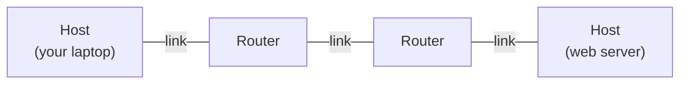

A packet goes from host to router to router to host. **Routing** is how the routers know which way to send it.

## 1. The Internet Protocol and the IPv4 packet

**What this chapter is about:** what IP is, what is written on every IP packet (the header), and what happens when a packet is too big for a link.

### 1.1 The Internet Protocol

**In one sentence:** IP (the Internet Protocol) is the common language that lets many different kinds of networks work together as one big Internet.

**The problem IP solves.** The world has many different local networks: Ethernet cables in an office, Wi-Fi at home, fibre links, old FDDI rings, point-to-point links. Each one works differently. Routers join them together. IP is the set of rules that lets a host on any one of them reach a host on any other. It does this with five ideas:

1. **Packets:** data is cut into packets. Each packet carries addressing information, and routers pass it on network by network.
2. **Addresses:** every network connection (interface) gets an IP address. Every packet names its source and its destination.
3. **Independence from the link:** IP sits on top of the physical and link layers. Any network that follows the IP rules can join, whatever cables or radios it uses.
4. **Routing protocols:** routers talk to each other about the map of the network, to decide where packets should go.
5. **Fragmentation and reassembly:** if a packet is too big for a link, IP can cut it into pieces and the destination glues them back together.

> **Kid example.** IP is like the address on an envelope. A letter may travel by bicycle in your town, by truck between cities and by plane between countries. Every carrier is different, but each one reads the same address. The local networks are the bicycles, trucks and planes; IP is the address system they all understand.

**The hourglass.** Draw the Internet's protocols as an hourglass. At the top are many applications (FTP for files, HTTP for the web, NV for network voice, TFTP). They use one of two transport protocols, TCP or UDP. All of them pass through **one narrow waist: IP**. Below IP the hourglass opens up again into many network technologies (NET₁, NET₂, …, NETₙ, such as Ethernet, Wi-Fi or DSL).

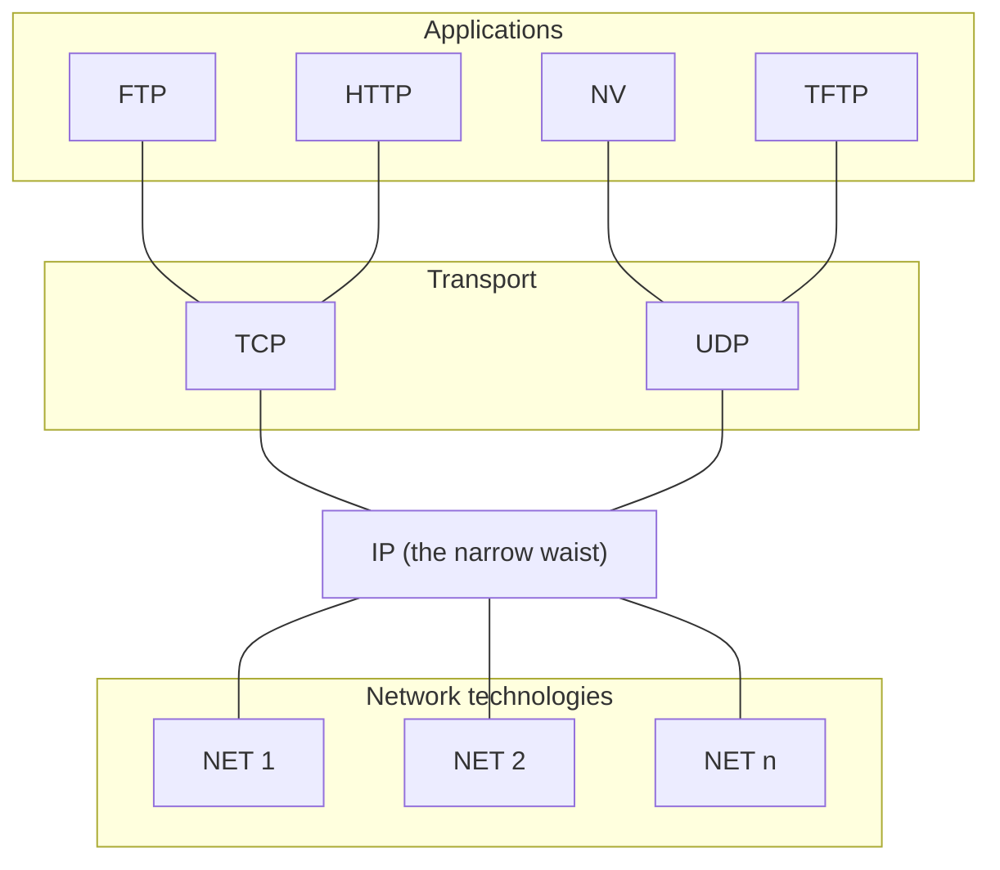

The lines show which protocol runs on top of which. They are not one-way flows.

Why is a narrow waist good? Because everything passes through IP, a new app works on every network, and a new kind of network works with every app. Nobody has to change the other side.

> **Kid example.** Think of a plug and a wall socket. Thousands of different devices (lamps, phones, toasters) and many different power stations all meet at one standard socket. Because the socket is the same everywhere, any device works with any power station. IP is that socket.

**Encapsulation: envelopes inside envelopes.** When an app sends data, each layer wraps it in its own header (a label with information for that layer):

1. The **transport layer** adds a TCP or UDP header (port numbers; for TCP also sequence numbers and flags).
2. The **network layer** adds the IP header (IP addresses, TTL).
3. The **link layer** adds a link header, for example an Ethernet header (hardware MAC addresses).

The receiver removes the headers in the opposite order. This unwrapping is called **decapsulation**.

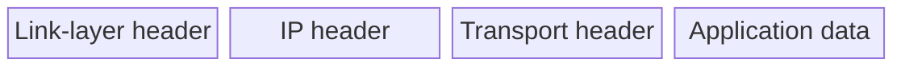

> **Kid example.** You write a letter (the data), put it in an envelope with your friend's room number (transport header), put that in a bigger envelope with the house address (IP header), and hand it to a courier who puts a delivery sticker on it (link header). At the other end, each person opens only their own envelope and passes the rest inside.

**IP is connectionless and "best effort".** IP does not set up a connection first: each packet (also called a **datagram**) is handled on its own. And IP **promises nothing**. A packet can be:

- **lost**,
- **delivered out of order**,
- **duplicated** (arrive twice), or
- **delayed for a long time**.

If an app needs reliable delivery, a protocol above IP, such as TCP, must add it.

> **Kid example.** IP is like dropping postcards in a postbox. Usually they arrive. But the post office does not promise anything: a card can get lost, two cards can arrive in the wrong order, and nobody calls you to say "your card arrived".

**Remember:**
- IP glues different networks together; it is the narrow waist of the hourglass.
- Each layer adds its own header (encapsulation); the receiver removes them (decapsulation).
- IP is connectionless and best effort: loss, reordering, duplication and delay can all happen.

### 1.2 The IPv4 header

**In one sentence:** every IPv4 packet starts with a header, a fixed list of fields that tells routers where the packet goes and how to handle it.

Routers decide where to send a packet by looking at its **destination address**. After the header comes the **payload** (the content), which usually starts with a TCP or UDP header.

The header is drawn in rows of 32 bits. The numbers in brackets are the size of each field **in bits**. The boxes in the drawing are only roughly to scale (the small DSCP, ECN and flag boxes are not to scale).

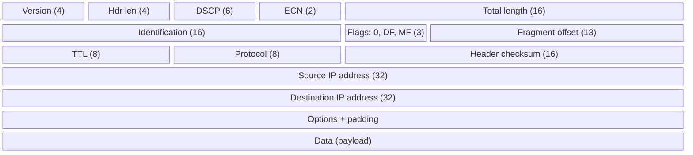

Each field, in simple words:

- **Version (4 bits):** the number 4, meaning IPv4. (IPv6 is the newer version.)
- **Header length (4 bits):** how long the header is, counted in 32-bit words. It is needed because optional fields can make the header longer.
- **DSCP (6 bits):** "differentiated services" (RFC 2474): a priority mark for quality of service. Real-time traffic such as **Voice over IP** uses it, and so can video calls, critical data and big bulk transfers.
- **ECN (2 bits, optional, RFC 3168):** lets a router warn the two ends that it is getting crowded **without dropping packets**. It works only if both ends support it, and helps only if the network supports it too.
- **Total length (16 bits):** header plus data. The smallest is **20 bytes** (a header with no data), the largest **65,535 bytes**. Every host must be able to rebuild packets of at least **576 bytes**; modern hosts can do much more. A link may have a smaller limit, which forces fragmentation.
- **Identification (16 bits):** a number shared by all fragments (pieces) of one original packet, so the receiver knows which pieces belong together. It was once also used for tracing packets, but **RFC 6864 now forbids that use**.
- **Flags (3 bits):** a reserved bit that is always 0, then **DF** (Don't Fragment) and **MF** (More Fragments). See [1.3](#13-fragmentation-and-reassembly).
- **Fragment offset (13 bits):** where this piece sits inside the original packet. See [1.3](#13-fragmentation-and-reassembly).
- **TTL (8 bits), Time To Live:** each router subtracts 1; at 0 the packet is thrown away. Its main job is to **break routing loops**, because a packet going round in circles cannot live forever. It is also used for other things, such as collecting Internet statistics and managing caches.
- **Protocol (8 bits):** what kind of data the payload is: **ICMP = 1, TCP = 6, UDP = 17**.
- **Header checksum (16 bits):** an error check over the header only. Every router must recompute it, because every router changes the TTL.
- **Source and destination addresses (32 bits each):** who sent it, and where it goes.
- **Options and padding:** rarely used. Padding fills the header up to a multiple of 32 bits. With options the header can grow from 20 up to 60 bytes.

> **Kid example.** TTL works like a ticket with a fixed number of holes to punch (often 64). Every post office (router) that handles the parcel punches one hole. When no holes are left, the parcel is thrown away. So a parcel that is sent round and round in a circle by mistake cannot travel forever.

You can look at real packets and their headers with a free packet analyser called **Wireshark**.

**Remember:**
- Routers route on the **destination address**.
- Header size: 20 bytes normally, up to 60 bytes with options. Packet size: 20 to 65,535 bytes.
- Protocol numbers: **ICMP 1, TCP 6, UDP 17**.
- TTL stops loops from keeping packets alive forever; the checksum covers only the header and is recomputed at every hop.

### 1.3 Fragmentation and reassembly

**In one sentence:** when a packet is bigger than the next link allows (its MTU), IP cuts it into smaller pieces, and only the final destination glues them back together.

Every link has a **maximum transmission unit (MTU)**, the biggest packet it can carry. If a packet is bigger than the MTU of the next link, it must be **fragmented** (cut into pieces). The rules:

- **Only cut when you must** (when MTU < packet size). The sender tries to avoid it.
- **Each piece is a complete packet on its own** with its own IP header, and a piece can be **cut again** further along the path.
- **Only the destination host glues the pieces back together.** Routers in the middle never do.
- **Lost pieces are not recovered.** If one piece is lost, the whole packet (every piece) must be sent again.

> **Kid example.** You must push a long letter through a narrow letter slot. You cut it into numbered pieces, write the full address on each piece, and push them through one by one. Only your friend at home (the destination) tapes the pieces back together, using the numbers (the offsets). If one piece gets lost, the whole letter must be sent again.

**The two flag bits.**

- **DF (Don't Fragment):** "never cut me". If DF is set and the packet is too big for the next link, the router **drops** it and sends an error back to the sender. This is useful, for example, when the target host cannot rebuild packets. The main reason a sender sets DF is **Path MTU Discovery (PMTUD)**: the router that cannot forward the packet sends back an ICMP "Fragmentation Needed" message (type 3, code 4); the sender then makes its packets smaller and tries again. You can also find the path MTU by hand with ping or traceroute.
- **MF (More Fragments):** "more pieces follow". In a packet that was never cut, MF = 0. In a cut packet, **every piece except the last has MF = 1**. The last piece has MF = 0 but a **non-zero offset**; that is how it differs from an uncut packet.

**The fragment offset** tells where a piece belongs, counted from the start of the original data. The first piece always has offset 0. The field is 13 bits (values 0 to 8,191) and counts in **units of 8 bytes**. So every piece (except the last) carries a multiple of 8 data bytes, and the largest offset is 8,191 × 8 = **65,528 bytes** (65,535 with the header). The receiver uses the **source address + destination address + Identification** to know which pieces belong together.

**Worked example.** Host H1 sends a packet to host H8 across four links: Ethernet (H1–R1), FDDI (R1–R2), PPP (R2–R3) and Ethernet again (R3–H8). Ethernet's MTU is **1,500 bytes**; this PPP link's MTU is **576 bytes**. The packet has 1,400 data bytes.

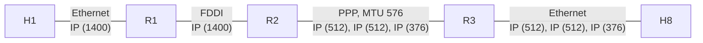

Step by step:

1. 1,400 data bytes + 20 header bytes fit on Ethernet and FDDI, so nothing happens at R1.
2. They do **not** fit the 576-byte PPP link, so **R2 must cut the packet**.
3. Each piece gets its own 20-byte header. 512 data bytes + 20 = 532 bytes, which fits under 576. (512 is chosen because it is a multiple of 8.)
4. The pieces stay separate on the last Ethernet link. **Only H8 rebuilds the packet.**

| Packet | Ident | MF | Offset field | Data bytes | Position in original data |
|---|---|---|---|---|---|
| (a) original | x | 0 | 0 | 1400 | 0–1399 |
| (b) fragment 1 | x | 1 | 0 | 512 | 0–511 |
| (b) fragment 2 | x | 1 | 64 | 512 | 512–1023 (64 × 8 = 512) |
| (b) fragment 3 | x | 0 | 128 | 376 | 1024–1399 (128 × 8 = 1024) |

How to read the offset: the field holds the position **divided by 8**. Fragment 2 starts at byte 512, and 512 ÷ 8 = 64. Fragment 3 starts at byte 1024, and 1024 ÷ 8 = 128. All pieces share the same Ident value x.

**Technical clarification.** Also, the default PPP MTU is often 1,500 bytes (about 1,492 bytes of payload in practice). The lecture's example deliberately uses a much smaller PPP MTU of 576 bytes.

**Remember:**
- Fragment only when needed; pieces are full packets; **only the destination reassembles**; a lost piece means resending everything.
- DF = do not cut (used for Path MTU Discovery); MF = more pieces follow (0 only on the last piece).
- Offset counts in **8-byte units**; pieces are matched by source, destination and Identification.

## 2. IPv4 addressing and address services

**What this chapter is about:** how IP addresses are built, and three helpers that every network needs: ARP (find the hardware address), ICMP (errors and tests) and DHCP (get an address automatically).

### 2.1 IP addresses: classes, subnets and CIDR

**In one sentence:** an IP address has a network part and a host part, and the "/number" after an address says how many bits are the network part.

IP addresses are **globally unique** (or made to look unique) and **hierarchical**: first a **network** part, then a **host** part. Because addresses are grouped by network, a far-away router only needs one line for a whole network instead of one per computer. This is called **aggregation**. It saves router memory and makes routing simpler.

> **Kid example.** An IP address is like "street name + house number". A far-away post office only looks at the street (the network part); only the local postman cares about the house number (the host part). If many streets lie in one district, the far-away office needs just one line in its book, "district X: send north" (aggregation), instead of one line per street.

**Classful addressing (old, but you still hear the names).** At first, the size of the network part was fixed by the first bits of the address:

- **Class A:** first bit 0, then a 7-bit network number and a 24-bit host part (an 8-bit prefix, about 16 million hosts per network).
- **Class B:** first bits 10, a 16-bit prefix (about 65,000 hosts).
- **Class C:** first bits 110, a 24-bit prefix (about 254 hosts).

**The Internet in 1990** was a tree with a **single backbone** (NSFNET). Regional networks such as BARRNET, Westnet and MidNet hung off the backbone, and universities and labs hung off the regional networks.

**Subnetting** adds one more level inside an organisation. A **subnet mask** shows which bits are "network" and which are "host". For example 255.255.255.0 is 24 one-bits followed by 8 zero-bits. Inside a class B network, a mask can split the host part into a **subnet ID** and a **host ID**. Subnet masks can split the host part in different ways, and **subnets are only visible inside the site**: the outside world still sees one network.

**CIDR (Classless Inter-Domain Routing).** Today we do not use classes. We write an address block as **address/prefix length**, for example **171.67.0.0/16**. The number after the slash is how many bits at the start are the network part.

- Neighbouring blocks of addresses are given to networks that are near each other, so they can be joined into one bigger block (**supernetting**).
- A block is written as one pair (first address, size), and block sizes must be **powers of 2**.
- **128.96.34.0/25** means the mask has 25 one-bits and 7 zero-bits: 0xffffff80 = **255.255.255.128**. **128.96.33.0/24** means mask **255.255.255.0**.
- **Every router must understand CIDR.**

**How to read a /number, step by step.** Take 200.23.16.0/20.

1. An IPv4 address has 32 bits.
2. /20 means the first 20 bits are the network part, so 32 − 20 = 12 bits are left for hosts.
3. 2¹² = 4,096 addresses are inside this block.
4. A /23 has 32 − 23 = 9 host bits = 512 addresses. So a /20 holds 4,096 ÷ 512 = **8** blocks of size /23.

**Route aggregation example.** The ISP "Fly-By-Night-ISP" gave its customers these blocks: 200.23.16.0/23 (Organization 0), 200.23.18.0/23 (Organization 1), 200.23.20.0/23 (Organization 2), …, 200.23.30.0/23 (Organization 7). That is exactly the 8 blocks inside **200.23.16.0/20**. So the ISP tells the whole Internet just one thing: **"Send me anything with addresses beginning 200.23.16.0/20."** Another ISP, "ISPs-R-Us", says "Send me anything with addresses beginning 199.31.0.0/16."

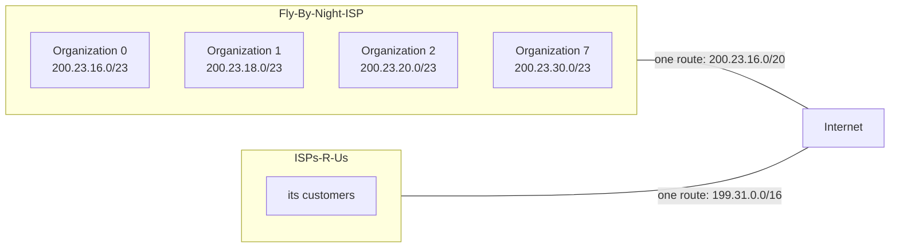

**The connectivity rule.** For every destination, a router must either:

- have a line in its forwarding table that maps the **prefix to a next hop**, or
- know a **"smarter router"** to send unknown destinations to: the **default route**.

When several lines match, the router uses **longest prefix match**: the line with the longest (most detailed) prefix wins. The default route is **0.0.0.0/0**: it matches everything, but it is the least detailed, so it is used only when nothing else matches. **Core routers know every route and have no default route.**

**Additional context.** A tiny longest-prefix example: a table has 200.23.16.0/20 → link 1 and 200.23.18.0/23 → link 2. A packet to 200.23.19.5 matches both (it is inside both blocks), and the /23 is longer, so it goes out on link 2. A packet to 200.23.25.1 matches only the /20, so it goes out on link 1.

> **Kid example.** You ask for directions. One sign says "Gothenburg: this way". Another says "Gothenburg, Chalmers campus: that way". If you are going to Chalmers, you follow the **more detailed** sign. If you are going somewhere else in Gothenburg, only the first sign fits. And if no sign fits at all, you follow the big sign "All other places: highway" (the default route).

**Remember:**
- Address = network part + host part; "/n" = the first n bits are the network part.
- Aggregation: many small blocks → one big block → fewer table lines.
- Longest prefix match picks the most detailed matching line; 0.0.0.0/0 is the default route; core routers have no default route.

### 2.2 From IP addresses to hardware addresses: ARP

**In one sentence:** ARP asks the local network "who has this IP address?" and learns the hardware (MAC) address it must put on the frame.

There are two kinds of addresses at the same time:

- A **layer-2 (link) address** names a **network card** (hardware interface), for example the Wi-Fi address 00:26:b0:f9:25:cf.
- A **layer-3 (network) address** names a **host**, for example www06.stanford.edu is 171.67.216.19. (The DNS lecture explains how names become IP addresses.)

One host can have **several network cards**, so several link addresses for one IP address. To send a packet, a node first looks in its **routing table** to choose **which network card** to use. Then, to actually put the packet on that link, it needs the **link address** of the destination (or of the next router) on that link.

**ARP (Address Resolution Protocol)** does this translation:

1. Every node keeps a **table of IP → link-address pairs** (the ARP table).
2. If the IP address is not in the table, the node **broadcasts a request** to everyone on the local network: "Who has IP address X?"
3. Because the request was broadcast and contains the sender's own addresses, **everybody learns** where the sender is.
4. The **machine with that IP address answers** with its link address.
5. **Table entries are thrown away if they are not refreshed** after a while.

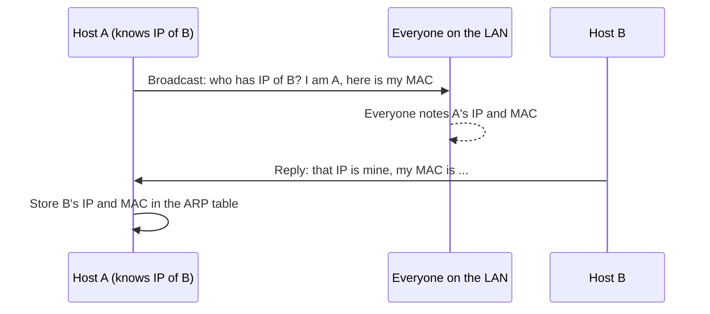

> **Kid example.** You know a classmate's name (the IP address) but not which desk they sit at (the link address). You shout to the whole class "Who is Sara? I am Tom at desk 3!" (the broadcast request; now everybody knows where Tom sits). Sara answers "I am at desk 7" (the reply). You write it in your notebook (the ARP table), and you rub it out after a while if nobody confirms it again.

**The ARP packet for Ethernet and IPv4.** Rows are 32 bits wide; the numbers in brackets are field sizes in bits (boxes roughly to scale).

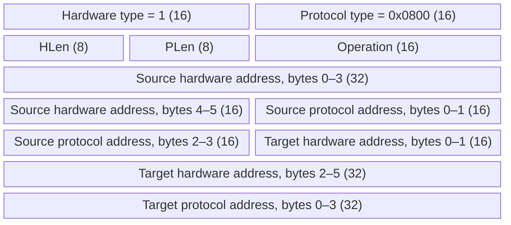

- Hardware type **1** = Ethernet; protocol type **0x0800** = IPv4.
- Operation **1** = request, **2** = reply.
- In a request the target hardware address is not known yet (it may be all zeros).

**Technical clarification.** The lecture writes "HLen = 48, PLen = 32", which are the address lengths **in bits**. In the actual packet these fields hold the lengths **in bytes**: HLen = 6 for a MAC address and PLen = 4 for an IPv4 address, as the lecture's explanation says.

**Remember:**
- IP address = which host; MAC address = which network card on this local link.
- ARP: broadcast request, unicast reply, everyone learns the asker, entries expire.
- In the packet: HLen = 6 bytes, PLen = 4 bytes; operation 1 = request, 2 = reply.

### 2.3 ICMP: errors and diagnostics

**In one sentence:** ICMP is IP's helper for sending back error messages and test messages, such as ping.

The **Internet Control Message Protocol** carries error messages, tests and control messages for IP. Examples:

- **Echo (ping):** send a small packet to a target and wait for the answer, to measure the round-trip time.
- **Redirect:** tell a host "there is a better route to that destination".
- **Destination unreachable:** a router or host says that a protocol, port or host cannot be reached.
- **TTL exceeded:** the TTL hit 0, so the packet was dropped (this stops packets from cycling forever).
- **Checksum failed:** the data may be damaged.
- **Reassembly failed:** for example, some fragments were missing or damaged.
- **Cannot fragment:** a router could not cut the packet to fit the MTU because DF was set.

> **Kid example.** Ping is like shouting "Marco!" in a swimming pool and timing how long it takes until someone shouts "Polo!" back. A "destination unreachable" message is like a lifeguard shouting back "Nobody called Polo is in this pool!"

**Many ICMP messages include a piece of the packet that caused them**, so the sender knows which packet went wrong. An ICMP message travels inside an IP packet with protocol = 1:

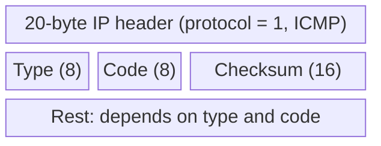

**Type and code.** The **type** says what kind of message it is; the **code** gives more detail. The full list is at <http://www.iana.org/assignments/icmp-parameters>. Common types:

| Type | Meaning |
|---|---|
| 0 | Echo reply |
| 3 | Destination unreachable |
| 4 | Source quench |
| 5 | Redirect |
| 8 | Echo request |
| 11 | Time exceeded |
| 13 / 14 | Timestamp request / reply |

Codes for "destination unreachable" (type 3): **0** network unreachable, **1** host unreachable, **2** protocol unreachable, **3** port unreachable, **4** fragmentation needed and DF set.

**Example: Time Exceeded.** Type 11, code usually 0 ("TTL exceeded in transit"), then an unused 32-bit word, then **the IP header plus the first 8 payload bytes** of the packet that caused it. Those 8 bytes are exactly a **UDP header** (source port, destination port, length, checksum, 16 bits each), which nicely tells the sender which conversation the error belongs to.

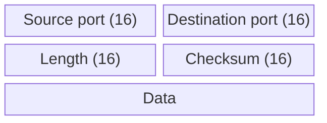

**traceroute versus ping.**

- **Ping** checks whether a host answers and measures the round-trip time.
- **Traceroute** (on Windows: `tracert`) lists every router on the path and the round-trip time to each one. It works by sending packets with TTL = 1, 2, 3, … so that each router in turn throws one away and sends back "time exceeded".

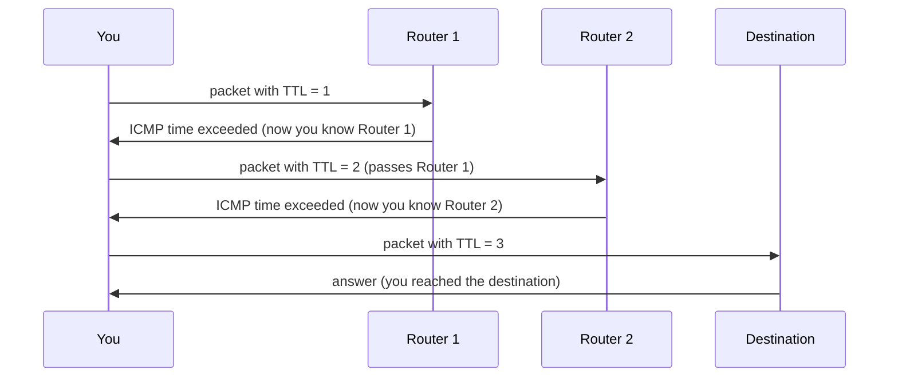

A line that shows **"Request timed out"** means that router did not answer in time. Common reasons: a firewall or filter blocks ICMP, the router is busy or limits ICMP, network settings or policy, a broken part of the path, or a wrongly configured device. A few time-outs are normal; if **every** hop after some point times out, there may be a real problem. Try `tracert google.com` and `ping google.com` yourself.

**Remember:**
- ICMP travels inside IP with protocol number 1; type = what kind, code = detail.
- Ping uses echo request (8) and echo reply (0); traceroute uses TTL = 1, 2, 3, … and the "time exceeded" (11) answers.
- Destination unreachable (3), code 4 = fragmentation needed but DF set (used by Path MTU Discovery).

### 2.4 DHCP: getting an address automatically

**In one sentence:** DHCP gives a new computer its IP address and basic settings automatically, for a limited time (a lease).

Every network card needs an IP address. Typing them in by hand is a pain, so most networks use the **Dynamic Host Configuration Protocol**. It works in four messages, easy to remember as **D-O-R-A**:

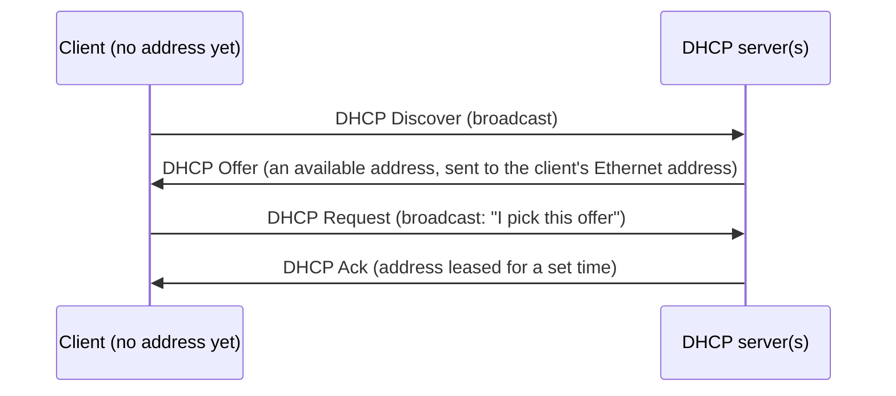

1. **Discover:** the new client broadcasts "is there a DHCP server?".
2. **Offer:** one or more servers answer with an offer: a free address from their pool. The offer cannot be sent to the offered IP address, because the client has not accepted it yet. So it is sent to the **client's Ethernet address** (not broadcast).
3. **Request:** the client picks one offer and **broadcasts** "I take this one". Broadcasting it tells the other servers that their offers were not chosen.
4. **Ack:** the chosen server confirms.

> **Kid example.** A new child arrives at a summer camp and shouts "Is there a free bed?" (discover). Two leaders answer "Bed 12 is free" and "Bed 5 is free" (offers). The child shouts "I take bed 12 from Ana!" (request; shouted, so that the other leader knows bed 5 is still free for someone else). Ana confirms "Bed 12 is yours for this week" (ack, with a time limit, the lease). Ana also tells the child where the dining hall is (default gateway) and where the information desk is (DNS server).

**What else the server gives you,** besides the address:

- the **subnet mask**, so the host can tell whether another host is on the same subnet (talk directly) or not (go through a router);
- the **default gateway**, the router that gets all traffic for places outside the local network;
- the **DNS server**, so the host can turn names like www.example.com into IP addresses.

**Leasing.** The address is only lent for a **lease time**.

- Near the end of the lease, the client tries to **renew** with the same server.
- If that server cannot be reached, it can **rebind** with any available server.
- A client that leaves sends a **release**, giving the address back.

(More on lease times: <https://lazyadmin.nl/home-network/dhcp-lease-time/>.) On Windows, try `ipconfig` and `ipconfig /all` to see your own settings.

**DHCP scope.** A scope is the **range of addresses** a server may lend on one subnet, plus settings such as subnet mask, gateway, DNS servers and lease time. A scope can have:

- **exclusions:** addresses never handed out, for devices with fixed (static) addresses;
- **reservations:** a fixed address always given to the same device, such as a printer or a server;
- **load balancing:** in big networks several DHCP servers share the work.

**Remember:**
- DORA: Discover (broadcast) → Offer (to the client's MAC) → Request (broadcast) → Ack.
- DHCP gives address, subnet mask, default gateway and DNS server, for a lease (renew, rebind, release).
- Scope = address range + settings; exclusions, reservations, load balancing.

## 3. Forwarding, Internet structure and intra-domain routing

**What this chapter is about:** the difference between forwarding and routing, the different ways a network can move packets, how the Internet is split into autonomous systems, and the two classic ways to route inside one AS (link state and distance vector).

### 3.1 Forwarding, switching and source routing

**In one sentence:** forwarding is the fast "look up and send" job for each packet, while routing is the slower job of filling in the table that forwarding uses.

**Forwarding is not routing.**

- **Forwarding** moves a packet from an input port to an output port. The router looks up the destination address in its **forwarding table** and finds the output port, or an ⟨output port, MAC address⟩ pair.
- **Routing** works out the **rules** for that table: it is the process of **filling in the forwarding tables**. Routers exchange messages about the networks they can reach, trying to find the best route to every destination (or a good route, or just any route, depending on how big the network is).

> **Kid example.** Routing is like planning a trip with a big map and writing the directions on a card. Forwarding is glancing at the card at each crossing: "to the station? turn left". Forwarding must be very fast and happens for every packet; routing happens in the background and only changes the card.

IP forwarding happens at the **network layer**, not at the link layer. That is why a router can forward **between different kinds of networks** (for example Ethernet on one side, a cable-TV wire on the other). It also does the required work on the IP header, such as subtracting 1 from the TTL.

**The family tree of communication networks.**

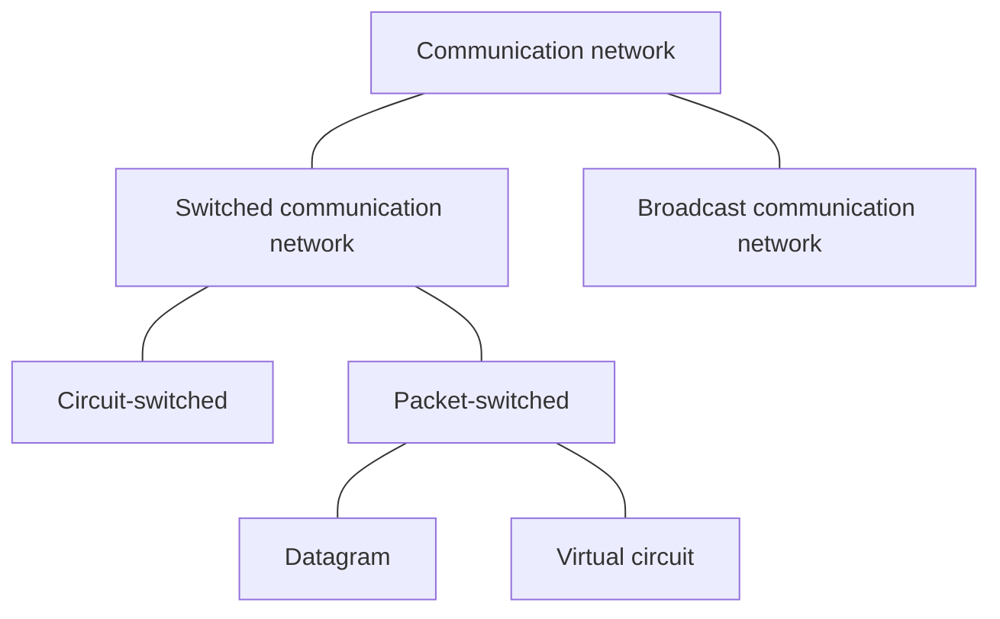

- A **broadcast** network sends everything to everyone (like old Wi-Fi radio or a shared cable).
- A **switched** network passes data through switches along a path. It is either **circuit-switched** (a fixed path for the whole call) or **packet-switched** (data in packets). Packet switching comes in two kinds: **datagram** and **virtual circuit**.

† *The old telephone network (PSTN)* is the classic circuit-switched network. **A telephone number is a program**: dialling it sets up a physical wire connection to another phone (old phones used to click while the switches connected). The connection belongs to that call until someone hangs up. The lecture notes that the UK PSTN was to be switched off in December 2025.

**Virtual circuit switching (connection-oriented).**

1. First there is a **set-up phase** (and later a tear-down phase). It gives the connection a short label, the **virtual circuit identifier (VCI)**, on each link.
2. Each switch keeps a **VC table**: ⟨in-link, in-VCI⟩ → ⟨out-link, out-VCI⟩.
3. After set-up, packets follow the circuit and carry only the small VCI.
4. ATM and Frame Relay used this model.

**Datagram switching (connectionless).**

1. **No set-up.** Switches have a routing table based on **node addresses**.
2. **Each packet is forwarded on its own**, so packets of one conversation may take different paths and arrive out of order. The Internet's IP works this way.

> **Kid example.** A virtual circuit is like booking a train seat: first you reserve, then you just show your short seat number at each stop. Datagram switching is like sending separate postcards: no booking, but every card needs the full address, and two cards may take different roads.

**Comparing the two models** (+ = advantage, − = disadvantage):

| Virtual circuit model | Datagram model |
|---|---|
| − Typically waits a full round-trip time for setup before the first data packet | + No setup delay: send as soon as data is ready |
| + Small per-packet header (just a circuit identifier) | − Larger header: each packet carries all routing information (full address) |
| − If a switch or link on the circuit fails, the connection breaks and must be set up again | + Can automatically route around failures |
| + Setup is a chance to reserve resources | − The source cannot know whether the network can deliver, or whether the destination is up |
| + Packets to the same destination can use different circuits | − All packets to one destination may end up on the same route; load balancing needs more complex forwarding and routing |

**Additional context.** The notes mention two ways datagram networks balance load: **ECMP** (equal-cost multi-path: spread traffic over several equally good paths) and **hash-based** choice of path per flow (so a flow keeps one path and stays in order).

**Source routing.** A simple form of datagram switching: **the sender decides the whole path** and writes it into the packet as a list of output ports. Each switch reads the next port from the list. (In the lecture's picture, the header [3, 0, 1] is rotated at each switch as it is used.)

- **Good:** the sender has full control (pick or avoid paths for speed, security or policy), custom routes, useful for testing, avoids some bad routing decisions.
- **Bad:** the sender must know the whole map; it does not scale; attackers can abuse it; it cannot adapt when the network changes; bad decisions when the sender lacks information.

> **Kid example.** Source routing is like giving a taxi driver a note with every single turn written on it: "left, right, second exit". You are in full control, but if one road is closed, the driver is stuck, and you must know the whole city map yourself.

In IPv4 source routing exists as header options:

- **Loose Source and Record Route (LSRR, option 131 = 0x83):** lists some routers that must be visited, not every hop.
- **Strict Source and Record Route (SSRR, option 137 = 0x89):** gives the exact path.

Both carry a list of IP addresses and a pointer to the next one. **In practice source routing is deprecated and blocked**, for security and performance reasons.

**Remember:**
- Forwarding = per packet, fast, uses the table. Routing = fills the table.
- Virtual circuit: set-up first, short label, breaks on failure. Datagram: no set-up, full address, routes around failures (IP is datagram).
- Source routing: the sender picks the path; LSRR (loose) and SSRR (strict) exist in IPv4 but are blocked in practice.

### 3.2 Internet structure and autonomous systems

**In one sentence:** the Internet is a network of networks; each separately run network is an autonomous system (AS), routing inside an AS uses an IGP, and routing between ASes uses BGP.

**The Internet today** has **many backbones**, run by backbone providers, joined at **peering points**. Big companies connect straight to backbone providers; home ISPs and small companies connect through them. CAIDA's "IPv4 and IPv6 AS Core" pictures show the ASes by location, how big their customer cones are, and their links. From 2017 to 2020 the customer cones of the largest ASes grew. (An AS's **customer cone** is every AS it can reach by going down through its customers.)

**Autonomous systems (ASes)** are **administrative domains**: networks run by one organisation, such as Stanford or a large company. An AS wants to:

- pick **its own routing method inside**, and
- set **its own rules (policy) for traffic to and from the outside**.

Each AS has a unique **AS number** (first 16 bits, later extended to 32 bits).

> **Kid example.** Each AS is like a country with its own road rules inside. How a country organizes its own roads is its own business. At the borders, countries make agreements about whose traffic they let through, and those agreements are about business and politics, not about the shortest road. Inside: link state or distance vector. Between ASes: BGP.

**Two levels of routing.**

- Inside each AS: an **interior gateway protocol (IGP)**. Each AS chooses its own, with its own rules.
- Between ASes: an **exterior gateway protocol (EGP)**, one Internet-wide standard: **BGP**.

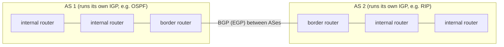

**Kinds of traffic and kinds of AS.**

- **Local traffic** starts or ends inside the AS. **Transit traffic** only passes through it.
- A **stub AS** is connected to only one other AS.
- A **multihomed AS** is connected to several ASes but **carries no transit traffic**.
- A **transit AS** is connected to several ASes **and carries transit traffic**.

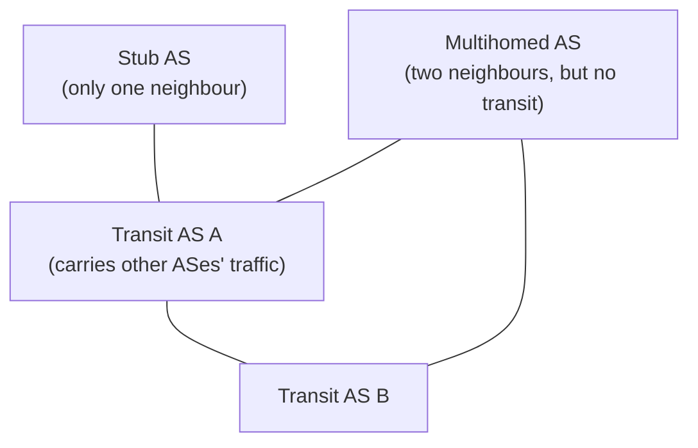

**Inside an AS** there is one boss, so **finding the best (optimal) path matters most**. **Between ASes, business policy matters most** (see Part B).

**Remember:**
- AS = one administrative domain with a unique AS number (16 → 32 bits).
- IGP inside (RIP, OSPF); EGP between (BGP).
- Stub (one neighbour), multihomed (several, no transit), transit (several, carries transit).
- Inside: optimality. Between: policy.

### 3.3 Intra-domain routing: link state and distance vector

**In one sentence:** inside one AS, routers either share the whole map with everyone (link state, like OSPF) or share only their distances with their neighbours (distance vector, like RIP).

#### Routing as a graph problem

Routing algorithms can be sorted in two ways:

- **Global or decentralized.** In a global algorithm every router knows the whole map. In a decentralized one, a router knows only its neighbours and what they tell it.
- **Intra-domain or inter-domain.** Intra-domain: all routers under one boss, up to about 100 networks (for example a campus like Stanford). Inter-domain: decentralized, as big as the whole Internet.

**Finding the best path.** Think of the network as a **graph**: routers are dots (nodes) and links are lines (edges). Each line has a **cost**, which could be based on delay, bandwidth, how busy the link is, queue length, and so on. The job: **find the cheapest path between two nodes**. Usually each node computes this itself. Some newer research argues against that, because each node optimising only for itself can hurt the system as a whole.

The two families of intra-domain routing:

| Link state | Distance vector |
|---|---|
| Global view of the network | Only local state (less overhead, smaller footprint) |
| Simpler to debug | Harder to debug |
| Requires global state (OSPF reduces this with areas) | Can suffer from loops |
| Example: OSPF | Example: RIP |

> **Kid example.** Link state is like every child in class drawing their own little piece of the town map and photocopying it for everyone, so everyone can glue together the full map. Distance vector is like a rumour game: you only ask the children sitting next to you "how far is the park from you?", add your own distance to them, and pass on your best guess.

#### Link state and reliable flooding

**The idea:** tell **all** routers (not just neighbours), but tell them only about **your own direct links** (not your whole table). Each router then builds the full map from everybody's pieces.

A **Link State Packet (LSP)** contains:

- the **ID** of the router that made it;
- the **cost of each link to a direct neighbour**;
- a **sequence number (SEQNO)**, so newer news beats older news;
- a **time-to-live (TTL)** for the packet.

**Reliable flooding**, the way LSPs are spread:

1. Keep the newest LSP from each router.
2. Pass an LSP on to all neighbours except the one it came from.
3. Make a new LSP from time to time, with SEQNO + 1.
4. After a reboot, start SEQNO at 0. If you then hear **your own old** packet with SEQNO = *x*, set your next SEQNO to *x* + 1, so that your new LSPs beat the old ones still travelling around.
5. Lower the TTL of each stored LSP over time and **throw it away when the TTL reaches 0**.

When every router has the map, each one computes its best paths with **Dijkstra's shortest-path algorithm**.

#### Dijkstra's shortest-path algorithm †

**The map.** *G* = (*N*, *E*): routers *N* = {u, v, w, x, y, z} and links *E*. *c*(a,b) is the cost of the direct link between *a* and *b*; for example *c*(w,z) = 5. If two routers are not directly linked, the cost is ∞; for example *c*(u,z) = ∞. The network operator chooses the costs: always 1, or based on bandwidth, or on congestion or delay.

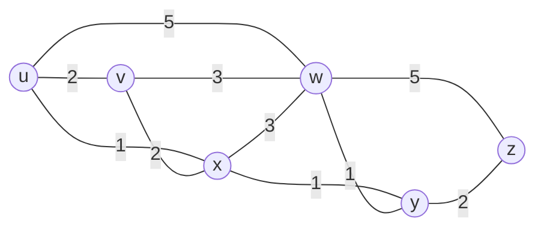

**Technical clarification.** The lecture's list of links *E* leaves out (u, w), although its picture (and the Dijkstra table, where D(w) starts at 5 via u) contains a u–w link of cost 5. The diagram above follows the picture.

Dijkstra's algorithm is **global**: every node knows the whole map and all costs (thanks to the link-state flooding). It computes the cheapest paths from one **source** to every other node, which gives that node's forwarding table. It is **step by step**: after *k* steps, the cheapest paths to *k* destinations are known for sure.

Notation:

- *D*(v): the current best known cost from the source to v.
- *p*(v): the node just before v on that path (the "predecessor").
- *N*′: the set of nodes whose cheapest path is already final.

```text
1  Initialization:
2    N' = {u}                     /* compute least-cost paths from u to all other nodes */
3    for all nodes v
4      if v adjacent to u         /* u initially knows only direct costs to neighbours */
5        then D(v) = c(u,v)       /* but they may not be minimum! */
6        else D(v) = ∞
8  Loop
9    find a not in N' such that D(a) is a minimum
10   add a to N'
11   update D(b) for all b adjacent to a and not in N':
12     D(b) = min( D(b), D(a) + c(a,b) )
         /* new cost to b is the old cost, or the known cost to a plus the link a–b */
15 until all nodes in N'
```

In plain words, the loop is:

1. Among the nodes that are not final yet, pick the one with the **smallest** cost so far. It is now final.
2. Look at its neighbours. For each one, ask: "is it cheaper to go through the node I just picked?" If yes, lower its cost and remember the new predecessor.
3. Repeat until every node is final.

> **Kid example.** Imagine water spreading from a tap at u through pipes of different lengths. The water reaches the closest place first, then the next closest, and so on. Each time it reaches a new place, that place's distance is final, and the water starts spreading from there too. Dijkstra's algorithm follows the water.

Running it from u on the map above:

| Step | N′ | D(v), p(v) | D(w), p(w) | D(x), p(x) | D(y), p(y) | D(z), p(z) |
|---|---|---|---|---|---|---|
| 0 | u | 2, u | 5, u | 1, u | ∞ | ∞ |
| 1 | ux | 2, u | 4, x | | 2, x | ∞ |
| 2 | uxy | 2, u | 3, y | | | 4, y |
| 3 | uxyv | | 3, y | | | 4, y |
| 4 | uxyvw | | | | | 4, y |
| 5 | uxyvwz | | | | | |

How to read it: each row shows the costs **after** the last node in N′ was added. The smallest cost in a row is the node added in the next row.

- **Step 0:** u knows only its direct links: v = 2, w = 5, x = 1. y and z are ∞.
- **Step 1:** x has the smallest cost (1), so x is final. Through x: w = 1 + 3 = **4** (better than 5), y = 1 + 1 = **2** (better than ∞).
- **Step 2:** v and y both cost 2 (a tie). The lecture adds y first; either choice gives the same final costs. Through y: w = 2 + 1 = **3**, z = 2 + 2 = **4**.
- **Steps 3 to 5:** v, then w, then z become final. Nothing improves any more.

**Result.** Follow the predecessors back to build the **tree of cheapest paths** from u, then the **forwarding table** of u:

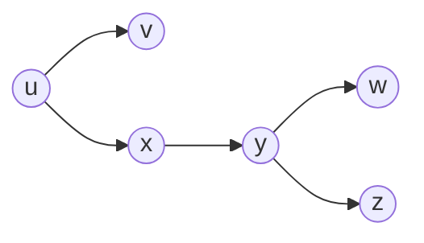

| Destination | Use link |
|---|---|
| v | (u, v) |
| x, y, w, z | (u, x) |

#### Distance vector and the Bellman-Ford equation †

**Distance vector** is a **distributed** routing method: no one has the whole map.

- Each node keeps rows of **(Destination, Cost, NextHop)**.
- It talks **only with its direct neighbours**: from time to time (every few seconds to minutes), and whenever its table changes (a **triggered update**).
- Each update is a list of **(Destination, Cost)** pairs.
- A node changes its table when it hears of a **better** route (lower cost, or a newly connected neighbour). Existing routes are refreshed, and **deleted if they time out**.

It is based on the **Bellman-Ford equation**. Let *Dₓ*(y) be the cost of the cheapest path from x to y. Then

**Dₓ(y) = minᵥ { c(x,v) + Dᵥ(y) }**, taking the minimum over all neighbours v of x.

In words: any best path from x has to leave x through some neighbour v. So try every neighbour, compute "cost of my link to v + v's own best cost to y", and keep the smallest.

**Example.** Node u has neighbours v, x and w, with link costs 2, 1 and 5. They report: *D*ᵥ(z) = 5, *D*ₓ(z) = 3, *D*w(z) = 3. Then

*D*ᵤ(z) = min{2 + 5, 1 + 3, 5 + 3} = min{7, 4, 8} = **4**,

and the neighbour that gave the minimum, **x**, is u's next hop towards z.

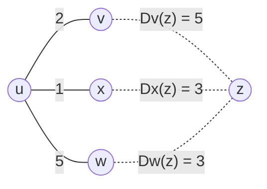

**The algorithm.** From time to time each node sends its own distance estimates (its "distance vector") to its neighbours. When x gets a new vector from a neighbour, it recomputes *Dₓ*(y) ← minᵥ{c(x,v) + Dᵥ(y)} for every destination y. Under mild, natural conditions the estimates end up at the true cheapest costs. The method is:

- **iterative and asynchronous:** each local recomputation is caused by a link-cost change nearby or by a message from a neighbour;
- **distributed and self-stopping:** a node tells its neighbours only when its vector changes, and they tell theirs only if needed; when nothing changes, everything goes quiet.

Each node loops: **wait** (for a link-cost change or a message) → **recompute** → **if anything changed, tell the neighbours**.

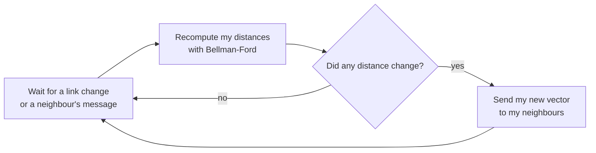

**Three-node example.** Links: x–y cost 2, y–z cost 1, x–z cost 7.

1. At first each node knows only its direct links. x's own row is (0, 2, 7); its rows for y and z are unknown (∞).
2. x receives y's vector and z's vector and computes:
   - *Dₓ*(y) = min{c(x,y) + *D*ᵧ(y), c(x,z) + *D*_z(y)} = min{2 + 0, 7 + 1} = **2**;
   - *Dₓ*(z) = min{c(x,y) + *D*ᵧ(z), c(x,z) + *D*_z(z)} = min{2 + 1, 7 + 0} = **3**.
3. After the messages settle, all three tables agree: from x (0, 2, 3), from y (2, 0, 1), from z (3, 1, 0).

The direct x–z link of cost 7 is never used, because going through y costs only 3.

#### Loops and counting to infinity

Distance vector uses only **local information**, so it can be fooled into loops. The lecture's example network has the links A–B, A–C, A–E, A–F, B–C, C–D, D–G and F–G.

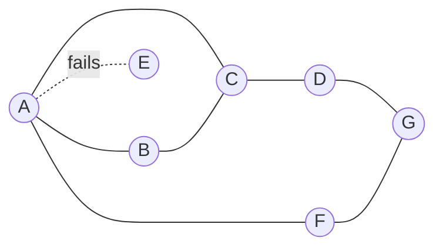

**Counting to infinity.** The link from A to E breaks.

1. A advertises: distance to E = **∞**.
2. But B and C (who reached E through A) have just advertised a distance of **2** to E.
3. B thinks it can reach E in **3** hops (through C) and tells A.
4. A thinks it can reach E in **4** hops (through B) and tells C.
5. C thinks it can reach E in **5** hops… and so on, upward forever.

> **Kid example.** E has moved away, but nobody knows it yet. A asks B and C: "Do you know how far E is?" B says "3, via C", A then says "4, via B", C says "5, via A"... Each one repeats the old rumour from the others and adds one, so the number keeps growing. Split horizon is the rule "never tell a friend the news that you learned from that same friend".

**Ways to avoid loops.**

- The **IP TTL** stops a single packet from living forever, but it **does not fix** the routing loop itself.
- **Treat a small number as infinity**, for example 16. After a limited number of rounds the node decides "unreachable". But rounds can be long, so this is slow.
- **Split horizon:** when you send updates to node A, **leave out the destinations you reach through A**. In the example, this stops B and C from telling A "distance 2".
- **Split horizon with poison reverse:** when you send updates to A, **include those destinations with cost ∞ ("poison")**. The lecture's poison reverse example: B tells C "E: 2", so C records "B says E is at 2"; after the failure B's message becomes "E: ∞", and C records "B says E is at ∞".

**Additional context : when does poison reverse help?.** It prevents loops between **two** neighbours (B will never route to E through A while A routes through B). It does **not** prevent loops through **three or more** routers. In the triangle A–B–C above, C can still offer B a route to E that secretly goes through A, and the three can still count to infinity until the bound (such as 16) is reached.

**When an alternative exists, it is fast.** Same graph, but now link F–G breaks.

1. F notices, sets its distance to G to ∞ and tells A.
2. A sets its distance to G to ∞, since it went through F.
3. A gets a regular update from C with a **2-hop** path to G (C–D–G).
4. A sets its distance to G to **3** and tells F.
5. F decides it can reach G in **4** hops through A.

Here the network finds the new right answer quickly, because a real other path exists.

#### Distance vector versus link state

- **Number of messages:** LS needs **O(*n* · *d*)** messages for *n* nodes. DV's convergence time varies but is **Ω(*d*)**.
- **Rounds until everything settles:** LS **O(*n*²)**. DV **could count all the way to ∞** if there is a loop. Later the course studies a **self-stabilizing version that needs only Θ(*d*) rounds**.
- **What a broken router can do:** in LS, a node can advertise a wrong **link** cost (only its own links). In DV, a node can advertise a wrong **path** cost, and because others build on those costs, **the error spreads through the network**.

**Technical clarification.** The lecture defines *d* as "the number of neighbours of a node", while the lecture's explanation calls *d* "the network diameter". For the self-stabilizing Θ(*d*) bound, the diameter reading fits what the course shows later (the self-stabilizing BFS spanning-tree algorithm stabilizes in a number of cycles proportional to the diameter).

#### RIP †

**Protocols for routing inside an AS:**

- **RIP** (Routing Information Protocol) is a fairly simple distance-vector protocol, specified in **RFC 2453** (38 pages). It was **made self-stabilizing by Radia Perlman**.
- **OSPF** (Open Shortest Path First) is a more complex link-state protocol that adds **areas** to scale better (RFC 2328).

**RIPv2 [RFC 2453]:**

- runs over **UDP port 520**;
- allows at most **15 hops (16 = ∞)**;
- relies on **count to infinity** to deal with loops;
- supports **split horizon** and **poison reverse**;
- RFC 1812 lists which options routers should or must support.

**RIPv2 packet** (sizes in bytes):

```mermaid
block-beta
    columns 4
    C["command (1)"]:1 V["version (1)"]:1 Z["must be zero (2)"]:2
    E["RIP entry (20), repeated for each route"]:4
```

**Each 20-byte RIP entry:**

```mermaid
block-beta
    columns 4
    AF["address family identifier (2)"]:2 RT["route tag (2)"]:2
    IP["IP address (4)"]:4
    SM["subnet mask (4)"]:4
    NH["next hop (4)"]:4
    M["metric (4)"]:4
```

- The **route tag** lets RIP routers tell internal routes from external ones. It must be kept when the route is passed on; it could, for example, hold the AS number.
- The **next hop** lets one router announce routes for several routers on the same subnet, and can point a RIP neighbour to a better path.
- The **metric** is the hop count.

#### OSPF †

**OSPFv2 [RFC 2328]** is a link-state protocol (RFC 2328 is 244 pages) that:

- runs **directly on IP (protocol number 89)**, so it must handle **its own reliability**;
- **authenticates all messages**;
- uses **areas** to scale.

**Two levels: areas and a backbone.**

- Link-state messages are flooded **only inside one area**, or inside the backbone.
- Each router knows the detailed map of its own area, and only the **direction** to other places.
- **Area border routers** summarise the distances inside their area and announce them in the backbone.
- **Internal routers** flood only inside their area, compute routes inside the area, and send packets for the outside to an area border router.
- **Backbone routers** run OSPF only in the backbone. A **boundary router** connects to other ASes.

```mermaid
flowchart TB
    subgraph BB["Area 0: backbone"]
        BR["boundary router<br/>(to other ASes)"]
        BK["backbone router"]
        ABR1["area border router 1"]
        ABR2["area border router 2"]
        ABR3["area border router 3"]
        BR --- BK
        BK --- ABR1
        BK --- ABR2
        BK --- ABR3
    end
    subgraph A1["Area 1"]
        I1["internal routers"]
    end
    subgraph A2["Area 2"]
        I2["internal routers"]
    end
    subgraph A3["Area 3"]
        I3["internal routers"]
    end
    ABR1 --- I1
    ABR2 --- I2
    ABR3 --- I3
```

**OSPF areas:** **area 0 is the backbone** (it contains all boundary routers). **Traffic between two areas always goes through area 0.** A router only needs the exact routes inside its own area; for anything else it just sends the packet towards the right area. **Virtual links** can make far-away routers part of area 0.

> **Kid example.** OSPF areas are like the floors of a big school. Each floor knows every room on its own floor. To reach another floor you always go to the main staircase (area 0), and the staircase guards (area border routers) know which floor has which rooms.

**OSPF packet header** (fields from the lecture; sizes in bits from RFC 2328):

```mermaid
block-beta
    columns 4
    VER["Version # (8)"]:1 TY["Type (8)"]:1 PL["Packet length (16)"]:2
    RID["Router ID (32)"]:4
    AID["Area ID (32)"]:4
    CK["Checksum (16)"]:2 AT["AuType (16)"]:2
    AU["Authentication (64)"]:4
```

(The authentication field is 64 bits, so it really spans two 32-bit rows; it is drawn as one block.)

**The five OSPF packet types:**

1. **Hello:** find neighbours and keep checking that they are alive.
2. **Database Description (DD):** a summary of the router's link-state database, with a sequence number, used to synchronise databases.
3. **Link State Request:** "please send me these LSAs that I am missing".
4. **Link State Update:** carries LSAs about changes (new routers, link changes, failures).
5. **Link State Acknowledgment:** "I received your update", which makes flooding reliable.

**How OSPF routers share the map, step by step:**

1. **Discover neighbours** with Hello packets. Two routers become neighbours if their Hello settings match (area ID, hello interval and so on).
2. **Exchange LSAs** (router ID, direct links, their cost and status) with neighbours.
3. **Flood LSAs** to neighbours in the same area, passing on arriving LSAs, using reliable flooding: every LSA is acknowledged and is sent only once unless something changes.
4. **Update the link-state database (LSDB)** with arriving LSAs, until every router has the complete picture.
5. **Detect changes:** when a link goes up or down, make a new LSA and flood it.
6. **Age and refresh:** LSAs have an age field; refresh them regularly and remove old ones.

**The Database Description packet** holds: the interface MTU, options (multicast, external LSAs and so on), the bits **I** (init), **M** (more) and **MS** (master/slave), a **DD sequence number**, and then LSA headers (20 bytes or more each).

**The DD exchange** (how two routers start synchronising):

```mermaid
sequenceDiagram
    participant A as Node A
    participant B as Node B
    A->>B: empty DD, seq n, I=1, M=1, MS=1
    B->>A: DD, seq n, I=0, MS=0, may contain LSA headers (M=1 if more)
    A->>B: DD, seq n+1, I=0, MS=1, M depends on whether more LSAs remain
    Note over A,B: continues until both send M=0
```

**Remember:**
- Link state: flood your own links to everyone (LSP with ID, link costs, SEQNO, TTL), then run Dijkstra. Example: OSPF.
- Distance vector: tell neighbours your distances; Bellman-Ford *Dₓ(y) = minᵥ{c(x,v) + Dᵥ(y)}*. Example: RIP.
- DV can count to infinity; fixes: a small "infinity" (16), split horizon, poison reverse (helps for two-node loops only).
- LS: wrong link costs stay local. DV: wrong path costs spread.
- RIPv2: UDP 520, 15 hops max. OSPFv2: IP protocol 89, areas, area 0 = backbone, five packet types.

---

# Part B: Beyond EDA344

From here on the material is new compared with the introductory course: **routing between ASes, and routing security** (RPKI, ROV, ASPA and the problems BGP can get into).

## 4. Inter-domain routing with BGP

**What this chapter is about:** why the Internet needs a special protocol between ASes, how BGP works, which messages it sends, how a router picks one route among many, and how money relationships between ASes shape routing.

### 4.1 Why a separate inter-domain protocol?

**In one sentence:** between ASes the goal is not the shortest path but following business rules and hiding private information, so we need BGP instead of OSPF everywhere.

Why not just use OSPF for the whole Internet, maybe with many levels of areas? **Size is not the only problem.**

- **BGP is about policy and hiding information.** Inside an AS all routers trust each other; between ASes they do not: **intra = trusted, inter = untrusted.**
- Inside an AS you **optimise a number** (the path cost). Between ASes you **follow a business relationship**. Every problem in this lecture comes from that difference.
- There are about **75,000 active ASes** and **no central authority** over what any of them announces. Each AS decides for itself what to advertise and what to believe. There is **no global view**: every router sees a slightly different Internet. **The goal is not the shortest path; the goal is policy.**

> **Kid example.** Inside your family you share everything and just take the quickest way to school. Between families it is different: your neighbour may let you walk through their garden, but only if you are friends, and they do not want to tell everyone what is in their garden. BGP is the set of "garden rules" between families.

**Why study BGP?** It is the critical protocol that keeps the Internet running, the only widely used EGP, and full of real problems: efficiency, the Cogent versus Level3 Internet split, Pakistan accidentally taking YouTube offline, and spammers hijacking address blocks.

**History of BGP.**

| Year | Version | What changed |
|---|---|---|
| 1989 | BGPv1 [RFC 1105] | "directional" routing |
| 1990 | BGPv2 [RFC 1163] | a bunch of incompatible changes |
| 1991 | BGPv3 [RFC 1267] | fixes connection "collisions" |
| 1994 | BGPv4 proposed [RFC 1654] | |
| 1995 | BGPv4 actual [RFC 1771] | **CIDR support** |
| today | BGPv4 [RFC 4271] | latest specification |

More reading: application of BGP in the Internet [RFC 1772], experience with BGPv4 [RFC 1773], protocol analysis [RFC 1774].

**Remember:** intra = trusted and optimised; inter = untrusted and policy-driven; about 75,000 ASes, no central authority, no global view.

### 4.2 BGP basics

**In one sentence:** each AS tells its neighbours which address blocks it can reach and by which list of ASes, learns many paths, picks one by its own policy, and passes only that one on.

**The big picture.**

- Every AS that takes part gets an AS number (**first 16 bits, now 32** [RFC 4893]).
- For BGP, each AS is drawn as **a single node**.
- ASes tell all neighbours which **prefixes they can reach**, for example "I can reach prefix 171.67.0.0/14 through ASes 15444, 3549, 174, 46749 and 32".
- Each AS **chooses one path by its routing policy**. The key rule: **learn many paths, pass on only one!**
- Each AS **adds its own AS number** to the front of the paths it passes on.

```mermaid
flowchart TB
    A32["AS 32<br/>owns 171.67.0.0/14"] -->|"171.67.0.0/14: 32"| A46749["AS 46749"]
    A46749 -->|"171.67.0.0/14: 46749 32"| A174["AS 174"]
    A174 -->|"... 174 46749 32"| A3549["AS 3549"]
    A3549 -->|"... 3549 174 46749 32"| A15444["AS 15444"]
```

The arrows show the announcement travelling; each AS puts its own number at the front. (Data traffic later flows the opposite way, towards AS 32.)

> **Kid example.** BGP is like a chain of friends passing on a note: "You can reach the ice-cream shop through me." Each friend writes their own name at the front of the list before passing it on. When you get several notes, you keep the one you like best (maybe from your best friend, not the shortest one) and pass only that one on.

**What a BGP router stores.** Think of three boxes of routes:

```mermaid
flowchart LR
    IN["Adj-RIBs-In<br/>unprocessed routes learned from peers<br/>(reachable and unreachable)"] -->|"selected by policy;<br/>first hop reachable by IGP or static route"| LOC["Loc-RIB<br/>routes chosen for use"]
    LOC -->|"subset chosen for each peer"| OUT["Adj-RIBs-Out<br/>routes to advertise"]
```

1. **Adj-RIBs-In:** everything heard from neighbours, not yet processed. It even keeps unreachable routes, in case they become reachable later and can be moved into the Loc-RIB.
2. **Loc-RIB:** the routes chosen by policy for actual use (the first hop must be reachable by the IGP or a static route).
3. **Adj-RIBs-Out:** for each neighbour, the routes the router will tell that neighbour.

**What follows from BGP's design.**

- **The full AS path makes routing loop-free:** a router rejects any path that already contains its own AS. (Exceptions: during churn, IGP/EGP mismatches and similar.)
- Not every AS knows every path.
- Treating an AS as one node loses efficiency: the **shortest AS path is not guaranteed**, and a short AS path may hide many router hops inside each AS.
- Size: the lecture quotes 32K ASes and 300K+ prefixes (older figures; compare the ~75,000 ASes above).

**Where does Chalmers sit?** Chalmers is **AS2841**, with **one upstream and no downstreams**: a **stub AS**. Its path to the world is **AS2841 → AS1653 (SUNET) → AS2603 (NORDUnet) → the commercial Internet**. Göteborgs universitet is **AS2842**, a sibling customer of SUNET, so traffic between the two universities goes **up to SUNET and back down**. SUNET has **44 peers and 1 upstream**, so most of its traffic leaves through **peering, not paid transit**. The lesson: **policy follows topology, not invoices.** (The BGP relationship is customer/provider no matter how the money moves; SUNET is publicly funded, not a commercial transit contract.)

```mermaid
flowchart BT
    CH["Chalmers<br/>AS2841 (stub)"] --> SU["SUNET<br/>AS1653"]
    GU["Göteborgs universitet<br/>AS2842"] --> SU
    SU --> NO["NORDUnet<br/>AS2603"]
    NO --> CI["Commercial Internet"]
```

Arrows point from customer to provider.

**Try it yourself.**

- `traceroute -A -q 1 www.gu.se` (Linux; on macOS and BSD the flag is `-a`). `-A` looks up the AS of each hop; `-q 1` sends one probe per hop.
- `mtr -z -c 10 --report www.gu.se` is nicer and live. Windows `tracert` has no AS lookup; use WinMTR.
- `curl -s https://ipinfo.io/json` shows which AS you are in right now.
- Expect **AS2841 → AS1653 → AS2842**. Hops showing `* * *` are **ICMP filtering, not failure**. A short path to a large site means **peering, not closeness**. Adding `-6` traces over IPv6, and the path may differ.

**Remember:**
- BGP announces prefixes with the full AS path; each AS adds its own number.
- Learn many paths, pass on only one, chosen by policy.
- Adj-RIBs-In → Loc-RIB → Adj-RIBs-Out.
- The AS path prevents loops; the shortest AS path is not guaranteed.
- Chalmers = AS2841, a stub AS behind SUNET (AS1653).

### 4.3 BGP messages, attributes and route selection

**In one sentence:** BGP routers talk over TCP port 179 with four message types, attach attributes to each route, and pick the best route by going down a fixed list of rules.

**How BGP routers talk.** Border routers connect over **TCP port 179** and keep one long-lived connection, sending messages both ways. There are **four message types**:

1. **OPEN:** starts the connection and identifies the two BGP peers; it must be the first message in each direction.
2. **UPDATE:** announces route changes (the most important message).
3. **NOTIFICATION:** reports an error when closing the connection.
4. **KEEPALIVE:** "I am still here".

Extensions can add more types, for example ROUTE-REFRESH [RFC 2918].

```mermaid
sequenceDiagram
    participant A as Border router, AS A
    participant B as Border router, AS B
    A->>B: TCP connection to port 179
    A->>B: OPEN
    B->>A: OPEN
    A->>B: UPDATE (new routes / withdrawn routes)
    B->>A: UPDATE
    A->>B: KEEPALIVE (from time to time)
    B->>A: NOTIFICATION (only on an error, then close)
```

**What is inside an UPDATE.**

- **Withdrawn routes:** a list of prefixes that cannot be reached any more.
- **Network Layer Reachability Information (NLRI):** the list of prefixes that the attributes below are about.
- **Path attributes:** ORIGIN, AS_PATH, NEXT_HOP, MULTI_EXIT_DISC, LOCAL_PREF, ATOMIC_AGGREGATE, AGGREGATOR, …. Each attribute has a **1-byte type, 1-byte flags and a length**. New attribute types can be added; for example **AS4_PATH** carries 32-bit AS numbers instead of the old 16-bit ones.

**An example announcement:** NLRI **171.67.0.0/14**, AS path **15444 3549 174 46749 32**, and a **next-hop IP address** (just like in RIPv2). There are many **knobs for traffic engineering** (metric, weight, local preference, MED, communities): "lots of voodoo".

**Route selection.** When a router has several routes to the same prefix, it goes down this list until one route wins:

1. Is the **next hop reachable**? If not, the route cannot be used.
2. Prefer the highest **weight** (set by the AS's own local policy).
3. Prefer the highest **LOCAL_PREF**.
4. Prefer routes **this router started itself** (locally originated).
5. Prefer the **shortest AS path**.
6. Prefer the lowest **origin type** (IGP before EGP before incomplete).
7. Prefer the lowest **MED**, but MEDs can only be compared between routes **from the same neighbour AS**.
8. Prefer **eBGP over iBGP**.
9. Prefer the route with the **lowest cost to the exit point** ("hot-potato routing").
10. **Tie-breakers**, for example the lowest router ID or the oldest route.

> **Kid example.** Choosing a route is like choosing a bus to school with a list of rules. First rule: does the bus run at all? Next: which bus does my family prefer (local preference)? Only if they are equal do I look at which one has the fewest stops (AS path length). And if still equal, I take the one whose stop is nearest my door (hot potato), and finally I just pick by a fixed tie-breaker.

Notice that **policy (weight, LOCAL_PREF) comes before path length**. That is why BGP often does not use the shortest path.

**Technical clarification.** The lecture explains hot-potato routing as "packet routing without storing packets in buffers". That is the meaning of the term in switch design (deflection routing). In BGP route selection, hot-potato routing means **handing traffic to the nearest exit point of your own AS**, getting rid of it as quickly as possible, which is what "lowest cost to egress point" expresses.

**External versus internal BGP.** If every AS had only one router, every BGP session would be between ASes (**eBGP**). Real ASes have **several border routers at several meeting points**. **iBGP** runs between routers of the **same** AS, so that all its border routers agree about the routes learned from outside.

```mermaid
flowchart LR
    subgraph AS2["AS 2"]
        R2a["border router"] -.-|"iBGP"| R2b["border router"]
    end
    subgraph AS3["AS 3"]
        R3a["border router"] -.-|"iBGP"| R3b["border router"]
    end
    R2a ---|"eBGP"| R3a
    R2b ---|"eBGP"| R3b
```

**Remember:**
- TCP port 179; OPEN, UPDATE, NOTIFICATION, KEEPALIVE.
- UPDATE = withdrawn routes + NLRI + path attributes.
- Selection order: next hop reachable → weight → LOCAL_PREF → locally originated → shortest AS path → origin → MED (same neighbour AS only) → eBGP over iBGP → nearest exit (hot potato) → tie-break.
- eBGP between ASes, iBGP inside one AS.

### 4.4 AS relationships: customers, providers and peers

**In one sentence:** ASes are customers (who pay), providers (who get paid) or peers (who swap traffic for free), and these money relationships decide which routes are passed on.

**Customer and provider.** **Customers pay for connectivity**; for example, Stanford pays Cogent. The customer is a stub, the provider a transit AS. The amounts and price structures vary a lot. Many customers are **multi-homed** (Stanford also connects to CalREN/Internet2). **Typical policy: prefer routes learned from customers**, because customers bring in money.

**Peers** agree to **swap traffic for free**, with penalties or new negotiations if the traffic becomes very unbalanced. **Tier-1 ISPs have no default route: they all peer with each other.** You are **Tier *i* + 1** if you have a default route to a Tier *i* provider.

```mermaid
flowchart BT
    T1a["Tier-1 ISP"] ---|"peers (free)"| T1b["Tier-1 ISP"]
    P["Provider (transit AS)"] -->|"customer pays"| T1a
    C1["Customer (stub)"] -->|"customer pays"| P
    C2["Customer (stub)"] -->|"customer pays"| P
```

Solid arrows point from customer to provider (who pays whom); the peer line has no arrow because neither side pays.

> **Kid example.** Think of shops and delivery companies. A customer pays a provider to carry its parcels everywhere. Two companies of the same size may agree to carry each other's parcels for free (peering). But no company carries parcels for free between two other companies that do not pay it.

**Additional context : the valley-free rule.** From these relationships follows the rule the lecture uses later: **a route learned from a provider or a peer is advertised only to customers**, never to another provider or peer. A legitimate AS path therefore climbs up through providers, crosses at most one peer link at the top, and then goes down through customers; it never climbs again after going down (no "valley"). Advertising more widely would mean offering free transit.

```mermaid
flowchart LR
    A["source AS"] -->|"up to provider"| B["provider"]
    B -->|"up to provider"| C["Tier-1"]
    C ---|"at most one peer link"| D["Tier-1"]
    D -->|"down to customer"| E["provider"]
    E -->|"down to customer"| F["destination AS"]
```

A good path looks like a mountain: up, maybe one step across the top, then down. Going down and then up again (a "valley") is not allowed.

**BGP relationship drama: Cogent versus Level3 (self-study).** Level3 and Cogent were peers. In 2005 Level3 decided to start charging Cogent; Cogent refused. The result was an **Internet partition**: Cogent's customers could not reach Level3's customers and the other way round, and other ISPs were affected too. Three weeks later they reached a new, secret agreement.

**Remember:**
- Customers pay providers; peers exchange traffic for free; Tier-1 ISPs peer with each other and have no default route.
- Prefer customer routes (they pay).
- Valley-free: routes from providers or peers go only to customers.

## 5. Routing security and BGP problems

**What this chapter is about:** BGP believes everyone, so wrong or stolen routes can spread. You will learn about hijacks and leaks, and the tools that fix part of the problem (RPKI, ROA, ROV, ASPA). Then come three other BGP problems: slow convergence, instability and "wedgies".

### 5.1 Routing security

**In one sentence:** BGP has no built-in way to check who owns an address block, so any AS can lie, and RPKI with ROV and ASPA are later add-ons that check part of the story.

**BGP trusts everyone.** BGP has **no built-in origin check**: **any AS can announce any prefix**, and its neighbours have no protocol tool to check it. This was not a bug at the time: the first operators knew each other personally and fixed mistakes by telephone. **Everything that follows was added later** to a protocol that assumes everyone cooperates. (DNS has the same story, as the next lecture shows.)

**A real hijack: YouTube, February 2008.**

1. Pakistan Telecom was ordered to block YouTube inside Pakistan. It announced a route for YouTube's addresses into its own network, pointing to nowhere.
2. YouTube announced **208.65.152.0/22**. Pakistan Telecom announced **208.65.153.0/24**, a smaller block inside it.
3. The announcement **leaked** to its upstream provider and spread into the **global routing table**.
4. **The more specific prefix wins** (longest prefix match happens before any policy comparison), so routers everywhere sent YouTube traffic to Pakistan Telecom. **YouTube was unreachable worldwide for about two hours.**
5. **Nothing broke.** Every router did exactly what BGP says. **Every part being correct does not mean the whole system is correct.**

```mermaid
flowchart LR
    YT["YouTube announces<br/>208.65.152.0/22"] --> NET["Routers everywhere"]
    PK["Pakistan Telecom announces<br/>208.65.153.0/24 (more specific)"] --> NET
    NET -->|"longest prefix wins"| PKX["Traffic for 208.65.153.x<br/>goes to Pakistan Telecom"]
```

> **Kid example.** Two signposts stand at a crossing. One says "Everything on Long Street: this way" (the /22). A prankster adds a second sign: "Long Street numbers 100 to 199: that way" (the /24). Drivers always follow the **more detailed** sign, so everyone heading for those houses drove the wrong way. Every driver followed the rules perfectly; the trouble was a wrong sign.

*Check yourself (from the lecture):* if Pakistan Telecom had announced the same /22 instead of a /24, would the result have been the same? (Hint: with equal prefix lengths, BGP's route selection, such as AS-path length and local policy, decides, so only part of the Internet would have chosen the false route.)

† An older, archived version of the lecture tells the same story with different details: the Pakistani ISP **PieNET** advertised **208.65.152.0/23 and 208.65.152.128/23**, and it adds that spammers steal unused IP space to hide (Feamster), asks why someone would advertise very short prefixes, and says that secure BGP is "in the works".

**Technical clarification.** The two YouTube versions disagree. The visible version (Pakistan Telecom announcing 208.65.153.0/24) matches the well-documented account of the incident. The archived version's "208.65.152.128/23" cannot be a valid /23 block (a /23 must start at an even third octet with .0), so treat the visible version as correct.

**Hijacks are not the only problem: route leaks.**

- **Hijack:** announcing a prefix that is **not yours** (a false origin).
- **Leak:** passing a route on **further than it should go**. The origin is **real**; what is broken is the **valley-free** rule. A typical cause: a multi-homed customer passes routes learned from one provider on to its other provider. Suddenly a small network looks like a transit path between two big ones, and a link built for one customer gets flooded with traffic between providers.
- RFC 7908 lists **six different leak types**.
- **Different problem, different fix:** checking the origin does not help against leaks, because nothing about the origin is false.

> **Kid example.** A hijack is a stranger putting up a sign saying "I am the ice-cream shop". A leak is your friend, who really knows the way to the ice-cream shop, telling a whole crowd to walk through his small garden to get there. The directions are real, but the garden was never meant for that many people.

**RPKI: a trust system for addresses.** The **Resource Public Key Infrastructure** gives out **certificates that link address blocks to their owners**. It starts at the **five RIRs** and follows the way addresses are handed out (IANA → RIRs → local registries and end users). A resource certificate has no name or e-mail, only "the holder of this key controls these number resources". It is shaped like **DNSSEC's chain of trust**, with one difference: DNSSEC has one root key, while RPKI has **five roots** with no common parent.

```mermaid
flowchart TB
    IANA["IANA"] --> R1["RIR 1"]
    IANA --> R2["RIR 2"]
    IANA --> R5["... RIR 5"]
    R1 --> L["Local registry / ISP"]
    L --> E["End user<br/>(signs ROAs for its prefixes)"]
```

The arrows follow the hand-out of addresses. In RPKI each of the five RIRs is its own trust anchor (root).

**ROAs: what is signed.** A **Route Origin Authorisation** is a signed statement linking a **prefix → origin AS**, with a **maxLength**. It is described in **RFC 9582** (which replaces RFC 6482). To check a ROA, you check its chain of certificates up to an RIR trust anchor. **A ROA says nothing about the path, only who may originate the prefix.**

*Example:* a ROA for 192.0.2.0/22 with maxLength 24 allows AS 64500 to originate 192.0.2.0/22 and any more specific prefix down to /24.

*Check yourself (from the lecture):* an AS holds 203.0.113.0/24 and announces it from two different AS numbers, one per site. How many ROAs does it need? (Two: a ROA names one origin AS, so each origin needs its own.)

**The maxLength trap.**

1. An operator holds 192.0.2.0/22 and announces exactly that, but sets **maxLength 24** "in case we need /24s later".
2. An attacker announces **192.0.2.0/24** and fakes the origin as **AS 64500** (faking the origin AS costs nothing; it is not signed).
3. A checking router sees: inside 192.0.2.0/22, length 24 ≤ maxLength 24, origin matches → **Valid**.
4. Because it is more specific, the attacker's /24 **wins everywhere** it spreads.

**RFC 9319:** use the **smallest maxLength** (the length you actually announce) and prefer explicit ROAs. *A security tool set up loosely for convenience became a weakness.*

**Route Origin Validation (ROV, RFC 6811).** Every received announcement gets one of three marks:

```mermaid
flowchart TD
    S["Announcement: prefix P from origin AS X"] --> Q1{"Does any ROA cover P?"}
    Q1 -->|"no"| NF["NotFound<br/>(no ROA published; not 'bad')"]
    Q1 -->|"yes"| Q2{"Origin AS matches<br/>AND length ≤ maxLength?"}
    Q2 -->|"yes"| V["Valid"]
    Q2 -->|"no"| I["Invalid"]
```

- **Valid:** a ROA covers the prefix, the length is within maxLength, and the origin AS matches.
- **Invalid:** a ROA covers the prefix, but the origin AS does not match or the prefix is longer than maxLength.
- **NotFound:** no ROA covers the prefix. **NotFound is not "bad"**; it only means the owner has not published a ROA (true for about a third of the address space).

The result is not simply yes/no, and **what you do with it matters**: the operator decides whether to **drop** Invalid routes (strong, more and more common) or only to **de-prefer** them (weaker: use them only if no other route exists).

**Signing is not the same as checking** (figures from the lecture; they change over time, so check again at bgp.he.net and stats.labs.apnic.net):

- ROA coverage of announced prefixes: a record **~67.4 %** (Hurricane Electric, 29 June 2026).
- ASes with full ROV protection: **about 12.3 %**. Not checking at all: **about 36.2 %** (RIPE Labs, 2026).
- **Signed ≠ checked.** Signing your prefix only protects you from neighbours who actually check.

**What ROV cannot do.** Origin validation checks **only the last AS in the path** (the rightmost one, the origin). The rest of the **AS_PATH is not signed**, so any AS in the middle can fake it. *Example:* an attacker AS 64666 announces 192.0.2.0/24 (really originated by AS 64500, with a correct ROA) with AS_PATH "64666 64500", claiming "I have a path to the origin". ROV sees origin 64500, finds the ROA, and says **Valid**, even though 64666 may have no connection to 64500 at all.

**ASPA: checking the path.** Signing the whole path (BGPsec) is possible in principle, but it needs cryptography for every announcement at full speed and only helps where every AS on the path uses it, so almost nobody deployed it. **ASPA** is cheaper:

- Each AS publishes a signed list of **its real providers**.
- A router can then test a received AS_PATH against the valley-free shape. If the path means some AS passed a route from one of its providers to another provider, the path is impossible: it is **forged, or a leak**.
- So ASPA **catches leaks, not just hijacks**. (In the example above, AS 64500's ASPA does not list 64666 as a provider, so the forged path fails.)
- In production: **RIPE NCC and APNIC since November 2025, ARIN since January 2026**; all RIRs are expected by the end of 2026.

> **Kid example.** ROV is like checking only the signature at the bottom of a letter: "yes, this was really signed by the shop". It does not check who carried the letter. ASPA is like each person writing down "my only real delivery companies are A and B". If a letter claims to have travelled through a company that is not on anyone's list, you know the story is made up.

**ASPA in practice.** Published ASPA objects covered **well under 1 % of ASNs** (February 2026): standardised and supported by registries, but not yet used. Learn to tell three stages apart (students often mix them up):

1. **Specified:** the design exists as a document.
2. **Available:** the infrastructure exists, so an operator who wants to can use it.
3. **Adopted:** enough networks actually use it for it to work.

ASPA is at "available". RPKI origin validation is between available and adopted (lots of signing, much less checking). BGP itself is fully adopted, which is exactly why it is so hard to replace.

**Partial deployment is a problem of its own.** What happens when **12 % check and 88 % do not**? Neither the "nobody checks" nor the "everybody checks" analysis fits. A hijacked route is dropped by checking ASes and accepted by the rest, so the same prefix is **reachable from some places and hijacked from others**. Which one you get depends on topology (who your neighbours are), not on how many ASes check overall. Dropping invalid routes also moves traffic in ways nobody planned. **Security tools have their own convergence behaviour**: a security mechanism is a distributed system in its own right.

**Remember:**
- BGP has no origin check; the more specific prefix wins (YouTube 2008: /24 inside /22).
- Hijack = false origin; leak = real route, passed on too far (valley-free broken).
- RPKI (five RIR roots) → ROA (prefix → origin AS, maxLength) → ROV (Valid / Invalid / NotFound).
- Use the smallest maxLength (RFC 9319).
- ROV checks only the origin; ASPA checks the path shape and catches leaks.
- Specified → available → adopted.

### 5.2 BGP problems: convergence, stability and wedgies

**In one sentence:** BGP can take a long time to settle, can flap between routes, and can even settle in a state nobody wanted (a "wedgie") and stay stuck there.

BGP's problems and the usual answers:

- **Security** (above).
- **Convergence.**
- **Size (scaling):** route reflectors.
- **Traffic engineering:** AS prepending (repeating your own AS number to make a path look longer and less attractive).
- **More than one stable answer:** BGP "wedgies".

**Convergence.** After a change, how long until the network is calm again? It depends on the change, and **sometimes it never calms down**. It is an open research problem ("tweak and pray"), and the distributed setting makes it hard. Even the easier question **"does a stable configuration exist at all?"** is **NP-complete** [Griffin 1999] (meaning: no fast general method is known).

**Stability.** Stable routes are usually better than routes that change all the time, for two reasons:

1. **Management:** a problem that comes and goes is hard to debug.
2. **Higher layers suffer:** for example, TCP's round-trip-time estimate gets confused if the route keeps switching between a 500 ms path and a 50 ms path.

There is a **tension between the best route and a stable route**.

**BGP wedgies [RFC 4264].** A common configuration is:

1. **prefer customer routes over non-customer routes**, then
2. **prefer the shortest AS path**.

This can lead to **more than one stable outcome**. The lecture's example: AS 1 owns 1.2.0.0/16 and is connected to AS 5 (primary link) and AS 2 (backup link). The other ASes form a chain AS 2 – AS 3 – AS 4 – AS 5. AS 1 marks the backup by **prepending**: it announces "1.2.0.0/16: AS 1 1 1 1" to AS 2 and "1.2.0.0/16: AS 1" to AS 5.

```mermaid
flowchart LR
    AS1["AS 1<br/>1.2.0.0/16"] ---|"primary: AS 1"| AS5["AS 5"]
    AS1 ---|"backup: AS 1 1 1 1"| AS2["AS 2"]
    AS2 --- AS3["AS 3"]
    AS3 --- AS4["AS 4"]
    AS4 --- AS5
```

The story, step by step (the AS paths are the announcements shown in the lecture):

1. **Normal operation.** The primary route spreads around the chain: AS 5 announces "5 1", AS 4 announces "4 5 1", AS 3 announces "3 4 5 1" and AS 2 announces "2 3 4 5 1". Traffic uses the primary link.
2. **The primary link fails.** Only the backup route is left and it spreads the other way: AS 2 announces "2 1 1 1 1", AS 3 announces "3 2 1 1 1 1", AS 4 announces "4 3 2 1 1 1 1". This is **stable**, with all traffic on the backup link.
3. **The primary link comes back.** AS 1 announces "AS 1" to AS 5 again, and AS 4 announces "4 5 1" to AS 3. But **AS 3 prefers routes from AS 2** (by its local policy, as in the "prefer customer routes" rule), so it keeps "3 2 1 1 1 1" and never switches to AS 4's shorter path. AS 2 and AS 3 keep using the backup link.
4. **Wedged!** The system is stable again, but in a state that nobody intended, and BGP will not leave it by itself. Getting back to the intended state needs **a human** (for example, temporarily withdrawing the backup announcement).

```mermaid
stateDiagram-v2
    [*] --> Intended
    Intended --> BackupOnly: primary link fails
    BackupOnly --> Wedged: primary link restored
    Wedged --> Intended: human resets the backup route
    note right of Wedged
        stable, but not the state anyone wanted
    end note
```

> **Kid example.** Imagine a class that always queues at the main door. One day the main door is locked, so everyone learns to use the back door. The next day the main door opens again, but the children at the front of the queue are told "always follow your best friend", and their best friends are already at the back door. So the whole class keeps using the back door forever, until a teacher steps in and says "everyone, main door again!"

**"Converged to what?"** BGP converges, and the wedgie converged too, **to a state nobody wanted**. Every participant behaved correctly, yet there is no way back without a human, because **the protocol has no idea of a correct ("legitimate") state to return to**. The lecture ends with an open question: *what would a protocol need in order to leave a bad state on its own?* This is the main idea of the second half of the course, **self-stabilization**.

**Remember:**
- BGP problems: security, convergence, scaling (route reflectors), traffic engineering (prepending), wedgies.
- "Does a stable configuration exist?" is NP-complete.
- Optimality versus stability.
- Wedgie (RFC 4264): "prefer customer" + "shortest path" → two stable states; stuck in the unintended one until a human fixes it.
- This leads to self-stabilization: a system that returns to a legal state by itself.

## 6. Summary and review

**What this chapter is about:** the big design ideas behind the Internet, and extra quiz topics.

### 6.1 Summary: Internet design principles

- **End-to-end principle:** a simple core and a smart edge; important functions live at the endpoints.
- **Layering:** the work is split into layers, each with a clear job.
- **Abstraction:** each layer hides its details behind a clear interface.
- **Decentralization:** no central boss.
- **Open standards:** protocols are developed openly and published.
- **Packet switching:** data travels in small packets that share the network.
- **Stateless communication:** each packet is handled on its own, without the network remembering each connection.
- **Best-effort service:** no promise of delivery or quality.
- **Rough consensus and running code:** decisions by rough agreement among experts, proven by working programs.
- **Public network:** open to anyone with the equipment and a connection.
- **Evolutionary development:** the Internet is designed to keep changing and growing.

### 6.2 Related quiz topics not in the lecture

**Additional context.** The course's pre-lecture quiz for this lecture also asks about the following. These one-line explanations are general networking knowledge, matching the answers the quiz accepts.

- **NAT (network address translation)** lets many hosts with private addresses share one public address. It saves IPv4 addresses but **makes incoming connections hard** and **breaks the end-to-end principle** (it rewrites source IP addresses and ports). When a NAT runs out of ports, new outgoing connections fail or ports are reused. **STUN** lets peers behind NATs learn their public address and port, but fails with **symmetric NATs**.
- **Switching fabrics:** a **crossbar** switch gives the highest total throughput and little contention, but becomes expensive as the number of ports grows.
- **Forwarding-table lookup:** **tries** (a tree-shaped data structure) are good for software but slower at longest prefix match than **TCAMs** (special hardware memory).
- **Routing versus forwarding** is the split between the **control plane** (computing tables) and the **data plane** (looking up every packet).
- **iBGP** does not pass on routes learned from another iBGP peer, so it needs a **full mesh** (every router talks to every other) or **route reflectors**; route reflectors can cause less-than-best or one-way-different paths.
- **BGP convergence** is slow partly because of **path exploration**: after a failure, routers briefly accept and then withdraw several invalid backup paths. Policies and filters also slow things down.
- **AS-path prepending** lets a multihomed AS make one entry path less attractive, to steer incoming traffic. **Export filters** decide which routes go to which neighbours, enforcing business relationships; filters that are too open can turn an AS into unwanted transit.
- **ECMP** spreads traffic over equal-cost paths by hashing flows, which can be uneven when many flows hash to the same path.
- **IP anycast** (one address announced from many places) sends clients to a nearby DNS root-server copy without changing the clients, but different clients may reach different copies.

## Revision notes and references

Technical clarifications, where the lecture material is corrected or made precise, appear in sections [1.3](#13-fragmentation-and-reassembly), [2.2](#22-from-ip-addresses-to-hardware-addresses-arp), [3.3](#33-intra-domain-routing-link-state-and-distance-vector), [4.3](#43-bgp-messages-attributes-and-route-selection) and [5.1](#51-routing-security).

- J. Kurose and K. Ross, *Computer Networking: A Top-Down Approach*: network layer and routing chapters.
- [RFC 791 — Internet Protocol](https://www.rfc-editor.org/rfc/rfc791) and [RFC 792 — ICMP](https://www.rfc-editor.org/rfc/rfc792): the IPv4 header, fragmentation and error messages.
- [RFC 826 — ARP](https://www.rfc-editor.org/rfc/rfc826), [RFC 2131 — DHCP](https://www.rfc-editor.org/rfc/rfc2131) and [RFC 4632 — CIDR](https://www.rfc-editor.org/rfc/rfc4632): address resolution, configuration and classless addressing.
- [RFC 2453 — RIP version 2](https://www.rfc-editor.org/rfc/rfc2453) and [RFC 2328 — OSPF version 2](https://www.rfc-editor.org/rfc/rfc2328): distance-vector and link-state intra-domain routing.
- [RFC 4271 — BGP-4](https://www.rfc-editor.org/rfc/rfc4271) and [RFC 6811 — BGP prefix origin validation](https://www.rfc-editor.org/rfc/rfc6811): inter-domain routing and route origin validation (ROV).
