# Internet Routing: IP, Forwarding, Intra-domain and Inter-domain Routing, and Routing Security

**Course:** EDA387/DIT663 Computer Networks, lecture "Internet Routing (Review)". Part A reviews IP, forwarding and routing (material from the earlier course EDA344); Part B, "Beyond EDA344", covers inter-domain routing and routing security. Many slides are borrowed from Philip Levis and David Mazières; the BGP part is based on a lecture by Rob Sherwood.

**Revised:** 21 October 2026

**† Supplementary material:** content that comes only from hidden PowerPoint slides. It may not be part of this year's examinable material.

**Notes in the text.** Paragraphs that begin with **Technical clarification** mark places where the lecture material is wrong, inconsistent or imprecise, and give the correct statement. Paragraphs that begin with **Additional context** add material from outside the lecture, such as the course book (Dolev), old exams, the pre-lecture quizzes or general knowledge.

---

## Glossary

| Term | Expansion or category | Meaning |
|---|---|---|
| Adj-RIB-In / Adj-RIB-Out | Adjacent Routing Information Base, incoming / outgoing | BGP's tables of routes learned from neighbours (in) and routes chosen to be advertised to neighbours (out). |
| Aggregation | — | Advertising one short prefix that covers many longer ones, to keep routing tables small. |
| ARP | Address Resolution Protocol | Finds the link-layer (MAC) address that belongs to an IP address on the local network. |
| AS | Autonomous System | A network (or group of networks) under one administration, such as a university or an ISP. |
| ASN | Autonomous System Number | The number that identifies an AS; originally 16 bits, now 32 bits. |
| ASPA | Autonomous System Provider Authorisation | A signed list of an AS's legitimate providers, used to detect impossible AS paths. |
| Bellman-Ford equation | — | *Dₓ(y) = minᵥ { c(x,v) + Dᵥ(y) }*: my best cost to *y* is the best "link to a neighbour + that neighbour's cost". |
| BGP | Border Gateway Protocol | The path-vector protocol that routes between ASes on the Internet (version 4 today). |
| CIDR | Classless Inter-Domain Routing | Writing networks as address + prefix length (for example 171.67.0.0/16) instead of classes A/B/C. |
| Count to infinity | — | A distance-vector failure where routers keep raising their distance to a lost destination by small steps. |
| Datagram network | — | A packet network without connection setup; each packet is forwarded on its own (connectionless). |
| Default route | — | The "send everything else here" entry, prefix 0.0.0.0/0. |
| DF / MF | Don't Fragment / More Fragments | IPv4 flag bits that forbid fragmentation (DF) or say more fragments follow (MF). |
| DHCP | Dynamic Host Configuration Protocol | Automatically gives a host its IP address, subnet mask, default gateway and DNS server. |
| Dijkstra's algorithm | — | Computes least-cost paths from one node to all others; used by link-state routing. (Not the token-ring algorithm of the same author.) |
| Distance vector (DV) | — | Routing where each router tells only its neighbours its cost to every destination. |
| DSCP | Differentiated Services Code Point | 6-bit IPv4 field that marks packet priority (quality of service). |
| eBGP / iBGP | external / internal BGP | BGP sessions between routers of different ASes (eBGP) or inside one AS (iBGP). |
| ECN | Explicit Congestion Notification | 2-bit IPv4 field that lets routers signal congestion without dropping packets. |
| EGP | Exterior Gateway Protocol | A protocol for routing **between** ASes; in practice BGP. |
| Forwarding | — | Moving a packet from an input port to the right output port, by looking up a table. |
| Fragmentation | — | Splitting an IP packet into smaller pieces that fit a link's MTU. |
| Hijack (prefix hijack) | — | An AS announces an address prefix that it does not hold. |
| ICMP | Internet Control Message Protocol | IP's helper protocol for error and diagnostic messages (ping, time exceeded, unreachable…). |
| IGP | Interior Gateway Protocol | A protocol for routing **inside** one AS, such as RIP or OSPF. |
| Link state (LS) | — | Routing where every router floods its own links to all routers, so each one knows the whole map. |
| Loc-RIB | Local Routing Information Base | The BGP routes a router has selected by its policy. |
| LOCAL_PREF | Local preference | BGP attribute used inside an AS to prefer one route over another. |
| Longest prefix match | — | Forwarding rule: among all matching table entries, use the one with the longest (most specific) prefix. |
| LSP / LSA | Link State Packet / Link State Advertisement | The message a link-state router floods, describing its own links. |
| MED | Multi-Exit Discriminator | BGP attribute hinting which of several entry points into an AS is preferred. |
| MTU | Maximum Transmission Unit | The largest packet a link can carry (Ethernet: 1,500 bytes). |
| NLRI | Network Layer Reachability Information | The list of prefixes a BGP UPDATE talks about. |
| OSPF | Open Shortest Path First | A link-state IGP with areas for scalability. |
| Path vector | — | Routing where advertisements carry the full list of ASes on the path (BGP). |
| PMTUD | Path MTU Discovery | Finding the largest packet size that crosses a path without fragmentation, using DF and ICMP. |
| Poison reverse | — | Split horizon plus advertising "infinity" back to the neighbour you route through. |
| PSTN | Public Switched Telephone Network | The old circuit-switched telephone network. |
| RIP | Routing Information Protocol | A simple distance-vector IGP (16 hops = infinity). |
| RIR | Regional Internet Registry | One of the five organisations that hand out IP addresses in a world region. |
| ROA | Route Origin Authorisation | A signed statement "AS *X* may originate prefix *P*, up to length *maxLength*". |
| Route leak | — | A genuine route is passed on further than the business relationships allow. |
| ROV | Route Origin Validation | Checking BGP announcements against ROAs: Valid, Invalid or NotFound. |
| RPKI | Resource Public Key Infrastructure | Certificates that prove who holds which IP addresses and AS numbers. |
| Source routing | — | The sender writes the whole path into the packet. |
| Split horizon | — | A router does not advertise a route back to the neighbour it learned it from. |
| Stub / multihomed / transit AS | — | An AS with one neighbour / several neighbours but no transit traffic / several neighbours and carrying transit traffic. |
| Supernetting | — | Grouping contiguous network numbers into one CIDR block. |
| TTL | Time To Live | IPv4 field decremented at each hop; the packet is dropped at 0, so it cannot loop forever. |
| Valley-free rule | — | A route learned from a provider or peer is advertised only to customers. |
| VCI | Virtual Circuit Identifier | The small label that identifies a virtual circuit on one link. |
| Virtual circuit | — | A path set up before data is sent; packets carry only a short circuit label (connection-oriented). |
| Wedgie | — | A BGP configuration with more than one stable outcome, which can get "stuck" in the unintended one. |

## Contents

- [1. The Internet Protocol and the IPv4 packet](#1-the-internet-protocol-and-the-ipv4-packet)
  - [1.1 The Internet Protocol](#11-the-internet-protocol)
  - [1.2 The IPv4 header](#12-the-ipv4-header)
  - [1.3 Fragmentation and reassembly](#13-fragmentation-and-reassembly)
- [2. IPv4 addressing and address services](#2-ipv4-addressing-and-address-services)
  - [2.1 IP addresses: classes, subnets and CIDR](#21-ip-addresses-classes-subnets-and-cidr)
  - [2.2 From IP addresses to hardware addresses: ARP](#22-from-ip-addresses-to-hardware-addresses-arp)
  - [2.3 ICMP: errors and diagnostics](#23-icmp-errors-and-diagnostics)
  - [2.4 DHCP: getting an address automatically](#24-dhcp-getting-an-address-automatically)
- [3. Forwarding, Internet structure and intra-domain routing](#3-forwarding-internet-structure-and-intra-domain-routing)
  - [3.1 Forwarding, switching and source routing](#31-forwarding-switching-and-source-routing)
  - [3.2 Internet structure and autonomous systems](#32-internet-structure-and-autonomous-systems)
  - [3.3 Intra-domain routing: link state and distance vector](#33-intra-domain-routing-link-state-and-distance-vector)
- [4. Inter-domain routing with BGP](#4-inter-domain-routing-with-bgp)
  - [4.1 Why a separate inter-domain protocol?](#41-why-a-separate-inter-domain-protocol)
  - [4.2 BGP basics](#42-bgp-basics)
  - [4.3 BGP messages, attributes and route selection](#43-bgp-messages-attributes-and-route-selection)
  - [4.4 AS relationships: customers, providers and peers](#44-as-relationships-customers-providers-and-peers)
- [5. Routing security and BGP problems](#5-routing-security-and-bgp-problems)
  - [5.1 Routing security](#51-routing-security)
  - [5.2 BGP problems: convergence, stability and wedgies](#52-bgp-problems-convergence-stability-and-wedgies)
- [6. Summary and review](#6-summary-and-review)
  - [6.1 Summary: Internet design principles](#61-summary-internet-design-principles)
  - [6.2 Related quiz topics not in the lecture](#62-related-quiz-topics-not-in-the-lecture)
- [Revision notes and references](#revision-notes-and-references)

## 1. The Internet Protocol and the IPv4 packet

### 1.1 The Internet Protocol

**IP's goal is to glue lower-level networks together.** Picture several separate local networks (an Ethernet, a point-to-point link, an FDDI ring) joined by routers. IP lets a host on one of them reach a host on any other, whatever technology each network uses. It does this through:

- **Packets:** data is cut into packets, each carrying addressing information, and routers pass them network by network.
- **Addresses:** every interface gets an IP address, used to name the source and destination.
- **Independence from the link layer:** IP sits above the physical and data-link layers, so any network that follows the IP rules can join.
- **Routing protocols:** routers exchange information about the topology to decide where to send packets.
- **Fragmentation and reassembly:** IP can cut packets that are too big for a link and rebuild them at the destination.

**The hourglass.** The Internet's protocol stack looks like an hourglass. At the top are many applications (FTP, HTTP, NV for network voice, TFTP). They use the transport protocols TCP and UDP. All of these meet at **one narrow waist: IP**. Below IP fan out many network technologies (NET₁, NET₂, …, NETₙ, such as Ethernet, Wi-Fi or DSL). Because everything passes through IP, applications can be written without caring about the network below, and new networks can be added without changing applications.

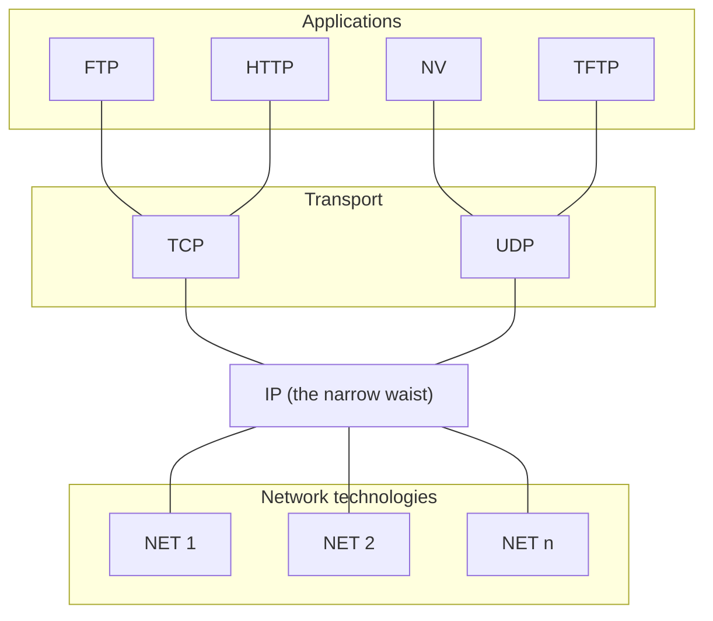

The lines show which protocol runs on top of which; they are not one-way flows.

**Encapsulation.** When an application sends data, each layer wraps it in its own header, like putting a letter in an envelope, then that envelope in a bigger one: the transport layer adds a TCP or UDP header (ports, and for TCP sequence numbers and flags), the network layer adds the IP header (addresses, TTL), and the link layer adds a link header such as an Ethernet frame header (MAC addresses). The receiver removes the headers in reverse order (**decapsulation**).

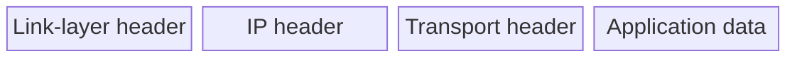

**IP's service is connectionless and best effort.** IP does not set up a connection; each packet (datagram) is handled on its own. It also does not promise delivery. Packets can be **lost**, **delivered out of order**, **duplicated**, or **delayed for a long time**. Protocols above IP, such as TCP, must add reliability when an application needs it.

### 1.2 The IPv4 header

Routing is based on the **destination address**. After the IP header comes the **payload**, which usually starts with a TCP or UDP header. The header is drawn in 32-bit rows. The numbers in brackets are field sizes in **bits**; the drawn block widths are only roughly to scale (the DSCP, ECN and flag blocks in particular are not).

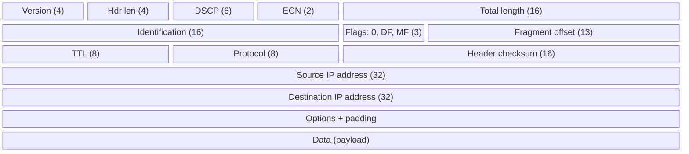

Field by field:

- **Version (4 bits):** 4 for IPv4 (IPv6 also exists).
- **Header length (4 bits):** the header size in 32-bit words, needed because optional fields make the header longer.
- **DSCP (6 bits):** differentiated services (RFC 2474), used for quality of service. Real-time streams such as **Voice over IP** use it; other uses include video conferencing, critical data and bulk transfer.
- **ECN (2 bits, optional, RFC 3168):** lets routers notify the endpoints of congestion **without dropping packets**. It is available only when both endpoints support it and is effective only when the network supports it.
- **Total length (16 bits):** header plus data, from **20 bytes** (a header with no data) up to **65,535 bytes**. Hosts are required to reassemble datagrams of up to **576 bytes**; modern hosts handle much more. Links may impose smaller limits, which forces fragmentation.
- **Identification (16 bits):** identifies the group of fragments belonging to one datagram. It used to be used for packet tracing, but **RFC 6864 now prohibits such use**.
- **Flags (3 bits):** a reserved 0 bit, **DF** and **MF** (see §3).
- **Fragment offset (13 bits):** where this fragment sits in the original datagram (see §3).
- **TTL (8 bits):** decremented at each hop and the packet is discarded at 0. It is mainly used to **break routing loops** (a looping packet cannot live forever), and also for other things such as collecting Internet statistics and managing caching.
- **Protocol (8 bits):** what the payload is: **ICMP = 1, TCP = 6, UDP = 17**.
- **Header checksum (16 bits):** error check over the header only. Routers recompute it because they change the TTL.
- **Source and destination addresses (32 bits each).**
- **Options and padding:** rarely used; padding makes the header a multiple of 32 bits. With options, the header can grow from 20 up to 60 bytes.

You can look at real packets with a packet analyser such as **Wireshark**.

### 1.3 Fragmentation and reassembly

Every network has a **maximum transmission unit (MTU)**. When a datagram is larger than the MTU of the next link, it must be **fragmented**. The strategy:

- Fragment only when necessary (MTU < datagram size). The sender tries to avoid fragmentation.
- **Fragments are self-contained datagrams**, and a fragment can be **fragmented again** further along the path.
- **Reassembly is delayed until the destination host.** Routers in the middle do not reassemble.
- **There is no recovery of lost fragments.** If one fragment is lost, the whole packet must be sent again (all fragments).

**The flag bits.**

- **DF (Don't Fragment):** if DF is set and fragmentation would be needed, the packet is **dropped** and an error goes back to the sender. This is useful, for example, when the target host has no resources to reassemble. The main reason a source sets DF is **Path MTU Discovery (PMTUD)**: a router that cannot forward the packet drops it and returns an ICMP "Fragmentation Needed" message (type 3, code 4); the host then lowers its packet size and tries again. The path MTU can also be found manually with tools like ping or traceroute.
- **MF (More Fragments):** cleared in unfragmented packets. In a fragmented packet, **every fragment except the last has MF = 1**. The last fragment has MF = 0 but a **non-zero offset**, which is how it differs from an unfragmented packet.

**The fragment offset** says where the fragment belongs, measured from the start of the original datagram. The first fragment always has offset 0. The field is 13 bits (0 to 8,191) and counts in **units of 8 bytes**, so fragment data lengths are multiples of 8 and the largest offset is 8,191 × 8 = **65,528 bytes** (65,535 with the header). The **source and destination addresses plus the Identification field** tell the receiver which fragments belong together.

**Worked example.** Host H1 sends to host H8 across four links: Ethernet (H1–R1), FDDI (R1–R2), PPP (R2–R3) and Ethernet (R3–H8). The Ethernet MTU is **1,500 bytes** and the PPP MTU is **576 bytes**.

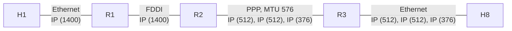

The 1,400 data bytes fit Ethernet and FDDI, but not PPP, so **R2 must fragment** the packet:

| Packet | Ident | MF | Offset field | Data bytes | Position in original data |
|---|---|---|---|---|---|
| (a) original | x | 0 | 0 | 1400 | 0–1399 |
| (b) fragment 1 | x | 1 | 0 | 512 | 0–511 |
| (b) fragment 2 | x | 1 | 64 | 512 | 512–1023 (64 × 8 = 512) |
| (b) fragment 3 | x | 0 | 128 | 376 | 1024–1399 (128 × 8 = 1024) |

The fragments stay separate on the last Ethernet link; only H8 reassembles them. Each fragment gets its own 20-byte IP header, so 512 + 20 = 532 bytes fits the 576-byte PPP MTU.

**Technical clarification.** Also, the default PPP MTU is often 1,500 bytes (about 1,492 bytes of payload in practice). The lecture's example deliberately uses a much smaller PPP MTU of 576 bytes.

## 2. IPv4 addressing and address services

### 2.1 IP addresses: classes, subnets and CIDR

IP addresses are **globally unique** (or made to seem so) and **hierarchical**: a **network** part plus a **host** part. Grouping addresses this way allows **aggregation**, which saves memory in routers and simplifies routing.

**Classful addressing (historical).** Originally, the length of the network part was built into the address. You still hear the names:

- **Class A:** first bit 0, then a 7-bit network number and a 24-bit host part (8-bit prefix, about 16 million hosts per network).
- **Class B:** first bits 10, 16-bit prefix (about 65,000 hosts).
- **Class C:** first bits 110, 24-bit prefix (about 254 hosts).

**The Internet in 1990** had a hierarchical structure with a **single backbone** (NSFNET) connecting regional networks (such as BARRNET, Westnet and MidNet) to which universities and labs were attached.

**Subnetting** adds another level of hierarchy inside an organisation. A **subnet mask** (such as 255.255.255.0 = 24 one-bits followed by 8 zero-bits) splits the host part of, say, a class B address into a **subnet ID** and a **host ID**. Subnet masks define a variable partition of the host part, and **subnets are visible only within the site**.

**CIDR and supernetting.** Today routing uses **Classless Inter-Domain Routing**: a block is written as address + prefix length, for example **171.67.0.0/16**.

- Contiguous blocks of network numbers are assigned to nearby networks (**supernetting**).
- A block is represented by a single pair (first network address, count), with block sizes restricted to **powers of 2**.
- The prefix length is written after a slash. **128.96.34.0/25** means a netmask of 25 one-bits and 7 zero-bits: 0xffffff80 = **255.255.255.128**. **128.96.33.0/24** means netmask **255.255.255.0**.
- **All routers must understand CIDR.**

**Route aggregation example.** The ISP "Fly-By-Night-ISP" has given its customer organisations the blocks 200.23.16.0/23 (Organization 0), 200.23.18.0/23 (Organization 1), 200.23.20.0/23 (Organization 2), …, 200.23.30.0/23 (Organization 7). All of these lie inside **200.23.16.0/20**, so the ISP tells the Internet just one thing: **"Send me anything with addresses beginning 200.23.16.0/20."** Another ISP, "ISPs-R-Us", advertises "Send me anything with addresses beginning 199.31.0.0/16."

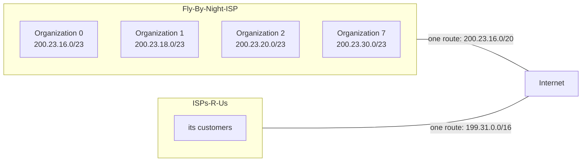

**Connectivity rule.** For each destination address a router must either have the **prefix mapped to a next hop** in its forwarding table, or know a **"smarter router"** to send unknown prefixes to (a **default route**). Routers use **longest prefix match**: if several entries match, the one with the longest prefix wins. The default route is the prefix **0.0.0.0/0**, which matches everything but is the least specific. **Core routers know everything and have no default route.**

**Additional context.** A tiny longest-prefix example: a table has 200.23.16.0/20 → link 1 and 200.23.18.0/23 → link 2. A packet to 200.23.19.5 matches both (it is inside both blocks), and the /23 is longer, so it goes out on link 2. A packet to 200.23.25.1 matches only the /20, so it goes out on link 1.

### 2.2 From IP addresses to hardware addresses: ARP

Two kinds of addresses exist at the same time:

- A **layer-2 (link) address** names a **hardware interface**, for example the wireless Ethernet address 00:26:b0:f9:25:cf.
- A **layer-3 (network) address** names a **host**, for example www06.stanford.edu is 171.67.216.19. (The DNS lecture explains how names map to IP addresses.)

A single host can have **several hardware interfaces**, so several link addresses for one network address. When a node must forward a packet to an IP address, it uses its **routing table** to decide **which hardware interface** to send it out of, and then needs the link address of the destination (or of the next-hop router) on that link.

**ARP (Address Resolution Protocol)** does the translation:

1. Each node keeps a **table of IP-to-link-address bindings**.
2. If the IP address is not in the table, the node **broadcasts a request** on the local network.
3. **Everybody learns** the physical address of the requesting node (because the request was broadcast).
4. The **target machine responds** with its link-layer address.
5. **Table entries are discarded if they are not refreshed.**

**ARP packet for Ethernet and IPv4.** Rows are 32 bits wide; the numbers in brackets are field sizes in bits (block widths roughly to scale).

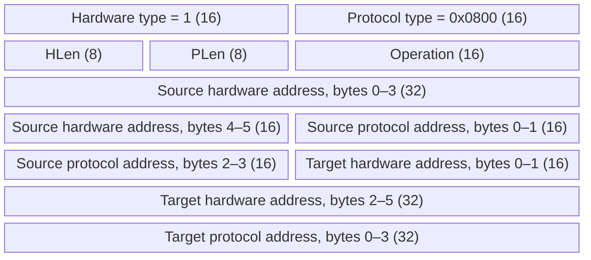

Hardware type 1 means Ethernet; protocol type 0x0800 means IPv4. The operation is 1 for a request and 2 for a reply. In a request, the target hardware address is unknown (it may be all zeros).

**Technical clarification.** The lecture writes "HLen = 48, PLen = 32", which are the address lengths **in bits**. In the actual packet these fields hold the lengths **in bytes**: HLen = 6 for a MAC address and PLen = 4 for an IPv4 address, as the lecture's explanation says.

### 2.3 ICMP: errors and diagnostics

The **Internet Control Message Protocol** handles error messages, diagnostics and control tasks for IP. Examples:

- **Echo (ping):** send a small packet to a target and wait for the reply, measuring the round-trip time.
- **Redirect:** tell a host there is a better route to a destination.
- **Destination unreachable:** a router or host tells the sender that a protocol, port or host is unavailable.
- **TTL exceeded:** so that datagrams do not cycle forever.
- **Checksum failed:** possible data corruption.
- **Reassembly failed:** for example, missing or corrupted fragments.
- **Cannot fragment:** a router cannot split a packet to fit the MTU (DF set).

**Many ICMP messages include part of the packet that triggered them.** An ICMP message travels inside an IP packet with protocol = 1:

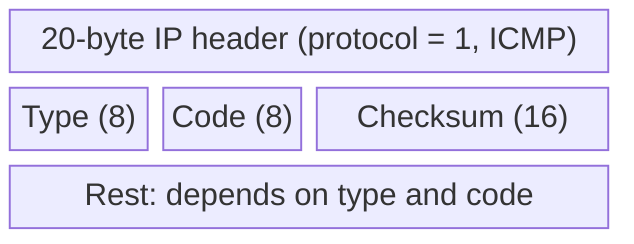

Types include echo, echo reply, destination unreachable, redirect and time exceeded (full list at <http://www.iana.org/assignments/icmp-parameters>). Common type numbers: 0 echo reply, 3 destination unreachable, 4 source quench, 5 redirect, 8 echo request, 11 time exceeded, 13/14 timestamp request/reply. **The code refines the type.** For "destination unreachable": code 0 network unreachable, 1 host unreachable, 2 protocol unreachable, 3 port unreachable, 4 fragmentation needed and DF set.

**Example: Time Exceeded** has type 11, code usually 0 ("TTL exceeded in transit"), an unused 32-bit word, then **the IP header plus the first 8 payload bytes** of the packet that caused it. Those 8 bytes are exactly a **UDP header** (source port, destination port, length, checksum, 16 bits each), which conveniently tells the sender which flow the error belongs to.

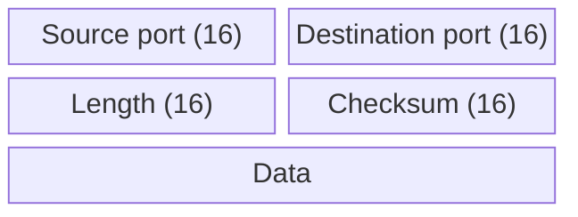

**traceroute versus ping.** *Ping* checks whether a host answers and measures the round-trip time. *Traceroute* (Windows: `tracert`) lists the routers on the path and the round-trip time to each hop; it works by provoking "time exceeded" messages hop by hop. A line showing **"Request timed out"** means that hop did not answer in time. Common reasons: a firewall or filter blocks ICMP, the router is busy or rate-limits ICMP, network configuration or policy, a broken segment, or a misconfigured device. Occasional time-outs are normal; if **every** hop after some point times out, there may be a real problem on the path. Try `tracert google.com` and `ping google.com` yourself.

### 2.4 DHCP: getting an address automatically

Hosts need IP addresses for their interfaces. Assigning them by hand is a pain, so most networks use the **Dynamic Host Configuration Protocol**:

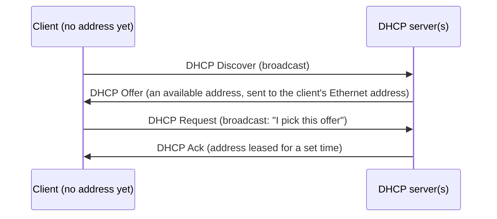

1. **Discover:** the client broadcasts a DHCP discover message.
2. **Offer:** one or more servers answer with an offer containing an available address from their pool. The offer cannot be sent to the offered IP address (the client has not accepted it yet), so it is sent to the **client's Ethernet address** (not broadcast).
3. **Request:** the client picks one offer and **broadcasts** a DHCP request.
4. **Ack:** the chosen server confirms with a DHCP ack.

Besides the address, the server provides:

- the **subnet mask**, so the host can tell whether another host is on the same subnet (talk directly) or not (go through a router);
- the **default gateway**, where traffic for destinations outside the local network goes;
- the **DNS server**, so the host can turn names like www.example.com into IP addresses.

**Leasing.** The address is given for a **lease time**. Near the end of the lease the client tries to **renew** with the same server; if that server cannot be reached it can **rebind** with any available server. A client that leaves or no longer needs the address sends a **release**. (More on lease times: <https://lazyadmin.nl/home-network/dhcp-lease-time/>.) Try `ipconfig` and `ipconfig /all` on Windows to see your own settings.

**DHCP scope.** A scope is the **range of addresses** a server may lease on one subnet, together with settings such as the subnet mask, gateway, DNS servers and lease duration. Scopes can have:

- **exclusions:** addresses never offered, for devices with static addresses;
- **reservations:** fixed addresses for devices that need a consistent one, such as printers or servers;
- **load balancing:** in large networks, several DHCP servers share the work.

## 3. Forwarding, Internet structure and intra-domain routing

### 3.1 Forwarding, switching and source routing

**Forwarding is not routing.**

- **Forwarding** passes packets from an input port to an output port. The router looks up the destination address in its **forwarding table** and finds the out-port, or an ⟨out-port, MAC address⟩ pair.
- **Routing** figures out the **rules** for that mapping: it is the process of **populating the forwarding tables**. Routers exchange messages about the networks they can reach, with the goal of finding the optimal route to every destination (or a good route, or just any route, depending on scale).

IP forwarding works at the **network layer**, not the link layer, so it can forward **between different kinds of networks** (for example Ethernet on one side, a cable-TV wire on the other). It also does required processing on the network-layer header, such as decrementing the TTL.

**The big picture of communication networks.**

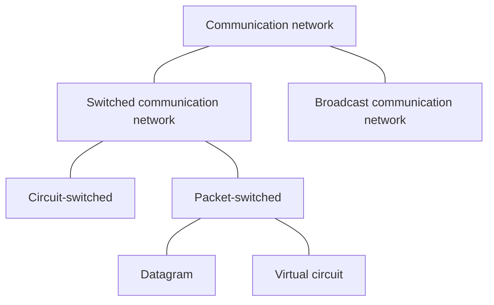

† *The old telephone network (PSTN)* is the classic circuit-switched network: **a telephone number is a program** that sets up a physical wire connection to another phone (old phones used to click while the switches connected). The connection is dedicated to the call until hang-up. The lecture notes that the UK PSTN was to be switched off in December 2025.

**Virtual circuit switching (connection-oriented).**

- An explicit **connection setup (and tear-down) phase** establishes a **virtual circuit identifier (VCI)** on each link.
- Each switch keeps a **VC table** that maps ⟨in-link, in-VCI⟩ → ⟨out-link, out-VCI⟩.
- Later packets follow the established circuit, carrying only the small VCI.
- Technologies such as ATM and Frame Relay used this model.

**Datagram switching (connectionless).**

- **No connection setup.** Switches have a routing table based on **node addresses**.
- **Each packet is forwarded independently**, so packets of one flow may take different paths and arrive out of order. The Internet's IP works this way.

**Comparing the two models.**

| Virtual circuit model | Datagram model |
|---|---|
| − Typically waits a full round-trip time for setup before the first data packet | + No setup delay: send as soon as data is ready |
| + Small per-packet header (just a circuit identifier) | − Larger header: each packet carries all routing information (full address) |
| − If a switch or link on the circuit fails, the connection breaks and must be set up again | + Can automatically route around failures |
| + Setup is a chance to reserve resources | − The source cannot know whether the network can deliver, or whether the destination is up |
| + Packets to the same destination can use different circuits | − All packets to one destination may end up on the same route; load balancing needs more complex forwarding and routing |

**Additional context.** The notes mention two ways datagram networks balance load: **ECMP** (equal-cost multi-path: spread traffic over several equally good paths) and **hash-based** choice of path per flow (so a flow keeps one path and stays in order).

**Source routing** is a simple way to do datagram switching: **the sender decides the whole path** and writes it into the packet as a list of output ports. Each switch reads the next port from the list (in the lecture's picture, the header [3, 0, 1] is rotated at each switch as it is used).

- Pros: the sender has full control (choose or avoid paths for performance, security or policy), custom routes, useful for diagnostics, avoids some bad routing decisions.
- Cons: the sender must know the whole topology; does not scale; can be abused by attackers; inflexible when the network changes; poor decisions when the sender lacks information.

In IPv4, source routing exists as header options: **Loose Source and Record Route (LSRR, option 131 = 0x83)** lists routers that must be visited, not every hop; **Strict Source and Record Route (SSRR, option 137 = 0x89)** gives the exact path. Both carry a list of IP addresses and a pointer to the next one. **In practice source routing is deprecated and blocked** for security and performance reasons.

### 3.2 Internet structure and autonomous systems

**The Internet today** has **multiple backbones** run by backbone service providers, joined at **peering points**. Large corporations connect directly to backbone providers; "consumer" ISPs and small corporations connect through them. CAIDA's "IPv4 and IPv6 AS Core" pictures show the ASes by location, their customer-cone sizes and links; from 2017 to 2020 the customer cones of the largest ASes grew. (An AS's **customer cone** is the set of ASes it can reach by going down through customers.)

**Autonomous systems (ASes)** correspond to **administrative domains**. The Internet is not one network but a network of networks, and ASes reflect its organisation (for example Stanford or a large company). ASes want to:

- choose **their own local routing algorithm**, and
- set **policies about non-local routing**.

Each AS is given a unique AS number (originally 16 bits; later extended to 32 bits).

**Two-level route propagation.** Routing is managed with two levels:

- an **interior gateway protocol (IGP)** inside each AS (each AS selects its own standards and policies);
- an **exterior gateway protocol (EGP)** between ASes (an Internet-wide standard: BGP).

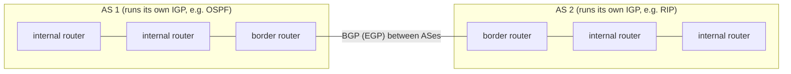

**Types of traffic and of AS.**

- **Local traffic** has its source or destination inside the AS. **Transit traffic** only passes through it.
- A **stub AS** connects to only one other AS.
- A **multihomed AS** connects to several ASes but **carries no transit traffic**.
- A **transit AS** connects to several ASes **and carries transit traffic**.

**Intra-domain routing** happens under a single administrative control, so **optimality is important**. Between ASes, **policy dominates** (see Part B).

### 3.3 Intra-domain routing: link state and distance vector

#### Routing as a graph problem

Properties of routing algorithms:

- **Global or decentralized.** In a global algorithm all routers know the complete topology; in a decentralized one they know only their neighbours and what the neighbours tell them.
- **Intra-domain or inter-domain.** Intra-domain: all routers under the same administrative control, scaling to about 100 networks (for example a campus like Stanford). Inter-domain: decentralized, scaling to the whole Internet.

**Optimality.** View the network as a **graph** and give each edge a **cost**, which can be based on latency, bandwidth, utilisation, queue length, and so on. The problem is to **find the lowest-cost path between two nodes**. Traditionally each node computes the costs itself; some recent research argues against doing this, because purely local optimisation can hurt the system as a whole.

The two classes of intra-domain algorithms:

| Link state | Distance vector |
|---|---|
| Global view of the network | Only local state (less overhead, smaller footprint) |
| Simpler to debug | Harder to debug |
| Requires global state (OSPF reduces this with areas) | Can suffer from loops |
| Example: OSPF | Example: RIP |

#### Link state and reliable flooding

**Strategy:** send information **to all nodes** (not just neighbours), but only about **directly connected links** (not the whole routing table). Each router builds the full map from everybody's pieces.

A **Link State Packet (LSP)** contains:

- the **ID** of the node that created it;
- the **cost of the link to each directly connected neighbour**;
- a **sequence number (SEQNO)**;
- a **time-to-live (TTL)** for the packet.

**Reliable flooding:**

1. Store the most recent LSP from each node.
2. Forward an LSP to all neighbours except the one it came from.
3. Generate a new LSP periodically, incrementing SEQNO.
4. Start SEQNO at 0 after a reboot. If you hear **your own** packet with SEQNO = *x*, set your next SEQNO to *x* + 1 (so your new LSPs beat the old ones still in the network).
5. Decrement the TTL of each stored LSP and **discard it when the TTL reaches 0**.

The best path is then calculated with **Dijkstra's shortest-path algorithm**.

#### Dijkstra's shortest-path algorithm †

**Graph abstraction.** *G* = (*N*, *E*), with routers *N* = {u, v, w, x, y, z}. *c*₍ₐ,ᵦ₎ is the cost of the direct link between *a* and *b*, for example *c*(w,z) = 5, and *c*(u,z) = ∞ because u and z are not directly connected. The operator defines costs: always 1, or inversely related to bandwidth, or related to congestion or delay.

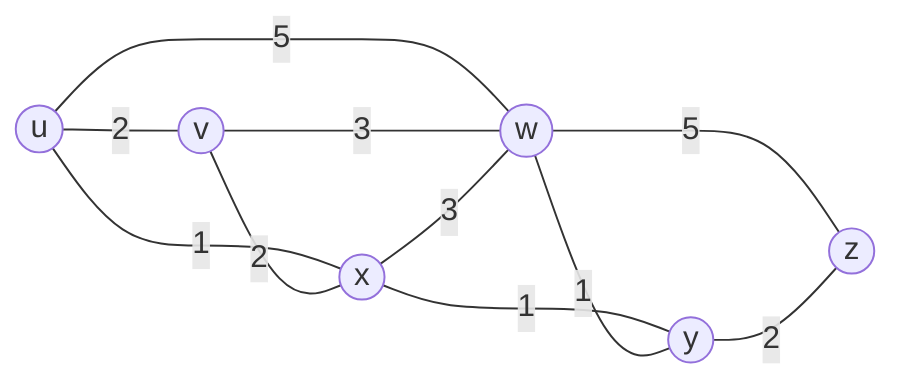

**Technical clarification.** The lecture's list of links *E* leaves out (u, w), although its picture (and the Dijkstra table, where D(w) starts at 5 via u) contains a u–w link of cost 5. The diagram above follows the picture.

Dijkstra's algorithm is **global**: all nodes know the topology and link costs (thanks to the link-state broadcast), so all have the same information. It computes least-cost paths from one **source** to all other nodes, giving that node's forwarding table. It is **iterative**: after *k* iterations, the least-cost paths to *k* destinations are known.

Notation: *D*(v) is the current estimate of the least cost from the source to v; *p*(v) is the predecessor of v on that path; *N*′ is the set of nodes whose least-cost path is definitely known.

```text
1  Initialization:
2    N' = {u}                     /* compute least-cost paths from u to all other nodes */
3    for all nodes v
4      if v adjacent to u         /* u initially knows only direct costs to neighbours */
5        then D(v) = c(u,v)       /* but they may not be minimum! */
6        else D(v) = ∞
8  Loop
9    find a not in N' such that D(a) is a minimum
10   add a to N'
11   update D(b) for all b adjacent to a and not in N':
12     D(b) = min( D(b), D(a) + c(a,b) )
         /* new cost to b is the old cost, or the known cost to a plus the link a–b */
15 until all nodes in N'
```

Running it from u on the graph above:

| Step | N′ | D(v), p(v) | D(w), p(w) | D(x), p(x) | D(y), p(y) | D(z), p(z) |
|---|---|---|---|---|---|---|
| 0 | u | 2, u | 5, u | 1, u | ∞ | ∞ |
| 1 | ux | 2, u | 4, x | | 2, x | ∞ |
| 2 | uxy | 2, u | 3, y | | | 4, y |
| 3 | uxyv | | 3, y | | | 4, y |
| 4 | uxyvw | | | | | 4, y |
| 5 | uxyvwz | | | | | |

Each row shows the estimates **after** the node named last in N′ was added; the smallest estimate in a row is the node added in the next row. For example, at step 1 x joins N′ (D(x) = 1 was the smallest), and then w improves from 5 to D(x) + c(x,w) = 1 + 3 = 4 and y from ∞ to 1 + 1 = 2. At step 2, v and y tie at cost 2; the lecture adds y first (either choice gives the same final costs). Adding y improves w to 2 + 1 = 3 and z to 2 + 2 = 4.

**Result.** Trace the predecessors back to build the **least-cost-path tree** from u, then the **forwarding table**: to reach **v**, use link **(u, v)**; to reach **every other destination** (x, y, w, z), use link **(u, x)**.

#### Distance vector and the Bellman-Ford equation †

**Distance vector** is a **distributed** routing algorithm.

- Each node keeps triples **(Destination, Cost, NextHop)**.
- It exchanges updates **with direct neighbours only**: periodically (every few seconds to minutes) and whenever its table changes (a **triggered update**).
- Each update is a list of **(Destination, Cost)** pairs.
- A node updates its table when it hears a **better** route (smaller cost, or from a newly connected neighbour). Existing routes are refreshed, and **deleted if they time out**.

It is based on the **Bellman-Ford equation** (dynamic programming). Let *Dₓ*(y) be the cost of the least-cost path from x to y. Then

**Dₓ(y) = minᵥ { c(x,v) + Dᵥ(y) }**, taking the minimum over all neighbours v of x.

In words: any best path from x must leave through some neighbour v, so try every neighbour and keep the cheapest "link to v + v's own cost to y".

**Example.** Node u has neighbours v, x and w with link costs 2, 1 and 5. They report *D*ᵥ(z) = 5, *D*ₓ(z) = 3, *D*w(z) = 3. Then
*D*ᵤ(z) = min{2 + 5, 1 + 3, 5 + 3} = **4**, and the neighbour achieving the minimum, **x**, is the next hop towards z.

**The algorithm.** From time to time each node sends its own distance-vector estimate to its neighbours. When x receives a new estimate from a neighbour, it updates its own vector with *Dₓ*(y) ← minᵥ{c(x,v) + Dᵥ(y)} for each destination y. Under minor, natural conditions the estimates converge to the actual least costs. It is:

- **iterative and asynchronous:** each local iteration is caused by a local link-cost change or a DV update message from a neighbour;
- **distributed and self-stopping:** a node notifies its neighbours only when its vector changes, and they notify theirs only if necessary; with no notifications, nothing happens.

Each node loops: **wait** (for a link-cost change or a message) → **recompute** the estimates → **if any distance changed, notify neighbours**.

**Three-node example.** Links x–y cost 2, y–z cost 1, x–z cost 7. Initially each node knows only its direct costs; x's table has its own row (0, 2, 7) and unknown (∞) rows for y and z. After receiving y's and z's vectors, x computes:

- *Dₓ*(y) = min{c(x,y) + *D*ᵧ(y), c(x,z) + *D*_z(y)} = min{2 + 0, 7 + 1} = **2**;
- *Dₓ*(z) = min{c(x,y) + *D*ᵧ(z), c(x,z) + *D*_z(z)} = min{2 + 1, 7 + 0} = **3**.

After the exchanges settle, all three tables agree: from x (0, 2, 3), from y (2, 0, 1), from z (3, 1, 0). The direct x–z link of cost 7 is never used, because going through y costs only 3.

#### Loops and counting to infinity

Distance vector uses only **local information**, which makes it vulnerable to loops. The lecture's example network has the links A–B, A–C, A–E, A–F, B–C, C–D, D–G and F–G.

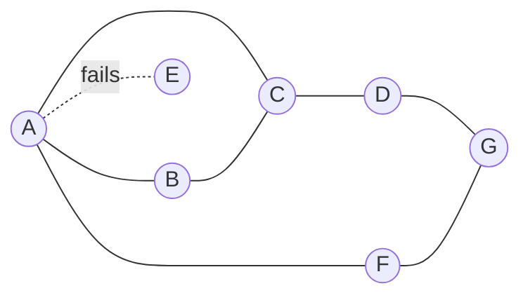

**Counting to infinity.** The link from A to E fails.

1. A advertises a distance of **∞** to E.
2. But B and C (which reached E through A) have just advertised a distance of **2** to E.
3. B decides it can reach E in **3** hops (through C) and advertises this to A.
4. A decides it can reach E in **4** hops (through B) and advertises this to C.
5. C decides it can reach E in **5** hops… and so on, upward forever.

**How to avoid loops.**

- The **IP TTL** field stops a packet from living forever, but it **does not break or repair** the routing loop.
- **Treat a small cost as infinity**, for example 16: after a bounded number of rounds the node decides the destination is unavailable. But rounds can be long, so this takes time.
- **Split horizon:** when sending updates to node A, **do not include destinations you route to through A**. In the example, this stops B and C from sending cost 2 to A.
- **Split horizon with poison reverse:** when sending updates to A, **explicitly include a very high cost ("poison", ∞)** for destinations you route through A. The poison reverse example in the lecture: B tells C "E: 2", so C records "B says E is at 2"; after the failure B's advertisement becomes "E: ∞", and C records "B says E is at ∞".

**Additional context : when does poison reverse help?.** It prevents loops between **two** neighbours (B will never route to E through A while A routes through B). It does **not** prevent loops through **three or more** routers. In the triangle A–B–C above, C can still offer B a route to E that secretly goes through A, and the three can still count to infinity until the bound (such as 16) is reached.

**Adapting to failures (another example on the same graph).** The link F–G fails.

1. F detects the failure, sets its distance to G to ∞ and sends an update to A.
2. A sets its distance to G to ∞, since it used F to reach G.
3. A receives a periodic update from C with a **2-hop** path to G (C–D–G).
4. A sets its distance to G to **3** and sends an update to F.
5. F decides it can reach G in **4** hops via A.

Here the network finds the new correct route quickly because a real alternative exists.

#### Distance vector versus link state

- **Number of messages:** LS needs **O(*n* · *d*)** for *n* nodes. DV's convergence time varies but is **Ω(*d*)**.
- **Rounds until convergence:** LS **O(*n*²)**. DV **could count all the way to ∞** if a loop exists. The course later studies a **self-stabilizing version that takes only Θ(*d*) rounds**.
- **Robustness to a malfunctioning router:** in LS a node can advertise an incorrect **link** cost; in DV a node can advertise an incorrect **path** cost, and because others use these costs, **errors propagate through the network**.

**Technical clarification.** The lecture defines *d* as "the number of neighbours of a node", while the lecture's explanation calls *d* "the network diameter". For the self-stabilizing Θ(*d*) bound, the diameter reading fits what the course shows later (the self-stabilizing BFS spanning-tree algorithm stabilizes in a number of cycles proportional to the diameter).

#### RIP †

**Intra-domain routing protocols:** **RIP** (Routing Information Protocol) is a fairly simple implementation of DV, specified in **RFC 2453** (38 pages), and was **made self-stabilizing by Radia Perlman**. **OSPF** (Open Shortest Path First) is a more complex link-state protocol that adds **areas** for scalability (RFC 2328).

**RIPv2 [RFC 2453]:**

- runs over **UDP port 520**;
- limits networks to **15 hops (16 = ∞)**;
- depends on **count to infinity** to deal with loops;
- supports **split horizon** and **poison reverse**;
- RFC 1812 specifies which options routers should or must have.

**RIPv2 packet format** (sizes in bytes):

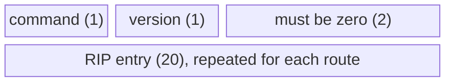

**Each 20-byte RIP entry:**

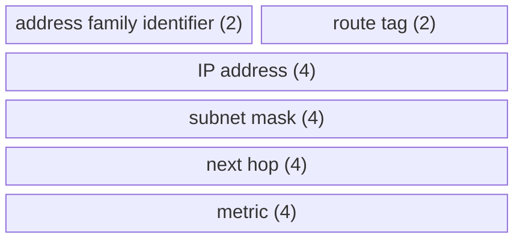

- The **route tag** lets RIP nodes distinguish internal from external routes; it must persist across announcements, and can for example encode the AS.
- The **next hop** lets one router advertise routes on behalf of several routers on the same subnet, and can redirect a RIP neighbour to a better path.
- The **metric** is the hop count.

#### OSPF †

**OSPFv2 [RFC 2328]:** a link-state protocol (RFC 2328 is 244 pages) that

- runs **directly over IP (protocol 89)**, so it has to provide its **own reliability**;
- **authenticates all exchanges**;
- adds **areas** for scalability.

**Hierarchical OSPF** has two levels: **local areas** and a **backbone**.

- Link-state advertisements are flooded **only within an area**, or within the backbone.
- Each node has the detailed topology of its own area, and only knows the **direction** to reach other destinations.
- **Area border routers** summarize distances to destinations in their own area and advertise them in the backbone.
- **Local (internal) routers** flood link state in their area only, compute routing within the area, and forward packets for the outside to an area border router.
- **Backbone routers** run OSPF limited to the backbone. A **boundary router** connects to other ASes.

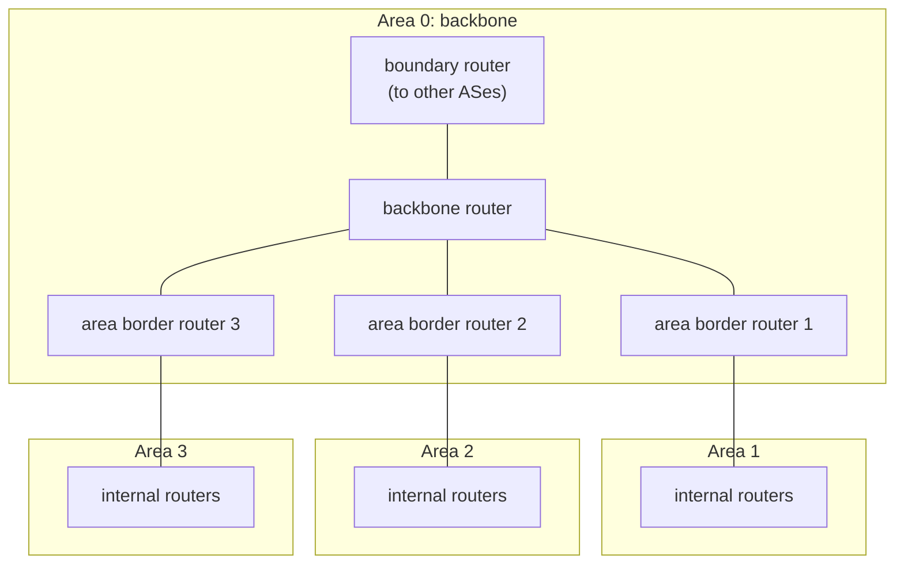

**OSPF areas:** **area 0 is the backbone** (it includes all boundary routers). **Traffic between two areas always goes through area 0.** A router only needs to know how to route exactly within its own area; otherwise it just routes to the right area. **Virtual links** can let distant routers be part of area 0.

**OSPF packet header** (fields from the lecture; the widths are from RFC 2328):

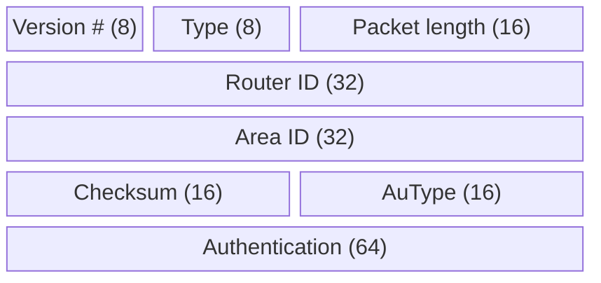

(The authentication field is 64 bits, so it spans two 32-bit rows; it is drawn as one block.)

**OSPF packet types:**

1. **Hello:** establish and maintain adjacency, checking neighbours are reachable and working.
2. **Database Description (DD):** a summary of the router's link-state database with a sequence number, used to synchronize databases.
3. **Link State Request:** ask for specific LSAs that are missing.
4. **Link State Update:** carry LSAs about topology changes (new routers, link changes, failures).
5. **Link State Acknowledgment:** confirm receipt of updates, making flooding reliable.

**Link-state information exchange, step by step:**

1. **Discover neighbours** with Hello packets; become neighbours if the Hello parameters (area ID, hello interval, etc.) match.
2. **Exchange LSAs** (router ID, direct links, their cost and status) with neighbours.
3. **Flood LSAs** to neighbours in the same area, forwarding arriving LSAs, using reliable flooding: every LSA is acknowledged and is sent only once unless something changes.
4. **Update the link-state database (LSDB)** with arriving LSAs, until each router has a complete view.
5. **Detect changes:** when a link goes up or down, generate a new LSA and flood it.
6. **Age and refresh:** LSAs have an age field; refresh them periodically and remove stale ones.

**Database Description packet:** interface MTU, options (multicast, external LSAs, etc.), the bits **I** (init), **M** (more) and **MS** (master/slave), a **DD sequence number**, then LSA headers (20 bytes or more each).

**DD exchange** (initializing the routing state):

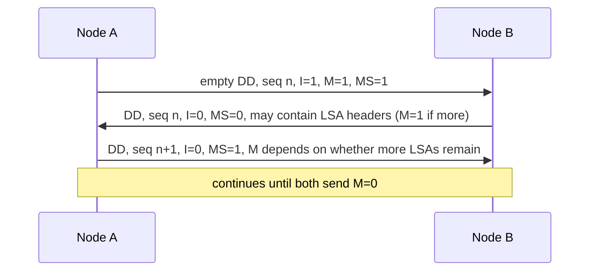

---

# Part B: Beyond EDA344

From here on the material is new compared with the introductory course: **inter-domain routing and routing security** (RPKI, ROV, ASPA and BGP pathologies).

## 4. Inter-domain routing with BGP

### 4.1 Why a separate inter-domain protocol?

Why not use OSPF everywhere, for example with hierarchies of OSPF areas? **Scaling is not the only limitation.**

- **BGP is a policy control and information hiding protocol.** Inside an AS, all routers are trusted; between ASes, they are not: **intra = trusted, inter = untrusted.**
- Inside an AS you **optimise a metric**; between ASes you **enforce a business relationship**. Every pathology in this lecture follows from that difference.
- There are about **75,000 active ASes** and **no central authority** over what any of them announces. Each AS independently decides what to advertise and what to believe. There is **no global view**: every router sees a different Internet. **Shortest path is not the goal; policy is.**

**Why study BGP?** It is the critical protocol that makes the Internet run, the only widely deployed EGP, and an active area of problems: efficiency, the Cogent versus Level3 Internet partition, Pakistan accidentally taking down YouTube, and spammers using prefix hijacking.

**History.**

- 1989: BGPv1, "directional" routing [RFC 1105]
- 1990: BGPv2, a bunch of incompatible changes [RFC 1163]
- 1991: BGPv3, resolves connection "collisions" [RFC 1267]
- 1994: BGPv4 proposed [RFC 1654]
- 1995: BGPv4 actual, with **CIDR support** [RFC 1771]
- Latest BGPv4 specification: [RFC 4271]
- More: application of BGP in the Internet [RFC 1772], experience with BGPv4 [RFC 1773], protocol analysis [RFC 1774].

### 4.2 BGP basics

**High-level view.**

- ASes participate in the EGP and are assigned an AS number (**originally 16 bits, now 32** [RFC 4893]).
- Each AS is **abstracted to a single node**.
- ASes exchange **prefix reachability** with all neighbours, for example "I can reach prefix 171.67.0.0/14 through ASes 15444, 3549, 174, 46749 and 32".
- Each AS **selects a single path by routing policy**. Critical: **learn many paths, propagate only one!**
- Each AS **adds its own ASN** to the paths it advertises.

**BGP state.** A BGP speaker conceptually keeps three sets of routes:

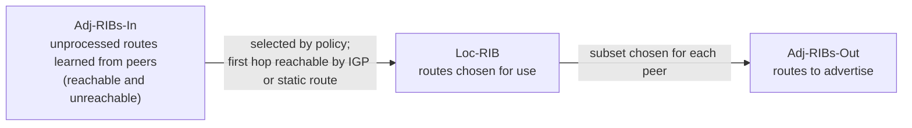

Adj-RIBs-In keeps unreachable routes too, in case they later become reachable and can be added to the Loc-RIB.

**Implications of BGP's design.**

- **An explicit AS path makes routing loop-free** (a router rejects a path that already contains its own AS), except under churn, IGP/EGP mismatch and similar situations.
- Not all ASes know all paths.
- The AS abstraction loses efficiency: the **shortest AS path is not guaranteed** (and a short AS path may hide many router hops).
- Scaling: the lecture cites 32K ASes and 300K+ prefixes (older figures; compare the ~75,000 ASes above).

**Where does Chalmers sit?** Chalmers is **AS2841**, with **one upstream and no downstreams**: a **stub AS**. Its path to the world is **AS2841 → AS1653 (SUNET) → AS2603 (NORDUnet) → the commercial Internet**. Göteborgs universitet is **AS2842**, a sibling customer of SUNET, so traffic between the two universities goes **up to SUNET and back down**. SUNET has **44 peers and 1 upstream**, so most of its traffic leaves through **peering, not paid transit**. The lesson: **policy follows topology, not invoices.** (The BGP relationship is customer/provider no matter how the money moves; SUNET is publicly funded, not a commercial transit contract.)

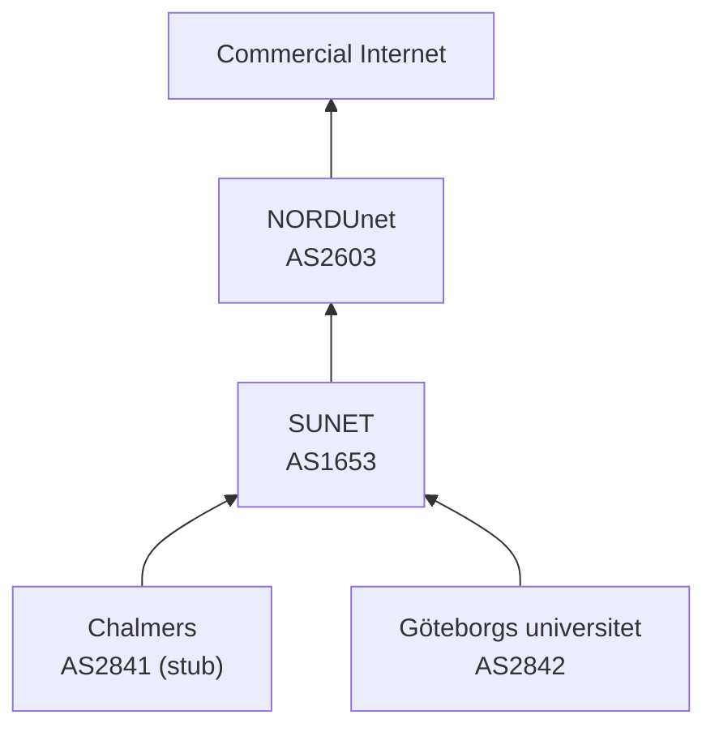

Arrows point from customer to provider.

**Demo: trace the path yourself.**

- `traceroute -A -q 1 www.gu.se` (Linux; on macOS and BSD the flag is `-a`). `-A` looks up the AS of each hop; `-q 1` sends one probe per hop.
- `mtr -z -c 10 --report www.gu.se` is nicer and live. Windows `tracert` has no AS lookup; use WinMTR.
- `curl -s https://ipinfo.io/json` shows which AS you are in right now.
- Expect **AS2841 → AS1653 → AS2842**. Hops showing `* * *` are **ICMP filtering, not failure**. A short path to a large site means **peering, not proximity**. Adding `-6` traces over IPv6, and the path may differ.

### 4.3 BGP messages, attributes and route selection

**Protocol details.** Border routers connect over **TCP port 179** and exchange messages in both directions over a long-lived connection. The base protocol has **four message types**:

1. **OPEN:** initialize the connection; identifies the BGP peers and must be the first message in each direction.
2. **UPDATE:** announce routing changes (the most important message).
3. **NOTIFICATION:** announce an error when closing the connection.
4. **KEEPALIVE:** make sure the peer is alive.

Extensions can add more types, for example ROUTE-REFRESH [RFC 2918].

**Anatomy of an UPDATE.**

- **Withdrawn routes:** a list of IP prefixes that are no longer reachable.
- **Network Layer Reachability Information (NLRI):** the list of prefixes the path attributes apply to.
- **Path attributes:** ORIGIN, AS_PATH, NEXT_HOP, MULTI_EXIT_DISC, LOCAL_PREF, ATOMIC_AGGREGATE, AGGREGATOR, …. Each attribute has a **1-byte type, 1-byte flags and a length**. New attribute types can be introduced; for example **AS4_PATH** carries 32-bit AS numbers instead of the old 16-bit ones.

**An advertisement**, for example: NLRI **171.67.0.0/14**, AS path **15444 3549 174 46749 32**, and a **next-hop IP** (just like in RIPv2). There are many **knobs for traffic engineering** (metric, weight, local preference, MED, communities): "lots of voodoo".

**Route selection.** When several routes to the same prefix are available, a router goes down this list until one route wins:

1. Is the **next hop reachable**? If not, the route is unusable.
2. Prefer the highest **weight** (computed by some AS-specific local policy).
3. Prefer the highest **LOCAL_PREF**.
4. Prefer **locally originated** routes.
5. Prefer the **shortest AS path**.
6. Prefer the lowest **origin type** (IGP before EGP before incomplete).
7. Prefer the lowest **MED**, but MEDs can only be compared between routes **from the same AS**.
8. Prefer **eBGP over iBGP**.
9. Prefer the route with the **lowest cost to the egress point** ("hot-potato routing").
10. **Tie-breaking rules**, for example the lowest router ID or the oldest route.

**Technical clarification.** The lecture explains hot-potato routing as "packet routing without storing packets in buffers". That is the meaning of the term in switch design (deflection routing). In BGP route selection, hot-potato routing means **handing traffic to the nearest exit point of your own AS**, getting rid of it as quickly as possible, which is what "lowest cost to egress point" expresses.

**External versus internal BGP.** With only one router per AS, every BGP session is between ASes (**eBGP**). Real ASes have **multiple peering points** and several border routers. **iBGP** runs between routers of the same AS to keep the AS consistent, so that all its border routers agree on the routes learned from outside.

```mermaid
flowchart LR
    subgraph AS2["AS 2"]
        R2a["border router"] -.-|"iBGP"| R2b["border router"]
    end
    subgraph AS3["AS 3"]
        R3a["border router"] -.-|"iBGP"| R3b["border router"]
    end
    R2a ---|"eBGP"| R3a
    R2b ---|"eBGP"| R3b
```

### 4.4 AS relationships: customers, providers and peers

**Customer/provider.** **Customers pay for connectivity**, for example Stanford pays Cogent. The customer is a stub, the provider a transit AS. The amount and cost structure vary wildly. Many customers are **multi-homed** (Stanford also connects to CalREN/Internet2). **Typical policy: prefer routes learned from customers** (they bring in money).

**Peers** agree to **exchange traffic for free**, with penalties or renegotiation if the traffic becomes unbalanced. **Tier-1 ISPs have no default route: they all peer with each other.** You are **Tier *i* + 1** if you have a default route to a Tier *i* provider.

**Additional context : the valley-free rule.** From these relationships follows the rule the lecture uses later: **a route learned from a provider or a peer is advertised only to customers**, never to another provider or peer. A legitimate AS path therefore climbs up through providers, crosses at most one peer link at the top, and then goes down through customers; it never climbs again after going down (no "valley"). Advertising more widely would mean offering free transit.

**BGP relationship drama: Cogent versus Level3 (self-study).** Level3 and Cogent were peers. In 2005 Level3 decided to start charging Cogent; Cogent said no. The result was an **Internet partition**: Cogent's customers could not reach Level3's customers and vice versa, and other ISPs were affected too. Three weeks later they reached a new, undisclosed agreement.

## 5. Routing security and BGP problems

### 5.1 Routing security

**BGP trusts everyone.** BGP has **no native origin authentication**: **any AS can announce any prefix**, and its neighbours have no protocol-level way to check. This was a design-era assumption, not a bug: the original operators knew each other personally and fixed mistakes by telephone. **Everything that follows is retrofitted** onto a protocol that assumes cooperation. (DNS has the same story, as the next lecture shows.)

**Anatomy of a hijack: YouTube, February 2008.**

1. Pakistan Telecom was ordered to block YouTube inside Pakistan. It announced a route for YouTube's address space into its own network, pointing to nowhere.
2. YouTube announced **208.65.152.0/22**; Pakistan Telecom announced **208.65.153.0/24**, a smaller block inside it.
3. The announcement **leaked** to its upstream provider and into the **global routing table**.
4. **The more specific prefix wins** (longest prefix match, before any policy comparison), so routers everywhere sent YouTube traffic to Pakistan Telecom. **YouTube was unreachable worldwide for about two hours.**
5. **No component failed.** Every router did exactly what BGP specifies. **Correctness of each participant does not imply correctness of the system.**

*Check yourself (from the lecture):* if Pakistan Telecom had announced the same /22 instead of a /24, would the outcome have been the same? (Hint: with equal prefix lengths, BGP's route selection, such as AS-path length and local policy, decides, so only part of the Internet would have chosen the false route.)

† An older, archived version of the lecture tells the same story with different details: the Pakistani ISP **PieNET** advertised **208.65.152.0/23 and 208.65.152.128/23**, and it adds that spammers steal unused IP space to hide (Feamster), asks why someone would advertise very short prefixes, and says that secure BGP is "in the works".

**Technical clarification.** The two YouTube versions disagree. The visible version (Pakistan Telecom announcing 208.65.153.0/24) matches the well-documented account of the incident. The archived version's "208.65.152.128/23" cannot be a valid /23 block (a /23 must start at an even third octet with .0), so treat the visible version as correct.

**Hijacks are not the only failure: route leaks.**

- **Hijack:** announcing a prefix **you do not hold** (false origin).
- **Leak:** propagating a route **beyond its intended scope**. The origin is **genuine**; what is violated is the **valley-free** policy. Typical cause: a multi-homed customer re-announces routes learned from one provider to another provider, and suddenly a small network appears to offer transit between two large ones; a link sized for one customer receives inter-provider traffic.
- RFC 7908 lists **six distinct leak types**.
- **Different failure, different fix:** origin authentication does not help against leaks, because nothing about the origin is false.

**RPKI: a trust structure for addresses.** The **Resource Public Key Infrastructure** issues **certificates binding address resources to their holders**. It is **anchored at the five RIRs** and follows the allocation hierarchy (IANA → RIRs → local registries and end users). A resource certificate contains no name or e-mail, only "the holder of this key controls these number resources". It has the same shape as **DNSSEC's chain of trust**, but a different root problem: DNSSEC has one root key, RPKI has **five roots** with no common parent.

**ROAs: what gets asserted.** A **Route Origin Authorisation** is a signed statement binding a **prefix → origin AS**, with a **maxLength**. It is profiled in **RFC 9582** (which obsoletes RFC 6482). Verifying a ROA means checking its certificate chain up to an RIR trust anchor. **A ROA says nothing about the path, only who may originate.**

*Example:* a ROA for 192.0.2.0/22 with maxLength 24 authorises AS 64500 to originate 192.0.2.0/22 and any more-specific prefix down to /24.

*Check yourself (from the lecture):* an AS holds 203.0.113.0/24 and announces it from two different AS numbers, one per site. How many ROAs does it need? (Two: a ROA names one origin AS, so each origin needs its own.)

**The maxLength trap.**

1. An operator holds 192.0.2.0/22 and announces exactly that, but sets **maxLength 24** "in case we need /24s later".
2. An attacker announces **192.0.2.0/24** with the forged origin **AS 64500** (forging the origin AS costs nothing; it is an unsigned attribute).
3. A validating router checks: inside 192.0.2.0/22, length 24 ≤ maxLength 24, origin matches → **Valid**.
4. Being more specific, the attacker's /24 **wins everywhere** it spreads.

**RFC 9319:** use the **minimal maxLength** (the length you actually announce) and prefer explicit ROAs. *A security mechanism misconfigured for convenience became a vulnerability.*

**Route Origin Validation (ROV, RFC 6811).** Each received announcement is scored:

- **Valid:** a ROA covers the prefix, the length is within maxLength, and the origin AS matches.
- **Invalid:** a ROA covers the prefix, but the origin AS does not match or the length exceeds maxLength.
- **NotFound:** no ROA covers the prefix. **NotFound is not "bad"**; it only means the holder has not published a ROA (true for about a third of the address space).

Validation is not binary, and **the default matters**: the operator decides whether to **drop** Invalid routes (strong, increasingly common) or merely **de-preference** them (weaker: use them only when no other route exists).

**The gap between signing and checking** (figures from the lecture; they change over time, so re-check at bgp.he.net and stats.labs.apnic.net):

- ROA coverage of announced prefixes: a record **~67.4 %** (Hurricane Electric, 29 June 2026).
- ASes with full ROV protection: **about 12.3 %**. Not validating at all: **about 36.2 %** (RIPE Labs, 2026).
- **Signed ≠ checked.** A signed prefix protects you only against neighbours who check.

**What ROV cannot do.** Origin validation authenticates **only the last AS in the path** (the rightmost, the origin). The rest of the **AS_PATH is unsigned**, so any intermediate AS can forge it. *Example:* an attacker AS 64666 announces 192.0.2.0/24 (legitimately originated by AS 64500, with a correct ROA) with AS_PATH "64666 64500", claiming "I have a path to the origin". ROV sees origin 64500, finds the ROA, and says **Valid**, even though 64666 may have no connection to 64500 at all.

**ASPA: validating the path.** Signing the whole path (BGPsec) is possible in principle but needs per-announcement cryptography at line rate and helps only where every AS on the path deploys it, so deployment has been minimal. **ASPA** is cheaper:

- Each AS publishes a signed object **listing its legitimate providers**.
- A router can then test a received AS_PATH against the valley-free shape. If the path implies that some AS passed a route from one of its providers to another provider, the path is impossible: it is **forged, or a leak**.
- So ASPA **catches leaks, not just hijacks**. (In the example above, AS 64500's ASPA does not list 64666 as a provider, so the forged path fails.)
- In production: **RIPE NCC and APNIC since November 2025, ARIN since January 2026**; all RIRs expected by the end of 2026.

**ASPA in practice.** Published ASPA objects covered **well under 1 % of ASNs** (February 2026): standardised, supported by registries, but not yet used. Learn to tell apart three states, which students routinely confuse:

1. **Specified:** the design exists as a document.
2. **Available:** the infrastructure exists, so an operator who wants to can use it.
3. **Adopted:** enough networks actually use it for it to work.

ASPA is at "available"; RPKI origin validation is between available and adopted (signing widespread, checking not); BGP itself is fully adopted, which is exactly why it is so hard to replace.

**Partial deployment is its own problem.** What happens in an Internet where **12 % validate and 88 % do not**? Neither the "no deployment" nor the "full deployment" analysis applies. A hijacked route is dropped by validating ASes and accepted by the rest, so the same prefix is **reachable from some places and hijacked from others**, depending on topology (who your neighbours are) rather than on adoption counts. Dropping invalid routes also shifts traffic paths in ways nobody planned. **Security mechanisms have their own convergence properties**: a security mechanism is a distributed system in its own right.

### 5.2 BGP problems: convergence, stability and wedgies

BGP's problems and the usual responses:

- **Security** (above).
- **Convergence.**
- **Scaling:** route reflectors.
- **Traffic engineering:** AS prepending (repeating your own AS number to make a path look longer and less attractive).
- **Multiple stable solutions:** BGP "wedgies".

**Convergence.** Given a change, how long until the network re-stabilizes? It depends on the change, and **sometimes it never does**. It is an open research problem ("tweak and pray"), and the distributed setting is hard. Even the easier question, **"does a stable configuration exist?"**, is **NP-complete** [Griffin 1999].

**Stability.** Stable routes are often preferred over rapidly changing ones:

1. **Management:** a transient problem is hard to debug.
2. **Higher-layer optimisations:** for example TCP's round-trip-time estimation suffers if the route keeps alternating between a 500 ms path and a 50 ms path.

There is a **tension between optimality and stability**.

**BGP wedgies [RFC 4264].** A common configuration is:

1. **prefer customer routes over non-customer routes**, then
2. **prefer the shortest AS path**.

This can lead to **more than one stable outcome**. The lecture's example: AS 1 owns 1.2.0.0/16 and is connected to AS 5 (primary link) and AS 2 (backup link). The other ASes form a chain AS 2 – AS 3 – AS 4 – AS 5. AS 1 marks the backup by **prepending**: it announces "1.2.0.0/16: AS 1 1 1 1" to AS 2 and "1.2.0.0/16: AS 1" to AS 5.

```mermaid
flowchart LR
    AS1["AS 1<br/>1.2.0.0/16"] ---|"primary: AS 1"| AS5["AS 5"]
    AS1 ---|"backup: AS 1 1 1 1"| AS2["AS 2"]
    AS2 --- AS3["AS 3"]
    AS3 --- AS4["AS 4"]
    AS4 --- AS5
```

The story, step by step (the AS paths are the announcements shown in the lecture):

1. **Normal operation.** The primary route spreads around the chain: AS 5 announces "5 1", AS 4 announces "4 5 1", AS 3 announces "3 4 5 1" and AS 2 announces "2 3 4 5 1". Traffic uses the primary link.
2. **The primary link fails.** Only the backup route remains and spreads the other way: AS 2 announces "2 1 1 1 1", AS 3 announces "3 2 1 1 1 1", AS 4 announces "4 3 2 1 1 1 1". This is **stable**, with all traffic on the backup link.
3. **The primary link is restored.** AS 1 announces "AS 1" to AS 5 again, and AS 4 announces "4 5 1" to AS 3. But **AS 3 prefers routes from AS 2** (by its local policy, as in the "prefer customer routes" rule), so it keeps "3 2 1 1 1 1" and never switches to AS 4's shorter path. AS 2 and AS 3 keep using the backup link.
4. **Wedged!** The system is stable again, but in a state that nobody intended, and BGP will not leave it by itself. Getting back to the intended state needs **human intervention** (for example, temporarily withdrawing the backup announcement).

**"Converged to what?"** BGP converges, and the wedgie converged too, **to a state nobody wanted**. Every participant behaved correctly, yet there is no path back without a human, because **the protocol has no notion of a legitimate configuration to return to**. The lecture ends with an open question: *what would a protocol need in order to leave a bad state on its own?* This is the thesis of the second half of the course, **self-stabilization**.

## 6. Summary and review

### 6.1 Summary: Internet design principles

- **End-to-end principle:** a dumb core with a smart edge; important functions live at the endpoints.
- **Layering:** functionality is split into layers with clear responsibilities.
- **Abstraction:** each layer hides its details behind a well-defined interface.
- **Decentralization:** no central controlling authority.
- **Open standards:** protocols are developed openly and published.
- **Packet switching:** data travels in small packets that share the network.
- **Stateless communication:** each packet is treated independently, without the network keeping per-connection state.
- **Best-effort service:** no guarantees of delivery or quality.
- **Rough consensus and running code:** decisions by rough agreement among experts, validated by working implementations.
- **Public network:** open to anyone with the equipment and connectivity.
- **Evolutionary development:** the Internet is designed to keep evolving.

### 6.2 Related quiz topics not in the lecture

**Additional context.** The course's pre-lecture quiz for this lecture also asks about the following. These one-line explanations are general networking knowledge, matching the answers the quiz accepts.

- **NAT (network address translation)** lets many hosts with private addresses share one public address, which saves IPv4 addresses but **complicates inbound connections** and **breaks the end-to-end principle** (it rewrites source IP addresses and ports). When a NAT runs out of ports, new outbound connections fail or ports are reused. **STUN** lets peers behind NATs learn their public address and port, but fails with **symmetric NATs**.
- **Switching fabrics:** a **crossbar** switch offers the highest aggregate throughput and low contention, but becomes costly as the port count grows.
- **Forwarding-table lookup:** **tries** are software-friendly but slower for longest prefix match than **TCAMs** (special hardware memory).
- **Routing versus forwarding** is the separation of the **control plane** (computing tables) from the **data plane** (per-packet lookups).
- **iBGP** does not pass on routes learned from another iBGP peer, so it needs a **full mesh** or **route reflectors**; route reflectors can cause suboptimal or asymmetric paths.
- **BGP convergence** is slow partly because of **path exploration**: after a failure, routers briefly accept and then withdraw several invalid alternative paths. Policies and filters also delay propagation.
- **AS-path prepending** lets a multihomed AS make one entry path less attractive, to influence incoming traffic. **Export filters** control which routes are advertised to which neighbours, enforcing business relationships; overly permissive export policies can turn an AS into unwanted transit.
- **ECMP** spreads traffic over equal-cost paths by hashing flows, which can be uneven when many flows hash to the same path.
- **IP anycast** (one address announced from many places) sends clients to a nearby DNS root-server instance without client changes, but different clients may reach different replicas.

## Revision notes and references

Technical clarifications, where the lecture material is corrected or made precise, appear in sections [1.3](#13-fragmentation-and-reassembly), [2.2](#22-from-ip-addresses-to-hardware-addresses-arp), [3.3](#33-intra-domain-routing-link-state-and-distance-vector), [4.3](#43-bgp-messages-attributes-and-route-selection), [5.1](#51-routing-security). Where the slides and the course book differ, this guide follows the book and says so at that point.

- J. Kurose and K. Ross, *Computer Networking: A Top-Down Approach*: network layer and routing chapters.
- [RFC 791 — Internet Protocol](https://www.rfc-editor.org/rfc/rfc791) and [RFC 792 — ICMP](https://www.rfc-editor.org/rfc/rfc792): the IPv4 header, fragmentation and error messages.
- [RFC 826 — ARP](https://www.rfc-editor.org/rfc/rfc826), [RFC 2131 — DHCP](https://www.rfc-editor.org/rfc/rfc2131) and [RFC 4632 — CIDR](https://www.rfc-editor.org/rfc/rfc4632): address resolution, configuration and classless addressing.
- [RFC 2453 — RIP version 2](https://www.rfc-editor.org/rfc/rfc2453) and [RFC 2328 — OSPF version 2](https://www.rfc-editor.org/rfc/rfc2328): distance-vector and link-state intra-domain routing.
- [RFC 4271 — BGP-4](https://www.rfc-editor.org/rfc/rfc4271) and [RFC 6811 — BGP prefix origin validation](https://www.rfc-editor.org/rfc/rfc6811): inter-domain routing and route origin validation (ROV).
