# IP Variations: IPv6, Multicast and Anycast

**Course:** EDA387/DIT663 Computer Networks, lecture "IP variations: IPv6, multicast, anycast" (Review 03). Part A repeats addressing, autoconfiguration, the header and anycast (material from introductory courses, mainly from Cisco CCNAv7). Part B, "Beyond EDA344", is new: IPv6 in practice, adoption data, deployment models, 464XLAT, extension headers, SRv6 and how IPv6 deployment fails. Many slides are borrowed from Philip Levis and David Mazières, and some from Ali Salehson and Rhouma Rhouma.

**Revised:** 21 October 2026

**† Supplementary material:** content that comes only from hidden PowerPoint slides. It may not be part of this year's examinable material. This lecture has no hidden material, so no section is marked †.

**How to read this guide.** Every part starts with **In one sentence**, the whole idea in one line. Then comes the explanation in small steps, a **Kid example** (the same idea told with everyday things), pictures, and a **Remember** list with what you must know for the exam. **Technical clarification** marks a place where the slides are wrong or unclear, and gives the correct version. **Additional context** adds something useful that is not on the slides.

---

## Glossary

| Term | Full name | Meaning in simple words |
|---|---|---|
| 464XLAT | — | Two translators (one on the phone, one at the carrier's edge) that let old IPv4 apps work over an IPv6-only network. |
| 6LoWPAN | IPv6 over Low-Power Wireless Personal Area Networks | A layer that squeezes IPv6 headers into tiny radio frames (127 bytes). |
| 6to4 | — | An old, now deprecated automatic tunnelling scheme; its addresses start with `2002::/16` followed by an IPv4 address. |
| Anycast | — | One unicast address given to several devices; routing delivers each packet to the **nearest** one. |
| APNIC, ARIN, AFRINIC, LACNIC, RIPE NCC | — | The five Regional Internet Registries (Asia-Pacific, North America, Africa, Latin America and Caribbean, Europe/Middle East/Central Asia). |
| Broadcast | — | One packet that **every** device on the local network must receive. IPv4 has it; IPv6 does not. |
| CIDR | Classless Inter-Domain Routing | Writing networks as address/prefix length; in IPv4 it slowed down address exhaustion. |
| DAD | Duplicate Address Detection | Before using an address, a device asks "does anyone already have this?" with a Neighbor Solicitation. |
| DHCPv6 | Dynamic Host Configuration Protocol for IPv6 | A server that hands out IPv6 settings: only extra settings (stateless) or also the address (stateful). |
| DNS64 | — | A DNS resolver that makes up an IPv6 answer (inside `64:ff9b::/96`) for a name that only has an IPv4 address. |
| Dual stack | — | A device or network runs IPv4 and IPv6 at the same time. |
| EUI-64 | Extended Unique Identifier, 64 bits | Builds a 64-bit interface ID from a 48-bit MAC address: insert `fffe` in the middle and flip the 7th bit. |
| Extension header | — | An optional IPv6 header placed between the base header and the payload (for routing, fragmentation, …). |
| Flow label | — | 20-bit IPv6 header field that marks packets belonging to the same flow (conversation). |
| GUA | Global Unicast Address | A worldwide unique, routable IPv6 address; today they start with `2` or `3` (`2000::/3`). |
| Happy Eyeballs | — | A client tries IPv6 and IPv4 at almost the same time and uses whichever connects first (RFC 8305). |
| Hexadecimal (hex) | — | Counting with 16 symbols: 0–9 and a–f (a = 10 … f = 15). One hex digit = 4 bits. |
| Hextet | — | Informal name for one 16-bit group of an IPv6 address (four hex digits). |
| Hop limit | — | IPv6's version of IPv4's TTL: each router lowers it by one; the packet is dropped at 0. |
| IANA | Internet Assigned Numbers Authority | Gives large address blocks to the five RIRs. |
| ICMPv6 | Internet Control Message Protocol for IPv6 | Errors and diagnostics, plus Neighbor Discovery and multicast membership (MLD). |
| IGMP | Internet Group Management Protocol | How IPv4 hosts tell their router which multicast groups they want. |
| Interface ID | — | The last (usually 64) bits of an IPv6 address; names the interface on its link. |
| LLA | Link-Local Address | An address in `fe80::/10` that works only on one link; every IPv6 interface has one. |
| MAC address | Media Access Control address | The 48-bit hardware address of a network card, like `fc:99:47:75:ce:e0`. |
| MLD | Multicast Listener Discovery | IPv6's version of IGMP; part of ICMPv6. |
| Multicast | — | One packet delivered to every member of a group; routers copy it only where paths split. |
| NA / NS | Neighbor Advertisement / Neighbor Solicitation | ICMPv6 messages for finding a neighbour's MAC address and for DAD. They replace ARP. |
| NAT64 | — | A translator that lets IPv6-only clients reach IPv4-only servers. |
| NDP (ND) | Neighbor Discovery Protocol | The four ICMPv6 messages RS, RA, NS, NA. |
| Next header | — | 8-bit IPv6 field that says what comes after this header (another extension header, or TCP/UDP). |
| Prefix | — | The first part of an address that names the network, written with a slash, like `2001:db8:acad:1::/64`. |
| RA / RS | Router Advertisement / Router Solicitation | ICMPv6 messages: routers announce the prefix and settings (RA); hosts ask for an RA right away (RS). |
| RIR | Regional Internet Registry | One of the five organisations that hand out addresses in a world region. |
| SLAAC | Stateless Address Autoconfiguration | A host builds its own address from the RA's prefix plus its own interface ID; no server involved. |
| Solicited-node multicast address | — | A multicast group made from the last 24 bits of an address; used by NS so that (normally) only the target is disturbed. |
| SRv6 | Segment Routing over IPv6 | The packet carries its path as a list of IPv6 addresses in a routing extension header. |
| Subnet ID | — | The bits between the global routing prefix and the interface ID, used by a site to number its subnets. |
| Tunnelling | — | Putting a whole packet inside another packet (for example IPv6 inside IPv4) to cross a network. |
| ULA | Unique Local Address | Private-use IPv6 addresses in `fc00::/7` (in practice `fd00::/8`), not routed on the Internet. |
| Zone index | — | The `%` and interface name/number after a link-local address (for example `fe80::1%eth0`), saying which interface is meant. |

## Contents

- [Before you start: the words you need](#before-you-start-the-words-you-need)
- [1. Why IPv6 exists](#1-why-ipv6-exists)
  - [1.1 The problem: IPv4 ran out](#11-the-problem-ipv4-ran-out)
  - [1.2 IPv6: history and motivation](#12-ipv6-history-and-motivation)
  - [1.3 IPv4 and IPv6 coexistence](#13-ipv4-and-ipv6-coexistence)
- [2. IPv6 addresses](#2-ipv6-addresses)
  - [2.1 Writing IPv6 addresses](#21-writing-ipv6-addresses)
  - [2.2 Address types and prefix length](#22-address-types-and-prefix-length)
  - [2.3 Unicast addresses: GUA, LLA, ULA and embedded IPv4](#23-unicast-addresses-gua-lla-ula-and-embedded-ipv4)
- [3. Address configuration](#3-address-configuration)
  - [3.1 Static configuration](#31-static-configuration)
  - [3.2 Dynamic addressing: RS, RA and the three methods](#32-dynamic-addressing-rs-ra-and-the-three-methods)
  - [3.3 Interface IDs: EUI-64 or random](#33-interface-ids-eui-64-or-random)
  - [3.4 Dynamic link-local addresses](#34-dynamic-link-local-addresses)
- [4. Multicast, anycast and subnetting](#4-multicast-anycast-and-subnetting)
  - [4.1 Multicast](#41-multicast)
  - [4.2 Anycast](#42-anycast)
  - [4.3 Subnetting an IPv6 network](#43-subnetting-an-ipv6-network)
- [5. The IPv6 header, tunnelling and ICMPv6](#5-the-ipv6-header-tunnelling-and-icmpv6)
  - [5.1 The IPv6 header](#51-the-ipv6-header)
  - [5.2 Tunnelling and 6to4](#52-tunnelling-and-6to4)
  - [5.3 ICMPv6 and Neighbor Discovery](#53-icmpv6-and-neighbor-discovery)
- [6. IPv6 deployment today](#6-ipv6-deployment-today)
  - [6.1 Part B: IPv6 is now the majority](#61-part-b-ipv6-is-now-the-majority)
  - [6.2 Testing the economic argument](#62-testing-the-economic-argument)
  - [6.3 Deployment models and 464XLAT](#63-deployment-models-and-464xlat)
  - [6.4 Extension headers in the wild, and SRv6](#64-extension-headers-in-the-wild-and-srv6)
  - [6.5 How IPv6 deployment fails](#65-how-ipv6-deployment-fails)
- [7. Summary and review](#7-summary-and-review)
  - [7.1 Summary](#71-summary)
  - [7.2 Related quiz topics not in the lecture](#72-related-quiz-topics-not-in-the-lecture)
- [Revision notes and references](#revision-notes-and-references)

## Before you start: the words you need

This lecture is about addresses, so a few basic words come back all the time.

- **IP address:** the number that says where a packet should go, like a house address. IPv4 addresses are 32 bits (`192.0.2.4`); IPv6 addresses are 128 bits (`2001:db8::1`).
- **Bit:** the smallest piece of computer data, a 0 or a 1. 8 bits make a **byte**.
- **Hexadecimal (hex):** a way of writing numbers with 16 symbols, `0`–`9` and `a`–`f`. One hex digit stands for exactly 4 bits, so hex is a short way to write long bit strings.
- **Prefix:** the first part of an address, which names the **network** (like the street). The rest names the **device** (like the house number). `/64` means "the first 64 bits are the prefix".
- **Link:** one local network, such as the Wi-Fi in your home, where devices can reach each other without a router.

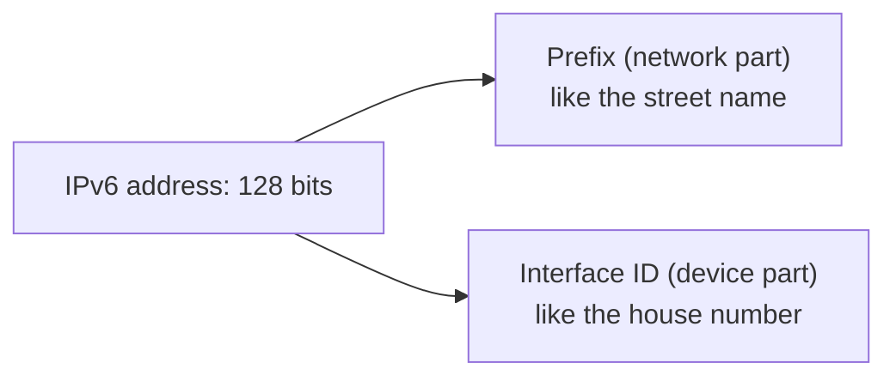

> **Kid example.** An IP address is like "Main Street 12". "Main Street" is the prefix: every house on the street shares it. "12" is the interface ID: only one house has it. IPv6 simply has much, much longer street names and house numbers.

## 1. Why IPv6 exists

**What this chapter is about:** the old addresses (IPv4) ran out, a new version (IPv6) was made long before that, and for years both have had to live side by side.

### 1.1 The problem: IPv4 ran out

**In one sentence:** IPv4 has only about 4.3 billion addresses, everyone could see years ahead that they would run out, and they did run out, region by region.

> **Kid example.** Imagine a town where every house number has only three digits. When the town grows past 999 houses, new families cannot get a number at all. Everybody could see the town growing year by year, and a plan with much longer numbers (IPv6) was ready long before the numbers ran out. IPv4 has about 4.3 billion numbers, far fewer than the devices on the Internet today.

#### "I think we have a problem"

The lecture shows a 2007 projection ("A Pragmatic Report on IPv4 Address Space Consumption", Cisco) of how many of the 256 IPv4 **/8 blocks** would be used up over time, under four models: polynomial and exponential growth over 5 years, exponential and linear growth over 10 years. All the curves reach the end of the address space; they only disagree about **when**.

The point: in 2007 IPv4 exhaustion was not a matter of opinion. The trend was clear and public, and the answer (IPv6) had been published nine years earlier. So the interesting question is not why anyone was surprised, but **why a problem that was visible, measured and solved in advance still took another two decades to fix**. Part B answers it.

**Technical clarification.** The lecture's figure credits "Tony Main"; the lecture's own explanation corrects this: the author is **Tony Hain**. Also, the explanation describes the graph as "how many /8 blocks remained… every curve heads to zero", but the figure plots blocks **used** (the y-axis rises from 128 to 256), so every curve heads **up to 256**, which means the same thing: nothing left.

#### How the problem was recognised

| Date | Event |
|---|---|
| Sep 1981 | RFC 791 standardises IPv4, with 32-bit addresses. |
| 1989 | The World becomes the first commercial ISP; the growth curve begins. |
| Nov 1991 | The IETF creates the ROAD (Routing and Addressing) group to study the problem. |
| Jun 1992 | RFC 1338: first description of address exhaustion. |
| Sep 1993 | RFC 1519: CIDR. |
| May 1994 | RFC 1631: NAT. |
| Dec 1995 / 1996 | RFC 1883: IPv6 proposed (see the note below). |
| Jan 2011 | IANA allocates its last free /8 blocks. |

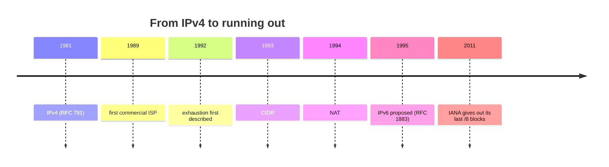

**The central irony:** CIDR and NAT were both responses to exhaustion, and both **worked**: they bought about two decades. They were so effective that they **removed the urgency** to deploy the actual solution.

> **Kid example.** Your shoes are getting too small. Instead of buying new shoes, you cut a hole for your toes (NAT) and loosen the laces (CIDR). It works well enough that you keep putting off the shop for years, even though new shoes (IPv6) were waiting there all along.

**Technical clarification.** The timeline figure and the lecture's explanation date RFC 1883 to December 1996. RFC 1883 is dated **December 1995**. (Its successor RFC 2460 is from December 1998, as the lecture says elsewhere.)

#### Who hands out addresses

IANA gives large blocks to five **Regional Internet Registries (RIRs)**, which allocate to ISPs and organisations in their region:

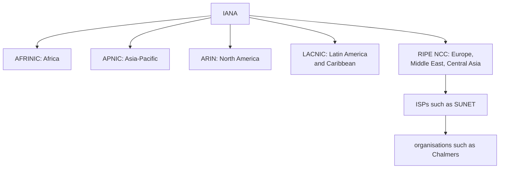

This structure matters twice: it explains why exhaustion happened at **different times in different regions**, and it is the **same hierarchy that RPKI uses** to certify who holds which addresses (the routing lecture's route origin validation is anchored at the five RIRs).

> **Kid example.** The head office of a bakery chain (IANA) sends big sacks of flour to five regional warehouses (RIRs). Each warehouse gives smaller bags to the bakeries in its area (ISPs), and they bake bread for their customers (organisations). The region that sells the most bread runs out of flour first.

#### Exhaustion, region by region

| Date (from the lecture) | Event |
|---|---|
| Jan 2011 | IANA allocates the last free /8 blocks. |
| Apr 2011 | APNIC starts using its last free /8 (fastest-growing region). |
| Sep 2012 | RIPE NCC starts using its last free /8. |
| Jun 2014 | LACNIC starts using its last free /8. |
| Sep 2014 | ARIN starts using its last free /8. |
| Mar 2017 | AFRINIC starts using its last free /8. |
| Nov 2019 | RIPE NCC allocates the last free /22: European address space really runs out. |

Two lessons: exhaustion **tracked growth, not policy** (the fastest-growing regions ran out first); and **look at the units**: the first allocations were /8 blocks of about 16 million addresses, the last were /22 blocks of 1,024. The rationing is visible in the numbers.

**Technical clarification.** Other sources (ARIN's own announcements) put ARIN's move to its last /8 in **April 2014** and its free pool running out completely in **September 2015**. Treat the lecture's ARIN date with some care.

The next figure ("RIR IPv4 Address Run-Down Model") shows each registry's remaining pool from 2013. The curves **flatten** as they approach zero because of **policy, not demand**: registries restrict allocations to small blocks for newcomers, so what is left lasts longer while becoming less useful. Today IPv4 has not disappeared; it has become a **rationed, traded commodity**, bought and sold on a transfer market.

**Remember:**
- IPv4 = 32 bits ≈ 4.3 billion addresses; exhaustion was **visible and predicted**.
- **CIDR and NAT** bought about 20 years and **removed the urgency**.
- IANA → **five RIRs** → ISPs → organisations; regions ran out at different times (APNIC first, 2011).
- RFC 1883 is from **December 1995**; the figure's author is **Tony Hain**.
- Today IPv4 addresses are **bought and sold**.

### 1.2 IPv6: history and motivation

**In one sentence:** IPv6 has 128-bit addresses, was published in 1998 (now RFC 8200), and also cleans up old IPv4 problems.

- Work started in **1994**.
- Basic protocol published in **1998 (RFC 2460)**.
- A brief lull, then progress in **2003–6**.
- A hard push within the IETF for adoption since then.

Also: RFC 2460 is **no longer current**; it was replaced by **RFC 8200 in 2017**, so cite that one.

**What happened to IPv5?** Version number 5 had already been given to an experimental protocol, the **Internet Stream Protocol** (ST), meant for real-time streaming. It was never a general replacement for IPv4, but the number was taken, so the next protocol became version 6.

#### Why IPv6?

- **IPv4 is running out of addresses.** IPv4 has 32 bits (about 4.3 billion addresses); IPv6 has **128 bits**.
- IPv6 also **fixes IPv4 limitations** and adds enhancements.
- With a growing Internet population, limited IPv4 space, **problems with NAT**, and the **Internet of Things**, it is time to move to IPv6.

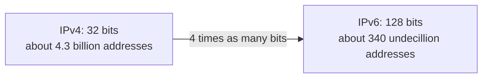

(340 undecillion is 340 followed by 36 zeros, roughly 3.4 × 10³⁸.)

> **Kid example.** Going from 32 to 128 bits is not "four times more addresses". Every extra bit **doubles** the count. It is like going from a 3-digit house number to a 12-digit one: not four times as many houses, but a billion times as many.

**Exam care with 2¹²⁸.** It is an enormous number, but it is **not** the number of usable hosts. Allocation policy gives each subnet a 64-bit prefix, so the practical quantity is about **2⁶⁴ subnets**, each with practically unlimited room for interfaces. The space was made huge **on purpose**, so that it could be allocated generously in clean hierarchical blocks instead of being squeezed.

The redesign also removed known IPv4 weaknesses: a **simpler fixed header**, **no fragmentation by routers**, and **no header checksum** (see [section 5.1](#51-the-ipv6-header)).

**Remember:**
- IPv6: work from **1994**, RFC 2460 in **1998**, now **RFC 8200 (2017)**.
- Number 5 was taken by the **Internet Stream Protocol**.
- **128 bits**; think "about 2⁶⁴ subnets", not "2¹²⁸ hosts".
- Simpler fixed header, **no router fragmentation**, **no header checksum**.

### 1.3 IPv4 and IPv6 coexistence

**In one sentence:** because nobody can switch everything on one day, IPv4 and IPv6 live together using dual stack, tunnelling and translation.

*(Marked self-study in the lecture.)*

There was never going to be a **flag day** (a day when everyone switches at once). IPv4 and IPv6 will coexist for years, and the IETF made three kinds of migration technique:

| Technique | What it means |
|---|---|
| **Dual stack** | Devices run IPv4 and IPv6 at the same time: two addresses, two routing tables, two sets of firewall rules. |
| **Tunnelling** | Carry an IPv6 packet **inside** an IPv4 packet (or the reverse) to cross a network that only speaks the other protocol. |
| **Translation** | Rewrite between the two address families. **NAT64** lets IPv6-only devices talk to IPv4-only devices, using a technique similar to NAT for IPv4. |

Tunnelling and translation are meant for the transition and should be used only where needed; the goal is **native IPv6 end to end**.

> **Kid example.** Dual stack is like a child who speaks two languages and uses whichever one the other person speaks. Tunnelling is like putting a letter written in one language inside an envelope addressed in the other language, so that the postmen in between can deliver it. Translation is like an interpreter who rewrites every sentence from one language into the other.

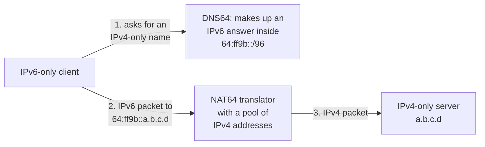

**NAT64 + DNS64** is how translation is actually deployed: the translator holds a pool of IPv4 addresses and rewrites between the families, while DNS64 makes up (synthesises) an IPv6 answer for a name that only has an IPv4 record.

A warning: in Part B you will see that **dual stack, the option that sounds safest, turned out to be the expensive one, because it doubles everything that can fail**.

**Remember:**
- No **flag day**: three techniques, **dual stack**, **tunnelling**, **translation**.
- **NAT64 + DNS64**: DNS64 invents an address in `64:ff9b::/96`; NAT64 rewrites IPv6 ↔ IPv4.
- The goal is **native IPv6 end to end**; dual stack doubles what can fail.

## 2. IPv6 addresses

**What this chapter is about:** how to write and shorten IPv6 addresses, the kinds of addresses (unicast, multicast, anycast), and the important unicast types (GUA, LLA, ULA).

### 2.1 Writing IPv6 addresses

**In one sentence:** an IPv6 address is eight groups of four hex digits, and two rules let you write it shorter: drop leading zeros, and replace one run of zero groups with `::`.

- IPv6 addresses are **128 bits**, written in **hexadecimal**.
- They are **not case-sensitive** (convention, and RFC 5952, prefer lower case).
- The preferred format is `x:x:x:x:x:x:x:x`: eight groups of **four hex digits**.
- One group (16 bits) is informally called a **hextet**. 8 hextets × 16 bits = 128 bits.

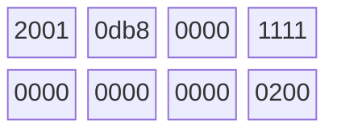

Eight hextets of 16 bits each (shown in two rows of four) make the 128-bit address `2001:0db8:0000:1111:0000:0000:0000:0200`.

> **Kid example.** One hex digit is 4 bits (a number 0–15, written 0–9 and a–f). Four of them make a hextet of 16 bits. Eight hextets make the 128-bit address, like eight 4-digit blocks on a very long licence plate.

Examples in the preferred format:

```
2001:0db8:0000:1111:0000:0000:0000:0200
2001:0db8:0000:00a3:abcd:0000:0000:1234
```

#### Rule 1: omit leading zeros

Inside any hextet you may drop **leading** zeros: `01ab → 1ab`, `09f0 → 9f0`, `0a00 → a00`, `00ab → ab`.

The rule applies **only to leading zeros, never to trailing zeros**. The reason is **reversibility**: every hextet is exactly four digits, so to rebuild a short group you pad zeros **on the left**. If trailing zeros could also be dropped, `ab` could mean `00ab` or `ab00`, and the address would be ambiguous.

| Type | Format |
|---|---|
| Preferred | `2001:0db8:0000:1111:0000:0000:0000:0200` |
| No leading zeros | `2001:db8:0:1111:0:0:0:200` |

> **Kid example.** Writing "007" as "7" is fine: everyone knows a hextet has 4 digits, so you just put zeros back at the front. But writing "700" as "7" would be a disaster: nobody could tell whether you meant 7, 70 or 700.

#### Rule 2: double colon

A double colon `::` can replace **one** continuous run of **one or more hextets that are all zeros**.

- `2001:db8:cafe:1:0:0:0:1` becomes `2001:db8:cafe:1::1`.
- `::` may be used **only once** in an address.

Again the reason is reversibility. To expand `::`, count the hextets that are present, subtract from 8, and insert that many zero groups at the `::`. With two `::` you would know the total number of missing groups but not how to split them between the two gaps.

| Type | Format |
|---|---|
| Preferred | `2001:0db8:0000:1111:0000:0000:0000:0200` |
| Compressed | `2001:db8:0:1111::200` |

**Worked example of the ambiguity.** `2001:db8::1::5` has 4 written hextets, so 4 zero hextets are missing, but they could be split 1+3, 2+2 or 3+1:

- `2001:db8:0:1:0:0:0:5`
- `2001:db8:0:0:1:0:0:5`
- `2001:db8:0:0:0:1:0:5`

So it is invalid. In practice: apply rule 1 first, then rule 2. RFC 5952 also asks you to compress the **longest** run of zeros, and if two runs are equally long, the **leftmost** one.

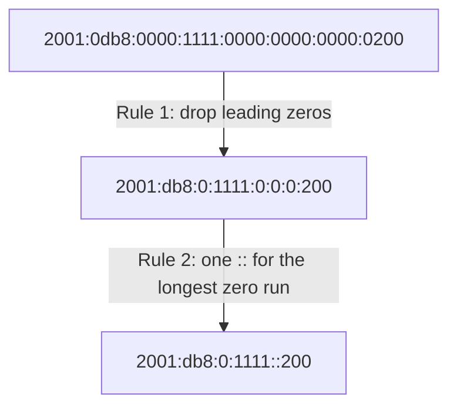

> **Kid example.** The rule "`::` only once" is like a sentence with one gap: "I have 8 crayons, the missing ones are here: red, ___, blue". You know exactly how many are missing and where. With two gaps, "red, ___, green, ___, blue", you know how many are missing in total, but not how many belong in each gap.

**Remember:**
- 128 bits = **8 hextets** of 4 hex digits; lower case preferred.
- **Rule 1:** drop **leading** zeros only (never trailing).
- **Rule 2:** `::` replaces **one** run of all-zero hextets, **only once**; compress the **longest** run (leftmost if tied).
- To expand `::`: 8 minus the hextets you see = number of zero groups to insert.

### 2.2 Address types and prefix length

**In one sentence:** IPv6 has unicast (one), multicast (a group) and anycast (the nearest of many), no broadcast at all, and almost every network uses a /64 prefix.

#### Unicast, multicast, anycast

| Type | Meaning |
|---|---|
| **Unicast** | Names exactly one interface; a packet is delivered to that one interface. |
| **Multicast** | Names a group; one packet is delivered to every member. |
| **Anycast** | A unicast address deliberately given to several devices; a packet goes to the **nearest** one. |

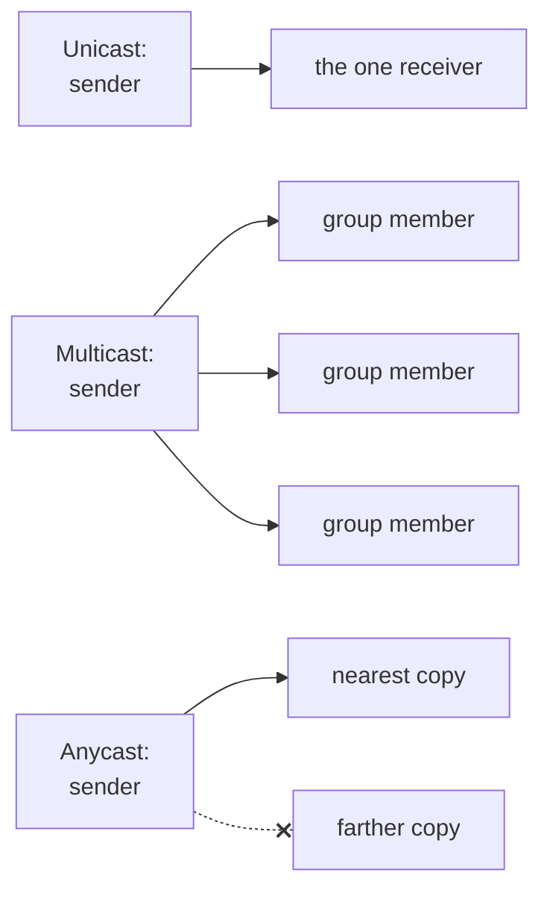

The crossed dotted line means "not chosen": anycast reaches only the nearest copy.

**IPv6 has no broadcast address.** IPv4's broadcast, which every host on a segment had to process whether it cared or not, is gone. Its jobs are done by multicast to well-defined groups: the **all-nodes** group `ff02::1` (which gives essentially the same result as a broadcast) and the **all-routers** group `ff02::2`. This is an improvement: broadcast forces every host to stop and inspect; multicast lets uninterested hosts ignore the traffic **in hardware**.

> **Kid example.** Unicast is a letter to one person. Multicast is a newsletter sent only to the members of a club. Anycast is calling "any pizza shop of this chain": the call goes to the nearest shop. The old broadcast was shouting through the school loudspeaker, so everybody had to stop and listen even if the message was not for them; IPv6 dropped it.

#### Prefix length

- Prefix length uses **slash notation**, as in CIDR, and gives the network part of the address.
- It ranges from **0 to 128**. The recommended length for LANs and most networks is **/64**.
- A **64-bit interface ID** is strongly recommended because **SLAAC uses 64 bits for the interface ID**; it also makes subnetting simpler.

So the near-universal /64 is not an accident: if you use a longer prefix, fewer than 64 bits remain for the interface ID and **SLAAC stops working**. An organisation that gets a /48 from its provider therefore has **16 bits of subnet ID = 65,536 subnets**. Point-to-point links are the common exception, often using /127.


**Remember:**
- Three types: **unicast**, **multicast**, **anycast**. **No broadcast** in IPv6.
- All-nodes `ff02::1`, all-routers `ff02::2`.
- **/64** is standard because **SLAAC needs a 64-bit interface ID**; a /48 site has **65,536** /64 subnets.

### 2.3 Unicast addresses: GUA, LLA, ULA and embedded IPv4

**In one sentence:** every IPv6 interface has a link-local address (works only on its own link) and usually a global address (works everywhere), and there are also private ULAs and addresses with IPv4 inside.

**An IPv4 interface normally has one address; an IPv6 interface normally has at least two:**

- **Global Unicast Address (GUA):** like a public IPv4 address; globally unique and routable on the Internet.
- **Link-Local Address (LLA):** required on every IPv6-enabled interface; used to talk to devices on the **same link** only; never routed.

The LLA is **not optional and not a fallback**. It is the address the interface uses before it has any other, and it is the address that Neighbor Discovery, router advertisements and many routing protocols use for their own messages. Several IPv6 addresses on one interface is the **normal** state.

> **Kid example.** A GUA is like your full home address that works from anywhere in the world. An LLA is like your name inside your own classroom: everybody in the room can call you by it, but it means nothing outside the room. You get your classroom name the moment you walk in, before you know your full address.

#### GUA

- Only GUAs whose **first three bits are `001`**, i.e. **`2000::/3`**, are being assigned today.
- So current GUAs **begin with a hex 2 or 3**. That is only **1/8** of the IPv6 space.

Why 2 or 3? The first hex digit is 4 bits. If the first three bits are `001`, the fourth bit can be 0 or 1, giving `0010` = 2 or `0011` = 3.

Seven-eighths are held in reserve: a lesson in protocol design. "Reserving capacity is cheaper than reclaiming it."

**Structure of a GUA:**


The widths are not to scale: in a typical /48 site the three parts are 48, 16 and 64 bits.

| Part | Who sets it | Notes |
|---|---|---|
| **Global routing prefix** | The provider (ISP) | Length depends on ISP policy; a /48 to a site and a /56 to a home are common. |
| **Subnet ID** | The organisation | Numbers the subnets inside the site. |
| **Interface ID** | The host or administrator | Like the host part of an IPv4 address; normally 64 bits. From the MAC (EUI-64), random, or manual. |

> **Kid example.** A GUA is like "Sweden, Gothenburg (from the post office) – Building 5 (your school decides) – Room 12 (the room itself)". The post office only cares about the first part; the school numbers its own buildings; each room has its own number.

In IPv6 the **all-0s and all-1s** interface IDs may be given to devices (there is no broadcast to reserve all-1s for). The **all-0s** ID is reserved as the **Subnet-Router anycast address** and should only be assigned to routers.

Compare with IPv4, where the network/host boundary moves and must be computed. Here it is fixed by convention, which is why IPv6 subnetting is simpler.

#### LLA

- Lets a device talk to other IPv6 devices **on the same link only**.
- Packets with a link-local source or destination **cannot be routed**.
- **Every** IPv6 interface must have one; if it is not configured manually, the device **creates one automatically**.
- LLAs are in **`fe80::/10`** (in practice the next bits are zero, so you see `fe80::/64`).

That restriction is what makes LLAs useful: an address that cannot leave the link is safe to use before the device knows anything about the wider network.

**The zone index.** A host with several interfaces may have the **same** link-local address on more than one of them, so the address alone does not say where to send. That is why tools need a **zone index**: the address, a `%`, and the interface name or number, for example `fe80::1%eth0`.

> **Kid example.** Two classrooms can each have a pupil called "Sam". If you are standing in the corridor between them and shout "Sam!", nobody knows which one you mean. So you say "Sam in room 3" (`fe80::1%eth0`).

#### Unique Local Addresses (ULA)

ULAs (range `fc00::/7`) are somewhat like the IPv4 private addresses of RFC 1918, but with important differences:

- They are used for local addressing **inside a site** or between a limited number of sites.
- They can be used for devices that will **never need to reach another network**.
- They are **not globally routed** and **not translated** to a global IPv6 address.
- Many sites use RFC 1918 + NAT to try to hide or secure their network. **That was never the intended use of ULAs.**

In practice only the upper half is used: addresses beginning **`fd`** are locally assigned, with **40 random bits** to make clashes between organisations very unlikely. The `fc` half was reserved for a central scheme that was never defined. The key lesson: in IPv4, private addressing and NAT arrived together and are often treated as one idea. **In IPv6 they are separate**: you can have local-only addressing without any address translation.

**Technical clarification.** The lecture writes the range as "fc00::/7 to fdff::/7". The range is simply **`fc00::/7`**, which covers every address from `fc00::` to `fdff:ffff:…:ffff`.

#### Embedded IPv4 addresses

Some IPv6 addresses carry an IPv4 address inside them, mostly for transition mechanisms. In each example below the IPv4 address `192.0.2.128` is written in hex as `c000:0280` (192 = c0, 0 = 00, 2 = 02, 128 = 80).

| Type | Example | Description |
|---|---|---|
| IPv4-mapped IPv6 | `::ffff:192.0.2.128` = `::ffff:c000:0280` | IPv4 address in the last 32 bits. Used **inside dual-stack hosts** so IPv6 sockets can accept IPv4 connections. Not routed on the Internet. |
| IPv4-compatible IPv6 (**deprecated**) | `::192.0.2.128` = `::c000:0280` | IPv4 address in the last 32 bits, the rest zero. Early method, now obsolete. |
| 6to4 (tunnelling) | `2002:c000:0280::/48` | IPv4 address in the 2nd and 3rd hextets of the prefix. Automatic tunnelling of IPv6 over IPv4. |
| NAT64 (well-known prefix) | `64:ff9b::192.0.2.128` = `64:ff9b::c000:0280` | IPv4 address in the last 32 bits. Used by NAT64/DNS64 so IPv6-only clients reach IPv4-only servers. |

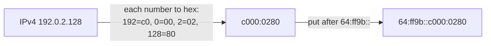

**Technical clarification.** The lecture title reads "Eembedded"; the lecture's explanation points out the typo.

The pattern: **one address family written inside the other**. It returns in Part B with 464XLAT.

**Remember:**
- Every interface has an **LLA** (`fe80::/10`, never routed) and usually a **GUA** (`2000::/3`, starts with 2 or 3).
- GUA = **global routing prefix** (ISP) + **subnet ID** (site) + **interface ID** (64 bits).
- **Zone index** `%eth0` says which interface a link-local address is on.
- **ULA** = `fc00::/7`, in practice `fd` + 40 random bits; **not NAT**.
- Embedded IPv4: IPv4-mapped `::ffff:`, compatible `::` (deprecated), 6to4 `2002:`, NAT64 `64:ff9b::`.

## 3. Address configuration

**What this chapter is about:** how a device gets its IPv6 address, either typed in by hand or built automatically after asking the router, and how the device part of the address (interface ID) is made.

### 3.1 Static configuration

**In one sentence:** you can type IPv6 addresses by hand on routers and hosts, much like IPv4, but a Cisco router also needs `ipv6 unicast-routing` before it really works.

#### On a router (Cisco IOS)

Most IPv6 commands look like their IPv4 versions with `ipv6` instead of `ip`:

```
R1(config)# interface gigabitethernet 0/0/0
R1(config-if)# ipv6 address 2001:db8:acad:1::1/64
R1(config-if)# no shutdown
R1(config-if)# exit
```

What each line does:

1. Choose the interface (the network port) to configure.
2. Give it the address `2001:db8:acad:1::1` with a /64 prefix.
3. Switch the interface on.
4. Leave the interface settings.

One command has **no IPv4 counterpart** and matters a lot: **`ipv6 unicast-routing`**. Without it a Cisco router holds IPv6 addresses but **does not forward IPv6 packets** and **does not send router advertisements**, so hosts on its networks never autoconfigure. This is the most common reason a correct-looking IPv6 configuration does nothing. The general lesson: **configuring addresses is not the same as enabling the protocol**.

> **Kid example.** You can put name tags on every door of a post office (the addresses), but if nobody has told the staff "start sorting letters" (`ipv6 unicast-routing`), no letter ever moves.

#### On a Windows host

Like IPv4: an address, a prefix length, a default gateway and a DNS server. The **default gateway** can be the router's GUA or its LLA; **best practice is the LLA**. Why point at an address that cannot be routed? **Stability**: the LLA depends only on the router's interface, so it **survives renumbering**. If the site changes provider and every global prefix changes, a gateway set by LLA keeps working. With DHCPv6 or SLAAC, the router's LLA is set as the gateway automatically.

> **Kid example.** If you tell a new pupil "the teacher is the person at the front of room 3", that stays true even if the school changes its street address. Pointing at the router's LLA is like that: it does not change when the "street" (the global prefix) changes.

#### Configuring an LLA by hand

```
R1(config-if)# ipv6 address fe80::1:1 link-local
```

Automatic LLAs are long and random-looking. A hand-made one like `fe80::1` is short and recognisable, so when it appears as the default gateway on every host, troubleshooting is easier. The same LLA may be used on several interfaces (it only has to be unique **on its link**), though common practice is a different LLA per interface so you can tell them apart.

**Remember:**
- Cisco: `ipv6 address …` on each interface, **and `ipv6 unicast-routing`** or nothing is forwarded and no RAs are sent.
- Best default gateway = the router's **LLA** (survives renumbering).
- Hand-made LLAs like `fe80::1` make troubleshooting easier.

### 3.2 Dynamic addressing: RS, RA and the three methods

**In one sentence:** a host asks "is there a router?" (RS), the router answers with the network prefix and a choice of method (RA), and the host then builds or receives its address.

Devices get GUAs dynamically through **ICMPv6** messages:

- **Router Solicitation (RS):** sent by hosts to discover IPv6 routers ("is there a router? tell me now").
- **Router Advertisement (RA):** sent by routers, regularly and in reply to an RS, telling hosts how to get a GUA and giving network information:
  - network **prefix and prefix length**;
  - **default gateway** address (the router's LLA, which is the RA's source address);
  - **DNS addresses and domain name**.

**Where this function lives.** In IPv4 a host learns its address from DHCP, an application-layer protocol over UDP. In IPv6 the equivalent is **built into ICMPv6**, part of the protocol itself.

**The RA chooses** which of three methods hosts use, through flags in the RA (not by the host):

| Method | Address from | Other settings (DNS…) from | RA flags |
|---|---|---|---|
| 1. **SLAAC** | The host builds it (RA prefix + own interface ID) | The RA | M = 0, O = 0 |
| 2. **SLAAC + stateless DHCPv6** | The host builds it | A stateless DHCPv6 server | M = 0, O = 1 |
| 3. **Stateful DHCPv6** | A DHCPv6 server | The DHCPv6 server | M = 1 |

(M stands for "Managed address configuration", O for "Other configuration".)

In **all three**, the **default gateway comes from the RA** (the router's LLA), never from DHCPv6.

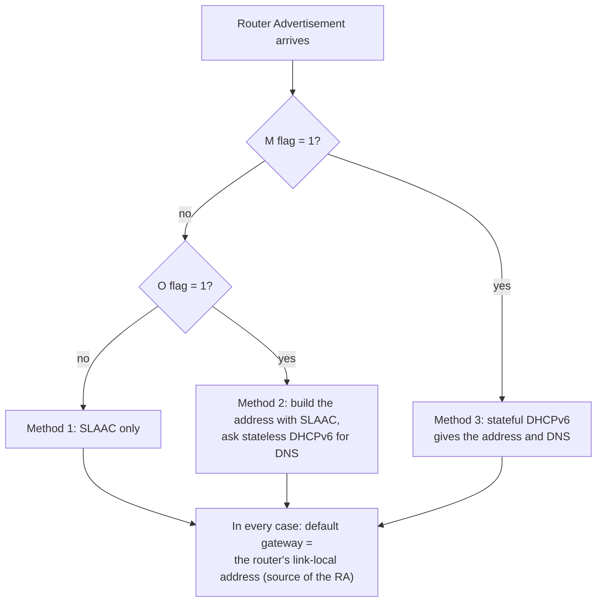

#### Method 1: SLAAC

The RA supplies the **prefix** (normally /64); the host supplies the other 64 bits with **EUI-64** or **random generation**, and joins them into a full address. **Stateless** means no server records which address went to which device: nothing to set up, no leases to run out, nothing to fail if a server is down. The cost is the mirror image: **no central list** of who has which address, and plain SLAAC originally had **no way to tell hosts about DNS servers** (which is why methods 2 and 3 exist).

> **Kid example.** SLAAC is like building your own address: the street sign at the corner tells you the street name (the prefix from the router's advertisement), and you add your own house number (the interface ID) yourself. Nobody has to keep a list of who lives where.

#### Method 2: SLAAC and stateless DHCPv6

The host still builds its own address and uses the router's LLA as its gateway, but the RA also tells it to ask a **stateless DHCPv6** server for the rest: **DNS server addresses** and possibly a domain name. "Stateless" because the server hands out settings without allocating addresses or tracking who got what. Modern systems can also learn DNS servers **directly from the RA**, so in many networks DHCPv6 is no longer needed.

> **Kid example.** You still choose your own house number, but you phone the town hall to ask "which shop is the nearest phone book?" (the DNS server). The town hall answers everyone the same and does not write down who called.

#### Method 3: stateful DHCPv6

The closest thing to IPv4's DHCP: a **stateful DHCPv6** server gives the GUA, prefix length, DNS servers, domain name and other information. "Stateful" because it allocates addresses from a pool and **records who holds which** (bindings, leases, a database). Why choose it? **Control and accountability**: an organisation that must know which device had which address at a given time (auditing, access control, incident response) needs that record. The client's DHCPv6 **Solicit** message goes to the multicast address **`ff02::1:2`** (all DHCPv6 servers and relay agents on the link): even here, discovery is **multicast, not broadcast**.

> **Kid example.** Here the town hall gives you your house number and writes it in a big book: "house 12 belongs to the Smith family since Monday". If something goes wrong at house 12, the town knows exactly who lived there at that time.

**Remember:**
- **RS** = host asks; **RA** = router announces prefix, gateway, DNS and the method.
- The **RA flags** choose: M=0,O=0 **SLAAC**; M=0,O=1 **SLAAC + stateless DHCPv6**; M=1 **stateful DHCPv6**.
- The **default gateway always comes from the RA** (the router's LLA).
- Stateless = no record of who has which address; stateful = a record (accountability).
- DHCPv6 Solicit goes to **`ff02::1:2`** (multicast).

### 3.3 Interface IDs: EUI-64 or random

**In one sentence:** the 64-bit device part of the address is either made from the network card's MAC address (EUI-64) or chosen at random, and random is better for privacy.

With SLAAC (alone or with stateless DHCPv6) the host must make its own 64-bit interface ID, by the **EUI-64 process** or as a **random 64-bit number**. The difference is mainly about **privacy**: an ID made from the MAC is stable and globally unique, so it stays the same as the device moves between networks (only the prefix changes). That makes the device **trackable everywhere it goes**. Random IDs break that link; modern systems overwhelmingly choose randomness.

> **Kid example.** If you always wear a T-shirt with your full name printed on it, people in every shop, café and town can recognise you and follow where you go. A random interface ID is like wearing a plain T-shirt: you are still you, but nobody can easily track you from place to place.

#### The EUI-64 process

1. Insert the 16-bit value **`fffe`** into the middle of the 48-bit MAC address (between the manufacturer part and the device part).
2. **Flip the 7th bit** (counting from the left, starting at 1) of the first byte.

**Worked example (from the lecture).** MAC `fc:99:47:75:ce:e0`:

| Step | Result |
|---|---|
| Split the MAC in half | `fc:99:47` and `75:ce:e0` |
| Insert `ff:fe` in the middle | `fc:99:47:ff:fe:75:ce:e0` |
| First byte `fc` in binary | `1111 1100` |
| Flip the 7th bit (value 2) | `1111 1110` = `fe` |
| Interface ID | `fe99:47ff:fe75:cee0` |

So with prefix `2001:db8:acad:1::/64` the address becomes `2001:db8:acad:1:fe99:47ff:fe75:cee0`, exactly as the lecture shows.

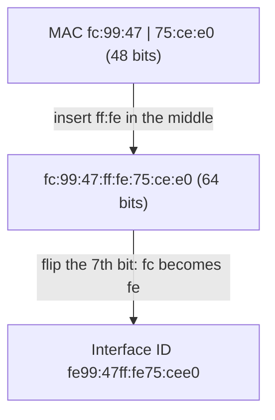

**How to find the 7th bit.** Write the first byte as 8 bits and number them 1 to 8 from the left. Bit 7 is the second from the right; it has the value 2. Flipping it means: if it is 0, make it 1; if it is 1, make it 0. So the first byte changes by exactly 2 (`fc` = 252 becomes `fe` = 254).

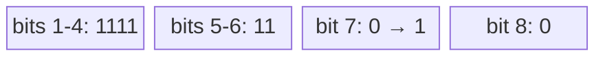

**Why flip that bit?** In a MAC address, that bit says whether the address is **universally** administered (by the manufacturer, bit = 0) or **locally** administered (bit = 1). In the EUI-64 interface ID the meaning is inverted, so **1 means universal**. Flipping converts between the two conventions. **Exam tip:** the interface ID is *not* just the MAC with `fffe` inserted; forgetting the flip is where most marks are lost.

#### Randomly generated interface IDs

Depending on the operating system, a device may use a random ID instead. **Windows has done this since Vista:**

```
C:\> ipconfig
Ethernet adapter Local Area Connection:
   IPv6 Address. . . . . : 2001:db8:acad:1:50a5:8a35:a5bb:66e1
   Link-local IPv6 Address: fe80::50a5:8a35:a5bb:66e1
   Default Gateway . . . .: fe80::1
```

To make sure a unicast address is unique, the client may use **Duplicate Address Detection (DAD)**, which is like an ARP request for its own address: if nobody replies, the address is unique (details in [section 5.3](#53-icmpv6-and-neighbor-discovery)).

Two ideas are often confused and must be kept apart:

- A **stable random** ID is made once per interface per network and does not change while the device stays there: no link to the hardware, but stable locally.
- **Temporary (privacy) addresses** go further: extra addresses that change every few hours and are used for outgoing connections, while a stable address stays for incoming ones.

That is why a real interface often shows several IPv6 addresses at once: a link-local address, a stable global address and one or more temporary global addresses. That is normal.

**Remember:**
- Interface ID = **EUI-64** (from the MAC) or **random**; random protects **privacy**.
- EUI-64: insert **`fffe`** in the middle, then **flip the 7th bit** (`fc` → `fe`).
- **Stable random** ID (per network) vs **temporary** addresses (change every few hours).
- Several IPv6 addresses on one interface is **normal**.

### 3.4 Dynamic link-local addresses

**In one sentence:** a device makes its link-local address by itself the moment its interface comes up, which lets it talk before it knows anything else.

All IPv6 interfaces must have an LLA, and like GUAs they are usually made automatically: prefix **`fe80::/10`** plus an interface ID from **EUI-64 or random generation**.

The difference from a GUA is **where the prefix comes from**. A GUA needs an RA to supply the prefix, so a host cannot have one until a router has spoken. An LLA needs **nothing**: its prefix is a constant, so an interface can form one **the instant it comes up**. That is exactly why LLAs exist: a Router Solicitation must be sent **from** some address, and the LLA is the one the interface can always have. **It is the bootstrap.**

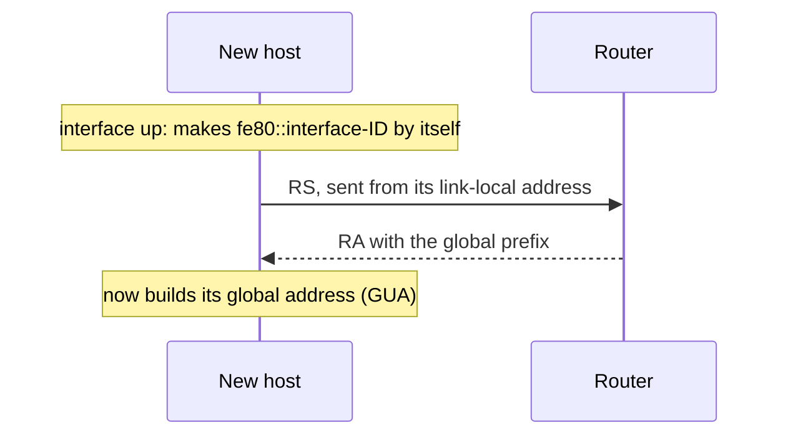

> **Kid example.** On your first day at a new school, before you get a student card with your full details, you can already say "Hi, I'm Alex" to the people in your classroom. That first name is your link-local address. You use it to ask the teacher "where do I get my student card?" (the RS).

#### On Windows

Operating systems normally use the **same method** for the SLAAC GUA and the LLA:

```
EUI-64 generated interface ID:
   IPv6 Address. . . . . . . : 2001:db8:acad:1:fc99:47ff:fe75:cee0
   Link-local IPv6 Address . : fe80::fc99:47ff:fe75:cee0
   Default Gateway . . . . . : fe80::1

Random 64-bit generated interface ID:
   IPv6 Address. . . . . . . : 2001:db8:acad:1:50a5:8a35:a5bb:66e1
   Link-local IPv6 Address . : fe80::50a5:8a35:a5bb:66e1
   Default Gateway . . . . . : fe80::1
```

A handy diagnostic: if the **last 64 bits of the LLA and the GUA match**, the GUA was built by SLAAC. If they differ, something else assigned it (DHCPv6, manual configuration, or a temporary privacy address). Windows shows a `%` and a number after link-local addresses: the **zone index**.

#### On Cisco routers

Cisco routers **create an LLA automatically whenever a GUA is assigned** to the interface, using **EUI-64** by default:

```
R1# show interface gigabitEthernet 0/0/0
  Hardware is ISR4221-2x1GE, address is 7079.b392.3640 (bia 7079.b392.3640)
R1# show ipv6 interface brief
GigabitEthernet0/0/0  [up/up]
    FE80::7279:B3FF:FE92:3640
    2001:DB8:ACAD:1::1
```

Check the EUI-64 step: MAC `70:79:b3:92:36:40` → insert `ff:fe` → `70:79:b3:ff:fe:92:36:40`; first byte `70` = `0111 0000`, flip the 7th bit → `0111 0010` = `72`. Result `7279:b3ff:fe92:3640`. ✓

Note the order: on a Cisco router the LLA appears **as a consequence** of configuring the GUA. This LLA is also the source of the router's RAs, and so the **default gateway of every host** on the link. Because it is long and hard to read, administrators often override it with something like `fe80::1`.

**Remember:**
- LLA = **`fe80::/10`** + interface ID; made **at once**, with no router needed.
- The LLA is the **bootstrap**: the RS is sent from it.
- Same last 64 bits in LLA and GUA → the GUA came from **SLAAC**.
- Cisco makes an EUI-64 LLA **when a GUA is configured**; often replaced by `fe80::1`.

## 4. Multicast, anycast and subnetting

**What this chapter is about:** sending one packet to many receivers (multicast), sending to the nearest of many servers (anycast), and how easy it is to cut an IPv6 network into subnets.

### 4.1 Multicast

**In one sentence:** with multicast the sender sends one copy, and the routers make extra copies only where the paths to the receivers split.

**Problem:** send a packet to many nodes, for example **IP-TV** or a large audio stream. Using **n unicast packets** means the same packet crosses a single link many times: near the source, every copy uses the same links, and those links fill up first.

**Multicast idea:** **the network duplicates the packet, not the sender.** The source sends one copy, and routers copy it only where the paths to different receivers split. Each link carries each packet **once**, however many receivers are behind it.

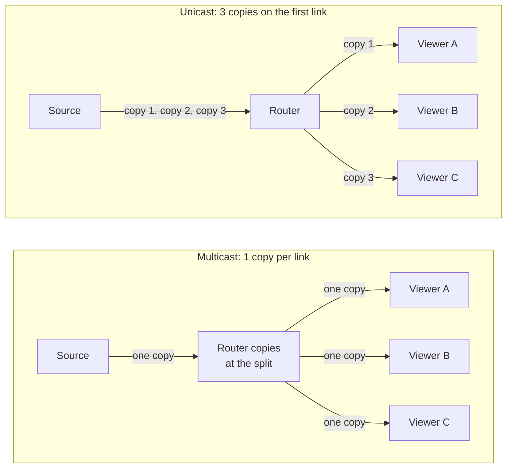

> **Kid example.** A teacher wants to give the same worksheet to three classrooms down the corridor. Unicast: she carries three sheets down the whole corridor. Multicast: she carries one sheet to the end of the corridor, and the helper there photocopies it for each room. The corridor (the first link) only carries one sheet.

**Cost model:** unicast puts the work on the sender and nearby links; multicast puts it **into the routers**. That makes multicast powerful, and also limits its use across the public Internet, because routers under many different owners must cooperate (and keep state for every group).

#### How groups work

- Nodes can **join a multicast group**, named by a **multicast IP address**.
- Routers build a routing topology (a distribution tree) using membership information from:
  - **IGMP** (Internet Group Management Protocol) for IPv4, or
  - **MLD** (Multicast Listener Discovery) for IPv6.
- These are protocols for **hosts to manage their membership**: a host sends a **report** (IGMP or MLD) to its local router.
- **MLD is part of ICMPv6**, with the same format for reports and queries.

**Example.** A host tells its router: "I want to receive `239.1.1.1` traffic." The router records the membership. Multicast routers keep a **multicast forwarding table**:

`(Source IP, Group Address) → Outgoing Interface List`

Example: `(*, 239.1.1.1) → [eth0, eth2]` means "traffic for group 239.1.1.1 from any source (`*`) goes out of eth0 and eth2".

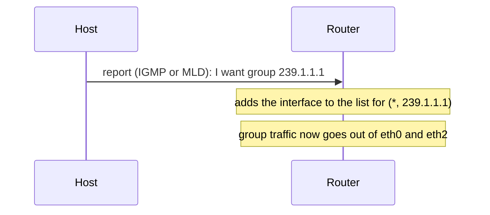

> **Kid example.** Joining a multicast group is like signing up for a club's newsletter at the school office. The office (router) writes your classroom on the club's list, and from then on puts a copy of the newsletter into your classroom's tray.

**A pattern to notice:** functions that were separate protocols in IPv4 (address resolution = ARP, autoconfiguration = DHCP, group membership = IGMP) are all **absorbed into ICMPv6** in IPv6. One protocol to secure, filter and understand; but it also means that **blocking ICMPv6 at a firewall breaks IPv6** completely.

#### IPv6 multicast addresses

- All IPv6 multicast addresses start with **`ff`**: the prefix **`ff00::/8`**.
- Two types: **well-known** multicast addresses and **solicited-node** multicast addresses.
- **Multicast addresses can only be destinations, never sources.** A group cannot send a packet; a multicast source address means the packet is malformed. (Anycast is different: it can be either, because it really is a unicast address.)

**Well-known groups:**

| Address | Group | Who joins |
|---|---|---|
| `ff02::1` | All-nodes | Every IPv6 device on the link. A packet here reaches everyone: the closest thing to broadcast. |
| `ff02::2` | All-routers | Every IPv6 router; a Cisco router joins when `ipv6 unicast-routing` is enabled. An RS sent here reaches every router and disturbs no host. |

The `02` in `ff02` is the **scope**: link-local, so routers do not forward these packets beyond the link.

**Solicited-node multicast** is the mechanism that **replaces ARP**:

- It is like the all-nodes address, but the group is formed from the **last 24 bits** of the address being looked for, so normally **only the target** is in it.
- It is **mapped to a special Ethernet multicast address**, so the **network card can filter the frame by its destination MAC** without passing it to the IPv6 software.

Result: IPv4 address resolution interrupts **every** host on the segment; IPv6 address resolution normally interrupts **exactly one**.

> **Kid example.** ARP is the teacher shouting "Whoever is sitting in seat 10, stand up!" to the whole school hall, so everyone looks up. Solicited-node multicast is like whispering only into the row where seat 10 is: in practice only the one person you want hears it, and everyone else keeps working.

**Additional context.** The exact formats: solicited-node address = `ff02::1:ff` followed by the last 24 bits of the unicast address (prefix `ff02::1:ff00:0/104`); its Ethernet address = `33:33` followed by the last 32 bits of the IPv6 multicast address. Example: for `2001:db8:acad:1::10`, the last 24 bits are `00:00:10`, so the group is `ff02::1:ff00:10`, and the Ethernet destination is `33:33:ff:00:00:10`.

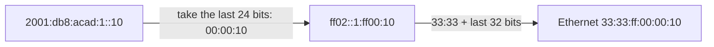

**Remember:**
- Multicast: **the network copies, not the sender**; each link carries one copy.
- Membership: **IGMP** (IPv4), **MLD** (IPv6, part of ICMPv6).
- Forwarding entry: **(source, group) → list of outgoing interfaces**.
- IPv6 multicast = **`ff00::/8`**; `ff02::1` all nodes, `ff02::2` all routers; only ever a **destination**.
- **Solicited-node** multicast (`ff02::1:ff` + last 24 bits) **replaces ARP** and disturbs only the target.
- ARP, DHCP and IGMP jobs all moved into **ICMPv6** → never block ICMPv6.

### 4.2 Anycast

**In one sentence:** anycast is one address that exists in many places, and normal routing takes you to the nearest copy.

**Anycast = talk to "any" one of a set of nodes.** "We've seen this with DNS":

```
$ dig www.google.com
www.google.com.    604799 IN CNAME www.l.google.com.
www.l.google.com.  300    IN A     74.125.19.103
www.l.google.com.  300    IN A     74.125.19.104
www.l.google.com.  300    IN A     74.125.19.147
www.l.google.com.  300    IN A     74.125.19.99
```

The name maps to a **set** of addresses, and the client picks one. That is anycast-like behaviour **at the application layer**.

**Technical clarification.** The lecture body says that "the anycast routing mechanism directs the query to the nearest node" for these A records. The lecture's own explanation describes it more precisely, and that is the version to learn: in this DNS example there are **several distinct addresses** and the **client chooses** between them. In **IP-layer** anycast there is **one address** that exists in several places, and the **routing system chooses**; the client never knows there was a choice.

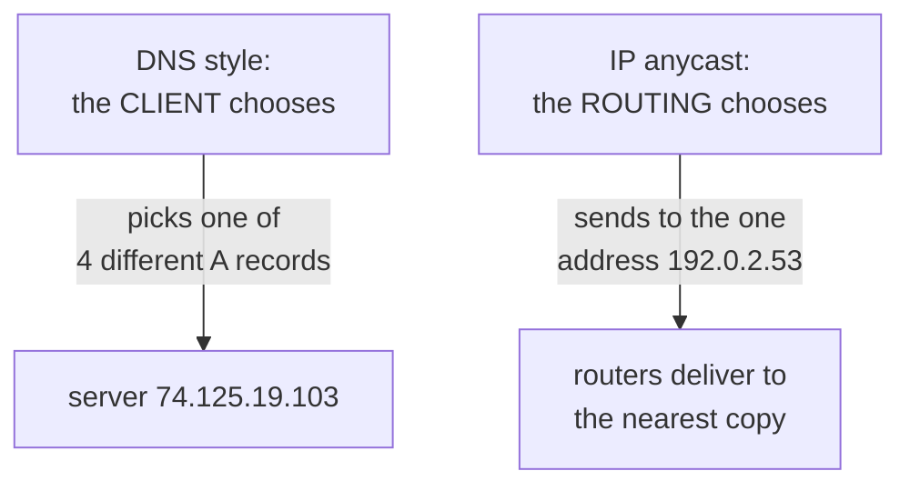

#### Anycast at the IP layer

- DNS gives anycast through name → address mappings.
- At layer 3: **a single IP address refers to multiple hosts**, and you need to talk to **any one of them**.

**Example: the DNS root servers.** They are spread over the world and answer queries for the root zone. Instead of a fixed list of addresses that would need updating globally, **one IP address is shared by many root server instances**. A query to that address is routed to the **nearest operational instance**, based on network topology, routing metrics and latency. There are 13 root server identities but over a thousand instances. When an instance fails, it stops announcing its route; traffic moves to the next nearest without any client noticing or any DNS record changing. **Failure handling is pushed down into the routing layer.** (See the DNS guide, [section 5.1](02-DNS.md#51-anycast-and-root-resilience).)

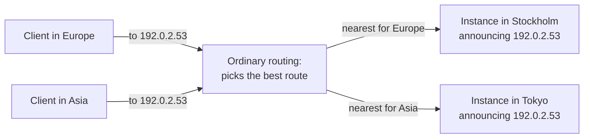

The address `192.0.2.53` is a made-up example.

> **Kid example.** A pizza chain has the same phone number in every city. When you call, the phone network connects you to the shop in your own city. If your local shop closes, the network quietly connects you to the next closest shop. You never dialled a different number.

#### Anycast in forwarding tables

*(Marked self-study in the lecture.)*

- An anycast address **looks like a unicast address**: no special format (unlike multicast).
- The **same address could be unicast in one network and anycast in another**; it depends on how it is assigned and advertised.
- Routers decide "nearest" **by their normal routing-table rules** (longest prefix match, then metric), not by inspecting the address.
- Anycast is best for services where separate packets **may go to different destinations** without harm (for example CDNs).
- Examples: the **Subnet-Router anycast** address (all-0s interface ID); Cloudflare DNS `2606:4700:4700::1111` (1.1.1.1 in IPv6); Google DNS `8.8.8.8`. Try `traceroute 8.8.8.8` from different places (the lecture links the online tool at panel.perfops.net) and you will reach different machines.

So anycast is not really a feature added to IP. It is a **consequence** of the fact that routing already picks the best of several paths; someone noticed this was useful and gave it a name.

**Remember:**
- DNS with several A records: **client chooses**. IP anycast: **one address, routing chooses**.
- Root servers: **13 identities, over 1,000 instances**; a failed instance just stops announcing its route.
- An anycast address **looks like any unicast address**.
- Examples: Subnet-Router anycast, `2606:4700:4700::1111`, `8.8.8.8`.

### 4.3 Subnetting an IPv6 network

**In one sentence:** to make IPv6 subnets you simply count up the subnet ID (1, 2, 3, …); there is no tricky bit arithmetic as in IPv4.

*(Marked self-study.)*

- IPv6 was **designed with subnetting in mind**.
- A separate **subnet ID** field, between the global routing prefix and the interface ID, is used to create subnets.

**Example.** Given the global routing prefix **`2001:db8:acad::/48`** with a **16-bit subnet ID**:

- This allows **65,536 /64 subnets** (2¹⁶).
- The global routing prefix is the **same** for all subnets.
- Only the **subnet ID hextet is incremented** (in hexadecimal) for each subnet: `2001:db8:acad:0001::/64`, `2001:db8:acad:0002::/64`, `2001:db8:acad:0003::/64`, …

```mermaid
block-beta
  columns 4
  g["2001:db8:acad (prefix, 48 bits)"]:2 s["0001 (subnet ID, 16 bits)"] i["interface ID (64 bits)"]
```

The lecture's topology needs **five subnets**: one for each LAN plus one for the serial link between R1 and R2. They get subnet IDs **0001 to 0005**. Each /64 gives more addresses than will ever be needed. R1's interfaces are configured on different subnets:

```
R1(config)# interface gigabitethernet 0/0/0
R1(config-if)# ipv6 address 2001:db8:acad:1::1/64
R1(config-if)# no shutdown
R1(config-if)# exit
R1(config)# interface gigabitethernet 0/0/1
R1(config-if)# ipv6 address 2001:db8:acad:2::1/64
R1(config)# interface serial 0/1/0
R1(config-if)# ipv6 address 2001:db8:acad:3::1/64
```

```mermaid
flowchart LR
  subgraph site["Site 2001:db8:acad::/48"]
    L1["LAN 2001:db8:acad:1::/64"] --- R1["R1"]
    L2["LAN 2001:db8:acad:2::/64"] --- R1
    R1 ---|"serial link 2001:db8:acad:3::/64"| R2["R2"]
    R2 --- L4["LAN 2001:db8:acad:4::/64"]
    R2 --- L5["LAN 2001:db8:acad:5::/64"]
  end
```

This matches the lecture's figure: R1 serves subnets 1 and 2 (PC1, PC2), the serial link between R1 and R2 is subnet 3, and R2 serves subnets 4 and 5 (PC3, PC4). Each router interface gets host part `::1` and each PC `::10`, for example PC1 = `2001:db8:acad:1::10`. Subnets 0000 and 0006 to ffff are left unused.

> **Kid example.** A school has one street address (the /48 prefix). Inside, the rooms are just numbered 1, 2, 3, 4, 5. Every room is huge, so you never have to squeeze. In IPv4 it is more like cutting one small cake into slices: every extra slice makes the others smaller, and you need maths to cut it fairly.

**Contrast with IPv4**, where you must borrow bits from the host part, compute how many hosts are left, and accept that each subnet reduces the others: rationing. In IPv6 there is nothing to ration: **subnetting is counting, not arithmetic**.

**Remember:**
- /48 prefix + **16-bit subnet ID** = **65,536** /64 subnets.
- Just **count up** the subnet hextet: `:1::/64`, `:2::/64`, `:3::/64`, …
- Lecture topology: 5 subnets (4 LANs + 1 serial link); routers `::1`, PCs `::10`.
- IPv6 subnetting is **counting, not arithmetic**.

## 5. The IPv6 header, tunnelling and ICMPv6

**What this chapter is about:** what the IPv6 packet header looks like, how IPv6 crossed IPv4-only networks (tunnelling), and the ICMPv6 messages that replace ARP and help hosts configure themselves.

### 5.1 The IPv6 header

**In one sentence:** the IPv6 header is always exactly 40 bytes, with fewer fields than IPv4, and optional extras are chained after it as extension headers.

#### Key features of IPv6

- **128-bit addresses.**
- **Autoconfiguration.**
- **Simplified basic packet format through extension headers**: a **40-byte base header**, with uncommonly used fields made **optional**.
- **Security and authentication.**

A warning on the last point: **IPsec** was originally **mandatory to implement** in IPv6, which led to the claim that "IPv6 is inherently secure". That requirement was later **relaxed to a recommendation**, and IPsec works just as well with IPv4. **IPv6 is not more secure just by being IPv6**; saying otherwise in an exam will cost you.

#### The header

```mermaid
block-beta
  columns 4
  v["Version (4)"] c["Traffic class (8)"] f["Flow label (20)"]:2
  l["Payload length (16)"]:2 n["Next header (8)"] h["Hop limit (8)"]
  s["Source address (128 bits)"]:4
  d["Destination address (128 bits)"]:4
```

Each of the first two rows is 32 bits; each address row stands for four such rows (128 bits). The widths are not to scale; the bit counts are in brackets.

| Field | Bits | Meaning |
|---|---|---|
| Version | 4 | Always 6. |
| Traffic class | 8 | Like Type of Service (DSCP + ECN) in IPv4. |
| Flow label | 20 | Identifies packets belonging to one flow. No IPv4 equivalent. |
| Payload length | 16 | Length of everything after the 40-byte base header. |
| Next header | 8 | What follows: an extension header, or TCP (6), UDP (17), ICMPv6 (58). |
| Hop limit | 8 | Like TTL in IPv4. |
| Source / destination address | 128 each | The two addresses. |

Total: 4 + 8 + 20 + 16 + 8 + 8 = 64 bits = 8 bytes, plus 16 + 16 bytes of addresses = **40 bytes**, fixed.

> **Kid example.** The IPv4 header is like a form where people can add extra pages in the middle, so every clerk must first check how long the form is. The IPv6 header is a fixed one-page form, always the same size, so clerks (routers) can handle it fast. Anything extra is stapled on after the page (extension headers).

**What is missing (and why):**

- **No header checksum:** the link layer (Ethernet CRC) and the transport layer (TCP/UDP checksums) already check integrity, and recomputing a checksum at every hop (needed in IPv4 because the TTL changes) was wasted work.
- **No fragmentation fields:** IPv6 **routers do not fragment**. Only the source may fragment, using a Fragment extension header.
- **No options inside the header:** they move to extension headers, chained through **Next header**. In IPv4, the header length varies and every router must read a length field first; in IPv6 it is always 40 bytes.

**Technical clarification.** The lecture describes the 16-bit length field as "datagram length". In IPv6 it is the **payload length**: it does **not** include the 40-byte base header (unlike IPv4's Total Length, which does).

```mermaid
flowchart LR
  B["Base header<br/>Next header = 43"] --> RH["Routing extension header<br/>Next header = 44"]
  RH --> FH["Fragment extension header<br/>Next header = 6"]
  FH --> T["TCP segment"]
```

Each header says what comes next, forming a chain (43 = Routing, 44 = Fragment, 6 = TCP). This chain is the "hook" that Part B returns to.

> **Kid example.** Next header works like a treasure hunt: each note says "the next clue is a blue card", and the blue card says "the next clue is under the mat". You follow the chain until you reach the treasure (the TCP data).

**Remember:**
- Base header = **40 bytes, fixed**; fields: version, traffic class, **flow label (20)**, **payload length** (excludes the header), **next header**, **hop limit**, two 128-bit addresses.
- Removed: **checksum**, **router fragmentation**, **options** (now extension headers).
- Next header values: **6 TCP, 17 UDP, 58 ICMPv6, 43 Routing, 44 Fragment**.
- IPv6 is **not automatically more secure** (IPsec is only recommended).

### 5.2 Tunnelling and 6to4

**In one sentence:** tunnelling hides an IPv6 packet inside an IPv4 packet to cross an IPv4-only network; it was useful early on and is now mostly obsolete.

#### IP tunnelling (marked "now obsolete")

- **Encapsulate an IP packet inside another IP packet.**
- This makes an **end-to-end path look like a single IP hop** to the inner protocol.

For the transition, tunnelling let IPv6 traffic cross networks that spoke only IPv4. It was essential when IPv6 "islands" were rare and separated by an IPv4 "ocean".

```mermaid
flowchart LR
  h1["IPv6 host"] -->|"IPv6 packet"| t1["Tunnel entry"]
  t1 -->|"IPv4 header + inner IPv6 packet,<br/>across the IPv4-only network"| t2["Tunnel exit"]
  t2 -->|"IPv6 packet"| h2["IPv6 host"]
```

> **Kid example.** Tunnelling is like putting a small parcel inside a bigger box for part of the trip. The carriers in the middle only see the big box and its address. At the end of their part of the trip someone opens the box, and the small parcel continues with its own address.

**Why obsolete?** The picture **turned upside down**. Once native IPv6 became widely available, tunnelling added delay, complexity and failure modes for no benefit. Automatic tunnelling in particular proved unreliable and hard to troubleshoot, and several schemes have been deprecated. Lesson: **a transition mechanism is designed for one point in a transition and outlives its usefulness when the balance shifts.**

#### 6to4 ("6-4-6") example

**Every 6to4 address starts with `2002::/16`**, and the next 32 bits are an IPv4 address written in hex. The lecture's two sites:

| IPv4 address | In hex | 6to4 prefix |
|---|---|---|
| 192.0.2.4 | c0.00.02.04 | `2002:c000:0204::/48` |
| 198.51.100.8 | c6.33.64.08 | `2002:c633:6408::/48` |

(198 = c6, 51 = 33, 100 = 64, 8 = 08.)

```mermaid
block-beta
  columns 4
  a["2002 (16 bits)"] b["IPv4 address in hex (32 bits)"]:2 c["subnet + interface ID"]
```

So any host with a public IPv4 address could **derive a whole /48 of IPv6 space** from it, with no registration. The address **contains its own tunnel endpoint**, which is why 6to4 needed no configuration. It was also its downfall: return traffic depended on **relay routers run by third parties with no obligation to anyone**, and reliability was poor. **6to4 is deprecated.**

**Remember:**
- Tunnelling = **IP packet inside an IP packet**; the path looks like one hop.
- Useful when IPv6 was islands in an IPv4 ocean; now **obsolete**.
- **6to4** = `2002:` + IPv4 address in hex → a /48; needed third-party relays; **deprecated**.

### 5.3 ICMPv6 and Neighbor Discovery

**In one sentence:** four ICMPv6 messages (RS, RA, NS, NA) let hosts find routers, configure themselves, find neighbours' MAC addresses and check that their address is not taken; ARP is gone.

ICMPv6 has new features not found in ICMPv4, including the four messages of the **Neighbor Discovery Protocol (ND or NDP)**:

| Between | Message | Purpose |
|---|---|---|
| Router ↔ host | **Router Solicitation (RS)** | Host: "is there a router? tell me how to configure myself." |
| Router ↔ host | **Router Advertisement (RA)** | Router: prefix, prefix length, gateway, DNS, which method to use. |
| Device ↔ device | **Neighbor Solicitation (NS)** | "Who has this IPv6 address? What is your MAC?" Also used for DAD. |
| Device ↔ device | **Neighbor Advertisement (NA)** | "I have it; here is my MAC." |

**NS and NA replace ARP entirely. ARP does not exist in IPv6.** And again: blocking ICMP out of habit at a firewall does not just harm diagnostics in IPv6; **it breaks the protocol**.

#### RA and RS

- IPv6 routers send **RA messages every 200 seconds** (Cisco's default) to give addressing information to hosts.
- An RA can include the **prefix, prefix length, DNS address and domain name**.
- A host using SLAAC sets its **default gateway to the link-local address of the router that sent the RA**.
- A router also sends an RA **in response to an RS**.

```mermaid
sequenceDiagram
  participant PC1 as PC1 (only link-local address)
  participant R1 as R1 (link-local fe80::1)
  PC1->>R1: RS to ff02::2 "is there an IPv6 router?"
  R1-->>PC1: RA to ff02::1 "use SLAAC, prefix 2001:db8:acad:1::/64, gateway fe80::1"
  Note over PC1: builds 2001:db8:acad:1:interface-ID, then runs DAD
```

Two implementation details: the RS goes to the **all-routers** group `ff02::2`, so other hosts never see it; and the host sends it **from its link-local address**, which it can form without outside help. "Link-local first, ask, then configure everything else."

#### Duplicate Address Detection (DAD)

A device with a new global or link-local address may perform DAD:

1. It sends an **NS** with **its own (tentative) address as the target**.
2. If another device has that address, it answers with an **NA**, and the tentative address is abandoned.
3. If no reply arrives, the address is assumed unique and put into use.

```mermaid
flowchart TD
    A["New address (tentative)"] --> B["Send NS: who has this address?"]
    B --> C{"Any NA reply?"}
    C -->|"yes: someone has it"| D["Give up this address"]
    C -->|"no reply"| E["Address is unique: use it"]
```

This matters most for random interface IDs: a collision among 64 random bits is extremely unlikely but not impossible, and a duplicate would break both devices in miserable ways. **No new message type was needed: DAD is a neighbour solicitation about yourself.**

> **Kid example.** Before writing your chosen nickname on your locker, you ask the whole corridor once: "Is anybody here already called Sky?" If someone answers, you pick another nickname. If nobody answers, the nickname is yours. That is DAD: a question about yourself.

#### Address resolution

To find the MAC address of a destination on the link, a device sends an **NS to the solicited-node multicast address** of the target, including the target IPv6 address. The device with that address replies with an **NA containing its Ethernet MAC address**. In the lecture's figure, R1 sends an NS asking for the MAC of `2001:db8:acad:1::10`.

```mermaid
sequenceDiagram
  participant R1 as R1
  participant T as Host 2001:db8:acad:1::10
  participant O as Other hosts on the link
  R1->>T: NS to ff02::1:ff00:10 "who has 2001:db8:acad:1::10?"
  Note over O: their network cards drop the frame (not in that group)
  T-->>R1: NA "2001:db8:acad:1::10 is at my MAC address"
```

ARP: a **broadcast** that every host must receive and inspect. NS: a **multicast** to a group defined by the target's last 24 bits, which maps to a specific Ethernet multicast address, so uninterested hosts filter it **in hardware**. "Same function, much less disturbance."

**Remember:**
- NDP = **RS, RA** (router ↔ host) and **NS, NA** (device ↔ device).
- **No ARP** in IPv6: NS to the **solicited-node** group, NA with the MAC.
- RAs every **200 s** (Cisco default) and in reply to an RS; RS goes to **`ff02::2`**, RA to **`ff02::1`**.
- **DAD** = an NS about **your own** address; no reply → the address is yours.
- Blocking ICMPv6 **breaks IPv6**.

## 6. IPv6 deployment today

**What this chapter is about:** what really happened when IPv6 met the real world: it is now used by about half of users, the money argument was only half right, some designed features turned out unusable, and the transition hides its own failures.

### 6.1 Part B: IPv6 is now the majority

**In one sentence:** in March 2026 more than half of Google's users reached it over IPv6, but how big "adoption" is depends on who measures and how.

*(Part B, "Beyond EDA344": everything from here is new compared with an introductory course.)*

The through-line of Part B: **standardised, deployed and usable are three different states**, and most interesting engineering lives in the gaps between them.

```mermaid
flowchart LR
    S["Standardised<br/>(written in an RFC)"] --> D["Deployed<br/>(installed in devices)"] --> U["Usable<br/>(actually works end to end)"]
```

> **Kid example.** A recipe in a cookbook (standardised) is not the same as having the ingredients in your kitchen (deployed), and that is not the same as a cake that actually tastes good when you bake it at home (usable). Each step can fail on its own.

#### IPv6 is now the majority

- **28 March 2026:** IPv6 passed **50% of Google's users** for the first time: **50.10%**.
- That is **eighteen years** after the measurement began.
- The transition is **no longer something for the future; it is most of the traffic.**
- "Any lecture framing IPv6 as 'coming' is describing 2015."
- Source: Google IPv6 statistics, 28 March 2026 (the lecturer is told to re-pull before teaching).

The curve is nearly flat until about 2011 and then grows steadily for fifteen years. Much of what was written about IPv6 being slow was written during the flat part and was true then. A useful reflex: **when you meet a claim about the state of the Internet, check its date.**

#### Two measurements, two answers

- **Google** measures **its own users**; **APNIC** measures via **advertisement delivery**.
- APNIC's figure runs **consistently lower, nearer 40%**.
- **Neither is wrong**: they sample different populations by different means.
- "Teach the bracket, and ask what each method cannot see."

Google measures people who load Google services; APNIC delivers a small measurement task through ad networks, a different and broader population. Users who never visit Google are invisible to one; users who **block ads** are invisible to the other. "Adoption is fifty per cent" is an incomplete sentence: **adoption by whom, measured how, over what period?**

```mermaid
flowchart TB
    Q["What share of users have IPv6?"]
    Q --> G["Google: its own users<br/>about 50% (Mar 2026)<br/>cannot see people who never use Google"]
    Q --> A["APNIC: through ads<br/>nearer 40%<br/>cannot see people who block ads"]
```

> **Kid example.** Ask "how many pupils like football?" at the football pitch and you get a high number; ask on the school bus and you get a lower one. Both counts are honest, they just asked different children. So always ask "who did you count, and how?"

**Remember:**
- **28 March 2026**: IPv6 > 50% of Google users (**50.10%**), 18 years after measurement began.
- **APNIC** (via ads) shows about **40%**; both are right, they measure different people.
- Standardised, deployed and usable are **three different states**.

### 6.2 Testing the economic argument

**In one sentence:** people predicted IPv6 would win because IPv4 addresses would get expensive; IPv6 did win, but IPv4 prices actually fell, so the reason was different.

- The economic argument (from the 2024 version of the course): IPv6 wins when IPv4 addresses cost more (about **\$60 in 2022**) than deploying IPv6 (**\$50 to \$200 per device** plus large migration costs).
- IPv6 crossed 50% in March 2026: **so far, so good**.
- **But** IPv4 transfer prices **fell roughly a third from the 2021 peak**, while transfer **volume hit records**.
- **Adoption rose as the price fell. The prediction landed; the mechanism did not.**
- Price figures vary by source and block size; **brokers are interested parties**.

If scarcity pricing were driving the transition, prices should have gone **up**. So what did drive it?

- **Mobile carriers going IPv6-only** for their own operational reasons.
- The running cost of **carrier-grade NAT** (the state, the logging, legal-intercept obligations) exceeding the cost of IPv6.
- **Cloud providers changing defaults.**

```mermaid
flowchart LR
    P["Prediction:<br/>IPv4 gets expensive,<br/>so IPv6 wins"] --> R1["IPv6 did win<br/>(over 50%)"]
    P --> R2["but IPv4 prices FELL<br/>about a third since 2021"]
    R2 --> W["Real drivers: mobile carriers,<br/>cost of carrier-grade NAT,<br/>cloud defaults"]
```

> **Kid example.** You guess "everyone will start cycling because petrol will get expensive". A year later everyone cycles, but petrol got cheaper. Your guess about the result was right, but your reason was wrong: maybe the town built new bike lanes.

A falsifiable prediction (one that could be proved wrong), tested: a good model of how to treat claims in this course.

**Remember:**
- Predicted: IPv4 cost (about **\$60** in 2022) > IPv6 cost (**\$50–\$200** per device) → IPv6.
- Result right, **mechanism wrong**: IPv4 prices **fell about a third** from the 2021 peak.
- Real drivers: **IPv6-only mobile carriers**, **carrier-grade NAT costs**, **cloud defaults**.

### 6.3 Deployment models and 464XLAT

**In one sentence:** running both IPv4 and IPv6 (dual stack) is the expensive middle; big mobile networks run IPv6-only and use 464XLAT so old IPv4 apps still work.

#### Three deployment models

| Model | What it means |
|---|---|
| **Dual-stack** | Run both: two address plans, two routing tables, two firewall policies; every problem diagnosed twice. **Twice the operational surface.** |
| **IPv6-mostly** | IPv6 by default; IPv4 given **on demand** to hosts that still need it (RFC 8925). The default flips. |
| **IPv6-only** | No IPv4 on the access network at all. |

"The question is never 'IPv6 or IPv4' but **which stack the network runs natively**." Most people assume dual stack is the destination; it is **the expensive middle**, designed as a transition state, and it doubles the operational surface without removing anything. Large mobile networks moved past it years ago.

> **Kid example.** Dual stack is like a family that keeps two complete kitchens, one for old recipes and one for new ones. Twice the cleaning, twice the shopping, twice the things that can break. IPv6-only is one kitchen, with a small adapter for the few old pots that still need it.

#### 464XLAT

**464XLAT** lets older IPv4 apps and devices work on modern **IPv6-only** networks by translating back and forth:

- Mobile carriers run **IPv6-only access networks at scale**.
- A **client-side translator** presents IPv4 to legacy applications.
- Traffic **crosses the network as IPv6** and is **translated back at the far edge**.
- "Most students use this daily and have never heard of it."

```mermaid
flowchart LR
  app["IPv4 app<br/>on the phone"] -->|"IPv4"| clat["CLAT: translator<br/>on the phone"]
  clat -->|"IPv6 only, across<br/>the carrier network"| plat["PLAT: NAT64 translator<br/>at the carrier edge"]
  plat -->|"IPv4"| srv["IPv4-only server<br/>on the Internet"]
```

The name says it: **4 → 6 → 4**. The application believes it has IPv4 throughout; the network never carries any. The legacy protocol survives **only at the two edges**. "That is what a well-executed transition looks like: invisible to the people relying on it."

> **Kid example.** A grandmother only writes letters in Swedish. Her letter is translated into English at her local post office, travels across the world in English, and is translated back into Swedish just before it reaches her friend. Both of them only ever see Swedish.

**Additional context.** 464XLAT is RFC 6877. The phone-side part is called the **CLAT** (customer-side translator) and the edge part the **PLAT** (provider-side translator), which is usually a NAT64 box.

**Remember:**
- **Dual stack** = twice the operational surface; the **expensive middle**, not the goal.
- **IPv6-mostly** (RFC 8925): IPv4 only on demand. **IPv6-only**: no IPv4 on access.
- **464XLAT** (RFC 6877): **CLAT** on the phone, **PLAT** (NAT64) at the edge; 4 → 6 → 4.

### 6.4 Extension headers in the wild, and SRv6

**In one sentence:** on the open Internet, many boxes drop packets with extension headers, but inside one operator's own network the same mechanism works well (SRv6).

#### Extension headers in the wild

- **The design:** extend the protocol **without renegotiating the header**.
- **The reality:** transit networks and middleboxes **drop packets carrying them**.
- Measured drop rates are high enough that **protocol designers avoid them**.
- "A standardised feature that deployment killed."

Firewalls and middleboxes cannot read an arbitrary chain of headers **at line rate** (at full speed) to decide whether a packet is allowed, so many simply **drop anything with extension headers**. The reference measurement study is **RFC 7872**. Nothing is wrong with the specification or with any single implementation; the feature is unusable on the open Internet because of the **combined behaviour of independently run middleboxes that nobody coordinates**. "Standardised, deployed and usable are three different states. This is the clearest example you will meet."

> **Kid example.** The post office rules say you may staple extra notes to a parcel. But many sorting centres along the way are in a hurry and simply throw away any parcel with something stapled to it, "just in case". The rule exists; in practice you cannot use it.

#### SRv6: the idea that survived

**Segment Routing over IPv6 (SRv6)** writes routing paths and processing instructions directly into IPv6 packet headers:

- The path is written as a **list of addresses in the packet** (in a routing extension header).
- It uses **the very extension-header mechanism that the open Internet drops**.
- It **works because operators control both ends and every hop in between**.
- "**Same mechanism, different trust domain, opposite outcome.**"

Each segment ID is a real IPv6 address; the packet is steered by rewriting its destination as it moves through the list. It is **source routing, revived**. Nothing about the technology changed between these two slides; what changed is the **administrative boundary**. On the open Internet, packets cross networks run by parties with no shared incentive, and the conservative default wins ("when in doubt, drop it"). Inside one operator's domain, the operator controls every hop and can simply allow the header. **Deployability is a property of a protocol together with the trust domain it runs in.** "What else would become possible if you controlled every hop?" That question returns in the SDN lecture.

```mermaid
flowchart TB
  subgraph open["Open Internet"]
    direction LR
    a1["Sender"] -->|"packet with<br/>extension header"| m1["Middlebox of network X"]
    m1 -->|"dropped: when in<br/>doubt, drop it"| x1["(lost)"]
  end
  subgraph one["One operator (SRv6)"]
    direction LR
    a2["Ingress router writes<br/>the segment list"] -->|"segment 1"| b2["Router A"]
    b2 -->|"segment 2"| c2["Router B"]
    c2 -->|"last segment"| d2["Egress router"]
  end
  open ~~~ one
```

> **Kid example.** Inside your own house you can put sticky notes on any door saying "go to the kitchen, then the garden", and everyone in the family follows them, because it is your house. Out on the street, strangers just tear the notes off.

**Remember:**
- Extension headers are **dropped** by many middleboxes on the open Internet (**RFC 7872**).
- **SRv6** = path as a **list of IPv6 addresses** in a routing extension header; source routing revived.
- It works because **one operator controls every hop**: same mechanism, different trust domain.

### 6.5 How IPv6 deployment fails

**In one sentence:** Happy Eyeballs quietly falls back to IPv4 when IPv6 is broken, so users are happy, but nobody notices or fixes the broken IPv6.

- **Happy Eyeballs** is a connection algorithm used by dual-stack clients to avoid slow loading when an IPv6 connection is broken.
- Happy Eyeballs **masks broken IPv6**: the user sees success, the operator sees nothing.
- Dual stack **doubles the paths that can fail independently**.
- Translation state at the edge is **soft state that can be lost mid-connection**.
- "**A transition mechanism that hides its own failures delays its own completion.**"

Happy Eyeballs (**RFC 8305**) has a dual-stack client try both address families and use whichever answers first. It exists because early dual-stack deployments produced painful timeouts when IPv6 was configured but broken. It works: users stop noticing. **That is also the problem.** If IPv6 is broken and the client silently falls back to IPv4, nobody complains, no ticket is opened, and the operator's monitoring shows healthy traffic. The mechanism that made dual stack tolerable **removed the signal that would have got it fixed**.

```mermaid
sequenceDiagram
  participant C as Dual-stack client
  participant S6 as Server over IPv6 (path broken)
  participant S4 as Server over IPv4
  C->>S6: try IPv6 first
  C->>S4: after a short delay, also try IPv4
  S4-->>C: IPv4 connects: use it
  Note over C,S6: the IPv6 failure is never reported, so nobody fixes it
```

> **Kid example.** The front door of your house is stuck, so you always use the back door. You never complain, so nobody ever fixes the front door. The back door made life easy, and that is exactly why the front door stays broken.

Add the other two: dual stack means **two paths that fail independently**, so the number of things that can break more than doubles; and **translation state** at the edge is soft state: lose it mid-connection and the connection dies with no protocol-level explanation. "What would a network need in order to notice this by itself?" That question is left open, and it is the theme of the second half of the course (systems that detect and recover from bad states on their own).

**Remember:**
- **Happy Eyeballs** (RFC 8305): try IPv6 and IPv4, use the first that works.
- It **hides broken IPv6**, so nobody fixes it.
- Dual stack = **two independent ways to fail**; translation state is **soft state** that can be lost.
- Link to the second half: systems that **notice and recover by themselves**.

## 7. Summary and review

**What this chapter is about:** the main points of the lecture in one place, and short answers to quiz topics that the lecture does not cover.

### 7.1 Summary

1. **IPv6 itself:** 128-bit addresses, the shortening rules, the three address categories, and the three ways a device configures itself.
2. **Multicast:** one packet to many receivers, copied by the network, not the sender; well-known groups replace IPv4 broadcast.
3. **Anycast:** one address in many places, the routing system chooses; the DNS root servers are the example.
4. **Subnetting:** in IPv6 it is counting, not rationing.
5. **ICMPv6:** takes over address resolution, autoconfiguration and group membership in one protocol.

From Part B, carry one thing above the rest: **IPv6 is now the majority protocol, extension headers were standardised and remain unusable, and the transition succeeded partly by hiding its own failures. Standardised, deployed and usable are three different states.**

```mermaid
flowchart LR
    I["IPv6"] --> A["Addresses: 128 bits,<br/>GUA, LLA, ULA"]
    I --> C["Configuration:<br/>SLAAC, DHCPv6"]
    I --> M["Multicast and anycast<br/>(no broadcast)"]
    I --> H["40-byte header,<br/>extension headers"]
    I --> N["ICMPv6: RS, RA,<br/>NS, NA, MLD"]
    I --> D["Deployment: over 50%,<br/>464XLAT, Happy Eyeballs"]
```

### 7.2 Related quiz topics not in the lecture

**Additional context.** The course's pre-lecture IPv6 quiz (30 questions) asks about several things the 2026 slides do not cover directly. Short explanations:

- **Why NAT alone was not enough.** NAT saves addresses, but it **breaks transparency**: devices behind it cannot be reached directly, and packets are rewritten in the middle. New protocols that need direct end-to-end connections (calls, games, peer-to-peer) become hard to build, which **hampers innovation**.
- **Why adoption was slow.** NAT and address reuse kept IPv4 "good enough", and IPv6 is **not compatible** with IPv4: an IPv4-only device cannot talk to an IPv6-only device without help, so everybody had to upgrade and nobody wanted to go first.
- **Routers never fragment; only the source does.** If a packet is too big for the next link, an IPv6 router **drops it** and sends back an ICMPv6 **"Packet Too Big"** message. The source then uses smaller packets (Path MTU Discovery). This keeps routers simpler and faster.
- **The 1280-byte minimum MTU.** Every IPv6 link must carry packets of at least **1,280 bytes** (RFC 8200). A sender that keeps packets at 1,280 bytes or less knows they will fit on every path. If a physical link is smaller, a layer underneath (like 6LoWPAN) must handle it.
- **Why fragments are risky.** If **one** fragment is lost, the **whole** packet is lost. Example: 10% loss per hop over 3 wireless hops. One fragment survives with probability 0.9 × 0.9 × 0.9 ≈ 0.73. Four fragments all survive with probability 0.73⁴ ≈ 0.28, so 72% of the time the packet cannot be rebuilt.
- **Link-layer acknowledgements are not enough.** Wi-Fi may confirm each hop, but a packet can still be dropped inside a router. Only **end-to-end** recovery (such as TCP retransmission) guarantees delivery: the **end-to-end principle**.
- **6LoWPAN.** Low-power radios like IEEE 802.15.4 have frames of only **127 bytes**; a 40-byte IPv6 header plus 8-byte UDP header would eat almost half. 6LoWPAN **compresses** IPv6 headers (and handles fragmentation below IPv6). Many fields can be left out because the receiver can rebuild them, for example the version (always 6) and a **link-local address derived from the MAC**, which is already in the radio frame.
- **Jumbograms.** The normal payload length field is 16 bits (max 65,535 bytes). A special option (RFC 2675) uses 32 bits for bigger payloads on links that support them.
- **Flow label purpose.** To mark packets that belong to the same flow, so routers can treat them consistently (same path, same treatment).
- **Anycast's routing cost and DDoS benefit.** An anycast service's address is announced from many places as its own specific route, so it cannot be summarised with its neighbours: routing tables carry extra specific entries for it (the quiz phrases this as "multiple /32 entries"). On the positive side, a DDoS attack from around the world is **spread over many sites**, each receiving only part of it.
- **Multicast's main difficulty on the Internet.** Routers must keep **state for every group** (who is a member, which links lead to them), which is complex across many autonomous systems.
- **A quiz honesty note.** One quiz question asks which compressed form is invalid; the accepted answer is "using `::` more than once". Using `::` to stand for a group that is **not** all zeros is also invalid in real life, but the quiz key only accepts the first.

```mermaid
flowchart LR
    F1["fragment 1<br/>survives: 0.73"] --> ALL["all 4 survive:<br/>0.73 × 0.73 × 0.73 × 0.73 ≈ 0.28"]
    F2["fragment 2<br/>survives: 0.73"] --> ALL
    F3["fragment 3<br/>survives: 0.73"] --> ALL
    F4["fragment 4<br/>survives: 0.73"] --> ALL
```

> **Kid example.** Sending a packet in fragments is like posting a jigsaw puzzle in four separate envelopes. If even one envelope gets lost, nobody can finish the puzzle. The more pieces you split it into, the more likely one goes missing.

## Revision notes and references

Technical clarifications, where the lecture material is corrected or made precise, appear in sections [1.1](#11-the-problem-ipv4-ran-out), [2.3](#23-unicast-addresses-gua-lla-ula-and-embedded-ipv4), [4.2](#42-anycast), [5.1](#51-the-ipv6-header). Where the slides and the course book differ, this guide follows the book and says so at that point.

- [RFC 8200 — IPv6 specification](https://www.rfc-editor.org/rfc/rfc8200) and [RFC 4291 — IPv6 addressing architecture](https://www.rfc-editor.org/rfc/rfc4291): the header, extension headers and address types.
- [RFC 4861 — Neighbor Discovery](https://www.rfc-editor.org/rfc/rfc4861), [RFC 4862 — stateless address autoconfiguration](https://www.rfc-editor.org/rfc/rfc4862), [RFC 8981 — temporary addresses](https://www.rfc-editor.org/rfc/rfc8981) and [RFC 4443 — ICMPv6](https://www.rfc-editor.org/rfc/rfc4443): address configuration and neighbour discovery.
- [RFC 3056 — 6to4](https://www.rfc-editor.org/rfc/rfc3056) and [RFC 6877 — 464XLAT](https://www.rfc-editor.org/rfc/rfc6877): transition mechanisms.
- [RFC 8754 — IPv6 Segment Routing Header](https://www.rfc-editor.org/rfc/rfc8754): the extension header behind SRv6.
