# End-to-End Communication and Congestion Control (TCP)

**Course:** EDA387/DIT660 Computer Networks, lecture "End-to-end Communication and Congestion Control" (Review 04), by Elad Michael Schiller. Part A reviews the transport layer: multiplexing, reliability, sliding windows, flow control and loss-based congestion control (Tahoe, Reno, NewReno). Part B, "Beyond EDA344", covers bufferbloat, active queue management, BBR, L4S, QUIC and how TCP fails. Several slides follow the Kurose and Ross textbook.

**Revised:** 21 October 2026

**† Supplementary material:** content that comes only from hidden PowerPoint slides. It may not be part of this year's examinable material. In this lecture the hidden material is an archived window trace, an archived "real-world applications" overview, and three sets of review questions.

**Notes in the text.** Paragraphs that begin with **Technical clarification** mark places where the lecture material is wrong, inconsistent or imprecise, and give the correct statement. Paragraphs that begin with **Additional context** add material from outside the lecture, such as the course book (Dolev), old exams, the pre-lecture quizzes or general knowledge.

---

## Glossary

| Term | Expansion or category | Meaning |
|---|---|---|
| ACK | Acknowledgement | A message from the receiver saying what has arrived. In TCP the ACK number is "the next byte I expect". |
| AIMD | Additive Increase, Multiplicative Decrease | Grow the window by a fixed amount per round trip; cut it in half on congestion. |
| AQM | Active Queue Management | Routers drop or mark packets **before** the buffer is full, to keep queues short. |
| Bandwidth-delay product (BDP) | — | Link rate × round-trip time: how much data fits "in the pipe". |
| BBR | Bottleneck Bandwidth and Round-trip propagation time | Google's congestion control that models the path and sends at the estimated BDP instead of waiting for loss. |
| Bufferbloat | — | Very large router buffers filled by loss-based TCP, causing huge delays while throughput looks fine. |
| CoDel | Controlled Delay | An AQM scheme that drops based on how **long** packets have waited, not how many are queued. |
| Congestion collapse | — | A state where the network is busy but delivers almost nothing useful, mostly retransmissions. |
| Congestion control | — | Stops senders from overloading the **network**. |
| CUBIC | — | The Linux default congestion control: the window grows along a cubic curve in time since the last loss. |
| CWND | Congestion Window | How much unacknowledged data the sender may have in flight, as allowed by congestion control. |
| DevRTT | Deviation of the RTT | A running average of how much RTT samples differ from the estimate; used for the safety margin. |
| Duplicate ACK | — | An ACK that repeats the previous ACK number because a later segment arrived before a missing one. |
| ECN | Explicit Congestion Notification | Routers **mark** packets instead of dropping them; the receiver echoes the mark to the sender. |
| EstimatedRTT | — | TCP's smoothed RTT: an exponentially weighted moving average of the samples. |
| EWMA | Exponentially Weighted Moving Average | new = (1 − α) × old + α × sample: old values fade away exponentially. |
| Fast recovery | — | After a fast retransmit, halve the window (plus 3) and keep sending instead of restarting from 1. |
| Fast retransmit | — | Resend a segment after **3 duplicate ACKs**, without waiting for the timeout. |
| Flow control | — | Stops a sender from overflowing the **receiver's** buffer, using the advertised receive window. |
| FQ-CoDel | Fair Queueing with CoDel | Separate queues per flow, each managed by CoDel, so one bulk download cannot delay interactive traffic. |
| Karn's algorithm | — | Do not take an RTT sample from a retransmitted segment (you cannot tell which copy was ACKed). |
| L4S | Low Latency, Low Loss, Scalable Throughput | A redesigned congestion signal: frequent ECN marks in a separate low-latency queue (RFC 9330–9332). |
| MSS | Maximum Segment Size | The largest amount of data TCP puts in one segment. |
| Multiplexing / demultiplexing | — | Gathering data from many sockets into segments (mux); delivering each arriving segment to the right socket (demux). |
| NewReno | — | Reno improved to repair several losses from one window during a single fast recovery. |
| Pipelining (sliding window) | — | Allowing several unacknowledged segments in flight at once. |
| QUIC | — | A modern transport protocol that runs over UDP in user space (inside the application). |
| RcvWindow (rwnd) | Receive window | The free buffer space the receiver advertises in every segment. |
| Reno | — | TCP with slow start, congestion avoidance, fast retransmit **and fast recovery**. |
| RTO / TimeoutInterval | Retransmission timeout | How long the sender waits for an ACK before resending: EstimatedRTT + 4 × DevRTT. |
| RTT | Round-trip time | Time for a segment to reach the receiver plus the time for its ACK to come back. |
| Segment | — | The unit of data exchanged between transport-layer entities (a packet is the network layer's unit; a frame is the link layer's). |
| Slow start | — | Start with CWND = 1 and add 1 per ACK, so the window **doubles** every RTT. |
| Socket | — | The "door" between an application process and the transport layer. |
| ssthresh | Slow start threshold | The window size where slow start ends and congestion avoidance begins. |
| Stop-and-wait | — | Send one packet, wait for its ACK, then send the next. |
| Tahoe | — | TCP with slow start, congestion avoidance and fast retransmit; on any loss, CWND goes back to 1. |
| UDP | User Datagram Protocol | Connectionless "best effort" transport: no reliability, flow control or congestion control. |
| Vegas | — | Delay-based TCP: slows down when the RTT rises, before any loss. |
| Westwood | — | TCP that estimates bandwidth from the rate of returning ACKs and sets the window from it after a loss. |

## Contents

- [1. End-to-end transport](#1-end-to-end-transport)
  - [1.1 What "end-to-end" means](#11-what-end-to-end-means)
  - [1.2 Layers and the transport layer](#12-layers-and-the-transport-layer)
  - [1.3 What applications need, and what TCP and UDP offer](#13-what-applications-need-and-what-tcp-and-udp-offer)
  - [1.4 Multiplexing and demultiplexing](#14-multiplexing-and-demultiplexing)
- [2. Reliable data transfer and flow control](#2-reliable-data-transfer-and-flow-control)
  - [2.1 Reliable data transfer and stop-and-wait](#21-reliable-data-transfer-and-stop-and-wait)
  - [2.2 Pipelining and sliding windows](#22-pipelining-and-sliding-windows)
  - [2.3 When to retransmit: RTT estimation and timeouts](#23-when-to-retransmit-rtt-estimation-and-timeouts)
  - [2.4 Fast retransmit](#24-fast-retransmit)
  - [2.5 Flow control](#25-flow-control)
- [3. Congestion control and classical TCP](#3-congestion-control-and-classical-tcp)
  - [3.1 Congestion: causes, consequences and goals](#31-congestion-causes-consequences-and-goals)
  - [3.2 The congestion window and end-to-end feedback](#32-the-congestion-window-and-end-to-end-feedback)
  - [3.3 AIMD and fairness](#33-aimd-and-fairness)
  - [3.4 Van Jacobson's TCP: slow start and congestion avoidance](#34-van-jacobsons-tcp-slow-start-and-congestion-avoidance)
  - [3.5 Tahoe, fast recovery and Reno](#35-tahoe-fast-recovery-and-reno)
  - [3.6 TCP variants: NewReno, Vegas, Westwood, CUBIC, and ECN](#36-tcp-variants-newreno-vegas-westwood-cubic-and-ecn)
  - [3.7 The history of TCP](#37-the-history-of-tcp)
- [4. Modern transport: beyond loss-based control](#4-modern-transport-beyond-loss-based-control)
  - [4.1 Part B: thirty years you have not been taught](#41-part-b-thirty-years-you-have-not-been-taught)
  - [4.2 Bufferbloat and AQM](#42-bufferbloat-and-aqm)
  - [4.3 BBR](#43-bbr)
  - [4.4 L4S and QUIC](#44-l4s-and-quic)
  - [4.5 How TCP fails, and summary](#45-how-tcp-fails-and-summary)
- [5. Review questions](#5-review-questions)
  - [5.1 Check yourself: worked answers](#51-check-yourself-worked-answers)
  - [5.2 Review questions †](#52-review-questions-)
  - [5.3 Related quiz topics not in the lecture](#53-related-quiz-topics-not-in-the-lecture)
- [Revision notes and references](#revision-notes-and-references)

## 1. End-to-end transport

### 1.1 What "end-to-end" means

*(Self-study slide: "What does End2End communications mean?")*

**End-to-end** means that the properties we care about (reliability, ordering, rate control) are built **between the two end computers**, not by the network in between. The network's job is only to move packets, and it is **allowed to lose, reorder or delay them**. Anything stronger is constructed by the hosts at either end.

That is a **design decision**, not a law of nature. The telephone network built reliability into the network itself. The Internet chose to **keep the middle simple and push complexity to the edges**, and almost everything in this lecture follows from that choice.

### 1.2 Layers and the transport layer

#### The Internet protocol stack

*(Self-study.)*

| Layer | Job | Examples |
|---|---|---|
| Application | The programs' own protocols | FTP, SMTP, HTTP |
| **Transport** | Process-to-process delivery | **TCP, UDP** |
| Network | Routing datagrams from source to destination | IP, routing protocols |
| Link | Moving data between neighbouring network elements | PPP, Ethernet |
| Physical | Bits "on the wire" | — |

Each layer offers a service to the one above and uses the one below, so in principle any layer can be replaced without disturbing its neighbours. Part B shows QUIC deliberately blurring the transport boundary.

#### Logical versus physical communication

Each layer is **distributed**: "entities" implement the layer's functions at each node, perform actions, and exchange messages **with their peers** at the same layer. This conversation is **logical**: no packet travels "sideways" between two transport layers. Every message goes **down** the stack, across the wire, and **up** the other side.

**Transport protocols run in the end systems:** they take data from the application, add addressing (and maybe reliability information) to form a **segment**, send it to the peer, and (maybe) wait for the peer to ACK it.

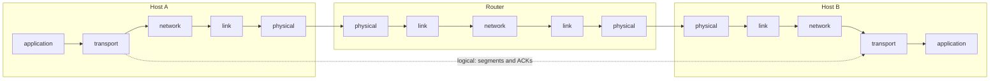

The solid arrows show the real path: down host A's stack, through the router (which climbs **only up to the network layer**), and up host B's stack. The dotted arrow is the logical transport-layer conversation. A router opens the IP header and no further; the TCP header is just payload to it. That is what makes the transport layer end-to-end in a concrete sense, and why **routers do not take part in TCP** (they do not acknowledge or retransmit, and classically do not even know a connection exists). It is also why TCP can be changed by upgrading two hosts instead of the whole Internet.

### 1.3 What applications need, and what TCP and UDP offer

**What do end users need from the transport layer?** Some care about:

- **connection management**;
- **reliability** (guaranteed arrival);
- **timing**, for example for streamed communication.

Not everyone wants all three. A file transfer wants reliability and does not care much about timing. A live video call wants timing and can tolerate a lost frame. A DNS query wants neither badly enough to pay for a connection setup. That is why the Internet offers **two** transport protocols.

| | **TCP** | **UDP** |
|---|---|---|
| Setup | Connection-oriented | Connectionless |
| Reliability | Reliable transport between sender and receiver | None: "put stuff in an envelope and rely on IP for delivery (or not)" |
| Flow control | Yes: the sender won't overwhelm the receiver | No |
| Congestion control | Yes: acts when the network is overloaded | No |
| Timing / bandwidth guarantees | No | No |

**Flow control protects the receiver. Congestion control protects the network.** They use similar mechanisms (both limit how much the sender may have in flight) but respond to different signals and serve different parties. Students mix them up constantly, and examiners know it. Congestion control is described as "an extra service, both for users and for the network's benefit": a sender that ignores congestion also hurts itself, because a saturated network drops its packets too.

### 1.4 Multiplexing and demultiplexing

A host runs many processes but has one network interface.

- **Multiplexing** (at the sending host): gathering data from several sockets and enveloping it with a header (later used for demultiplexing).
- **Demultiplexing** (at the receiving host): delivering each received segment to the **correct socket**.

The sender adds exactly the information the receiver needs to undo what the sender did: a general pattern in protocol design.

#### How it works

A host uses **IP addresses and port numbers** to direct a segment to the right socket. Every TCP/UDP segment carries a **16-bit source port** and a **16-bit destination port**:

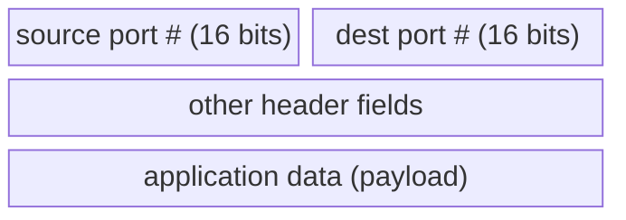

16 bits give 65,536 ports. That is a real limit: it is why a carrier-grade NAT can only squeeze so many subscribers behind one IPv4 address. Note that the ports are in the transport header but the IP addresses are in the network header, so demultiplexing needs information from **two layers** at once.

#### UDP demultiplexing

When a host receives a UDP datagram, it **checks the destination port** and sends the datagram to the socket with that port. That is the whole rule. So **datagrams with the same destination port but different source IP addresses and/or source ports go to the same socket.** One UDP socket can receive from many senders, and a UDP server needs no per-client state; the application must check the source itself if it cares who sent what.

The lecture's Java example: a server socket on port 6428 (`new DatagramSocket(6428)`), and client sockets on 5775 and 9157. Both clients send to destination port 6428; the server replies to whatever **source port** each datagram carried (5775 or 9157), which each client's operating system chose.

#### TCP demultiplexing

A TCP socket is identified by a **4-tuple**: **source IP, source port, destination IP, destination port**. The receiver uses **all four** values to pick the socket. So a server can have many simultaneous TCP sockets, **one per connection**. Web servers have a different socket for each client (and non-persistent HTTP even has a different socket for each request).

**The lecture's example.** Three segments arrive at server B, all with destination `B, port 80`:

| Segment from | Source IP, port | Goes to |
|---|---|---|
| Host A | A, 9157 | socket 1 |
| Host C | C, 9157 | socket 2 |
| Host C | C, 5775 | socket 3 |

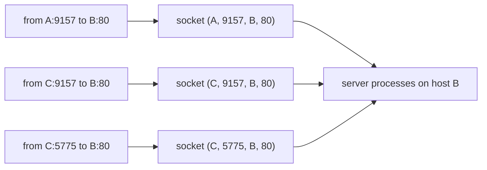

Under UDP's rule all three would land in **one** socket. The extra three values let the server keep **separate state per connection** (sequence numbers, windows, congestion state). That per-connection state is the price of everything TCP offers, and why a TCP server can be exhausted by too many connections. (The same 4-tuple, plus the protocol number, is what ECMP hashes to choose a path in the routing lecture.)

## 2. Reliable data transfer and flow control

### 2.1 Reliable data transfer and stop-and-wait

Reliable data transfer matters in the application, transport and link layers: "in the top-10 list of important networking topics". **The characteristics of the unreliable channel determine how complex the protocol must be:**

| The channel may… | So the protocol needs… |
|---|---|
| corrupt bits | a checksum and retransmission |
| also lose packets | timers |
| also reorder or duplicate | sequence numbers |

#### Positive acknowledgement with retransmission (stop-and-wait)

1. The **receiver sends an ACK** when data arrives.
2. The **sender starts a timer** whenever it transmits.
3. The sender **retransmits if the timer expires** before the ACK arrives.

"Positive" means the receiver acknowledges what **arrived**; it cannot easily notice what failed to arrive.

#### Any problem with stop-and-wait? Performance

**Example from the lecture:** a 1 Gbps link, 15 ms propagation delay, 8,000-bit packets.

- Transmission time: D_trans = L / R = 8,000 bits / 10⁹ bits/s = **8 microseconds**.
- Round-trip time: RTT = 2 × 15 ms = **30 ms**.
- **Sender utilisation** (fraction of time the sender is busy sending):

  U_sender = (L/R) / (RTT + L/R) = 0.008 ms / 30.008 ms ≈ **0.00027 = 0.027%**.

So a 1 Gbps link delivers one 8,000-bit packet every 30 ms ≈ **267 kbit/s**. The link is not the bottleneck; **the protocol is**. Making the link faster makes utilisation **worse**, because L/R shrinks while the propagation delay stays the same.

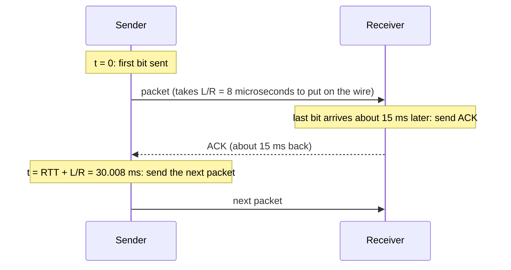

The sender's activity is a thin sliver followed by a long silence. Everything that follows (pipelining, windows and, in Part B, the bandwidth-delay product) is an attempt to **fill that silence**.

### 2.2 Pipelining and sliding windows

**Idea:** stop waiting. **Pipelining** (also called **sliding window**) lets the sender have **multiple "in-flight", not-yet-ACKed segments**.

- **Choice of N** (the window size): ideally large enough that the sender can **transmit continuously during the whole round trip**.
- It still needs ACKs and retransmission. When a segment in the sequence is missing, the receiver **acknowledges the last correctly received** in-order data.

That ideal window is the **bandwidth-delay product (BDP)**: link rate × RTT. A window smaller than the BDP leaves the link idle; a window **larger** than the BDP puts the excess **into a queue somewhere**. "Remember that last clause. It is the whole subject of Part B."

**Worked numbers (the 1 Gbps example link).** BDP = 10⁹ bit/s × 0.030 s = 3 × 10⁷ bits = 3,750 packets of 8,000 bits. Counting the transmission time too, a window of about (30.008 ms) / (0.008 ms) ≈ **3,751 packets** keeps the sender busy all the time. With a window of **3**, utilisation is 3 × 0.027% ≈ **0.08%**: "increase utilization by a factor of 3".

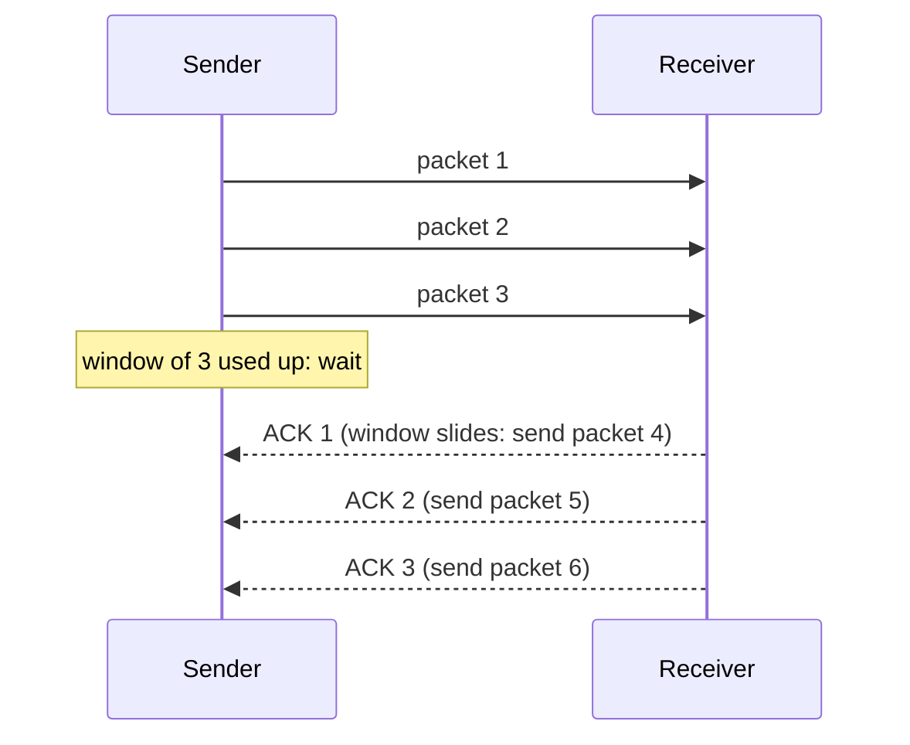

**As ACKs arrive, the window moves forward.** The window is not a fixed batch that empties and refills; it is a **range** that slides. Each ACK advances the left edge, which allows new data at the right edge. This makes TCP **self-clocking**: data leaves at the rate ACKs return, which is the rate the network delivers. (The cost: the sender's behaviour now also depends on the reverse path.)

#### TCP's sliding window counts bytes

TCP's window is measured in **byte positions**, not packets. The lecture's example:

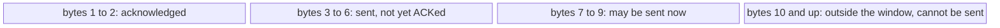

The window covers bytes 3 to 9. When the ACK for byte 3 arrives, the whole window slides one byte to the right.

Because TCP counts bytes, it can re-segment (resend data in a differently sized segment), and it gives the application a **byte stream with no message boundaries**. If an application calls `send` twice, the receiver is **not** guaranteed two matching reads; applications that need message boundaries must add them themselves (a classic source of bugs).

### 2.3 When to retransmit: RTT estimation and timeouts

**Too short a timer** → the sender retransmits data that was only delayed (wasting capacity and, as Part B shows, possibly worsening congestion). **Too long** → the sender sits idle after a real loss. The right value depends on **this path's RTT right now**, which changes, so TCP **measures it continuously**.

#### EstimatedRTT

EstimatedRTT = (1 − α) × EstimatedRTT + α × SampleRTT, typically **α = 0.125**.

This is an **exponentially weighted moving average (EWMA)**: the influence of a past sample decreases exponentially fast. It tracks recent behaviour smoothly and needs to store **one number** per connection (important when a server has hundreds of thousands of connections). The lecture's figure shows SampleRTT jumping around between gaia.cs.umass.edu and fantasia.eurecom.fr, with EstimatedRTT as a smooth line through it.

#### The timeout: EstimatedRTT plus a safety margin

- DevRTT = (1 − β) × DevRTT + β × |SampleRTT − EstimatedRTT|, typically **β = 0.25**.
- **TimeoutInterval = EstimatedRTT + 4 × DevRTT.**

A large variation in the samples gives a **larger safety margin**. On a stable path the timeout sits just above the estimate, so losses are noticed quickly; on a jittery path the margin widens automatically, so normal jitter does not cause spurious retransmissions. "The protocol is adapting not just to how long the path takes, but to how predictable it is."

#### Worked example from the lecture

At the start there is no previous estimate, so EstimatedRTT = the first sample:

| Step | SampleRTT | EstimatedRTT |
|---|---|---|
| 1st ACK | 0.052671 − 0.024047 = 0.028624 s | 0.028624 s (first sample used directly) |
| 2nd ACK | 0.052676 − 0.024048 = 0.028628 s | 0.875 × 0.028624 + 0.125 × 0.028628 = 0.0286245 s |

Each sample is the time the ACK arrived minus the time the segment was sent. Notice how little the estimate moves per sample: that damping is intended.

**Technical clarification.** The lecture's first line writes the full update formula with the same number on both sides ("0.875 × 0.028624 + 0.125 × (0.052671 − 0.024047) = 0.028624"). That is correct arithmetic, but the reason is simply that the first sample is used as the starting estimate.

**Karn's algorithm**: TCP does **not** take an RTT sample from a **retransmitted** segment, because it cannot tell whether the ACK belongs to the first or the second transmission.

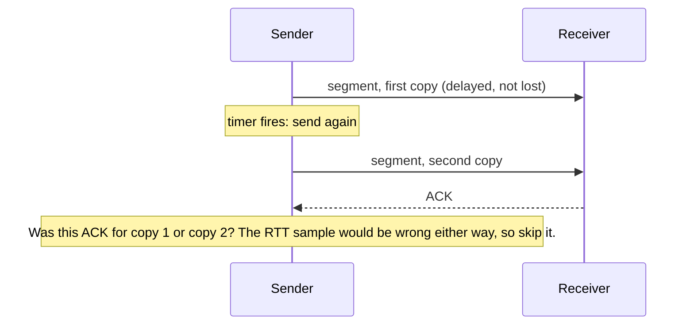

### 2.4 Fast retransmit

The timeout can be **relatively long**, so a lost packet may wait a long time to be resent. But TCP has a faster signal:

- When the receiver gets segments **out of order** (because one is missing), it keeps acknowledging the **last in-order byte**: it sends **duplicate ACKs**.
- Senders often send many segments back to back, so **if one segment is lost there will likely be many duplicate ACKs.**
- **If the sender receives 3 duplicate ACKs for the same data**, it assumes the segment after the ACKed data was lost and **resends it before the timer expires**: **fast retransmit**.

**The lecture's example** (Host A to Host B):

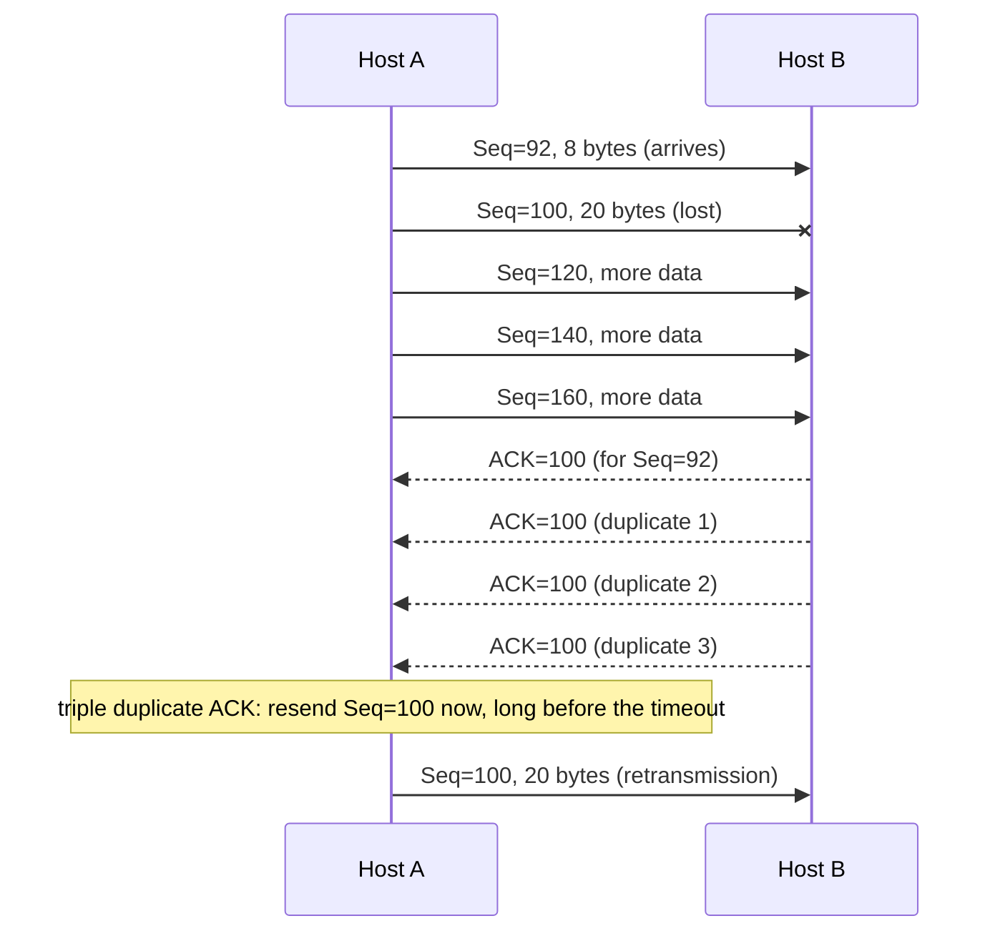

The sequence numbers after 100 (120, 140, 160) are illustrative; the lecture draws the extra segments without numbers. ACK = 100 means "I have everything up to byte 99; I want byte 100 next".

**Why 3 and not just 2?** One or two duplicates can easily be caused by mild **reordering** (packets taking slightly different paths). Retransmitting on the first duplicate would cause constant needless retransmissions on paths that reorder. Three makes reordering an unlikely explanation while still reacting much faster than the timeout.

Also note: the sender resends **only** the missing segment, not everything after it; the duplicates are evidence that the later ones arrived. Repairing several losses from one window is harder, which is what **SACK** (selective acknowledgement) was introduced for.

**Additional context.** Delayed ACKs (the receiver waits up to about 200 ms, never more than 500 ms, to acknowledge two segments with one ACK) can slow fast retransmit down, because duplicate ACKs come out more slowly. A receiver should send an ACK **immediately** when an out-of-order segment arrives (RFC 5681).

### 2.5 Flow control

**What do ACKs achieve besides reliability?** **Flow control**: the receiver can acknowledge its **receiving capacity** (the free space in its buffer, the "receiver's window"), so the sender does not swamp it.

- The **receiver** explicitly tells the sender how much free buffer space it has, in the **RcvWindow** field of every TCP segment. It changes dynamically.
- The **sender** keeps the amount of **transmitted, un-ACKed data below the most recently received RcvWindow**.
- So the sender won't overrun the receiver's buffer by sending too much, too fast.

**RcvBuffer** = the size of the TCP receive buffer; **RcvWindow** = the spare room in it.

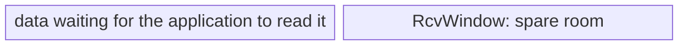

The whole bar is RcvBuffer.

As the application reads, the window grows; if the application stops reading, the window shrinks towards **zero**. A **zero window** is legal and means "stop". The sender then **probes** now and then, because a window update could itself be lost and a sender that waited passively might wait forever.

**Protocol economy:** the ACK has to travel back anyway; adding one field tells the sender two things in one message: what arrived, and how much more the receiver can hold.

## 3. Congestion control and classical TCP

### 3.1 Congestion: causes, consequences and goals

#### Need for congestion control

**Congestion occurs when demand for network resources (bandwidth, processing) exceeds capacity.** It is not just theory: in the mid-1980s the Internet suffered **congestion collapses**, where throughput fell by orders of magnitude although nothing was physically broken. Senders retransmitted into a saturated network, and the retransmissions used up the capacity that would have let anything succeed.

**Informally:** "too many sources sending too much data too fast for the network to handle."

**Manifestations:**

- **long delays** (queueing in router buffers);
- **packet loss** (buffer overflow at routers).

| | Congestion control | Flow control |
|---|---|---|
| Problem | Too many senders, sending too fast | One sender too fast for one receiver |
| Who is protected | The network | The receiver |
| Feedback | None explicit: the sender must **infer** congestion | Explicit: the receiver reports its buffer |

#### Consequences

- **Packet loss**, when overwhelmed routers drop packets.
- **Increased latency**, as packets queue.
- **Reduced throughput**, as capacity is used by traffic that is dropped or retransmitted.
- **Degraded user experience**: slow websites, stuttering video, sluggish apps.

These **compound** in a feedback loop:

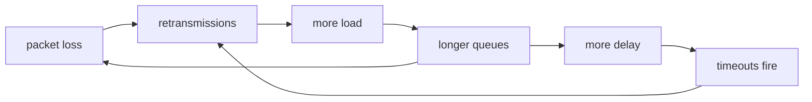

Congestion control breaks this loop by making senders **send less** when they see signs of congestion. Notice that no component has failed anywhere in the loop.

#### Goals of congestion control

- **Fair resource sharing** among users, applications and connections.
- **Preventing collapse**: keeping the network stable.
- **Ensuring QoS** (quality of service): a minimum level of performance, such as minimum bandwidth, low latency, reliable delivery.
- **Enhancing user experience.**

The goals pull against each other, and **fairness is hard to define**: equal rate per connection, per user, or per application? A user who opens ten connections gets ten shares under the first definition (which is exactly what browsers learned to do).

### 3.2 The congestion window and end-to-end feedback

- **Congestion window (CWND):** the maximum number of unacknowledged packets a sender may have in transit at any time.
- TCP **continuously adjusts CWND** based on feedback from ACKs and other indicators.

**CWND limits data in flight, not rate.** The rate follows from it:

**throughput ≈ (w × MSS) / RTT bytes/sec**, where w = CWND in segments.

The sender may have at most min(CWND, RcvWindow) un-ACKed bytes: the smaller of the congestion window and the receive window wins.

**Two consequences:**

1. The same window gives a **higher rate on a shorter path**.
2. **RTT unfairness:** two flows sharing a bottleneck with the same algorithm but different RTTs do not get equal shares; the short-RTT flow gets feedback sooner and grows faster.

**End-to-end feedback.** Think of congestion as an **alarm flag observable at the end stations**. The network does not raise the flag; routers just drop packets when buffers overflow, and the sender notices missing ACKs. So **loss is used as a proxy for congestion**, with a known defect: packets can be lost for other reasons (for example a wireless bit error), and TCP cannot tell the difference.

#### The simple feedback model

Every RTT, feedback arrives via ACKs; **duplicate ACKs indicate congestion**.

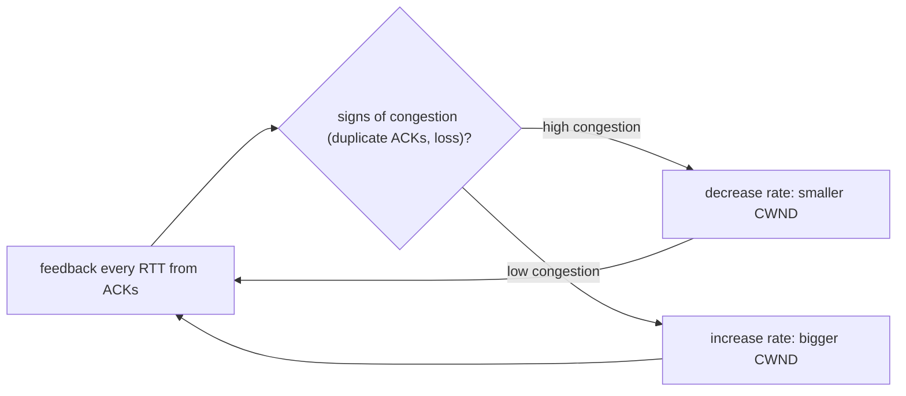

The sender treats "no trouble" as permission to send more and **never stops probing upward**, then backs off on trouble, then probes again. Capacity changes all the time as other flows come and go, so a fixed answer would be wrong within seconds. But it means TCP **causes the very loss it responds to**: "a startling thing to say out loud, and true".

### 3.3 AIMD and fairness

The lecture compares three ways to update the window:

| Scheme | On congestion | No congestion | Performance | Fairness |
|---|---|---|---|---|
| **Multiplicative** | CWND / 2 | 2 × CWND | Fast response | **Ratios unchanged** (stays unfair) |
| **Additive** | CWND − 1 | CWND + 1 | Slow response | Divides spare bandwidth equally, but the **difference remains unchanged** |
| **AIMD** | CWND / 2 (multiplicative decrease) | CWND + 1 (additive increase) | Fast response to congestion | Additive increase **improves the ratio**; multiplicative decrease keeps the ratio but **shrinks the difference** |

So with AIMD, **connections that over-use resources lose more during multiplicative decreases**, and **connections below their fair share can increase gradually**.

**TCP congestion control = AIMD.** Increase the sending rate by **1 MSS every RTT** until loss is detected; **cut it in half** at each loss event. The result is the **sawtooth**: "probing for bandwidth". Grow slowly, retreat quickly.

#### Two users, one link (Chiu and Jain, 1989)

Plot user 1's rate on one axis and user 2's on the other. The **bandwidth limit** is the line where the two rates add up to capacity; the **fairness line** is where both are equal. Additive increase moves the point **parallel to the fairness line** (both add the same amount, so the difference stays the same). Multiplicative decrease moves it **towards the origin** (both halve, so the ratio stays the same and the difference halves). Repeating the two moves drives the point to where the fairness line meets the capacity line: **a fair and efficient allocation, from any starting point, without any communication between the users**.

**Worked example.** Capacity 100. User 1 starts at 70, user 2 at 10. Each step both add 5; whenever the total goes over 100, both halve:

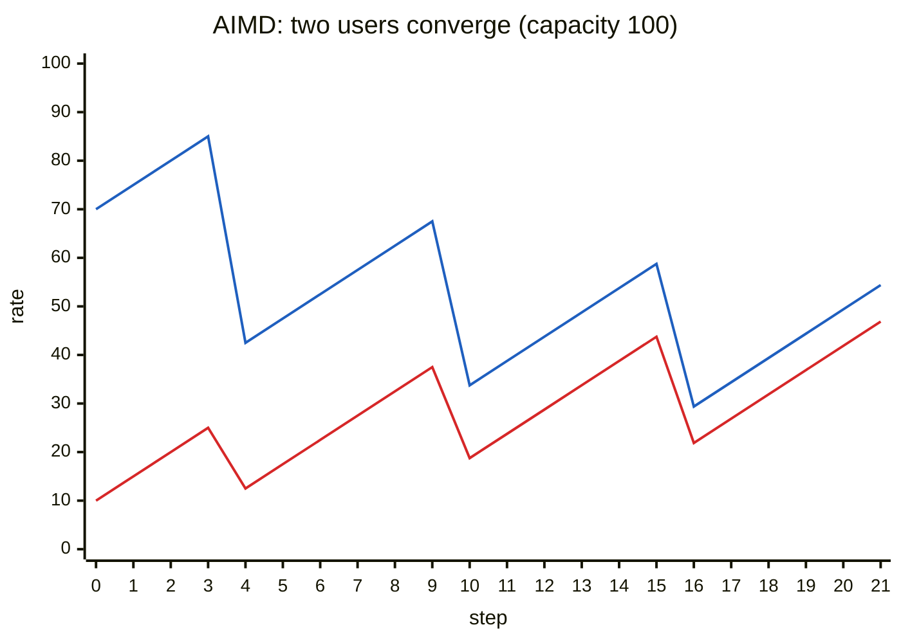

The blue (upper) line is user 1, the red (lower) line user 2. The gap between them is 60 at the start, then 30, 15 and 7.5 after the first, second and third halvings: it halves every time, so the two rates converge.

**Additional context.** A sending scheme is called **TCP-friendly** if it gets roughly the same throughput as a standard TCP flow under the same conditions. Unfairness arises when one flow backs off after loss while another keeps growing aggressively.

### 3.4 Van Jacobson's TCP: slow start and congestion avoidance

**Van Jacobson's** algorithms for TCP helped solve the congestion problem and are used in over 90% of Internet hosts. The history: in **1986** the link between Lawrence Berkeley Laboratory and UC Berkeley, a few hundred metres, dropped from **32 kbit/s to 40 bit/s**: a thousand-fold collapse with no hardware fault. Jacobson diagnosed it, and his **1988** fixes are slow start and congestion avoidance. A network of correctly working components entered a lasting near-total failure and needed a **change of algorithm**, not a repair, to leave it: the same theme as BGP wedgies in the routing lecture.

**End-to-end (no network assistance), window-based congestion control:**

- Designed by Van Jacobson in the late 1980s, based on the AIMD algorithm of Dah-Ming Chiu and Raj Jain.
- **Dynamic window size** [Van Jacobson, 1988].
- **Initialization:** the **slow start** phase (labelled "MI" in the lecture).
- **Steady state:** upon reaching a threshold, **AIMD** for **congestion avoidance**.
- It has worked well: the Internet's bandwidth has grown more than 200,000 times.
- Many versions, with different ways to detect a congestion event:
  - **TCP Tahoe:** less optimised (congestion = timeout).
  - **TCP Reno:** common implementation (congestion = timeout **or** 3 duplicate ACKs).
  - **TCP Vegas:** not currently used.

**Technical clarification.** The lecture expands MI as "Mild Increase". In the AIMD vocabulary, slow start is **multiplicative (exponential) increase**: the window doubles every RTT, which is anything but mild ("not so slow!", as the lecture says next). The lecture also spells Chiu as "Chu".

#### Slow start

```
initialize: CWND = 1
for (each segment ACKed)
    CWND++
until (congestion event OR CWND > threshold)
```

Adding 1 **per ACK** doubles the window **every RTT**: send 1 segment, get 1 ACK → CWND = 2; send 2, get 2 ACKs → CWND = 4; then 8, 16, … "Exponential increase (per RTT) in window size (not so slow!)". The name means starting from **one** segment instead of blasting at full speed. The lecture's second figure shows bursts growing from 6 to 12 to 24 segments.

**On a timeout:** Slow Start Threshold = CWND / 2 (remember where trouble started).

#### Congestion avoidance

Once CWND > threshold, grow by about **one segment per RTT** (additive increase). In practice the sender adds MSS × MSS / CWND bytes per ACK, which adds up to one MSS per round trip.

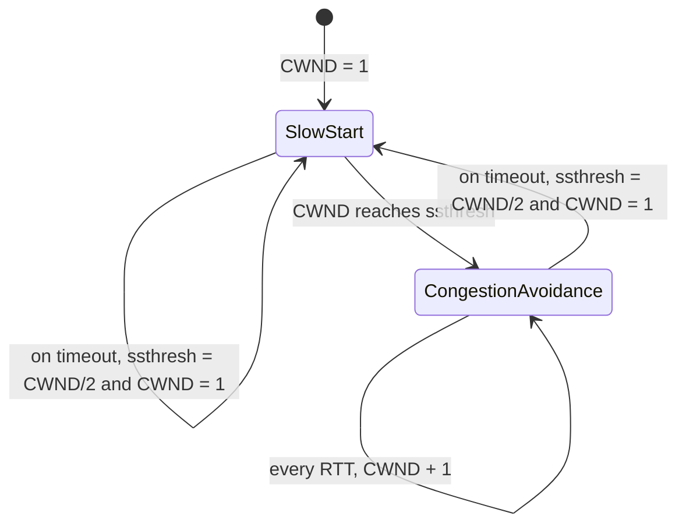

This diagram shows the parts that Tahoe and Reno share. What happens on **three duplicate ACKs** is where they differ ([section 3.5](#35-tahoe-fast-recovery-and-reno)).

Most Internet connections are short (a few kilobytes) and **finish before ever leaving slow start**. Steady-state congestion avoidance describes a minority of flows, but those carry most of the bytes.

### 3.5 Tahoe, fast recovery and Reno

#### TCP Tahoe

After slow start (CWND > threshold), add about one segment per RTT; on a loss event:

```
threshold = CWND / 2
CWND = 1
perform slow start
```

**Back to one**, whatever kind of loss it was. Tahoe throws away everything it learned about the path; on a long, fast link it takes many round trips just to get back to where it was.

**Technical clarification.** The lecture title and code spell it "Taheo"; the lecture's explanation points out it should be **Tahoe**.

#### Fast retransmit in the congestion-control story

- **Purpose:** detect and recover from loss quickly, without waiting for the retransmission timeout (RTO).
- **How:** 3 duplicate ACKs for the same packet → assume the next packet was lost.
- **Action:** retransmit immediately.

**Two loss signals of different severity:** three duplicate ACKs mean **later segments are still arriving**, so the path works. A **timeout** means **nothing came back**: a much worse sign. Tahoe's mistake was to react to both the same way.

#### Fast recovery

- **Purpose:** recover quickly after a fast retransmit by **adjusting CWND** instead of restarting.
- Instead of going down to one segment, the sender **halves** the window and **keeps sending new packets**.

The arithmetic:

```
Threshold = CWND / 2
CWND = Threshold + 3
for each further duplicate ACK: CWND++
when a new ACK arrives (the retransmission was received):
    CWND = Threshold
    go back to congestion avoidance
```

**Why + 3?** The three duplicate ACKs mean three segments **left the network** and reached the receiver, so three fewer are in flight than the sender's count suggests; adding 3 corrects the count. Likewise, **each extra duplicate ACK** shows one more segment has left the network, so the sender may send one more without adding load. This is called **window inflation**: careful bookkeeping of what is really in flight. When the new ACK arrives, the inflation is undone (CWND = Threshold).

**Technical clarification.** The lecture spells "flight" as "flisht".

#### The key differences

| | Fast retransmit | Fast recovery |
|---|---|---|
| Objective | Quickly **resend** the lost packet | **Manage CWND** after the fast retransmit |
| Timing | Immediately on the 3rd duplicate ACK | The phase that **follows** fast retransmit |
| Effect on CWND | None directly | Halves it (plus 3), then grows it gradually |

They are always used together and they are not the same thing; an exam question about "the difference" is asking exactly this.

#### The whole picture

The figure plots CWND against round-trip times for Reno:

- **Slow start** from 1 up to **ssthresh = 28** (around RTT 5).
- **Congestion avoidance**: gentle climb to **36** at around RTT 13.
- **Three duplicate ACKs:** ssthresh(new) = 36 / 2 = **18**; CWND(new) = 18 + 3 = **21**.
- **Fast recovery:** CWND inflates a little with each further duplicate ACK.
- **ACK for the retransmitted segment:** CWND = ssthresh(new) = **18**; congestion avoidance resumes.

**Tahoe vs Reno, worked.** Initial ssthresh 16; three duplicate ACKs arrive when CWND = 24. Reno drops to 12 (ignoring the brief +3 inflation) and continues linearly; Tahoe drops to 1 and slow-starts up to its new threshold 12:

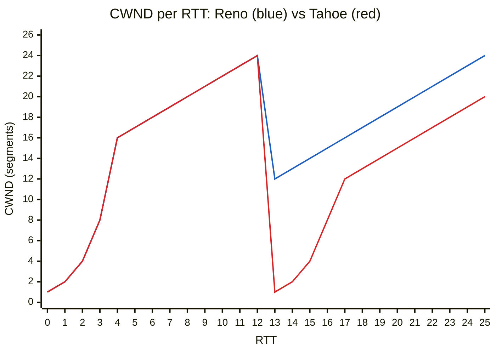

The two lines are identical until RTT 12. After the loss, Tahoe needs four extra round trips to climb back to 12, and stays 4 segments behind Reno from then on in this example. On a long, fast path the difference is much larger.

#### TCP Congestion Window Trace †

*(Hidden, archived slide.)* A real CWND trace is messier than the idealised sawtooth: variable peaks, uneven intervals, occasional deep cuts, because real paths have competing flows arriving and leaving, route changes and cross traffic.

#### TCP variants summary

- **TCP Tahoe:** slow start, congestion avoidance and fast retransmit. On 3 duplicate ACKs: fast retransmit and **CWND = 1**.
- **TCP Reno:** slow start, congestion avoidance, fast retransmit **and fast recovery**. On 3 duplicate ACKs: fast retransmit and **CWND = threshold + 3** "to keep the pipe full" (fast recovery).
- In both, the **receiver buffers out-of-order packets**; when the lost packet arrives via fast retransmit, the receiver sends a **cumulative ACK** covering everything it now has in order.
- Other implementations: Vegas, NewReno and SACK TCP.

| Event | Tahoe | Reno |
|---|---|---|
| 3 duplicate ACKs | ssthresh = CWND/2, CWND = 1, slow start | ssthresh = CWND/2, CWND = ssthresh + 3, fast recovery |
| Timeout | ssthresh = CWND/2, CWND = 1, slow start | ssthresh = CWND/2, CWND = 1, slow start |

**Technical clarification.** The lecture calls NewReno "the most commonly implemented on webservers today, according to a survey". That survey is old; the lecture's explanation says the algorithm in Linux today is **CUBIC**, which is what most web servers run.

### 3.6 TCP variants: NewReno, Vegas, Westwood, CUBIC, and ECN

#### Reno vs NewReno

- **Reno** improves congestion control after loss by entering fast recovery on duplicate ACKs.
- But Reno enters fast recovery even if only a single packet is lost, and it handles **several losses in one window** badly.
- **NewReno** reduces slowdowns and uses bandwidth better.

What NewReno actually does (quiz key, RFC 6582): Reno **leaves** fast recovery at the first new ACK, so when several segments from one window are lost it exits and re-enters fast recovery repeatedly, one round trip each time. NewReno uses **partial ACKs**: if a new ACK advances but does not cover everything that was outstanding when recovery began, another segment must also be lost; NewReno retransmits it at once and **stays in fast recovery until all lost packets of that window are acknowledged**. Buffer overflow tends to drop several consecutive packets, so this matters a lot.

**Technical clarification.** The lecture says NewReno "allows multiple packets to be transmitted before entering Fast Recovery". That is not the standard description; learn the partial-ACK description above, which matches the lecture's own explanation, RFC 6582 and the quiz key.

#### Vegas

**Vegas** monitors **variation in RTTs** and adjusts the sending rate: a rising RTT means a queue is building, so Vegas slows down **before** anything is dropped. It aims to keep queueing delay minimal and behaviour steady: **delay-based** congestion control, two decades before BBR.

Why it failed in practice: a delay-based sender backs off when it sees a queue forming, while a loss-based sender next to it keeps pushing until the buffer overflows. **Sharing a link, the polite algorithm gets less.**

**Technical clarification.** The lecture says Vegas is "not currently used (higher latency)". Vegas was designed for **lower** latency; the reason it is not used is the one above (it loses bandwidth to loss-based flows).

#### Westwood

**Westwood** estimates the available **bandwidth from the rate of ACKs** and regulates CWND from that estimate (after a loss, it sets the window from the estimate instead of blindly halving). It aims for good performance on high-speed, long-distance networks, and the quiz associates it with **wireless** links, where many losses are not caused by congestion.

#### CUBIC

- **Default in Linux**, and the most popular TCP for web servers.
- A **smoother adjustment of CWND** during congestion avoidance, using a **cubic function** of the time since the last congestion event.
- **K** is the point in time at which the window will again reach **W_max**, the size it had when the last loss happened.

Additive increase is too slow on high-BDP paths: adding one segment per RTT to rebuild a window of tens of thousands of segments takes far too long. CUBIC instead grows **fast** while far below W_max, **flattens** near W_max (the level that caused trouble last time), then **accelerates again** beyond it to probe for new capacity. Growth depends on **elapsed time**, not on ACKs received, which makes CUBIC less unfair to long-RTT flows.

**Technical clarification.** The lecture's text reads "Large increase when near K, small increase near K", which is garbled. The correct statement: **small increase near K** (near W_max), **large increase far from K**.

**Additional context.** The CUBIC window (RFC 9438) is W(t) = C × (t − K)³ + W_max, with K = ∛(W_max × (1 − β) / C), β = 0.7 (after a loss the window drops to 70% of W_max) and C = 0.4. With W_max = 100 segments, K = ∛75 ≈ 4.2 seconds.

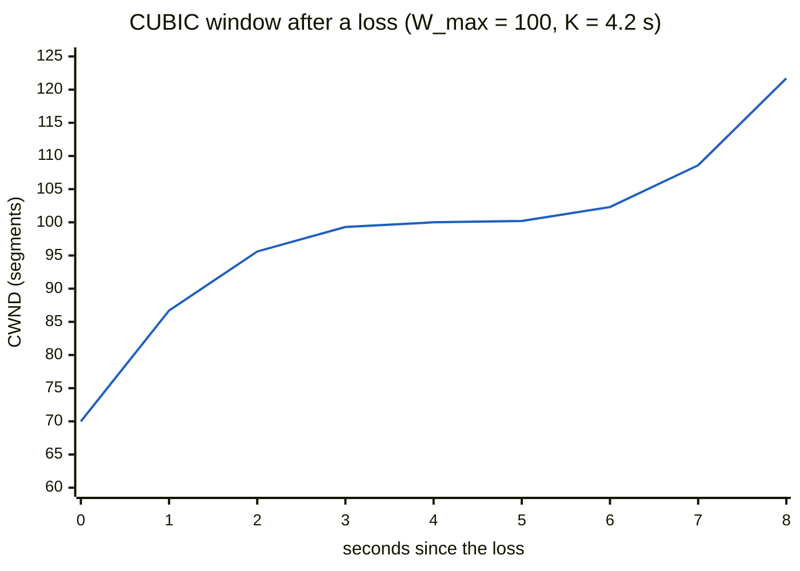

Fast at first, almost flat around 100 (near K), then faster again: the cubic shape.

#### TCP BBR (as a variant)

BBR estimates the available **bottleneck bandwidth** and adjusts CWND to maximise utilisation **without causing queueing delay**. See [section 4.3](#43-bbr).

#### Explicit Congestion Notification (ECN)

- Improve congestion control via **router indications before packets are lost**.
- **ECN bits:** special bits in the **IP header**. A congested router **marks** a packet instead of dropping it.
- **Receiver's role:** its ACK tells the sender that congestion was seen (via ECN fields in the **TCP header**).
- **Sender's response:** reduces its rate **proactively**, before any loss.

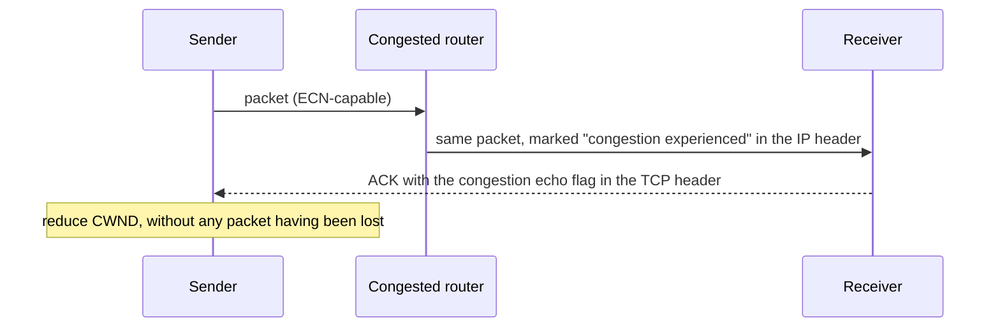

No data is destroyed: no retransmission and no waiting for loss detection. But the signal crosses a layer boundary in each direction (IP → TCP → sender), so **router, receiver and sender** must all support it, which slowed deployment. And because a classic ECN sender reacts to a mark **exactly as to a loss** (halving), marks must stay rare: the limitation L4S removes.

### 3.7 The history of TCP

| Year | Event |
|---|---|
| 1974 | TCP described by Vint Cerf and Bob Kahn (IEEE Transactions on Communications). |
| 1975 | Three-way handshake (Ray Tomlinson, SIGCOMM 75). |
| 1981 | RFC 793 and RFC 791 standardise TCP and IP. |
| 1983 | BSD Unix 4.2 supports TCP/IP. |
| 1984 | Nagle's algorithm reduces the overhead of small packets and predicts congestion collapse. |
| 1986 | Congestion collapse first observed. |
| 1987 | Karn's algorithm for better RTT estimation. |
| 1988 | Van Jacobson's algorithms: slow start, congestion avoidance, fast retransmit (4.3BSD Tahoe, SIGCOMM 88). |
| 1990 | 4.3BSD Reno: fast recovery, delayed ACKs. |
| 1993–94 | TCP Vegas (Brakmo et al., not widely implemented), T/TCP (Braden), ECN proposed (Floyd). |
| 1996 | NewReno (modified fast recovery), SACK (Floyd et al.), FACK (Mathis et al.), improved startup (Hoe). |

Two observations: **Nagle predicted congestion collapse before it happened, and it happened anyway**; and several good ideas took decades to matter (ECN, proposed in 1994, had little effect until L4S in the 2020s; Vegas's idea "measure delay, not loss" only succeeded with BBR in 2016). "Good ideas do not deploy because they are good. They deploy when the conditions that make them necessary arrive, and when enough parties can act at once."

**Technical clarification.** The lecture's timeline spells Nagle as "Nagel". The years in the table are given in the lecture's explanation; its timeline picture shows the events without all the dates.

## 4. Modern transport: beyond loss-based control

### 4.1 Part B: thirty years you have not been taught

*(Part B, "Beyond EDA344": new compared with an introductory course.)*

The standard story ends around **1996**: Tahoe, Reno, NewReno, SACK. Since then:

| Development | What it is |
|---|---|
| **CUBIC** as default (2006) | A cubic function decides how fast the window grows. |
| **ECN** deployment | Routers warn endpoints by **marking** packets instead of dropping them. |
| **Bufferbloat** (named about 2010–11) | Harmful delay caused by excessively large buffers in routers and switches. |
| **BBR** (2016) | Google's algorithm that models the path's capacity instead of reacting to loss. |
| **QUIC** (standardised 2021) | A transport protocol running over UDP, designed to replace TCP for most web traffic. |
| **L4S** (RFCs 2023) | Low Latency, Low Loss, Scalable throughput: a redesigned congestion signal to cut queueing delay. |

"Congestion control stopped being a solved problem and became an active one." Every assumption under the 1996 design changed: buffers became huge, wireless made loss a poor congestion signal, **latency** (not throughput) became what users notice, and transport moved **out of the operating system**. None of Part A is wrong (CUBIC is still the Linux default and a direct descendant); the story is just **incomplete**.

### 4.2 Bufferbloat and AQM

#### Bufferbloat

- **Loss-based congestion control fills whatever buffer it finds.**
- Memory got cheap, so buffers got deep: **seconds** of queueing delay.
- **Throughput stayed fine; latency collapsed.**
- "More memory made the Internet slower. The protocol was working as designed."

A loss-based sender keeps increasing its window until something is dropped. With a small buffer that happens quickly and the queue stays short. With a **huge** buffer, the sender keeps going, **filling memory rather than the link**, until the buffer is full. The link is busy all along, so throughput looks fine, but every packet now waits behind a buffer-full of someone else's bulk download. On home routers of the late 2000s this reached **whole seconds**. Vendors added memory believing that fewer drops meant better performance; they were right about drops and wrong about performance. The name and diagnosis come from **Jim Gettys** around 2010.

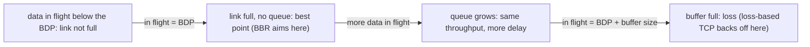

Everything between the BDP point and the buffer-full point is **queue: pure latency with no gain in throughput**. Bigger buffers just stretch that middle region.

#### AQM: managing the queue instead

- **If senders cannot detect a full buffer, the buffer must tell them.**
- **CoDel:** drop based on **how long** packets have been queued, not **how many** are queued.
- **FQ-CoDel:** **per-flow queueing**, so one bulk transfer cannot starve an interactive one.
- **The fix moved from the endpoint to the middle of the network.**

CoDel changes what triggers a drop: queue length in packets is a poor stand-in for delay (it breaks whenever bandwidth changes), so CoDel measures how long packets actually sit and acts on **persistent standing delay**: a control law on **time**, not occupancy. FQ-CoDel adds **fair queueing**: separate queues per flow, so a download and a video call do not share one queue. Most of the improvement people notice comes from the fair-queueing part.

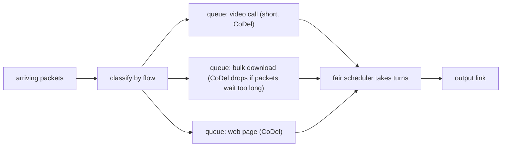

**Architectural tension:** the end-to-end argument says to put functions at the endpoints, but here the endpoints **could not** solve the problem (a sender cannot observe a queue nobody tells it about), so the network had to step in.

**Additional context.** The quiz also asks about **DropTail** and **RED**. DropTail is the plain rule "when the queue is full, drop every new packet": many flows lose packets at the same moment, all halve together and grow together (**synchronised losses**), wasting capacity and hurting fairness. **RED (Random Early Detection)**, an early AQM scheme, drops or marks a few **random** packets as the **average** queue grows, before it is full, so senders slow down early and at different times.

### 4.3 BBR

#### BBR: asking a different question

- Loss-based congestion control asks: **has something been dropped yet?**
- BBR asks: **what is the bottleneck bandwidth, and what is the minimum RTT?**
- Send at the **estimated bandwidth-delay product**; **do not fill the queue at all**.
- "**A model of the path, not a reaction to its failure.**"

Every algorithm in Part A is **reactive**: send more until something breaks, then less; by the time loss arrives, the damage (a full buffer) is done. BBR continuously estimates two properties of the path: the **bottleneck bandwidth** (the highest delivery rate seen recently) and the **minimum RTT** (the RTT when no queue has built). Their product is how much data can be in flight with the link fully used and the queue empty. In the flowchart of [section 4.2](#42-bufferbloat-and-aqm), loss-based control operates at the **buffer-full** point; BBR targets the **BDP** point. BBR is not a refinement of AIMD or CUBIC; it is a **different paradigm**.

#### BBR's status

- **BBRv3** is specified in **draft-ietf-ccwg-bbr, revision 06, July 2026**.
- Still **Experimental** after **nine years and three major versions**.
- The draft specifies **no ECN response**: an open question, not an oversight.
- "Widely deployed and not yet standardised are compatible states."
- (The lecture says to verify the current revision at datatracker.ietf.org.)

People assume standardisation comes before deployment; in transport it often runs the other way: an operator with enough traffic can deploy on its own, and the standard then documents what already exists. The pattern has now appeared three times: **RPKI** (about two-thirds of prefixes signed, about an eighth of networks checking), **ASPA** (standardised, adopted by well under 1%), and **BBR** (deployed globally, still Experimental). "Specified, deployed, and adopted are three different states."

#### Does BBR play fair?

- An **independent evaluation** (PAM 2024, by MPI-INF and VU Amsterdam) tested the claim.
- **BBRv3 keeps BBRv1-like unfairness towards CUBIC in shallow buffers.**
- A **persistent bias favouring long-RTT flows** remains.
- "Measured behaviour contradicting the deployment narrative."

Be precise: this does **not** show that BBR is bad or that its designers were dishonest. It shows that a central claim about a globally deployed algorithm was tested **by outsiders** and did not fully hold. "When a claim is made about a deployed system, ask who measured it, on what, and what the method could not see."

### 4.4 L4S and QUIC

#### L4S: Low Latency, Low Loss, Scalable Throughput

- Specified in **RFC 9330, 9331, 9332**.
- **Two queues**: classic traffic and scalable traffic, separated by the **ECT(1)** marking.
- **Mark early and often** rather than drop, so senders react **before** a queue builds.
- "**Congestion signalling redesigned** rather than congestion response retuned."

Classic ECN senders treat a mark like a loss and halve their window, so marks must be rare and the signal stays coarse. L4S separates the traffic: packets marked **ECT(1)** go into a **low-latency queue** whose AQM marks **early and often**, and senders using a **scalable** congestion control respond to each mark with a **small, proportional** step instead of halving. Classic traffic keeps its own queue and behaviour, and the two queues are **coupled** so neither starves the other.

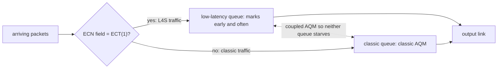

Compare with CoDel: CoDel manages **one shared queue** better; L4S **separates** the traffic classes and **changes what the signal means**. (An L4S deployment runs AQM in both queues.)

#### L4S is actually deployed

- **Comcast** has rolled it out across its production network.
- **Apple** devices support it from **iOS 17 and macOS Sonoma** onward.
- Not a paper standard: running in consumer networks now.
- Compare with ASPA: standardised, available, barely used.

L4S needs the **network and the endpoint to cooperate**, which normally makes deployment harder. It happened because **two organisations big enough to matter each controlled one side** and coordinated. ASPA needs thousands of independent networks to act with no coordinator. "The difference is not technical merit. It is how many parties must move, and whether any single one of them benefits before the others do."

#### L4S measured, honestly

- A **March 2026 field study**: **83 households**, about **120,000 controlled experiments**.
- **Up to about 25% tail-latency reduction** for interactive traffic.
- **Minimal gains** for some workloads; benefits concentrated at **peak hours**.
- "A real improvement, bounded and situational, not a universal win."

The improvement is in the **tail** (the worst delays), not the **mean**: the right metric for interactive traffic like video calls (which suffer from the occasional long delay), and the wrong one for a throughput chart. And benefits appear at peak hours, when there is congestion to relieve, which a vendor benchmark on an idle link would miss.

#### QUIC moves congestion control to userspace

- TCP congestion control lives **in the kernel**: changing it means changing the operating system.
- **QUIC runs in the application**, so the algorithm **ships with the browser**.
- **Deployment speed increases; so does fragmentation** across implementations.
- "**Who controls the algorithm determines how fast it can change.**"

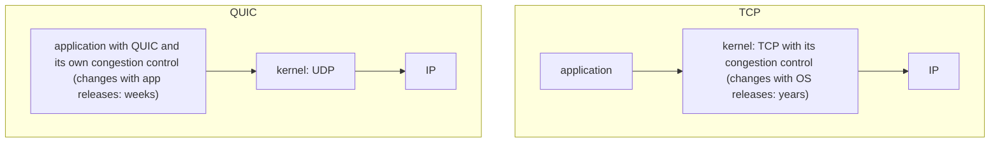

A browser vendor can change congestion control for hundreds of millions of users in weeks; BBR spread quickly partly because it did not have to wait for operating systems. The cost: there is **no longer one congestion control** on the Internet. Different applications run different algorithms with different fairness properties on the same links, with no coordination. "If every application shipped its own congestion control, what would prevent a race to the most aggressive one?"

#### Real-world applications †

*(Hidden, archived slide.)* Congestion control matters for **web browsing** (pages without needless delay), **streaming** (less buffering), **file downloads** (fast without destabilising the network), **online gaming** (stable, low lag) and **cloud services** (responsiveness). They map to Part B: gaming cares about the **tail latency** that bufferbloat destroys and L4S improves; streaming wants steady throughput, which BBR's rate estimation targets; downloads on long fat paths are what CUBIC was designed for.

### 4.5 How TCP fails, and summary

#### How TCP fails

- A sender **cannot distinguish congestion loss from wireless loss**, and backs off either way.
- **Competing algorithms reach an equilibrium neither would choose alone.**
- A **route flap changes the RTT** under an estimator built assuming it is stable.
- "**Convergence to a stable state is not convergence to a good one.**"

Each is correct behaviour producing a bad outcome:

1. On a lossy wireless path, TCP throttles for no reason, and no signal is available to tell the cases apart.
2. Two senders with different algorithms settle into a split neither would have chosen. Nothing failed; the system **converged, somewhere bad**.
3. After a route change, the RTT estimator (and its variance) describes a path that no longer exists.

This is the fourth of six closing slides with the same theme: BGP wedgies (converged to a state nobody wanted), DNS (serves wrong answers it cannot detect), IPv6 (failures masked by the mechanism meant to smooth them), and now TCP. "What would a protocol need in order to leave a bad state by itself? The second half of this course answers it" (self-stabilization).

#### Summary: TCP

- The **major transport service** on the Internet.
- **Connection-oriented.**
- Provides **end-to-end reliability.**
- Includes **flow/error control and congestion control.**

Each line was contested at some point: connection orientation (QUIC revisits it), end-to-end reliability (ECN and L4S move some responsibility into the network), and congestion control, which was **not in the original protocol at all**: it was added in 1988 after the network began collapsing.

#### Interactive exercises

*(Self-study.)* The lecture lists the Kurose–Ross interactive exercises and animations (gaia.cs.umass.edu/kurose_ross/interactive/): TCP sequence and ACK numbers with segment loss; RTT and timeout; congestion window evolution; retransmissions with ACK loss; animations of Go-Back-N, Selective Repeat, flow control and TCP congestion control. If you are short of time, the lecture recommends the **congestion window** and the **RTT and timeout** exercises.

## 5. Review questions

### 5.1 Check yourself: worked answers

These are answers to some of the "Check yourself" questions in the lecture, worked out with the lecture's formulas.

| Question | Answer |
|---|---|
| Stop-and-wait: transmitting takes 1 ms and the RTT is 100 ms. What fraction of time is the sender sending? | 1 / (100 + 1) ≈ **1%**. |
| The 1 Gbps example link with a satellite path of 250 ms each way? | U = 0.008 / (500 + 0.008) ≈ **0.0016%**: even worse; the propagation delay is what matters. |
| What window saturates the 1 Gbps example link? | About (30 + 0.008) / 0.008 ≈ **3,751 packets** (the BDP is 3,750 packets of 8,000 bits). Twice that just builds a queue. |
| CWND = 64 KB, RTT = 20 ms: throughput? | 65,536 × 8 bits / 0.020 s ≈ **26 Mbit/s**. If the path's RTT grows, the rate falls in proportion. |
| Two flows with RTTs 10 ms and 100 ms share a link: who wins? | The **10 ms** flow, roughly **10 : 1** for classic window-based TCP (throughput ∝ 1/RTT). |
| Slow start from CWND = 1: round trips to reach 64? | **6** (1 → 2 → 4 → 8 → 16 → 32 → 64). Additive increase would need **63**. |
| A 20 kB transfer with an initial window of 10 segments: does it reach congestion avoidance? | With a 1,460-byte MSS, 10 segments ≈ 14.6 kB in the first RTT and the rest in the second, so it **finishes in slow start**. |
| With α = 1/8, how fast does the estimate follow a step change? | After n samples, (7/8)ⁿ of the old value remains: about **half after 5 samples** and about 90% of the change after 17. |
| If the true RTT suddenly doubles, is the first timeout too short or too long? | Probably **too short** (the estimate lags), causing a spurious retransmission; TCP then backs off (doubles the timeout) and Karn's rule stops it from learning from the retransmitted segment. |
| What does a receive window pinned near zero say about an application? | The application is **not reading** its data fast enough: the receiver, not the network, is the bottleneck. |
| Which three parties must support ECN? | The **sender**, the **routers** that mark, and the **receiver** that echoes. If one is missing, routers fall back to dropping, or the mark is never echoed. |
| How long until a 32-bit sequence number space wraps at 10 Gbit/s? | 2³² bytes ≈ 34.4 Gbit, so about **3.4 seconds**. |
| What window fills a 1 Gbit/s path with a 100 ms RTT? | 10⁹ × 0.1 = 10⁸ bits = **12.5 MB**, about 190 times the 64 KB maximum of the original header (hence the window scale option). |
| For each of Tahoe and Reno, CWND after 3 duplicate ACKs and after a timeout? | Tahoe: 1 and 1. Reno: ssthresh + 3 (then ssthresh) and 1. |
| Reno vs NewReno when three segments are lost from one window? | Reno repairs about **one loss per round trip** (re-entering recovery, often ending in a timeout); NewReno repairs all three in **one recovery episode**, one partial ACK per lost segment. |

### 5.2 Review questions †

*(Hidden material †.)*

**1. A finite sequence number field.** "TCP uses a finite field to contain stream sequence numbers. How does it allow an arbitrary-length stream?" The 32-bit numbers **wrap around** and are compared with modulo arithmetic. The constraint is how fast you may wrap: on a very fast link, numbers can wrap while old segments are still in the network, which is what **PAWS** (protection against wrapped sequence numbers, using timestamps) addresses.

**2. Unnecessary retransmissions.** "Under what conditions of delay, bandwidth, load and packet loss will TCP retransmit significant volumes of data unnecessarily?" When timeouts fire on segments that were only **delayed** (sudden RTT increases, high jitter, heavy load), and when a whole window is resent although only one segment was missing (for example in Go-Back-N-like behaviour, or after a timeout in Tahoe).

**3. A lost ACK need not force retransmission.** Because TCP ACKs are **cumulative**: a later ACK (for example ACK = 300) also confirms everything an earlier, lost ACK (ACK = 200) would have confirmed, as long as it arrives before the timer expires.

**4. Discarding out-of-order segments.** "Imagine a TCP that discards segments that arrive out of order, even inside the window. Does it work?" **Yes, it is still correct**: anything discarded will be retransmitted. But **performance collapses**: one loss forces retransmission of everything after it, and duplicate ACKs (the basis of fast retransmit) become far less useful. "A protocol can be correct and useless."

**5. Initial sequence number always 1.** "Explain how a crash and restart can confuse a remote system into believing that the old connection remained open." After a restart, the host opens a new connection with the **same** ports and the **same** starting sequence number 1. Segments of the new connection then fall inside the sequence space the remote side still expects for the **old** connection, so the remote side accepts them as if the old connection had continued (and old delayed segments can also be mistaken for new ones). That is why initial sequence numbers are chosen from a clock or randomly.

**6. Window-limited throughput.** "Maximum window 64 KB, unbounded bandwidth, average RTT 20 ms: maximum throughput? And with RTT 40 ms?" Throughput = window / RTT = 64 KB / 20 ms ≈ **26 Mbit/s** (3.2 MB/s). With 40 ms it **halves** to about **13 Mbit/s**. On a path with infinite bandwidth, the **window and RTT alone** decide throughput: the reason for the window scale option.

### 5.3 Related quiz topics not in the lecture

**Additional context.** The course's pre-lecture TCP quiz (29 questions) asks about a few things that the lecture does not cover directly. Short explanations:

- **The three-way handshake.** TCP opens a connection with **SYN** (client: "let's talk, my first sequence number is x"), **SYN-ACK** (server: "OK, mine is y, I expect x + 1") and **ACK** (client: "I expect y + 1").

```mermaid
sequenceDiagram
  participant C as Client
  participant S as Server
  C->>S: SYN, seq = x
  S-->>C: SYN-ACK, seq = y, ack = x + 1
  C->>S: ACK, ack = y + 1
  Note over C,S: connection open: data can flow both ways
```

- **Sequence and ACK numbers.** The sequence number of a segment is the number of its **first data byte** in the stream; the ACK number is "the **next byte** I expect". Example: seq = 1 with 100 bytes (1–100) is answered by ACK = 101. Sequence numbers are 32 bits so that old, delayed segments are very unlikely to be confused with new ones when numbers wrap.
- **RTO too small or too large.** Too small: **spurious retransmissions** of packets that were only slow. Too large: **slow recovery** after a real loss.
- **SYN flood.** An attacker sends thousands of SYNs and never completes the handshake; the server keeps memory for each half-open connection and runs out.
- **SYN cookies.** The server keeps **no** memory for half-open connections. It encodes the needed information (a cryptographic hash of addresses, ports and time) into the **initial sequence number** it sends in the SYN-ACK. A real client's final ACK returns that number + 1, so the server can rebuild the state then.
- **TCP reset (RST) attack.** A forged RST segment kills a connection if its sequence number falls inside the expected window; **predictable** sequence numbers make this feasible.
- **Wireless.** On Wi-Fi many losses come from radio noise, not congestion; standard TCP treats every loss as congestion and halves its speed for nothing (the first failure in [section 4.5](#45-how-tcp-fails-and-summary)).

## Revision notes and references

Technical clarifications, where the lecture material is corrected or made precise, appear in sections [2.3](#23-when-to-retransmit-rtt-estimation-and-timeouts), [3.4](#34-van-jacobsons-tcp-slow-start-and-congestion-avoidance), [3.5](#35-tahoe-fast-recovery-and-reno), [3.6](#36-tcp-variants-newreno-vegas-westwood-cubic-and-ecn), [3.7](#37-the-history-of-tcp). Where the slides and the course book differ, this guide follows the book and says so at that point.

- J. Kurose and K. Ross, *Computer Networking: A Top-Down Approach*: transport layer chapter.
- [RFC 9293 — TCP](https://www.rfc-editor.org/rfc/rfc9293), [RFC 6298 — computing TCP's retransmission timer](https://www.rfc-editor.org/rfc/rfc6298) and [RFC 5681 — TCP congestion control](https://www.rfc-editor.org/rfc/rfc5681).
- V. Jacobson, "Congestion Avoidance and Control", ACM SIGCOMM 1988: slow start and congestion avoidance.
- [RFC 6582 — NewReno](https://www.rfc-editor.org/rfc/rfc6582), [RFC 3168 — ECN](https://www.rfc-editor.org/rfc/rfc3168) and [RFC 9438 — CUBIC](https://www.rfc-editor.org/rfc/rfc9438): later loss-based TCP variants and explicit congestion notification.
- N. Cardwell et al., "BBR: Congestion-Based Congestion Control", *ACM Queue* 14(5), 2016; [RFC 9330 — L4S architecture](https://www.rfc-editor.org/rfc/rfc9330); [RFC 9000 — QUIC](https://www.rfc-editor.org/rfc/rfc9000).
