# The Socket API

**Course:** EDA387/DIT661 Computer Networks, "Socket API" (three lecture sessions plus self-study material). Session one builds a working client and server and explains why the interface looks the way it does. Session two goes through the elementary calls and addresses. Session three is about many clients at once, attacks on servers, scaling to ten thousand connections and more, and what people build on top of sockets. The code comes from W. Richard Stevens, *UNIX Network Programming*. About two thirds of the material is marked **Self-study**; it is "not filler and not optional", so it is included here like everything else.

**Revised:** 21 October 2026

**† Supplementary material:** content that comes only from hidden PowerPoint slides. It may not be part of this year's examinable material. In this lecture the hidden material is the three self-assessment checklists (section 8.2) and part of the discussion of TIME_WAIT (section 3.4). Text from them is marked with †.

**Notes in the text.** Paragraphs that begin with **Technical clarification** mark places where the lecture material is wrong, inconsistent or imprecise, and give the correct statement. Paragraphs that begin with **Additional context** add material from outside the lecture, such as the course book (Dolev), old exams, the pre-lecture quizzes or general knowledge.

**No programming knowledge needed.** The lecture contains C code. Every piece of code below is explained line by line in plain words, so you can follow the ideas even if you have never programmed. A "function" is a named command (like `connect`) that a program can call; the values in brackets are what you give it; it hands back a "return value".

---

## Glossary

| Term | Expansion or category | Meaning |
|---|---|---|
| Active close | — | The side that calls `close` first; it sends the first FIN and later sits in TIME_WAIT. |
| Active open | — | The client side of opening a connection: calling `connect`, which sends a SYN. |
| AF_INET / AF_INET6 | Address Family Internet (version 4 / version 6) | The constant that says "this socket or address uses IPv4" (or IPv6). |
| API | Application Programming Interface | The set of functions a program may call to use some service, here the network. |
| Backlog | — | The second argument of `listen`: roughly how many waiting connections the kernel may queue. |
| Big-endian | — | Storing a multi-byte number with its most significant ("big") byte first. The network uses this order. |
| Blocking call | — | A call that makes the program wait (sleep) until the work is done. |
| BSD | Berkeley Software Distribution | The version of Unix from the University of California, Berkeley, where sockets were created (4.2BSD, 1983). |
| Byte stream | — | A flow of bytes with no built-in boundaries between "messages"; what TCP gives you. |
| C10K / C10M | — | The challenge of one server handling ten thousand (1999) or ten million (2013) connections at once. |
| Concurrent server | — | A server that serves several clients at the same time. |
| Connected descriptor | — | The new descriptor returned by `accept`, used to talk to one particular client. |
| Daemon | — | A long-running background program, such as a server. |
| Descriptor (file descriptor, fd) | — | A small whole number (0, 1, 2, 3 …) that a program uses to name an open file or socket. |
| DPDK | Data Plane Development Kit | A library that lets a program drive the network card directly, bypassing the kernel. |
| EINTR | "Interrupted" error code | A slow call was interrupted by a signal; just try the call again. |
| EOF | End Of File | "No more data will come." On a socket: `read` returns 0 after the peer's FIN. |
| Ephemeral port | — | A short-lived port number that the kernel picks for the client side of a connection. |
| epoll / kqueue | — | Modern Linux (epoll) and BSD (kqueue) replacements for `select` that scale to many connections. |
| errno | — | A variable where the system stores the reason for the last error. |
| fd_set | — | A row of on/off bits, one per descriptor number, used by `select`. |
| FD_SETSIZE | — | The fixed size of `select`'s descriptor set, usually 1024. |
| FIN | Finish | A TCP segment that says "I have finished sending". |
| Four-tuple | — | (local IP, local port, remote IP, remote port): the four values that identify a TCP connection. Also called the socket pair. |
| Full-duplex | — | Data can flow in both directions at the same time. |
| GDB | GNU Debugger | A tool to run a program step by step and look inside it. |
| getaddrinfo | — | The modern function that turns a host name into a list of addresses (IPv4 and IPv6). |
| Half-close | — | Closing only the sending direction of a connection while still receiving. |
| htons / htonl / ntohs / ntohl | host to network short / long, network to host short / long | Functions that convert numbers between the computer's byte order and network byte order. |
| I/O multiplexing | — | Waiting on many descriptors at once and handling whichever is ready (with `select`). |
| INADDR_ANY | — | The "wildcard" IPv4 address: accept connections on any of this host's addresses. |
| io_uring | — | A modern Linux interface for asynchronous I/O using shared ring buffers. |
| Iterative server | — | A server that serves one client completely before the next. |
| Kernel | — | The protected core of the operating system; it runs TCP/IP and owns the network card. |
| Listening descriptor | — | The descriptor on which a server waits for new connections. |
| Little-endian | — | Storing a multi-byte number with its least significant ("little") byte first (Intel/AMD PCs). |
| MSL | Maximum Segment Lifetime | The longest time a TCP segment can survive in the network. |
| Multihomed host | — | A computer with more than one network interface (and IP address). |
| Network byte order | — | The agreed byte order on the wire: big-endian. |
| Non-blocking I/O | — | A socket mode in which a call that would have to wait returns an error at once instead. |
| Passive close | — | The side that receives the first FIN. |
| Passive open | — | The server side of opening: `socket`, `bind`, `listen`, then waiting. |
| Port | — | A 16-bit number that identifies a program (service) on a host. |
| RST | Reset | A TCP segment that says "something is wrong, abort this connection". |
| select | — | The classic function for I/O multiplexing. |
| shutdown | — | A function that closes one or both directions of a connection, ignoring reference counts. |
| SO_REUSEADDR | — | A socket option that lets a restarted server bind its port while old connections are in TIME_WAIT. |
| sockaddr / sockaddr_in / sockaddr_storage | — | C structures that hold socket addresses: generic, IPv4-specific, and big-enough-for-anything. |
| Socket | — | To the kernel, an endpoint of communication; to a program, a descriptor it can read and write. |
| Socket address | — | An IP address plus a port, for example 128.2.194.242:3479. |
| SYN | Synchronize | The first segment of the TCP handshake; carries the initial sequence number. |
| System call | — | A request from a program to the kernel. |
| telnet / netcat (nc) | — | Programs that open a raw TCP connection so you can type to a server. |
| TIME_WAIT | — | The TCP state the active closer stays in for 2 × MSL after the connection ends. |
| Well-known port | — | A port number below 1024 registered for a standard service (80 web, 25 mail, …). |
| Wrapper function | — | A function with a capitalised name (`Socket`, `Bind` …) that calls the real one and stops the program on error. |
| XDP / eBPF | eXpress Data Path / extended Berkeley Packet Filter | Small, kernel-verified programs that handle packets inside the network driver. |
| ZeroMQ | — | A messaging library that sends whole messages and hides the byte-stream problem. |

## Contents

- [1. The client-server model and the socket interface](#1-the-client-server-model-and-the-socket-interface)
  - [1.1 What this block is about](#11-what-this-block-is-about)
  - [1.2 The layers below your program](#12-the-layers-below-your-program)
  - [1.3 Connections, socket addresses and the four-tuple](#13-connections-socket-addresses-and-the-four-tuple)
  - [1.4 Clients, servers and ports](#14-clients-servers-and-ports)
  - [1.5 What a socket is](#15-what-a-socket-is)
  - [1.6 The map of the socket calls](#16-the-map-of-the-socket-calls)
  - [1.7 Where sockets came from: BSD history](#17-where-sockets-came-from-bsd-history)
- [2. A first client and server](#2-a-first-client-and-server)
  - [2.1 The daytime client](#21-the-daytime-client)
  - [2.2 TCP is a byte stream](#22-tcp-is-a-byte-stream)
  - [2.3 Error handling with wrapper functions](#23-error-handling-with-wrapper-functions)
  - [2.4 The daytime server](#24-the-daytime-server)
  - [2.5 Iterative servers](#25-iterative-servers)
- [3. TCP connection establishment, termination and ports](#3-tcp-connection-establishment-termination-and-ports)
  - [3.1 The three-way handshake](#31-the-three-way-handshake)
  - [3.2 Closing a connection and the half-close](#32-closing-a-connection-and-the-half-close)
  - [3.3 The TCP state transition diagram](#33-the-tcp-state-transition-diagram)
  - [3.4 TIME_WAIT](#34-time_wait)
  - [3.5 Port number ranges and ephemeral ports](#35-port-number-ranges-and-ephemeral-ports)
  - [3.6 Many connections on one port](#36-many-connections-on-one-port)
- [4. Byte order, addresses and address structures](#4-byte-order-addresses-and-address-structures)
  - [4.1 Byte ordering](#41-byte-ordering)
  - [4.2 IP addresses and names](#42-ip-addresses-and-names)
  - [4.3 Socket address structures](#43-socket-address-structures)
  - [4.4 Converting addresses between text and binary](#44-converting-addresses-between-text-and-binary)
- [5. Robust I/O and the elementary socket calls](#5-robust-io-and-the-elementary-socket-calls)
  - [5.1 Short reads and writes: readn, writen and readline](#51-short-reads-and-writes-readn-writen-and-readline)
  - [5.2 The socket function](#52-the-socket-function)
  - [5.3 The connect function](#53-the-connect-function)
  - [5.4 The bind function](#54-the-bind-function)
  - [5.5 The listen function and its two queues](#55-the-listen-function-and-its-two-queues)
  - [5.6 The accept function](#56-the-accept-function)
  - [5.7 The close function](#57-the-close-function)
- [6. The echo service, I/O models and select](#6-the-echo-service-io-models-and-select)
  - [6.1 The echo client and server](#61-the-echo-client-and-server)
  - [6.2 I/O models](#62-io-models)
  - [6.3 The select function](#63-the-select-function)
  - [6.4 The echo client with select](#64-the-echo-client-with-select)
  - [6.5 Batch input: stop-and-wait is slow](#65-batch-input-stop-and-wait-is-slow)
  - [6.6 The batch-mode bug and shutdown](#66-the-batch-mode-bug-and-shutdown)
  - [6.7 An echo server built on select](#67-an-echo-server-built-on-select)
- [7. Robust and scalable servers](#7-robust-and-scalable-servers)
  - [7.1 Denial of service and robust servers](#71-denial-of-service-and-robust-servers)
  - [7.2 Debugging and testing tools](#72-debugging-and-testing-tools)
  - [7.3 Kinds of servers](#73-kinds-of-servers)
  - [7.4 C10K and C10M](#74-c10k-and-c10m)
  - [7.5 Above the socket: messaging libraries](#75-above-the-socket-messaging-libraries)
- [8. Summary and review](#8-summary-and-review)
  - [8.1 Summary](#81-summary)
  - [8.2 Self-assessment checklists †](#82-self-assessment-checklists-)
  - [8.3 Old exam questions on sockets](#83-old-exam-questions-on-sockets)
  - [8.4 Related quiz topics not in the lectures](#84-related-quiz-topics-not-in-the-lectures)
- [Revision notes and references](#revision-notes-and-references)

## 1. The client-server model and the socket interface

### 1.1 What this block is about

This block is about programming **processes** (running programs) that talk to each other through an application programming interface called **sockets**. Some students know sockets already, because "that model has become synonymous with network programming"; others start from zero.

The aims:

- give guidance for beginners and advanced programmers, for people writing **new** network programs and people **maintaining old** ones (the socket API has been stable for about four decades, so code from 1990 still compiles);
- be able to **explain in detail** how the networking parts of a system work and **how to program them**;
- learn through **code examples**, with the usual split into a **client** and a **server**, and write small TCP client-server programs.

The lecturer's advice: "If you take one thing from this session, make it the ability to write" the daytime client and the daytime server ([section 2.1](#21-the-daytime-client) and [section 2.4](#24-the-daytime-server)) "from memory. Everything afterwards is a variation."

The word to notice is **interface**. A socket is not a protocol and not a network. It is the **boundary between your program and the operating system's networking machinery**.

### 1.2 The layers below your program

The lecture reviews a client and a server talking over Ethernet with TCP:

- **Your application** is at the top.
- **TCP** gives a reliable, ordered **byte stream** between two endpoints.
- **IP** moves packets between hosts and has **no idea a connection exists**.
- **Ethernet** moves frames between neighbouring machines on the same link.

The socket API sits at the boundary **between your application and TCP**. You never write an IP header or an Ethernet frame yourself.

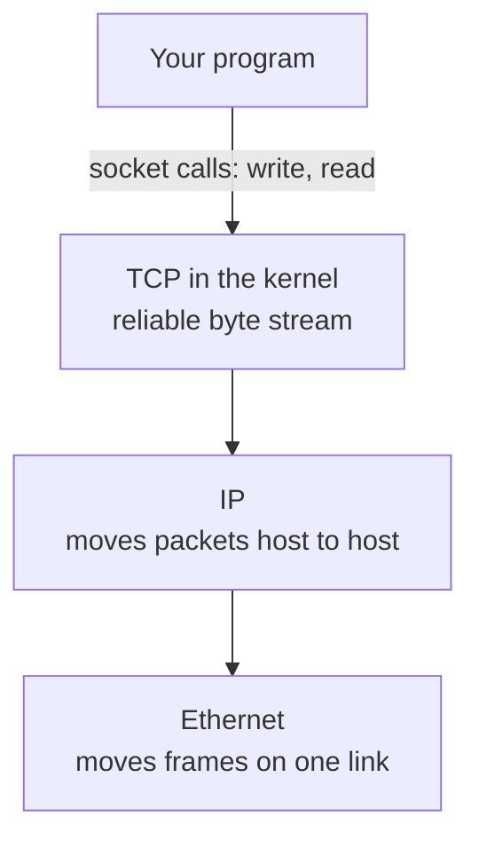

What each layer promises matters. TCP promises that bytes arrive, **in order, eventually**. It promises **nothing about when**, **nothing about message boundaries**, and **nothing about how many `read` calls** it takes to collect them. Following one message down and back up shows two lessons:

1. **The number of `write` calls at one end has no relation to the number of `read` calls at the other.** TCP may split your bytes over several segments or join them with bytes from a later write. This is "the single most common source of bugs in first network programs".
2. **None of the layers in between knows about your message.** The reliability you rely on is built by the two endpoints, not by the network.

### 1.3 Connections, socket addresses and the four-tuple

The lecture names the things that identify a connection:

- A **socket address** is an **IP address plus a port**, written `address:port`.
  - Client socket address: `128.2.194.242:3479`. Port 3479 is an **ephemeral port** chosen by the kernel.
  - Server socket address: `208.216.181.15:80`. Port 80 is a **well-known port** for web servers.
- A **connection** is identified by the pair of both socket addresses, the **connection socket pair**:
  `(128.2.194.242:3479, 208.216.181.15:80)`. That is four values in total, so it is also called the **four-tuple**.

There are **two common styles** of communication:

| Style | Protocol | Socket type | Properties |
|---|---|---|---|
| Datagrams | UDP | `SOCK_DGRAM` | separate packets, no connection |
| Connections | TCP | `SOCK_STREAM` | **point-to-point, full-duplex (both directions at once), reliable**; the main focus of this block |

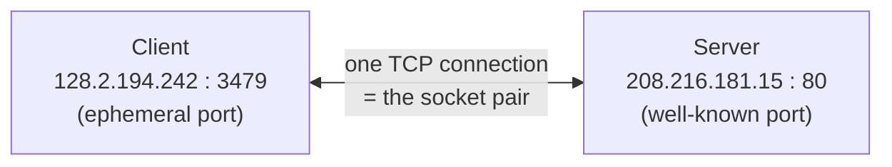

The four-tuple is why one server can hold thousands of connections on one port: all connections to port 80 share three of the four values and differ in the client's port (or address). Also, the same four-tuple returns in the data-centre material, where ECMP load balancing hashes exactly these values to choose a path.

### 1.4 Clients, servers and ports

**Clients.** Examples: web browsers, ftp, telnet, ssh. How does a client find a server?

- The **IP address** in the server's socket address identifies the **host** (more exactly, one network adapter of that host; a machine with several adapters has several addresses).
- The **well-known port** identifies the **service**, and so, indirectly, the server program that performs it.

"Address gets you to the machine; port gets you to the program." Well-known ports are only a **convention** (a registered list); nothing in TCP enforces them. A web server on port 9000 works fine; clients just won't find it unless told.

**Using ports to identify services.** One server host, `128.2.194.242`, runs a web server on port 80 and an echo server on port 7. A request for `128.2.194.242:80` goes to the web server and one for `128.2.194.242:7` to the echo server. The **kernel** (the transport layer) reads the port number and passes each segment to the right socket. This is called **demultiplexing**.

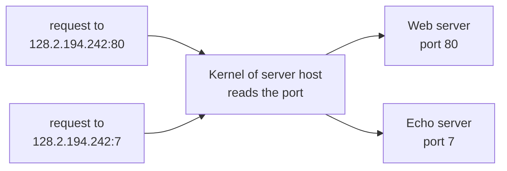

A useful debugging fact: if nothing listens on the requested port, the server's TCP answers with a **reset (RST)**, so the client fails **at once** ("connection refused"). If a firewall silently drops the packets, the client **hangs** until a timeout.

**The client-server exchange** has four steps:

1. The client **sends a request**.
2. The server **handles the request** (it manages some **resource**, such as information or storage).
3. The server **sends a response**.
4. The client **handles the response**.

Clients and servers are **processes**, running on the same or on different hosts. The only structural difference is **who starts**: the server prepares and waits, the client reaches out.

**Servers** are **long-running processes** ("daemons"), typically started at boot time by the `init` process (process 1), running until the machine is turned off. Each waits on a well-known port:

| Server | Port(s) | Resource | Service |
|---|---|---|---|
| Echo | 7 | — | sends back whatever it receives |
| FTP | 20, 21 | files | stores and retrieves files |
| Telnet | 23 | a terminal | gives a remote terminal on the server machine |
| Mail (SMTP) | 25 | the email "spool" file | stores mail messages in the spool |
| Web (HTTP) | 80 | files and compute cycles (CGI programs) | retrieves files and runs CGI programs for the client |

A machine that runs a server is also often called "a server". The file `/etc/services` lists the services on a Linux machine. Two lessons follow from "long-running": a server **must not leak** (memory, descriptors), and a server **cannot trust its input**, because anyone who can reach the port can connect.

### 1.5 What a socket is

The socket interface was **created in the early 1980s** as part of the Berkeley distribution of Unix that contained an early version of the Internet protocols. It:

- provides a **user-level interface** to the network;
- is the **underlying basis for all Internet applications** (every browser, web server and database client ends up in these calls);
- is based on the **client/server** programming model.

The lecture gives the central idea:

- **To the kernel**, a socket is an **endpoint of communication**.
- **To an application**, a socket is a **file descriptor** that lets it read from and write to the network.
- In Unix, **all I/O devices are modelled as files, including networks**. So clients and servers communicate by **reading from and writing to socket descriptors**, with the same `read` and `write` calls used for files.
- The main difference between file I/O and socket I/O is **how the program "opens" the descriptor**.

A **file descriptor** is just a small whole number. Every program starts with 0 (standard input, the keyboard), 1 (standard output, the screen) and 2 (standard error). The first socket a program opens usually gets number 3.

The lecture draws the picture: on each host, an **application** talks to a **socket**, which belongs to the **OS + APIs**, which talks through a **network interface** to the Internet. "Sockets make network I/O look like files"; the program **calls system functions** to control and communicate; the **network code handles routing and segmentation**. This is both the convenience and the limitation: you don't choose the route, and you don't control how your bytes are cut into segments, so you **cannot rely on message boundaries**.

The lecture shows the same API from **Java**: a `Socket` class with input and output streams. Python, Go and Rust wrap the same system calls in the same order. The differences between languages are mostly about error handling and cleanup.

Note that the word "socket" is used in **four senses**: the whole API; the descriptor your program holds; the kernel data structure behind it; and in "socket address", an address-and-port pair.

### 1.6 The map of the socket calls

This is "the one slide from part one worth memorising": the overview of the BSD sockets interface.

- **Client:** `socket` → `connect` → then `write` / `read` → `close`.
- **Server:** `socket` → `bind` → `listen` → `accept` → then `read` / `write` → `close`, and back to `accept` to "await a connection request from the next client".
- The **connection request** travels from the client's `connect` to the server's `accept`.
- When the client closes, the server's `read` returns **EOF** (end of file).
- The helper functions `open_clientfd` (client side: socket + connect) and `open_listenfd` (server side: socket + bind + listen) wrap each side's sequence into one call.

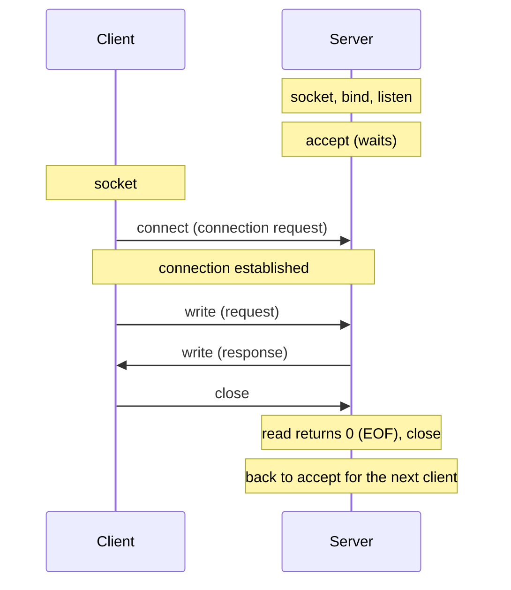

The asymmetry to remember: **the client makes two calls before it can talk; the server makes four**, three of which only say "I am willing to receive connections, at this address and port, with a queue this deep".

### 1.7 Where sockets came from: BSD history

This part is marked "extra review on your own": the history is interesting but **not examinable**.

- The sockets API **originated with 4.2BSD, released in 1983**.
- A few changes came in **1990 with 4.3BSD Reno**, when the OSI protocols went into the BSD kernel.
- The lecture recommends a talk by **Kirk McKusick**, who shared an office at Berkeley with **Bill Joy**, who led the beginnings of BSD.
- The family tree of BSD releases shows that its descendants are still in use (macOS, iOS, embedded systems, router software).
- The releases from the **Computer Systems Research Group (CSRG)** at Berkeley, 4.2BSD to 4.4BSD, required the receiver to already hold an (expensive) **AT&T Unix source licence**. But **all the networking code** (kernel support and applications) was **written at Berkeley, independently** of the AT&T code.
- So from **1989** Berkeley shipped the **BSD networking releases**, containing all the networking code not covered by the AT&T licence. They were **publicly available**, eventually by **anonymous FTP** to anyone.

The lesson: the technical quality of the BSD stack explains why people wanted it; the **licence** explains why they could have it. Commercial Unix vendors, Microsoft and router makers took it, which is why this one API became universal. And because the API made **very few decisions for the programmer** (protocol, addressing, concurrency, buffering), it has aged well.

## 2. A first client and server

### 2.1 The daytime client

The **daytime** service (TCP port 13) is very simple: when you connect, the server sends the current date and time as a line of text and closes the connection. The lecture shows the client.

```c
int main(int argc, char **argv) {
    int     sockfd, n;
    char    recvline[MAXLINE + 1];
    struct sockaddr_in servaddr;

    if (argc != 2)  err_quit("usage: a.out <IPaddress>");
    if ( (sockfd = socket(AF_INET, SOCK_STREAM, 0)) < 0)  err_sys("socket error");

    bzero(&servaddr, sizeof(servaddr));
    servaddr.sin_family = AF_INET;
    servaddr.sin_port   = htons(13);   /* daytime server */
    if (inet_pton(AF_INET, argv[1], &servaddr.sin_addr) <= 0)
        err_quit("inet_pton error for %s", argv[1]);

    if (connect(sockfd, (SA *) &servaddr, sizeof(servaddr)) < 0)  err_sys("connect error");

    while ( (n = read(sockfd, recvline, MAXLINE)) > 0) {
        recvline[n] = 0;        /* null terminate */
        if (fputs(recvline, stdout) == EOF)  err_sys("fputs error");
    }
    if (n < 0)  err_sys("read error");
    exit(0);
}
```

Line by line, in plain words:

1. **Declarations.** Reserve a place for the socket descriptor (`sockfd`), a byte count (`n`), a receive buffer (`recvline`) and a **socket address structure** for the server (`servaddr`).
2. **Argument check.** The program must be given the server's IP address when it is started; otherwise it prints how to use it and stops.
3. **`socket(AF_INET, SOCK_STREAM, 0)`** creates a **TCP socket over IPv4**: `AF_INET` = IPv4 address family, `SOCK_STREAM` = reliable byte stream, `0` = "pick the obvious protocol", which is TCP. It returns a **small integer descriptor**. If it returns a negative number, there was an error.
4. **`bzero`** fills the address structure with zeros (so no leftover garbage remains), then the program fills in the **family** (IPv4), the **port** 13 (converted with `htons` to network byte order, [section 4.1](#41-byte-ordering)) and the **IP address** (converted from text like "192.0.2.5" to binary by `inet_pton`, [section 4.4](#44-converting-addresses-between-text-and-binary)).
5. **`connect`** starts the TCP three-way handshake with the server. When it returns successfully, the connection is established.
6. **The read loop.** Call `read` again and again while it returns a positive number of bytes. Each time, add a zero byte at the end (C's way of marking the end of text) and print the text. When `read` returns **0**, the server has closed the connection, and the loop ends. A negative value means an error.

The lecture adds:

- The call to `socket` **can fail**. Why? Answer: the process may have reached its **limit of open descriptors**, the kernel may be **out of memory**, or the address family or type may be **unsupported**.
- We will meet the word "socket" in several meanings: the **sockets API**, the **function named `socket`**, and **the TCP socket**, which is a TCP endpoint.

At the moment `socket` returns, the socket exists but is **connected to nothing**: no address, no peer. Everything useful happens in the calls after it.

### 2.2 TCP is a byte stream

The lecture explains why the client reads **in a loop**.

TCP is a **byte-stream protocol with no record boundaries**. The server's reply is 26 bytes:

`Mon May 26 20:58:40 2003\r\n` (`\r` is carriage return and `\n` is linefeed, together "end of line").

These 26 bytes can arrive in many ways:

- normally as **one TCP segment** with all 26 bytes,
- but also as **26 segments of 1 byte each**, or anything in between.

So you must **always code the read in a loop**, and stop when `read` returns **0** (the other end closed) or a **negative value** (an error). Ending the data by closing the connection is also how **HTTP 1.0** worked.

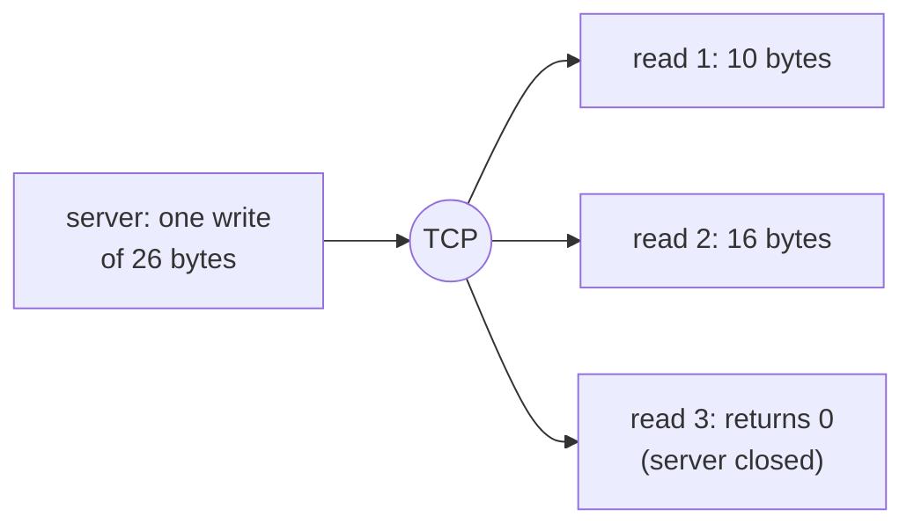

**TCP itself gives no record markers.** If an application needs to mark the ends of records, it must do so itself. There are three common ways:

| Method | Example in the lecture | Weakness |
|---|---|---|
| A **delimiter** at the end of each record | **SMTP** ends each record with carriage return + linefeed (`\r\n`) | the delimiter must be "escaped" if it can appear inside the data |
| A **length prefix** before each record | **Sun RPC** and **DNS** put a binary counter with the record length in front of each record | you must know the length before you start sending |
| **Closing the connection** | the daytime server, HTTP 1.0 | only one message per connection |

### 2.3 Error handling with wrapper functions

**It is essential to check every function call for an error return.** To keep the code readable, Stevens uses **wrapper functions**: the same name with a **capital letter**, which calls the real function, checks the result, and stops the program with a message if there was an error.

```c
int Socket(int family, int type, int protocol) {
    int n;
    if ( (n = socket(family, type, protocol)) < 0)
        err_sys("socket error");
    return (n);
}
```

In words: call the real `socket`; if the result is negative, print "socket error" and stop; otherwise hand back the descriptor. You will see `Socket`, `Bind`, `Listen`, `Accept`, `Write`, `Close` … throughout the lecture.

A caution: "check and abort" is right for teaching code and small tools, but **wrong for a server**, which must **not stop just because one client did something strange** ([section 7.1](#71-denial-of-service-and-robust-servers)).

### 2.4 The daytime server

The lecture shows the server.

```c
int main(int argc, char **argv) {
    int     listenfd, connfd;
    struct sockaddr_in servaddr;
    char    buff[MAXLINE];
    time_t  ticks;

    listenfd = Socket(AF_INET, SOCK_STREAM, 0);
    bzero(&servaddr, sizeof(servaddr));
    servaddr.sin_family      = AF_INET;
    servaddr.sin_addr.s_addr = htonl(INADDR_ANY);
    servaddr.sin_port        = htons(13);   /* daytime server */

    Bind(listenfd, (SA *) &servaddr, sizeof(servaddr));
    Listen(listenfd, LISTENQ);

    for ( ; ; ) {
        connfd = Accept(listenfd, (SA *) NULL, NULL);
        ticks = time(NULL);
        snprintf(buff, sizeof(buff), "%.24s\r\n", ctime(&ticks));
        Write(connfd, buff, strlen(buff));
        Close(connfd);
    }
}
```

In plain words:

1. **Two descriptors**, where the client had one: `listenfd` (the **listening** socket) and `connfd` (the **connected** socket for one client).
2. Create a TCP socket, zero the address structure, and fill it with family IPv4, address **`INADDR_ANY`** (the wildcard: "any of my addresses"), and port 13. The **server names its own address**, because clients must know in advance where to find it; the client never did this.
3. **`Bind`** attaches the socket to that address and port.
4. **`Listen`** turns it into a listening socket and sets the size of the waiting queue (`LISTENQ`).
5. **The endless loop** (`for ( ; ; )` means "repeat forever"):
   - **`Accept`** sleeps until a client has connected, then returns a **new descriptor** `connfd` for that client.
   - Get the current time (`time`), turn it into text (`ctime`), and put it with `\r\n` into `buff`.
   - **`Write`** the text to **`connfd`** (not to the listening socket).
   - **`Close`** `connfd`, then go back to `Accept`.

"Nine lines. That is a complete TCP server." Two things to fix in your mind (notes): the **listening descriptor is never written to**; it only produces connected descriptors. And the server closes `connfd` but **never closes `listenfd`**: the connection ends, the service continues.

**What `accept` really does.** The server process is **put to sleep** in `accept`, waiting for connections. TCP sets up connections with the **three-way handshake**; when the handshake completes, `accept` **returns**, and its return value is a new descriptor, the **connected descriptor**, used to talk to the new client. The order matters: **the kernel completes the handshake first**, even while the program is busy elsewhere; `accept` just **hands over** a connection that the kernel has already established.

**Technical clarification.** The lecture's server code writes `bzeros(&servaddr, …)`. The real function is called **`bzero`** (or the standard `memset(&servaddr, 0, sizeof(servaddr))`); `bzeros` does not exist and would not compile.

### 2.5 Iterative servers

**The daytime server handles only one client at a time.** If several connections arrive at about the same time, the **kernel queues them**, up to some limit, and `accept` returns them **one at a time**. The daytime server is fast, so nobody notices. But if serving each client took longer, we would need to **overlap** the service of one client with another. A server that serves one client after another is called an **iterative server**.

The lecture draws the timeline:

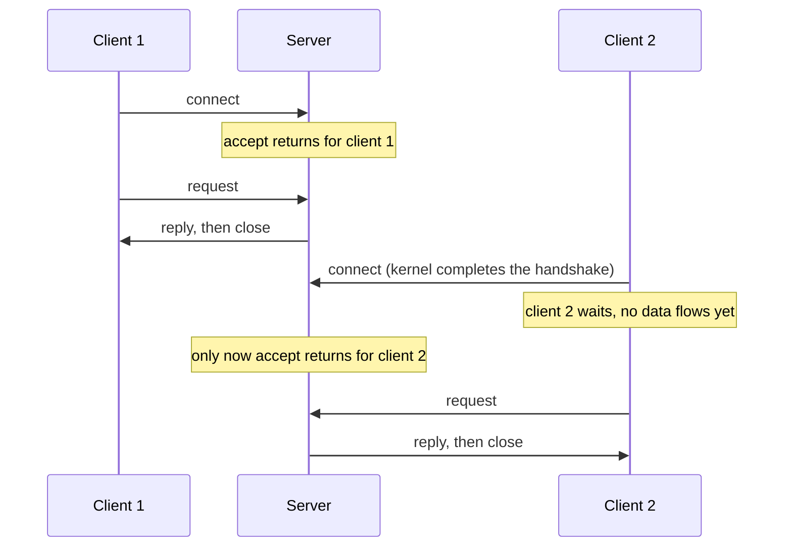

Client 2's connection may already be established by the kernel, but no data flows until the server comes back to `accept`. That waiting gap grows with the time each client takes and with the number of clients waiting. **Every concurrency technique later in the block is an attempt to remove this gap.**

## 3. TCP connection establishment, termination and ports

### 3.1 The three-way handshake

To understand `connect`, `accept` and `close`, you must understand how TCP connections are **established and terminated**, and TCP's **state transition diagram**.
- The **server** prepares to accept a connection by calling `socket`, `bind` and `listen`. This is a **passive open**.
- The **client** calls `connect`. This is an **active open**. The client's TCP sends a **SYN** ("synchronize") segment, which tells the server the client's **initial sequence number** for the data it will send. The SYN carries **no data**: only an IP header, a TCP header and possibly TCP options.
- The **server** must **acknowledge (ACK)** the client's SYN and must also send **its own SYN** with its initial sequence number. It sends **both in one segment** (SYN + ACK).
- The **client** must **acknowledge** the server's SYN.

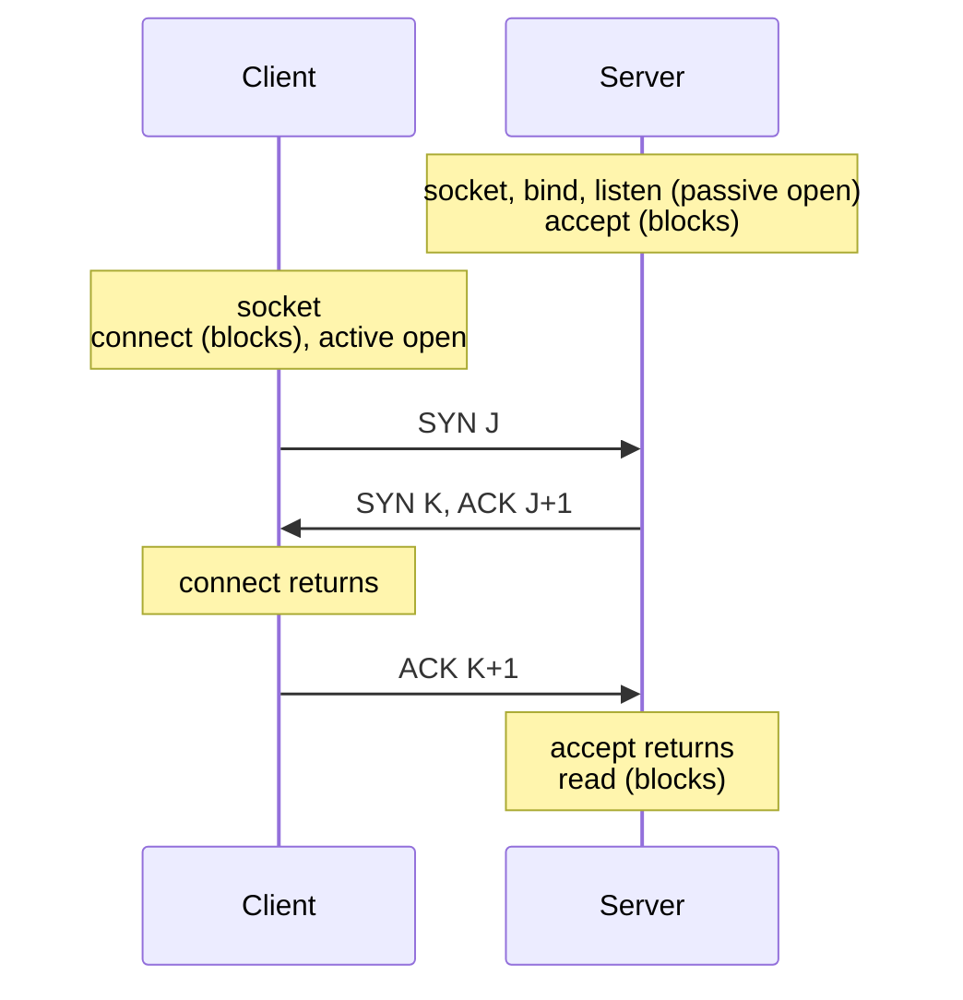

Here J and K are the two initial sequence numbers. Why **three** segments?

- Not four: the server's ACK and its own SYN can travel **together**, saving a round trip.
- Not two: **each side must know that its own sequence number arrived**. The client learns this from the server's ACK; the server learns it from the client's final ACK.

The cost (notes): **no data can flow until one round-trip time has passed**. On a path with a 100 ms round trip, that is a tenth of a second spent only on agreeing. This is why HTTP keeps connections open (keep-alive) and why QUIC combines its handshake with encryption set-up.

### 3.2 Closing a connection and the half-close

The lecture shows that closing takes **four segments**:

1. One process calls `close` first: the **active close**. Its TCP sends a **FIN**: "I have finished sending data".
2. The other end performs the **passive close**: its TCP **acknowledges the FIN**, and the arrival of the FIN is passed to the application as an **end-of-file** (`read` returns 0), because no more data will come on this connection.
3. **Later**, the process that received the end-of-file **closes its socket**, so its TCP sends its own **FIN**.
4. The TCP at the end that did the active close **acknowledges** that FIN.

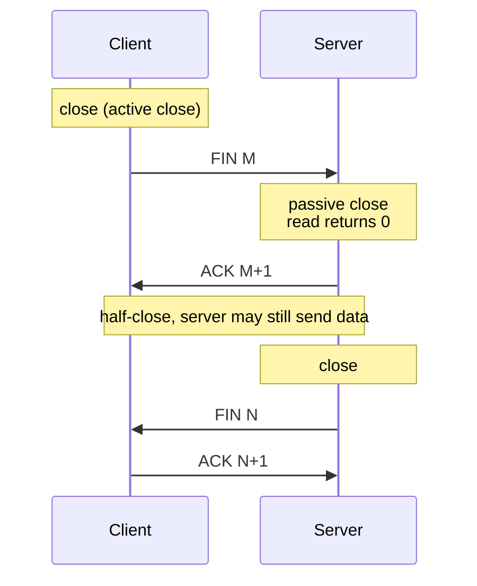

**Half-close.** Between steps 2 and 3, data **can still flow** from the passive-closing end to the active-closing end. A TCP connection is really **two independent byte streams**, one per direction, and each can end without the other. This is a real feature: a client can say "I have finished sending my request, now send me the answer". The `shutdown` call does exactly this ([section 6.6](#66-the-batch-mode-bug-and-shutdown)).

So **a `read` that returns 0 is not an error and not an empty message.** It means "the peer has finished sending".

### 3.3 The TCP state transition diagram

A TCP connection is always in one **state**. The API calls either **drive** a state change or **report** one:

- An application that does an **active open** in the **CLOSED** state makes TCP send a **SYN**, and the new state is **SYN_SENT**. If TCP then receives a **SYN with an ACK**, it sends an **ACK**, and the new state is **ESTABLISHED**. (So `connect` blocks in SYN_SENT and returns in ESTABLISHED.)
- The two arrows **out of ESTABLISHED** are about termination:
  - If the application calls **`close` before receiving a FIN** (active close), the state becomes **FIN_WAIT_1**.
  - If the application **receives a FIN** while ESTABLISHED (passive close), the state becomes **CLOSE_WAIT**.
- **Simultaneous open**: both ends send SYNs at about the same time and the SYNs cross in the network.
- **Simultaneous close**: both ends send FINs at the same time.

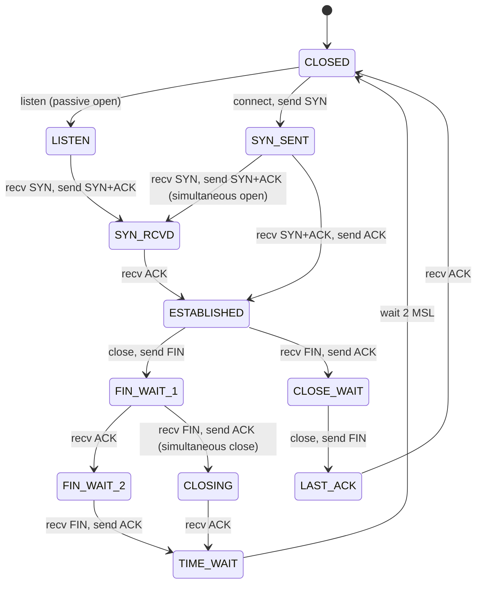

The left path (FIN_WAIT_1, FIN_WAIT_2, TIME_WAIT) is the **active closer**; the right path (CLOSE_WAIT, LAST_ACK) is the **passive closer**. Note that the difference matters: **the end that closes first must sit in TIME_WAIT afterwards**. Which end that is depends on your application protocol. A web server that closes after each response is the active closer on every connection, which historically caused scaling problems.

**Additional context.** The full diagram on the original slide (Stevens, figure 2.4) also has a direct arrow FIN_WAIT_1 → TIME_WAIT when a FIN and the ACK of our FIN arrive together, and the timeout paths back to CLOSED. The drawing above keeps the main arrows.

**Watching the packets.** **`netstat`** displays network connections, routing tables and interface statistics. "Try it!" While your client and server talk you will see `ESTABLISHED`; afterwards `TIME_WAIT`; on the server's waiting socket `LISTEN`. On Linux, **`ss`** is the modern replacement.

### 3.4 TIME_WAIT
- The end that does the **active close** goes through the **TIME_WAIT** state.
- It stays there for **2 × MSL** (twice the maximum segment lifetime).
- **MSL** is the longest time any IP datagram can live in the network. It is **bounded** because every datagram carries an **8-bit hop limit** (TTL), so it cannot circulate forever.
- The recommended MSL (RFC 1122) is **2 minutes**; BSD uses **30 seconds**. So TIME_WAIT lasts **between 1 and 4 minutes**.
- Lost packets are usually the result of **routing problems** (for example a routing loop). Once the problem is fixed, a packet that was stuck in the loop may still be delivered, but this happens **within MSL**.

The lecture gives the **two reasons** TIME_WAIT exists:

1. **To implement TCP's full-duplex connection termination reliably.**
2. **To allow old duplicate segments to expire in the network.**

**Reason 1: reliable termination.** Suppose the **final ACK is lost**. The other side (the passive closer) will **resend its final FIN**. If the active closer had already gone to CLOSED, it would have no record of the connection, so it would answer with an **RST** ("unexpected FIN"), and the other side would report an **error even though all data was received correctly**. So the active closer must **keep state information** to be able to **resend the final ACK**. That is also why it is **the active closer that stays in TIME_WAIT**: it is the end that might have to retransmit the final ACK. "If TCP terminates both directions of data flow cleanly for a connection, then it must correctly handle the loss of any of these four segments."

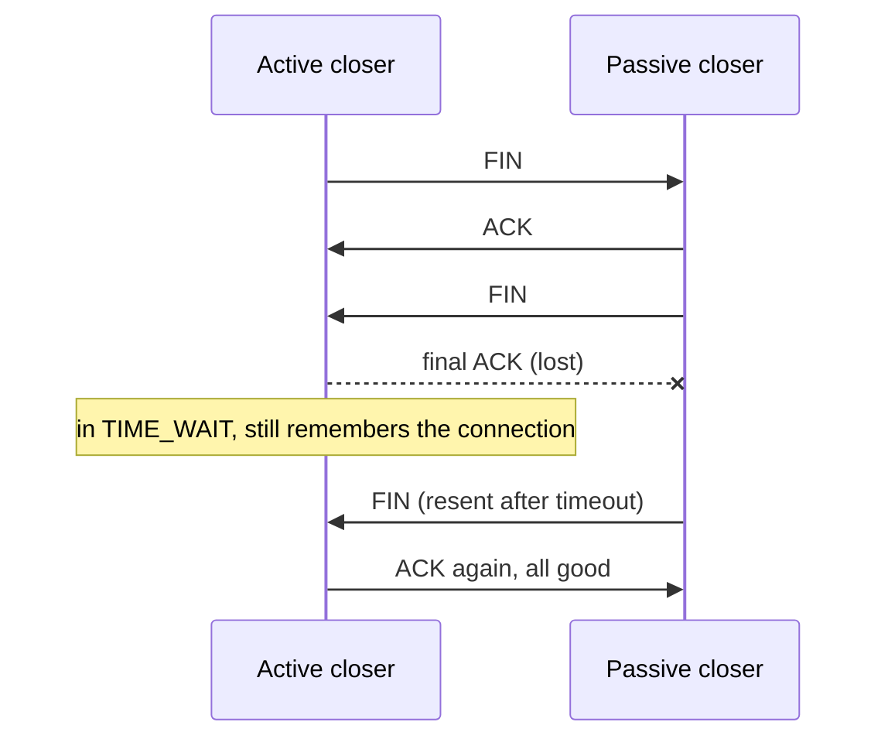

**Reason 2: expiring old duplicates.** Take a connection `(12.106.32.254, 1500, 206.168.112.219, 21)`. It closes. Later a new connection is set up between **the same IP addresses and the same ports**: a new **incarnation** of the old connection. Nothing in a packet header says which incarnation it belongs to. An old, delayed segment from the first incarnation could arrive and, **if its sequence number happens to fit**, be **mistaken for data of the new connection**. TCP prevents this: **a new incarnation of a connection that is in TIME_WAIT cannot be started**. Because TIME_WAIT lasts **2 × MSL**, there is **one MSL for a packet in one direction to die** and **another MSL for its reply** to die. So when a new connection is established, all old duplicates from previous incarnations are **guaranteed to have expired**.

† The failure case, stated directly: if an endpoint were **not** in TIME_WAIT when a delayed segment arrives, "that segment is mistaken for part of the second connection (when it has appropriate sequence numbers)". The protection is "temporal rather than structural": TCP does not detect the stale segment; it **waits until the segment cannot exist any more**.

† The **design consequences**. TIME_WAIT is a **resource**: each connection in it holds a kernel table entry and reserves a four-tuple for about a minute on the machine that closed first. A busy server closing many short connections can hold tens of thousands of them. This shaped protocols (**HTTP keep-alive**, **connection pooling**, **persistent connections**) and the socket API: the option **`SO_REUSEADDR`** lets a server bind a port that still has connections in TIME_WAIT (you will need it in the labs, otherwise a restarted server fails with "address already in use"). The general lesson: a mechanism designed for correctness when connections were few and long can become a bottleneck when usage changes.

**Technical clarification.** The lecture says the TIME_WAIT material is "hidden in the current deck". In fact only the parts marked † above are hidden; the rest of this section is visible.

### 3.5 Port number ranges and ephemeral ports

The lecture divides the 16-bit port numbers (0 to 65535) into three ranges. The figure in the lecture (from Stevens) gives the numbers:

| Range | Ports | Who controls it |
|---|---|---|
| **Well-known** | 0 – 1023 | assigned by **IANA** (Internet Assigned Numbers Authority) |
| **Registered** | 1024 – 49151 | IANA only **lists** their uses, it does not control them |
| **Dynamic or private** | 49152 – 65535 | **not controlled**: the **ephemeral ports** |

The figure also shows older conventions: BSD **reserved** ports 1–1023 (only privileged programs may bind them), traditional BSD **ephemeral** ports 1024–5000, BSD servers (non-privileged) 5001–65535, the `rresvport` range 513–1023, and Solaris ephemeral ports 32768–65535. None of this is enforced by TCP; it is a registry plus agreement.

**Ephemeral ports.** Ephemeral means **short-lived**. They are used for the **client end** of a client-server connection to a well-known port on a server. They may also be used to free up a server's well-known listening port by moving the service connection elsewhere. The allocation is **temporary**, valid only for the session; afterwards the port can be reused. The client does not choose its port: it calls `connect` without `bind`, and the kernel picks an unused one. Also, there are about **16 000** ports in the usual range, so one client machine cannot hold more than about that many connections **to the same server address and port**, because each four-tuple must be unique.

**Technical clarification.** The lecture's figure starts the well-known range at 1; officially it is **0 to 1023**.

### 3.6 Many connections on one port

The lecture shows how a **concurrent server** can serve many clients on **one** port. The server host is **multihomed**: it has two IP addresses, `12.106.32.254` and `192.168.42.1`. It does a passive open on the well-known port **21** (FTP).

1. **Listening.** The server's socket pair is written `{*:21, *:*}`. The first `*` means "any local address of this host" (the wildcard); `*:*` means "any client address and port". The listening socket is **not a connection**; it is a **pattern** that arriving connections are matched against.
2. **First client.** A client at `206.168.112.219` connects from ephemeral port **1500**. The server accepts it and **forks** (makes a copy of itself); the **child** serves this client. The **connected socket** uses the **same local port 21** as the listening socket. On the multihomed server, the **local address is filled in** (`12.106.32.254`) once the connection is established. So the child's socket pair is `{12.106.32.254:21, 206.168.112.219:1500}`. The server host must distinguish the listening socket from the connected socket.
3. **Second client.** Another client process on the same client host connects. Its TCP picks another unused ephemeral port, **1501**. On the server, a second child gets `{12.106.32.254:21, 206.168.112.219:1501}`. The two connections are **distinct**.

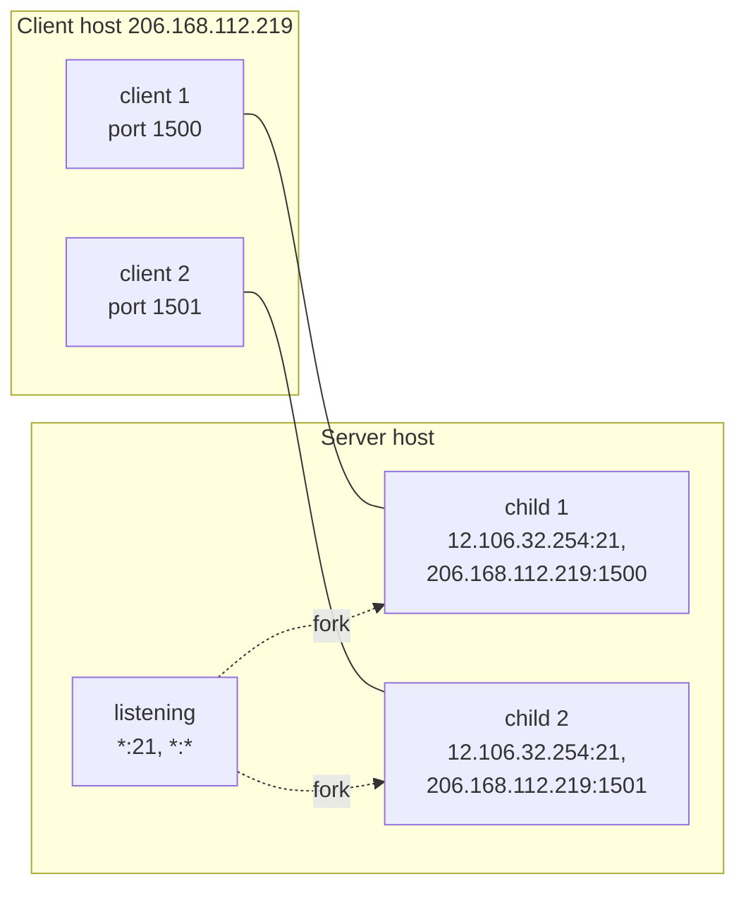

**The rule to remember:** TCP **cannot demultiplex** incoming segments by looking only at the destination port. It must look at **all four values of the socket pair** to decide which endpoint gets an arriving segment. A segment matches the **most specific** socket that fits, so an established connection always wins over the wildcard listener. (UDP, by contrast, delivers by destination port alone, because a UDP socket has no peer.)

## 4. Byte order, addresses and address structures

### 4.1 Byte ordering

This part is marked "review on your own".

**The problem.** A 16-bit number is made of **2 bytes**, and there are **two ways to store them** in memory:

| Order | Byte at the lower address A | Byte at address A + 1 | Used by |
|---|---|---|---|
| **Little-endian** | low-order byte | high-order byte | Intel/AMD PCs, most ARM systems |
| **Big-endian** | high-order byte | low-order byte | the **network** |

Example: port 80 is `0x0050` in hexadecimal. Big-endian memory holds `00 50`; little-endian memory holds `50 00`. If a little-endian machine sent its memory as it is, a big-endian reader would see `0x5000` = 20480. Wrong port!

**Finding your host's order.** There is no single standard, and machines of both kinds exist. The lecture's test program stores the number `0x0102` and then looks at its two bytes one by one:

```c
union { short s; char c[sizeof(short)]; } un;
un.s = 0x0102;
if (un.c[0] == 1 && un.c[1] == 2)      printf("big-endian\n");
else if (un.c[0] == 2 && un.c[1] == 1) printf("little-endian\n");
else                                   printf("unknown\n");
```

A `union` lets the same two bytes of memory be read either as one number (`s`) or as two separate bytes (`c[0]`, `c[1]`). If the first byte is 1, the "big" part came first: big-endian.

**Where it matters.** Network protocols must fix a **network byte order**, so that the sending and receiving protocol stacks agree in which order the bytes of multi-byte fields (addresses, port numbers) are sent. **IP uses big-endian.** In theory an implementation could keep socket address fields in host order and convert when building headers, "but, not :(": in practice the socket address structures already hold these fields **in network byte order**, so **you** must convert.

**The conversion functions.** The network is big-endian; the host may be either. The functions work on 16-bit ("short") and 32-bit ("long") values:

| Function | Read it as | Use it for |
|---|---|---|
| `htons()` | host to network, short | port numbers, before sending |
| `htonl()` | host to network, long | IPv4 addresses, before sending |
| `ntohs()` | network to host, short | port numbers, after receiving |
| `ntohl()` | network to host, long | IPv4 addresses, after receiving |

On a big-endian machine these functions do nothing, which is exactly why forgetting them is dangerous: the program works on one kind of machine and silently gives wrong numbers on another. You will also see many "structure casts" in socket code ([section 4.3](#43-socket-address-structures)).

### 4.2 IP addresses and names

**The programmer's view** has three mappings:

1. **Hosts** are mapped to a set of **32-bit IP addresses**, for example `128.2.203.179`.
2. The set of IP addresses is mapped to **Internet domain names**: `128.2.203.179` is `www.cs.cmu.edu`.
3. A **process** on one host can communicate with a process on another host over a **connection**.

None of these is one-to-one: a host may have several addresses, a name may have several addresses, and many connections may exist between the same pair of addresses.

**IP addresses in memory.** A 32-bit IPv4 address is stored in a structure:

```c
struct in_addr {
    unsigned int s_addr;   /* network byte order (big-endian) */
};
```

IP addresses are **always stored in memory in network byte order**. The same is true for **any integer** carried in a packet header, for example the **port number**. Hence the four conversion functions `htonl`, `htons`, `ntohl`, `ntohs`.

**DNS.** DNS maps between names and addresses in a **worldwide distributed database**.

- **`getaddrinfo()`** is the modern resolver call. **Use this.** It is **thread-safe** (unlike `gethostbyname()`), returns an **ordered list of addresses** (try each in turn), and is **protocol-independent**: one call serves IPv4 and IPv6.
- **`getnameinfo()`** does the reverse direction (address to name).
- **Legacy:** `gethostbyname()`, `gethostbyaddr()` and `struct hostent` are **IPv4-only and not thread-safe**. You will meet them in older code and in the labs.

### 4.3 Socket address structures

**Two structures.** The functions `connect`, `bind` and `accept` take a pointer to a **generic** socket address. Programs fill in an **Internet-specific** one and **cast** (re-label) its pointer to the generic type.

```c
struct sockaddr {              /* generic: for connect, bind, accept */
    unsigned short sa_family;  /* protocol family */
    char           sa_data[14];/* address data */
};

struct sockaddr_in {           /* Internet (IPv4) specific */
    unsigned short sin_family; /* address family, always AF_INET */
    unsigned short sin_port;   /* port number, network byte order */
    struct in_addr sin_addr;   /* IP address, network byte order */
    unsigned char  sin_zero[8];/* padding to the size of struct sockaddr */
};
```

- A socket address structure is **always passed by reference** (as a pointer) to socket functions.
- You **must cast** `(sockaddr_in *)` to `(sockaddr *)` for `connect`, `bind` and `accept`.
- Why the generic type at all? It is "**necessary only because C did not have generic (`void *`) pointers when the sockets interface was designed**". The API supports many address families of different sizes, and in 1983 C the only way to say "any of these" was one generic struct plus casts.

**The length field.** Some systems have an extra first field **`sin_len`** (the length of the structure, 16). It simplifies the handling of **variable-length** address structures inside the kernel. You **never need to set or read it**, unless you work with routing sockets. You only work with `sin_family`, `sin_addr` and `sin_port`. **`sin_zero` is unused**, but **we always set the entire structure to 0 before filling it in**.

**Self-definition.** Socket address structures are **self-defining**: they always **begin with a field (the "family")** that says which address family the structure holds. Newer implementations that support variable-length structures also put a **length** field at the beginning. So the kernel can look at the first field of any structure and know how to read the rest.

**The full declarations:**

```c
struct in_addr {
    in_addr_t s_addr;          /* 32-bit IPv4 address, network byte ordered */
};
struct sockaddr_in {
    uint8_t        sin_len;    /* length of structure (16) */
    sa_family_t    sin_family; /* AF_INET */
    in_port_t      sin_port;   /* 16-bit TCP or UDP port, network byte ordered */
    struct in_addr sin_addr;   /* 32-bit IPv4 address, network byte ordered */
    char           sin_zero[8];/* unused */
};
```

Of five fields, only two carry real information (port and address); the rest make the types, byte order and casting line up. The IPv6 version is a different, larger structure called `sockaddr_in6`.

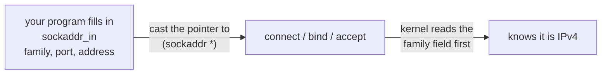

### 4.4 Converting addresses between text and binary

Humans write addresses as text (`"192.168.1.5"` or `"2001:db8::1"`); socket address structures store them as **binary numbers in network byte order**.

**The old functions: `inet_aton`, `inet_addr`, `inet_ntoa`.** They convert an IPv4 dotted-decimal string to and from a 32-bit address. They are **IPv4 only** and are used a lot in existing code. Avoid writing them: `inet_addr` returns, on error, a value that is also a valid address (255.255.255.255, the broadcast address), and `inet_ntoa` returns a pointer to one shared ("static") buffer, so it is **not thread-safe** and a second call overwrites the first.

**The new functions: `inet_pton` and `inet_ntop`.** The letters mean **p = presentation** (a string) and **n = numeric** (binary). They handle **both IPv4 and IPv6**.

```c
int inet_pton(int family, const char *strptr, void *addrptr);
    /* Returns: 1 if OK, 0 if input not a valid presentation format, -1 on error */
const char *inet_ntop(int family, const void *addrptr, char *strptr, size_t len);
    /* Returns: pointer to result if OK, NULL on error */
```

Three improvements: an explicit **family** argument (so IPv6 works), **three distinct results** for `inet_pton` (good, bad string, error), and the result is written into **your own buffer** (no shared static storage).

**`sock_ntop`** is a helper that prints any socket address. It looks at the **family field** (`sa->sa_family`): for `AF_INET` it casts to `sockaddr_in`, calls `inet_ntop(AF_INET, …)`, and if the port is not zero, adds `:port` (after `ntohs`). The IPv6 case is the same with `sockaddr_in6`. The caller never needs to know which family it was: this is **protocol-independent** code, made possible by self-defining structures.

**Protocol-independent clients:**

- Use **`sockaddr_storage`**, which is **large enough for any address family**, instead of `sockaddr_in`.
- **`getaddrinfo` returns a list**: walk it and **connect to the first address that works**.
- **One code path serves IPv4 and IPv6**, with no conditional compilation.

Why it matters: IPv6 now carries the majority of traffic, so a client written only for `sockaddr_in` cannot reach a growing part of the Internet.

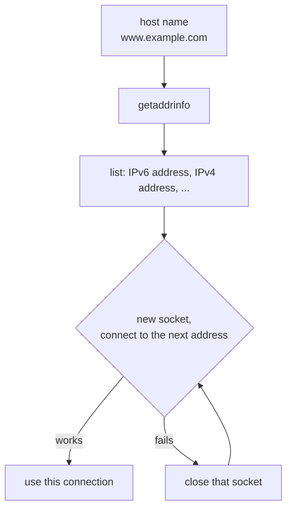

**The echo server identifies its client.** After `accept`, the server knows the client's address and can look up its name:

```c
hp = Gethostbyaddr((const char *)&clientaddr.sin_addr.s_addr,
                   sizeof(clientaddr.sin_addr.s_addr), AF_INET);
haddrp = inet_ntoa(clientaddr.sin_addr);
printf("server connected to %s (%s)\n", hp->h_name, haddrp);
```

In words: do a **reverse DNS lookup** of the client's address (`Gethostbyaddr`), turn the address into text (`inet_ntoa`), and print both. Two cautions: reverse lookups are **slow** (a network round trip per connection), and the name is **not trustworthy** for authentication, because the owner of an address block controls its reverse names. This code uses the legacy calls; `getnameinfo` is the modern one.

## 5. Robust I/O and the elementary socket calls

### 5.1 Short reads and writes: readn, writen and readline

**How TCP sockets differ from normal file I/O.** It is **not an error** for `read` or `write` on a socket to transfer **fewer bytes than requested**, because buffer limits in the kernel may be reached. You simply call `read` or `write` again. With `read` this can always happen on a stream socket; with `write` it is normally seen only on non-blocking sockets. Still, the examples always call **`writen`** instead of `write`, in case the implementation returns a short count.

**`readn`: read exactly n bytes.**

```c
ssize_t readn(int fd, void *vptr, size_t n) {
    size_t  nleft = n;  ssize_t nread;  char *ptr = vptr;
    while (nleft > 0) {
        if ( (nread = read(fd, ptr, nleft)) < 0) {
            if (errno == EINTR) nread = 0;   /* interrupted: call read() again */
            else return (-1);
        } else if (nread == 0)
            break;                           /* EOF */
        nleft -= nread;
        ptr   += nread;
    }
    return (n - nleft);                      /* return >= 0 */
}
```

In words: keep a count of bytes still missing. While some are missing, call `read`. If it fails because a **signal interrupted it** (`EINTR`), that is not a real error: count it as 0 bytes and try again. If it returns 0, the peer closed: stop early. Otherwise move forward in the buffer and reduce the count. At the end, return how many bytes were really read.

**`writen`: write exactly n bytes.** The mirror image: loop while bytes remain; if `write` was interrupted (`EINTR`), try again; on another error return −1; otherwise advance. A short write happens when the socket's **send buffer** is full (slow peer, closed window, congestion): the notes call it "backpressure made visible".

**`readline`: read one line.** The simple version reads **one byte at a time** until it finds `\n` or reaches the maximum length, handling `EINTR` and EOF. The lecture labels it "**PAINFULLY SLOW VERSION, example only**": it calls `read` (a system call) **once for every byte**. It is tempting to use the standard C I/O library (stdio, which buffers), but **stdio's buffering creates its own problems**: the **state of the stdio buffers is not exposed**, so data can sit hidden in the library's buffer, and other code (for example `select`) cannot see it.

**Report protocol violations.** Network programs should follow the protocol, but to be safe, **check for unexpected network traffic** too. Protocol violations should be **reported as errors**, so that bugs are noticed and fixed and **malicious attempts are detected**, and applications should **recover and keep working** if possible. With stdio there is **no way to tell if unexpected data is held in its buffers**.

**A better readline: exposing the internal buffer.** The improved version keeps its **own** buffer and makes its state visible:

```c
static int   read_cnt;           /* bytes left in the buffer */
static char *read_ptr;           /* next byte to hand out */
static char  read_buf[MAXLINE];  /* the buffer */

static ssize_t my_read(int fd, char *ptr) {
    if (read_cnt <= 0) {
      again:
        if ( (read_cnt = read(fd, read_buf, sizeof(read_buf))) < 0) {
            if (errno == EINTR) goto again;
            return (-1);
        } else if (read_cnt == 0)
            return (0);
        read_ptr = read_buf;
    }
    read_cnt--;
    *ptr = *read_ptr++;
    return (1);
}

ssize_t readlinebuf(void **vptrptr) {   /* lets the caller see leftover data */
    if (read_cnt)
        *vptrptr = read_ptr;
    return (read_cnt);
}
```

In words: `my_read` hands out **one byte at a time**, but it only calls the real `read` when its buffer is **empty**, and then it reads a **whole buffer-full** at once. So there is one system call per buffer instead of one per byte. `readline` is the same loop as before, with `my_read` in place of `read`. `readlinebuf` lets the caller **check whether more data was received beyond one line**. Also, the `static` buffer is shared by the whole program, so this version is **not thread-safe** and cannot serve two sockets at once.

**Summary.** TCP sockets give a **byte stream**: there are **no record markers**, and a `read` can return **less than asked for, which is not an error**. `readn`, `writen` and `readline` help with this. However, **network programs should be written to act on buffers rather than lines**.

### 5.2 The socket function

The lecture revisits each elementary call, now with its state change. The lecture points back to the state diagram.

**`socket`.** To do network I/O, the first thing a process must do is call `socket`, saying which kind of communication it wants:

```c
int socket(int family, int type, int protocol);
```

- `family`: `AF_INET` (IPv4), `AF_INET6` (IPv6), and others.
- `type`: `SOCK_STREAM` (reliable byte stream) or `SOCK_DGRAM` (datagrams).
- `protocol`: usually `0` = the obvious choice (TCP for `SOCK_STREAM`, UDP for `SOCK_DGRAM`).

It creates **no connection, reserves no port and contacts nothing**; it only allocates a kernel structure and gives you a descriptor.

**Return value and errors.** It returns a **non-negative integer: the file descriptor**. Errors:

- **No permission** to create a socket of this type or protocol;
- **No support** for this address family or protocol;
- **Process file table overflow** (this program has too many open descriptors);
- the **system limit** on the total number of open files has been reached;
- **Insufficient memory**: the socket cannot be created until resources are freed.

**State.** **CLOSED** is the state a socket starts in when `socket` creates it. From there, `connect` leads towards SYN_SENT (a client), while `bind` + `listen` lead to LISTEN (a server).

### 5.3 The connect function

**`connect`** is how a TCP **client** establishes a connection with its server:

```c
int connect(int sockfd, const struct sockaddr *servaddr, socklen_t addrlen);
```

- The client **does not have to call `bind`** first: the kernel **chooses an ephemeral port and the source IP address** if necessary.
- For TCP, `connect` **starts the three-way handshake** and **returns only when the connection is established, or an error occurs**.

**Three ways `connect` can fail:**

| What happens | What the client sees |
|---|---|
| **No response** to the SYN | 4.4BSD sends one SYN when `connect` is called, **another 6 s later and another 24 s later**; if no response arrives within **75 s** in total, a **timeout** error is returned. |
| The server answers the SYN with an **RST** | **"connection refused"**, at once. It means **no process is waiting for connections** on that port; the server program is probably not running. |
| A router answers with **ICMP "destination unreachable"** | A **soft error**: the kernel **saves the message but keeps sending SYNs**. If there is still no response after the fixed time (75 s), the saved error is returned: "**host or network unreachable**". The ICMP error may be **transient** (a routing problem that will be fixed), which is why it is not treated as final at once. |

The lecture lists when TCP sends an **RST** ("something is wrong"):

- a **SYN arrives for a port with no listening server**;
- TCP wants to **abort** an existing connection;
- TCP receives a segment for a connection that **does not exist**.

**State.** `connect` moves the socket from **CLOSED to SYN_SENT**, and on success to **ESTABLISHED**. On failure the **socket is no longer usable and must be closed**; you **cannot call `connect` again** on it. To retry: close, create a new socket, connect again. (This matters when walking a `getaddrinfo` list: each attempt needs a fresh socket.)

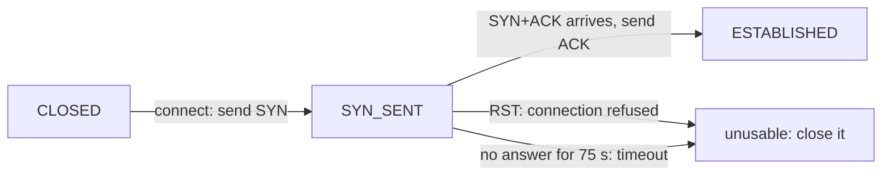

**Technical clarification.** The lecture once writes "STABLISHED"; it means **ESTABLISHED**.

### 5.4 The bind function

**`bind`** assigns a **local protocol address** to a socket: a 32-bit IPv4 or 128-bit IPv6 address together with a 16-bit TCP or UDP port.

```c
int bind(int sockfd, const struct sockaddr *myaddr, socklen_t addrlen);
```

- **Servers bind their well-known port** when they start, so clients know where to find them.
- If a socket is not bound, the kernel **chooses an ephemeral port** when `connect` or `listen` is called. That is normal for TCP **clients**, rare for TCP **servers**.

**Binding an IP address.** A process can bind a **specific IP address**, which **must belong to an interface of this host**.

- For a **TCP client**, this sets the **source IP address** of its datagrams. Clients normally don't; the kernel chooses the source address based on the outgoing interface.
- For a **TCP server**, it **restricts the socket to connections destined to that IP address only**. If the server does not bind an address, the kernel uses the **destination address of the client's SYN** as the server's source address.

**What the kernel chooses:**

| IP address given | Port given | Result |
|---|---|---|
| wildcard | 0 | kernel chooses IP address and port |
| wildcard | nonzero | kernel chooses IP address, process specifies port |
| local IP address | 0 | process specifies IP address, kernel chooses port |
| local IP address | nonzero | process specifies IP address and port |

With port 0, the kernel picks an ephemeral port **when `bind` is called**. With the wildcard address, the kernel **does not choose the local IP address until the socket is connected** (then it uses the address the connection arrived on).

**Errors:**

- the address is **protected** and the user is not the superuser (ports below 1024 need privileges);
- the address is **already in use** (often a previous connection in TIME_WAIT; fix with `SO_REUSEADDR`);
- `sockfd` is not a valid descriptor;
- the socket is **already bound**.

### 5.5 The listen function and its two queues

**`listen`** is called **only by a TCP server**:

```c
int listen(int sockfd, int backlog);
```

- It converts an unconnected socket, which by default is assumed to be an **active** socket (one that will call `connect`), into a **passive** socket: the kernel should **accept incoming connection requests** to it.
- It moves the socket from **CLOSED to LISTEN**.
- `backlog` says the **maximum number of connections the kernel should queue** for this socket.
- It must be called **before `accept`**, normally after `socket` and `bind`.

Before `listen`, a SYN to that port gets an RST. After `listen`, it gets a SYN+ACK, **whether or not the program has called `accept` yet**.

**The two queues.** For each listening socket the kernel keeps:

1. an **incomplete connection queue** (state **SYN_RCVD**): one entry for each SYN that has arrived, while the server waits for the handshake to complete;
2. a **completed connection queue** (state **ESTABLISHED**): one entry for each client whose handshake has completed.

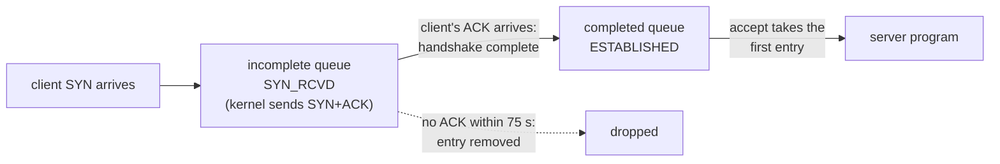

Once an entry is created on the incomplete queue, the **listening socket's parameters are copied** to the new connection; the **server process is not involved**. So socket options set on the listening socket apply to every connection made from it.

**The backlog:**

- Historically, `backlog` was the maximum for the **sum of both queues**.
- There is **no formal definition** of what it means; Berkeley-derived systems multiply it by **1.5**.
- Entries stay incomplete until the **third segment** of the handshake arrives, or until the entry **times out (75 s)**.
- **5** was the maximum supported by 4.2BSD: enough when servers handled hundreds of connections **a day**, but busy servers handle **millions a day**. Newer kernels support larger values, and administrators can change the maximum.
- "What value should the application specify, since 5 is often inadequate?" Answer: **set it generously** (a few hundred is normal); modern systems cap it anyway.

**A `Listen` wrapper that can be tuned:**

```c
void Listen(int fd, int backlog) {
    char *ptr;   /* can override 2nd argument with environment variable */
    if ( (ptr = getenv("LISTENQ")) != NULL)
        backlog = atoi(ptr);
    if (listen(fd, backlog) < 0)
        err_sys("listen error");
}
```

In words: if an **environment variable** called `LISTENQ` is set (a setting you can give from the shell), use its value as the backlog; then call `listen` and stop on error. So the backlog can be tuned **without recompiling**. Errors of `listen`: another socket is already listening on the same port; `sockfd` is not a valid socket; the socket type does not support `listen`.

**Additional context.** The two queues are what a **SYN flood** attacks: an attacker sends many SYNs from fake addresses and never completes the handshake, so the incomplete queue fills up and real clients are turned away. **SYN cookies** are the standard defence (see the TCP guide, 13-TCP.md).

### 5.6 The accept function

**`accept`** returns the **next completed connection** from the **front of the completed connection queue**. If that queue is empty, the process is **put to sleep** (by default).

```c
int accept(int sockfd, struct sockaddr *cliaddr, socklen_t *addrlen);
```

- `cliaddr` and `addrlen` return the **client's address**.
- `addrlen` is a **value-result argument**: **before** the call, it holds the size of the structure `cliaddr` points to; **after** the call, it holds the number of bytes the kernel actually stored there.

**A brand-new descriptor.** `accept` returns a **new descriptor created by the kernel**, which refers to the TCP connection with this client.

- The **first argument** of `accept` is the **listening socket**; the **return value** is the **connected socket**.
- A server normally creates **only one listening socket**, which exists for the **lifetime of the server**.
- The kernel creates **one connected socket for each accepted client** (each completed handshake). When the server has finished with that client, it **closes the connected socket**.

**`accept` illustrated.** `accept` blocks waiting for a connection request. It returns a connected descriptor (`connfd`) with the **same properties** as the listening descriptor (`listenfd`). It returns when the connection is created and ready for I/O. **All I/O with the client goes through the connected socket.** `accept` also fills in the client's IP address.

```c
int listenfd;                 /* listening descriptor */
int connfd;                   /* connected descriptor */
struct sockaddr_in clientaddr;
int clientlen;
clientlen = sizeof(clientaddr);
connfd = Accept(listenfd, (SA *)&clientaddr, &clientlen);
```

The three panels of the lecture's figure:

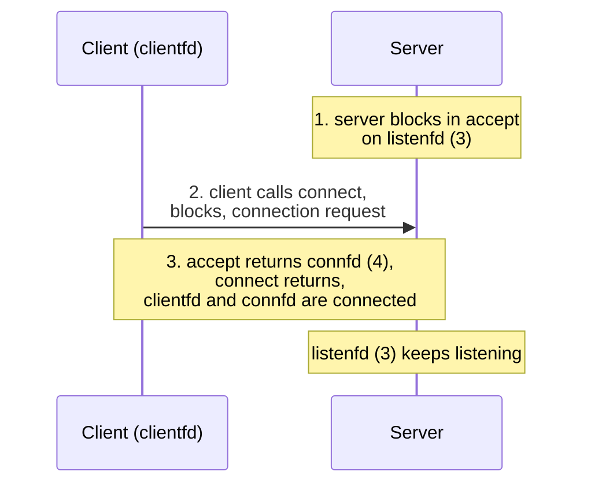

**Connected vs listening descriptors:**

| | Listening descriptor | Connected descriptor |
|---|---|---|
| What it is | the end point for **client connection requests** | the end point of **the connection** between client and server |
| How many | created **once** | a **new one** each time a request is accepted |
| Lifetime | the **whole life of the server** | only as long as it takes to **serve that client** |

**Why the distinction?** It allows **concurrent servers** that talk over many client connections at once. For example, each time a request arrives, the server **forks a child** to handle it and goes straight back to `accept`.

**State.** The connection that `accept` returns is **already ESTABLISHED**. The listening socket stays in **LISTEN** and is not changed.

**Errors:** the descriptor is invalid; **the connection has been aborted** (a client completed the handshake and then reset the connection before `accept`; the right reaction is to ignore it and call `accept` again); the socket is not listening or `addrlen` is invalid; the **per-process** or **system** limit on open descriptors is reached; the socket is not of type `SOCK_STREAM`; not enough free memory (often the **socket buffer limits**, not the system memory); a protocol error; **firewall rules forbid the connection**.

### 5.7 The close function

**`close`** closes a socket and terminates the TCP connection:

```c
int close(int sockfd);
```

- It **marks the socket as closed and returns immediately**.
- The descriptor **can no longer be used** to read or write.
- TCP will **try to send any data already queued** to the other end, and **after that** the normal termination sequence (FIN, ACK, …) takes place.
- The **`SO_LINGER`** socket option can change this default behaviour.

Also: because `close` returns **at once**, a successful `close` tells you **nothing about whether your data arrived**. If you need certainty, the application must send its own acknowledgement. And `close` ends **both** directions; `shutdown` can end just one ([section 6.6](#66-the-batch-mode-bug-and-shutdown)).

## 6. The echo service, I/O models and select

### 6.1 The echo client and server

The lecture builds a richer pair: the **echo** server sends back whatever the client sends; the client reads lines from the keyboard.

**In use:**

```text
hive> echoclient hive 5000
Please enter msg: 123
Echo from server: 123
Please enter msg: 456789
Echo from server: 456789

hive> echoserver 5000
server established connection with HIVE (128.252.21.14)
server received 4 bytes: 123
server received 7 bytes: 456789
```

(4 bytes for "123" because the newline is counted too; 7 bytes for "456789".)

**The echo server** sets up exactly like the daytime server (port 7 this time), then:

```c
for ( ; ; ) {
    clilen = sizeof(cliaddr);
    connfd = Accept(listenfd, (SA *) &cliaddr, &clilen);
    str_echo(connfd);          /* the whole conversation with this client */
    Close(connfd);
}

void str_echo(int sockfd) {
    ssize_t n;  char buf[MAXLINE];
  again:
    while ( (n = read(sockfd, buf, MAXLINE)) > 0)
        Writen(sockfd, buf, n);
    if (n < 0 && errno == EINTR) goto again;
    else if (n < 0) err_sys("str_echo: read error");
}
```

In words: accept a client, then in `str_echo` **read** whatever arrives and **write back exactly `n` bytes** (the number actually read) with `Writen`, until `read` returns 0 (the client closed). If `read` was interrupted by a signal, try again. Then close and accept the next client. This is still an **iterative** server, and now the problem is bigger: `str_echo` runs **until the client closes**, which may be minutes, while other clients wait.

**The echo client:**

```c
sockfd = Socket(AF_INET, SOCK_STREAM, 0);
bzero(&servaddr, sizeof(servaddr));
servaddr.sin_family = AF_INET;  servaddr.sin_port = htons(SERV_PORT);
Inet_pton(AF_INET, argv[1], &servaddr.sin_addr);
Connect(sockfd, (SA *) &servaddr, sizeof(servaddr));
str_cli(stdin, sockfd);         /* do it all */

void str_cli(FILE *fp, int sockfd) {
    char sendline[MAXLINE], recvline[MAXLINE];
    while (Fgets(sendline, MAXLINE, fp) != NULL) {
        Writen(sockfd, sendline, strlen(sendline));
        if (Readline(sockfd, recvline, MAXLINE) == 0)
            err_quit("str_cli: server terminated prematurely");
        Fputs(recvline, stdout);
    }
}
```

In words: connect, then repeat: read a line from the keyboard (`Fgets`), send it (`Writen`), read the echoed line back (`Readline`), print it (`Fputs`).

**The problem.** The client has **two inputs at the same time**: the keyboard and the TCP socket. Suppose the client is **blocked in `fgets`** (waiting for the user to type) and the **server process is killed**. The server's TCP correctly sends a **FIN** to the client, but the client is **busy waiting on the keyboard**, so it **never sees the EOF until it reads from the socket**, possibly much later. One program, two things to watch, and no way to watch both.

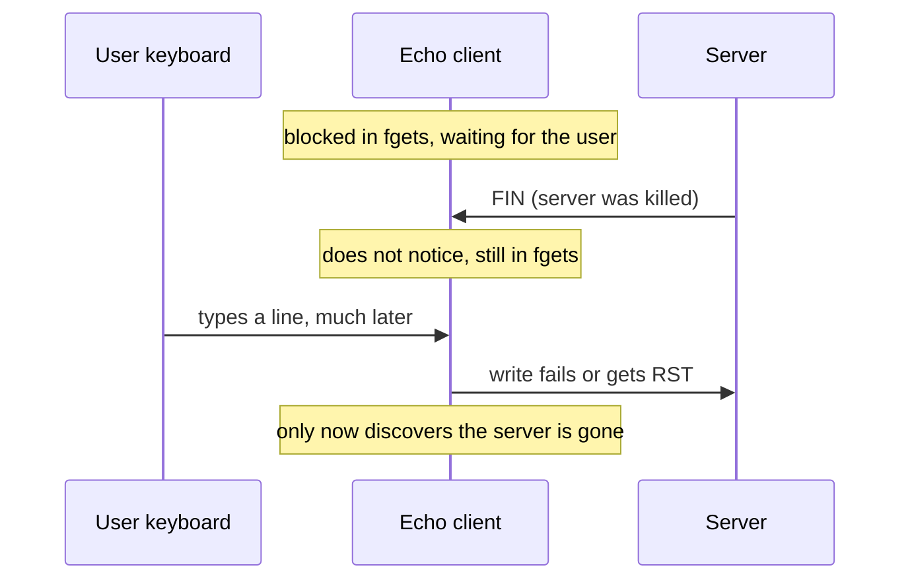

### 6.2 I/O models

**I/O multiplexing.** We need a way for the process to **tell the kernel** that it wants to be **notified when one or more I/O conditions are ready**: input is ready to be read, or a descriptor can take more output. This is **I/O multiplexing**, provided by **`select`**. Instead of choosing one descriptor and blocking on it, the program gives the kernel a **set** and blocks on the set.

It is typically used when:

- a **client** handles **multiple descriptors** (for example the keyboard and a socket), or **multiple sockets**;
- a **TCP server** handles both a **listening socket and its connected sockets**;
- a server handles **both TCP and UDP**;
- a server handles **multiple services** and perhaps multiple protocols.

I/O multiplexing is **not limited to network programming**.

**The five I/O models:**

1. **Blocking I/O**,
2. **Non-blocking I/O**,
3. **I/O multiplexing** (`select` and `poll`),
4. signal-driven I/O (**not in this course**),
5. asynchronous I/O (**not in this course**).

A read has **two waiting phases**: (1) **waiting for data** to arrive, and (2) **copying the data** from the kernel into the program's buffer.

- **Blocking.** **By default, all sockets are blocking.** The program calls `read`; if there is no data, the process sleeps; when data arrives it is copied and `read` returns. The process waits through both phases.
- **Non-blocking.** You can set a socket to be non-blocking, which tells the kernel: "when an I/O operation I request cannot be completed without putting the process to sleep, **do not put the process to sleep, but return an error instead**" (the error is `EWOULDBLOCK` / `EAGAIN`). Calling it again and again ("polling") wastes processor time.
- **I/O multiplexing.** **Call `select` and block there**, instead of blocking in the actual I/O call. When `select` returns, one of the descriptors is ready, and then you call `read`.

**Comparison:**

| | Phase 1: wait for data | Phase 2: copy data from kernel to program |
|---|---|---|
| Blocking | blocked in `read` | blocked in `read` |
| Non-blocking | "check, check, check …" (each call returns at once) | blocked in `read` |
| I/O multiplexing | blocked in `select`, until "ready" | blocked in `read` |

"First phase handled differently, second phase handled the same (blocked in the call to `recvfrom`)." Also, only **asynchronous I/O** (not taught here) avoids blocking in both phases; this is the model of Linux's io_uring ([section 7.4](#74-c10k-and-c10m)).

Multiplexing costs **two system calls** (select, then read) where blocking needs one, so it is worse for a single descriptor. It pays off as soon as there are **several** descriptors to watch with one thread.

**Technical clarification.** The lecture's explanation describes "all five models side by side", but the figure in the lecture shows only **three** columns (blocking, non-blocking, I/O multiplexing). The full figure in Stevens (figure 6.6) has all five.

### 6.3 The select function

**`select`:**

```c
int select(int maxfdp1, fd_set *readset, fd_set *writeset,
           fd_set *exceptset, const struct timeval *timeout);
```

Example: call `select` and tell the kernel to return only when

- any descriptor in **{1, 4, 5}** is ready for **reading**, or
- any descriptor in **{2, 7}** is ready for **writing**, or
- any descriptor in **{1, 4}** has an **exception condition** pending, or
- **10.2 seconds** have passed.

**What the arguments mean.** `select` tells the kernel **which descriptors to test** (reading, writing, exception) and **how long to wait**. It is **not restricted to sockets**: any file descriptor can be tested (which is why the keyboard and a socket can be watched together). The timeout is a structure with seconds and microseconds:

```c
struct timeval {
    long tv_sec;    /* seconds */
    long tv_usec;   /* microseconds */
};
```

**Three ways to use the timeout:**

| Timeout | Behaviour |
|---|---|
| **null pointer** | **wait forever**: return only when a descriptor is ready |
| a **positive time** | **wait up to that time**: return when ready, or when the time is up |
| **zero** | **don't wait at all**: check the descriptors and return immediately (a poll) |

**Descriptor sets.** An `fd_set` is a row of bits, one per descriptor number. Four macros handle it:

| Macro | Meaning |
|---|---|
| `FD_ZERO(&set)` | clear all bits |
| `FD_SET(fd, &set)` | turn on the bit for `fd` |
| `FD_CLR(fd, &set)` | turn off the bit for `fd` |
| `FD_ISSET(fd, &set)` | is the bit for `fd` on? |

```c
fd_set rset;
FD_ZERO(&rset);      /* initialize the set: all bits off */
FD_SET(1, &rset);    /* turn on bit for fd 1 */
FD_SET(4, &rset);    /* turn on bit for fd 4 */
FD_SET(5, &rset);    /* turn on bit for fd 5 */
```

**Important: `select` modifies the descriptor sets** you pass. On return, only the bits of **ready** descriptors are still on. So you must **rebuild the sets before every call**.

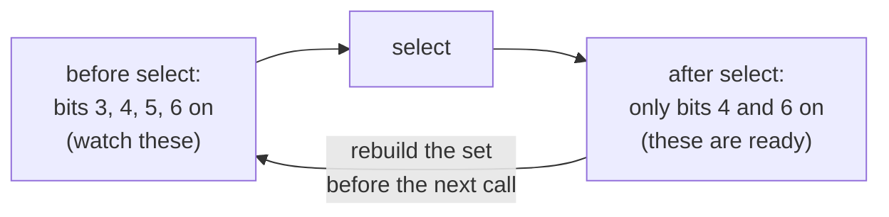

**Return value.** It is the **total number of ready bits** across all sets. **`maxfdp1`** is the **number of descriptors to test**: the **highest descriptor number plus one** (the kernel checks descriptors 0, 1, …, maxfdp1 − 1).

**When is a descriptor ready?**

| Condition | Readable? | Writable? | Exception? |
|---|---|---|---|
| Data to read | ✓ | | |
| Read half of the connection closed (FIN received) | ✓ | | |
| New connection ready for a listening socket | ✓ | | |
| Space available for writing | | ✓ | |
| Write half of the connection closed | | ✓ | |
| Pending error | ✓ | ✓ | |
| TCP out-of-band data | | | ✓ |

"Ready" means **the next call will not block**, not that it will succeed. A socket whose peer has closed is **readable** (and `read` returns 0); a listening socket is **readable** when `accept` has a connection to hand over.

**Technical clarification.** The first bullet of the `select` overview, "TCP client establishes a connection with its server", is copied from the `connect` material by mistake; it has nothing to do with `select`.

### 6.4 The echo client with select

**What makes the socket readable:**

- the peer sends **data**: the socket becomes readable and `read` returns **more than 0** (the number of bytes);
- the peer sends a **FIN** (the peer process ended): readable, and `read` returns **0 (EOF)**;
- the peer sends an **RST** (the peer host crashed and rebooted): readable, `read` returns **−1**, and `errno` holds the error code.

So after `select` says "ready", you must **call `read` and look at the result**.

**The rewritten `str_cli`:**

```c
void str_cli(FILE *fp, int sockfd) {
    int maxfdp1;  fd_set rset;  char sendline[MAXLINE], recvline[MAXLINE];
    FD_ZERO(&rset);
    for ( ; ; ) {
        FD_SET(fileno(fp), &rset);  FD_SET(sockfd, &rset);
        maxfdp1 = max(fileno(fp), sockfd) + 1;
        Select(maxfdp1, &rset, NULL, NULL, NULL);
        if (FD_ISSET(sockfd, &rset)) {          /* socket is readable */
            if (Readline(sockfd, recvline, MAXLINE) == 0)
                err_quit("str_cli: server terminated prematurely");
            Fputs(recvline, stdout);
        }
        if (FD_ISSET(fileno(fp), &rset)) {      /* input is readable */
            if (Fgets(sendline, MAXLINE, fp) == NULL) return;   /* all done */
            Writen(sockfd, sendline, strlen(sendline));
        }
    }
}
```

In words: forever, put **both** the keyboard descriptor (`fileno(fp)`) and the socket into the read set, compute the highest descriptor plus one, and **wait in `select`** until one of them is ready. If the **socket** is ready, read a line from the server (if it returns 0, the server has gone: say so and stop) and print it. If the **keyboard** is ready, read a line from the user (if there is none, we are done) and send it.

**What changed.** The **same four I/O functions** are used (`fgets`, `writen`, `readline`, `fputs`), but the **order of flow** changed: instead of being **driven by `fgets`**, the function is now **driven by `select`**. "We have added greatly to the robustness of our client with only a few additional lines of code." Now, if the server dies while the user is not typing, the client notices **at once**.

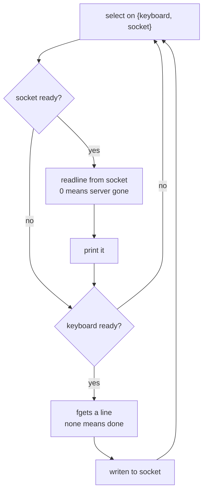

### 6.5 Batch input: stop-and-wait is slow

The original client works in **stop-and-wait** mode: it sends one line and **waits for the reply** before sending the next. Each line takes **one RTT** (round-trip time) plus the server's processing time (about 0 for an echo server). That is fine for a human typing, but how long does it take to echo a whole file?

**A worked example:**

- `ping` (average of 30 measurements) gives an **RTT of 175 ms** for 84-byte IP datagrams.
- Take the first **2 000 lines** of a **98 349-byte** file: on average **49 bytes per line**.
- Add the **IP header (20 bytes)** and **TCP header (20 bytes)**: the average segment is about **89 bytes**, nearly the size of the ping packets.
- Estimate: 2 000 × 0.175 s = **350 seconds**. The **measured** time was about **354 seconds**.

| Quantity | Value |
|---|---|
| Lines | 2 000 |
| Bytes per line | 98 349 ÷ 2 000 ≈ 49 |
| Segment size | 49 + 20 + 20 ≈ 89 bytes |
| RTT | 0.175 s |
| Predicted time | 2 000 × 0.175 = 350 s |
| Measured time | ≈ 354 s |

So with stop-and-wait, **the speed depends only on the RTT**, not on the link's bandwidth. Nearly half of each packet is header, too.

Because there is a **delay** between sending a packet and its arrival, and because the pipe is **full-duplex** (both directions at once), the stop-and-wait client uses **only a small fraction of the pipe's capacity**. A batched client keeps sending while replies flow back.

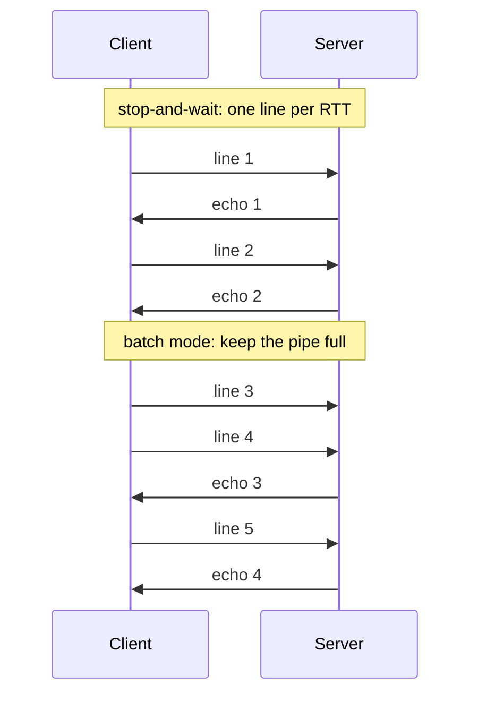

### 6.6 The batch-mode bug and shutdown

**The bug.** We can run the client in **batch mode** by redirecting input and output (for example `echoclient host < file1 > file2`). For an echo protocol, the output file should be **identical** to the input file. But **the output file is always smaller**!

Suppose the input has **9 lines**, and the last one is sent at time 8. The client **cannot close the connection after writing this request**, because there are **still other requests and replies in the pipe**. The cause is how the client handles **EOF on input**: `str_cli` returns to `main`, which ends the program. But in batch mode, **EOF on input does not mean we have finished reading from the socket**: there may still be requests on their way to the server, or replies on their way back.

```mermaid
sequenceDiagram
  participant C as Client
  participant S as Server
  C->>S: lines 7, 8, 9
  Note over C: input file ends (EOF)<br/>old client exits and closes
  S--xC: echoes of 7, 8, 9 still on the way, lost
```

**The solution:** send a **FIN** to the server, saying "we have finished sending data", but **leave the socket open for reading**. This is TCP's **half-close** ([section 3.2](#32-closing-a-connection-and-the-half-close)).

**`shutdown` vs `close`:**

- `close` **decrements the descriptor's reference count** and closes the socket only when the count reaches **0** (several descriptors can refer to one socket, for example after `fork`).
- `shutdown` starts TCP's normal termination **regardless of the reference count**.
- `close` terminates **both directions** (reading and writing). Since TCP is full-duplex, there are times we want to tell the other end "I have finished sending", even though it may still have data for us.

**The modes:**

```c
int shutdown(int sockfd, int howto);
```

| `howto` | Effect |
|---|---|
| `SHUT_RD` | the **read** half of the connection is closed |
| `SHUT_WR` | the **write** half is closed (a FIN is sent): the **half-close** |
| `SHUT_RDWR` | both halves are closed |

**The final `str_cli`:**

```c
void str_cli(FILE *fp, int sockfd) {
    int maxfdp1, stdineof;  fd_set rset;  char buf[MAXLINE];  int n;
    stdineof = 0;
    FD_ZERO(&rset);
    for ( ; ; ) {
        if (stdineof == 0) FD_SET(fileno(fp), &rset);
        FD_SET(sockfd, &rset);
        maxfdp1 = max(fileno(fp), sockfd) + 1;
        Select(maxfdp1, &rset, NULL, NULL, NULL);
        if (FD_ISSET(sockfd, &rset)) {                   /* socket is readable */
            if ( (n = Read(sockfd, buf, MAXLINE)) == 0) {
                if (stdineof == 1) return;               /* normal termination */
                else err_quit("str_cli: server terminated prematurely");
            }
            Write(fileno(stdout), buf, n);
        }
        if (FD_ISSET(fileno(fp), &rset)) {               /* input is readable */
            if ( (n = Read(fileno(fp), buf, MAXLINE)) == 0) {
                stdineof = 1;
                Shutdown(sockfd, SHUT_WR);               /* send FIN */
                FD_CLR(fileno(fp), &rset);
                continue;
            }
            Writen(sockfd, buf, n);
        }
    }
}
```

In words: a flag `stdineof` remembers whether the input has ended. While it has not, watch both input and socket. When input ends: set the flag, **send a FIN with `shutdown(SHUT_WR)`**, stop watching the input, and **keep going**. Now only the socket is watched; replies keep arriving and are printed. When the **socket** returns 0 **and** the input had already ended, everything is done: **normal termination**. If the socket returns 0 while input has not ended, the server died early. Note that this version reads and writes **buffers** with `Read`/`Write` instead of lines with `fgets`/`readline`.

```mermaid
sequenceDiagram
  participant C as Client
  participant S as Server
  C->>S: last lines of input
  Note over C: input EOF, shutdown(SHUT_WR)
  C->>S: FIN
  S->>C: remaining echoes still arrive
  Note over S: read returns 0, server closes
  S->>C: FIN
  Note over C: read returns 0 and stdineof = 1, normal end
```

**Summary.** The default is **blocking I/O**, also the most used. The most used function for I/O multiplexing is **`select`**: we tell it which descriptors interest us (reading, writing, exceptions), the maximum time to wait, and the maximum descriptor number plus one. Running the echo client in batch mode with `select` showed that even when the user's input has ended, **data can still be in the pipe** to or from the server; handling this needs **`shutdown`** and TCP's **half-close**. "The **dangers of mixing stdio buffering** (as well as our own readline buffering) **with `select`**" led to versions of the echo client and server that **operate on buffers instead of lines**.

**Additional context.** Why is mixing stdio with `select` dangerous? `fgets` may read **several lines at once** from the kernel into stdio's own hidden buffer and give you only the first. `select` only looks at the **kernel's** descriptor, which is now empty, so it does not report the lines still waiting inside stdio, and they may be ignored until more input arrives. That is why the final version uses `Read` on `fileno(fp)` directly.

### 6.7 An echo server built on select

The lecture builds a server that serves **many clients with one process and no `fork`**.

**Before any client.** The server has **one listening descriptor** and keeps **one read set**. It was started in the foreground, so descriptors **0, 1 and 2** are standard input, output and error; the first free descriptor, **3**, is the listening socket. An integer array `client[]` will hold the connected sockets; all entries start at **−1** (empty). The first argument to `select` will be **4** (highest descriptor 3, plus one).

**First client.** It connects: the **listening descriptor becomes readable**, and the server calls `accept`. The new connected descriptor is **4**. The server must **remember it in `client[]`** and **add it to the descriptor set**.

**Second client.** Later a second client connects and gets descriptor **5**, which must be remembered too.

**First client leaves.** It sends a **FIN**, which makes descriptor 4 **readable**. The server reads, `read` returns **0**, so it **closes** the socket and updates its data: `client[0]` is set back to −1 and bit 4 in the set is turned off.

```mermaid
flowchart LR
  A["start<br/>listen fd 3<br/>client[] all -1<br/>watch {3}"] -->|client 1 connects| B["accept gives fd 4<br/>client[0] = 4<br/>watch {3, 4}"]
  B -->|client 2 connects| C["accept gives fd 5<br/>client[1] = 5<br/>watch {3, 4, 5}"]
  C -->|client 1 sends FIN| D["read on 4 returns 0<br/>close 4, client[0] = -1<br/>watch {3, 5}"]
```

**Bookkeeping.** As clients arrive, the server stores each connected descriptor in the **first free entry** of `client[]` (the first −1) and adds it to the read set. **`maxi`** is the highest index of `client[]` in use; **`maxfd` + 1** is the current first argument to `select`. The number of clients is limited by the **smaller of FD_SETSIZE (1024)** and the maximum number of descriptors the process may open.

**The code:**

```c
int main(int argc, char **argv) {
    int i, maxi, maxfd, listenfd, connfd, sockfd;
    int nready, client[FD_SETSIZE];
    ssize_t n;  fd_set rset, allset;  char buf[MAXLINE];
    socklen_t clilen;  struct sockaddr_in cliaddr, servaddr;

    listenfd = Socket(AF_INET, SOCK_STREAM, 0);
    bzero(&servaddr, sizeof(servaddr));
    servaddr.sin_family = AF_INET;
    servaddr.sin_addr.s_addr = htonl(INADDR_ANY);
    servaddr.sin_port = htons(SERV_PORT);
    Bind(listenfd, (SA *) &servaddr, sizeof(servaddr));
    Listen(listenfd, LISTENQ);

    maxfd = listenfd;                                  /* initialize */
    maxi = -1;                                         /* index into client[] array */
    for (i = 0; i < FD_SETSIZE; i++) client[i] = -1;   /* -1 indicates available entry */
    FD_ZERO(&allset);
    FD_SET(listenfd, &allset);

    for ( ; ; ) {
        rset = allset;                                 /* structure assignment */
        nready = Select(maxfd + 1, &rset, NULL, NULL, NULL);

        if (FD_ISSET(listenfd, &rset)) {               /* new client connection */
            clilen = sizeof(cliaddr);
            connfd = Accept(listenfd, (SA *) &cliaddr, &clilen);
            for (i = 0; i < FD_SETSIZE; i++)
                if (client[i] < 0) { client[i] = connfd; break; }   /* save descriptor */
            if (i == FD_SETSIZE) err_quit("too many clients");
            FD_SET(connfd, &allset);                   /* add new descriptor to set */
            if (connfd > maxfd) maxfd = connfd;        /* for select */
            if (i > maxi) maxi = i;                    /* max index in client[] array */
            if (--nready <= 0) continue;               /* no more readable descriptors */
        }

        for (i = 0; i <= maxi; i++) {                  /* check all clients for data */
            if ( (sockfd = client[i]) < 0) continue;
            if (FD_ISSET(sockfd, &rset)) {
                if ( (n = Read(sockfd, buf, MAXLINE)) == 0) {          /* client closed */
                    Close(sockfd);  FD_CLR(sockfd, &allset);  client[i] = -1;
                } else
                    Writen(sockfd, buf, n);
                if (--nready <= 0) break;              /* no more readable descriptors */
            }
        }
    }
}
```

In plain words:

1. Set up the listening socket as before.
2. Keep **two sets**: **`allset`**, the master list of everything we care about, and **`rset`**, a working copy that `select` is allowed to overwrite. At the top of each loop, `rset = allset` restores the full list in one step.
3. Wait in `select` until something is ready. `nready` = how many descriptors are ready.
4. If the **listening socket** is ready: `accept` the new client, put its descriptor in the first free place of `client[]` (stop with "too many clients" if there is none), add it to `allset`, and update `maxfd` and `maxi`. If that was the only ready descriptor, go back to `select`.
5. Then look through `client[]`. For each client whose descriptor is ready: `read`. If it returns **0**, the client has closed: **close** it, remove it from `allset`, and mark the slot free. Otherwise **echo** the bytes back with `Writen`. Stop early once all `nready` ready descriptors have been handled.

Three things to notice. The program handles "too many clients" by **dying**, which is fine for teaching but not for a real server (it should refuse the one client). `maxfd` is **never lowered** when the highest descriptor closes, so the kernel keeps scanning more than needed. And three **linear scans** happen per event (the kernel over the descriptors, the program over `client[]`, and over the set), harmless at 10 clients but a problem at 10 000 ([section 7.4](#74-c10k-and-c10m)).

## 7. Robust and scalable servers

### 7.1 Denial of service and robust servers

**The one-byte attack.** What happens if a **malicious client connects, sends one byte (not a newline), and goes to sleep**? The server calls `read` (inside a read-a-line function), gets the single byte, and then **blocks in the next `read`**, waiting for the rest of the line from this client. The server is now **blocked by this one client** and serves **nobody else**, neither new connections nor existing clients' data, until the malicious client sends a newline or terminates.

**The rule:** **a server must never block in a function call related to a single client**, because it might deny service to all other clients. Solutions:

- **Non-blocking I/O**;
- **Each client served by a separate thread** (or process);
- **A timeout** on I/O operations.

**Attack 1: too many connections.** A `select` server is **limited to FD_SETSIZE − 4** connections (typically **1020**): 3 descriptors for standard input/output/error and 1 for the listening socket. "Defenses?" Limit what one client may use (connections per source address, idle timeouts) and use `epoll`/`kqueue`, which have no such ceiling.

**Attack 2: partial lines.** A client gets the server's attention by sending a **partial line**; the server **blocks until the line is completed**. The timeline: client 1 connects; the user types "Hello world\n" but the client sends only "Hello world"; `select` detects input and the server calls `readlineb`; the server **blocks waiting for "\n" from client 1**, while client 2 waits.

**A flaky client** does the same **without any bad intent**:

```c
while (Fgets(buf, MAXLINE, stdin) != NULL) {
    Rio_writen(clientfd, buf, strlen(buf)-1);   /* send the line without its newline */
    Fgets(buf, MAXLINE, stdin);                 /* read & ignore line */
    Rio_writen(clientfd, "\n", 1);              /* newline only after the user types again */
    Rio_readlineb(&rio, buf, MAXLINE);
    Fputs(buf, stdout);
}
```

It sends everything **up to the newline**, and sends the newline only when the user types **another** line. Meanwhile, the server blocks. The server **cannot tell hostility from hesitation**; the effect is the same.

**A robust server:**

- **Break reading a line into multiple partial reads**;
- every time a connection is selected, **read as much as is available** (never more);
- **Construct the line in a separate buffer for each connection**;
- this requires the plain Unix **`read(fd, buf, maxn)`**, which reads **as many bytes as are available, up to `maxn`**.

**Just to complicate things.** If a client sends **x bytes in one `write`**, it is **not guaranteed** that the server receives all x bytes in **one `read`**. For example: the client writes "Hello world\n"; `select` wakes the server, which calls `read`; `read` returns "Hell"; a later `read` returns "o w"; another returns "orld\n". **Solution:** keep a **buffer for each client** and **process it only when a whole message has arrived**. What counts as "a message", and how you know it is complete, depends on the application (for example a newline, or a length prefix).

**Conceptual model:** keep a **state machine for each connection**.

| | First version | Second (robust) version |
|---|---|---|
| State of a connection | just the identity of `connfd` | `connfd` + **the partial line** + **count of characters** |
| What `select` decides | which state machine to update | which state machine to update |
| Work per event | process the **entire line** | process **as much of the line as is available** |

**Design issue:** the **granularity** of the state machine must be chosen so that **the server never blocks**.

```mermaid
stateDiagram-v2
  [*] --> Empty
  Empty --> Partial: some bytes arrive, no newline yet
  Partial --> Partial: more bytes, still no newline
  Partial --> Complete: newline arrives
  Empty --> Complete: whole line arrives at once
  Complete --> Empty: echo the line, clear buffer
  Partial --> [*]: client closes or times out
```

### 7.2 Debugging and testing tools

**Debugging advice.** Tools make programming simpler: **GDB** helps with debugging; **DDD** is a graphical version of GDB. And:

- **Program defensively**: check error returns and buffer sizes;
- **Build programs in a modular way**;
- **Print sensible error messages**;
- you may want to do **better than the built-in wrapper functions** (which just stop the program).

**Using GDB:**

- **Prepare:** compile with **`-g`** (keep the full symbol table) and **without optimisation** (`-O`, `-O2` …), otherwise the debugger shows confusing lines.
- **Run directly:** `gdb progname`, then `run args`; shell-style redirection works (`run < infile > /dev/null`).
- **Post-mortem:** `gdb progname core` examines the program's state at the moment it crashed.
- **Help:** `help`, `help <topic>`, `help <command>`.
- **Breakpoints:** the program runs until it hits one; `cont` continues. `break foo.c:4` (line 4 of foo.c), `break 16` (line 16 of the current file), `break main` (entry to `main`). CTRL-C (SIGINT) stops a hanging program (sometimes).
- **Stepping:** `step N` runs N source lines (default 1); `next` is like `step` but treats a function call as one line. Hint: avoid "mega-expressions" like `foo(bar(tmp = baz(), tmp2 = baz2()))`, which are hard to step through.
- **Looking at state:** `backtrace` (`bt`) shows the stack of function calls (move with `up` and `down`); `bt full` also prints local variables; `print EXP` prints a value; `x/<count><format><size> ADDR` examines memory. Formats: o (octal), x (hex), d (decimal), u (unsigned decimal), t (binary), f (float), a (address), i (instruction), c (char), s (string). Sizes: b (byte), h (halfword), w (word), g (giant, 8 bytes).
- **More:** the official GDB homepage and a GDB primer (links in the lecture).

Also: also compile with **`-Wall`** (all warnings); and when a socket call fails, print **`errno`** and the **descriptor number** (many bugs are "wrong descriptor").

**Testing servers with telnet.** `telnet <host> <portnumber>` opens a connection to a server on that host and port, and lets you type to it. It is invaluable for testing servers that send **ASCII text**: the echo server, web servers, mail servers. It separates "is my server wrong?" from "is my client wrong?". Also, **`nc` (netcat)** does the same job on systems without telnet, and that neither works for binary or encrypted protocols (use `openssl s_client` for TLS).

### 7.3 Kinds of servers

The lecture compares server designs.

**Iterative servers** process **one request at a time** (the timeline of [section 2.5](#25-iterative-servers)).

**Their flaw.** Client 1 connects and the server blocks waiting for its data. The **user of client 1 goes out to lunch**, so client 1 blocks waiting for the user to type. **Client 2 blocks** waiting to complete its connection request **"until after lunch!"**. **Solution: concurrent servers**, which use **multiple concurrent flows** to serve multiple clients at the same time.

**Concurrent servers** handle multiple requests **concurrently**: client 2's conversation starts at once, overlapping client 1's, and the server never blocks waiting for one user. Note that concurrency does **not** make the total work smaller; it changes **who waits**.

**Mechanisms for concurrent flows:**

| Mechanism | Who interleaves the flows | Memory | Notes |
|---|---|---|---|
| **1. Processes** (`fork`) | the **kernel**, automatically | each flow has its **own private address space** | strong isolation; expensive to create and switch |
| **2. I/O multiplexing** (`select`) | the **programmer**, manually | all flows **share one address space** | popular for high-performance servers |
| **3. Threads** | the kernel | shared address space | cheaper than processes, no isolation |

**Event-based servers with I/O multiplexing:** keep a **pool of connected descriptors**, and repeat forever: use `select` to block until (a) a **new connection request** arrives on the listening descriptor, or (b) **new data** arrives on an existing connected descriptor. If (a), **add** the new connection to the pool. If (b), **read** the available data; **close** the connection on EOF and remove it from the pool.

**Pros and cons of event-based designs:**

| + | − |
|---|---|
| **one logical control flow** | **significantly more complex to code** than process- or thread-based designs |
| can **single-step with a debugger** | can be **vulnerable to denial-of-service** attacks (if any handler blocks) |
| **no process or thread control overhead** | `select` does not scale |
| design of choice for **high-performance web servers and search engines** | |

The lecture adds: modern equivalents are **epoll (Linux)** and **kqueue (BSD)**; "select does not scale. See C10K."

### 7.4 C10K and C10M

**C10K: why `select` ran out.** In **1999, Dan Kegel** asked: can **one server hold ten thousand concurrent connections**?

- `select` has a **hard descriptor limit** (FD_SETSIZE, typically 1024) and **rescans the whole set on every call**.
- Its cost grows with the number of **connections watched**, not the number **active**.
- **Thread-per-connection fails differently**: each thread needs **stack memory**, and the system spends time **context switching**.
- **The answers:** **epoll** (Linux), **kqueue** (BSD), **IOCP** (Windows), and the **nginx** web server built on them. With these, you register interest once and the kernel tells you only what changed.

**C10M: the kernel becomes the bottleneck.** In **2013, Robert Graham**: at **ten million** connections "the kernel is the problem, not the solution". **Per-packet system calls, interrupts, copies and lost cache locality** dominate. Responses:

| Technique | Idea |
|---|---|
| **io_uring** | keep the kernel, but **fewer system calls**: shared ring buffers, batching, zero-copy send |
| **XDP / AF_XDP** | run **verified eBPF** programs **in the network driver**, before the normal network stack |
| **DPDK** and **user-space TCP stacks** (mTCP, F-Stack, TAS, Junction) | **leave the kernel entirely**: the program drives the network card itself |

**What kernel bypass costs:**

- **DPDK burns a whole CPU core at 100 %**, constantly **polling** whether traffic arrives or not.
- It needs **huge pages, core pinning, NIC-specific drivers** and real operational expertise.
- Userspace gets **direct hardware access**; **IOMMU and VFIO reduce but do not remove** the risk.
- **For most workloads, the modern kernel** (eBPF, XDP, io_uring, multi-queue network cards) **is enough**.
- Source: Awamoto and Honda, "Opening Up Kernel-Bypass TCP Stacks", USENIX ATC 2025.

```mermaid
flowchart LR
  A["select<br/>~1 000 connections<br/>scans everything"] --> B["epoll / kqueue / IOCP<br/>C10K: 10 000+<br/>only ready events"]
  B --> C["io_uring, XDP<br/>fewer syscalls,<br/>work in the driver"]
  C --> D["DPDK, user-space TCP<br/>C10M: bypass the kernel<br/>costs a polling core"]
```

**Technical clarification.** The lecture says "The SDN lecture taught them [XDP and eBPF] from the switch side". The SDN lecture in this course does not mention XDP or eBPF (see 14-SDN.md); treat that sentence as a leftover from another version of the course.

### 7.5 Above the socket: messaging libraries

**Message-oriented middleware.** "We spent nine slides on `readn`, `writen` and `readline`, because TCP is a byte stream." **ZeroMQ** delivers **whole messages, atomically**: the **framing problem disappears**.

- It has a **socket-like API**, but with **patterns instead of connections**: **REQ/REP** (request-reply), **PUB/SUB** (publish-subscribe), **PUSH/PULL** (pipelines). One ZeroMQ socket may talk to many peers.
- It is **brokerless** (no server in the middle). **Automatic reconnection and queueing** come for free.
- The price: "You stop writing plumbing, **and stop seeing the connection**."

**The messaging landscape:**

| System | Aim |
|---|---|
| **ZeroMQ** (2007) → **nanomsg** (2012) → **NNG** | one brokerless, socket-like family |
| **NATS** | cloud-native publish-subscribe and request-reply |
| **Aeron** | when **latency dominates**, as in finance |
| **Zenoh** | robotics and edge: data in motion and at rest |
| **Kafka** | a **durable, replayable log**: "a different thing entirely, **not a transport**" |

"Each hides connection visibility, backpressure and failure modes. **Know what you traded.**"

## 8. Summary and review

### 8.1 Summary

**Concepts:**

- **Socket = file descriptor** → one model for files and network I/O.
- **TCP handshake and termination** → reliable set-up and tear-down.
- **TIME_WAIT** → prevents reuse while old packets may still arrive.
- **Ports** → identify services and let many connections share a host.
- **Blocking vs multiplexing** → decides responsiveness and scalability.
- **MSL** (maximum segment lifetime) → governs TIME_WAIT; wrong values break correctness.
- **Byte order conversion** → interoperability between different hosts.

**Practice:**

- **Client:** `socket` → `connect`. **Server:** `socket` → `bind` → `listen` → `accept` (binds the service to a port).
- **Daytime server** → minimal working TCP example.
- **Echo client/server evolution:** blocking version (easy but fragile) → robust I/O wrappers (`Readline`, `Writen`, full transfers) → `select`-based server (many clients at once) → `shutdown` (signal EOF while still reading).
- **Error-handling wrappers** → standard return-code checks.
- Today: **epoll / kqueue** rather than `select`.

```mermaid
flowchart LR
  D["Daytime server<br/>one message,<br/>iterative"] --> E["Echo server<br/>a conversation,<br/>blocking hurts"]
  E --> S["Echo with select<br/>many clients, one thread,<br/>needs shutdown"]
  S --> R["Robust server<br/>partial reads,<br/>per-client buffers"]
  R --> M["Modern<br/>epoll / kqueue"]
```

**Pitfalls:**

| Pitfall | Consequence |
|---|---|
| assuming TCP preserves message boundaries | must loop on `read` |
| blocking I/O in servers | hangs with multiple clients |
| misconfigured socket options (e.g. `SO_LINGER`, wrong MSL) | unstable or stuck connections |
| ignoring TIME_WAIT | mysterious "address already in use" errors |
| forgetting byte-order conversion | corrupted values between architectures |
| not freeing resources or closing descriptors | leaks and resource exhaustion |

**Best practices:** always **loop on `read`**; use **robust I/O wrappers**; **check return codes** consistently; **prefer multiplexing**; configure socket options carefully; **respect TIME_WAIT**; **convert byte order**; **free resources promptly**; **prefer epoll or kqueue over `select`**; **resolve with `getaddrinfo()` and store in `sockaddr_storage`** (protocol-independent by default).

**Technical clarification.** Two summary lines are imprecise. (1) The summary says TIME_WAIT "prevents reuse of **ports**". More exactly, it prevents reuse of the same **four-tuple** (both addresses and both ports), as [section 3.4](#34-time_wait) explains; a server can still accept new connections on the same port during TIME_WAIT. (2) The summary lists "MSL" next to socket options such as `SO_LINGER`. MSL is **not** a per-socket option a program can configure; it is a fixed value inside the TCP implementation (Linux, for example, uses a fixed 60-second TIME_WAIT).

### 8.2 Self-assessment checklists †

The three hidden self-assessment slides list what you should be able to do without looking.

† **After part I:**

- explain what a socket is in terms of **endpoints and file descriptors**;
- name the **four values** that identify a TCP connection;
- write the **client** sequence (socket, connect, read in a loop, close) and the **server** sequence (socket, bind, listen, accept, write, close, loop);
- say what the **three-way handshake** achieves and why it takes **three** segments;
- say what a **`read` returning zero** means.

† **After part II:**

- trace a connection from **CLOSED to ESTABLISHED** and through **both termination paths**, naming the **active closer**;
- state the **two independent reasons** for TIME_WAIT and why it lasts **2 × MSL**;
- explain why a **listening socket and a connected socket can share a local port**;
- say why a `read` may return **fewer bytes than requested**, and write the loop that handles it.

† **After part III:**

- write `socket`, `connect`, `bind`, `listen`, `accept` and `close` from memory, with the **state change** each causes;
- explain the difference between a **listening** and a **connected** descriptor;
- write a **`select` loop** with a master set and a working set;
- say why **"readable" can mean end-of-file**, and what happens if you don't check;
- explain the **batch-mode bug** and why **`shutdown`** fixes it.

### 8.3 Old exam questions on sockets

**Additional context.** These come from the course's old exams. Where no official answer exists, the answer is built from the lectures.

**October 2021, 1.m (true or false):** "Using the socket API (`socket`, `bind`, `listen`, `accept`, `connect`, `select`, `close`, `shutdown`) it is possible to implement a **lock** (mutex)." Official answer: **True**. For example, only one socket at a time can **`bind`** a given local address and port: a process "takes the lock" by binding an agreed port; others get "address in use" and retry; **`close`** releases it. (Another way: a lock server that accepts one client at a time.)

**October 2021, 1.n (true or false):** "Using the socket API it is possible to implement a **timer**." Official answer: **True**. `select` has a **timeout**: called with no descriptors (or none that become ready) and a timeout of, say, 10.2 seconds, it returns after that time.

**2012–2015, "find the bug in a `select` server"** (several exams). A server calls `select`; if the listening socket is ready it calls `accept` and then immediately `recv` to read a 1-byte client ID. **The flaw:** `select` only said that a **new connection** can be accepted, not that the new client has **sent anything**. The new socket is blocking, so **`recv` blocks**; a slow or malicious client that sends nothing **freezes the whole server** (the one-byte attack of [section 7.1](#71-denial-of-service-and-robust-servers)). **Fix:** add the new socket to the read set and read the ID only when `select` reports it readable. A variant loops `recv` until a 24-byte message is complete: `select` only promised *some* data, so the loop blocks and starves other sockets. **Fix:** a per-socket buffer, and go back to `select`.

**2013-10 / 2014-08, Q9a and Q9b.** "Someone suggests shortening TIME_WAIT. What could happen?" Both jobs of TIME_WAIT are put at risk: a **lost final ACK** could no longer be repeated (the peer gets an RST and an error), and **old duplicate segments** could be accepted by a **new incarnation** with the same four-tuple. "How many simultaneous connections are possible, and on what does it depend?" A connection is identified by the **four-tuple**, so many can exist at once; in practice the limit is the **16-bit port space** (for one client towards one server address and port) and the operating system's **resources** (descriptors, memory).

**January 2025, question 2a (3 points):** build and maintain a **complete overlay** (every node in a known set S connected to every other) in a **self-stabilizing** way, using a listening descriptor, connection descriptors, I/O multiplexing, `select`, `connect` and `accept`. The model answer: each node has one **listening** socket and a table `conn[j]` of connection descriptors. To avoid duplicates, the **smaller ID calls `connect`**, the larger ID calls **`accept`**. A **do-forever loop around `select` with a timeout** (never a NULL timeout, or repairs could stop) watches all descriptors; each round it closes `conn[j]` if `read` returned 0 or an error, or if nothing was heard for T seconds; it **re-`connect`s** every empty slot; it accepts new connections only from valid, smaller IDs; and it sends **heartbeats**. Any corrupted entry is either a dead descriptor (closed within T) or a wrong one (closed at once), and every missing connection is rebuilt in the next round: **convergence**; once all pairs are connected and heartbeats flow, nothing changes: **closure**. Traps: a blocking `read` or `connect` on one peer, both sides calling `connect`, and forgetting that TCP is a byte stream (messages need framing).

**2012-10 Q3:** the client/server call diagram of [section 1.6](#16-the-map-of-the-socket-calls), with boxes to fill in (server: socket, bind, listen, accept; client: socket, connect; then read/write; close; `read` returns 0; back to accept), and the three exchanges: **three-way handshake**, **data**, **connection termination**.

### 8.4 Related quiz topics not in the lectures

**Additional context.** The course's Socket API quiz (80 questions, based on Stevens' book) asks about several things the lecture only mentions or skips. Short explanations:

**Why the socket layer is in the kernel.** Only the kernel may touch the network card. If the socket API lived entirely in user programs, every program would need **privileged access to device drivers**.

**Errors you should recognise.**

| Situation | Result |
|---|---|
| Two sockets `bind` the same address and port (no special option) | the second `bind` fails with **EADDRINUSE** |
| `send`/`recv` on a TCP socket that never called `connect` | fails with **ENOTCONN** ("not connected"); a TCP socket never turns into UDP |
| `listen` without `bind` | succeeds, but the kernel picks a **random port**, so no client knows where to connect |
| Non-blocking `connect` | returns −1 with **EINPROGRESS**: the handshake has started, not finished. Wait until `select` marks the socket **writable**, then check the result with `getsockopt(SO_ERROR)`. |
| A signal arrives during `accept`, `select` or `read` | the call returns −1 with **EINTR**; simply call it again |
| Client's final handshake ACK is lost | the client is ESTABLISHED, but the server stays in **SYN_RCVD** and resends SYN+ACK |
| Client closes after the handshake but before `accept` | `accept` still returns the connection; the first `read` returns 0 |
| Both sides `close` at the same time | both go FIN_WAIT_1 → **CLOSING** → **TIME_WAIT** (both are active closers) |

**`readn` can block forever** if the peer sends **fewer than n bytes and keeps the connection open**.

**`getaddrinfo` hints.** Setting `hints.ai_family = AF_INET6` asks for **IPv6 results only**; `AF_UNSPEC` asks for both. (On Linux an IPv6 socket bound to `::` may still accept IPv4 clients as "IPv4-mapped" addresses unless the option `IPV6_V6ONLY` is set.)

**`inet_pton` and "300.1.1.1".** The quiz's answer is that it "only validates the string format, not the numeric range". Real modern implementations (for example on Linux) **do** reject 300.1.1.1 (return 0). The lesson either way: **check the return value**.

**Concurrency with `fork`.** The parent accepts, **forks a child** for the client, **closes its copy of the connected socket**, and returns to `accept`; the child closes its copy of the listening socket. When a child ends it becomes a **zombie** until the parent collects its exit status with `wait`/`waitpid`. The kernel tells the parent with the signal **SIGCHLD**, so the server installs a SIGCHLD handler that calls `waitpid` in a loop. Processes give **isolation** but cost **memory and CPU**.

**More `select` rules.** Rebuild the set before **every** call. When a client disconnects, **`close` it and `FD_CLR` it**; a closed descriptor left in the set makes `select` fail with **EBADF**. A socket can be readable and writable at once, so check both sets. **"Writable" only means there is space in the local send buffer**; the next `write` can still fail (for example after a reset). FD_SETSIZE is fixed at compile time, and the kernel scans every bit: **O(n)**.

**`poll`.** Works like `select` but takes an **array of `struct pollfd`** {fd, events wanted, events that happened}. **No FD_SETSIZE limit**, and no bit sets to rebuild, but still **O(n)**. Return value 0 = **timeout**. `POLLHUP` and `POLLERR` can be reported even if you didn't ask: close and clean up. After closing a socket, **update the array** (remove the entry or set its fd to −1); a stale entry shows up as `POLLNVAL`.

**`epoll` (Linux).** Register each descriptor **once** with `epoll_ctl(EPOLL_CTL_ADD)`; `epoll_wait` returns **only the ready ones**. Remove a descriptor with `EPOLL_CTL_DEL` **before** closing it, because the number may soon be reused by a new socket.

| Mode | Behaviour | Danger |
|---|---|---|
| **Level-triggered** (default) | reports "ready" **again and again** while data is waiting | repeated wake-ups |
| **Edge-triggered** (`EPOLLET`) | reports **once**, when new data arrives | you **must read (or write) in a loop until `EAGAIN`**, or leftover data never triggers a new event and the program stalls |

`epoll` cannot watch regular files, so a redirected stdin needs special handling.

**Socket options (`setsockopt`).**

| Option | What it does | Trade-off |
|---|---|---|
| `SO_REUSEADDR` | a restarted server can bind its port while old connections are in TIME_WAIT | in theory an old duplicate could reach the new connection |
| `SO_LINGER`, time 0 | `close` **throws away unsent data and sends RST** (abort) instead of FIN | fast, but data is lost and there is no TIME_WAIT |
| `SO_LINGER`, time > 0 | `close` **blocks** until unsent data is sent and acknowledged, or the time runs out | safer delivery, but `close` can stall a busy server |
| `SO_KEEPALIVE` | after a long idle time (default 2 hours) sends small probes to check the peer is alive | off by default: extra traffic, and a few lost probes on a bad network can wrongly declare a live peer dead |
| `TCP_NODELAY` | turns off **Nagle's algorithm**, which collects small writes into one segment | small writes go out at once (good for games, typing), but many tiny packets each carry 40 bytes of headers |

## Revision notes and references

Technical clarifications, where the lecture material is corrected or made precise, appear in sections [2.4](#24-the-daytime-server), [3.4](#34-time_wait), [3.5](#35-port-number-ranges-and-ephemeral-ports), [5.3](#53-the-connect-function), [6.2](#62-io-models), [6.3](#63-the-select-function), [7.4](#74-c10k-and-c10m), [8.1](#81-summary). Where the slides and the course book differ, this guide follows the book and says so at that point.

- W. R. Stevens, B. Fenner and A. M. Rudoff, *UNIX Network Programming, Volume 1: The Sockets Networking API*, 3rd edition: the source of the lecture's code.
- Linux manual pages [socket(2)](https://man7.org/linux/man-pages/man2/socket.2.html), [select(2)](https://man7.org/linux/man-pages/man2/select.2.html), [shutdown(2)](https://man7.org/linux/man-pages/man2/shutdown.2.html) and [epoll(7)](https://man7.org/linux/man-pages/man7/epoll.7.html): current API semantics.
- [RFC 9293 — TCP](https://www.rfc-editor.org/rfc/rfc9293): connection states, orderly close and TIME_WAIT.
- D. Kegel, ["The C10K problem"](http://www.kegel.com/c10k.html): the classic overview of serving many clients.
