# Software Defined Networks (SDN)

**Course:** EDA387/DIT663 Computer Networks, "Fault-tolerant Algorithms for Computer Networks: Self-stabilizing Software Defined Networks" (review lecture on SDN). The lecture is based on material by Mohammad Alizadeh (MIT). The outline promises four parts: what SDN is, OpenFlow basics, why SDN is happening now (a brief history), and a "4D discussion".

**Revised:** 21 October 2026

**† Supplementary material:** content that comes only from hidden PowerPoint slides. It may not be part of this year's examinable material. This lecture has no hidden material, so no section is marked †.

**How to read this guide.** Every part starts with **In one sentence**, the whole idea in one line. Then comes the explanation in small steps, a **Kid example** (the same idea told with everyday things), pictures, and a **Remember** list with what you must know for the exam. **Technical clarification** marks a place where the slides are wrong or unclear, and gives the correct version. **Additional context** adds something useful that is not on the slides.

---

## Glossary

| Term | Full name | Meaning in simple words |
|---|---|---|
| 4D | Four-dimensional network architecture | A research design (Princeton, CMU, around 2005) that split network control into four "planes" and argued for one central decision plane; an ancestor of SDN. |
| ACL | Access Control List | A list of rules in a router or firewall saying which traffic is allowed and which is dropped. Like a guest list at a door. |
| Active Networking | — | 1990s research in which packets could carry or select small programs that routers ran; the first attempt to make networks programmable. |
| BGP | Border Gateway Protocol | The routing protocol between the independent networks (autonomous systems) of the Internet. |
| Control plane | — | The part of the network that computes the forwarding state (decides where packets should go). The "brain". |
| Control program | — | An SDN application (routing, access control, load balancing …) that reads the global network view and outputs a configuration for each device. |
| Controller | — | A server that runs the network OS and talks to the switches. |
| Data plane | — | The part of the network that moves each packet, using forwarding state that is already installed. Also called the forwarding plane. The "hands". |
| Flow | — | All packets that share some header values, for example all packets from host H1 to port 80 of host H4. |
| Flow table | — | The table of match-action rules inside an OpenFlow switch. |
| Flow-MOD | Flow modification message | The OpenFlow message a controller sends to add, change or delete a rule in a switch's flow table. |
| ForCES | Forwarding and Control Element Separation | An IETF standard effort (2000s) for an open interface between the control and forwarding parts of a router. |
| Forwarding abstraction | — | A standard, vendor-neutral way to describe forwarding state, built from a small set of primitives. OpenFlow is one. |
| Global network view | — | The network OS's up-to-date map of all switches, links and hosts (a graph or database). Also called the global network map. |
| Hard timeout | — | An OpenFlow rule setting: delete the rule this many seconds after it was installed, no matter what. |
| Header | — | The "envelope" at the front of a packet: addresses, ports and other labels that switches read. |
| Idle timeout | — | An OpenFlow rule setting: delete the rule if no packet has matched it for this many seconds. |
| In-band control | — | Controller messages travel over the same switches and links as normal data traffic. |
| IS-IS | Intermediate System to Intermediate System | A link-state routing protocol, similar to OSPF. |
| Line card | — | The circuit board in a router or switch that holds the ports and does the fast per-packet work. |
| Management plane | — | People and scripts that configure and tune the network (link weights, ACLs, adding devices). |
| Match-action | — | The rule format of OpenFlow: "if the header matches this pattern, do this action". |
| Merchant silicon | — | Standard switching chips sold by chip makers to anyone, instead of each router vendor designing its own. |
| Multi-tenant | — | Many customers ("tenants") share the same physical data centre network. |
| Network hypervisor | — | Software between the tenants and the network OS that turns each tenant's virtual topology into real rules. |
| Network OS (NOS) | Network operating system | A distributed system on the controllers that builds the global network view and passes directives to switches. Examples: NOX, ONIX, Floodlight, OpenDaylight. |
| NOX | — | The first network OS for OpenFlow, made at Nicira (2008). |
| ONF | Open Networking Foundation | An industry group (founded 2011) that standardises OpenFlow and promotes SDN. |
| OpenFlow | — | The standard protocol between an SDN controller and the switches; installs match-action rules. |
| OSPF | Open Shortest Path First | A link-state routing protocol: routers flood the map, and each runs Dijkstra's algorithm. |
| Out-of-band control | — | Controller messages travel over a separate network of their own. |
| Packet-IN | — | The OpenFlow message a switch sends to the controller when a packet needs the controller's decision (for example a table miss). |
| Packet-OUT | — | The OpenFlow message a controller sends to tell a switch what to do with one particular packet. |
| QoS | Quality of Service | Giving some traffic better treatment (more bandwidth, less delay) than other traffic. |
| RCP | Routing Control Platform | A research system (around 2005) that computed BGP routes centrally for a whole network. |
| SANE | Secure Architecture for the Networked Enterprise | A Stanford research design (2006) where a central controller decides which flows are allowed; followed by Ethane (2007). |
| SDN | Software Defined Network(ing) | A network whose control plane is physically separate from the data plane and logically centralized. |
| Switch | — | A box that receives packets on one port and sends them out of another, according to its table. In SDN, a "simple switch" only follows rules. |
| Switching fabric | — | The inside "crossroads" of a router that moves packets from the input line card to the output line card. |
| Table miss | — | A packet matches no rule in the flow table. |
| TE | Traffic Engineering | Steering traffic onto paths so that the network is used well (no link overloaded). |
| Tenant | — | One customer of a shared data centre. |
| Virtual topology | — | The simplified, pretend network that a tenant sees and writes its rules against. |
| Virtualization | — | Making one physical network look like many separate logical networks. |
| Wildcard | — | A "don't care" part of a match pattern (written x or *): any value is accepted there. |

## Contents

- [Before you start: the words you need](#before-you-start-the-words-you-need)
- [1. What SDN is](#1-what-sdn-is)
  - [1.1 What is SDN?](#11-what-is-sdn)
  - [1.2 A major trend in networking](#12-a-major-trend-in-networking)
- [2. The three networking planes and traditional networks](#2-the-three-networking-planes-and-traditional-networks)
  - [2.1 The three networking planes](#21-the-three-networking-planes)
  - [2.2 Timescales of the planes](#22-timescales-of-the-planes)
  - [2.3 Inside a traditional router](#23-inside-a-traditional-router)
  - [2.4 The data plane at work: IP forwarding](#24-the-data-plane-at-work-ip-forwarding)
  - [2.5 The control plane at work: computing paths](#25-the-control-plane-at-work-computing-paths)
  - [2.6 The management plane: traffic engineering](#26-the-management-plane-traffic-engineering)
  - [2.7 Why traditional networks are hard to control](#27-why-traditional-networks-are-hard-to-control)
  - [2.8 Example 1: inter-domain routing with BGP](#28-example-1-inter-domain-routing-with-bgp)
  - [2.9 Example 2: access control goes wrong](#29-example-2-access-control-goes-wrong)
- [3. SDN architecture: network OS, control programs and virtualization](#3-sdn-architecture-network-os-control-programs-and-virtualization)
  - [3.1 How SDN changes the network](#31-how-sdn-changes-the-network)
  - [3.2 The network OS](#32-the-network-os)
  - [3.3 Control programs](#33-control-programs)
  - [3.4 The forwarding abstraction](#34-the-forwarding-abstraction)
  - [3.5 Virtualization and the network hypervisor](#35-virtualization-and-the-network-hypervisor)
  - [3.6 Does SDN simplify the network?](#36-does-sdn-simplify-the-network)
- [4. OpenFlow](#4-openflow)
  - [4.1 OpenFlow basics: flow tables](#41-openflow-basics-flow-tables)
  - [4.2 Match-action primitives](#42-match-action-primitives)
  - [4.3 OpenFlow rules and statistics](#43-openflow-rules-and-statistics)
  - [4.4 Execution example: one web connection](#44-execution-example-one-web-connection)
  - [4.5 Out-of-band control](#45-out-of-band-control)
  - [4.6 In-band control](#46-in-band-control)
- [5. History, drivers and practical challenges](#5-history-drivers-and-practical-challenges)
  - [5.1 The road to SDN](#51-the-road-to-sdn)
  - [5.2 Why SDN happened now: the drivers](#52-why-sdn-happened-now-the-drivers)
  - [5.3 Virtualization is the killer app](#53-virtualization-is-the-killer-app)
  - [5.4 Practical challenges](#54-practical-challenges)
- [6. Summary and review](#6-summary-and-review)
  - [6.1 Summary](#61-summary)
  - [6.2 Old exam questions on SDN](#62-old-exam-questions-on-sdn)
  - [6.3 Related quiz topics not in the lectures](#63-related-quiz-topics-not-in-the-lectures)
- [Revision notes and references](#revision-notes-and-references)

## Before you start: the words you need

SDN is about **who decides** where packets go in a network. A few words come back in every section.

- **Packet:** a small piece of data with a **header** (the envelope with addresses) in front.
- **Switch / router:** a box that takes a packet in on one port and sends it out of another port, looking at its **table** to decide which.
- **Forwarding:** the fast, simple job of "look at the header, look at the table, send the packet out of the right port".
- **Routing (control):** the slower, thinking job of **filling in** those tables, so packets reach their destination.
- **Controller:** in SDN, one central computer program that does the thinking for **all** switches and tells them their rules.

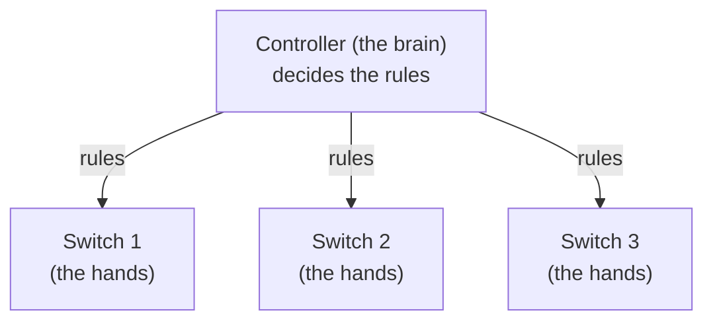

> **Kid example.** In an old city, every traffic light decides by itself when to turn green. In an SDN city, one traffic control centre sees a live map of all the roads and tells each light its rules. The lights still switch by themselves every few seconds; the centre only sets the rules.

## 1. What SDN is

**What this chapter is about:** the definition of SDN (take the thinking out of every box and put it in one logical place) and why the industry took it seriously.

### 1.1 What is SDN?

**In one sentence:** in SDN the switches only **forward**, and one **logically centralized** controller decides the rules for all of them.

The lecture gives a two-part definition. A **Software Defined Network** is:

1. a network in which the **control plane is physically separate from the data plane**, and
2. a network in which a **single, logically centralized control plane controls several forwarding devices**.

In words: the "thinking" part of the network (deciding where packets should go) is taken out of the individual switches and routers and put into one central place. The switches keep only the "doing" part (moving packets according to rules they were given).

"Logically centralized" is an important phrase. It means the control plane *behaves like* one brain, with one view of the whole network. It does *not* have to be a single physical computer: for reliability it may run on several servers ([section 4.5](#45-out-of-band-control)).

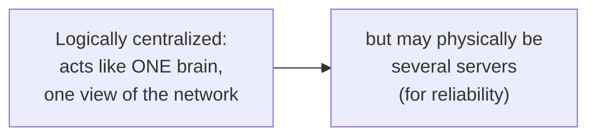

The lecture's picture has layers. At the top are several **control programs**. They look at a **global network map** (a small graph). Below them is one **control plane** (a red bar). Below that, the network's boxes, each split into a "Control" half and a "Forwarding" half, with dotted lines from the central control plane down to each box.

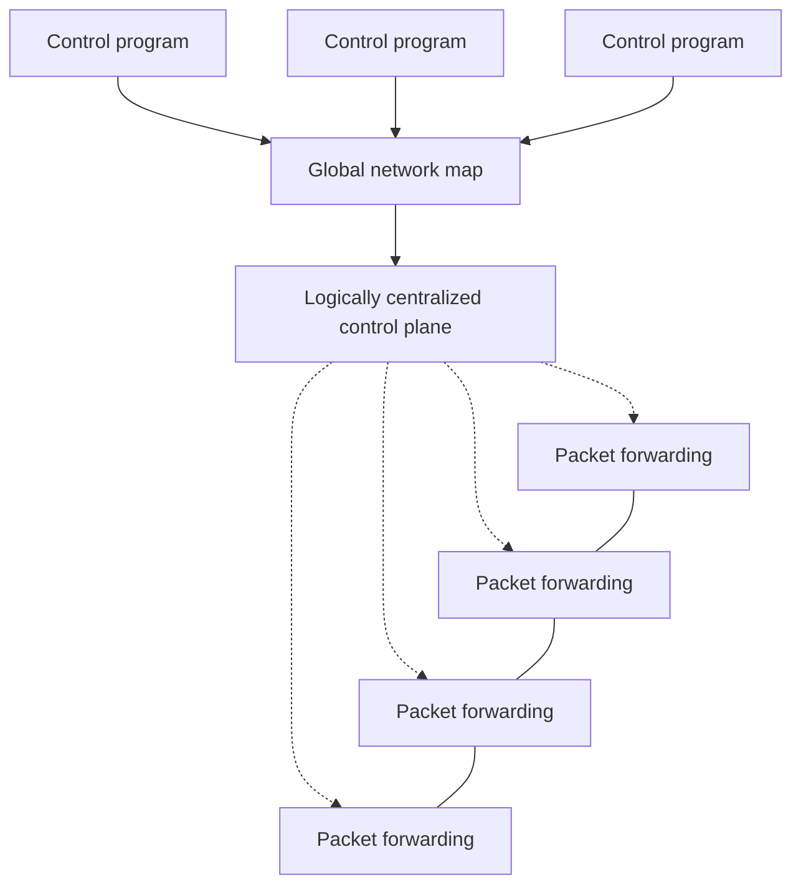

Why this matters: the controller makes **global decisions based on network-wide objectives and policies**, talks to the devices through **well-defined interfaces**, and lets operators adapt the network **programmatically** (by software) to changing traffic.

> **Kid example.** A football team. In a traditional network, every player decides alone where to run. In SDN, the coach on the sideline sees the whole field and tells each player the plan. The players still run and kick the ball themselves, very fast; the coach only gives the plan. And the "coach" can be a small team of coaches who always agree, so the plan does not stop if one coach gets sick.

**Remember:**

- SDN = (1) **control plane physically separate from the data plane** + (2) **one logically centralized control plane controls many forwarding devices**.
- Logically centralized = behaves like one brain; may be **physically distributed**.
- Benefits: **global decisions**, **well-defined interfaces**, **programmatic** control.

### 1.2 A major trend in networking

**In one sentence:** big players adopted SDN: Google runs its backbone on it, VMware bought Nicira for about a billion dollars, and the ONF writes its standards.

The lecture shows three facts that made SDN "a major trend":

- **Google**: its "entire backbone runs on SDN".
- **Nicira**, an SDN start-up, was **bought for \$1.2 billion (mostly cash)**. Also, the buyer was **VMware**.
- The **Open Networking Foundation (ONF)** is a group of industry leaders that develops open SDN standards (OpenFlow among them).

**Additional context.** The Google network meant here is called **B4**, Google's private network between its data centres, described in a 2013 SIGCOMM paper. Google has a second, user-facing backbone, so "entire backbone" is best read as "the whole B4 backbone". VMware bought Nicira in 2012; the price was about \$1.26 billion, of which about \$1.05 billion was cash.

> **Kid example.** When the biggest, richest families in town all start buying the same new kind of bicycle, you know it is not just a toy any more.

**Remember:**

- **Google** backbone (B4) on SDN; **Nicira** bought by **VMware** for about **\$1.2 billion** (2012); **ONF** develops open standards such as OpenFlow.

## 2. The three networking planes and traditional networks

**What this chapter is about:** the three kinds of work in any network (data, control, management), how fast each one is, what a traditional router looks like inside, and why controlling a traditional network is so hard.

### 2.1 The three networking planes

**In one sentence:** the **data plane** moves packets, the **control plane** computes the tables, and the **management plane** (people and scripts) sets the goals and configuration.

The lecture splits everything a network does into three **planes** (layers of work):

- **Data plane**: processing and delivering packets using **local forwarding state**. The rule is "forwarding state + packet header → forwarding decision". It also does **filtering, buffering and scheduling**.
- **Control plane**: **computing the forwarding state** in routers. It decides how and where packets are forwarded. Tasks: **routing, traffic engineering, failure detection and recovery**, and so on.
- **Management plane**: **configuring and tuning** the network. Tasks: **traffic engineering, ACL configuration, device provisioning** (setting up new devices), and so on.

The lecture cites Nencioni, Helvik and Heegaard (2017), a paper on the availability of an SDN backbone.

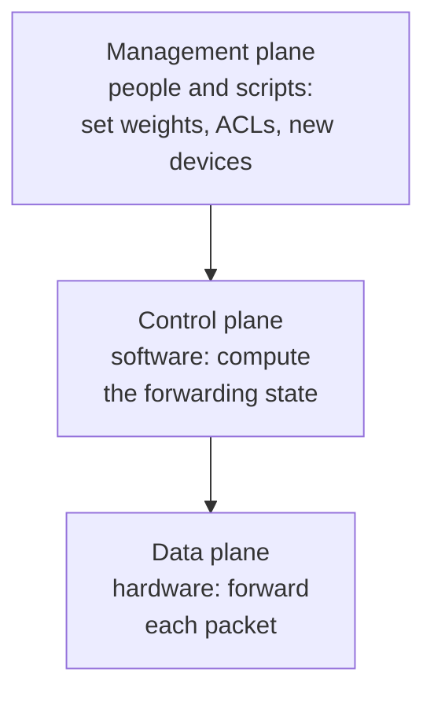

> **Kid example.** A train network. The **data plane** is the track switches that flip left or right as each train passes. The **control plane** decides how each switch should be set. The **management plane** is the boss who writes the timetable rules.

A useful consequence (asked in an old exam): if a router's **control plane fails** but its **data plane keeps working**, packets keep being forwarded for a while, using the forwarding entries that were already installed. Nothing updates those entries any more, so when the network changes, they become wrong ("stale").

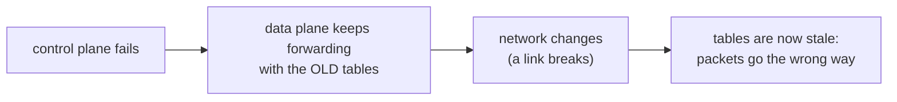

**Remember:**

- **Data plane**: forwarding state + header → decision; also filtering, buffering, scheduling.
- **Control plane**: computes the forwarding state; routing, traffic engineering, failure detection and recovery.
- **Management plane**: configuring and tuning; traffic engineering, ACLs, device provisioning.
- Control plane dies, data plane lives → forwarding continues on **stale** entries.

### 2.2 Timescales of the planes

**In one sentence:** the data plane works per packet (nanoseconds), the control plane per event (milliseconds to seconds), and the management plane at human speed (minutes to hours).

The lecture compares the planes in a table. This one is naturally a table:

| | Data | Control | Management |
|---|---|---|---|
| Time-scale | packet (nanoseconds) | event (10 milliseconds to seconds) | human (minutes to hours) |
| Tasks | forwarding, buffering, filtering, scheduling | routing, circuit set-up | analysis, configuration |
| Location | line-card hardware | router software | humans or scripts |

The idea to remember: **each plane is about a million times slower than the one below it**, so each is built differently. The data plane must handle every single packet, so it is special hardware. The control plane reacts to events (a link goes down, a new route appears), so it is software on the router's processor. The management plane follows human decisions.

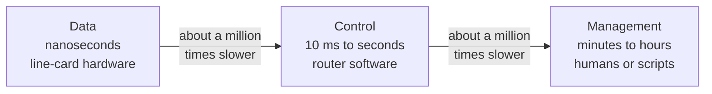

> **Kid example.** In a restaurant, the cook flips each pancake in seconds (data plane). The head chef changes the menu when an ingredient runs out (control plane). The owner decides once a month what kind of restaurant it is (management plane).

**Remember:**

- Data: **packet**, nanoseconds, **line-card hardware**.
- Control: **event**, 10 ms to seconds, **router software**.
- Management: **human**, minutes to hours, **humans or scripts**.

### 2.3 Inside a traditional router

**In one sentence:** a router has **line cards** (ports, the data plane), a **switching fabric** between them, and a **processor** running the routing software (the control plane); and every router has its own copy of that software.

The lecture shows the inside of one router:

- **Line cards** (several, on the left and right): the ports where cables plug in. They do the per-packet work. This is the **data plane**.
- A **switching fabric** in the middle: moves each packet from the line card where it entered to the line card where it must leave.
- A **processor** on top: runs the routing software. This is the **control plane**.

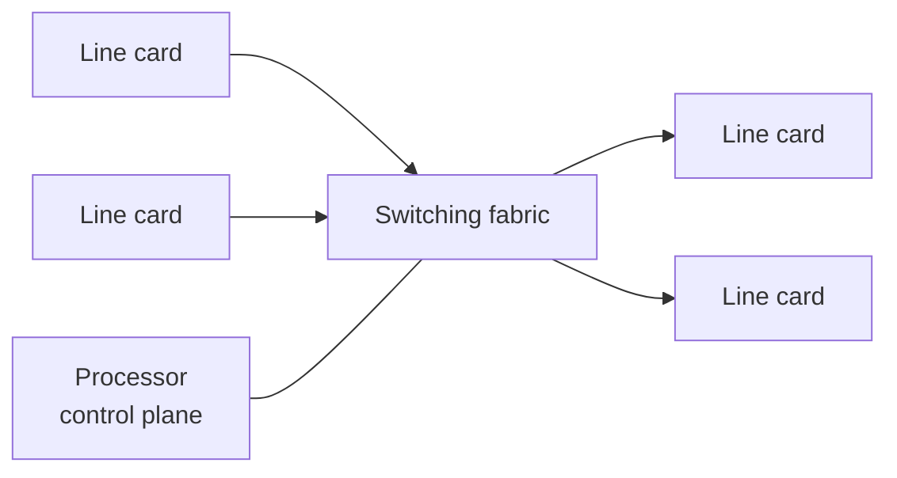

The lecture zooms out to a network of four routers. Each router is drawn as a **Hardware** layer (connected to its neighbours by solid lines: data links) with a **Software** layer on top (connected to the other routers' software by dotted lines: routing protocol messages). In a traditional network, **every router has its own copy of the control software**, and the copies talk to each other to agree on routes.

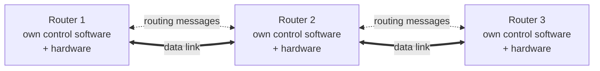

> **Kid example.** A post office building: the counters where letters come in and go out are the line cards, the conveyor belts in the back room are the switching fabric, and the manager's office upstairs is the processor that decides which belt goes where. In a traditional network, every post office has its own manager, and the managers phone each other to agree.

**Remember:**

- **Line cards** = ports, per-packet work = data plane. **Switching fabric** = moves packets between line cards. **Processor** = routing software = control plane.
- Traditional network: **each router has its own control software**; the copies exchange routing messages.

### 2.4 The data plane at work: IP forwarding

**In one sentence:** for every packet, the data plane **matches some header bits** (here the destination address) against its table and **does the action** (send it out of a port).

The lecture says the data plane runs **streaming algorithms on packets**: for each packet, it **matches on some header bits** and **performs some actions**.

The example is **IP forwarding**. Two local networks are joined by routers over a WAN:

- **LAN 1** = `1.2.3.0/24`, with hosts `1.2.3.4`, `1.2.3.7`, …, `1.2.3.156`.
- **LAN 2** = `5.6.7.0/24`, with hosts `5.6.7.8`, `5.6.7.9`, ….

The left router's **forwarding table** has two rows: `1.2.3.0/24` → towards LAN 1 (left arrow), and `5.6.7.0/24` → towards the WAN and LAN 2 (right arrow).

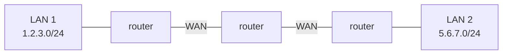

When a packet for `5.6.7.9` arrives at the left router, the router looks only at the destination address, finds that it starts with `5.6.7`, so it matches `5.6.7.0/24`, and sends the packet to the right. That is the whole job: match, then act.

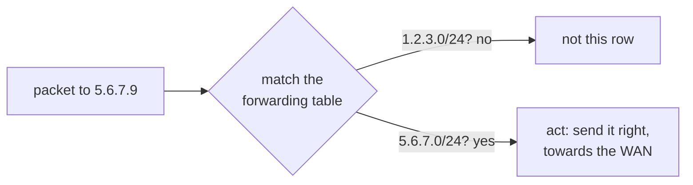

> **Kid example.** A post office worker reads only the first part of the postcode and drops the letter into the right bag. They never open the letter, and they don't decide which bags exist; someone else did that.

**Remember:**

- Data plane = **streaming algorithm**: for each packet, **match header bits**, **perform actions**.
- IP forwarding example: destination `5.6.7.9` matches `5.6.7.0/24` → send towards LAN 2.

### 2.5 The control plane at work: computing paths

**In one sentence:** the control plane **computes paths** and fills the forwarding tables; traditionally every router does this itself with a distributed protocol such as OSPF (flood the map, run Dijkstra).

The lecture says the control plane **computes the paths** packets will follow and **populates (fills in) the forwarding tables**. Traditionally this is done by a **distributed protocol**. The example is **link-state routing** (OSPF, IS-IS):

1. **Flood** the entire topology to all nodes: every router tells every other router which links it has.
2. **Each node computes shortest paths** using **Dijkstra's algorithm**.

The lecture adds a joke in brackets: "Dijkstra's algorithm (**not** the token ring algorithm)". Edsger Dijkstra invented both a shortest-path algorithm and a famous self-stabilizing token ring algorithm; this course teaches both, so the lecture warns you not to mix them up.

The lecture shows the result: a router learns "**if a packet is going to B, then send it to output 3**". Steps: (1) figure out which routers and links are present; (2) run Dijkstra's algorithm to find shortest paths. The rule is then copied into the data plane, and a packet with destination B is sent out of port 3 at every hop along the red path.

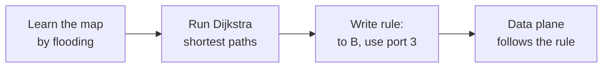

> **Kid example.** Every child in a class shouts out which friends they sit next to, until everyone has drawn the same seating map. Then each child works out the quickest way to pass a note to any other child, and writes it on a card: "notes for B go to my right".

**Additional context.** For how Dijkstra's algorithm and OSPF work step by step, see the Internet routing guide ([01-Internet-Routing.md](01-Internet-Routing.md)) in this folder.

**Remember:**

- Control plane = **compute paths** and **populate forwarding tables**.
- Link-state (OSPF, IS-IS): **flood** the topology, each node runs **Dijkstra** (the shortest-path one, not the token ring one).
- Result: rules such as "to B, use port 3", copied into the data plane.

### 2.6 The management plane: traffic engineering

**In one sentence:** operators steer traffic by setting OSPF **link weights**, but there is no perfect way to choose them.

The lecture uses **traffic engineering** as the management plane example. In OSPF, every link has a **weight**, and "shortest path" means the path with the smallest total weight. So the operator can steer traffic by **setting the weights**. But how should they choose them? The lecture asks three questions:

- Weights **inversely proportional to link capacity**? (Fast links get small weights, so traffic prefers them. This is Cisco's default for OSPF.)
- Weights **proportional to propagation delay**? (Short links get small weights, so traffic takes the quickest route.)
- **Network-wide optimization based on traffic**? (Measure the traffic and compute weights that spread it best.)

There is no perfect answer, and each weight change can move lots of traffic at once. This leads to the next section.

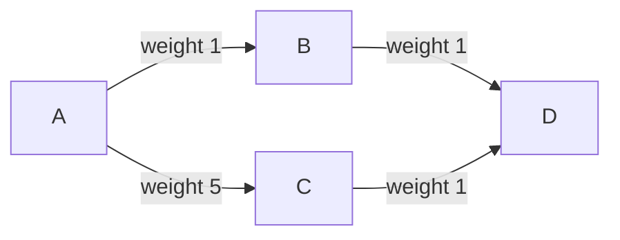

In the picture, A to D via B costs 1 + 1 = 2 and via C costs 5 + 1 = 6, so all traffic takes A → B → D. Change the weight A → C from 5 to 1 and the path via C costs 2 as well, and traffic may suddenly move.

> **Kid example.** You want people to walk through the park instead of the busy shopping street. You cannot move the people; you can only put up signs saying how long each street is. Change one sign, and suddenly everybody walks a different way, maybe even a way you didn't want.

**Remember:**

- OSPF: each link has a **weight**; shortest = smallest total weight; operators steer traffic by **changing weights**.
- Choices: **inverse to capacity** (Cisco default), **proportional to delay**, **network-wide optimization based on traffic**. None is perfect.

### 2.7 Why traditional networks are hard to control

**In one sentence:** traditional networks have **too many separate mechanisms**, only **indirect** and **uncoordinated** control, and protocols that **interact**, so they are hard to reason about, hard to change and expensive.

The lecture lists four **challenges**:

- **(Too) many task-specific control mechanisms.** One protocol for routing, another for access control, another for quality of service. **No modularity** (you cannot reuse pieces), and limited functionality.
- **Indirect control.** You cannot simply say "send this traffic along that path". You have to **invert the protocol's behaviour** and "**coax**" it into doing what you want. Example: to move traffic, you **change link weights instead of paths**, and hope that the protocol then picks the paths you wanted. One weight change can move lots of other traffic too.
- **Uncoordinated control.** You **cannot control which router updates first**. While routers update one by one, the network is briefly inconsistent (loops, black holes).
- **Interacting protocols and mechanisms.** Routing, addressing, access control and QoS all affect each other.

The result: the network is **hard to reason about, hard to evolve, and expensive**.

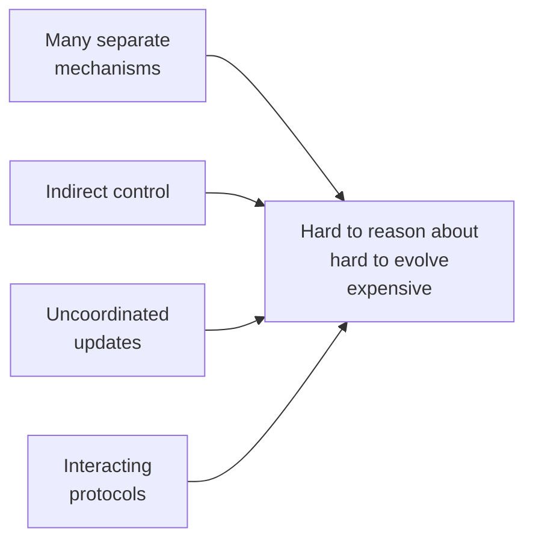

> **Kid example of indirect control.** You want your little brother to walk home by the park road. You are not allowed to tell him the route; you can only tell him "the shop road is very long". He might take the park road, or a third road you never thought of.

**Remember:**

- Four challenges: **too many task-specific mechanisms** (no modularity), **indirect control** (change weights, not paths), **uncoordinated control** (can't choose update order), **interacting protocols**.
- Result: **hard to reason about, hard to evolve, expensive**.

### 2.8 Example 1: inter-domain routing with BGP

**In one sentence:** BGP routes only on destination address blocks and only influences neighbours, so many useful policies are hard; SDN rules can match more fields and make them possible.

The lecture says that BGP, today's routing protocol between networks, **artificially constrains routes**:

- It routes **only on destination IP address blocks** (prefixes).
- A network can **only influence its immediate neighbours**.
- It is **very difficult to add other information** to the decision.

Things operators would like to do, but BGP makes hard:

- **Application-specific peering**: route video traffic one way and other traffic another way.
- **Blocking denial-of-service traffic**: drop unwanted traffic further **upstream** (before it reaches you).
- **Inbound traffic engineering**: split *incoming* traffic over several peering links.

The lecture points to **inter-domain software-defined routing** as a fix, citing Chen et al., "Software-defined inter-domain routing revisited", IEEE ICC 2016. Because SDN rules can match on many header fields, not only the destination ([section 4.2](#42-match-action-primitives)), all three wishes become possible.

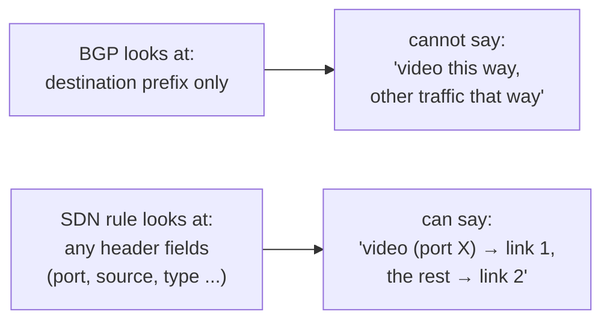

> **Kid example.** BGP is like a delivery company that only looks at the town name on a parcel. You cannot tell it "send all the fragile parcels by the smooth road", because it never reads the word "fragile".

**Remember:**

- BGP: routes **only on destination prefixes**, influences **only immediate neighbours**, hard to add other information.
- Hard with BGP: **application-specific peering**, **blocking DoS upstream**, **inbound traffic engineering**.
- Fix: **inter-domain SDN** (Chen et al., ICC 2016), because SDN matches many header fields.

### 2.9 Example 2: access control goes wrong

**In one sentence:** adding one new link changed the routes automatically, but the packet filters stayed where they were, so traffic that should be blocked got through.

The lecture tells a short story.

**The network.** Two locations, **Chicago (chi)** and **New York (nyc)**. Each has a **Data Center** and a **Front Office**. Routers: R1 (chi data centre), R2 (chi front office), R3 (nyc data centre), R4 (nyc front office), and R5 between R2 and R4. All routers exchange routes over all links.

**The policy.** Each front office may not reach the *other* city's data centre. So there are two **packet filters**:

- On **R1**: "Drop nyc-FO → \*, Permit \*" (drop anything from the New York front office, allow everything else).
- On **R3**: "Drop chi-FO → \*, Permit \*".

Originally, the only way from chi-FO to the nyc data centre is R2 → R5 → R4 → R3, so R3's filter catches it.

**The change.** Someone adds **a new short-cut link between the two data centres** (R1 to R3), intended for backup traffic.

**The problem.** "Oops: the new link lets packets **violate the access control policy**!" Routing changed automatically and now prefers the shorter path R2 → R1 → R3 for chi-FO traffic. R1 does not drop it (R1 only drops nyc-FO). R3's filter was set up on the old way in (from R4), so traffic arriving over the short-cut is never checked. **Routing changed, but packet filters do not update automatically.**

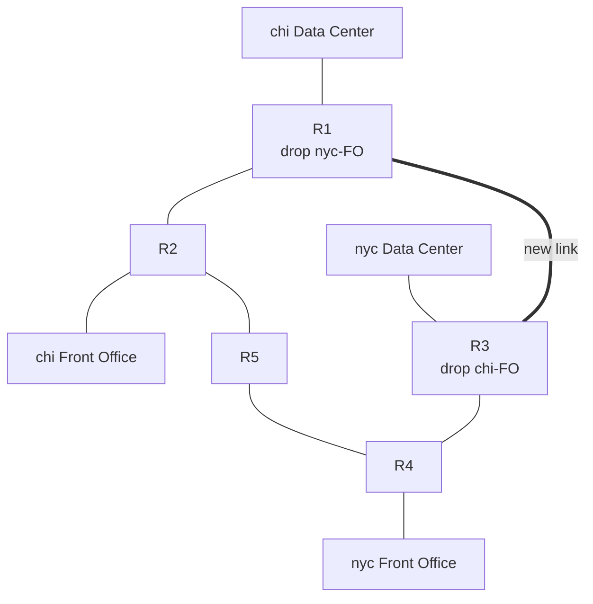

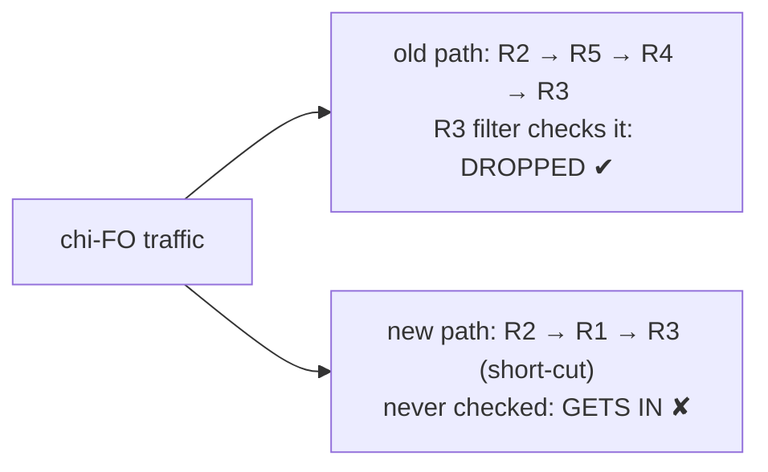

> **Kid example.** A school puts a guard at the front door to keep visitors out. Then a builder adds a back door to make deliveries faster. Nobody tells the guard, so visitors simply walk in through the back.

The lesson: in a traditional network, routing and access control are **separate mechanisms that interact** ([section 2.7](#27-why-traditional-networks-are-hard-to-control)). Nobody reasons about both together. With SDN, one controller knows the topology *and* the policy, so when a link is added it can recompute routes and filters together.

**Remember:**

- Policy: each front office may not reach the other city's data centre; filters on R1 and R3.
- New R1–R3 link → routing moves chi-FO traffic to R2 → R1 → R3 → **policy violated**.
- **Routing changed, but packet filters do not update automatically.** SDN's controller knows both topology and policy.

## 3. SDN architecture: network OS, control programs and virtualization

**What this chapter is about:** the building blocks of SDN, from the bottom up: simple switches, a standard way to program them (the forwarding abstraction), a **network OS** that keeps a map of the whole network, **control programs** that turn the map into rules, and a **hypervisor** that lets many customers share one network.

### 3.1 How SDN changes the network

**In one sentence:** instead of every box having its own hardware, OS and features, SDN puts the features as **programs** on one **network OS** that controls many simple switches.

**Before.** Every box is a vertical stack: **custom hardware**, its own **OS**, and its own **features** on top. Five boxes means five separate brains, each from a vendor, each configured by hand.

**After (top).** The features become **programs** that run on one **Network OS**, which controls all the boxes.

The lecture lists three things SDN needs:

1. **An open interface to packet forwarding** (so software can tell any switch what to do).
2. **At least one Network OS**, probably many, both open-source and closed-source.
3. **A consistent, up-to-date global network view.**

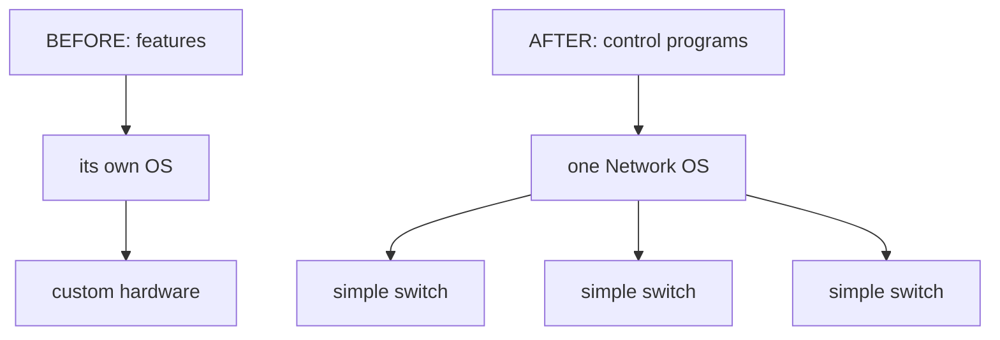

> **Kid example.** Before: every phone maker wrote its own system and all its own apps. After: one operating system (like Android) runs on many phones, and anyone can write apps for it.

**Remember:**

- Before: each box = **custom hardware + own OS + own features**.
- After: **features as programs** on **one Network OS** controlling simple switches.
- SDN needs: **open interface to packet forwarding**, **at least one Network OS**, **consistent, up-to-date global network view**.

### 3.2 The network OS

**In one sentence:** the network OS is a distributed system on the controllers that **collects state** from the switches into one up-to-date map and **sends directives** back to them.

The lecture defines it:

- The **Network OS** is **a distributed system that creates a consistent, up-to-date network view**.
- It **runs on servers (controllers)** in the network.
- Examples: **NOX, ONIX, Floodlight, Trema, OpenDaylight, HyperFlow, Kandoo, Beehive, Beacon, Maestro**, and more.
- It uses the forwarding abstraction ([section 3.4](#34-the-forwarding-abstraction)) in two directions: to **get state information** from the forwarding elements (switches), and to **give control directives** to them.

The lecture shows the layering: **Control Program A** and **Control Program B** on top, the **Network OS** (with its small network graph) in the middle, and plain **Packet Forwarding** boxes at the bottom, linked to the network OS by dotted control connections.

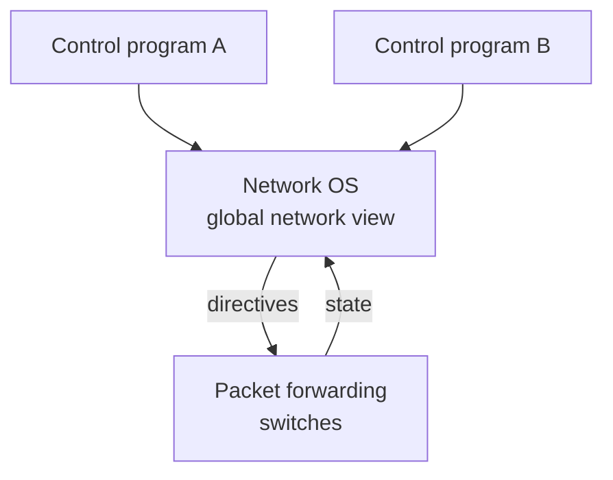

> **Kid example.** The network OS is like an air traffic control tower. Every plane reports where it is (state), the tower keeps one big up-to-date radar map, and the tower tells each plane what to do (directives). The tower may be several rooms working together, but pilots experience it as one voice.

**Remember:**

- Network OS = **distributed system** that creates a **consistent, up-to-date network view**; runs on **controllers**.
- Examples: NOX, ONIX, Floodlight, Trema, OpenDaylight, HyperFlow, Kandoo, Beehive, Beacon, Maestro.
- Two directions: **state** from switches, **directives** to switches.

### 3.3 Control programs

**In one sentence:** a control program is a plain function "**network graph in, device configurations out**"; it does not have to be a distributed system.

The lecture describes a **control program** (an SDN "app"):

- It **operates on a view of the network**.
- **Input**: the **global network view** (a graph or a database).
- **Output**: the **configuration of each network device**.
- A control program **is not a distributed system**. The abstraction **hides the details of the distributed state**: the control program sees one clean graph, not hundreds of switches sending messages at different times.

This is the main gift of SDN to programmers. Writing a correct distributed protocol (like OSPF) is hard; writing a function "graph in, rules out" is much easier. For example, a routing control program can simply run Dijkstra's algorithm on the graph and output "to B, use port 3" for every switch.

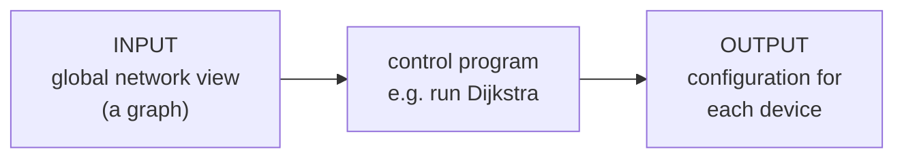

> **Kid example.** Planning a trip with the whole map spread out on a table is much easier than asking for directions at every crossroads.

**Remember:**

- Control program: **input** = global network view (graph/database); **output** = configuration of each device.
- It is **not a distributed system**; the abstraction **hides the distributed state**.

### 3.4 The forwarding abstraction

**In one sentence:** the forwarding abstraction is a **standard, small set of forwarding commands** that every switch understands, so control programs do not depend on the switch vendor; OpenFlow is one.

The **purpose** of the forwarding abstraction is a **standard way of defining forwarding state**. It must be:

- **Flexible**: its behaviour is specified by the control plane, and it is built from a **basic set of forwarding primitives**.
- **Minimal**: **streamlined for speed and low power**, so switches stay fast and cheap.
- So the **control program is not vendor-specific**: the same program works on switches from any company.

**OpenFlow is an example** of such an abstraction ([section 4.1](#41-openflow-basics-flow-tables)).

> **Kid example.** A USB plug: every brand of computer and every brand of mouse agree on the same simple plug, so any mouse works with any computer.

**Remember:**

- Purpose: a **standard way of defining forwarding state**.
- **Flexible** (built from basic primitives, behaviour set by the control plane) and **minimal** (fast, low power).
- Control programs become **not vendor-specific**. **OpenFlow** is an example.

### 3.5 Virtualization and the network hypervisor

**In one sentence:** the **network hypervisor** shows each control program a simple **virtual topology** and translates its rules into real rules on the many physical switches.

The lecture adds one more layer. From the bottom: the switches; the **Network OS**, which builds the **global network view**; the **network hypervisor**, which turns that view into a **virtual topology**; and the control program on top, which sees only the virtual topology.

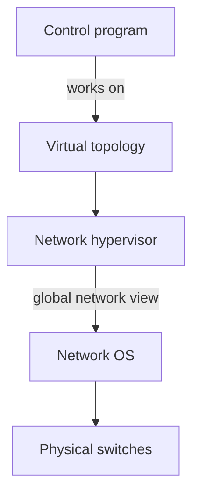

"**Virtualization simplifies the control program**". An example:

- The control program sees an **abstract network view**: hosts **A** and **B** attached to one big switch. Its whole policy is one line: "**A → B drop**".
- The real **global network view** has many switches and many paths between A and B.
- "**Hypervisor then inserts flow entries as needed**": it places "A → B drop" rules on the real switches (the lecture shows the rule on two of them, near A) so that the policy holds whatever path the traffic would take.

```mermaid
flowchart LR
  V["What the program sees:<br/>A — one big switch — B<br/>rule: A → B drop"] -->|"hypervisor<br/>translates"| R["Real network:<br/>many switches and paths;<br/>'A → B drop' placed on the<br/>switches next to A"]
```

> **Kid example.** You tell the building manager "my child may not go into the kitchen". You don't need to know where all the doors are; the manager works out which real doors to lock.

**Remember:**

- Layers: physical switches → **Network OS** (global view) → **network hypervisor** (virtual topology) → control program.
- "**Virtualization simplifies the control program**": e.g. one big switch with the rule "A → B drop".
- "**Hypervisor then inserts flow entries as needed**" on the real switches.

### 3.6 Does SDN simplify the network?

**In one sentence:** SDN does not remove complexity; it **moves** it into reusable platform code (network OS, hypervisor) and gives control programs a **simple interface**, just like compilers.

The lecture answers honestly:

- **Abstraction doesn't eliminate complexity.** The **network OS and the hypervisor are still complicated pieces of code**.
- SDN's main achievements:
  - it **simplifies the interface for the control program** (the part each user writes), and
  - it **pushes complexity into reusable code** (the SDN platform),
  - "**just like compilers**".

A compiler is a hard program, but it is written once by experts, and then millions of programmers write easy code on top of it. In the same way, the network OS is hard, but it is written once, and then many simple control programs reuse it.

```mermaid
flowchart TB
  E["Many simple control programs<br/>(easy to write)"] --> P["SDN platform: network OS + hypervisor<br/>(hard, but written once and reused)"]
  P --> S["Switches"]
```

> **Kid example.** A car is very complicated inside, but the engineers built it once. You only use a steering wheel and two pedals. The complexity is still there, hidden in a part that many people reuse.

**Remember:**

- **Abstraction doesn't eliminate complexity**: network OS and hypervisor are still complicated.
- SDN **simplifies the interface for the control program** and **pushes complexity into reusable code**, "**just like compilers**".

## 4. OpenFlow

**What this chapter is about:** OpenFlow, the standard way a controller programs a switch: flow tables of match-action rules, what a rule can match and do, counters, a full example of one web connection, and the two ways the controller can reach the switches (out-of-band and in-band).

### 4.1 OpenFlow basics: flow tables

**In one sentence:** inside each OpenFlow switch is a **flow table** of rules like "if header = p, send to port 4", written by the controller; a packet that matches no rule is sent **to the controller**.

The lecture introduces **OpenFlow**. The picture: control programs A and B on a **Network OS**, which talks to the **packet forwarding** boxes. Inside a switch is a **flow table**. The network OS writes rules into it, for example:

- "If header = **p**, send to port 4"
- "If header = **q**, overwrite header with **r**, add header **s**, and send to ports 5, 6"
- "If header = **?**, send to me"

The first rule is ordinary forwarding. The second rule both **modifies** the packet and sends copies out of **two** ports (multicast). The third rule handles a packet whose header the switch does not recognise: "send to me" means **send it to the controller**, because "me" is the network OS that is speaking.

```mermaid
flowchart TB
  NOS[Network OS] -->|installs rules| FT
  subgraph SW [Switch]
    FT["Flow table<br/>p: port 4<br/>q: rewrite, ports 5 and 6<br/>?: to controller"]
  end
  FT -->|unknown packet| NOS
```

> **Kid example.** A sorting machine at the post office has a rule card: "postcode 412 → bin 4". If a letter has a postcode that is not on the card, the machine puts it in a tray for the supervisor, who decides and writes a new line on the card.

**Technical clarification.** The lecture's explanation reads "send to me" as the switch sending the packet "to itself". That is a misreading. In OpenFlow, a packet that matches no rule (a **table miss**) is sent **to the controller**, which then decides what to do. The SDN quiz uses the same answer: "The switch forwards the packet to the controller for decision-making".

**Remember:**

- Each switch has a **flow table**; the network OS **installs rules**.
- Examples: p → port 4; q → rewrite to r, add s, ports 5 and 6; unknown → **to the controller**.
- **Table miss** → packet goes **to the controller** (not "to itself").

### 4.2 Match-action primitives

**In one sentence:** a rule **matches any header bits** (with "don't care" wildcards) and then **acts**: forward, drop, send to controller, rewrite or push/pop headers, or limit the rate.

The lecture lists the building blocks, written as **<Match, Action>** pairs.

**Match**: match **arbitrary bits in headers**.

- Match on **any header**, or even a **new header** that has not been invented yet.
- This **allows any flow granularity**: a rule can be as broad as "all packets" or as narrow as "this one TCP connection".
- The lecture's example pattern is `1000x01xx0101001x`. Each `x` is a **wildcard** ("don't care"); every other bit must be equal.

For example, with that pattern:

| Header bits | Match? | Why |
|---|---|---|
| `10001010101010010` | yes | every fixed bit is equal; the four `x` positions hold 1, 0, 1, 0, which do not matter |
| `10000010001010011` | yes | same fixed bits; different values under the `x` |
| `00001010101010010` | no | the first bit must be 1 |

```mermaid
block-beta
  columns 5
  a["1000"] b["x<br/>(any)"] c["01"] d["xx<br/>(any)"] e["0101001x<br/>(last bit any)"]
```

The pattern read in pieces: the fixed pieces must be exactly equal, the `x` pieces may be anything.

**Action**:

- **Forward** to one or more ports, **drop**, or **send to the controller**.
- **Overwrite the header with a mask** (change some fields), **push or pop** a header (add or remove an extra header, such as a tunnel or VLAN tag).
- **Forward at a specific bit-rate** (rate limiting).

> **Kid example.** A normal rule card says only "postcode → bin". A match-action rule card can say "red envelopes from Gothenburg with a gold stamp → put a new label on them and send a copy to bins 5 and 6".

**Remember:**

- **Match** arbitrary header bits, any header (even future ones); **any flow granularity**; `x` = **wildcard**.
- **Action**: forward (one or more ports), drop, to controller; overwrite header with a mask; push/pop headers; forward at a specific bit-rate.

### 4.3 OpenFlow rules and statistics

**In one sentence:** each row of the flow table is **rule + action + statistics** (counters), and the last row holds the **default action**.

"**Exploit the flow table in switches, routers, and chipsets**": OpenFlow reuses the tables that switch chips already have (this is why it could run on existing hardware, [section 5.2](#52-why-sdn-happened-now-the-drivers)). The flow table is a list, Flow 1, Flow 2, … Flow N. Each row has three parts:

| Rule | Action | Statistics |
|---|---|---|
| a match pattern, **exact or wildcard** | what to do with matching packets | counters: how many packets and bytes matched |

The last row (Flow N) holds the **default action**, used when nothing else matches.

The **statistics** let the controller measure the network: it can ask each switch "how much traffic matched each rule?" and use the answer, for example, for traffic engineering.

```mermaid
flowchart TB
  P["packet arrives"] --> F1{"Flow 1 rule<br/>matches?"}
  F1 -->|yes| A1["do Flow 1 action,<br/>add 1 to its counters"]
  F1 -->|no| F2{"Flow 2 rule<br/>matches?"}
  F2 -->|yes| A2["do Flow 2 action,<br/>add 1 to its counters"]
  F2 -->|"no ... down to Flow N"| FN["Flow N:<br/>default action"]
```

> **Kid example.** Each line of the rule card has a little tally box. Every time a letter follows that line, the machine adds a tick. The supervisor can read the ticks and see which bins are getting too full.

**Remember:**

- OpenFlow **exploits the flow tables already in switch chips**.
- Row = **rule** (exact or wildcard) + **action** + **statistics** (packet and byte counters).
- Flow N = **default action**. Statistics help, for example, traffic engineering.

### 4.4 Execution example: one web connection

**In one sentence:** only the **first packet** in each direction goes to the controller, which installs a rule (Flow-MOD); after that the switch forwards everything else by itself.

The lecture shows this as a step-by-step picture story (with a video: youtu.be/l25Ukkmk6Sk at 2 min 38 s). It has one switch **S1**, one controller **C0**, and four hosts **H1 to H4** on ports eth1 to eth4. Host H1 opens a web (HTTP, port 80) connection to H4. At the start, S1's flow table is empty.

```mermaid
flowchart TB
  C0["Controller C0"] -.- S1["Switch S1"]
  S1 ---|eth1| H1[H1]
  S1 ---|eth2| H2[H2]
  S1 ---|eth3| H3[H3]
  S1 ---|eth4| H4[H4]
```

**Step 1, the first packet.** H1 sends a TCP **SYN** to H4 port 80. S1 has no rule, so it stores the packet in a buffer (**buffer ID 250**) and sends a **Packet-IN** to C0. The lecture shows two possible answers from the controller:

- **Packet-OUT**: "for buffer 250: forward to port 4". This handles **only this one packet**.
- **Flow-MOD**: install a rule in the flow table, with: match and mask (H1 → H4, port 80), buffer ID 250, **idle timeout 20**, **hard timeout 60**, **action: forward to port 4**, **priority 5000**. The buffered SYN goes out of port 4, and S1 now has the entry "**H1 → H4 port 80**".

**Step 2, the reply.** H4 answers with **SYN/ACK**. There is no rule for traffic from H4 to H1 yet, so S1 buffers it (**buffer ID 251**) and sends another Packet-IN. Again the lecture shows a Packet-OUT ("forward port 1") and a Flow-MOD (same settings, action forward to port 1). S1 now also has the entry "**H4 → H1 reply**".

**Step 3, everything else.** The final **ACK**, the **HTTP request** and the **HTTP reply** all match the two installed rules. The switch forwards them **by itself**, at full speed, **without asking the controller**.

```mermaid
sequenceDiagram
  participant H1
  participant S1 as Switch S1
  participant C0 as Controller C0
  participant H4
  H1->>S1: SYN to port 80
  S1->>C0: Packet-IN, buffer 250
  C0->>S1: Flow-MOD, H1 to H4 port 80, out port 4
  S1->>H4: SYN
  H4->>S1: SYN/ACK
  S1->>C0: Packet-IN, buffer 251
  C0->>S1: Flow-MOD, H4 to H1 reply, out port 1
  S1->>H1: SYN/ACK
  H1->>S1: ACK, then HTTP request
  S1->>H4: matched by rule, no controller
  H4->>S1: HTTP reply
  S1->>H1: matched by rule, no controller
```

What to learn from it:

- **Only the first packet of each new flow** goes to the controller. That trip adds delay to the first packet (the "flow set-up" latency).
- After that, the **controller is not involved** in each packet. Forwarding stays distributed and fast.
- **Packet-OUT** answers one packet; **Flow-MOD** installs a rule for all later packets.

> **Kid example.** The first time a new child asks the school bus driver "where do I get off?", the driver phones the office. The office says "stop 4", and the driver writes it on a sticky note. Every other day that child rides, the driver just reads the note and never phones again. Packet-OUT is the office answering only for today; Flow-MOD is writing the sticky note.

**Additional context.** In OpenFlow both timeouts are counted in **seconds**. The **idle timeout (20)** removes the rule when no packet has matched it for 20 seconds; the **hard timeout (60)** removes it 60 seconds after it was installed, even if it is busy. When several rules match one packet, the one with the **highest priority** number wins. Timeouts make old rules clean themselves up: a wrong or stale rule cannot stay in the switch forever, which is exactly the kind of property that the self-stabilization part of this course cares about.

```mermaid
flowchart LR
  I["rule installed<br/>time 0"] --> Q{"no packet matched<br/>for 20 s?"}
  Q -->|yes| D["idle timeout:<br/>rule deleted"]
  Q -->|"no, still busy"| H["at 60 s anyway:<br/>hard timeout deletes it"]
```

**Remember:**

- Setup: switch **S1**, controller **C0**, hosts **H1–H4** on eth1–eth4; H1 opens HTTP (port 80) to H4.
- SYN: no rule → buffer **250**, **Packet-IN**; controller answers with **Packet-OUT** (this packet only) or **Flow-MOD** (rule: idle **20**, hard **60**, priority **5000**, out port 4).
- SYN/ACK: buffer **251**, Packet-IN, Flow-MOD out port 1.
- ACK, HTTP request, HTTP reply: matched by rules, **no controller**.
- Only the **first packet** of a new flow goes to the controller (flow set-up latency).
- Timeouts in **seconds**; highest **priority** wins; timeouts clean up stale rules.

### 4.5 Out-of-band control

**In one sentence:** the controller can be several servers (logically central, physically distributed), and with **out-of-band** control it reaches the switches over a **separate control network**.

This part is about where the controller lives and how it talks to the switches.

- The control plane is **logically centralized**, and **possibly physically distributed** (several controller servers). Being distributed gives:
  - **Reliability**,
  - **Availability**,
  - **Scalability**,
  - **Low latency** (a controller close to each part of the network).
- **Out-of-band SDN control**: a **physically or logically separate network** acts as the controller entity. The figure (image from packetlife.net) shows a **controller** on top, connected by blue dashed lines (the control plane) to every switch, and the switches connected to each other by green solid lines (the forwarding plane).

```mermaid
flowchart TB
  C[Controller] -.-> S1[Switch]
  C -.-> S2[Switch]
  C -.-> S3[Switch]
  C -.-> S4[Switch]
  S1 --- S2
  S2 --- S3
  S3 --- S4
  S1 --- S4
```

The trade-off: Out-of-band control is clean and isolated (good for **security** and reliability: data traffic cannot block control messages), but it **costs** a second network, adds **complexity**, and the control network itself can break and cut switches off from the controller.

> **Kid example.** The head teacher has a private walkie-talkie to every classroom. It always works, even when the corridors are full, but someone has to buy and charge all those walkie-talkies.

**Remember:**

- Control: **logically centralized, possibly physically distributed** → **reliability, availability, scalability, low latency**.
- **Out-of-band**: a **separate** (physical or logical) control network.
- + isolated, secure, not blocked by data traffic; − **costs** a second network, more complexity, can itself fail.

### 4.6 In-band control

**In one sentence:** with **in-band** control the controller's messages travel over the **same links as data**, which is cheaper and more redundant, but creates a chicken-and-egg problem that self-stabilizing algorithms can solve.

In **in-band SDN control**, control traffic goes either

- **Through a dedicated management port** of the switch (**Controller A** in the figure), or
- **Multiplexed with data-plane traffic** (**Controller B**): the controller's messages travel over the **same links as normal data**, through other switches, and reach the switch's control module through an internal link.

**Benefits: less cost, higher redundancy, increased partition tolerance.**

- **Less cost**: no separate control network to build.
- **Higher redundancy**: the data network has many paths, so there are many ways to reach the controller.
- **Increased partition tolerance**: if one link breaks, control messages can go around it.

The figure shows an "abstract SDN switch": a control module with its **forwarding rules**, a switch fabric, data links to hosts and to neighbouring switches, and the two controllers.

```mermaid
flowchart LR
  CA[Controller A] -.->|management port| SW
  CB[Controller B] --- N1[Neighbour switch]
  N1 ---|"data link carries<br/>control too"| SW[SDN switch]
  SW --- H[Hosts]
  SW --- N2[Neighbour switch]
```

> **Kid example.** In-band is like the head teacher's notes being passed hand to hand through the same corridors the students walk in. It is free and there are many corridors, but if the children don't know which way to pass the notes, the notes get stuck.

**The catch: a chicken-and-egg problem.** In in-band control, a switch forwards packets, including the controller's own messages, **only according to its rules**, and the rules are installed by the controller. So the controller needs working paths in order to install the paths it needs. After a failure, or when rules are wrong, some switches may be cut off from the controller. This is why the lecture title says "**self-stabilizing** SDN": the course's algorithms (for example the self-stabilizing BFS spanning tree) can rebuild correct in-band paths from any starting state. See the 2020 exam question in [section 6.2](#62-old-exam-questions-on-sdn).

```mermaid
flowchart LR
  A["controller wants to<br/>install rules in switch X"] --> B["its message must travel<br/>through other switches"]
  B --> C["those switches forward it<br/>only if they have rules"]
  C --> D["and those rules come<br/>from the controller"]
  D -->|"chicken and egg"| A
```

**Technical clarification.** The lecture lists "network overhead" as a *drawback* of in-band control, while one old exam's answer key gives "reduced network overhead (no separate control network needed)" as its main *benefit*. Both are true in different senses: in-band needs **less infrastructure** (no second network), but control messages **add load to the data links**. In an exam, answer with the lecture's words: less cost, higher redundancy, increased partition tolerance.

**Additional context.** The abstract-switch figure looks like the one in the research paper "Renaissance: A self-stabilizing distributed SDN control plane" (ICDCS 2018), which the course's introduction slides mention. That paper bootstraps in-band control from any state, with several controllers.

**Remember:**

- **In-band**: control traffic via a **dedicated management port** (Controller A) or **multiplexed with data** (Controller B).
- Benefits: **less cost, higher redundancy, increased partition tolerance**.
- **Chicken-and-egg**: the controller's messages need rules that only the controller can install → **self-stabilizing** algorithms (BFS spanning tree) rebuild paths from any state.
- "Network overhead": less infrastructure, but control adds load to data links.

## 5. History, drivers and practical challenges

**What this chapter is about:** where SDN came from, why it succeeded around 2008–2012 when earlier ideas did not, why virtualization made it worth money, and the hard problems it still has.

### 5.1 The road to SDN

**In one sentence:** SDN grew in three steps: **Active Networking** (1990s), **control/data plane separation** (2003–2007), and **OpenFlow with network OSes** (2008).

The part "Recent SDN development" starts with "**The Road to SDN**", which follows the paper by N. Feamster et al., "The Road to SDN: An Intellectual History of Programmable Networks", ACM SIGCOMM CCR 2014:

| Period | Step | What it brought |
|---|---|---|
| 1990s | **Active Networking** | First attempt to make networks programmable: demultiplexing packets to software programs, network virtualization, … |
| 2003–2007 | **Control/data plane separation**: ForCES [IETF], RCP, 4D [Princeton, CMU], SANE/Ethane [Stanford/Berkeley] | **Open interfaces between the data and control plane**, and **logically centralized control** |
| 2008 | **OpenFlow API and network OSes**: OpenFlow switch interface [Stanford], NOX network OS [Nicira] | A simple standard interface that existing switches could support |

The middle step **most directly** led to SDN's split of control and data, because it created the **open interfaces** between them.

```mermaid
flowchart LR
  A["1990s<br/>Active Networking"] --> B["2003-2007<br/>Control/data separation"]
  B --> C["2008<br/>OpenFlow and NOX"]
  C --> D["2010s<br/>SDN in data centres<br/>and backbones"]
```

> **Kid example.** Learning to ride a bike: first a tricycle that nobody really used on the road (Active Networking), then training wheels that taught the important skill of balance (control/data separation), and finally a light, normal bike that everyone could afford (OpenFlow).

**Technical clarification.** The lecture's explanation contains two mistakes here. (1) They call SANE "Scalable Network Emulation". SANE stands for **Secure Architecture for the Networked Enterprise** (Casado et al., 2006), a security design in which a central controller decides which flows may talk; Ethane (2007) was its practical follow-up. (2) They say RCP (the "Routing Control Platform") came from Princeton and Carnegie Mellon. RCP was built by researchers at **Princeton and AT&T Labs**; it is **4D** that was Princeton and CMU, as the lecture's own timeline says.

**Technical clarification.** The outline promises a "**4D discussion**", but the lecture never covers 4D beyond its name in the timeline. In short: 4D (around 2005) proposed splitting the network into four planes (decision, dissemination, discovery, data) with a central **decision** plane that has a network-wide view and directly sets the data plane; this is the same idea as SDN's logically centralized controller.

**Remember:**

- **1990s Active Networking**: first programmable networks.
- **2003–2007 control/data separation**: ForCES, RCP, 4D, SANE/Ethane → **open interfaces** and **logically centralized control**. This step **most directly** led to SDN.
- **2008 OpenFlow** (Stanford) and **NOX** (Nicira).
- SANE = Secure Architecture for the Networked Enterprise; RCP = Princeton + AT&T; 4D = Princeton + CMU, four planes with a central decision plane.

### 5.2 Why SDN happened now: the drivers

**In one sentence:** SDN took off because of **cheap merchant switch chips**, **cost-conscious cloud operators** who wanted control, **OpenFlow working on existing hardware**, and the killer app **network virtualization**.

The lecture lists the **SDN drivers**:

- **Rise of merchant switching silicon**: cheap standard switch chips "**democratized switching**", and new **vendors were eager to unseat the incumbents** (the old big router companies).
- **Cloud and data centres**: their **operators face real network management problems**, are **extremely cost conscious**, and **desire a lot of control**.
- **The right balance between vision and pragmatism**: **OpenFlow is compatible with existing hardware**, so nobody had to buy new chips. (Earlier ideas such as Active Networking or ForCES needed special hardware or deep changes.)
- **A "killer app": network virtualization** ([section 5.3](#53-virtualization-is-the-killer-app)).

```mermaid
flowchart LR
  A["merchant silicon<br/>cheap chips"] --> S((SDN<br/>takes off))
  B["cloud and data centres<br/>cost-conscious, want control"] --> S
  C["OpenFlow works on<br/>existing hardware"] --> S
  D["killer app:<br/>network virtualization"] --> S
```

> **Kid example.** Smartphones took off when cheap chips, app stores and a must-have app all arrived at the same time. SDN took off when cheap switch chips, data-centre needs and network virtualization arrived together.

**Remember:**

- Drivers: **merchant switching silicon** ("democratized switching"), **cloud/data-centre operators** (real problems, cost conscious, want control), **vision vs pragmatism** (OpenFlow on **existing hardware**), **killer app: network virtualization**.

### 5.3 Virtualization is the killer app

**In one sentence:** in a multi-tenant data centre, each customer describes its own **virtual topology**, and the hypervisor compiles **thousands** of them into one set of switch rules; this is what people pay for.

Consider a **multi-tenant data centre** (like a cloud provider):

- It wants to let **each tenant specify a virtual topology**. This defines the tenant's own **policies and requirements**.
- The data centre's **network hypervisor compiles these virtual topologies into a set of switch configurations**.
- It **takes 1000s of individual tenant virtual topologies** and **computes configurations to implement all of them simultaneously**.
- "**This is what people are paying money for**."
- It is **enabled by SDN's ability to virtualize the network**.

```mermaid
flowchart LR
  T1[Tenant 1<br/>virtual topology] --> HV
  T2[Tenant 2<br/>virtual topology] --> HV
  T3[Tenant 1000<br/>virtual topology] --> HV
  HV[Network hypervisor<br/>compiles all at once] --> SW[Shared physical<br/>switches]
```

Each tenant gets its own topology, addresses and rules, all on the same shared switches, and tenants cannot see or disturb each other.

> **Kid example.** One big apartment building (the physical network). Each family (tenant) draws its own floor plan. The building manager (hypervisor) works out which real walls and doors to put up so that every family gets what it drew, and no family can walk into another's flat.

**Remember:**

- **Multi-tenant data centre**: each tenant specifies a **virtual topology** (its policies and requirements).
- **Network hypervisor compiles** 1000s of them into switch configurations **simultaneously**.
- "**This is what people are paying money for**"; enabled by SDN's ability to **virtualize**.

### 5.4 Practical challenges

**In one sentence:** SDN still has six hard problems: **scalability, reliability, response time, consistency, security and interoperability**.

The lecture lists six challenges. The lecture's word "**decision elements**" means the controllers:

| Challenge | Lecture's words | What it means |
|---|---|---|
| **Scalability** | decision elements responsible for many routers | One controller for many switches can become a bottleneck as the network grows. |
| **Reliability** | surviving failures of decision elements and routers | If the controller fails with no backup, switches keep forwarding with their old (**stale**) rules, but nobody can add rules or react to changes. |
| **Response time** | delays between decision elements and routers | The first packet of a new flow waits for the controller's answer ([section 4.4](#44-execution-example-one-web-connection)). |
| **Consistency** | ensuring multiple decision elements behave consistently | Several controllers must agree, or they install conflicting rules (loops, black holes). Agreeing costs messages and time. |
| **Security** | network vulnerable to attacks on decision elements | Whoever takes over the controller takes over the whole network. |
| **Interoperability** | legacy routers and neighbouring domains | Old routers and other networks don't speak OpenFlow. |

Notice the tension between the first four: **one** controller is simple and consistent but is a bottleneck and a single point of failure; **many** controllers scale and survive failures but must be kept consistent. An old exam names this the key challenge: "balancing scalability and response time" against a consistent network-wide state.

```mermaid
flowchart LR
  O["ONE controller<br/>+ simple, consistent<br/>− bottleneck, single point of failure"] <-->|"trade-off"| M["MANY controllers<br/>+ scale, survive failures<br/>− must be kept consistent"]
```

> **Kid example.** One teacher for a whole school always gives the same answer, but cannot answer everyone in time and the school stops if the teacher is ill. Many teachers can answer quickly and cover for each other, but they must keep agreeing on the rules, or pupils get different answers in different rooms.

**Additional context.** Distributed controllers usually keep their copies of the network view the same by **replicating state with a consensus protocol** (for example Paxos or Raft), so that if one controller dies, another takes over with the same knowledge. An old exam question asks exactly this.

**Remember:**

- Six challenges: **scalability, reliability, response time, consistency, security, interoperability**. "Decision elements" = controllers.
- Controller fails with no backup → **stale** rules keep forwarding, nobody updates.
- One vs many controllers is a **trade-off**; many controllers stay consistent with **consensus** (Paxos, Raft).

## 6. Summary and review

**What this chapter is about:** the whole lecture on one page, old exam questions with model answers, and quiz details that the lecture only hints at.

### 6.1 Summary

**In one sentence:** SDN separates the brain (control) from the hands (data), centralizes the brain logically, programs switches with match-action rules, and its biggest use is virtualization in data centres.

In short:

**Core concepts**

- SDN **separates the control plane from the data plane**.
- Control is **logically centralized but physically distributed**.
- The **management plane defines policies and operator intent**.
- **Motivation**: traditional networks are **complex, inflexible and error-prone**.

**How SDN works**

- The **Network OS maintains a global, consistent view** of the network.
- **Control programs define high-level policies** on this view.
- **Forwarding devices use match-action rules** (for example OpenFlow).
- **Virtualization enables multi-tenancy** via abstract topologies.

**Applications and use cases**

- **Access control**: centralized enforcement, fewer misconfigurations.
- **Network virtualization**: the key SDN use case in multi-tenant data centres.
- **Traffic engineering**: flexible, programmable path selection.
- **Benefits**: programmability, rapid innovation, cloud-scale efficiency.

```mermaid
flowchart TB
  P[Problem: networks are complex,<br/>inflexible, error-prone] --> S[SDN: separate control from data,<br/>logically centralize control]
  S --> H[Network OS + global view<br/>control programs<br/>match-action rules]
  H --> U[Access control<br/>virtualization<br/>traffic engineering]
  H --> C[Challenges: scalability, reliability,<br/>response time, consistency,<br/>security, interoperability]
```

> **Kid example.** The whole lecture as one story: the traffic lights of a city used to decide alone and got in each other's way. Now one control centre (that may be several rooms working together) sees the live map, writes simple rule cards for every light, and can even make the same streets look like separate private road networks for different bus companies.

**Remember:**

- Core: **separate control and data**, **logically centralized, physically distributed**, management plane = **intent**, motivation = complex, inflexible, error-prone networks.
- How: **Network OS** (global view), **control programs** (policies), **match-action** rules (OpenFlow), **virtualization** (multi-tenancy).
- Uses: **access control**, **network virtualization** (the key one), **traffic engineering**.

### 6.2 Old exam questions on SDN

**In one sentence:** exams ask what forwarding rules do, how a self-stabilizing BFS tree builds in-band routing, true/false about SDN's success, and common multiple-choice traps.

**Additional context.** These come from the course's old exams. The model answers below are built from the lectures and the exam guides in this project.

**August 2020, question 1.b (8 points).**

*1.b.i (2 points): "Explain what is the functionality that packet forwarding rules serve in SDNs."*

Model answer: in SDN the control plane (the controller) is separated from the data plane (the switches). The controller computes the forwarding state and installs it in each switch as **forwarding rules ⟨match, action⟩** in the flow table. A rule matches header fields of a packet and gives the action: forward to some port(s), drop, rewrite a header, or send to the controller. So the rules **are** the data plane's instructions: every packet, including the controller's own packets in the in-band case, is moved only according to them.

*1.b.ii (6 points): "Can any of the algorithms of item 1.a [spanning tree and routing algorithms] help to construct in-band routing in SDNs? If yes, how?"*

Model answer: yes, the **self-stabilizing BFS spanning tree** can help.

1. Make each controller the **root of a BFS spanning tree** over the switches. Each switch gets a parent (its next hop towards the controller) and a distance.
2. **Turn the tree into rules**: in every switch, install "packets addressed to controller c → forward to my parent's port in c's tree", and rules for the opposite direction (to the child whose subtree holds the destination switch).
3. In plain OpenFlow the switches cannot compute, so the controller runs the BFS logic itself: it learns its direct neighbours, installs rules to reach them, uses those rules to discover the next layer, and so on, layer by layer.
4. **Self-stabilization**: repeat the construction forever and remove rules that do not fit the current tree (for example with timeouts). Then, from any starting state (wrong rules, missing rules, failed links), the in-band paths become correct within O(d) rounds after the last fault, where d is the network diameter.

Benefits to mention: less cost, higher redundancy, increased partition tolerance.

```mermaid
flowchart TB
  C["Controller = root<br/>distance 0"] --> A["Switch A<br/>parent: controller<br/>distance 1"]
  C --> B["Switch B<br/>parent: controller<br/>distance 1"]
  A --> D["Switch D<br/>parent: A<br/>distance 2"]
  B --> E["Switch E<br/>parent: B<br/>distance 2"]
```

The BFS tree in the picture: each switch's rule "to the controller → send to my parent" follows the arrows backwards towards the root, layer by layer.

> **Kid example.** The controller is like a teacher in the middle of a playground. First it finds the children standing right next to it and tells them "pass notes for me straight to me". Then those children help reach the next ring of children, and so on. If someone moves or a note-passing rule is wrong, the teacher keeps redoing this game forever, so after a short while everything is correct again.

**October 2021, question 1.l (true or false).** "The success of SDN happened because it made the management of layer 2 protocols much more cost-efficient." Official answer: **True**. Reason (the SDN drivers, section 5.2): cheap merchant switching silicon, cost-conscious data-centre operators who want control, and network virtualization as the killer app. (The statement is a bit loose, because SDN rules match many header fields, not only layer 2; still answer True.)

**Multiple-choice traps seen in old exams and the quiz.**

- OpenFlow switches do **not** run Dijkstra's algorithm; they **match headers against flow-table entries and execute actions**. Path computation is in the controller.
- **In-band** = control and data share the **same** physical network. A dedicated separate link is **out-of-band**.
- Routing changes can break security because **packet filters may not update automatically** (section 2.9). SDN controllers *can* push filter updates; that is SDN's fix.
- Controller fails with no backup → packets **keep flowing on stale rules**; nobody takes over.
- What made SDN succeed where Active Networking and ForCES did not: a **vendor-neutral open interface** that worked on **existing hardware**.
- The SDN feature that fixes the "lack of modularity": **separation of control and data planes**.
- The management plane works on the **human timescale** (minutes to hours): long-term analysis and configuration.

**Remember:**

- Forwarding rules ⟨match, action⟩ **are** the data plane's instructions, even for the controller's own packets in-band.
- In-band routing: **self-stabilizing BFS spanning tree** rooted at each controller → rules "to controller → parent"; built layer by layer; repeated forever with stale rules removed → correct within **O(d)** rounds.
- 2021 true/false on SDN's cost-efficiency: **True**.
- Traps: switches don't run Dijkstra; in-band = same network; filters don't update automatically; stale rules if the controller dies; success = open interface on existing hardware.

### 6.3 Related quiz topics not in the lectures

**In one sentence:** the quiz also checks that the controller is not on every packet's path, how table misses work in newer OpenFlow, flow set-up latency, and a few virtualization and consistency facts.

**Additional context.** The course's pre-lecture SDN quiz (29 questions) also asks about a few details that the lecture only hints at. Short explanations:

- **Controller is not on the per-packet path.** Separating the planes gives **centralized control while forwarding stays distributed**: every switch forwards its own packets at full speed. Only the first packet of a new flow may visit the controller.
- **Table miss in newer OpenFlow.** In OpenFlow 1.0 a packet that matches nothing goes to the controller. From OpenFlow 1.3 the behaviour is set by a lowest-priority "table-miss" rule (often "send to controller"); with no such rule the packet is dropped. The classic answer, and the lecture's answer, is "send to the controller".
- **Flow set-up latency.** "Per-packet controller intervention in initial flow set-up" is the factor that adds latency in SDN decision-making.
- **Dynamic traffic engineering.** Because one controller sees everything and can reprogram every switch, an operator can move traffic by changing **one global policy**.
- **Abstract views.** A tenant's abstract view (for example "A and B on one big switch") lets the tenant define a **logical topology** over the shared physical network; the hypervisor **compiles** it into flow-table entries. The hypervisor does not tune MTUs, assign MAC addresses or start a virtual machine per rule.
- **Interoperability.** The common problem is that **traditional routers do not support OpenFlow**. Controller logic is software on servers, not switch firmware.
- **Consistency between controllers.** Controllers must **synchronize their updates** so that they do not install conflicting rules, and this coordination **adds communication overhead**.

```mermaid
flowchart LR
  M["table miss"] --> V{"OpenFlow version?"}
  V -->|"1.0"| C["send to controller"]
  V -->|"1.3 and later"| R{"is there a<br/>table-miss rule?"}
  R -->|yes| A["do what it says<br/>(often: to controller)"]
  R -->|no| D["drop the packet"]
```

**Remember:**

- Controller is **not** on the per-packet path; only first packets of new flows.
- Table miss: OpenFlow **1.0** → controller; **1.3+** → lowest-priority table-miss rule, otherwise **drop**. Exam answer: **to the controller**.
- Latency comes from **controller intervention in initial flow set-up**.
- Hypervisor **compiles** logical topologies into flow entries; legacy routers **don't support OpenFlow**; controller **synchronization adds overhead**.

## Revision notes and references

Technical clarifications, where the lecture material is corrected or made precise, appear in sections [4.1](#41-openflow-basics-flow-tables), [4.6](#46-in-band-control), [5.1](#51-the-road-to-sdn). Where the slides and the course book differ, this guide follows the book and says so at that point.

- N. McKeown et al., "OpenFlow: Enabling Innovation in Campus Networks", *ACM SIGCOMM Computer Communication Review* 38(2), 2008.
- N. Feamster, J. Rexford and E. Zegura, "The Road to SDN: An Intellectual History of Programmable Networks", *ACM Queue* 11(12), 2013.
- S. Jain et al., "B4: Experience with a Globally-Deployed Software Defined WAN", ACM SIGCOMM 2013.
