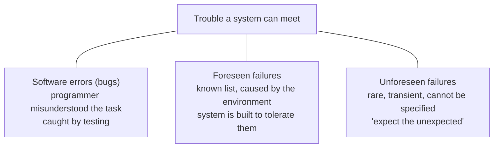
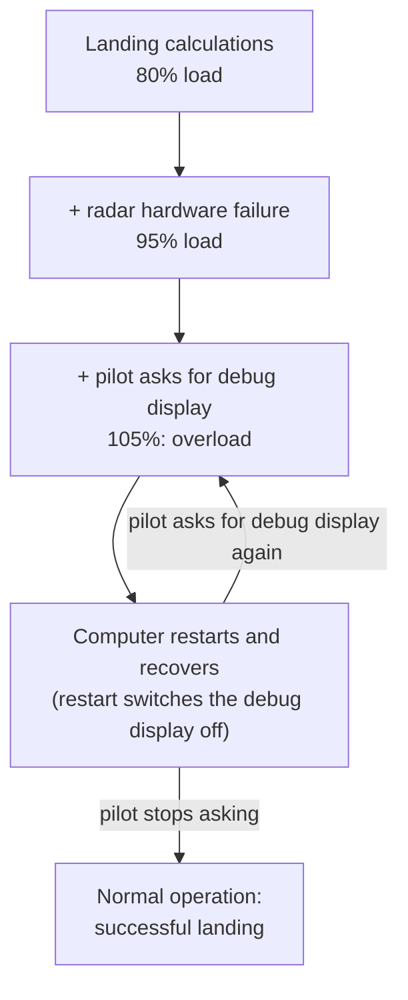
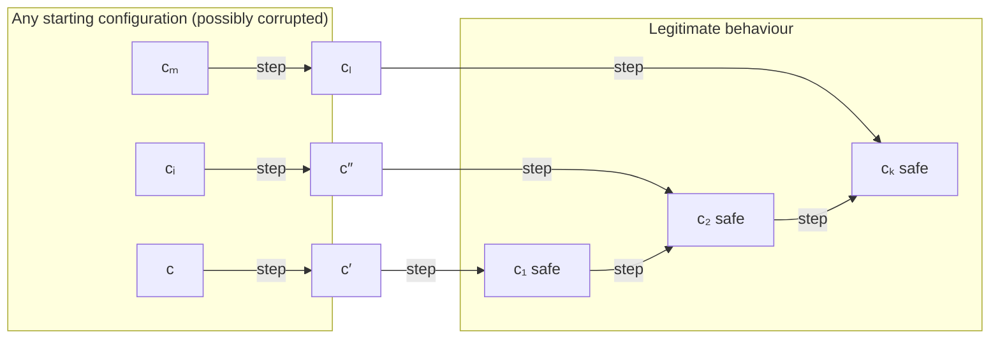

# Course Introduction: Why We Need Far More Dependable Networks

**Course:** EDA387/DIT660 Computer Networks (Chalmers), introductory lecture by Elad Michael Schiller.

**Generated:** 2026-10-21

**† Supplementary material:** content that comes only from hidden PowerPoint slides. It may not be part of this year's examinable material. *This lecture has no hidden slides, so nothing in this guide carries the † mark.*

**How to read the boxes.** Text that starts with **Beyond the slides** adds context that is not in the lecture itself (general knowledge or the course book). **Kid example** retells an idea with an everyday picture. Everything else follows the lecture.

---

## Glossary

| Term | Full name | Meaning |
|---|---|---|
| AGC | Apollo Guidance Computer | The small on-board computer that steered the Apollo spacecraft, including the Moon landing. |
| ARPANET | Advanced Research Projects Agency Network | The research network from the late 1960s that grew into today's Internet. |
| Asynchronous system | — | A system where nodes run at their own speed and there is no shared clock, so nobody can tell how long a step or a message will take. |
| Automated resilience | — | The ability of a system to bring itself back to correct behaviour without a human stepping in. |
| BSD socket API | Berkeley Software Distribution socket Application Programming Interface | The standard set of functions programs use to send and receive data over a network. |
| Checkpoint | — | A saved copy of important state, so that a restarted program can continue from it instead of from zero. |
| Fail-stop failure | — | A node crashes and stops completely; with *detectable* fail-stop, the others can find out that it stopped. |
| Foreseen failure | — | A failure the designers knew about in advance and built the system to tolerate. |
| Legal behaviour | — | Behaviour that matches what the system is supposed to do (its specification). |
| Message-passing system | — | A network of nodes that cooperate only by sending messages to each other. |
| Packet duplication | — | The network delivers the same packet more than once. |
| Packet omission | — | The network loses a packet, so it never arrives. |
| Packet reordering | — | Packets arrive in a different order from the one in which they were sent. |
| Restart loop | — | A system that restarts, hits the same problem, and restarts again and again. |
| RIP | Routing Information Protocol | An early distance-vector routing protocol of the Internet. |
| Safe configuration | — | A system state from which every following execution is correct. |
| SDN | Software-Defined Networking | A way to build networks where a separate controller program decides how switches forward packets. |
| Self-stabilization | — | A design criterion: a system that is started in **any** state eventually behaves correctly on its own. |
| Software error (bug) | — | A mistake where the programmer misunderstood what the program should do; testing should catch these. |
| STP | Spanning Tree Protocol | A protocol that connects network bridges without loops; Radia Perlman designed it to be self-stabilizing. |
| Transient fault | — | A short-lived fault that corrupts the state of the system and then goes away. |
| Unforeseen failure | — | A rare failure (or combination of failures) that nobody predicted, so it cannot be written into a specification or easily caught in testing. |

---

## Table of contents

1. [The problem: systems that crash](#1-the-problem-systems-that-crash)
2. [Three kinds of trouble](#2-three-kinds-of-trouble)
3. [The Apollo 11 landing: a story of unforeseen failures](#3-the-apollo-11-landing-a-story-of-unforeseen-failures)
4. [Restart on failure](#4-restart-on-failure)
5. [Self-stabilizing networks](#5-self-stabilizing-networks)
   - [5.1 The network model used in the course](#51-the-network-model-used-in-the-course)
   - [5.2 What self-stabilizing means](#52-what-self-stabilizing-means)
   - [5.3 The self-stabilizing Internet: Radia Perlman and later work](#53-the-self-stabilizing-internet-radia-perlman-and-later-work)
6. [About the course](#6-about-the-course)
   - [6.1 Aim and prerequisites](#61-aim-and-prerequisites)
   - [6.2 Expected outcomes](#62-expected-outcomes)
   - [6.3 Content, labs and lecture plan](#63-content-labs-and-lecture-plan)
   - [6.4 Examination and the safety net](#64-examination-and-the-safety-net)
   - [6.5 Attendance, quizzes, literature and honesty](#65-attendance-quizzes-literature-and-honesty)
   - [6.6 Tips and next steps](#66-tips-and-next-steps)
7. [Recommended videos](#7-recommended-videos)

---

## 1. The problem: systems that crash

The lecture opens with a familiar scene: a computer shows the Windows "blue screen of death", restarts, the user logs in again, tries to open PowerPoint, and the computer crashes again. Everybody has lived through something like this, and it shows the main message of the course in one picture: **we need far more dependable computer networks and distributed systems.**

The goal is not only to avoid crashes. The lecture argues for networks with **automated resilience**: networks that recover from bugs and from unforeseen failures *by themselves*, without a human having to fix them.

This may sound like asking for "the moon and back". But people did go to the Moon and come back, and the computer that helped them is a perfect example of automated resilience.

## 2. Three kinds of trouble

The lecture separates three kinds of trouble a system can meet. Think of a school bus:

- **Software errors (bugs).** The driver was given the wrong map: the programmer misunderstood what the program should do. These mistakes should be caught **during testing**. When the course says "failure", it does *not* mean this kind of bug.
- **Foreseen failures.** The bus has a spare tyre because flat tyres are known to happen. The system must tolerate a **known set of failures**. Here it is the **environment** (not the algorithm) that changes the system state, for example a lost message or a crashed node.
- **Unforeseen failures.** Something rare and strange happens that nobody planned for. These failures are **transient** (they come and go), so they are hard to catch in testing, and because nobody predicted them they **cannot be specified** in advance. The slogan in the lecture is **"Expect the unexpected."**

This course is mainly about the third kind: **unforeseen transient failures**, and how a system can recover from them automatically.

## 3. The Apollo 11 landing: a story of unforeseen failures

The Apollo spacecraft carried three astronauts (Neil Armstrong, Buzz Aldrin and Michael Collins) and one more important "crew member": the **Apollo Guidance Computer (AGC)**. The AGC had to steer the spacecraft along a difficult route using complicated calculations.

All computer systems meet failures sooner or later. In a spacecraft you cannot call a technician, so **automated resilience is the only way to go.** During the first Moon landing, a whole chain of unforeseen failures happened. The numbers below are the CPU load, meaning how busy the computer was:

1. Calculating the landing path kept the AGC at about **80 %** load.
2. A **hardware failure in the rendezvous radar** added an unexpected **15 %**, giving **95 %**. That is busy, but the computer should still have coped.
3. The pilot then asked the computer to **display debugging information** while the lander (the "Eagle") was landing. That added a critical **10 %**, which pushed the load **above 100 %** (80 + 15 + 10 = 105).
4. The overloaded computer **restarted and recovered**.
5. After recovering, the pilot asked for the debug display again, so the computer **restarted again** and recovered again.
6. The pilot understood that he should stop asking for debug information. The computer then behaved correctly, and **the landing was successful.**

> **Kid example.** A juggler can keep 8 balls in the air. Somebody throws in a 9th ball by accident (the broken radar), and the juggler just about copes. Then a friend shouts "show me a trick too!" (the debug display), and everything falls down. The juggler picks up the balls and starts again, but the friend shouts again and down they go again. Only when the friend stops shouting does the show go on. No single ball was the problem; the combination was.

**Why this matters.** No single problem caused the trouble. It was a **transient combination of failures**: a broken radar *plus* a user request. The restart itself switched off the debug display, so the system got back to normal once the pilot stopped asking. The radar fault on its own was a **persistent** failure that, according to the lecture, should have been found during system testing; it was the user's request that pushed the system over the limit.

> **Beyond the slides.** Historical accounts of Apollo 11 remember this moment through the computer's "1201" and "1202" program alarms, which meant the computer was overloaded and was restarting its work. The lecture tells the story through the load numbers above, which is all you need for the course.

## 4. Restart on failure

A common remedy is **restart on failure**. The idea: **software that has failed cannot be trusted to repair itself, so restart it instead.**

Restarts can be organized in levels, from small to big. A smaller restart disturbs the rest of the system less:

1. Restart only the failed job.
2. Restart a group of failed jobs.
3. Restart the software, but **keep critical state information**, for example by using **checkpoints** (saved copies of the important data).
4. Restart the hardware: a completely **"fresh start"**.

> **Kid example.** When a game on a tablet freezes, you first close just that game (restart the job). If that does not help, you restart the tablet but your saved games are kept (restart with checkpoints). As a last step you reset the whole tablet to factory settings (a fresh start). Each bigger step fixes more but loses more.

Restarting has a danger: a **restart loop**. Apollo 11 went into a loop of restarts, because after each restart the same combination of problems came back (the broken radar plus the pilot's debug request). The loop ended only because the combination was **transient**: once the pilot stopped asking, the system returned to normal.

The lecture uses this to state the focus of the course: **unforeseen transient failures and automated resilience.**

## 5. Self-stabilizing networks

The course gives strong guarantees against such failures by using the design criterion of **self-stabilization**: **a self-stabilizing network recovers after the last transient fault has happened.** No matter how badly the faults scrambled the state, once they stop, the network finds its way back to correct behaviour by itself.

### 5.1 The network model used in the course

The course looks at a computer network as an **asynchronous message-passing system**:

- The network has ***n* asynchronous nodes**. Each node runs at its own speed, and they cooperate only by sending messages.
- The **fault model** (the list of failures the design must survive) includes:
  - **Communication failures:** packets can be **omitted** (lost), **duplicated** (delivered twice) and **reordered** (delivered out of order).
  - **Node failures:** nodes can crash, and these are **detectable fail-stop** failures (a crashed node stops, and the others can detect it).

Recovery after transient faults must happen **even while** these communication failures and node crashes keep happening.

### 5.2 What self-stabilizing means

**A self-stabilizing network can be started in any state and will eventually show the desired "legal" behaviour.**

Imagine a ball dropped anywhere in a bowl: wherever you drop it, it rolls down to the bottom and stays there. A self-stabilizing system is like that bowl. The figure in the lecture shows several possible starting configurations (*c*, *c*ᵢ, *c*′, *c*″, *c*ₘ, *c*ₗ). From each of them, a few **steps** lead to a **safe configuration** (*c*₁ˢᵃᶠᵉ, *c*₂ˢᵃᶠᵉ, …, *c*ₖˢᵃᶠᵉ), and from a safe configuration every further step leads only to other safe configurations. That part is the **legitimate behaviour**.

The arrows are steps of the system, so they point in the direction time moves. The details of configurations, steps and safe configurations are taught in the Analytical Framework lecture.

### 5.3 The self-stabilizing Internet: Radia Perlman and later work

Self-stabilization is not only theory. **Radia Perlman's pioneering work envisioned a self-stabilizing Internet:**

- Her MIT master's thesis turned the Internet routing protocol **RIP** into a self-stabilizing one.
- Her work enabled today's **distance-vector and link-state routing protocols** to be robust, scalable and easy to manage.
- She made the **ARPANET routing** broadcast scheme self-stabilizing [*Computer Networks*, 1983].
- She designed the self-stabilizing **Spanning Tree Protocol (STP)** for connecting bridges [*Computer Networks*, 1985].
- *Data Communications Magazine* named her one of the 20 most influential people in information technology.

Other contributions to the field listed in the lecture:

- **Stabilizing inter-domain routing** by Chen, Datta and Tixeuil [*J. High Speed Networks*, 2005].
- **Robustness of the Adaptive Bellman-Ford Algorithm: Global Stability and Ultimate Bounds** by Mo, Dasgupta and Beal [*IEEE Trans. Automatic Control*, 2019].
- Recent work at Chalmers: **Renaissance**, a self-stabilizing distributed SDN control plane [ICDCS 2018, with Salem and Schmid], and **a self-stabilizing control plane for Fog ecosystems** [UCC 2020, with Georgiou, Georgiou, Pallis and Trihinas from Cyprus].

After a long process of trial and error, the Internet core can be seen as **"conceptually self-stabilizing"**, because it can (sometimes informally) cope with faults that were not foreseen when it was designed.

> **Note on the source.** One part of the lecture summarizes Perlman's work as making "distance vector and link-state" protocols robust, while the lecture's explanation mentions only link-state protocols. Both are listed above.

## 6. About the course

### 6.1 Aim and prerequisites

Computer networks cover several sub-specialties. This course combines three of them: **self-stabilizing algorithms for computer networks**, **programming with the BSD socket API**, and **communication concepts and protocols**. Mastering computer networks means both **theory and practice**: designing, implementing and using network protocols and services.

The aims are:

- to design and analyse self-stabilizing algorithms for network protocols;
- to gain experience in socket programming;
- to gain knowledge of existing communication networks, such as Internet technology, including core supporting hardware, communication protocols, fundamental services and methods for communicating data;
- to give in-depth knowledge of designing and analysing **fault-tolerant, network-oriented algorithms**.

**Prerequisites:** a Bachelor's degree or equivalent, at least one programming course, and 7.5 hp (or equivalent) in one of these five areas: computer communication (DIT420/EDA343), operating systems, algorithms and/or data structures, programming in C or C++, or discrete mathematics.

### 6.2 Expected outcomes

**Knowledge and understanding**

- Internet technology and the Domain Name System.
- Technical know-how about IPv6.
- Core protocols, global routing and services of networks such as the Internet, and their limitations.
- Contemporary networking problems, such as TCP connections, contention, performance and flow control.

**Skills and abilities**

- Define and analyse a computer network systematically, both as a **communication graph** and as a **distributed system**.
- Analyse the effect of failures (transient faults, message omission, topology changes) and how they can **propagate** through a network.
- Develop small network applications using fundamental networking techniques.
- Written communication: write lab reports and demonstrate protocol correctness.
- Show the correctness of protocols and clearly describe network algorithms you design yourself.

**Judgement and approach**

- Describe, design and analyse existing and new algorithms for network protocols, with a very strong emphasis on **self-stabilizing algorithms**.

### 6.3 Content, labs and lecture plan

Hands-on experiments and analysis are central because they connect the concepts to real-world problems.

- **Lab assignments (two parts):** the socket API, and a self-stabilizing SDN. Both are mandatory, with some exceptions.
- **Home assignments:** algorithms for computer networks, with four mandatory parts and one bonus part.

The lectures are planned as 2 service meetings, 6 lectures on Internet technologies, 8 lectures on algorithms for networks, 2 time slots for questions and answers, 3 reserved slots, and 10 slots for "fika and algorithms".

- **Review of Internet technologies:** routing, TCP, DNS, IPv6 and sockets.
- **Hot topics:** SDN, hashing and load balancing.
- **Algorithms for networks:** token ring, spanning trees, data link, model conversions, presence of faults, network coloring, and more.

The 2026 week plan from the lecture:

| Week | Tuesday | Thursday | Friday |
|---|---|---|---|
| 36 | Intro | Internet | Internet |
| 37 | Internet | Internet | Internet |
| 38 | Hot topics | Algorithms | Algorithms |
| 39 | Algorithms | Q&A | Algorithms |
| 40 | Algorithms | Q&A | Algorithms |
| 41 | No class | Algorithms | No class |
| 42 | Algorithms | Summary | Reserved |
| 43 | Reserved | Reserved | No class |

### 6.4 Examination and the safety net

**To pass the course** you must:

1. pass a written exam;
2. get all mandatory labs and assignments approved;
3. complete the **pre-lecture review quizzes with 100 % correct answers ten working days before the first written exam** (see Canvas).

**Written exam dates:** 29 October 2026 (morning), 4 January 2027 (afternoon), and 26 August 2027 (afternoon).

**What the exam can ask about:** the textbook, the supplementary material (videos and slides, with a focus on slide content), the class lectures (recorded or not), the pre-lecture review quizzes, the home assignments and the lab exercises.

All labs and home assignments are mandatory, apart from specific exceptions listed next to each lab. If you need an extension, ask the person responsible for that lab or assignment. An **official cheat sheet** is published at least a week before the exam and is attached to the exam questions.

**The exam safety net.** You may submit a **revised solution** of your exam (and of all lab and home assignments). You can then pass with **grade 3** if the points of your revised solution would have been enough for **grade 5**. The short version of the conditions:

1. at least **25 points** on the written exam;
2. attended at least **80 %** of the lectures in person;
3. submitted all pre-lecture quizzes, labs and assignments on time, and showed up on time to all demos;
4. sent the revised solutions within **5 working days** after the written exam.

The course web page has the full conditions.

### 6.5 Attendance, quizzes, literature and honesty

**Attendance questions.** In the first two minutes of each lecture hour there is a short, easy question. You need a passcode, which the lecturer gives at the start of the lecture; keep it private. Unlimited attempts are allowed. If something goes wrong, tell the lecturer immediately and write your name on the paper attendance list. **The exam safety net needs at least 80 % of the total points from these questions.**

**Pre-lecture review quizzes.** Most lectures have one. Three quizzes were available at the start, with up to five more later. The rules:

- answer at least **30 %** of the questions correctly **two hours before** the lecture;
- answer **all** questions correctly **ten days before the exam**;
- unlimited repeated attempts are allowed.

**Literature.** Shlomi Dolev, *Self-Stabilization*, 1st edition, The MIT Press (ISBN-10: 0-26-204178-2). The book is used for the algorithms part, in at least ten lectures and several home assignments. It is available online through the Chalmers library and on the publisher's website.

**Course evaluation** follows the standard Chalmers procedure. Students who want to be evaluators can contact the course responsible.

**Academic honesty and integrity.** The course follows Chalmers' guidelines:

- Write everything **in your own words**; do not copy from another source.
- To use an algorithm from class, state its **name and the book chapter** (or cite the original article: authors, title, year, venue and publisher). Do not copy code or text into an exam or report; cite the algorithm, lemma or theorem instead.
- You may discuss solutions with anyone, but you must write your submission yourself. LaTeX is preferred.
- Avoid using AI and large language models (for example ChatGPT) when writing assignments and labs.
- The examiner must report all suspected violations; it is not a matter of choice.

### 6.6 Tips and next steps

Tips from earlier students:

- Self-study the review course and watch the videos.
- Prepare before and after each lecture: read the assigned chapters and answer the questions beforehand.
- Review each lecture by the end of its week (videos, slides, chapters and questions).
- Do not put off the lab and home assignments, and pick a lab partner who does not either.
- Visit the Canvas page every other day.

What to do next: log in to Canvas (contact the student centre if you cannot), email the lecturer at elad@chalmers.se if you cannot see the course page, and look through the learning materials.

## 7. Recommended videos

Watch:

- History of the Internet: <http://vimeo.com/2696386>
- Conditions leading to the start of the Internet: <http://www.youtube.com/watch?v=8KQ1TFZcTpM>

Optional:

- How a packet moves through a network: <http://www.youtube.com/watch?v=O7CuFlM4V54>
- Inside the Internet: <http://www.youtube.com/watch?v=ZZQXnCi6H9Y>
- 40 years of the Internet: <http://www.youtube.com/watch?v=eZSPWDMn730>
- The Internet in 1969: <http://www.youtube.com/watch?v=Y0pPfyYtiBc>
- Also linked from the opening slide: <https://www.youtube.com/watch?v=9hIQjrMHTv4>
