# Self-Stabilizing Spanning Tree Construction and Fair Composition

**Course:** EDA387/DIT663 Computer Networks, part 2 (Fault-tolerant Algorithms for Computer Networks), lecture "Spanning tree construction" (Dolev, *Self-Stabilization*, §2.5 and §2.7)

**Revised:** 21 October 2026

**† Supplementary material:** content that comes only from hidden PowerPoint slides. It may not be part of this year's examinable material. In this lecture the hidden slides contain the book's original, round-based version of the correctness proof; it appears in [Section 3.2](#the-book-version-of-the-proof-).

**How to read this guide.** Every part starts with **In one sentence**, the whole idea in one line. Then comes the explanation in small steps, a **Kid example** (the same idea told with everyday things), pictures, and a **Remember** list with what you must know for the exam. **Technical clarification** marks a place where the slides are wrong or unclear, and gives the correct version. **Additional context** adds something useful that is not on the slides.

---

## Glossary

| Term | Full name | Meaning in simple words |
|---|---|---|
| A-projection | — | The part of a configuration (or execution) that belongs to the server algorithm only: (*a*ₚ₁, …, *a*ₚₙ). |
| Asynchronous cycle | — | The shortest stretch of an execution in which every processor completes at least one full iteration of its do-forever loop. |
| Asynchronous round | — | The shortest stretch of an execution in which every processor takes at least one step. |
| BFS | Breadth-First Search | A way of exploring a graph level by level: first all neighbours of the root, then their neighbours, and so on. |
| BFS tree (BFT) | Breadth-First Search Tree | A spanning tree in which every node's path to the root is a shortest path. |
| Broadcast storm | — | A flood of copies of a broadcast frame that keep being forwarded around a loop and congest the network. |
| CFM | Connectivity Fault Management | An Ethernet protocol for detecting and diagnosing connectivity faults. |
| Child indication | Parent field | The first field of a register *rᵢⱼ*: 1 if *pⱼ* is the parent of *pᵢ*, otherwise 0. |
| Client algorithm | — | In fair composition, the algorithm that uses the output of the server algorithm. |
| Δ (Delta) | — | The maximum number of links adjacent to a processor (maximum degree). |
| δ (delta) | — | The number of neighbours of the processor running the code. |
| Distance | — | The number of links on a shortest path from a processor to the root. |
| Euler tour | — | A walk around a tree that traverses every edge exactly twice, once down and once back up. |
| Fair composition | — | Running two (or more) self-stabilizing algorithms together, with every processor alternating steps of each, so that one uses the other's output. |
| First BFS tree | — | The unique BFS tree obtained when every node with several shortest-path neighbours picks the first one according to its fixed local ordering of links. |
| FirstFound | — | A Boolean variable in the code that ensures each processor marks exactly one parent per loop iteration. |
| Floating distance | — | A value in a register *rᵢⱼ*.dis that is smaller than the real distance of *pᵢ* from the root; a "wrong, too small" distance left by a fault. |
| Graph | — | A drawing of the network: dots (nodes, processors, switches) joined by lines (links). |
| IEEE 802.1D / 802.1w / 802.1s / 802.1Q | — | IEEE standards for STP, Rapid STP, Multiple STP, and bridges and bridged networks (which today incorporates the other three). |
| IS-IS | Intermediate System to Intermediate System | A link-state routing protocol; it has extensions that support Shortest Path Bridging. |
| Loop (switching loop) | — | A situation where there are several data-link layer paths between two nodes, so frames can circle forever. |
| *lrⱼᵢ* | Local register copy | The last value of register *rⱼᵢ* that processor *pᵢ* has read. |
| Parent | — | In a tree, the neighbour that is one step closer to the root. Every node except the root has exactly one parent. |
| Proof by induction | — | A proof that shows a base case and then shows that "true for *k*" implies "true for *k* + 1". |
| Register *rᵢⱼ* | Communication register | The register that *pᵢ* writes and *pⱼ* reads. |
| Root | — | The distinguished processor; the tree is rooted there and its distance is 0. |
| RSTP | Rapid Spanning Tree Protocol | The faster successor of STP (IEEE 802.1w, 2001). |
| Server algorithm | — | In fair composition, the algorithm whose stabilized output is used by the client. |
| Smallest floating distance | — | The smallest of all floating distances in a configuration. |
| Spanning tree | — | A subgraph that connects all nodes and has no cycles; between any two nodes there is exactly one path. |
| SPB | Shortest Path Bridging | IEEE 802.1aq, a protocol that lets bridges forward over shortest paths instead of a single tree. |
| ST | Spanning Tree task | The task in which every configuration encodes the first BFS tree of the communication graph. |
| STP | Spanning Tree Protocol | The Ethernet protocol that disables some links so that the active links form a loop-free spanning tree. |
| TTL | Time To Live | A counter in IP packets that is decreased at every hop; the packet is dropped at zero. Ethernet frames have no TTL. |

## Contents

- [Before you start: the words you need](#before-you-start-the-words-you-need)
- [1. Motivation: switching loops and spanning trees](#1-motivation-switching-loops-and-spanning-trees)
  - [1.1 Goal of the lecture](#11-goal-of-the-lecture)
  - [1.2 The problem: switching loops](#12-the-problem-switching-loops)
  - [1.3 The Spanning Tree Protocol](#13-the-spanning-tree-protocol)
- [2. Breadth-first search trees](#2-breadth-first-search-trees)
  - [2.1 Breadth-first search and BFS trees](#21-breadth-first-search-and-bfs-trees)
  - [2.2 A non-self-stabilizing distributed BFS tree](#22-a-non-self-stabilizing-distributed-bfs-tree)
  - [2.3 The self-stabilizing setting: registers encode the tree](#23-the-self-stabilizing-setting-registers-encode-the-tree)
- [3. The self-stabilizing BFS spanning tree](#3-the-self-stabilizing-bfs-spanning-tree)
  - [3.1 The self-stabilizing first-BFS algorithm](#31-the-self-stabilizing-first-bfs-algorithm)
  - [3.2 Correctness](#32-correctness)
- [4. Fair composition](#4-fair-composition)
  - [4.1 Fair composition](#41-fair-composition)
  - [4.2 Example: mutual exclusion in general graphs](#42-example-mutual-exclusion-in-general-graphs)
- [5. Summary](#5-summary)
  - [5.1 Recap](#51-recap)
- [Revision notes and references](#revision-notes-and-references)

## Before you start: the words you need

- **Graph:** dots joined by lines. A dot is a node (a processor or a switch); a line is a link.
- **Loop (cycle):** you can walk from a dot along lines and come back to the same dot without using a line twice.
- **Tree:** a graph with **no loops**. Between any two dots there is **exactly one** path.
- **Spanning tree:** a tree that uses **all** the dots of a graph but only **some** of its lines.
- **Root:** one special dot where the tree "hangs from". Its distance is 0.
- **Distance:** how many lines you must cross, at least, to reach the root.
- **Parent:** your neighbour that is one step closer to the root. Everybody except the root has exactly one parent.

**A graph with a loop, and a spanning tree inside it** (the dotted line is switched off):

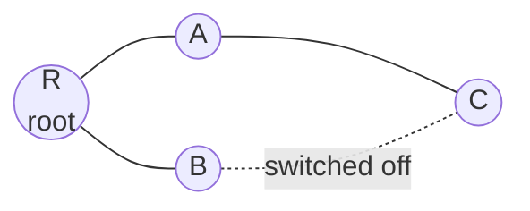

The four dots R, A, B, C and the lines R–A, A–C, R–B form a tree: from every dot there is now exactly one way to reach R.

> **Kid example.** Think of the paths between the houses in a village. If two paths lead from your house to the school, a ball thrown into the paths can roll round and round forever. A spanning tree is like closing a few paths with a fence so that from every house there is exactly **one** way to the school, and still every house can reach the school.

## 1. Motivation: switching loops and spanning trees

**What this chapter is about:** why loops in an Ethernet network are dangerous, and how the Spanning Tree Protocol removes them by switching some links off.

### 1.1 Goal of the lecture

**In one sentence:** define spanning tree construction, give a self-stabilizing algorithm for it, prove it correct, and then combine it with Dijkstra's token ring.

We want to understand how to design self-stabilizing network protocols. After this lecture you should be able to:

1. **Define the network task of spanning tree construction.**
2. **Propose an algorithm** that solves it.
3. **Argue about the correctness** of the proposal.

The lecture then shows how to combine this algorithm with Dijkstra's token ring (fair composition), which gives **token circulation in general networks that have one distinguished processor**.

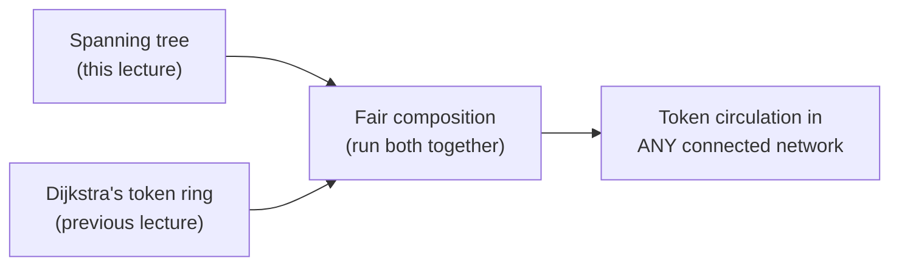

**Remember:**

- Three goals: **define** the task, **propose** an algorithm, **prove** it correct.
- Then: spanning tree + Dijkstra's ring, combined by **fair composition**, gives a token in **general** networks with one distinguished processor.

### 1.2 The problem: switching loops

**In one sentence:** if there are two paths between switches, a broadcast frame goes round and round forever, because Ethernet frames have no TTL.

A **switching loop** occurs when there are **several data-link layer paths between two nodes**. For example, four switches S1–S4 connected in a square give two different paths between any pair of PCs attached to them.

Loops allow **broadcast storms**. When a switch receives a broadcast Ethernet frame, it forwards it **out of every port**. In a loop, the copies come back around and are broadcast again, and again: the frame is broadcast repeatedly and congests the network.

The data-link layer **does not use the TTL technique**. IP packets carry a Time-To-Live counter that kills them after a number of hops, but an Ethernet frame has no such field. So when a frame is sent into a looped topology, it **can proliferate forever**.

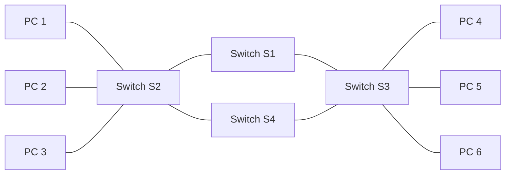

S2 and S3 are connected through S1 **and** through S4, which forms the loop S2–S1–S3–S4–S2.

**How a broadcast storm grows, step by step:**

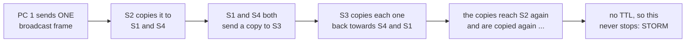

> **Kid example.** Four friends stand in a square and each one passes on every rumour to both neighbours. A rumour then runs round and round the square forever and keeps multiplying, and soon nobody can hear anything else: that is a broadcast storm. A spanning tree is the rule "Ana and Ben stop talking to each other directly": now there is exactly one way for a rumour to reach each friend, and it dies out after reaching everyone.

**Remember:**

- **Switching loop** = several data-link layer paths between two nodes.
- A switch floods a broadcast frame **out of every port**; in a loop the copies come back again and again: **broadcast storm**.
- Ethernet frames have **no TTL**, so a frame in a loop **can proliferate forever**.

### 1.3 The Spanning Tree Protocol

**In one sentence:** STP switches off some links so that the links that stay on form a tree, with exactly one path between any two nodes.

The **Spanning Tree Protocol (STP)** constructs a **loop-free logical topology** for Ethernet switches:

- It creates a **spanning tree** that **enables some links and disables others**, so that there is **a single active path between any two network nodes**.
- The aim is to **avoid the broadcast storms** that result from loops.
- STP can keep **backup links** that become active when an active link fails.

The lecture's example has three switches SW1, SW2 and SW3 connected in a triangle, each with one PC (Amlendra on SW1, Arjun on SW2, Arvind on SW3). STP disables one link of the triangle (here the SW2–SW3 link, Gi0/1 on SW2), so the active links form a tree and every frame has exactly one path.

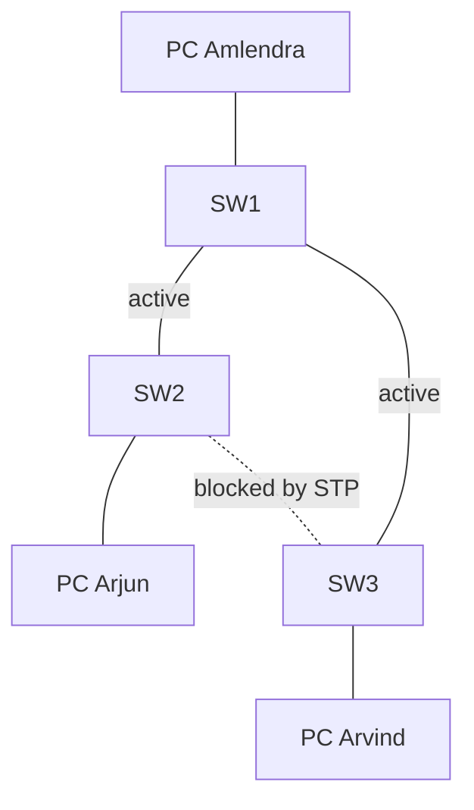

Now a frame from Arjun to Arvind has only one way: SW2 → SW1 → SW3. If the SW1–SW3 link breaks, STP can turn the blocked SW2–SW3 link back on as a **backup**.

> **Kid example.** Three classrooms are joined by three doors in a triangle. To stop children running round in circles in the break, the teacher locks one door. Every classroom can still be reached, but only in one way. If another door gets stuck, the teacher unlocks the locked door again: that is the backup link.

#### History and related protocols

- STP was originally standardized as **IEEE 802.1D**. The **first STP algorithm is by Radia Perlman**, who wrote it for her master's thesis.
- **Rapid Spanning Tree Protocol (RSTP)** was introduced by IEEE in **2001** as **802.1w**; it reduces convergence time.
- Today the functionality of 802.1D, 802.1w and **Multiple Spanning Tree (802.1s)** is incorporated into **IEEE 802.1Q-2014**, the standard for local and metropolitan area networks (bridges and bridged networks).


Many other related protocols exist:

- **Shortest Path Bridging (IEEE 802.1aq)**: efficient, flexible forwarding for large networks.
- **Bridges and Bridged Networks (IEEE 802.1Q-2014)**: standardizes bridges, with enhancements for connectivity, reliability and scalability.
- **Connectivity Fault Management (CFM)**: detecting and diagnosing connectivity faults in Ethernet networks.
- **Equal Cost Multiple Paths in Shortest Path Bridging**: load balancing over equal-cost paths.
- **Automatic Attachment to Provider Backbone Bridging**: simplifies attaching customer networks to provider networks.
- **IS-IS Extensions Supporting Shortest Path Bridging**: lets IS-IS carry the information SPB needs.

**Remember:**

- **STP** builds a **loop-free logical topology**: enables some links, disables others, **one active path** between any two nodes; keeps **backup links**.
- **IEEE 802.1D**; first algorithm by **Radia Perlman** (master's thesis).
- **RSTP = 802.1w (2001)**, faster convergence. **MSTP = 802.1s**. All now in **802.1Q-2014**.
- Related: SPB (802.1aq), CFM, ECMP in SPB, IS-IS extensions for SPB.

## 2. Breadth-first search trees

**What this chapter is about:** what a BFS tree is, why a simple distributed BFS is not self-stabilizing, and how registers can "write down" a tree.

### 2.1 Breadth-first search and BFS trees

**In one sentence:** BFS explores the network level by level from the root, and the tree it builds gives every node a shortest path to the root.

**Breadth-first search (BFS)** is an algorithm for traversing a network. The starting node is called the **root**. The algorithm explores **all neighbouring nodes first**, before moving to the next-level neighbours.

The **task** here is to construct a **directed tree**, a subgraph whose edges are **directed towards the root**, such that **the directed path from every node to the root is a shortest path** in the network. Such a tree is a **BFS tree (BFT)**.

The sequential (centralized, not distributed) BFS uses a queue:

```text
function BFS(Graph, root):
    queue   = empty queue        // nodes waiting to be explored
    visited = empty set          // nodes already reached
    tree    = {}                 // the directed tree being built
    queue.enqueue(root);  visited.add(root)
    while queue is not empty:
        current = queue.dequeue()
        tree[current] = []
        for neighbor in Graph.neighbors(current):
            if neighbor not in visited:
                visited.add(neighbor)
                tree[current].append(neighbor)   // neighbor becomes a child of current
                queue.enqueue(neighbor)
    return tree
```

Because the queue is first-in first-out, all nodes at distance 1 are handled before any node at distance 2, and so on. That is exactly why every tree path is a shortest path.

> **Kid example.** Drop a stone in a pond. First a small ring of waves appears, then a bigger ring, then a bigger one. BFS is the same: first everyone 1 step from the root, then everyone 2 steps away, then 3. A queue is a line at the school canteen: whoever came first is served first.

#### The running example

The lecture uses one example graph throughout. The numbers below are the processor names used on the lecture's register slide (*p*₁ is the root); the distance of each node from the root is given in brackets.

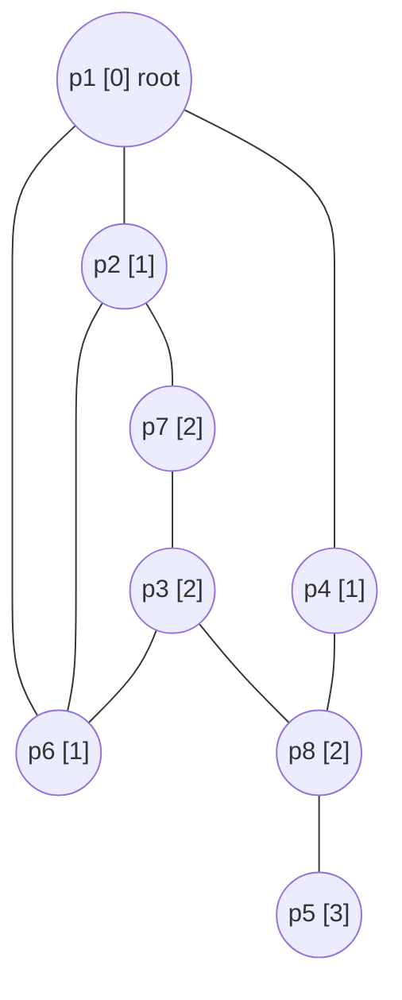

The BFS tree for this graph has the edges directed towards the root:

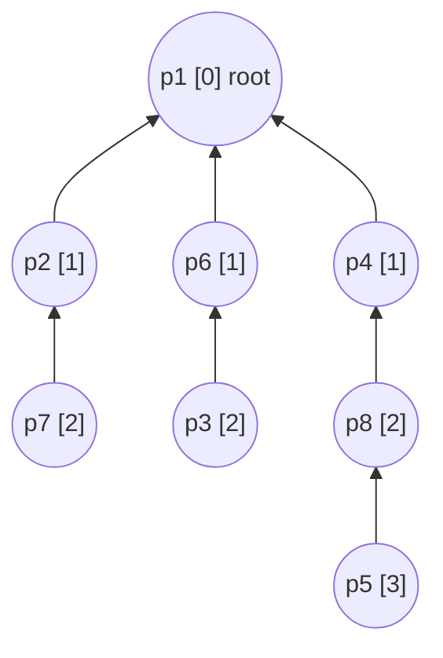

The links *p*₂–*p*₆, *p*₇–*p*₃ and *p*₃–*p*₈ exist in the graph but are not tree edges.

**Running the queue by hand.** Here is the sequential BFS on the running example, when every node lists its neighbours in the order of the first picture (for example *p*₁: *p*₂, *p*₆, *p*₄). It produces exactly the tree above.

| Step | Take from the queue | New neighbours found (they get this node as parent) | Queue afterwards |
|---|---|---|---|
| 1 | *p*₁ | *p*₂, *p*₆, *p*₄ | *p*₂, *p*₆, *p*₄ |
| 2 | *p*₂ | *p*₇ (*p*₆ was already found) | *p*₆, *p*₄, *p*₇ |
| 3 | *p*₆ | *p*₃ | *p*₄, *p*₇, *p*₃ |
| 4 | *p*₄ | *p*₈ | *p*₇, *p*₃, *p*₈ |
| 5 | *p*₇ | none (*p*₃ was already found) | *p*₃, *p*₈ |
| 6 | *p*₃ | none | *p*₈ |
| 7 | *p*₈ | *p*₅ | *p*₅ |
| 8 | *p*₅ | none | empty: done |

**The same tree drawn as "rings of waves" (levels):**

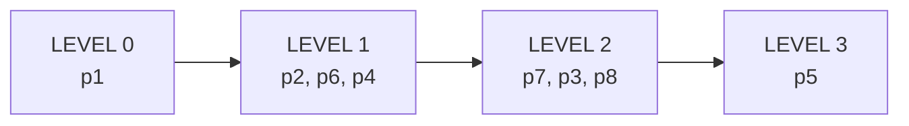

**Remember:**

- **BFS**: start at the **root**, visit **all neighbours first**, then the next level.
- **BFS tree**: edges point **towards the root**, and every node's path to the root is a **shortest path**.
- The sequential BFS uses a **FIFO queue**; that is why level 1 is finished before level 2.

### 2.2 A non-self-stabilizing distributed BFS tree

**In one sentence:** the simple distributed BFS works only if it starts from the right initial values, so one wrong value after a fault can stay forever.

A simple distributed (message-passing) BFS works like this:

```text
variables: distance, initially 0 for the root and ∞ for non-root processors

root:
    send distance to all neighbors

non-root:
    upon receiving <d> from pj:
        if d + 1 < distance then
            distance := d + 1
            parent   := j
            send <distance> to all neighbors
```

The root announces 0; each neighbour learns "I am at distance 1" and announces it; and so on. Every node keeps the smallest distance it has heard plus one, and the neighbour it heard it from becomes its parent.

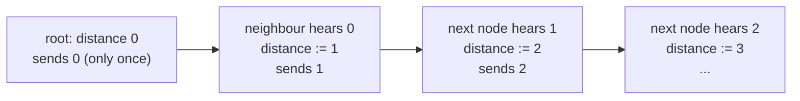

**Additional context (reasoning).** this algorithm is **not self-stabilizing** because it depends on the **initial values** (0 at the root, ∞ elsewhere) and the root sends only once. If a transient fault leaves a non-root processor with a distance that is too small, say 0, the test "*d* + 1 < distance" can never increase it again, and the wrong value is believed forever. A self-stabilizing algorithm cannot rely on initialization; it must **recompute everything repeatedly** from the neighbours' current values.

**What goes wrong after a fault:**

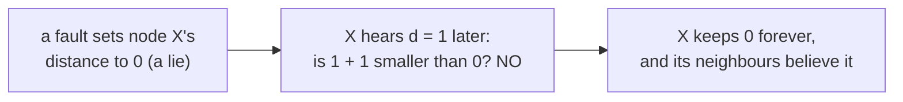

> **Kid example.** The teacher shouts "the school is here!" only once, at the start of the day. Each child remembers "I am one step further than the child who told me". If a child wakes up from a nap and wrongly believes "I am at the school (distance 0)", nobody ever corrects them, because the teacher never shouts again and the rule only accepts **smaller** numbers. The fix: the teacher must keep shouting forever, and everybody must keep recomputing from fresh information.

**Remember:**

- The simple distributed BFS starts with distance **0 at the root, ∞ elsewhere**, and only ever **lowers** a distance.
- It is **not self-stabilizing**: a too-small distance left by a fault is never corrected.
- A self-stabilizing version must **recompute everything repeatedly** from the neighbours' current values.

### 2.3 The self-stabilizing setting: registers encode the tree

**In one sentence:** every processor writes, for each neighbour, a little note ⟨"are you my parent?", "my distance"⟩, and these notes together are the tree.

The self-stabilizing algorithm uses the **shared-memory model**:

- The system consists of *n* processors; *p*₁ is the root.
- Processor *pᵢ* communicates with its neighbour *pⱼ* by **writing in the register *rᵢⱼ*** and **reading from *rⱼᵢ***.
- **The output is the constructed tree, which the registers encode.**

**Each node has one register per neighbour**, with two fields:

⟨**child-indication**, **distance**⟩ — written *rᵢⱼ*.parent and *rᵢⱼ*.dis.

*rᵢⱼ*.parent = 1 means "*pⱼ* is my parent" (I am *pⱼ*'s child); 0 means it is not. *rᵢⱼ*.dis is *pᵢ*'s distance from the root.

In the running example, after stabilization:

- the root writes ⟨0, 0⟩ to all its neighbours;
- *p*₂ (distance 1) writes ⟨1, 1⟩ to *p*₁ (its parent) and ⟨0, 1⟩ to *p*₆ and *p*₇;
- *p*₇ (distance 2) writes ⟨1, 2⟩ to *p*₂ and ⟨0, 2⟩ to *p*₃;
- *p*₅ (distance 3) writes ⟨1, 3⟩ to *p*₈, its only neighbour.

The lecture's register examples: *r*₂₁ = (parent = 1, dis = 1); *r*₅₈ = (parent = 1, dis = 3); *r*₇₃ = (parent = 0, dis = 2).

**The three registers that *p*₂ writes** (one per neighbour):

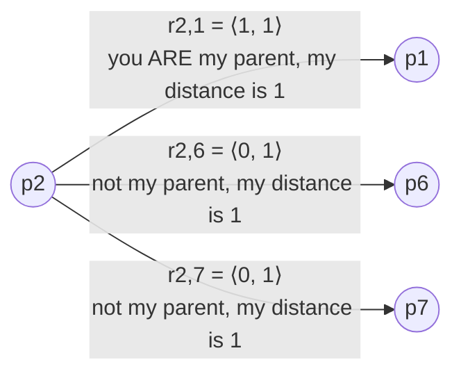

> **Kid example.** Every child has one note card for each friend sitting next to them. On each card the child writes two things: a tick or no tick ("you are the one who shows me the way to school"), and a number ("I am this many steps from school"). Nobody draws the tree on the board: if you collect all the cards, the ticks **are** the tree.

#### What is a first BFS tree?

Given a graph *G* = (*V*, *E*) and a root *v* ∈ *V*, **can there be more than one BFS tree rooted at *v***? Yes: whenever a node has **several shortest paths to the root**. In the lecture's version of the example graph with an extra link *p*₆–*p*₈, node *p*₈ (distance 2) has two neighbours at distance 1, *p*₄ and *p*₆. Both choices give a valid BFS tree:

**Option A: *p*₈ picks *p*₄**


**Option B: *p*₈ picks *p*₆**

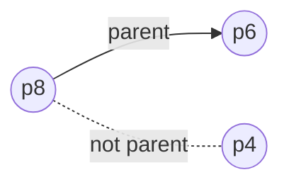

In option A, *p*₈ writes ⟨1, 2⟩ towards *p*₄ and ⟨0, 2⟩ towards *p*₆; in option B it is the other way round.

**The first-BFS tree construction selects the "first" of these paths.** Each processor decides on the order using **local identifiers**: it has a fixed, arbitrary ordering of its own links (port 1, port 2, …), and it picks the first neighbour in that ordering that has the smallest distance. So the tree is unique once the root and the local link orderings are fixed.

**Additional context (Dolev §2.5).** formally, let α*ᵢ* be the ordering of the edges incident to node *vᵢ*. The first BFS tree is uniquely defined by the root and the α orderings: a node at distance *x* + 1 with several neighbours at distance *x* connects to the first such neighbour according to α*ᵢ*.

> **Kid example.** Two friends are both one step from school and both could show you the way. To avoid arguing, you always pick the one who sits on your **left** first (your own fixed order). Because everyone always uses their own fixed order, there is only one possible answer: that is the "first" BFS tree.

**Remember:**

- Shared memory: *pᵢ* **writes** *rᵢⱼ* and **reads** *rⱼᵢ*. **One register per neighbour.**
- Register = ⟨**child-indication** (parent bit), **distance**⟩. Parent bit 1 = "you are my parent".
- Examples: *r*₂₁ = ⟨1, 1⟩, *r*₅₈ = ⟨1, 3⟩, *r*₇₃ = ⟨0, 2⟩. Root writes ⟨0, 0⟩ to everyone.
- **The registers encode the tree** (that is the output).
- Several BFS trees can exist; the **first BFS tree** picks the first neighbour (in the **local link order**) with the smallest distance, so it is **unique**.

## 3. The self-stabilizing BFS spanning tree

**What this chapter is about:** the algorithm itself (very short), and the proof that it always ends with the right tree, whatever mess it starts in.

### 3.1 The self-stabilizing first-BFS algorithm

**In one sentence:** the root keeps saying "my distance is 0", and every other processor keeps setting its distance to 1 + the smallest distance among its neighbours and marks the first such neighbour as its parent.

The idea, from Dolev, Israeli and Moran (1993, "Self-stabilization of dynamic systems assuming only read/write atomicity", *Distributed Computing* 7(1):3–16):

- **The root informs all its neighbours that its distance is 0.**
- **A non-root processor chooses the minimal distance among its neighbours, adds one, and updates its neighbours.**
- **Correct encoding of the distances allows the correct assignment of the parent–child values.**

The code for processor *pᵢ* (δ = number of *pᵢ*'s neighbours; *i* = the writing processor; *m* = the neighbour for whom the data is written; *lrₘᵢ* = the last value of *rₘᵢ* read by *pᵢ*):

```text
01 Root:  do forever
02            for m := 1 to δ do write r_im := ⟨0, 0⟩
03        od
04 Other: do forever
05            for m := 1 to δ do lr_mi := read(r_mi)
06            FirstFound := false
07            dist := 1 + min{ lr_mi.dis | 1 ≤ m ≤ δ }
08            for m := 1 to δ
09            do
10                if not FirstFound and lr_mi.dis = dist − 1 then
11                    write r_im := ⟨1, dist⟩
12                    FirstFound := true
13                else
14                    write r_im := ⟨0, dist⟩
15            od
16        od
```

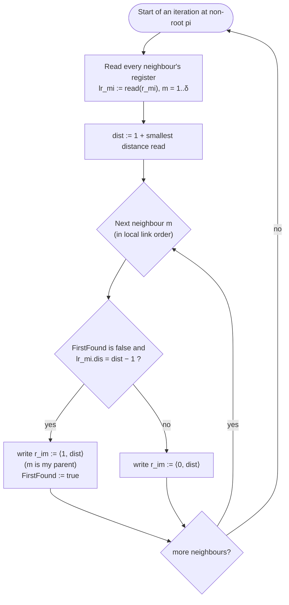

Notes on the code:

- The root is very simple: it keeps "telling" all neighbours ⟨0, 0⟩: "I am not your child, and my distance is 0".
- **FirstFound** guarantees that by the end of each pass every non-root processor marks **exactly one parent**: the **first** neighbour, in its local link order, whose distance is one less than its own.
- Everything is recomputed from scratch in every iteration, from the neighbours' current registers. Nothing depends on initial values; this is what makes it self-stabilizing.

**Additional context (Dolev §2.5).** the distance field is bounded by *N*, an upper bound on the number of processors; an attempt to write a larger value writes *N*. Non-root processors with the same number of neighbours run identical programs.

> **Kid example.** Every few minutes each child asks all the friends next to them: "How many steps are you from school?" The child takes the **smallest** answer, adds 1, and says that is their own number. Then the child points at the **first** friend (going round from the left) who gave that smallest answer: "you are my guide". The teacher at the school always answers "0". Because everybody keeps asking again and again, any wrong number gets fixed in the end.

#### A small worked example (how a lie disappears)

Take a line of four processors: root *R* – *A* – *B* – *C*. The real distances are *R* = 0, *A* = 1, *B* = 2, *C* = 3. A fault leaves *B* with the wrong value 5 and *C* with the wrong value **0** (a lie: *C* claims to be at the root). To keep it simple, in each step **everybody reads first and then everybody writes**.

| After step | *R* | *A* | *B* | *C* | Smallest floating distance (a value smaller than the real distance) |
|---|---|---|---|---|---|
| start (after the fault) | 0 | 1 | 5 | 0 | 0 (at *C*, real 3) |
| 1 | 0 | 1 = 1 + min(0, 5) | 1 = 1 + min(1, 0) | 6 = 1 + 5 | 1 (at *B*, real 2) |
| 2 | 0 | 1 = 1 + min(0, 1) | 2 = 1 + min(1, 6) | 2 = 1 + 1 | 2 (at *C*, real 3) |
| 3 | 0 | 1 = 1 + min(0, 2) | 2 = 1 + min(1, 2) | 3 = 1 + 2 | none: all correct |

Look at the last column: the lie 0 became 1, then 2, then it disappeared. Each time a lie is copied, it gets **one bigger**, while the real distances stay the same. That is the whole idea of the proof in the next section.

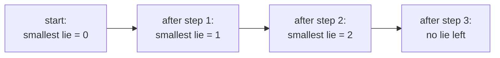

**Remember:**

- Idea (Dolev, Israeli, Moran 1993): **root says 0**; others take **1 + min** of the neighbours' distances.
- **Root:** forever writes ⟨0, 0⟩ to every neighbour.
- **Other:** read all neighbours (line 05), dist := 1 + min (line 07), write ⟨1, dist⟩ to the **first** neighbour with distance dist − 1 and ⟨0, dist⟩ to all others (lines 08–15).
- **FirstFound** ⇒ exactly **one parent** per pass.
- Everything is **recomputed every iteration**; nothing depends on initial values ⇒ self-stabilizing.
- Distances are bounded by *N* (writing more writes *N*).

### 3.2 Correctness

**In one sentence:** after 2*k* asynchronous cycles, every lie (floating distance) is at least *k* and every processor within distance *k* of the root is correct, so in the end all distances and therefore the tree are correct.

#### The task ST and floating distances

**Task ST:** every configuration **encodes a first BFS tree** of the communication graph. (A configuration is the vector of processor states plus the vector of register values; ST is the set of configuration sequences in which every configuration encodes the BFS tree.)

**Notation:** Δ is the **maximum number of links adjacent to a processor**.

**Definitions:**

- A **floating distance** in configuration *c* is a value in *rᵢⱼ*.dis that is **smaller than the distance of *pᵢ* from the root**.
- The **smallest floating distance** in *c* is the smallest value among the floating distances.

Floating distances are the "lies" left by transient faults: a processor claiming to be closer to the root than it really is. Too-large values are harmless (the minimum in line 07 ignores them as soon as a correct, smaller value is available), but too-small values attract neighbours. The proof shows that the smallest lie keeps growing until it disappears.

> **Kid example.** Imagine that, after a storm, a few children wrongly believe they live close to the school. Their neighbours believe them and say "then I am one step further", and so on. But every time the false story is passed on, the claimed distance grows by one, while the true distances from the real school never change. After a while the false story claims a distance that is bigger than the true ones, and everybody prefers the true, smaller numbers. That is why the smallest floating distance keeps growing until it disappears.

#### A reminder: proof by induction

A proof by induction has three parts:

1. **Base case:** prove the statement for the smallest value (often 0 or 1).
2. **Inductive hypothesis:** assume the statement is true for some arbitrary *k*.
3. **Inductive step:** use the hypothesis to prove it for *k* + 1.

**Example:** prove 1 + 2 + … + *x* = *x*(*x* + 1)/2 for all positive integers *x*.

- Base case *x* = 1: 1 = 1·(1 + 1)/2. True.
- Hypothesis: 1 + 2 + … + *k* = *k*(*k* + 1)/2.
- Step: add *k* + 1 to both sides:

```math
1 + 2 + \dots + k + (k+1) = \frac{k(k+1)}{2} + (k+1) = (k+1)\left(\frac{k}{2} + 1\right) = (k+1)\frac{k+2}{2} = \frac{(k+1)\big((k+1)+1\big)}{2}.
```

So the statement holds for *k* + 1, and therefore for every positive integer.

**Quick check with a number:** for *x* = 4, 1 + 2 + 3 + 4 = 10 and 4·5/2 = 10. It works.

> **Kid example.** Dominoes in a row. If you push the first one (base case), and you know that every domino always knocks over the next one (inductive step), then all the dominoes fall, however long the row is.

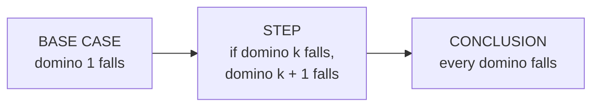

#### Lemma 2.1 (cycle version)

The lecture proves a version that is simpler than the one in the book, counting **asynchronous cycles**. Recall: the first asynchronous cycle of a fair execution is the shortest prefix in which every processor executes at least one complete iteration of the do-forever loop; the second cycle starts right after the first, and so on. So **in every asynchronous cycle, each processor reads the registers of all its neighbours and writes to each of its registers** (the root runs lines 01–03, the others lines 04–16).

**Lemma 2.1.** For every *k* > 0 and for every configuration that follows **2*k* asynchronous cycles**:

- **Assertion (1):** if there exists a floating distance, then the value of the smallest floating distance is **at least *k***.
- **Assertion (2):** the value in the registers of **every processor within distance *k* from the root equals its distance** from the root.

**What the lemma says, as a table:**

| After this many asynchronous cycles | Every lie is at least | Correct for sure: all processors within distance |
|---|---|---|
| 2 | 1 | 1 |
| 4 | 2 | 2 |
| 6 | 3 | 3 |
| 2*k* | *k* | *k* |

Why **two** cycles per step? In one cycle a processor **reads** the new values; only in the next cycle is it sure to **write** what it computed from them.

**Base case, k = 1.**

*Claim 1:* within the first two asynchronous cycles the system reaches a configuration *c*₂ in which the dist field is **0 at the root and at least 1 at every non-root processor**.

- Distances stored in registers and internal variables are non-negative, so the smallest floating distance is at least 0 in the starting configuration.
- During the first asynchronous cycle, each non-root processor computes dist in line 07. Since dist = 1 + (a non-negative minimum), **the result is at least 1**. Let *c*₁ be the configuration reached after each processor's first computation of dist.
- During the cycle that follows *c*₁, each non-root processor writes that value (≥ 1) to all its registers. Let *c*₂ be the configuration after that cycle.

(The lecture states Claim 1 as "within one asynchronous cycle", but its own proof uses the cycle up to *c*₁ plus the cycle after it.) So in every configuration after *c*₂ no non-root processor has a value below 1 in its registers: **Assertion (1) holds for *k* = 1**.

*Assertion (2) for k = 1:* the root writes distance 0 to its registers in every cycle. Let *c*₁ be the configuration after the first cycle. Every neighbour of the root reads the root's registers and, in the following cycle, writes to its own registers. In that write it assigns dist = 1 (the smallest value it can read is the root's 0, because no distance is negative). Any further read of the root's registers returns 0 again. So within **2 asynchronous cycles**, every neighbour of the root has dist = 1 in its registers.

**Inductive step, k → k + 1.** Assume the lemma holds for some *k* ≥ 1.

*Assertion (1):* let minFloat ≥ *k* be the smallest floating distance in configuration *c*₂ₖ, reached after the first 2*k* cycles. During the 2 cycles that follow, every processor that reads dist = minFloat and picks it as its smallest value computes and writes **minFloat + 1**. So in *c*₂₍ₖ₊₁₎ the smallest floating distance is at least minFloat + 1 ≥ *k* + 1.

*Assertion (2):* let *pᵢ* be a processor whose real distance from the root is *k* + 1. Look at its neighbours:

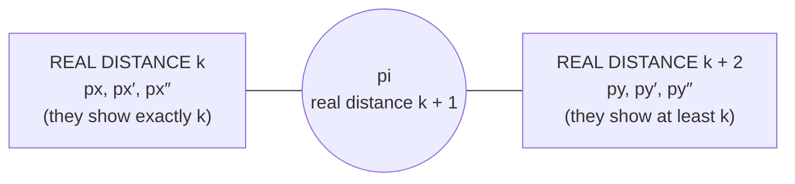

- Every neighbour at real distance *k* has **dist = *k*** in its registers, by Assertion (2) for *k*.
- Every other neighbour shows **dist ≥ *k***, by Assertion (1) (any value below *k* would be a floating distance smaller than *k*).
- So the minimum *pᵢ* reads is exactly *k*, and lines 05–14 make it write **dist = *k* + 1**. It cannot pick a neighbour with a larger distance (*k* is the minimum), and it cannot pick one with a smaller distance (none exists).

This proves Assertion (2) for *k* + 1. ∎

> **Kid example.** You are 3 steps from school. Your friends who are really 2 steps away say "2" (they are already correct). Your other friends cannot say less than 2, because all lies are now at least 2. So the smallest number you hear is exactly 2, and you correctly say "I am 3".

#### From correct distances to the first BFS tree

Once the value in the registers of every processor equals its distance from the root, each processor *pᵢ* chooses as its parent **the first neighbour, according to its internal link ordering, whose distance is smaller than its own**, which is exactly its parent in the first BFS tree.

**Corollary 2.1.** The algorithm is self-stabilizing for ST.

**Additional context (reasoning from Lemma 2.1).** let *d* be the largest distance of any processor from the root (*d* ≤ *n* − 1). Applying Assertion (2) with *k* = *d* shows that after 2*d* cycles every register holds the correct distance. In the next cycle each processor rereads its neighbours' now-correct registers and rewrites its parent bits, so the first BFS tree is encoded within O(*d*) cycles.

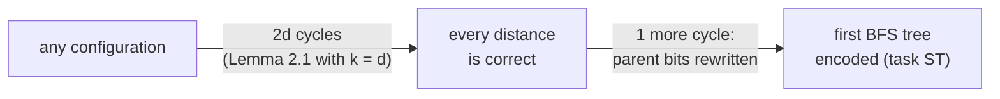

#### The book version of the proof †

The book proves the same lemma while counting **rounds** instead of cycles. Since one iteration of the do-forever loop takes O(Δ) steps, **in every 2Δ successive rounds each processor reads the registers of all its neighbours and writes to each of its registers**. The lemma reads: for every *k* > 0 and every configuration that follows **Δ + 4*k*Δ rounds**, Assertions 1 and 2 hold. The proof is by induction over *k*:

- **Base case, Assertion 1:** distances are non-negative, so the smallest floating distance is at least 0 initially. During the first 2Δ rounds each non-root processor computes dist (line 07), and the result is at least 1. Let *c*₂ be the configuration after every processor's first computation of dist. During the 2Δ rounds that follow *c*₂, each non-root processor writes that value to all its registers. So after the first 4Δ rounds no non-root processor has 0 in its registers.
- **Base case, Assertion 2:** the root writes 0 to its registers in every Δ rounds. Let *c*₁ be the configuration after these Δ rounds. Each processor reads the root's registers and then writes to its own registers during the 4Δ rounds that follow *c*₁, assigning 1. Any further read of the root returns 0, so after the first Δ + 4Δ rounds every neighbour of the root holds 1.
- **Induction step:** assume correctness for *k* ≥ 0. Let *m* ≥ *k* be the smallest floating distance in the configuration *c*₄ₖ that follows the first Δ + 4*k*Δ rounds. During the 4Δ rounds that follow, each processor that reads *m* and chooses it as the smallest value writes *m* + 1, so the smallest floating distance is *m* + 1 in *c*₄₍ₖ₊₁₎ (Assertion 1). Since the smallest floating distance is *m* ≥ *k*, each processor at distance *k* + 1 reads a neighbour of distance *k* and assigns *k* + 1: it cannot choose a neighbour with a larger distance (the algorithm takes the minimum) or a smaller one (*k* is the shortest distance of any neighbour) (Assertion 2).
- The corollary follows exactly as in the subsection "From correct distances to the first BFS tree" above.

**Cycles or rounds, side by side:**

| | Lecture (cycles) | Book (rounds) † |
|---|---|---|
| One "read everything and write everything" takes | 1 cycle | 2Δ rounds |
| Assertions hold after | 2*k* cycles | Δ + 4*k*Δ rounds |

**Remember:**

- **Task ST**: every configuration encodes the **first BFS tree**.
- **Floating distance** = a register distance **smaller than the real distance** (a lie). Too-large values are harmless.
- **Lemma 2.1 (cycles)**: after **2*k* asynchronous cycles**: (1) smallest floating distance **≥ *k***; (2) every processor within distance *k* holds its **correct** distance. Proved by **induction** on *k*.
- Base case needs **2** cycles (compute, then write), even though the slide says "one".
- Correct distances ⇒ each picks the **first** neighbour with smaller distance ⇒ **Corollary 2.1**: self-stabilizing for ST, within O(*d*) cycles.
- † Book version counts **rounds**: 2Δ rounds per iteration, assertions after **Δ + 4*k*Δ rounds**.

## 4. Fair composition

**What this chapter is about:** how to glue two self-stabilizing algorithms together, and how this gives a token in any network (not only a ring).

### 4.1 Fair composition

**In one sentence:** if the server stabilizes, and the client stabilizes whenever the server is correct, then running both in turns is self-stabilizing.

We now know two self-stabilizing algorithms: Dijkstra's token ring and the BFS tree construction. **Fair composition** lets us build bigger self-stabilizing algorithms out of smaller ones.

**The idea.** Compose self-stabilizing algorithms *AL*₁, …, *ALₖ* so that **the stabilized behaviour of *AL*₁, *AL*₂, …, *ALᵢ* is used by *ALᵢ₊₁***. *ALᵢ₊₁* **cannot detect** whether the earlier algorithms have stabilized, but it is **executed as if they have**. It is similar to network layering, where each layer uses the service of the layer below.

The technique is described for *k* = 2: two simple algorithms, a **server** and a **client**, are combined into a more complex algorithm. **The server ensures that some properties hold, and the client uses them.**

> **Kid example.** Fair composition is like building a house: the foundation (the server) must settle first, and the walls (the client) are built on top. The builders of the walls cannot see whether the foundation has settled yet, but once it has, the walls will end up straight. In the example below, the spanning tree is the foundation and the token circulation is the walls.

**Definitions.**

- The **server** *AL*₁ solves a task defined by a set of legal executions *T*₁; the **client** *AL*₂ solves *T*₂.
- Let *Aᵢ* be the state set of *pᵢ* in *AL*₁, and *Sᵢ* = *Aᵢ* × *Bᵢ* its state set in *AL*₂. Whenever *pᵢ* executes *AL*₂, it **modifies only the *Bᵢ* component**. (It may read the *Aᵢ* part, the server's output, but never changes it.)
- For a configuration *c* ∈ *S*₁ × … × *Sₙ*, the **A-projection** of *c* is the configuration (*a*ₚ₁, …, *a*ₚₙ) ∈ *A*₁ × … × *Aₙ*: just the server's part. The A-projection of an execution consists of the A-projection of every configuration in it.
- *AL*₂ is **self-stabilizing for task *T*₂ given task *T*₁** if every fair execution of *AL*₂ that has an A-projection in *T*₁ has a suffix in *T*₂. In words: if the server behaves legally, the client eventually behaves legally.
- *AL* is a **fair composition** of *AL*₁ and *AL*₂ if, in *AL*, **every processor executes steps of *AL*₁ and *AL*₂ alternately**.

**What one processor's state looks like** (the client may read A but only writes B):

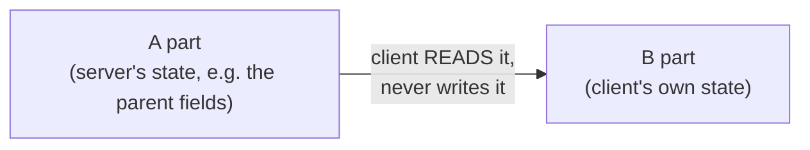

**Theorem 2.2.** Assume *AL*₂ is self-stabilizing for task *T*₂ given task *T*₁. If *AL*₁ is self-stabilizing for *T*₁, then the fair composition of *AL*₁ and *AL*₂ is self-stabilizing for *T*₂.

```mermaid
flowchart LR
    A["Any configuration"] -- "server AL1 stabilizes<br/>(client may misbehave meanwhile)" --> B["Server output legal (in T1);<br/>client part B is arbitrary"]
    B -- "client AL2 stabilizes given T1" --> C["Composed system legal (in T2)"]
```

**Additional context (Dolev §2.7).** the proof is two lines: by the self-stabilization of *AL*₁, every execution has a suffix whose A-projection is in *T*₁; by the assumption on *AL*₂, that suffix has a further suffix in *T*₂. It is enough that every processor executes steps of both algorithms infinitely often, and the server does not need to reach a state where its registers never change.

**Remember:**

- **Fair composition**: every processor runs steps of *AL*₁ (**server**) and *AL*₂ (**client**) **alternately**.
- The client **cannot detect** whether the server has stabilized; it runs **as if** it had. Like network **layering**.
- State *Sᵢ* = *Aᵢ* × *Bᵢ*; the client **modifies only *Bᵢ***. **A-projection** = the server's part only.
- "*AL*₂ self-stabilizing for *T*₂ **given** *T*₁": if the A-projection is in *T*₁, a suffix is in *T*₂.
- **Theorem 2.2**: *AL*₁ self-stabilizing for *T*₁ + *AL*₂ self-stabilizing for *T*₂ given *T*₁ ⇒ composition self-stabilizing for *T*₂.

### 4.2 Example: mutual exclusion in general graphs

**In one sentence:** build a spanning tree, walk around it (Euler tour) to get a virtual ring, and run Dijkstra's token ring on that ring.

Dijkstra's algorithm only works on a ring. To get token circulation on **any** connected graph with one distinguished processor, **compose the spanning tree construction (server) with the mutual exclusion algorithm (client)**.

#### The Euler tour turns a tree into a ring

An **Euler tour** of a rooted tree walks around the tree, traversing every edge twice: once going down and once coming back up. Example: a root with children *A* (edge 1), *B* (edge 3) and *C* (edge 5); *A* has children *D* (edge 2) and *E* (edge 4); *D* has a child *F* (edge 6).

```mermaid
flowchart TB
    R(("root")) ---|1| A(("A"))
    R ---|3| B(("B"))
    R ---|5| C(("C"))
    A ---|2| D(("D"))
    A ---|4| E(("E"))
    D ---|6| F(("F"))
```

Starting at the root, the tour traverses the edges in the order **1, 2, 6, 6, 2, 4, 4, 1, 3, 3, 5, 5**. Walking this tour forever is like walking around a ring, so **an Euler tour defines a virtual ring**.

**The same tour, written as the nodes you stand on:**

```mermaid
flowchart LR
  r0((root)) -->|1| a1((A)) -->|2| d1((D)) -->|6| f1((F)) -->|6| d2((D)) -->|2| a2((A)) -->|4| e1((E))
  e1 -->|4| a3((A)) -->|1| r1((root)) -->|3| b1((B)) -->|3| r2((root)) -->|5| c1((C)) -->|5| r3((root))
```

After the last step you are back at the root, and the walk starts again: a ring.

> **Kid example.** Put your right hand on the wall of a maze shaped like a tree and keep walking. You go down every corridor and come back up it, and in the end you are back at the start. If you keep going, you walk the same circle again and again. That circle is the "virtual ring".

#### The modified mutual exclusion algorithm

The lecture uses a version of Dijkstra's algorithm **designed to stabilize in a system where a rooted spanning tree exists and only read/write atomicity is assumed** (one read or one write per step, not the powerful central daemon).

Example: root *p*₁ with children *p*₄, *p*₂ and *p*₃ (in *p*₁'s fixed order). The virtual ring visits the registers and local copies in the order

*lr*₄,₁ → *r*₁,₂ → *lr*₁,₂ → *r*₂,₁ → *lr*₂,₁ → *r*₁,₃ → *lr*₁,₃ → *r*₃,₁ → *lr*₃,₁ → *r*₁,₄ → *lr*₁,₄ → *r*₄,₁ → (back to *lr*₄,₁).

So *p*₁ **acts as three processors** of the ring, one for each attached link. In particular it acts as the special processor using *lr*₄,₁ and *r*₁,₂: whenever *lr*₄,₁ equals *r*₁,₂, *p*₁ increments the value in *r*₁,₂ modulo 4*n* − 5.

**The virtual ring** (the name before the colon says which processor keeps that register or copy):

```mermaid
flowchart LR
  L41["p1: lr4,1"] --> R12["p1: r1,2"] --> L12["p2: lr1,2"] --> R21["p2: r2,1"] --> L21["p1: lr2,1"] --> R13["p1: r1,3"]
  R13 --> L13["p3: lr1,3"] --> R31["p3: r3,1"] --> L31["p1: lr3,1"] --> R14["p1: r1,4"] --> L14["p4: lr1,4"] --> R41["p4: r4,1"]
  R41 --> L41
```

**Code for *pᵢ*.** For a non-root node, the links are ordered 1, 2, …, δ with link 1 leading to its parent; register indices *rᵢ,ₘ₊₁* are computed modulo δ.

```text
01 Root:  do forever
02            lr_1,i := read(r_1,i)
03            if lr_δ,i = r_i,1 then
04                (* critical section *)
05                write r_i,2 := (lr_1,i + 1) mod (4n − 5)
06            for m := 2 to δ do
07                lr_m,i := read(r_m,i)
08                write r_i,m+1 := lr_m,i
09            od
10        od
11 Other: do forever
12            lr_1,i := read(r_1,i)
13            if lr_1,i ≠ r_i,2 then
14                (* critical section *)
15                write r_i,2 := lr_1,i
16            for m := 2 to δ do
17                lr_m,i := read(r_m,i)
18                write r_i,m+1 := lr_m,i
19            od
20        od
```

In words: a non-root processor reads from its parent link and passes the value down its first child link; it enters the critical section only when the value read from the parent differs from what it last passed on (this is Dijkstra's "copy if different"). For each further child it copies what came back up from the previous child into the next child's register, which carries the value around the Euler tour. The root behaves like Dijkstra's special processor: when the value coming back from its last child equals what it sent, it enters the critical section and sends a new, incremented value.

(The code follows Dolev, Figure 2.5. On the lecture slide the δ subscript in line 03 is lost; line 05 is written here with explicit parentheses, (lr₁,ᵢ + 1) mod (4*n* − 5), which is its intended meaning.)

**The two rules, side by side with Dijkstra's ring:**

| | Dijkstra's ring (previous lecture) | Tree version (this lecture) |
|---|---|---|
| Root (special processor) | if *x*₁ = *xₙ*: increment | if the value back from the last child equals what it sent: critical section, send value + 1 mod (4*n* − 5) |
| Everybody else | if *xᵢ* ≠ *xᵢ₋₁*: copy | if the value from the parent differs from what it passed on: critical section, copy it |

> **Kid example.** A relay race along the maze walk. Each runner passes a numbered baton down to the first corridor, waits for it to come back, and then passes it into the next corridor. The runner at the start (the root) checks the number when the baton comes home; if it is the number they sent, they write a new number on it and send it out again.

#### Putting it together

- Mutual exclusion is applied to a spanning tree of the system, using the ring defined by the Euler tour.
- **The parent field of the spanning tree algorithm defines the parent of each processor in the tree** (and hence its children too).
- While the server (tree construction) has not stabilized, the client may run on a structure that is not a tree, which is an execution its designers never considered. **When the server reaches its stable state, the mutual exclusion algorithm is in an arbitrary state, and from there it converges to a safe configuration.** By Theorem 2.2, the composition is self-stabilizing.

```mermaid
flowchart TB
    T["SERVER AL1: first-BFS spanning tree<br/>parent fields define the tree"] -- "client reads the parent fields,<br/>never writes them" --> M["CLIENT AL2: mutual exclusion on the Euler-tour ring<br/>token circulates around the virtual ring"]
```

**Additional context (Dolev §2.7).** one way to implement the alternation is a binary variable turnᵢ in each processor: when turnᵢ = 0 the processor executes the next step of the tree construction, when turnᵢ = 1 a step of mutual exclusion, and then flips turnᵢ. The composed algorithm can itself be used as a server that implements a central daemon (one processor activated at a time) for other client algorithms.

```mermaid
flowchart LR
  A["turn = 0:<br/>one step of the TREE"] --> B["flip turn"] --> C["turn = 1:<br/>one step of the TOKEN"] --> D["flip turn"] --> A
```

**Remember:**

- Dijkstra works only on a **ring**; for **any** graph: **spanning tree (server) + mutual exclusion (client)**.
- **Euler tour**: every tree edge twice (down and up) ⇒ a **virtual ring**. Example order: 1, 2, 6, 6, 2, 4, 4, 1, 3, 3, 5, 5.
- The root **acts as several ring processors** (one per link) and is the special processor: increments **mod (4*n* − 5)**.
- Works with only **read/write atomicity** (not the central daemon). Code follows **Dolev, Figure 2.5**.
- The **parent fields** of the tree define the tree for the client. After the tree stabilizes, ME starts from an arbitrary state and converges (**Theorem 2.2**).
- Alternation can use a **turn** bit; the composition can itself serve as a **central daemon**.

## 5. Summary

**What this chapter is about:** the whole lecture on one page.

### 5.1 Recap

**In one sentence:** loops cause storms, a self-stabilizing BFS tree removes them, and fair composition with Dijkstra's ring gives a token in any network.

- **Loops** at the data-link layer cause broadcast storms because Ethernet frames have no TTL; **STP** prevents them by building a spanning tree (first algorithm by Radia Perlman).
- The **self-stabilizing first-BFS algorithm** has the root write ⟨0, 0⟩ forever, and every other processor repeatedly set its distance to 1 + the minimum neighbour distance, marking as parent the first neighbour (in its local order) with distance one less.
- **Correctness** rests on **floating distances**: after 2*k* cycles the smallest floating distance is at least *k* and all processors within distance *k* are correct (Lemma 2.1, by induction). Hence the algorithm is self-stabilizing for ST (Corollary 2.1).
- **Fair composition** (Theorem 2.2): if the server stabilizes and the client stabilizes given the server's task, then running them alternately stabilizes. Composing the BFS tree with Dijkstra's algorithm on the **Euler-tour virtual ring** gives self-stabilizing **token circulation in general networks** with one distinguished processor.

```mermaid
flowchart LR
  A["loops cause<br/>broadcast storms"] --> B["spanning tree<br/>removes loops"] --> C["self-stabilizing BFS:<br/>root 0, others 1 + min"]
  C --> D["lies grow until they vanish<br/>(Lemma 2.1)"] --> E["Euler tour of the tree<br/>= virtual ring"] --> F["fair composition with Dijkstra:<br/>token in ANY network"]
```

> **Kid example.** The whole story: paths in circles make rumours spin forever, so we close some paths to get a tree. Everyone keeps asking "how far are you from school?" and any wrong answer slowly grows until nobody believes it. Then we walk around the tree like a maze, which gives a circle, and on that circle the children pass one talking stick, exactly as in Dijkstra's game.

## Revision notes and references

This guide found no errors in the lecture material that needed a technical clarification. Where the slides and the course book differ in presentation, this guide follows the lecture and notes the book's version.

- S. Dolev, *Self-Stabilization*, MIT Press, 2000: §2.5 (spanning-tree construction) and §2.7 (fair composition).
- R. Perlman, "An Algorithm for Distributed Computation of a Spanning Tree in an Extended LAN", ACM SIGCOMM 1985: the Spanning Tree Protocol.
