# Self-Stabilizing Maximal Matching and the Variant Function Technique

**Course:** EDA387/DIT663 Computer Networks, part 2 (Fault-tolerant Algorithms for Computer Networks), lecture "Maximal Matching" (Dolev, *Self-Stabilization*, §2.9; algorithm by Su-Chu Hsu and Shing-Tsaan Huang, "A Self-Stabilizing Algorithm for Maximal Matching", *Information Processing Letters* 43(2):77–81, 1992)

**Revised:** 21 October 2026

**† Supplementary material:** content that comes only from hidden PowerPoint slides. It may not be part of this year's examinable material. *This lecture has no hidden slides, so nothing in this guide carries the † mark.*

**How to read this guide.** Every part starts with **In one sentence**, the whole idea in one line. Then comes the explanation in small steps, a **Kid example** (the same idea told with everyday things), pictures, and a **Remember** list with what you must know for the exam. **Technical clarification** marks a place where the slides are wrong or unclear, and gives the correct version. **Additional context** adds something useful that is not on the slides.

---

## Glossary

| Term | Full name | Meaning in simple words |
|---|---|---|
| Central daemon | Central demon | A scheduler that picks exactly one processor at a time to take an atomic step; here one step is a full iteration of the do-forever loop (read all, compute, write). |
| Chaining | — | Status of *pᵢ*: it points to a neighbour *pⱼ*, but *pⱼ* points to some third processor *pₖ*, *k* ≠ *i*. |
| D2D | Device-to-Device communication | Wireless devices talking directly to each other instead of through a base station. |
| Distributed daemon | Distributed demon | A scheduler that may let any number of processors take steps concurrently; each step is a single read or write plus local computation. |
| Free | — | Status of *pᵢ*: its pointer is null and it has at least one neighbour that is not matched. |
| Lexicographic order | Dictionary order | Comparing vectors element by element from the left, the way words are ordered in a dictionary. |
| Matched | — | Status of *pᵢ*: it points to a neighbour *pⱼ* and *pⱼ* points back to *pᵢ*. |
| Matching | Independent edge set | A set of edges *M* ⊆ *E* in which no two edges share a vertex. |
| Maximal matching | — | A matching that is not a subset of any other matching: no edge can be added. |
| Maximum matching | — | A matching with the largest possible number of edges. Every maximum matching is maximal, but not the other way round. |
| MM | Maximal Matching task | The set of executions in which all pointers are fixed and form a maximal matching. |
| *N*(*i*) | Neighbourhood of *pᵢ* | The set of neighbours of processor *pᵢ*. |
| Null | — | "Nothing": a pointer with the value null points at nobody. |
| Pointer, pointerᵢ | — | Processor *pᵢ*'s only variable: either the name of one neighbour or null. |
| Potential function | — | Another name for a variant function. |
| Single | — | Status of *pᵢ*: its pointer is null and all its neighbours are matched. |
| Variant function | VF | A bounded function of the configuration that changes monotonically with every step; used to prove convergence and to bound its time. |
| Waiting | — | Status of *pᵢ*: it points to a neighbour *pⱼ* whose pointer is null. |

## Contents

- [Before you start: the words you need](#before-you-start-the-words-you-need)
- [1. Matchings and the variant-function technique](#1-matchings-and-the-variant-function-technique)
  - [1.1 Matchings: definitions](#11-matchings-definitions)
  - [1.2 Applications in computer networks](#12-applications-in-computer-networks)
  - [1.3 Proof technique: the variant function](#13-proof-technique-the-variant-function)
- [2. The self-stabilizing matching algorithm](#2-the-self-stabilizing-matching-algorithm)
  - [2.1 The task and the model](#21-the-task-and-the-model)
  - [2.2 The five processor statuses](#22-the-five-processor-statuses)
  - [2.3 The algorithm](#23-the-algorithm)
  - [2.4 Central versus distributed daemons](#24-central-versus-distributed-daemons)
- [3. Correctness and a worked example](#3-correctness-and-a-worked-example)
  - [3.1 Correctness with a variant function](#31-correctness-with-a-variant-function)
  - [3.2 A complete worked example](#32-a-complete-worked-example)
- [4. Summary](#4-summary)
  - [4.1 Recap](#41-recap)
- [Revision notes and references](#revision-notes-and-references)

## Before you start: the words you need

- **Graph:** dots (processors) joined by lines (links, also called **edges**).
- **Neighbour:** a processor joined to you by a line.
- **Pair (matching edge):** two neighbours who have chosen each other.
- **Pointer:** each processor has one "finger". It can point at **one** neighbour, or at nobody (**null**).
- **Matched:** two neighbours point at **each other**. That is a pair.

**Pointers drawn as arrows.** Here *a* and *b* point at each other (a pair), *c* points at *b*, and *d* points at nobody:

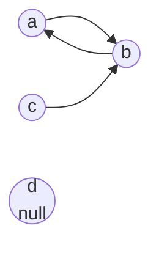

> **Kid example.** At a school dance, every child may point a finger at one friend standing next to them to say "dance with me?". When two children point at each other, they are a dancing pair. The goal of this lecture: everyone keeps following a few simple rules, and in the end nobody who could still dance is left standing next to another free child.

## 1. Matchings and the variant-function technique

**What this chapter is about:** what a matching is, where it is used in networks, and a new way to prove that an algorithm stabilizes (the variant function).

### 1.1 Matchings: definitions

**In one sentence:** a matching is a set of pairs where nobody is in two pairs; maximal means you cannot add another pair; maximum means it has the most pairs possible.

Let *G* = (*V*, *E*) be a network topology.

- A **matching** *M* ⊆ *E* is a set of edges in which **no two edges share a vertex**. It is also called an **independent edge set**.
- A **maximal matching** is a matching that is **not a subset of any other matching** *M′*. You cannot add one more edge without breaking the matching rule.
- A **maximum matching** is a matching that contains **the largest possible number of edges**.

The difference matters. Take a path of four nodes *a*–*b*–*c*–*d*:

**Maximal but not maximum: {*b*–*c*}** (thick line = matched)

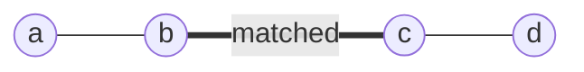

**Maximum: {*a*–*b*, *c*–*d*}**

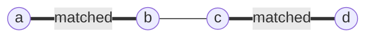

On the left, {*b*–*c*} is maximal: *a*–*b* and *c*–*d* both share a vertex with *b*–*c*, so nothing can be added. But it has only one edge, while the matching on the right has two. The algorithm in this lecture finds a **maximal** matching, which is easier, not necessarily a maximum one.

> **Kid example.** Four children stand in a line: Ali, Bo, Cy, Dee, and you may only dance with the child right next to you. If Bo and Cy dance, Ali and Dee are left alone, and they are not next to each other, so no new pair is possible: that is **maximal** (1 pair). If instead Ali dances with Bo and Cy dances with Dee, there are 2 pairs: that is **maximum**. Maximal = "nobody can join any more". Maximum = "the most pairs possible".

| Is it... | {*b*–*c*} | {*a*–*b*, *c*–*d*} | {*a*–*b*} |
|---|---|---|---|
| a matching? | yes | yes | yes |
| maximal (nothing can be added)? | yes | yes | **no** (*c*–*d* can be added) |
| maximum (most edges)? | no (1 edge) | yes (2 edges) | no |

**Remember:**

- **Matching** = set of edges with **no shared vertex** (independent edge set).
- **Maximal** = not a subset of any other matching (no edge can be added).
- **Maximum** = largest possible number of edges. Every maximum matching is maximal, **not** the other way round.
- This lecture's algorithm finds a **maximal** matching.

### 1.2 Applications in computer networks

**In one sentence:** matching is used to pair users with channels, devices with devices, and tasks with servers.

- **Matching in wireless networks.** Wireless networks consist of selfish, rational agents that seek their own benefit. Matching algorithms help pair agents with different characteristics that want to communicate.
    - **Cognitive radio networks:** licensed primary users occupy channels that unlicensed secondary users want to access; stable matchings of primary and secondary users are needed.
    - **Device-to-device (D2D) communications:** a technology to cope with the wireless capacity crunch; matching helps with interference management and resource allocation.
- **Cloud and edge computing:** **resource allocation** and **load balancing** (matching tasks to servers).

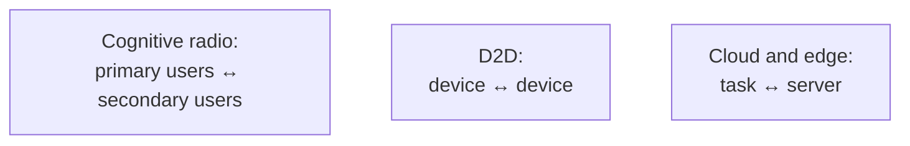

> **Kid example.** Matching is everywhere: children paired for a school project, players paired for a tennis game, or lunch boxes paired with the right child. In networks it pairs phones that talk directly to each other, or jobs with computers that will run them.

**Remember:**

- Wireless networks (selfish, rational agents): **cognitive radio** (primary and secondary users, stable matchings) and **D2D** (interference management, resource allocation).
- Cloud and edge computing: **resource allocation** and **load balancing**.

### 1.3 Proof technique: the variant function

**In one sentence:** find a number (or vector) that moves in one direction at every step and cannot move forever, so the system must stop moving, and show that where it stops is safe.

The **variant function** (also called a potential function) is a technique **for proving convergence**. The idea:

1. Define a function VF over configurations whose value is **bounded**.
2. Prove that the function **changes monotonically** (always decreases, or always increases) whenever a processor executes a step.
3. Show that once the function reaches a certain **threshold**, the system is in a **safe configuration**.

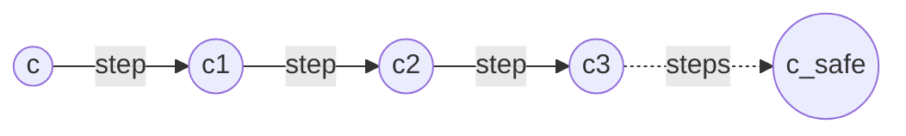

Along this execution, |VF(*c*)| ≥ |VF(*c*₁)| ≥ |VF(*c*₂)| ≥ |VF(*c*₃)| ≥ … ≥ |VF(*c*_safe)| ≥ … ≥ bound (the lecture draws the decreasing version; in the matching proof below the function increases instead).

Because the function cannot change forever in one direction without passing its bound, the technique also **estimates the number of steps** needed to reach a safe configuration: at most the number of different values the function can take.

> **Kid example.** A hiker who only ever walks downhill on a mountain with a floor at sea level must eventually stop. If every step lowers the height by at least one metre, and the hiker starts 100 metres up, there can be at most 100 steps. The height is the variant function; "sea level" is the bound.

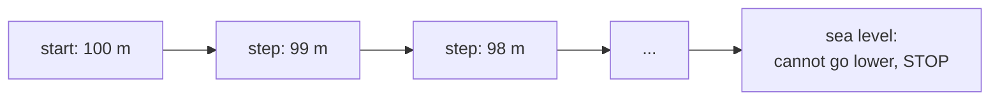

**Remember:**

- Variant function (potential function): **bounded**, **monotonic** at every step, reaching a **threshold** means **safe**.
- It proves **convergence** and also **bounds the number of steps** (at most the number of possible values).

## 2. The self-stabilizing matching algorithm

**What this chapter is about:** the setting, the five "moods" (statuses) a processor can be in, the three rules of the algorithm, and why it needs a central daemon.

### 2.1 The task and the model

**In one sentence:** each processor has one pointer, and the goal is that pointers end up in mutual pairs forming a maximal matching, with one processor moving at a time.

- **Matching** is a set of edges without common nodes.
- Each processor *pᵢ* has a single variable **pointerᵢ**, which either points to one of its neighbours or is **null**. *pᵢ* tries to find a matching neighbour.
- The algorithm should reach a configuration in which **pointerᵢ = *j* implies pointerⱼ = *i***: pointers come in mutual pairs, and those pairs are the matching edges.
- We **assume a central daemon**: one processor is activated at a time; it reads the state of all its neighbours and updates its own state before any other processor is activated.
- The set of legal executions **MM** for the maximal matching task includes **every execution in which the values of the pointers of all the processors are fixed and form a maximal matching**.

**Additional context (Dolev §2.9).** the book states the two conditions explicitly: (1) if *pᵢ* points to *pⱼ* then *pⱼ* points to *pᵢ* (the matching condition), and (2) no two neighbouring processors both have null pointers (the maximality condition: otherwise the edge between them could be added).

**The two conditions of a good final picture:**

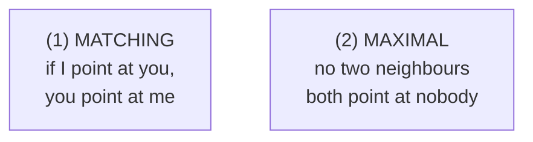

> **Kid example.** The dance is finished when (1) every finger that points at someone is answered by a finger pointing back, and (2) there are no two free children standing next to each other, because then they could still dance together.

**Remember:**

- One variable per processor: **pointerᵢ** = a neighbour or **null**.
- Goal: **pointerᵢ = *j* ⇒ pointerⱼ = *i*** and no two neighbours both null.
- **Central daemon**: one processor at a time; read all neighbours, update, before anyone else moves.
- **MM** = executions where all pointers are **fixed** and form a **maximal matching**.

### 2.2 The five processor statuses

**In one sentence:** a processor that points at someone is matched, waiting or chaining (depending on what its target does); a processor that points at nobody is free or single (depending on its neighbours).

In a configuration, each processor *pᵢ* has exactly one of five statuses:

- **Matched:** *pᵢ* has a neighbour *pⱼ* such that pointerᵢ = *j* **and** pointerⱼ = *i*.
- **Waiting:** *pᵢ* has a neighbour *pⱼ* such that pointerᵢ = *j* and pointerⱼ = **null**. (*pᵢ* has proposed; *pⱼ* has not answered yet.)
- **Chaining:** *pᵢ* has a neighbour *pⱼ* such that pointerᵢ = *j* and pointerⱼ = *k*, **k ≠ i**. (*pᵢ* is pointing at someone who is pointing elsewhere.)
- **Free:** pointerᵢ = null and there is a neighbour *pⱼ* that is **not matched**. (*pᵢ* could still find a partner.)
- **Single:** pointerᵢ = null and **every neighbour is matched**. (*pᵢ* has no possible partner left.)

The first three describe a processor with a non-null pointer, classified by what its target does; the last two describe a processor with a null pointer, classified by its neighbours.

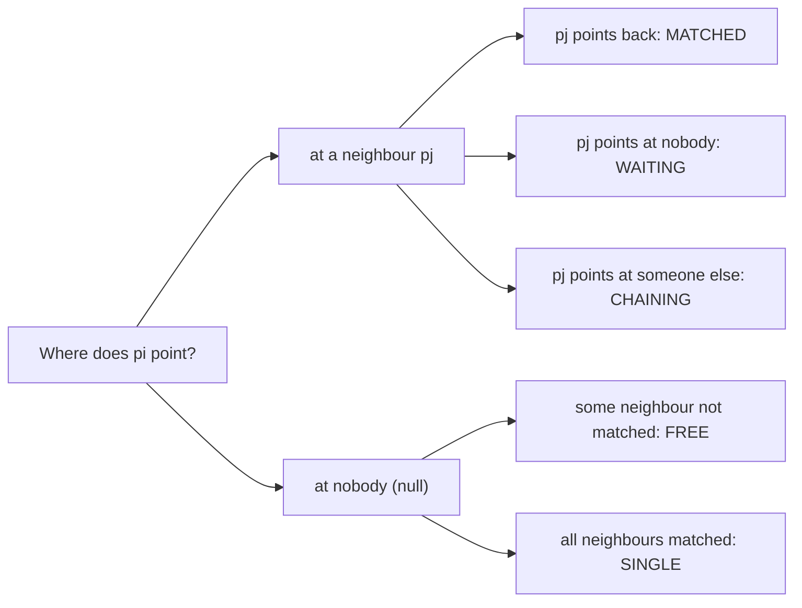

The lecture's example graph has five processors *pᵢ*, *pⱼ*, *pₖ*, *pℓ*, *pₘ* with links *pℓ*–*pᵢ*, *pᵢ*–*pⱼ*, *pℓ*–*pₘ*, *pℓ*–*pₖ*, *pᵢ*–*pₖ*, *pⱼ*–*pₖ* and *pₘ*–*pₖ*. Two of its pictures, drawn here with links as plain lines and pointers as arrows:

***pᵢ* is matched**

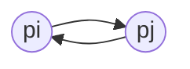

***pᵢ* is chaining**

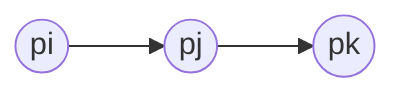

**Additional context (definition check).** the lecture slides define **free** as "pointerᵢ = null and there is a neighbour *pⱼ* with pointerⱼ = null" and **single** as "pointerᵢ = null and there is no neighbour *pⱼ* with pointerⱼ = null" (the free line also has a typo, *pᵢ* for *pⱼ*). The lecture's own explanation and the Dolev book use **"not matched"** / **"matched"** instead, as in the list above. The two versions differ when a neighbour is waiting or chaining (its pointer is not null, yet it is not matched). The proof below, and the "free or single" case in it, only works with the book's version, so this guide uses the book's definitions. In a safe configuration the two versions agree.

> **Kid example.** The five moods at the dance. **Matched:** "we point at each other, we dance". **Waiting:** "I asked my friend, and my friend has not answered yet". **Chaining:** "I asked my friend, but my friend is asking somebody else" (a hopeless wish). **Free:** "I asked nobody, and there is still someone next to me without a partner". **Single:** "I asked nobody, and everybody next to me already has a partner".

**Remember:**

- Pointer set: **matched** (target points back), **waiting** (target null), **chaining** (target points elsewhere).
- Pointer null: **free** (some neighbour **not matched**), **single** (all neighbours **matched**).
- Every processor has **exactly one** of the five statuses.
- Use the **book's** "not matched / matched" definitions for free/single (the slide version differs).

### 2.3 The algorithm

**In one sentence:** say yes to a proposal, propose to a free neighbour, and give up a proposal that is pointed elsewhere.

The program for processor *pᵢ*:

```text
01 do forever
02     if pointer_i = null and (∃ p_j ∈ N(i) | pointer_j = i) then
03         pointer_i := j
04     if pointer_i = null and (∀ p_j ∈ N(i) | pointer_j ≠ i) and
05                             (∃ p_j ∈ N(i) | pointer_j = null) then
06         pointer_i := j
07     if pointer_i = j and pointer_j = k and k ≠ i then
08         pointer_i := null
09 od
```

The three rules in plain words:

- **Lines 02–03, accept a proposal.** If I point to nobody and some neighbour points to me, I point back to it. Now we are matched.
- **Lines 04–06, make a proposal.** If I point to nobody, nobody points to me, and some neighbour also points to nobody, I point to that neighbour (I become waiting).
- **Lines 07–08, withdraw a hopeless proposal.** If I point to a neighbour that points to somebody else, I give up and set my pointer to null.

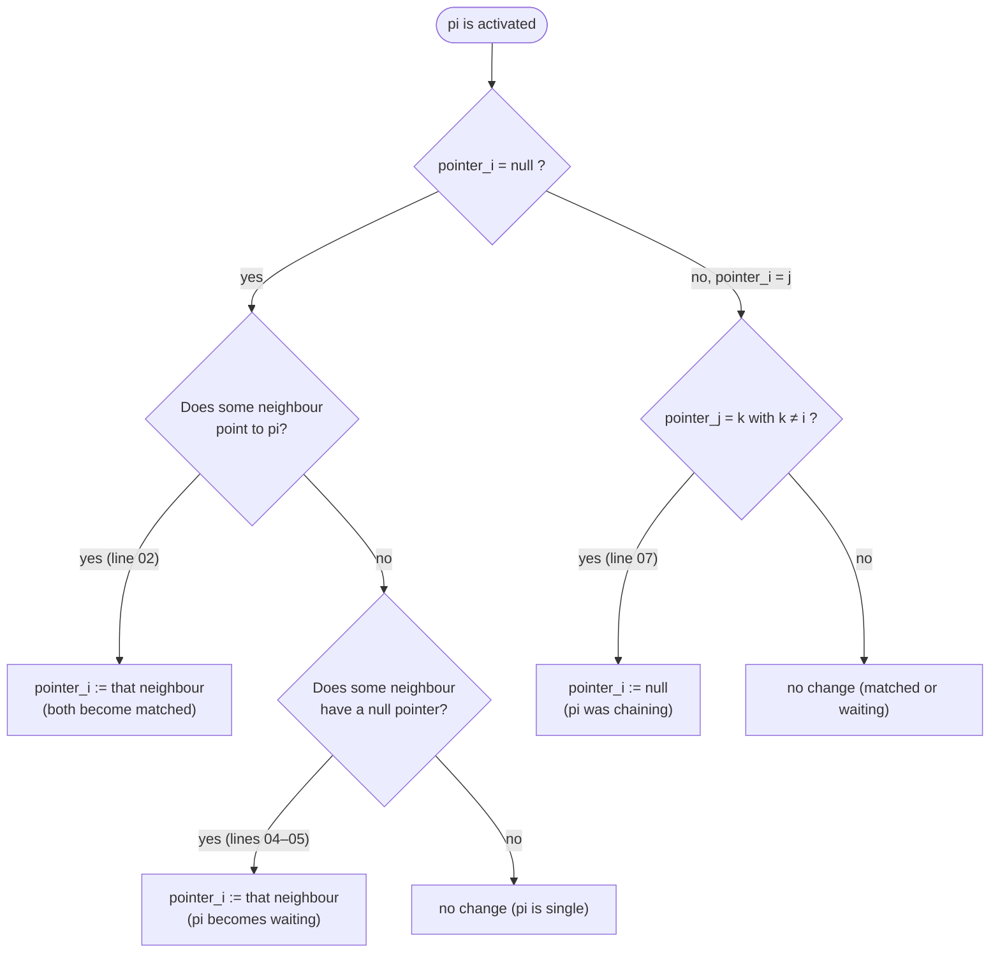

Which status triggers which line:

- a **free** processor runs line 03 (if a neighbour points to it) or line 06 (otherwise, if a neighbour has a null pointer);
- a **chaining** processor runs line 08;
- a **matched**, **waiting** or **single** processor changes nothing.

| Status of *pᵢ* | What *pᵢ* does when activated |
|---|---|
| Free, and a neighbour points to it | line 03: point back (accept) |
| Free, nobody points to it, a neighbour is null | line 06: point at that neighbour (propose) |
| Chaining | line 08: pointer := null (withdraw) |
| Matched, waiting, single | nothing |

> **Kid example.** The three dance rules. **Rule 1 (say yes):** if your hands are free and someone is pointing at you, point back: you are now a pair. **Rule 2 (ask):** if your hands are free, nobody is pointing at you, and a friend next to you also has free hands, point at that friend. **Rule 3 (give up):** if you are pointing at a friend who is pointing at somebody else, put your hand down.

**Remember:**

- Line 03 **accept**: null and someone points to me ⇒ point back (matched).
- Line 06 **propose**: null, nobody points to me, a neighbour is null ⇒ point to it (waiting).
- Line 08 **withdraw**: my target points elsewhere ⇒ null.
- Free ⇒ line 03 or 06; chaining ⇒ line 08; matched, waiting, single ⇒ no change.

### 2.4 Central versus distributed daemons

**In one sentence:** the proof needs a central daemon (one processor at a time); with many processors moving together, the algorithm can loop forever.

How many processors may run concurrently?

- Under the **central daemon** model, **exactly one** processor among all processors is selected, arbitrarily, by an adversarial scheduler, and takes a single atomic step. **Each step captures a complete iteration of the do-forever loop**: read all, finite internal computation, write all. **The proof in this lecture assumes a central daemon.**
- Under the **distributed daemon** model, **an arbitrary number of processors** are selected by an adversarial scheduler to take atomic steps **concurrently**. Each step captures **a single communication operation**, such as one read or one write, together with a finite sequence of local operations.

> **Kid example.** A central daemon is a teacher who calls on exactly one child at a time, and that child finishes a whole turn before the next is called. A distributed daemon is a teacher who may shout "you, you and you, go!" so that several children act at the same moment, each seeing the others as they were just before. Algorithms that work in the calm classroom can go wrong in the busy one.

**Additional context (reasoning).** here is why the central daemon matters for this algorithm. Take three processors *a*, *b*, *c* connected in a triangle, all with null pointers, and let a distributed daemon activate all three at the same moment. Each sees that nobody points to it and that a neighbour is null, so each runs line 06; the adversary can make them choose *a* → *b*, *b* → *c*, *c* → *a*. Now all three are chaining, all three run line 08 together, and all pointers are null again. This can repeat forever, so the algorithm never stabilizes under that scheduler. With a central daemon only one processor moves at a time, which is exactly what the variant-function proof below counts on.

**The triangle trap, as a picture** (all three move at the same moment every time):

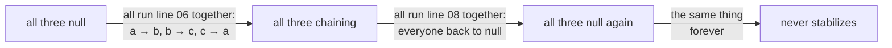

**After the "all propose together" step** (each one points at someone who points elsewhere):

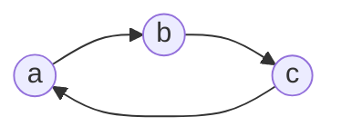

**Remember:**

- **Central daemon**: exactly **one** processor per step; a step = a **whole loop iteration**. The proof assumes it.
- **Distributed daemon**: **any number** at once; a step = **one read or write**.
- Under a distributed daemon the triangle *a*, *b*, *c* can propose in a circle, all withdraw, and repeat **forever**.

## 3. Correctness and a worked example

**What this chapter is about:** the proof that the algorithm always ends in a maximal matching, using a vector that grows at every step, and a full example step by step.

### 3.1 Correctness with a variant function

**In one sentence:** count the processors in each status, put the counts in a vector, and show that every pointer change makes the vector bigger in dictionary order, until it reaches (*n*, 0, 0, 0), which is safe.

#### The variant function

Let *m*, *s*, *w*, *f* and *c* be the total numbers of **matched**, **single**, **waiting**, **free** and **chaining** processors in a configuration. The variant function is the vector

```math
VF(c) = (m + s,\; w,\; f,\; c).
```

**Values of VF are compared lexicographically**: compare the first elements; only if they are equal compare the second; and so on. For example, (5, 3, 4, 7) is greater than (5, 3, 3, 8), because the first two elements are equal and 4 > 3.

Since every processor has exactly one status, *m* + *s* + *w* + *f* + *c* = *n*.

> **Kid example.** Lexicographic order is how words are sorted in a dictionary. "cat" comes before "cow" because the first letters are equal (c = c) and then "a" comes before "o". The later letters do not matter once one letter is different. With vectors we do the same with numbers: (5, 3, **4**, 7) beats (5, 3, **3**, 8) because 4 > 3, even though 7 < 8.

**Comparing (5, 3, 4, 7) with (5, 3, 3, 8), one position at a time:**

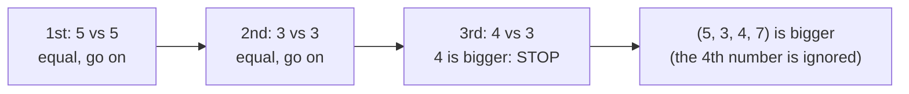

#### The proof idea

1. **VF(*c*) = (*n*, 0, 0, 0) exactly characterizes safe configurations.** Every configuration with VF = (*n*, 0, 0, 0) is safe with relation to MM and the algorithm, and every safe configuration has VF = (*n*, 0, 0, 0). In such a configuration every processor is matched or single: pointers come in mutual pairs (a matching), and every unmatched processor has only matched neighbours, so no edge can be added (maximal).
2. **Once the system reaches a safe configuration, no processor changes its pointer.** Matched and single processors have no applicable line.
3. **In every non-safe configuration, at least one processor can change its pointer** when the central daemon activates it (a waiting or chaining or free processor exists, and the analysis below shows which line applies).
4. **Every change of a pointer value increases VF** (shown below).
5. **The number of pointer changes is bounded** by the number of possible VF values, so a safe configuration is reached.

#### Every pointer change increases VF

**Line 03 (accept).** *pᵢ* is free and its neighbour *pⱼ* points to it, so *pⱼ* is waiting. After pointerᵢ := *j*, both are matched. The number of free and of waiting processors each drop by 1, and the number of matched rises by 2:

```math
(m+s,\; w,\; f,\; c) \;\Rightarrow\; (m+s+2,\; w-1,\; f-1,\; c).
```

**Line 06 (propose).** *pᵢ* is free and points to a neighbour with a null pointer, so *pᵢ* becomes waiting:

```math
(m+s,\; w,\; f,\; c) \;\Rightarrow\; (m+s,\; w+1,\; f-1,\; c).
```

**Line 08 (withdraw).** *pᵢ* is chaining. Two cases:

- **Case 1: no processor points to *pᵢ*.** *pᵢ* becomes **free** if it has an unmatched neighbour, or **single** if all its neighbours are matched. Chaining drops by 1, and free or single rises by 1:

```math
(m+s,\; w,\; f,\; c) \;\Rightarrow\; (m+s,\; w,\; f+1,\; c-1) \quad\text{or}\quad (m+s+1,\; w,\; f,\; c-1).
```

- **Case 2: at least one neighbour *pℓ* points to *pᵢ*.** Before the step, *pℓ* was chaining (it pointed to *pᵢ*, which pointed elsewhere). After the step *pᵢ* is null, so *pℓ* becomes **waiting**, and *pᵢ* becomes **free** (*pℓ* is an unmatched neighbour). Chaining drops by 2, waiting and free each rise by 1:

```math
(m+s,\; w,\; f,\; c) \;\Rightarrow\; (m+s,\; w+1,\; f+1,\; c-2).
```

In every case the vector grows lexicographically: line 03 increases the first element; line 06 keeps the first element and increases the second; line 08 increases the first element (single), or keeps the first two and increases the third (case 1, free), or keeps the first and increases the second (case 2). So **every assignment increments VF**, and the system stabilizes once it reaches a configuration where no increment is possible, which is a safe configuration.

**All four moves on one page** (the first position that changes is in bold, and it always goes **up**):

| Move | Change of (*m* + *s*, *w*, *f*, *c*) | First position that changes |
|---|---|---|
| Line 03, accept | (**+2**, −1, −1, 0) | 1st, up |
| Line 06, propose | (0, **+1**, −1, 0) | 2nd, up |
| Line 08, case 1, becomes single | (**+1**, 0, 0, −1) | 1st, up |
| Line 08, case 1, becomes free | (0, 0, **+1**, −1) | 3rd, up |
| Line 08, case 2 | (0, **+1**, +1, −2) | 2nd, up |

**Additional context (checking side effects).** a step can also change the status of processors other than *pᵢ* and its partner, but only in ways that keep the increase. After line 03, a neighbour that was free may become single (its last unmatched neighbour got matched), which moves it from *f* to *m* + *s* and increases the first element further; a processor that pointed to *pᵢ* or *pⱼ* without being chosen turns from waiting into chaining, which only affects later elements. In case 2 of line 08, if several neighbours point to *pᵢ*, each of them turns from chaining into waiting, so *w* grows by more than 1. None of this can make the vector smaller, because the first element that changes always increases.

> **Kid example.** Think of a score board with four numbers, read like a dictionary word. Every time a child follows a dance rule, the score board goes up in dictionary order: a new pair is the biggest win, a new "waiting" is the next biggest, and so on. The score cannot go up forever, because there are only so many children, so the moving must stop. And the only place where it stops is "everyone is matched or single", which is exactly a finished dance.

#### How many steps?

The number of pointer changes is bounded by the number of possible vector values. Because *m* + *s* + *w* + *f* + *c* = *n*, a rough count is: *n* + 1 possible values for *m* + *s*, *n* + 1 for *w*, and *n* + 1 for *f*; then *n* and the first three elements determine *c*. So there are O(*n*³) possible vectors, and

**the system reaches a safe configuration within O(*n*³) pointer-value changes.**

```math
\underbrace{(n+1)}_{m+s} \times \underbrace{(n+1)}_{w} \times \underbrace{(n+1)}_{f} = (n+1)^3 = O(n^3)
```

For example, with *n* = 5 processors there are at most 6 · 6 · 6 = 216 possible vectors, so at most 216 pointer changes (the real number is much smaller, but the bound is enough).


**Additional context (course quiz).** quiz questions ask which status changes each line causes and why the bound is cubic. Remember the four transition vectors and the "*n* + 1 choices for each of the first three elements" argument.

**Remember:**

- **VF = (*m* + *s*, *w*, *f*, *c*)**, compared **lexicographically**; *m* + *s* + *w* + *f* + *c* = *n*.
- **VF = (*n*, 0, 0, 0) ⇔ safe** (everyone matched or single ⇒ maximal matching).
- Safe ⇒ nobody moves. Not safe ⇒ someone can move.
- Every pointer change **increases** VF: line 03 (+2, −1, −1, 0); line 06 (0, +1, −1, 0); line 08 case 1 (0, 0, +1, −1) or (+1, 0, 0, −1); line 08 case 2 (0, +1, +1, −2).
- At most (*n* + 1)³ values ⇒ safe within **O(*n*³) pointer changes** (under a **central daemon**).

### 3.2 A complete worked example

**In one sentence:** starting from a messy configuration of five processors, six moves give a maximal matching, and VF goes up at every move.

Use the lecture's graph: links *pℓ*–*pᵢ*, *pᵢ*–*pⱼ*, *pℓ*–*pₘ*, *pℓ*–*pₖ*, *pᵢ*–*pₖ*, *pⱼ*–*pₖ*, *pₘ*–*pₖ*.

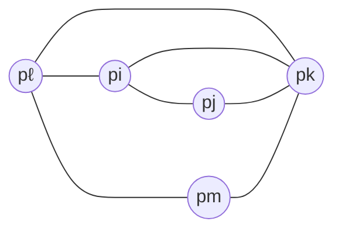

Start from the corrupted configuration pointerᵢ = *j*, pointerⱼ = *k*, pointerₖ = *m*, pointerℓ = *k*, pointerₘ = null. Then *pᵢ*, *pⱼ* and *pℓ* are chaining, *pₖ* is waiting (it points to *pₘ*, which is null), and *pₘ* is free. VF = (0, 1, 1, 3).

**The starting pointers** (arrows are pointers):

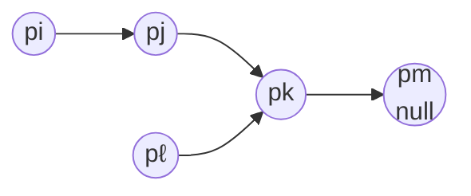

The central daemon activates processors one at a time (activations that change nothing are skipped):

| Step | Activated | Line | New pointer | Statuses afterwards (*i*, *j*, *k*, ℓ, *m*) | VF |
|---|---|---|---|---|---|
| start | — | — | — | C, C, W, C, F | (0, 1, 1, 3) |
| 1 | *pᵢ* | 08 | pointerᵢ := null | F, C, W, C, F | (0, 1, 2, 2) |
| 2 | *pₘ* | 03 | pointerₘ := *k* | F, C, M, C, M | (2, 0, 1, 2) |
| 3 | *pℓ* | 08 | pointerℓ := null | F, C, M, F, M | (2, 0, 2, 1) |
| 4 | *pᵢ* | 06 | pointerᵢ := ℓ | W, C, M, F, M | (2, 1, 1, 1) |
| 5 | *pℓ* | 03 | pointerℓ := *i* | M, C, M, M, M | (4, 0, 0, 1) |
| 6 | *pⱼ* | 08 | pointerⱼ := null | M, S, M, M, M | (5, 0, 0, 0) |

(M = matched, S = single, W = waiting, F = free, C = chaining.)

**Why each step happens, in plain words:**

1. *pᵢ* points at *pⱼ*, but *pⱼ* points at *pₖ*: hopeless, so *pᵢ* gives up (line 08).
2. *pₖ* is pointing at *pₘ*, and *pₘ* has free hands: *pₘ* says yes (line 03). Now *pₖ*–*pₘ* is a pair.
3. *pℓ* points at *pₖ*, but *pₖ* points at *pₘ*: hopeless, so *pℓ* gives up (line 08).
4. *pᵢ* is free, nobody points at it, and its neighbour *pℓ* has free hands: *pᵢ* asks *pℓ* (line 06).
5. *pℓ* is free and *pᵢ* points at it: *pℓ* says yes (line 03). Now *pᵢ*–*pℓ* is a pair.
6. *pⱼ* still points at *pₖ*, who is taken: *pⱼ* gives up (line 08). All of *pⱼ*'s neighbours (*pᵢ*, *pₖ*) are matched, so *pⱼ* is single.

**VF after each step** (it always goes up in dictionary order):

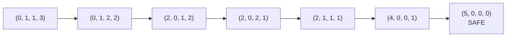

VF increases at every step, exactly as the proof predicts. The final configuration has the matching {*pₖ*–*pₘ*, *pᵢ*–*pℓ*}, and *pⱼ* is single because both its neighbours *pᵢ* and *pₖ* are matched. No edge can be added, so the matching is maximal, and no line is applicable any more.

**The final pointers:**

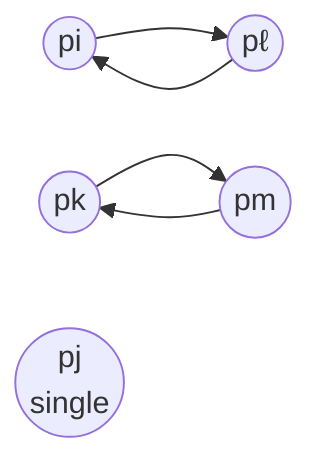

> **Kid example.** At the start, three children are pointing at friends who are pointing elsewhere, and one is waiting for an answer. One by one: a hopeless wish is dropped, an invitation is accepted, another hopeless wish is dropped, a new invitation is made and accepted, and the last hopeless wish is dropped. Two pairs dance, and the one child left over has no free friend next to them. The dance is finished and nobody moves any more.

**Remember:**

- Start: C, C, W, C, F with VF = (0, 1, 1, 3); *n* = 5.
- Six moves: 08, 03, 08, 06, 03, 08. VF rises every time to **(5, 0, 0, 0)**.
- Result: pairs {*pₖ*–*pₘ*, *pᵢ*–*pℓ*}, *pⱼ* **single**: a **maximal** matching.

## 4. Summary

**What this chapter is about:** the whole lecture on one page.

### 4.1 Recap

**In one sentence:** three simple pointer rules give a maximal matching from any start, proved with a variant function that grows at every move.

- A **matching** is a set of edges with no shared vertex; a **maximal** matching cannot be extended; a **maximum** matching is the largest possible.
- Each processor keeps one **pointer**. Rules: **accept** a proposal (line 03), **propose** to a neighbour with a null pointer (line 06), **withdraw** when the target points elsewhere (line 08).
- Statuses: **matched, waiting, chaining** (pointer set) and **free, single** (pointer null).
- **Variant function** VF = (*m* + *s*, *w*, *f*, *c*), compared lexicographically. Every pointer change increases it; VF = (*n*, 0, 0, 0) exactly when the configuration is safe. Under a **central daemon** the algorithm stabilizes within **O(*n*³) pointer changes**.

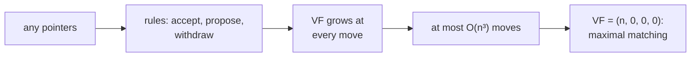

> **Kid example.** The whole story: children at a dance follow three rules (say yes, ask a free friend, drop a hopeless wish). A dictionary-ordered score goes up with every move and cannot go up forever, so the moving stops, and when it stops every child is either dancing or has no free friend left.

## Revision notes and references

This guide found no errors in the lecture material that needed a technical clarification. Where the slides and the course book differ in presentation, this guide follows the lecture and notes the book's version.

- S. Dolev, *Self-Stabilization*, MIT Press, 2000: §2.9 (the variant-function technique and maximal matching).
- S.-C. Hsu and S.-T. Huang, "A Self-Stabilizing Algorithm for Maximal Matching", *Information Processing Letters* 43(2), 1992.
