# Self-Stabilizing Leader Election in General Graphs (ID-Based Systems)

**Course:** EDA387/DIT663 Computer Networks, part 2 (Fault-tolerant Algorithms for Computer Networks), lecture "Self-stabilizing Leader Election for ID-based Systems", first part (Dolev, *Self-Stabilization*, §2.9: convergence stairs). The second part of the same lecture, leader election in complete graphs without identifiers, has its own guide.

**Revised:** 21 October 2026

**† Supplementary material:** content that comes only from hidden PowerPoint slides. It may not be part of this year's examinable material. *This part of the lecture has no hidden slides, so nothing in this guide carries the † mark.*

**How to read this guide.** Every part starts with **In one sentence**, the whole idea in one line. Then comes the explanation in small steps, a **Kid example** (the same idea told with everyday things), pictures, and a **Remember** list with what you must know for the exam. **Technical clarification** marks a place where the slides are wrong or unclear, and gives the correct version. **Additional context** adds something useful that is not on the slides.

---

## Glossary

| Term | Full name | Meaning in simple words |
|---|---|---|
| Attractor | — | Another name for a predicate *Aᵢ* in a convergence-stairs proof: once the system reaches it, it stays in it. |
| Candidate | — | The leader that processor *pᵢ* currently believes in, together with its distance to it. |
| Convergence stairs | — | A proof technique: show that the system reaches and stays in predicate *A*₁, then in a stronger *A*₂, and so on up to *Aₖ*, which describes safe configurations. |
| Δ (Delta) | — | The maximum number of neighbours of any processor. |
| δ (delta) | — | The number of neighbours of the processor running the code. |
| Distance (dis) | — | The number of hops a processor believes separate it from its candidate leader. |
| Floating identifier | — | An identifier that appears in the initial configuration although no processor in the system has that identifier: a "ghost" leader left by a fault. |
| ID(*i*) | Identifier of *pᵢ* | A unique number in the range 1 to *N* assigned to processor *pᵢ*. |
| IoT | Internet of Things | Networks of small connected devices such as sensors and appliances. |
| Leader election | — | The task of informing every processor of the identifier of one single processor, the leader. |
| Lexicographic order | — | Comparing pairs element by element: first the identifier, and only if equal, the distance. |
| MANET | Mobile Ad hoc Network | A self-configuring wireless network of mobile devices without fixed infrastructure. |
| *N* | — | A known upper bound on the number of processors; identifiers lie in 1 to *N*. |
| OSPF | Open Shortest Path First | A link-state routing protocol in which routers elect a designated router. |
| P2P | Peer-to-peer | Networks where all participants are equal and talk directly to each other. |
| Predicate | — | A true/false statement about a configuration, for example "no floating identifier exists". |
| Refinement | — | *A*ᵢ₊₁ refines *Aᵢ* if *Aᵢ* holds whenever *A*ᵢ₊₁ holds: *A*ᵢ₊₁ is the stronger statement. |
| Safe configuration | — | A configuration from which every fair execution is legal. |

## Contents

- [Before you start: the words you need](#before-you-start-the-words-you-need)
- [1. Leader election and convergence stairs](#1-leader-election-and-convergence-stairs)
  - [1.1 Why leader election?](#11-why-leader-election)
  - [1.2 Proof technique: convergence stairs](#12-proof-technique-convergence-stairs)
- [2. The task and the algorithm](#2-the-task-and-the-algorithm)
  - [2.1 The task and the assumptions](#21-the-task-and-the-assumptions)
  - [2.2 Why the naive algorithm is not self-stabilizing: floating identifiers](#22-why-the-naive-algorithm-is-not-self-stabilizing-floating-identifiers)
  - [2.3 The self-stabilizing algorithm](#23-the-self-stabilizing-algorithm)
- [3. Correctness and a worked example](#3-correctness-and-a-worked-example)
  - [3.1 Correctness with two convergence stairs](#31-correctness-with-two-convergence-stairs)
  - [3.2 A complete worked example](#32-a-complete-worked-example)
- [4. Summary](#4-summary)
  - [4.1 Recap](#41-recap)
- [Revision notes and references](#revision-notes-and-references)

## Before you start: the words you need

- **Identifier (ID):** every processor has its own name, which is a number: 1, 2, 3, … No two processors have the same number.
- ***N*:** a number that is **at least** as big as the number of processors. All IDs are between 1 and *N*.
- **Leader:** the one processor everybody agrees on. In this lecture the leader is the processor with the **smallest** ID.
- **Candidate:** the processor that *I* currently think is the leader.
- **Distance:** how many hops (links) I think I am away from my candidate.
- **Floating identifier (ghost):** an ID that appears in memory after a fault, but **no real processor has it**.

**Every processor shows a pair ⟨candidate, distance⟩.** Here everyone agrees that 1 is the leader:

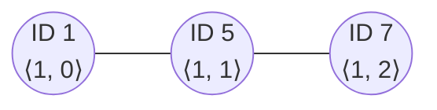

> **Kid example.** A class must pick a class captain: the child with the **smallest** student number. The children are not all in one room; each child can only whisper with the children sitting next to them. Each child says "I think the captain is number ⟨so-and-so⟩, and I heard it ⟨this many⟩ whispers away". The puzzle: after a big mess (some children even "remember" a number that belongs to nobody), can everyone still agree on the real captain?

## 1. Leader election and convergence stairs

**What this chapter is about:** why networks need a leader, and a proof method in which you climb a staircase of facts, one step at a time, until you reach "safe".

### 1.1 Why leader election?

**In one sentence:** once one node is chosen as the leader, many hard distributed jobs become easy, because the leader can coordinate the others.

Many distributed tasks become simple once one node is chosen as a leader that can coordinate the others. Leader election is used for:

- **Coordinator election:** selecting a coordinator that acts as a central point for decisions.
- **Load balancing:** a leader distributes incoming requests or tasks evenly among nodes.
- **Cluster management:** in clusters and clouds, a leader coordinates resource allocation, scaling and maintenance.
- **Network routing:** selecting a designated router; in OSPF, an election determines a designated router (the lecture describes it as the router responsible for maintaining the routing tables; in OSPF terms, the designated router coordinates the exchange of link-state information on a shared network segment).
- **Mobile ad hoc networks (MANETs):** a temporary leader keeps a dynamic, self-configuring network organized.
- **Sensor networks:** a leader aggregates data from many sensors, saves energy by controlling sensor activity, and talks to a central server.
- **IoT:** selecting edge devices or gateways that aggregate, preprocess and forward data to the cloud.
- **Decentralized systems:** in peer-to-peer and blockchain networks, consensus algorithms decide who may create new blocks or validate transactions.
- **Resource allocation:** choosing the node that allocates limited resources fairly and efficiently.

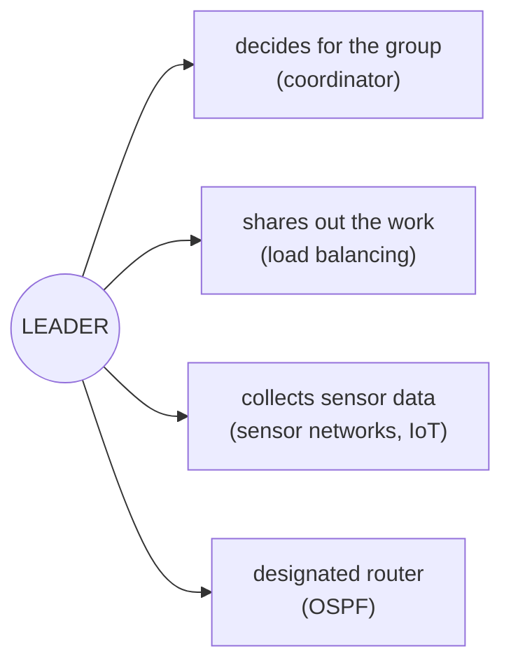

> **Kid example.** A class picks one class representative. Once every pupil knows who the representative is, questions to the teacher can go through that one person, and the class does not have to argue all together about every small thing.

**Remember:**

- A leader makes distributed tasks simple: it can **coordinate** and even compute centrally.
- Uses: coordinator, load balancing, cluster management, **OSPF designated router**, MANETs, sensor networks, IoT gateways, P2P and blockchain consensus, resource allocation.

### 1.2 Proof technique: convergence stairs

**In one sentence:** prove that the system reaches and keeps a first good fact *A*₁, then a stronger fact *A*₂, and so on, until the last fact *Aₖ* means "safe".

The **convergence stairs** technique proves that a self-stabilizing algorithm converges by climbing a staircase of predicates *A*₁, *A*₂, …, *Aₖ* (*k* > 1):

- Each *Aᵢ* is a **predicate** on configurations.
- For every 1 ≤ *i* < *k*, ***A*ᵢ₊₁ is a refinement of *Aᵢ***: *Aᵢ* holds whenever *A*ᵢ₊₁ holds. So each stair is stronger than the one below it.
- The term **attractor** is often used for each such predicate.

The proof goes stair by stair:

1. Prove that from some point of the execution, **every configuration satisfies *A*₁**.
2. Prove that an execution in which *Aᵢ* holds reaches a configuration after which **every configuration satisfies *A*ᵢ₊₁**.
3. Continue until ***Aₖ***, which is **the predicate for a safe configuration**.

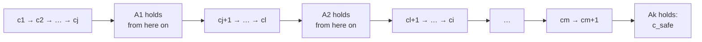

> **Kid example.** Climbing stairs. You first prove you can reach the first step and never fall below it; then that from the first step you can reach the second and never fall below it; and so on to the top floor, which is "safe". Each step is "stronger" than the one below: if you are on step 3, you are certainly also above step 1.

**A tiny example of "refinement":** *A*₁ = "there are no ghosts", *A*₂ = "everybody believes in the real captain". If *A*₂ is true, *A*₁ must be true too (you cannot believe in the real captain and in a ghost at the same time). So *A*₂ refines *A*₁.

**Remember:**

- Stairs *A*₁, …, *Aₖ* (*k* > 1), each a **predicate**; *A*ᵢ₊₁ **refines** *Aᵢ* (*A*ᵢ₊₁ true ⇒ *Aᵢ* true). Also called **attractors**.
- Prove: reach *A*₁ and stay; from *Aᵢ* reach *A*ᵢ₊₁ and stay; *Aₖ* = **safe configuration**.

## 2. The task and the algorithm

**What this chapter is about:** the exact task, why the obvious algorithm gets stuck on a "ghost" leader, and the clever fix with distances.

### 2.1 The task and the assumptions

**In one sentence:** every processor has a unique ID in 1 to *N*, and every processor must learn the ID of the one with the smallest ID.

- Every processor has a **unique identifier in the range 1 to *N***, where *N* is an upper bound on the number of processors in the system.
- **The leader election task** is to **inform every processor of the identifier of a single processor in the system**; that single processor, with the elected identifier, is the **leader**. Here the processor with the **minimum identifier** is elected.

**Additional context (Dolev §2.9).** usually the processor with the minimal (or maximal) identifier is elected. Leader election is a fundamental task because a distributed task can often be performed by electing a leader and then letting it compute centrally.

> **Kid example.** Every child has a different student number between 1 and *N*. The rule is simple: the child with the smallest number is the captain, and every child must end up knowing that number.

**Remember:**

- Unique IDs in **1 to *N*** (*N* = known upper bound on the number of processors).
- Task: every processor learns the ID of **one** leader; here the **minimum** ID.

### 2.2 Why the naive algorithm is not self-stabilizing: floating identifiers

**In one sentence:** after a fault, memory can contain a "ghost" ID smaller than every real ID, and the naive rule "always take the smallest" then believes the ghost forever.

A simple non-stabilizing algorithm: each processor starts with itself as candidate, repeatedly tells its neighbours its candidate, and switches to any smaller candidate it hears about. In a clean start this elects the minimum identifier.

But in self-stabilization the start is arbitrary. A **floating identifier** is **an identifier that appears in the initial configuration although no processor in the system has this identifier**.

The lecture's example: eight processors with identifiers 1 to 8, connected as below, and every processor's leader variable corrupted to **0**. Identifiers are in 1 to *N*, so no processor has identifier 0: it is floating.

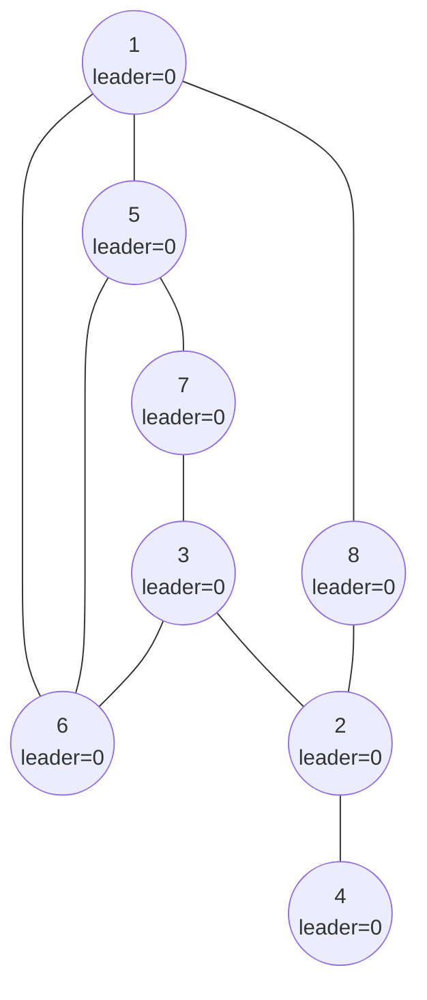

With the naive rule "switch to the smallest candidate you hear", 0 is smaller than every real identifier, so **every processor keeps declaring 0 as the leader forever**, and the system never elects a real processor.

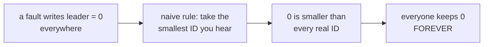

> **Kid example.** A rumour goes round: "the class captain is number 0". But there is no pupil with number 0! With the rule "always believe the smallest number", every child believes 0, because 0 is smaller than every real number. Nobody can ever prove it wrong, so the class is stuck with a captain who does not exist.

**Remember:**

- **Floating identifier** = an ID in the initial configuration that **no processor has** (a ghost).
- Example: 8 processors, every leader variable = **0**; 0 is not in 1 to *N*, so it is floating.
- The naive "take the smallest" rule keeps the ghost **forever**: not self-stabilizing.

### 2.3 The self-stabilizing algorithm

**In one sentence:** every processor publishes ⟨candidate, distance⟩, adds one to the distance when it copies a neighbour's candidate, and ignores any pair whose distance has reached *N*, so ghosts slowly "move away" and are dropped.

The fix uses **distance variables and the bound *N*** to eliminate floating identifiers. Each processor *pᵢ* publishes a pair ⟨leaderᵢ, disᵢ⟩: its candidate and its distance from that candidate. Each processor reads its neighbours' pairs and chooses the candidate with the **lexicographically lowest pair of identifier and distance**, but **ignores any pair whose distance has reached *N***.

```text
01 do forever
02     ⟨candidate, distance⟩ := ⟨ID(i), 0⟩
03     forall p_j ∈ N(i) do
04     begin
05         ⟨leader_i[j], dis_i[j]⟩ := read ⟨leader_j, dis_j⟩
06         if (dis_i[j] < N) and ((leader_i[j] < candidate) or
07             ((leader_i[j] = candidate) and (dis_i[j] < distance))) then
08             ⟨candidate, distance⟩ := ⟨leader_i[j], dis_i[j] + 1⟩
09     end
10     write ⟨leader_i, dis_i⟩ := ⟨candidate, distance⟩
11 od
```

In words, in every iteration *pᵢ*:

1. **Starts from scratch** with itself as candidate at distance 0 (line 02). Nothing is remembered from the previous iteration, so old corrupted beliefs cannot survive by themselves.
2. **Reads each neighbour's ⟨leader, dis⟩** (line 05).
3. **Adopts a neighbour's candidate** if that neighbour's distance is **less than *N*** and its candidate is **smaller**, or **equal with a shorter distance** (lines 06–07). It then sets its distance to the neighbour's distance **plus one** (line 08).
4. **Publishes** the chosen pair (line 10).

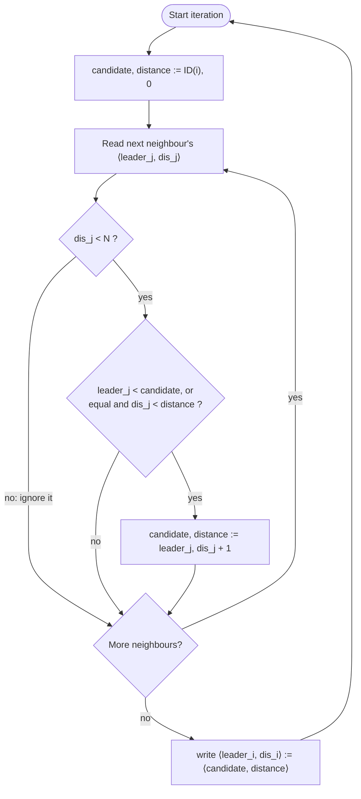

Why does the distance help? A real leader keeps publishing itself at distance 0, so its identifier is refreshed at small distances forever. A floating identifier has **no real source**: nobody publishes it at distance 0, so every time it is copied, its distance **grows by one**. Once its distance reaches *N* everybody ignores it.

**Comparing pairs "lexicographically"** (first the ID; only if the IDs are equal, the distance):

| Pair A | Pair B | Which is lower? | Why |
|---|---|---|---|
| ⟨2, 5⟩ | ⟨3, 0⟩ | ⟨2, 5⟩ | 2 < 3; the distance is not even looked at |
| ⟨1, 3⟩ | ⟨1, 1⟩ | ⟨1, 1⟩ | same ID, 1 < 3 |
| ⟨0, 8⟩ with *N* = 8 | ⟨4, 0⟩ | ⟨0, 8⟩ is **ignored** | its distance is not < *N* |

**A real leader versus a ghost:**

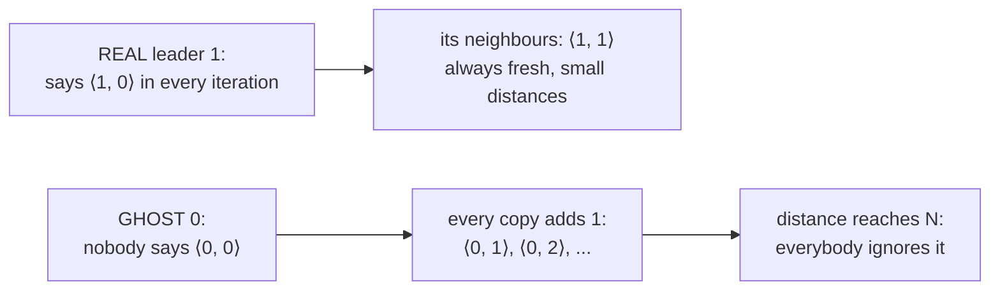

> **Kid example.** Every morning each child forgets yesterday's answer and starts again with "I am the captain, 0 whispers away". Then the child asks the neighbours "who is your captain, and how many whispers away?" and keeps the smallest name it hears, adding one whisper. The real captain shouts "it's me, 0 whispers!" every morning, so the real name is always fresh. A made-up name (a ghost) has nobody to shout it, so it gets one whisper further away every time it is passed on, and once it is *N* whispers away (more whispers than there are children), everyone knows it cannot be true and ignores it.

**Remember:**

- Publish **⟨leaderᵢ, disᵢ⟩**; choose the **lexicographically lowest** ⟨ID, distance⟩.
- Line 02: **restart** every iteration with ⟨ID(*i*), 0⟩ (no memory of old beliefs).
- Lines 06–08: adopt a neighbour's pair only if **dis < *N*** and (smaller ID, or same ID with shorter distance); take **dis + 1**.
- A real leader is refreshed at distance 0; a **ghost's distance only grows**, and at *N* it is **ignored**.

## 3. Correctness and a worked example

**What this chapter is about:** the two-step staircase proof (first the ghosts vanish, then the real minimum wins), and the full eight-processor example round by round.

### 3.1 Correctness with two convergence stairs

**In one sentence:** stair 1: ghost IDs disappear because their distance keeps growing up to *N*; stair 2: the smallest real ID then spreads like a BFS tree.

#### The two stairs

- ***A*₁: no floating identifier exists.**
- ***A*₂ (safe configuration): every processor chooses the minimum identifier of a processor in the system as the identifier of the leader.**

*A*₂ refines *A*₁: if every processor has chosen the real minimum identifier, then certainly no floating identifier is around.

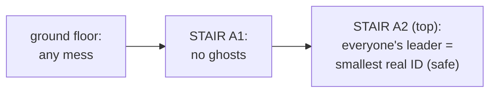

**Where can a floating identifier hide?** In processor *pᵢ*'s local array leaderᵢ[1, …, δ], in its local variable candidate, and in the field leaderᵢ of its communication register. The **distance** of a floating identifier found in leaderᵢ[*j*], candidate or leaderᵢ is disᵢ[*j*], distance or disᵢ, respectively.

| A ghost can hide in... | ...and its distance is then |
|---|---|
| leaderᵢ[*j*] (the copy *pᵢ* read from neighbour *pⱼ*) | disᵢ[*j*] |
| candidate (local variable) | distance |
| leaderᵢ (the register *pᵢ* publishes) | disᵢ |

#### Stair 1: Lemma 2.5, floating identifiers disappear

**Lemma 2.5.** Every fair execution that starts from any arbitrary configuration has a suffix in which no floating identifier exists.

*Proof.* We show that **as long as a floating identifier exists, the minimal distance of a floating identifier increases during any O(Δ) rounds** (O(Δ) rounds are enough for every processor to complete a full iteration of the loop, reading all of its at most Δ neighbours).

1. Let *pᵢ* be a processor that holds, in its local variables or its registers, a floating identifier with the **minimum distance**.
2. Once *pᵢ* starts executing the do-forever loop, it must choose either its **own** identifier (distance 0, which is not floating) or a candidate read from a neighbour, with **a distance at least one greater than the distance read** (line 08).
3. So if *pᵢ* chooses to assign a floating identifier to leaderᵢ, it must choose a distance **greater by one** than the distance it read, and the smallest distance it can read for a floating identifier is the current minimum. Floating identifiers can never be "refreshed" at a smaller distance, because no processor has that identifier and publishes it at distance 0.
4. So the minimum distance of any floating identifier keeps growing. **Once the minimum distance of a floating identifier reaches *N*, no processor chooses a floating identifier** (the test dis < *N* in line 06 fails).
5. Therefore all floating identifiers are eventually eliminated. ∎

The lecture's informal version: let floatIdMin be the smallest of all floating identifiers. Its distance increases within every asynchronous cycle (an induction on the distance of *pᵢ* from where floatIdMin is held). Eventually the condition in line 06 makes everybody ignore floatIdMin.

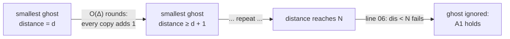

> **Kid example.** A rumour "the captain is Zed", but there is no pupil called Zed. Each time the rumour is passed on, it gets a "heard it from someone who heard it from…" counter that goes up by one. Nobody can ever reset that counter to 0, because Zed does not exist to say "it's me". If the counter is higher than the number of pupils in the school, the rumour cannot be true, so people stop believing it.

#### Stair 2: Theorem 2.3, the minimum identifier wins

After stair *A*₁, **only correct identifiers exist**, so the minimum identifier can be chosen correctly. From that point on, the argument is the same as for the BFS spanning tree learnt earlier in the course:

- The processor *p*₁ with the minimum identifier always picks itself at distance 0, because no neighbour can show a smaller real identifier.
- **The minimum identifier propagates.** The proof is by induction on the distance of *pᵢ* from the processor with the minimum identifier: processors at distance 1 adopt it with distance 1, then processors at distance 2 adopt it with distance 2, and so on, exactly like the distances in the BFS tree algorithm.
- If all processors already hold the minimum identifier, the remaining argument (correct distances) is the same as in the BFS tree construction proof.

**Theorem 2.3.** Every fair execution that starts from an arbitrary configuration reaches a safe configuration.

**Why the first stair is essential.** If *A*₁ did not hold, we could not prove correctness: the minimum identifier *z* present in the first (arbitrary) configuration might not be the identifier of any processor in the system, and the naive argument would elect the ghost *z*.

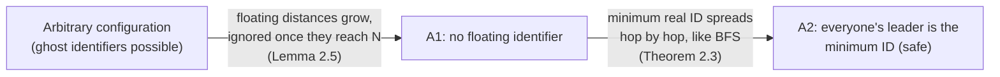

**Additional context (reasoning).** the algorithm also computes BFS distances from the leader for free: each processor's distance converges to its real hop distance from the minimum-identifier processor, as in the worked example below.

> **Kid example.** Once the ghost rumours are gone, the real smallest-number child keeps saying "it's me, 0 whispers". The children next to them say "1 whisper", the next ones "2 whispers", and so on, like ripples in a pond. Soon every child knows the real captain and how far away they are.

**Remember:**

- *A*₁: **no floating identifier**. *A*₂ (**safe**): everyone's leader = **minimum real ID**. *A*₂ refines *A*₁.
- Ghosts can hide in leaderᵢ[*j*], candidate, leaderᵢ (distances disᵢ[*j*], distance, disᵢ).
- **Lemma 2.5**: the minimum ghost distance **grows every O(Δ) rounds**; at *N* the ghost is ignored ⇒ *A*₁.
- **Theorem 2.3**: then the minimum ID spreads **like BFS** (induction on distance) ⇒ safe.
- Without *A*₁ the proof fails: the minimum ID *z* might be a ghost.
- Bonus: distances become the **BFS distances** from the leader.

### 3.2 A complete worked example

**In one sentence:** with *N* = 8 and every register ⟨0, 0⟩, the ghost 0 survives 8 rounds while its distance climbs to 8, then everyone drops it and the real leader 1 spreads in 3 more rounds.

Take the floating-identifier example from Section 2.2 with *N* = 8: every register starts as ⟨0, 0⟩. To keep it short, suppose every processor reads all its neighbours and then writes, all in the same round (this is one particular fair schedule). Each line shows ⟨leader, dis⟩ for processors 1 to 8 after that round.

| Round | *p*₁ | *p*₂ | *p*₃ | *p*₄ | *p*₅ | *p*₆ | *p*₇ | *p*₈ |
|---|---|---|---|---|---|---|---|---|
| 0 | ⟨0,0⟩ | ⟨0,0⟩ | ⟨0,0⟩ | ⟨0,0⟩ | ⟨0,0⟩ | ⟨0,0⟩ | ⟨0,0⟩ | ⟨0,0⟩ |
| 1 | ⟨0,1⟩ | ⟨0,1⟩ | ⟨0,1⟩ | ⟨0,1⟩ | ⟨0,1⟩ | ⟨0,1⟩ | ⟨0,1⟩ | ⟨0,1⟩ |
| 2 | ⟨0,2⟩ | ⟨0,2⟩ | ⟨0,2⟩ | ⟨0,2⟩ | ⟨0,2⟩ | ⟨0,2⟩ | ⟨0,2⟩ | ⟨0,2⟩ |
| … | … | … | … | … | … | … | … | … |
| 8 | ⟨0,8⟩ | ⟨0,8⟩ | ⟨0,8⟩ | ⟨0,8⟩ | ⟨0,8⟩ | ⟨0,8⟩ | ⟨0,8⟩ | ⟨0,8⟩ |
| 9 | ⟨1,0⟩ | ⟨2,0⟩ | ⟨3,0⟩ | ⟨4,0⟩ | ⟨5,0⟩ | ⟨6,0⟩ | ⟨7,0⟩ | ⟨8,0⟩ |
| 10 | ⟨1,0⟩ | ⟨2,0⟩ | ⟨2,1⟩ | ⟨2,1⟩ | ⟨1,1⟩ | ⟨1,1⟩ | ⟨3,1⟩ | ⟨1,1⟩ |
| 11 | ⟨1,0⟩ | ⟨1,2⟩ | ⟨1,2⟩ | ⟨2,1⟩ | ⟨1,1⟩ | ⟨1,1⟩ | ⟨1,2⟩ | ⟨1,1⟩ |
| 12 | ⟨1,0⟩ | ⟨1,2⟩ | ⟨1,2⟩ | ⟨1,3⟩ | ⟨1,1⟩ | ⟨1,1⟩ | ⟨1,2⟩ | ⟨1,1⟩ |

What happens:

- **Rounds 1–8 (stair 1).** The ghost 0 is still the smallest identifier, so everybody keeps it, but its distance grows by exactly one per round, because nobody publishes 0 at distance 0.
- **Round 9.** All distances are 8 = *N*, so the test dis < *N* fails everywhere and every processor falls back to itself. *A*₁ now holds: no floating identifier exists.
- **Rounds 10–12 (stair 2).** The real minimum identifier 1 spreads hop by hop. Processors 5, 6 and 8 (neighbours of 1) get distance 1; processors 2, 3 and 7 get distance 2; processor 4 gets distance 3. From round 12 on nothing changes: this is a safe configuration, and the distances are exactly the hop distances from processor 1.

**Two rows checked by hand:**

- Round 10, *p*₃: its neighbours 7, 6 and 2 showed ⟨7,0⟩, ⟨6,0⟩, ⟨2,0⟩ in round 9. The lowest is ⟨2,0⟩, and 2 < 3, so *p*₃ writes ⟨2, 0 + 1⟩ = ⟨2,1⟩.
- Round 11, *p*₂: its neighbours 3, 8 and 4 showed ⟨2,1⟩, ⟨1,1⟩, ⟨2,1⟩ in round 10. The lowest is ⟨1,1⟩, so *p*₂ writes ⟨1,2⟩.

**The final picture** (everyone's leader is 1; the number after the comma is the distance from processor 1):

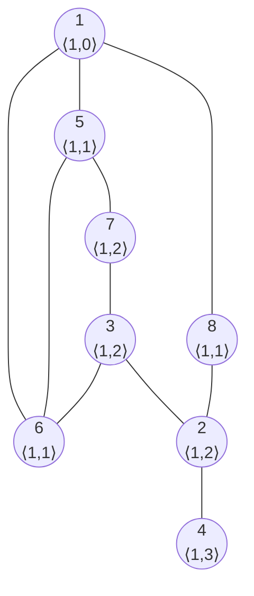

**The timeline:**

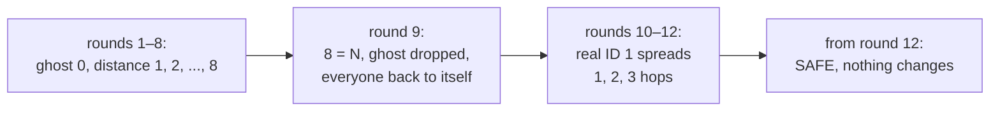

> **Kid example.** For 8 mornings the whole class still believes the ghost captain "0", but every morning the rumour is one whisper older. On morning 9 the rumour is 8 whispers old, which is too many for a class of 8, so everyone throws it away and says "then I am the captain myself". In the next three mornings, the real smallest number, 1, spreads out like ripples, and from then on everybody agrees.

**Remember:**

- *N* = 8, all registers ⟨0, 0⟩. Rounds 1–8: ⟨0, 1⟩ … ⟨0, 8⟩ (ghost distance +1 per round).
- Round 9: distance 8 = *N* ⇒ ghost ignored ⇒ everyone ⟨own ID, 0⟩ ⇒ *A*₁.
- Rounds 10–12: ID 1 spreads; final distances = hop distances from 1 (5, 6, 8 at 1; 2, 3, 7 at 2; 4 at 3).

## 4. Summary

**What this chapter is about:** the whole lecture on one page.

### 4.1 Recap

**In one sentence:** with distances and the bound *N*, ghost leaders fade away and the smallest real ID wins, proved with two convergence stairs.

- **Convergence stairs:** prove the system reaches and stays in *A*₁, then in the stronger *A*₂, …, up to *Aₖ* = safe.
- **Leader election in ID-based general graphs:** unique identifiers in 1 to *N*; every processor must learn the identifier of one leader (the minimum).
- **Floating identifiers** (ghost identifiers from the arbitrary start) break the naive algorithm. The fix: publish ⟨candidate, distance⟩, add one to the distance when copying, and **ignore any pair with distance ≥ *N***.
- **Proof:** stair *A*₁ (Lemma 2.5): the minimum distance of a floating identifier grows every O(Δ) rounds until it reaches *N*, so floating identifiers vanish. Stair *A*₂ (Theorem 2.3): the minimum real identifier then spreads like a BFS tree, giving a safe configuration.


> **Kid example.** The whole story: the class wants the smallest-number child as captain. After a mess, a ghost number might be going round. Because every rumour gets one whisper older each time it is passed on, and only the real captain can say "0 whispers", the ghost becomes too old and is thrown away, and then the real captain's number spreads to everybody.

## Revision notes and references

This guide found no errors in the lecture material that needed a technical clarification. Where the slides and the course book differ in presentation, this guide follows the lecture and notes the book's version.

- S. Dolev, *Self-Stabilization*, MIT Press, 2000: §2.9 (convergence stairs and leader election in ID-based systems).
