# IP Variations: IPv6, Multicast and Anycast

**Course:** EDA387/DIT663 Computer Networks, lecture "IP variations: IPv6, multicast, anycast" (Review 03). Part A reviews addressing, autoconfiguration, the header and anycast (material from introductory courses, mainly from Cisco CCNAv7); Part B, "Beyond EDA344", covers IPv6 in practice: adoption data, deployment models, 464XLAT, extension headers, SRv6 and how IPv6 deployment fails. Many slides are borrowed from Philip Levis and David Mazières, and some from Ali Salehson and Rhouma Rhouma.

**Generated:** 2026-10-21

**† Supplementary material:** content that comes only from hidden PowerPoint slides. It may not be part of this year's examinable material. This lecture has no hidden material, so no section is marked †.

**How to read the boxes.** Text that starts with **Beyond the slides** adds context that is not in the lecture (general knowledge, or topics that the course's pre-lecture quiz asks about). **Note on the source** marks a place where the lecture is inconsistent or imprecise. **Kid example** retells an idea with an everyday picture. Parts marked "self-study" in the lecture are included like everything else.

---

## Glossary

| Term | Full name | Meaning |
|---|---|---|
| 464XLAT | — | Two translators (one on the phone, one at the carrier's edge) that let IPv4 apps run over an IPv6-only network. |
| 6LoWPAN | IPv6 over Low-Power Wireless Personal Area Networks | An adaptation layer that squeezes IPv6 headers into tiny radio frames (127 bytes). |
| 6to4 | — | An old, now deprecated automatic tunnelling scheme; its addresses start with `2002::/16` followed by an IPv4 address. |
| Anycast | — | One unicast address assigned to several devices; routing delivers each packet to the nearest one. |
| APNIC, ARIN, AFRINIC, LACNIC, RIPE NCC | — | The five Regional Internet Registries (Asia-Pacific, North America, Africa, Latin America and Caribbean, Europe/Middle East/Central Asia). |
| CIDR | Classless Inter-Domain Routing | Writing networks as address/prefix length; in IPv4 it slowed address exhaustion. |
| DAD | Duplicate Address Detection | Before using an address, a device asks "does anyone already have this?" with a Neighbor Solicitation. |
| DHCPv6 | Dynamic Host Configuration Protocol for IPv6 | A server that hands out IPv6 settings, either only extra settings (stateless) or also the address (stateful). |
| DNS64 | — | A DNS resolver that makes up an IPv6 answer (inside `64:ff9b::/96`) for a name that only has an IPv4 address. |
| Dual stack | — | A device or network runs IPv4 and IPv6 at the same time. |
| EUI-64 | Extended Unique Identifier, 64 bits | Builds a 64-bit interface ID from a 48-bit MAC address: insert `fffe` in the middle and flip the 7th bit. |
| Extension header | — | An optional IPv6 header placed between the base header and the payload (for routing, fragmentation, …). |
| Flow label | — | 20-bit IPv6 header field that marks packets belonging to the same flow. |
| GUA | Global Unicast Address | A globally unique, routable IPv6 address; today they start with `2` or `3` (`2000::/3`). |
| Happy Eyeballs | — | A client tries IPv6 and IPv4 at almost the same time and uses whichever connects first (RFC 8305). |
| Hextet | — | Informal name for one 16-bit group of an IPv6 address (four hex digits). |
| Hop limit | — | IPv6's version of IPv4's TTL: decreased by each router; the packet is dropped at 0. |
| IANA | Internet Assigned Numbers Authority | Gives large address blocks to the five RIRs. |
| ICMPv6 | Internet Control Message Protocol for IPv6 | Errors and diagnostics, plus Neighbor Discovery and multicast membership (MLD). |
| IGMP | Internet Group Management Protocol | How IPv4 hosts tell their router which multicast groups they want. |
| Interface ID | — | The last (usually 64) bits of an IPv6 address; identifies the interface on its link. |
| LLA | Link-Local Address | An address in `fe80::/10` that works only on one link; every IPv6 interface has one. |
| MLD | Multicast Listener Discovery | IPv6's version of IGMP; part of ICMPv6. |
| Multicast | — | One packet delivered to every member of a group; routers copy it only where paths split. |
| NA / NS | Neighbor Advertisement / Neighbor Solicitation | ICMPv6 messages for finding a neighbour's MAC address and for DAD. They replace ARP. |
| NAT64 | — | A translator that lets IPv6-only clients reach IPv4-only servers. |
| NDP (ND) | Neighbor Discovery Protocol | The four ICMPv6 messages RS, RA, NS, NA. |
| Next header | — | 8-bit IPv6 field that says what comes after this header (another extension header, or TCP/UDP). |
| RA / RS | Router Advertisement / Router Solicitation | ICMPv6 messages: routers announce the prefix and settings (RA); hosts ask for an RA right away (RS). |
| RIR | Regional Internet Registry | One of the five organisations that hand out addresses in a world region. |
| SLAAC | Stateless Address Autoconfiguration | A host builds its own address from the RA's prefix plus its own interface ID; no server involved. |
| Solicited-node multicast address | — | A multicast group made from the last 24 bits of an address; used by NS so that (normally) only the target is disturbed. |
| SRv6 | Segment Routing over IPv6 | The packet carries its path as a list of IPv6 addresses in a routing extension header. |
| Subnet ID | — | The bits between the global routing prefix and the interface ID, used by a site to number its subnets. |
| Tunnelling | — | Putting a whole packet inside another packet (for example IPv6 inside IPv4) to cross a network. |
| ULA | Unique Local Address | Private-use IPv6 addresses in `fc00::/7` (in practice `fd00::/8`), not routed on the Internet. |
| Zone index | — | The `%` and interface name/number after a link-local address (for example `fe80::1%eth0`), saying which interface is meant. |

---

## Table of contents

- [1. The problem: IPv4 ran out](#1-the-problem-ipv4-ran-out)
- [2. IPv6: history and motivation](#2-ipv6-history-and-motivation)
- [3. IPv4 and IPv6 coexistence](#3-ipv4-and-ipv6-coexistence)
- [4. Writing IPv6 addresses](#4-writing-ipv6-addresses)
- [5. Address types and prefix length](#5-address-types-and-prefix-length)
- [6. Unicast addresses: GUA, LLA, ULA and embedded IPv4](#6-unicast-addresses-gua-lla-ula-and-embedded-ipv4)
- [7. Static configuration](#7-static-configuration)
- [8. Dynamic addressing: RS, RA and the three methods](#8-dynamic-addressing-rs-ra-and-the-three-methods)
- [9. Interface IDs: EUI-64 or random](#9-interface-ids-eui-64-or-random)
- [10. Dynamic link-local addresses](#10-dynamic-link-local-addresses)
- [11. Multicast](#11-multicast)
- [12. Anycast](#12-anycast)
- [13. Subnetting an IPv6 network](#13-subnetting-an-ipv6-network)
- [14. The IPv6 header](#14-the-ipv6-header)
- [15. Tunnelling and 6to4](#15-tunnelling-and-6to4)
- [16. ICMPv6 and Neighbor Discovery](#16-icmpv6-and-neighbor-discovery)
- [17. Part B: IPv6 is now the majority](#17-part-b-ipv6-is-now-the-majority)
- [18. Testing the economic argument](#18-testing-the-economic-argument)
- [19. Deployment models and 464XLAT](#19-deployment-models-and-464xlat)
- [20. Extension headers in the wild, and SRv6](#20-extension-headers-in-the-wild-and-srv6)
- [21. How IPv6 deployment fails](#21-how-ipv6-deployment-fails)
- [22. Summary](#22-summary)
- [23. Related quiz topics not in the lecture](#23-related-quiz-topics-not-in-the-lecture)

---

## 1. The problem: IPv4 ran out

### "I think we have a problem"

The lecture shows a 2007 projection ("A Pragmatic Report on IPv4 Address Space Consumption", Cisco) of how many of the 256 IPv4 **/8 blocks** would be used up over time, under four models: polynomial and exponential growth over 5 years, exponential and linear growth over 10 years. All the curves reach the end of the address space; they only disagree about **when**.

The point: in 2007 IPv4 exhaustion was not a matter of opinion. The trend was clear and public, and the answer (IPv6) had been published nine years earlier. So the interesting question is not why anyone was surprised, but **why a problem that was visible, quantified and solved in advance still took another two decades to fix**. Part B answers it.

> **Kid example.** Imagine a town where every house number has only three digits. When the town grows past 999 houses, new families cannot get a number at all. Everybody could see the town growing year by year, and a plan with much longer numbers (IPv6) was ready long before the numbers ran out. IPv4 has about 4.3 billion numbers, far fewer than the devices on the Internet today.

> **Note on the source.** The lecture's figure credits "Tony Main"; the lecture's own explanation corrects this: the author is **Tony Hain**. Also, the explanation describes the graph as "how many /8 blocks remained… every curve heads to zero", but the figure plots blocks **used** (the y-axis rises from 128 to 256), so every curve heads **up to 256**, which means the same thing: nothing left.

### How the problem was recognised

| Date | Event |
|---|---|
| Sep 1981 | RFC 791 standardises IPv4, with 32-bit addresses. |
| 1989 | The World becomes the first commercial ISP; the growth curve begins. |
| Nov 1991 | The IETF creates the ROAD (Routing and Addressing) group to study the problem. |
| Jun 1992 | RFC 1338: first description of address exhaustion. |
| Sep 1993 | RFC 1519: CIDR. |
| May 1994 | RFC 1631: NAT. |
| Dec 1995 / 1996 | RFC 1883: IPv6 proposed (see the note below). |
| Jan 2011 | IANA allocates its last free /8 blocks. |

**The central irony:** CIDR and NAT were both responses to exhaustion, and both **worked**: they bought about two decades. They were so effective that they **removed the urgency** to deploy the actual solution.

> **Note on the source.** The timeline figure and the lecture's explanation dates RFC 1883 to December 1996. RFC 1883 is dated **December 1995**. (Its successor RFC 2460 is from December 1998, as the lecture says elsewhere.)

### Who hands out addresses

IANA gives large blocks to five **Regional Internet Registries (RIRs)**, which allocate to ISPs and organisations in their region:

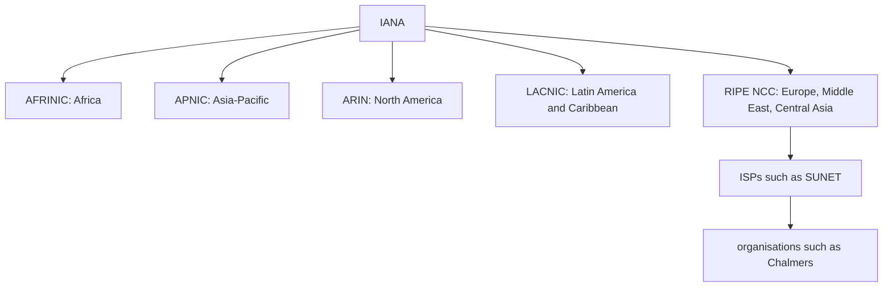

This structure matters twice: it explains why exhaustion happened at **different times in different regions**, and it is the **same hierarchy that RPKI uses** to certify who holds which addresses (the routing lecture's route origin validation is anchored at the five RIRs).

### Exhaustion, region by region

| Date (from the lecture) | Event |
|---|---|
| Jan 2011 | IANA allocates the last free /8 blocks. |
| Apr 2011 | APNIC starts using its last free /8 (fastest-growing region). |
| Sep 2012 | RIPE NCC starts using its last free /8. |
| Jun 2014 | LACNIC starts using its last free /8. |
| Sep 2014 | ARIN starts using its last free /8. |
| Mar 2017 | AFRINIC starts using its last free /8. |
| Nov 2019 | RIPE NCC allocates the last free /22: European address space genuinely runs out. |

Two lessons: exhaustion **tracked growth, not policy** (the fastest-growing regions ran out first); and **look at the units**: the first allocations were /8 blocks of about 16 million addresses, the last were /22 blocks of 1,024. The rationing is visible in the numbers.

> **Note on the source.** Other sources (ARIN's own announcements) put ARIN's move to its last /8 in **April 2014** and its free pool running out completely in **September 2015**. Treat the lecture's ARIN date with some care.

The next figure ("RIR IPv4 Address Run-Down Model") shows each registry's remaining pool from 2013. The curves **flatten** as they approach zero because of **policy, not demand**: registries restrict allocations to small blocks for newcomers, so what is left lasts longer while becoming less useful. Today IPv4 has not disappeared; it has become a **rationed, traded commodity**, bought and sold on a transfer market.

---

## 2. IPv6: history and motivation

- Work started in **1994**.
- Basic protocol published in **1998 (RFC 2460)**.
- A brief lull, then progress in **2003–6**.
- A hard push within the IETF for adoption since then.

Also: RFC 2460 is **no longer current**; it was replaced by **RFC 8200 in 2017**, so cite that one.

**What happened to IPv5?** Version number 5 had already been given to an experimental protocol, the **Internet Stream Protocol** (ST), meant for real-time streaming. It was never a general replacement for IPv4, but the number was taken, so the next protocol became version 6.

### Why IPv6?

- **IPv4 is running out of addresses.** IPv4 has 32 bits (about 4.3 billion addresses); IPv6 has **128 bits**.
- IPv6 also **fixes IPv4 limitations** and adds enhancements.
- With a growing Internet population, limited IPv4 space, **problems with NAT**, and the **Internet of Things**, it is time to move to IPv6.

**Exam care with 2¹²⁸.** It is an enormous number, but it is **not** the number of usable hosts. Allocation policy gives each subnet a 64-bit prefix, so the practical quantity is about **2⁶⁴ subnets**, each with practically unlimited room for interfaces. The space was made huge **on purpose**, so that it could be allocated generously in clean hierarchical blocks instead of being squeezed.

The redesign also removed known IPv4 weaknesses: a **simpler fixed header**, **no fragmentation by routers**, and **no header checksum** (see [section 14](#14-the-ipv6-header)).

---

## 3. IPv4 and IPv6 coexistence

*(Marked self-study in the lecture.)*

There was never going to be a **flag day** (a day when everyone switches at once). IPv4 and IPv6 will coexist for years, and the IETF made three kinds of migration technique:

| Technique | What it means |
|---|---|
| **Dual stack** | Devices run IPv4 and IPv6 at the same time: two addresses, two routing tables, two sets of firewall rules. |
| **Tunnelling** | Carry an IPv6 packet **inside** an IPv4 packet (or the reverse) to cross a network that only speaks the other protocol. |
| **Translation** | Rewrite between the two address families. **NAT64** lets IPv6-only devices talk to IPv4-only devices, using a technique similar to NAT for IPv4. |

> **Kid example.** Dual stack is like a child who speaks two languages and uses whichever one the other person speaks. Tunnelling is like putting a letter written in one language inside an envelope addressed in the other language, so that the postmen in between can deliver it. Translation is like an interpreter who rewrites every sentence from one language into the other.

Tunnelling and translation are meant for the transition and should be used only where needed; the goal is **native IPv6 end to end**.

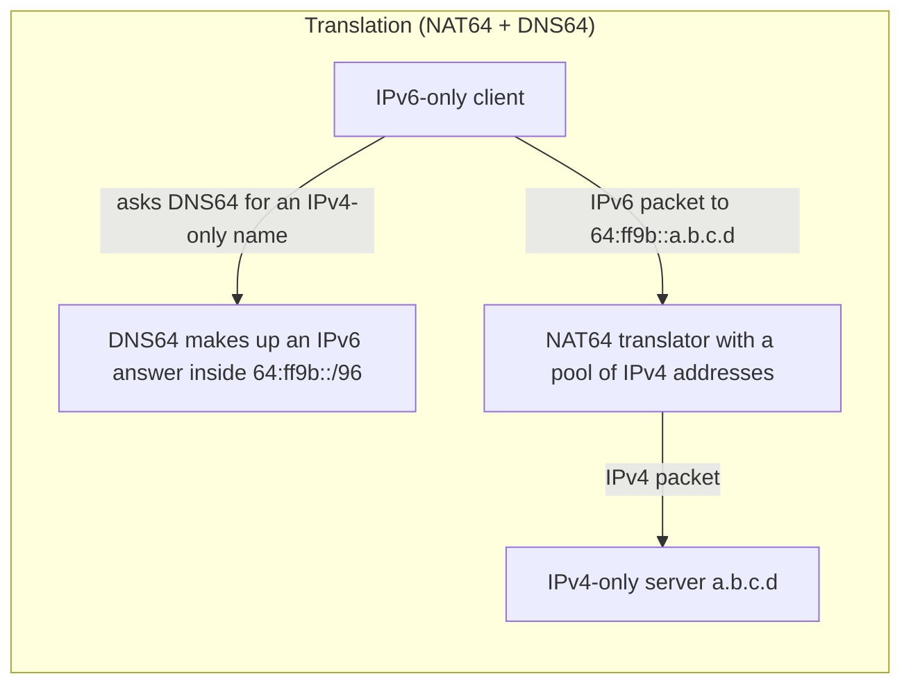

**NAT64 + DNS64** is how translation is actually deployed: the translator holds a pool of IPv4 addresses and rewrites between the families, while DNS64 synthesises an IPv6 answer for a name that only has an IPv4 record.

A warning: in Part B you will see that **dual stack, the option that sounds safest, turned out to be the expensive one, because it doubles everything that can fail**.

---

## 4. Writing IPv6 addresses

- IPv6 addresses are **128 bits**, written in **hexadecimal**.
- They are **not case-sensitive** (convention, and RFC 5952, prefer lower case).
- The preferred format is `x:x:x:x:x:x:x:x`: eight groups of **four hex digits**.
- One group (16 bits) is informally called a **hextet**. 8 hextets × 16 bits = 128 bits.

Examples in the preferred format:

```
2001:0db8:0000:1111:0000:0000:0000:0200
2001:0db8:0000:00a3:abcd:0000:0000:1234
```

> **Kid example.** One hex digit is 4 bits (a number 0–15, written 0–9 and a–f). Four of them make a hextet of 16 bits. Eight hextets make the 128-bit address, like eight 4-digit blocks on a very long licence plate.

### Rule 1: omit leading zeros

Inside any hextet you may drop **leading** zeros: `01ab → 1ab`, `09f0 → 9f0`, `0a00 → a00`, `00ab → ab`.

The rule applies **only to leading zeros, never to trailing zeros**. The reason is **reversibility**: every hextet is exactly four digits, so to rebuild a short group you pad zeros **on the left**. If trailing zeros could also be dropped, `ab` could mean `00ab` or `ab00`, and the address would be ambiguous.

| Type | Format |
|---|---|
| Preferred | `2001:0db8:0000:1111:0000:0000:0000:0200` |
| No leading zeros | `2001:db8:0:1111:0:0:0:200` |

### Rule 2: double colon

A double colon `::` can replace **one** contiguous run of **one or more hextets that are all zeros**.

- `2001:db8:cafe:1:0:0:0:1` becomes `2001:db8:cafe:1::1`.
- `::` may be used **only once** in an address.

Again the reason is reversibility. To expand `::`, count the hextets that are present, subtract from 8, and insert that many zero groups at the `::`. With two `::` you would know the total number of missing groups but not how to split them between the two gaps.

> **Kid example.** The rule "`::` only once" is like a sentence with one gap: "I have 8 crayons, the missing ones are here: red, ___, blue". You know exactly how many are missing and where. With two gaps, "red, ___, green, ___, blue", you know how many are missing in total, but not how many belong in each gap.

| Type | Format |
|---|---|
| Preferred | `2001:0db8:0000:1111:0000:0000:0000:0200` |
| Compressed | `2001:db8:0:1111::200` |

**Worked example of the ambiguity.** `2001:db8::1::5` has 4 written hextets, so 4 zero hextets are missing, but they could be split 1+3, 2+2 or 3+1:

- `2001:db8:0:1:0:0:0:5`
- `2001:db8:0:0:1:0:0:5`
- `2001:db8:0:0:0:1:0:5`

So it is invalid. In practice: apply rule 1 first, then rule 2. RFC 5952 also asks you to compress the **longest** run of zeros, and if two runs are equally long, the **leftmost** one.

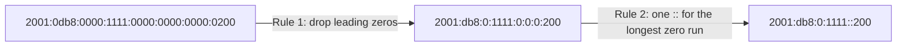

---

## 5. Address types and prefix length

### Unicast, multicast, anycast

| Type | Meaning |
|---|---|
| **Unicast** | Uniquely identifies one interface; a packet is delivered to that one interface. |
| **Multicast** | Identifies a group; one packet is delivered to every member. |
| **Anycast** | A unicast address deliberately assigned to several devices; a packet goes to the **nearest** one. |

**IPv6 has no broadcast address.** IPv4's broadcast, which every host on a segment had to process whether it cared or not, is gone. Its jobs are done by multicast to well-defined groups: the **all-nodes** group `ff02::1` (which gives essentially the same result as a broadcast) and the **all-routers** group `ff02::2`. This is an improvement: broadcast forces every host to stop and inspect; multicast lets uninterested hosts ignore the traffic **in hardware**.

> **Kid example.** Unicast is a letter to one person. Multicast is a newsletter sent only to the members of a club. Anycast is calling "any pizza shop of this chain": the call goes to the nearest shop. The old broadcast was shouting through the school loudspeaker, so everybody had to stop and listen even if the message was not for them; IPv6 dropped it.

### Prefix length

- Prefix length uses **slash notation**, as in CIDR, and gives the network part of the address.
- It ranges from **0 to 128**. The recommended length for LANs and most networks is **/64**.
- A **64-bit interface ID** is strongly recommended because **SLAAC uses 64 bits for the interface ID**; it also makes subnetting simpler.

So the near-universal /64 is not an accident: if you use a longer prefix, fewer than 64 bits remain for the interface ID and **SLAAC stops working**. An organisation that gets a /48 from its provider therefore has **16 bits of subnet ID = 65,536 subnets**. Point-to-point links are the common exception, often using /127.

---

## 6. Unicast addresses: GUA, LLA, ULA and embedded IPv4

**An IPv4 interface normally has one address; an IPv6 interface normally has at least two:**

- **Global Unicast Address (GUA):** like a public IPv4 address; globally unique and routable on the Internet.
- **Link-Local Address (LLA):** required on every IPv6-enabled interface; used to talk to devices on the **same link** only; never routed.

> **Kid example.** A GUA is like your full home address that works from anywhere in the world. An LLA is like your name inside your own classroom: everybody in the room can call you by it, but it means nothing outside the room. You get your classroom name the moment you walk in, before you know your full address.

The LLA is **not optional and not a fallback**. It is the address the interface uses before it has any other, and it is the address that Neighbor Discovery, router advertisements and many routing protocols use for their own messages. Several IPv6 addresses on one interface is the **normal** state.

### GUA

- Only GUAs whose **first three bits are `001`**, i.e. **`2000::/3`**, are being assigned today.
- So current GUAs **begin with a hex 2 or 3**. That is only **1/8** of the IPv6 space.

Seven-eighths are held in reserve: a lesson in protocol design. "Reserving capacity is cheaper than reclaiming it."

**Structure of a GUA:**


The widths are not to scale: in a typical /48 site the three parts are 48, 16 and 64 bits.

| Part | Who sets it | Notes |
|---|---|---|
| **Global routing prefix** | The provider (ISP) | Length depends on ISP policy; a /48 to a site and a /56 to a home are common. |
| **Subnet ID** | The organisation | Numbers the subnets inside the site. |
| **Interface ID** | The host or administrator | Like the host part of an IPv4 address; normally 64 bits. From the MAC (EUI-64), random, or manual. |

In IPv6 the **all-0s and all-1s** interface IDs may be given to devices (there is no broadcast to reserve all-1s for). The **all-0s** ID is reserved as the **Subnet-Router anycast address** and should only be assigned to routers.

Compare with IPv4, where the network/host boundary moves and must be computed. Here it is fixed by convention, which is why IPv6 subnetting is simpler.

### LLA

- Lets a device talk to other IPv6 devices **on the same link only**.
- Packets with a link-local source or destination **cannot be routed**.
- **Every** IPv6 interface must have one; if it is not configured manually, the device **creates one automatically**.
- LLAs are in **`fe80::/10`** (in practice the next bits are zero, so you see `fe80::/64`).

That restriction is what makes LLAs useful: an address that cannot leave the link is safe to use before the device knows anything about the wider network.

**The zone index.** A host with several interfaces may have the **same** link-local address on more than one of them, so the address alone does not say where to send. That is why tools need a **zone index**: the address, a `%`, and the interface name or number, for example `fe80::1%eth0`.

### Unique Local Addresses (ULA)

ULAs (range `fc00::/7`) are somewhat like the IPv4 private addresses of RFC 1918, but with important differences:

- They are used for local addressing **inside a site** or between a limited number of sites.
- They can be used for devices that will **never need to reach another network**.
- They are **not globally routed** and **not translated** to a global IPv6 address.
- Many sites use RFC 1918 + NAT to try to hide or secure their network. **That was never the intended use of ULAs.**

In practice only the upper half is used: addresses beginning **`fd`** are locally assigned, with **40 random bits** to make clashes between organisations very unlikely. The `fc` half was reserved for a central scheme that was never defined. The key lesson: in IPv4, private addressing and NAT arrived together and are often treated as one idea. **In IPv6 they are separate**: you can have local-only addressing without any address translation.

> **Note on the source.** The lecture writes the range as "fc00::/7 to fdff::/7". The range is simply **`fc00::/7`**, which covers every address from `fc00::` to `fdff:ffff:…:ffff`.

### Embedded IPv4 addresses

Some IPv6 addresses carry an IPv4 address inside them, mostly for transition mechanisms. In each example below the IPv4 address `192.0.2.128` is written in hex as `c000:0280` (192 = c0, 0 = 00, 2 = 02, 128 = 80).

| Type | Example | Description |
|---|---|---|
| IPv4-mapped IPv6 | `::ffff:192.0.2.128` = `::ffff:c000:0280` | IPv4 address in the last 32 bits. Used **inside dual-stack hosts** so IPv6 sockets can accept IPv4 connections. Not routed on the Internet. |
| IPv4-compatible IPv6 (**deprecated**) | `::192.0.2.128` = `::c000:0280` | IPv4 address in the last 32 bits, the rest zero. Early method, now obsolete. |
| 6to4 (tunnelling) | `2002:c000:0280::/48` | IPv4 address in the 2nd and 3rd hextets of the prefix. Automatic tunnelling of IPv6 over IPv4. |
| NAT64 (well-known prefix) | `64:ff9b::192.0.2.128` = `64:ff9b::c000:0280` | IPv4 address in the last 32 bits. Used by NAT64/DNS64 so IPv6-only clients reach IPv4-only servers. |

> **Note on the source.** The lecture title reads "Eembedded"; the lecture's explanation points out the typo.

The pattern: **one address family encoded inside the other**. It returns in Part B with 464XLAT.

---

## 7. Static configuration

### On a router (Cisco IOS)

Most IPv6 commands look like their IPv4 versions with `ipv6` instead of `ip`:

```
R1(config)# interface gigabitethernet 0/0/0
R1(config-if)# ipv6 address 2001:db8:acad:1::1/64
R1(config-if)# no shutdown
R1(config-if)# exit
```

One command has **no IPv4 counterpart** and matters a lot: **`ipv6 unicast-routing`**. Without it a Cisco router holds IPv6 addresses but **does not forward IPv6 packets** and **does not send router advertisements**, so hosts on its networks never autoconfigure. This is the most common reason a correct-looking IPv6 configuration does nothing. The general lesson: **configuring addresses is not the same as enabling the protocol**.

### On a Windows host

Like IPv4: an address, a prefix length, a default gateway and a DNS server. The **default gateway** can be the router's GUA or its LLA; **best practice is the LLA**. Why point at an address that cannot be routed? **Stability**: the LLA depends only on the router's interface, so it **survives renumbering**. If the site changes provider and every global prefix changes, a gateway set by LLA keeps working. With DHCPv6 or SLAAC, the router's LLA is set as the gateway automatically.

### Configuring an LLA by hand

```
R1(config-if)# ipv6 address fe80::1:1 link-local
```

Automatic LLAs are long and random-looking. A hand-made one like `fe80::1` is short and recognisable, so when it appears as the default gateway on every host, troubleshooting is easier. The same LLA may be used on several interfaces (it only has to be unique **on its link**), though common practice is a different LLA per interface so you can tell them apart.

---

## 8. Dynamic addressing: RS, RA and the three methods

Devices get GUAs dynamically through **ICMPv6** messages:

- **Router Solicitation (RS):** sent by hosts to discover IPv6 routers ("is there a router? tell me now").
- **Router Advertisement (RA):** sent by routers, periodically and in reply to an RS, telling hosts how to get a GUA and giving network information:
  - network **prefix and prefix length**;
  - **default gateway** address (the router's LLA, which is the RA's source address);
  - **DNS addresses and domain name**.

**Where this function lives.** In IPv4 a host learns its address from DHCP, an application-layer protocol over UDP. In IPv6 the equivalent is **built into ICMPv6**, part of the protocol itself.

**The RA chooses** which of three methods hosts use, through flags in the RA (not by the host):

| Method | Address from | Other settings (DNS…) from | RA flags |
|---|---|---|---|
| 1. **SLAAC** | The host builds it (RA prefix + own interface ID) | The RA | M = 0, O = 0 |
| 2. **SLAAC + stateless DHCPv6** | The host builds it | A stateless DHCPv6 server | M = 0, O = 1 |
| 3. **Stateful DHCPv6** | A DHCPv6 server | The DHCPv6 server | M = 1 |

In **all three**, the **default gateway comes from the RA** (the router's LLA), never from DHCPv6.

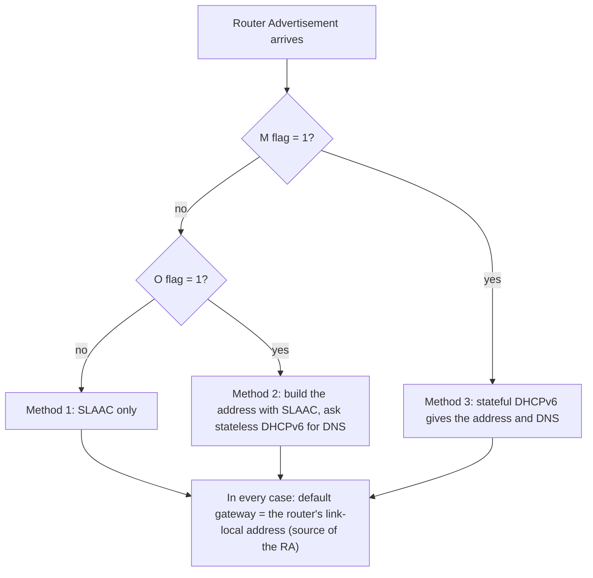

### Method 1: SLAAC

The RA supplies the **prefix** (normally /64); the host supplies the other 64 bits with **EUI-64** or **random generation**, and joins them into a full address. **Stateless** means no server records which address went to which device: nothing to provision, no leases to run out, nothing to fail if a server is down. The cost is the mirror image: **no central list** of who has which address, and plain SLAAC originally had **no way to tell hosts about DNS servers** (which is why methods 2 and 3 exist).

> **Kid example.** SLAAC is like building your own address: the street sign at the corner tells you the street name (the prefix from the router's advertisement), and you add your own house number (the interface ID) yourself. Nobody has to keep a list of who lives where.

### Method 2: SLAAC and stateless DHCPv6

The host still builds its own address and uses the router's LLA as its gateway, but the RA also tells it to ask a **stateless DHCPv6** server for the rest: **DNS server addresses** and possibly a domain name. "Stateless" because the server hands out settings without allocating addresses or tracking who got what. Modern systems can also learn DNS servers **directly from the RA**, so in many networks DHCPv6 is no longer needed.

### Method 3: stateful DHCPv6

The closest thing to IPv4's DHCP: a **stateful DHCPv6** server gives the GUA, prefix length, DNS servers, domain name and other information. "Stateful" because it allocates addresses from a pool and **records who holds which** (bindings, leases, a database). Why choose it? **Control and accountability**: an organisation that must know which device had which address at a given time (auditing, access control, incident response) needs that record. The client's DHCPv6 **Solicit** message goes to the multicast address **`ff02::1:2`** (all DHCPv6 servers and relay agents on the link): even here, discovery is **multicast, not broadcast**.

---

## 9. Interface IDs: EUI-64 or random

With SLAAC (alone or with stateless DHCPv6) the host must make its own 64-bit interface ID, by the **EUI-64 process** or as a **random 64-bit number**. The difference is mainly about **privacy**: an ID derived from the MAC is stable and globally unique, so it stays the same as the device moves between networks (only the prefix changes). That makes the device **trackable everywhere it goes**. Random IDs break that link; modern systems overwhelmingly choose randomness.

### The EUI-64 process

1. Insert the 16-bit value **`fffe`** into the middle of the 48-bit MAC address (between the manufacturer part and the device part).
2. **Flip the 7th bit** (counting from the left, starting at 1) of the first byte.

**Worked example (from the lecture).** MAC `fc:99:47:75:ce:e0`:

| Step | Result |
|---|---|
| Split the MAC in half | `fc:99:47` and `75:ce:e0` |
| Insert `ff:fe` in the middle | `fc:99:47:ff:fe:75:ce:e0` |
| First byte `fc` in binary | `1111 1100` |
| Flip the 7th bit (value 2) | `1111 1110` = `fe` |
| Interface ID | `fe99:47ff:fe75:cee0` |

So with prefix `2001:db8:acad:1::/64` the address becomes `2001:db8:acad:1:fe99:47ff:fe75:cee0`, exactly as the lecture shows.

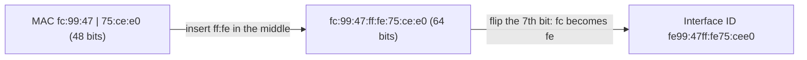

**Why flip that bit?** In a MAC address, that bit says whether the address is **universally** administered (by the manufacturer, bit = 0) or **locally** administered (bit = 1). In the EUI-64 interface ID the meaning is inverted, so **1 means universal**. Flipping converts between the conventions. **Exam tip:** the interface ID is *not* just the MAC with `fffe` inserted; forgetting the flip is where most marks are lost.

### Randomly generated interface IDs

Depending on the operating system, a device may use a random ID instead. **Windows has done this since Vista:**

```
C:\> ipconfig
Ethernet adapter Local Area Connection:
   IPv6 Address. . . . . : 2001:db8:acad:1:50a5:8a35:a5bb:66e1
   Link-local IPv6 Address: fe80::50a5:8a35:a5bb:66e1
   Default Gateway . . . .: fe80::1
```

To make sure a unicast address is unique, the client may use **Duplicate Address Detection (DAD)**, which is like an ARP request for its own address: if nobody replies, the address is unique (details in [section 16](#16-icmpv6-and-neighbor-discovery)).

Two ideas are often confused and must be kept apart:

- A **stable random** ID is made once per interface per network and does not change while the device stays there: no link to the hardware, but stable locally.
- **Temporary (privacy) addresses** go further: extra addresses that change every few hours and are used for outgoing connections, while a stable address stays for incoming ones.

That is why a real interface often shows several IPv6 addresses at once: a link-local address, a stable global address and one or more temporary global addresses. That is normal.

---

## 10. Dynamic link-local addresses

All IPv6 interfaces must have an LLA, and like GUAs they are usually made automatically: prefix **`fe80::/10`** plus an interface ID from **EUI-64 or random generation**.

The difference from a GUA is **where the prefix comes from**. A GUA needs an RA to supply the prefix, so a host cannot have one until a router has spoken. An LLA needs **nothing**: its prefix is a constant, so an interface can form one **the instant it comes up**. That is exactly why LLAs exist: a Router Solicitation must be sent **from** some address, and the LLA is the one the interface can always have. **It is the bootstrap.**

### On Windows

Operating systems normally use the **same method** for the SLAAC GUA and the LLA:

```
EUI-64 generated interface ID:
   IPv6 Address. . . . . . . : 2001:db8:acad:1:fc99:47ff:fe75:cee0
   Link-local IPv6 Address . : fe80::fc99:47ff:fe75:cee0
   Default Gateway . . . . . : fe80::1

Random 64-bit generated interface ID:
   IPv6 Address. . . . . . . : 2001:db8:acad:1:50a5:8a35:a5bb:66e1
   Link-local IPv6 Address . : fe80::50a5:8a35:a5bb:66e1
   Default Gateway . . . . . : fe80::1
```

A handy diagnostic: if the **last 64 bits of the LLA and the GUA match**, the GUA was built by SLAAC. If they differ, something else assigned it (DHCPv6, manual configuration, or a temporary privacy address). Windows shows a `%` and a number after link-local addresses: the **zone index**.

### On Cisco routers

Cisco routers **create an LLA automatically whenever a GUA is assigned** to the interface, using **EUI-64** by default:

```
R1# show interface gigabitEthernet 0/0/0
  Hardware is ISR4221-2x1GE, address is 7079.b392.3640 (bia 7079.b392.3640)
R1# show ipv6 interface brief
GigabitEthernet0/0/0  [up/up]
    FE80::7279:B3FF:FE92:3640
    2001:DB8:ACAD:1::1
```

Check the EUI-64 step: MAC `70:79:b3:92:36:40` → insert `ff:fe` → `70:79:b3:ff:fe:92:36:40`; first byte `70` = `0111 0000`, flip the 7th bit → `0111 0010` = `72`. Result `7279:b3ff:fe92:3640`. ✓

Note the order: on a Cisco router the LLA appears **as a consequence** of configuring the GUA. This LLA is also the source of the router's RAs, and so the **default gateway of every host** on the link. Because it is long and hard to read, administrators often override it with something like `fe80::1`.

---

## 11. Multicast

**Problem:** send a packet to many nodes, for example **IP-TV** or a large audio stream. Using **n unicast packets** means the same packet crosses a single link many times: near the source, every copy uses the same links, and those links fill up first.

**Multicast idea:** **the network duplicates the packet, not the sender.** The source sends one copy, and routers copy it only where the paths to different receivers split. Each link carries each packet **once**, however many receivers are behind it.

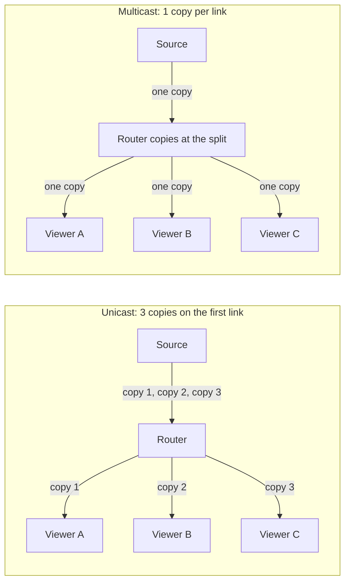

**Cost model:** unicast puts the work on the sender and nearby links; multicast puts it **into the routers**. That makes multicast powerful, and also limits its use across the public Internet, because routers under many different owners must cooperate (and keep state for every group).

### How groups work

- Nodes can **join a multicast group**, named by a **multicast IP address**.
- Routers build a routing topology (a distribution tree) using membership information from:
  - **IGMP** (Internet Group Management Protocol) for IPv4, or
  - **MLD** (Multicast Listener Discovery) for IPv6.
- These are protocols for **hosts to manage their membership**: a host sends a **report** (IGMP or MLD) to its local router.
- **MLD is part of ICMPv6**, with the same format for reports and queries.

**Example.** A host tells its router: "I want to receive `239.1.1.1` traffic." The router records the membership. Multicast routers keep a **multicast forwarding table**:

`(Source IP, Group Address) → Outgoing Interface List`

Example: `(*, 239.1.1.1) → [eth0, eth2]` means "traffic for group 239.1.1.1 from any source (`*`) goes out of eth0 and eth2".

**A pattern to notice:** functions that were separate protocols in IPv4 (address resolution = ARP, autoconfiguration = DHCP, group membership = IGMP) are all **absorbed into ICMPv6** in IPv6. One protocol to secure, filter and understand; but it also means that **blocking ICMPv6 at a firewall breaks IPv6** completely.

### IPv6 multicast addresses

- All IPv6 multicast addresses start with **`ff`**: the prefix **`ff00::/8`**.
- Two types: **well-known** multicast addresses and **solicited-node** multicast addresses.
- **Multicast addresses can only be destinations, never sources.** A group cannot send a packet; a multicast source address means the packet is malformed. (Anycast is different: it can be either, because it really is a unicast address.)

**Well-known groups:**

| Address | Group | Who joins |
|---|---|---|
| `ff02::1` | All-nodes | Every IPv6 device on the link. A packet here reaches everyone: the closest thing to broadcast. |
| `ff02::2` | All-routers | Every IPv6 router; a Cisco router joins when `ipv6 unicast-routing` is enabled. An RS sent here reaches every router and disturbs no host. |

The `02` in `ff02` is the **scope**: link-local, so routers do not forward these packets beyond the link.

**Solicited-node multicast** is the mechanism that **replaces ARP**:

- It is like the all-nodes address, but the group is formed from the **last 24 bits** of the address being looked for, so normally **only the target** is in it.
- It is **mapped to a special Ethernet multicast address**, so the **network card can filter the frame by its destination MAC** without passing it to the IPv6 software.

Result: IPv4 address resolution interrupts **every** host on the segment; IPv6 address resolution normally interrupts **exactly one**.

> **Beyond the slides.** The exact formats: solicited-node address = `ff02::1:ff` followed by the last 24 bits of the unicast address (prefix `ff02::1:ff00:0/104`); its Ethernet address = `33:33` followed by the last 32 bits of the IPv6 multicast address. Example: for `2001:db8:acad:1::10`, the last 24 bits are `00:00:10`, so the group is `ff02::1:ff00:10`, and the Ethernet destination is `33:33:ff:00:00:10`.

---

## 12. Anycast

**Anycast = communicate with "any" one of a set of nodes.** "We've seen this with DNS":

```
$ dig www.google.com
www.google.com.    604799 IN CNAME www.l.google.com.
www.l.google.com.  300    IN A     74.125.19.103
www.l.google.com.  300    IN A     74.125.19.104
www.l.google.com.  300    IN A     74.125.19.147
www.l.google.com.  300    IN A     74.125.19.99
```

The name maps to a **set** of addresses, and the client picks one. That is anycast-like behaviour **at the application layer**.

> **Note on the source.** The lecture body says that "the anycast routing mechanism directs the query to the nearest node" for these A records. The lecture's own explanation describes it more precisely, and that is the version to learn: in this DNS example there are **several distinct addresses** and the **client chooses** between them. In **IP-layer** anycast there is **one address** that exists in several places, and the **routing system chooses**; the client never knows there was a choice.

### Anycast at the IP layer

- DNS gives anycast through name → address mappings.
- At layer 3: **a single IP address refers to multiple hosts**, and you need to talk to **any one of them**.

**Example: the DNS root servers.** They are distributed worldwide and answer queries for the root zone. Instead of a fixed list of addresses that would need updating globally, **one IP address is shared by many root server instances**. A query to that address is routed to the **nearest operational instance**, based on network topology, routing metrics and latency. There are 13 root server identities but over a thousand instances. When an instance fails, it stops announcing its route; traffic moves to the next nearest without any client noticing or any DNS record changing. **Failure handling is pushed down into the routing layer.** (See the DNS guide, section 25.)

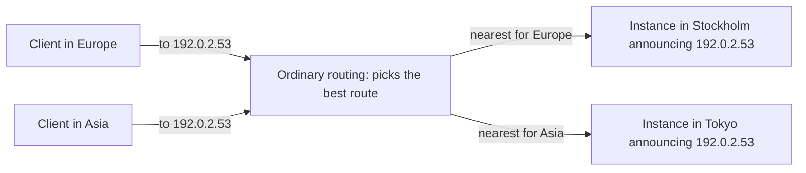

The address `192.0.2.53` is a made-up example.

### Anycast in forwarding tables

*(Marked self-study in the lecture.)*

- An anycast address **looks like a unicast address**: no special format (unlike multicast).
- The **same address could be unicast in one network and anycast in another**; it depends on how it is assigned and advertised.
- Routers decide "nearest" **by their normal routing-table rules** (longest prefix match, then metric), not by inspecting the address.
- Anycast is best for services where separate packets **may go to different destinations** without harm (for example CDNs).
- Examples: the **Subnet-Router anycast** address (all-0s interface ID); Cloudflare DNS `2606:4700:4700::1111` (1.1.1.1 in IPv6); Google DNS `8.8.8.8`. Try `traceroute 8.8.8.8` from different places (the lecture links the online tool at panel.perfops.net) and you will reach different machines.

So anycast is not really a feature added to IP. It is a **consequence** of the fact that routing already picks the best of several paths; someone noticed this was useful and gave it a name.

---

## 13. Subnetting an IPv6 network

*(Marked self-study.)*

- IPv6 was **designed with subnetting in mind**.
- A separate **subnet ID** field, between the global routing prefix and the interface ID, is used to create subnets.

**Example.** Given the global routing prefix **`2001:db8:acad::/48`** with a **16-bit subnet ID**:

- This allows **65,536 /64 subnets** (2¹⁶).
- The global routing prefix is the **same** for all subnets.
- Only the **subnet ID hextet is incremented** (in hexadecimal) for each subnet: `2001:db8:acad:0001::/64`, `2001:db8:acad:0002::/64`, `2001:db8:acad:0003::/64`, …

The lecture's topology needs **five subnets**: one for each LAN plus one for the serial link between R1 and R2. They get subnet IDs **0001 to 0005**. Each /64 gives more addresses than will ever be needed. R1's interfaces are configured on different subnets:

```
R1(config)# interface gigabitethernet 0/0/0
R1(config-if)# ipv6 address 2001:db8:acad:1::1/64
R1(config-if)# no shutdown
R1(config-if)# exit
R1(config)# interface gigabitethernet 0/0/1
R1(config-if)# ipv6 address 2001:db8:acad:2::1/64
R1(config)# interface serial 0/1/0
R1(config-if)# ipv6 address 2001:db8:acad:3::1/64
```

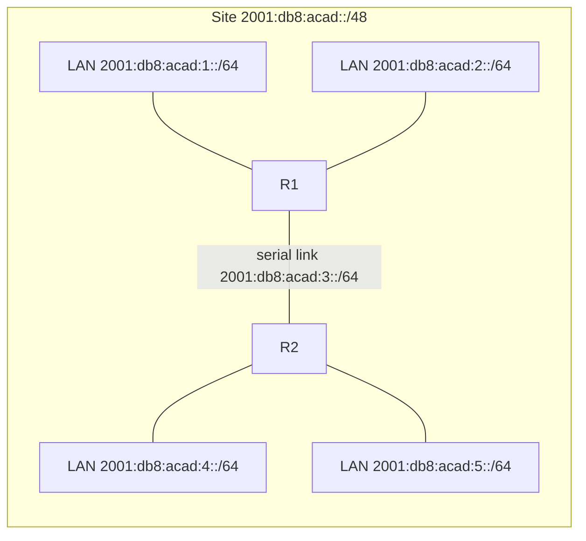

This matches the lecture's figure: R1 serves subnets 1 and 2 (PC1, PC2), the serial link between R1 and R2 is subnet 3, and R2 serves subnets 4 and 5 (PC3, PC4). Each router interface gets host part `::1` and each PC `::10`, for example PC1 = `2001:db8:acad:1::10`. Subnets 0000 and 0006 to ffff are left unused.

**Contrast with IPv4**, where you must borrow bits from the host part, compute how many hosts are left, and accept that each subnet reduces the others: rationing. In IPv6 there is nothing to ration: **subnetting is counting, not arithmetic**.

---

## 14. The IPv6 header

### Key features of IPv6

- **128-bit addresses.**
- **Autoconfiguration.**
- **Simplified basic packet format through extension headers**: a **40-byte base header**, with uncommonly used fields made **optional**.
- **Security and authentication.**

A warning on the last point: **IPsec** was originally **mandatory to implement** in IPv6, which led to the claim that "IPv6 is inherently secure". That requirement was later **relaxed to a recommendation**, and IPsec works just as well with IPv4. **IPv6 is not more secure just by being IPv6**; saying otherwise in an exam will cost you.

### The header

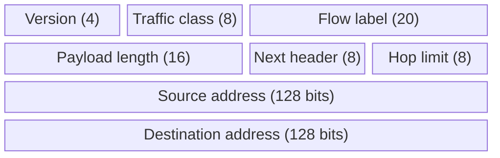

Each of the first two rows is 32 bits; each address row stands for four such rows (128 bits). The widths are not to scale; the bit counts are in brackets.

| Field | Bits | Meaning |
|---|---|---|
| Version | 4 | Always 6. |
| Traffic class | 8 | Like Type of Service (DSCP + ECN) in IPv4. |
| Flow label | 20 | Identifies packets belonging to one flow. No IPv4 equivalent. |
| Payload length | 16 | Length of everything after the 40-byte base header. |
| Next header | 8 | What follows: an extension header, or TCP (6), UDP (17), ICMPv6 (58). |
| Hop limit | 8 | Like TTL in IPv4. |
| Source / destination address | 128 each | The two addresses. |

Total: 4 + 8 + 20 + 16 + 8 + 8 = 64 bits = 8 bytes, plus 16 + 16 bytes of addresses = **40 bytes**, fixed.

**What is missing (and why):**

- **No header checksum:** the link layer (Ethernet CRC) and the transport layer (TCP/UDP checksums) already check integrity, and recomputing a checksum at every hop (needed in IPv4 because the TTL changes) was wasted work.
- **No fragmentation fields:** IPv6 **routers do not fragment**. Only the source may fragment, using a Fragment extension header.
- **No options inside the header:** they move to extension headers, chained through **Next header**. In IPv4, the header length varies and every router must read a length field first; in IPv6 it is always 40 bytes.

> **Note on the source.** The lecture describes the 16-bit length field as "datagram length". In IPv6 it is the **payload length**: it does **not** include the 40-byte base header (unlike IPv4's Total Length, which does).

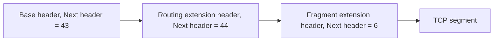

Each header says what comes next, forming a chain (43 = Routing, 44 = Fragment, 6 = TCP). This chain is the "hook" that Part B returns to.

---

## 15. Tunnelling and 6to4

### IP tunnelling (marked "now obsolete")

- **Encapsulate an IP packet inside another IP packet.**
- This makes an **end-to-end path look like a single IP hop** to the inner protocol.

> **Kid example.** Tunnelling is like putting a small parcel inside a bigger box for part of the trip. The carriers in the middle only see the big box and its address. At the end of their part of the trip someone opens the box, and the small parcel continues with its own address.

For the transition, tunnelling let IPv6 traffic cross networks that spoke only IPv4. It was essential when IPv6 "islands" were rare and separated by an IPv4 "ocean".

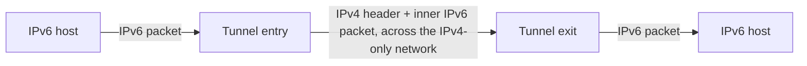

**Why obsolete?** The topology **inverted**. Once native IPv6 became widely available, tunnelling added latency, complexity and failure modes for no benefit. Automatic tunnelling in particular proved unreliable and hard to troubleshoot, and several schemes have been deprecated. Lesson: **a transition mechanism is designed for one point in a transition and outlives its usefulness when the balance shifts.**

### 6to4 ("6-4-6") example

**Every 6to4 address starts with `2002::/16`**, and the next 32 bits are an IPv4 address written in hex. The lecture's two sites:

| IPv4 address | In hex | 6to4 prefix |
|---|---|---|
| 192.0.2.4 | c0.00.02.04 | `2002:c000:0204::/48` |
| 198.51.100.8 | c6.33.64.08 | `2002:c633:6408::/48` |

(198 = c6, 51 = 33, 100 = 64, 8 = 08.)

So any host with a public IPv4 address could **derive a whole /48 of IPv6 space** from it, with no registration. The address **contains its own tunnel endpoint**, which is why 6to4 needed no configuration. It was also its downfall: return traffic depended on **relay routers run by third parties with no obligation to anyone**, and reliability was poor. **6to4 is deprecated.**

---

## 16. ICMPv6 and Neighbor Discovery

ICMPv6 has new features not found in ICMPv4, including the four messages of the **Neighbor Discovery Protocol (ND or NDP)**:

| Between | Message | Purpose |
|---|---|---|
| Router ↔ host | **Router Solicitation (RS)** | Host: "is there a router? tell me how to configure myself." |
| Router ↔ host | **Router Advertisement (RA)** | Router: prefix, prefix length, gateway, DNS, which method to use. |
| Device ↔ device | **Neighbor Solicitation (NS)** | "Who has this IPv6 address? What is your MAC?" Also used for DAD. |
| Device ↔ device | **Neighbor Advertisement (NA)** | "I have it; here is my MAC." |

**NS and NA replace ARP entirely. ARP does not exist in IPv6.** And again: blocking ICMP out of habit at a firewall does not just degrade diagnostics in IPv6; **it breaks the protocol**.

### RA and RS

- IPv6 routers send **RA messages every 200 seconds** (Cisco's default) to give addressing information to hosts.
- An RA can include the **prefix, prefix length, DNS address and domain name**.
- A host using SLAAC sets its **default gateway to the link-local address of the router that sent the RA**.
- A router also sends an RA **in response to an RS**.

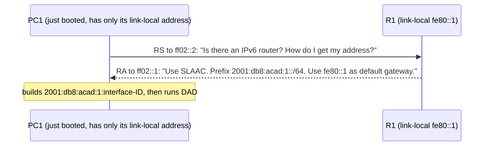

Two implementation details: the RS goes to the **all-routers** group `ff02::2`, so other hosts never see it; and the host sends it **from its link-local address**, which it can form without outside help. "Link-local first, ask, then configure everything else."

### Duplicate Address Detection (DAD)

A device with a new global or link-local address may perform DAD:

1. It sends an **NS** with **its own (tentative) address as the target**.
2. If another device has that address, it answers with an **NA**, and the tentative address is abandoned.
3. If no reply arrives, the address is assumed unique and put into use.

> **Kid example.** Before writing your chosen nickname on your locker, you ask the whole corridor once: "Is anybody here already called Sky?" If someone answers, you pick another nickname. If nobody answers, the nickname is yours. That is DAD: a question about yourself.

This matters most for random interface IDs: a collision among 64 random bits is extremely unlikely but not impossible, and a duplicate would break both devices in miserable ways. **No new message type was needed: DAD is a neighbour solicitation about yourself.**

### Address resolution

To find the MAC address of a destination on the link, a device sends an **NS to the solicited-node multicast address** of the target, including the target IPv6 address. The device with that address replies with an **NA containing its Ethernet MAC address**. In the lecture's figure, R1 sends an NS asking for the MAC of `2001:db8:acad:1::10`.

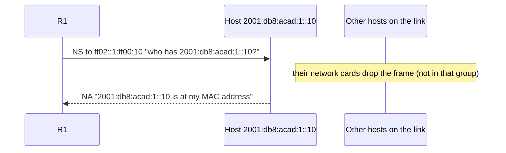

ARP: a **broadcast** that every host must receive and inspect. NS: a **multicast** to a group defined by the target's last 24 bits, which maps to a specific Ethernet multicast address, so uninterested hosts filter it **in hardware**. "Same function, dramatically less disturbance."

---

## 17. Part B: IPv6 is now the majority

*(Part B, "Beyond EDA344": everything from here is new compared with an introductory course.)*

The through-line of Part B: **standardised, deployed and usable are three different states**, and most interesting engineering lives in the gaps between them.

### IPv6 is now the majority

- **28 March 2026:** IPv6 passed **50% of Google's users** for the first time: **50.10%**.
- That is **eighteen years** after the measurement began.
- The transition is **no longer prospective; it is most of the traffic.**
- "Any lecture framing IPv6 as 'coming' is describing 2015."
- Source: Google IPv6 statistics, 28 March 2026 (the lecturer is told to re-pull before teaching).

The curve is nearly flat until about 2011 and then compounds steadily for fifteen years. Much of what was written about IPv6 being slow was written during the flat part and was true then. A useful reflex: **when you meet a claim about the state of the Internet, check its date.**

### Two measurements, two answers

- **Google** measures **its own users**; **APNIC** measures via **advertisement delivery**.
- APNIC's figure runs **consistently lower, nearer 40%**.
- **Neither is wrong**: they sample different populations by different means.
- "Teach the bracket, and ask what each method cannot see."

Google measures people who load Google services; APNIC delivers a small measurement task through ad networks, a different and broader population. Users who never visit Google are invisible to one; users who **block ads** are invisible to the other. "Adoption is fifty per cent" is an incomplete sentence: **adoption by whom, measured how, over what period?**

---

## 18. Testing the economic argument

- The economic argument (from the 2024 version of the course): IPv6 wins when IPv4 addresses cost more (about **\$60 in 2022**) than deploying IPv6 (**\$50 to \$200 per device** plus large migration costs).
- IPv6 crossed 50% in March 2026: **so far, so good**.
- **But** IPv4 transfer prices **fell roughly a third from the 2021 peak**, while transfer **volume hit records**.
- **Adoption rose as the price fell. The prediction landed; the mechanism did not.**
- Price figures vary by source and block size; **brokers are interested parties**.

If scarcity pricing were driving the transition, prices should have gone **up**. So what did drive it?

- **Mobile carriers going IPv6-only** for their own operational reasons.
- The running cost of **carrier-grade NAT** (the state, the logging, legal-intercept obligations) exceeding the cost of IPv6.
- **Cloud providers changing defaults.**

A falsifiable prediction, tested: a good model of how to treat claims in this course.

---

## 19. Deployment models and 464XLAT

### Three deployment models

| Model | What it means |
|---|---|
| **Dual-stack** | Run both: two address plans, two routing tables, two firewall policies; every problem diagnosed twice. **Twice the operational surface.** |
| **IPv6-mostly** | IPv6 by default; IPv4 given **on demand** to hosts that still need it (RFC 8925). The default inverts. |
| **IPv6-only** | No IPv4 on the access network at all. |

"The question is never 'IPv6 or IPv4' but **which stack the network runs natively**." Most people assume dual stack is the destination; it is **the expensive middle**, designed as a transition state, and it doubles the operational surface without removing anything. Large mobile networks moved past it years ago.

### 464XLAT

**464XLAT** lets older IPv4 apps and devices work on modern **IPv6-only** networks by translating back and forth:

- Mobile carriers run **IPv6-only access networks at scale**.
- A **client-side translator** presents IPv4 to legacy applications.
- Traffic **crosses the network as IPv6** and is **translated back at the far edge**.
- "Most students use this daily and have never heard of it."

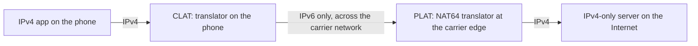

The name says it: **4 → 6 → 4**. The application believes it has IPv4 throughout; the network never carries any. The legacy protocol survives **only at the two edges**. "That is what a well-executed transition looks like: invisible to the people relying on it."

> **Beyond the slides.** 464XLAT is RFC 6877. The phone-side part is called the **CLAT** (customer-side translator) and the edge part the **PLAT** (provider-side translator), which is usually a NAT64 box.

---

## 20. Extension headers in the wild, and SRv6

### Extension headers in the wild

- **The design:** extend the protocol **without renegotiating the header**.
- **The reality:** transit networks and middleboxes **drop packets carrying them**.
- Measured drop rates are high enough that **protocol designers avoid them**.
- "A standardised feature that deployment killed."

Firewalls and middleboxes cannot parse an arbitrary chain of headers **at line rate** to decide whether a packet is allowed, so many simply **drop anything with extension headers**. The reference measurement study is **RFC 7872**. Nothing is wrong with the specification or with any single implementation; the feature is unusable on the open Internet because of the **combined behaviour of independently run middleboxes that nobody coordinates**. "Standardised, deployed and usable are three different states. This is the clearest example you will meet."

### SRv6: the idea that survived

**Segment Routing over IPv6 (SRv6)** encodes routing paths and processing instructions directly into IPv6 packet headers:

- The path is encoded as a **list of addresses in the packet** (in a routing extension header).
- It uses **the very extension-header mechanism that the open Internet drops**.
- It **works because operators control both ends and every hop in between**.
- "**Same mechanism, different trust domain, opposite outcome.**"

Each segment ID is a real IPv6 address; the packet is steered by rewriting its destination as it moves through the list. It is **source routing, revived**. Nothing about the technology changed between these two slides; what changed is the **administrative boundary**. On the open Internet, packets cross networks run by parties with no shared incentive, and the conservative default wins ("when in doubt, drop it"). Inside one operator's domain, the operator controls every hop and can simply allow the header. **Deployability is a property of a protocol together with the trust domain it runs in.** "What else would become possible if you controlled every hop?" That question returns in the SDN lecture.

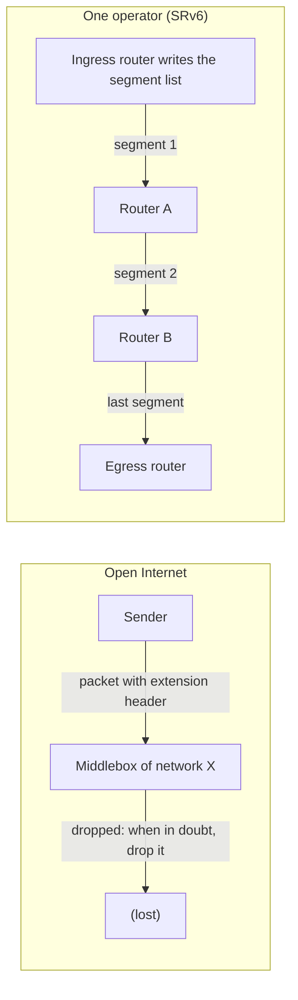

---

## 21. How IPv6 deployment fails

- **Happy Eyeballs** is a connection algorithm used by dual-stack clients to avoid slow loading when an IPv6 connection is broken.
- Happy Eyeballs **masks broken IPv6**: the user sees success, the operator sees nothing.
- Dual stack **doubles the paths that can fail independently**.
- Translation state at the edge is **soft state that can be lost mid-connection**.
- "**A transition mechanism that hides its own failures delays its own completion.**"

Happy Eyeballs (**RFC 8305**) has a dual-stack client try both address families and use whichever answers first. It exists because early dual-stack deployments produced painful timeouts when IPv6 was configured but broken. It works: users stop noticing. **That is also the problem.** If IPv6 is broken and the client silently falls back to IPv4, nobody complains, no ticket is opened, and the operator's monitoring shows healthy traffic. The mechanism that made dual stack tolerable **removed the signal that would have got it fixed**.

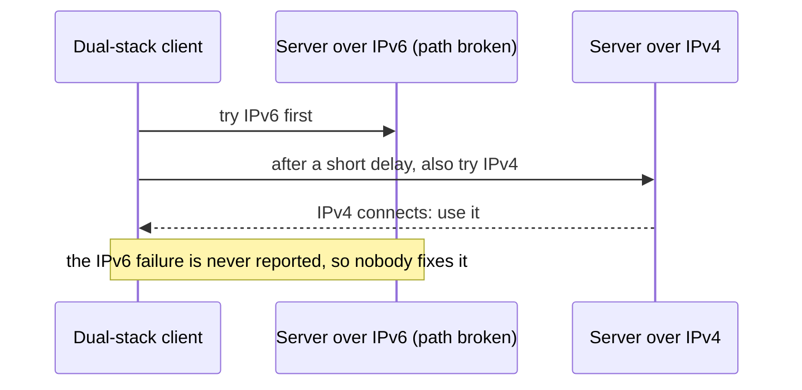

Add the other two: dual stack means **two paths that fail independently**, so the number of things that can break more than doubles; and **translation state** at the edge is soft state: lose it mid-connection and the connection dies with no protocol-level explanation. "What would a network need in order to notice this by itself?" That question is left open, and it is the theme of the second half of the course (systems that detect and recover from bad states on their own).

---

## 22. Summary

1. **IPv6 itself:** 128-bit addresses, the compression rules, the three address categories, and the three ways a device configures itself.
2. **Multicast:** one packet to many receivers, duplicated by the network, not the sender; well-known groups replace IPv4 broadcast.
3. **Anycast:** one address in many places, the routing system chooses; the DNS root servers are the example.
4. **Subnetting:** in IPv6 it is counting, not rationing.
5. **ICMPv6:** absorbs address resolution, autoconfiguration and group membership into one protocol.

From Part B, carry one thing above the rest: **IPv6 is now the majority protocol, extension headers were standardised and remain unusable, and the transition succeeded partly by hiding its own failures. Standardised, deployed and usable are three different states.**

---

## 23. Related quiz topics not in the lecture

> **Beyond the slides.** The course's pre-lecture IPv6 quiz (30 questions) asks about several things the 2026 slides do not cover directly. Short explanations:

- **Why NAT alone was not enough.** NAT saves addresses, but it **breaks transparency**: devices behind it cannot be reached directly, and packets are rewritten in the middle. New protocols that need direct end-to-end connections (calls, games, peer-to-peer) become hard to build, which **hampers innovation**.
- **Why adoption was slow.** NAT and address reuse kept IPv4 "good enough", and IPv6 is **not compatible** with IPv4: an IPv4-only device cannot talk to an IPv6-only device without help, so everybody had to upgrade and nobody wanted to go first.
- **Routers never fragment; only the source does.** If a packet is too big for the next link, an IPv6 router **drops it** and sends back an ICMPv6 **"Packet Too Big"** message. The source then uses smaller packets (Path MTU Discovery). This keeps routers simpler and faster.
- **The 1280-byte minimum MTU.** Every IPv6 link must carry packets of at least **1,280 bytes** (RFC 8200). A sender that keeps packets at 1,280 bytes or less knows they will fit on every path. If a physical link is smaller, a layer underneath (like 6LoWPAN) must handle it.
- **Why fragments are risky.** If **one** fragment is lost, the **whole** packet is lost. Example: 10% loss per hop over 3 wireless hops. One fragment survives with probability 0.9 × 0.9 × 0.9 ≈ 0.73. Four fragments all survive with probability 0.73⁴ ≈ 0.28, so 72% of the time the packet cannot be rebuilt.
- **Link-layer acknowledgements are not enough.** Wi-Fi may confirm each hop, but a packet can still be dropped inside a router. Only **end-to-end** recovery (such as TCP retransmission) guarantees delivery: the **end-to-end principle**.
- **6LoWPAN.** Low-power radios like IEEE 802.15.4 have frames of only **127 bytes**; a 40-byte IPv6 header plus 8-byte UDP header would eat almost half. 6LoWPAN **compresses** IPv6 headers (and handles fragmentation below IPv6). Many fields can be left out because the receiver can rebuild them, for example the version (always 6) and a **link-local address derived from the MAC**, which is already in the radio frame.
- **Jumbograms.** The normal payload length field is 16 bits (max 65,535 bytes). A special option (RFC 2675) uses 32 bits for bigger payloads on links that support them.
- **Flow label purpose.** To mark packets that belong to the same flow, so routers can treat them consistently (same path, same treatment).
- **Anycast's routing cost and DDoS benefit.** An anycast service's address is announced from many places as its own specific route, so it cannot be summarised with its neighbours: routing tables carry extra specific entries for it (the quiz phrases this as "multiple /32 entries"). On the positive side, a DDoS attack from around the world is **spread over many sites**, each receiving only part of it.
- **Multicast's main difficulty on the Internet.** Routers must keep **state for every group** (who is a member, which links lead to them), which is complex across many autonomous systems.
- **A quiz honesty note.** One quiz question asks which compressed form is invalid; the accepted answer is "using `::` more than once". Using `::` to stand for a group that is **not** all zeros is also invalid in real life, but the quiz key only accepts the first.
