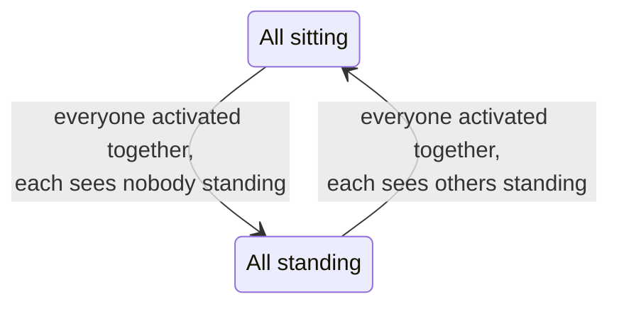
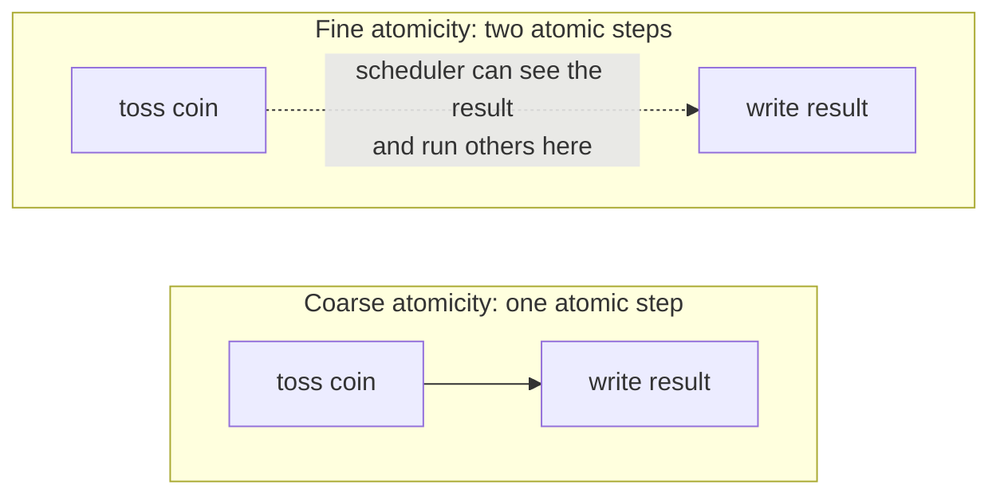
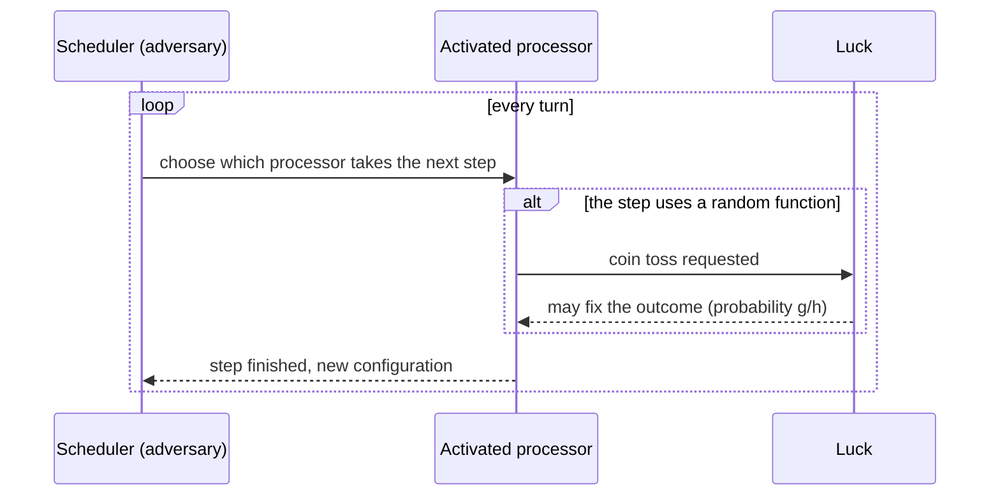
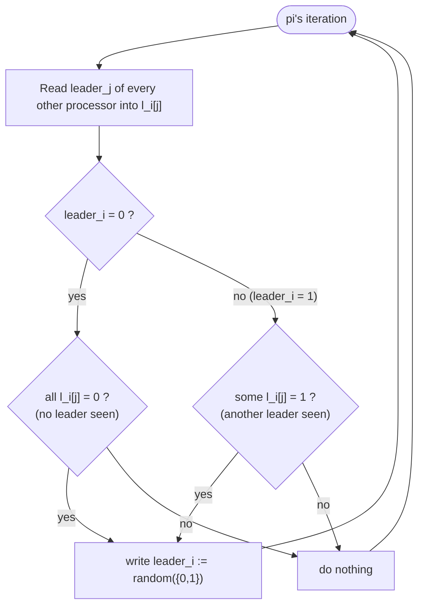
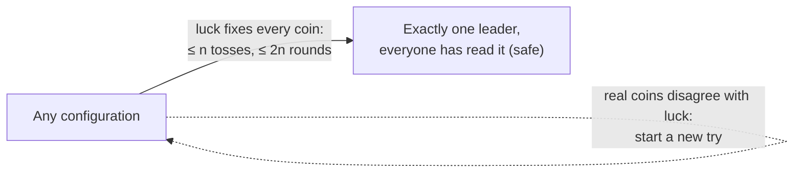
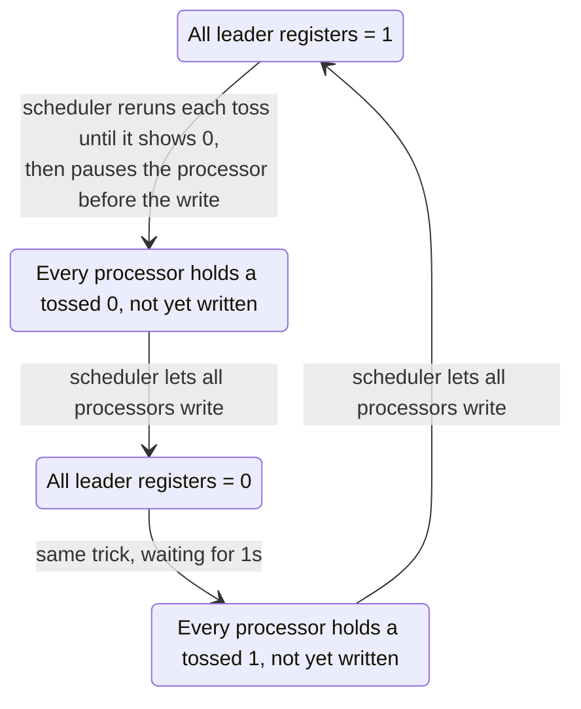

# Self-Stabilizing Leader Election in Complete Graphs (Anonymous Systems, Randomization)

**Course:** EDA387/DIT663 Computer Networks, part 2 (Fault-tolerant Algorithms for Computer Networks), lecture "Self-stabilizing Leader Election", second part (Dolev, *Self-Stabilization*, §2.4 and §2.9: randomized self-stabilization and the scheduler-luck game). The first part of the same lecture, leader election in general ID-based graphs, has its own guide.

**Revised:** 21 October 2026

**† Supplementary material:** content that comes only from hidden PowerPoint slides. It may not be part of this year's examinable material. *This part of the lecture has no hidden slides, so nothing in this guide carries the † mark.*

**Notes in the text.** Paragraphs that begin with **Technical clarification** mark places where the lecture material is wrong, inconsistent or imprecise, and give the correct statement. Paragraphs that begin with **Additional context** add material from outside the lecture, such as the course book (Dolev), old exams, the pre-lecture quizzes or general knowledge.

---

## Glossary

| Term | Expansion or category | Meaning |
|---|---|---|
| Anonymous system | Uniform system | All processors are identical: same program, no identifiers. |
| Atomic step | — | A step the scheduler cannot interrupt or look inside. |
| Central daemon | Central demon | A scheduler that activates exactly one processor at a time for one atomic step. |
| Coarse atomicity | — | A coin toss is part of the same atomic step as the following read or write, so the scheduler cannot see the result before it is written. |
| Combined probability, *cp* | — | The product of the probabilities of all of luck's interventions in the SL-game. |
| Complete graph | Fully connected graph | A topology in which every processor is directly connected to every other processor. |
| (*cp*, *r*)-strategy | — | A strategy for luck that reaches a safe configuration within at most *r* expected rounds, using interventions with combined probability *cp*. |
| Distributed daemon | Distributed demon | A scheduler that may activate any number of processors concurrently. |
| Expected value | — | The long-run average of a random quantity. |
| Fine atomicity | — | A coin toss is a separate atomic step, so the scheduler sees the result before it is written. |
| Geometric distribution | — | The number of tries until the first success when each try succeeds independently with probability *cp*; its expected value is 1/*cp*. |
| LE | Leader Election task | The set of executions in which there is a single fixed leader throughout the execution. |
| Leader register, leaderᵢ | — | A one-bit, single-writer multi-reader register: 1 means "I am a leader candidate", 0 means "I am not". |
| *lᵢ*[*j*] | — | *pᵢ*'s local copy of the last value it read from leaderⱼ. |
| Luck | — | The player in the SL-game who may fix the outcomes of coin tosses. |
| Randomized self-stabilizing | — | From any configuration and under any fair scheduler, the algorithm reaches a safe configuration within a finite number of rounds (with probability 1; here, in a finite expected number). |
| Scheduler | Adversary | The player that chooses which processor moves next, trying to prevent stabilization. |
| SL-game | Scheduler-luck game | A proof technique for bounding the expected stabilization time of randomized algorithms. |
| Symmetry breaking | — | Making identical processors end up in different roles (for example one leader and many followers). |

## Contents

- [1. Deterministic leader election without identifiers](#1-deterministic-leader-election-without-identifiers)
  - [1.1 The question: leader election without identifiers](#11-the-question-leader-election-without-identifiers)
  - [1.2 A deterministic solution under a central daemon](#12-a-deterministic-solution-under-a-central-daemon)
  - [1.3 No deterministic solution under a distributed daemon](#13-no-deterministic-solution-under-a-distributed-daemon)
- [2. Randomized self-stabilization](#2-randomized-self-stabilization)
  - [2.1 Randomized self-stabilization](#21-randomized-self-stabilization)
  - [2.2 Coarse versus fine atomicity](#22-coarse-versus-fine-atomicity)
  - [2.3 The scheduler-luck game](#23-the-scheduler-luck-game)
- [3. The randomized leader election algorithm](#3-the-randomized-leader-election-algorithm)
  - [3.1 The randomized leader election algorithm](#31-the-randomized-leader-election-algorithm)
  - [3.2 Lemma 2.6: stabilization within 2^O(n) expected rounds](#32-lemma-26-stabilization-within-2on-expected-rounds)
  - [3.3 Lemma 2.7: no stabilization under fine atomicity](#33-lemma-27-no-stabilization-under-fine-atomicity)
- [4. Summary](#4-summary)
  - [4.1 Recap](#41-recap)
- [Revision notes and references](#revision-notes-and-references)

## 1. Deterministic leader election without identifiers

### 1.1 The question: leader election without identifiers

The first part of the lecture elected the minimum identifier in an ID-based network. Now the question is:

**Is there a deterministic solution without identifiers in fully connected graphs?**

A leader election algorithm must end in a configuration where **exactly one** processor is the leader and every processor knows whether it is the leader or not. That final configuration is **not symmetric**. In an ID-based system, the identifiers already make processors different. In an **anonymous (uniform)** system all processors are identical, so something must **break the symmetry**. The answer depends on the scheduler.

**Additional context (Dolev §2.9).** in an ID-based complete graph the problem is trivial: every processor repeatedly appoints the processor with the maximal identifier. The difficulty here comes purely from having no identifiers.

### 1.2 A deterministic solution under a central daemon

Under the **central daemon** model, **exactly one** processor among all processors is selected, arbitrarily, by an adversarial scheduler, to take a single atomic step.

The lecture illustrates it with five people in a circle, each **sitting** or **standing**. The goal is that exactly one person stands. The rule: when the scheduler picks you, look at everybody else; **stand up if nobody else is standing; otherwise sit down**.

- After the scheduler's first choice, **at least one person is standing**: either someone was already standing, or the chosen person saw nobody standing and stood up.
- If *x* > 1 people stand, then once *x* − 1 of them have been picked, each of them saw someone else standing and sat down. Exactly one person is left standing.
- From then on, everybody else stays seated (they always see the leader standing) and the leader stays standing (it never sees anyone else standing).

A possible run with five people (S = standing, s = sitting), in the spirit of the lecture's animation:

| Picked | Before | Rule applied | After |
|---|---|---|---|
| person 1 | s S s S S | others are standing: sit | s S s S S |
| person 2 | s S s S S | others are standing: sit | s s s S S |
| person 4 | s s s S S | others are standing: sit | s s s s S |
| person 5 | s s s s S | nobody else stands: stand | s s s s S |
| person 3 | s s s s S | others are standing: sit | s s s s S |

From the third pick on, exactly one person (person 5) is standing, and it stays that way.

### 1.3 No deterministic solution under a distributed daemon

Under the **distributed daemon** model, an arbitrary number of processors are selected by an adversarial scheduler to **concurrently** take atomic steps. Now the same rule fails:

1. Everybody is sitting. The scheduler activates **all** of them at once. Each looks around, sees nobody standing, and decides to stand.
2. All stand up. The scheduler activates all of them again. Each sees others standing and decides to sit.
3. All sit down. Back to step 1, forever.



Since all processors are identical, start in the same state and see the same thing, any deterministic rule makes them all do the same thing. The scheduler can keep them perfectly in step forever. **Unfortunately, there is no deterministic solution under a distributed daemon.** That is why we turn to randomization.

**Additional context (Dolev §2.9).** the book concludes that there is no self-stabilizing uniform leader election algorithm without a central daemon (meaning a deterministic one); the randomized algorithm below needs no central daemon.

## 2. Randomized self-stabilization

### 2.1 Randomized self-stabilization

**Assumptions and definitions:**

- Processor activity is managed by a **scheduler**.
- The scheduler's assumption: **at most one atomic step is executed at any given time**, and **each atomic step includes a single read or write operation and a finite sequence of local computation**.
- The scheduler is regarded as an **adversary**: it aims to increase the algorithm's costs as much as possible.
- The scheduler is assumed to be **fair**, yet it has **unlimited resources** and chooses the next activated processor **online** (step by step, based on what has happened so far).

**An algorithm is randomized self-stabilizing for task LE if, starting with any system configuration and considering any fair scheduler, the algorithm reaches a safe configuration within a finite number of rounds** (in expectation; see the SL-game below).

**Randomized algorithms are often used to break symmetry** in a network of totally identical processors: if each processor flips its own coin, they will sooner or later get different results.

### 2.2 Coarse versus fine atomicity

When a processor tosses a coin, can the adversary see the result before the processor acts on it? This depends on the **atomicity** assumed:

- **Coarse atomicity, less power to the adversary.** A coin toss is an internal operation that is **not separable from the next read or write**. The adversary is **unaware** of the algorithm's random choice before that read or write has happened.
- **Fine atomicity, more power to the adversary.** A coin toss is a **separate operation** from the next read or write. The adversary **is aware** of the random choice before the read or write, and can schedule other processors in between.



We will see that the leader election algorithm below **works under coarse atomicity** (Lemma 2.6) and **fails under fine atomicity** (Lemma 2.7).

### 2.3 The scheduler-luck game

**Purpose:** to prove **upper bounds on the stabilization time of randomized algorithms** via probability calculations. Analysing every possible outcome of every random choice is very complicated, especially for self-stabilizing algorithms that make no assumption about the initial state. The **SL-game** avoids this: it **fixes** the outcome of the random function, so the proof looks like a proof of a deterministic algorithm.

#### Rules of the game

Given a randomized algorithm *AL*, we define a game between two players, **scheduler** and **luck**:

- **Scheduler** wants to **prevent** the algorithm from fulfilling its task. It chooses the activation order (interleaving) of the processors.
- **Luck** may **determine the result** of the random function.

In each turn:

1. The scheduler chooses the next processor to activate, and it makes a step.
2. If during this step the processor uses a random function, **luck may intervene** and fix the result (or a subset of the desired results). If luck fixes the result to be any of *g* values out of *h* possible results, the probability of this intervention is ***p* = *g*/*h***.
3. Luck may also choose **not** to intervene; then every result has equal probability.
4. Both players have unlimited computational resources and decide based on the history so far. When the step ends, a new turn begins.



**Definitions.**

- If luck intervenes ℓ times and the *x*-th intervention has probability Pr(*x*), the **combined probability** is

```math
cp = \prod_{x=1}^{\ell} \Pr(x).
```

- ***r*** is the expected number of rounds until stabilization, assuming every intervention succeeds.
- Luck has a **(*cp*, *r*)-strategy** to win the game if it has a strategy to reach a safe configuration in an expected number of at most *r* rounds, with interventions whose combined probability is no more than *cp*.

#### Theorem 2.4: from a luck strategy to an expected time

**Theorem 2.4.** If luck has a (*cp*, *r*)-strategy, then the algorithm reaches a safe configuration within at most ***r*/*cp*** expected number of rounds.

*Proof sketch.*

1. In a real execution, the random function's outputs may differ from what luck would have chosen. Then the system may reach an arbitrary state.
2. But from that arbitrary configuration **a new SL-game can be started**, in which, with probability *cp*, a safe configuration is reached within *r* expected rounds. Once in a safe configuration, luck is no longer needed.
3. So each "try" succeeds with probability *cp*. The probability that the first try fails and the second succeeds is (1 − *cp*) · *cp*; in general, the *x*-th try is the first success with probability (1 − *cp*)ˣ⁻¹ · *cp*.
4. The expected number of tries is

```math
\sum_{x=1}^{\infty} x \,(1-cp)^{x-1}\, cp = \frac{1}{cp}.
```

5. Each try takes *r* expected rounds. Since the expectation of a sum is the sum of the expectations, the expected number of rounds until a safe configuration is ***r*/*cp***. ∎

**Additional context (checking the sum).** the formula Σ *x*(1 − *q*)ˣ⁻¹*q* = 1/*q* is the mean of a geometric distribution. Quick check with *q* = 1/2: 1·½ + 2·¼ + 3·⅛ + 4·1/16 + … = 2 = 1/*q*.

## 3. The randomized leader election algorithm

### 3.1 The randomized leader election algorithm

The studied algorithm uses the **shared-memory model** for networks with the topology of a **complete graph** (every processor can read every other processor's register). Each processor *pᵢ* has a one-bit **leader register** leaderᵢ that it writes and everyone reads. The coin returns 0 or 1 with equal probability.

```text
01 do forever
02     forall p_j ∈ N(i) do
03         l_i[j] := read(leader_j)
04     if (leader_i = 0 and {∀ j ≠ i | l_i[j] = 0}) or
05        (leader_i = 1 and {∃ j ≠ i | l_i[j] = 1}) then
06         write leader_i := random({0, 1})
07 end
```

In words: *pᵢ* reads everybody's leader bit. It tosses a coin and writes the result into its own register in two situations:

- it is **not** a leader and sees **no** leader at all (somebody must try to become leader), or
- it **is** a leader but sees **another** leader too (too many leaders, somebody must try to step down).

Otherwise (exactly the right situation from its point of view) it does nothing.



**Task LE:** the set of executions in which there exists a **single fixed leader throughout the execution**.

**Safe configuration:**

- for **exactly one** processor, say *pᵢ*: leaderᵢ = 1 and *lᵢ*[*j*] = 0 for every *j* ≠ *i* (it is a leader and has seen that nobody else is);
- for **every other** processor *pⱼ* ≠ *pᵢ*: leaderⱼ = 0 and *lⱼ*[*i*] = 1 (it is not a leader and has seen the leader), as well as *lₖ*[*j*] = 0 for every *k* ≠ *j* (nobody has a stale copy saying *pⱼ* is a leader).

In any fair execution that starts in a safe configuration, *pᵢ* is the single leader, so the execution is in LE. (How can you prove it? Check that no processor's condition in lines 04–05 can ever become true: *pᵢ* only ever reads 0 from the others, and every other processor is 0 and only ever reads 1 from *pᵢ*, so nobody tosses a coin and nobody writes.)

**Additional context (Dolev §2.9).** the book's definition of a safe configuration has only the first two conditions; the lecture adds the third (no stale 1 in any local copy), which makes the "nobody ever writes again" argument immediate.

### 3.2 Lemma 2.6: stabilization within 2^O(n) expected rounds

**Lemma 2.6.** The algorithm stabilizes within 2^O(*n*) expected number of rounds. More precisely, using Theorem 2.4 the expected number of rounds is at most **2*n* · 2ⁿ**.

The proof presents a **(1/2ⁿ, 2*n*)-strategy** for luck. Then by Theorem 2.4 the expected number of rounds is at most *r*/*cp* = 2*n* / (1/2ⁿ) = 2*n* · 2ⁿ.

**Luck's strategy.** Whenever some processor *pᵢ* tosses a coin (line 06), luck intervenes:

- if **leaderⱼ = 0 for all *j* ≠ *i***, luck fixes the coin toss to be **1**;
- **otherwise**, luck fixes it to be **0**.

Under **coarse atomicity**, line 06 is atomic: at the end of the step, leaderᵢ already holds the coin's result, and nobody could act in between.

In other words, luck always makes the tossing processor choose the value that moves the system towards "exactly one leader".

**Observation 1 (no coin toss means already safe).** Within **less than 2*n* successive rounds**, each processor *pᵢ* reads all leader registers and, if necessary, tosses a coin and writes the outcome. So if **no processor tosses a coin within the first 2*n* rounds**, the system reaches a safe configuration: nobody writes during these rounds, so everybody reads fixed values. A processor with leaderᵢ = 0 that did not toss must have found some *pⱼ* with leaderⱼ = 1, and a processor with leaderⱼ = 1 that did not toss must have found that it is the **only** one with value 1.

**Observation 2 (with luck, a leader appears and stays).** If some processor does toss a coin, then by luck's strategy and lines 04–06, after the first coin toss **at least one leader register holds 1**. (If at the moment of the toss all other leader registers are 0, luck gives the tosser 1; otherwise some other register already holds 1.) Moreover, once leaderⱼ = 1 for some *j*, there is a *k* (possibly *k* = *j*) such that **leaderₖ = 1 for the rest of the execution**:

- Let *L* be the set of processors whose leader register holds 1 after the first coin toss.
- If some *pₖ* ∈ *L* never tosses a coin again, then leaderₖ = 1 forever (it only changes by tossing).
- Otherwise every processor in *L* tosses again. Let *pₖ* be the **last** processor in *L* to toss (for the first time). By luck's strategy, at *pₖ*'s toss all other leader values are 0, so luck sets *pₖ*'s coin to **1**. From then on leaderₖ = 1 and leaderⱼ = 0 for every *j* ≠ *k*.

**Success probability.** Each processor *pᵢ* tosses a coin **at most once**:

- If luck set *pᵢ*'s first toss to **0**, then in all later readings *pᵢ* sees leaderₖ = 1 (the eventual leader), so its condition never holds again.
- If luck set *pᵢ*'s first toss to **1**, then all other leader values were 0 at that moment (that is when luck chooses 1). After this atomic step *pᵢ* is the only processor with value 1, so it will not toss again either.

So luck intervenes at most *n* times, each time fixing one fair coin (probability 1/2). The combined probability is at least

```math
cp \ge \left(\tfrac{1}{2}\right)^n = \frac{1}{2^n}.
```

**Putting things together.** Within at most 2*n* rounds every processor stops tossing coins, and during these 2*n* rounds each processor tosses at most once. So luck wins the game within 2*n* rounds with combined probability 1/2ⁿ: a (1/2ⁿ, 2*n*)-strategy. By Theorem 2.4:

```math
\text{expected rounds} \le \frac{r}{cp} = \frac{2n}{1/2^n} = 2n\,2^n \in 2^{O(n)}.
```

*Example:* with *n* = 3 processors, the bound is 2 · 3 · 2³ = 48 expected rounds; with *n* = 10 it is 2 · 10 · 1024 = 20 480. The bound grows exponentially with *n*, which is why the lecture calls this a simple but slow algorithm.



**Technical clarification.** One sentence of the lecture says "Luck wins the game within 2ⁿ rounds"; the rest of the lecture, the rest of the proof and the book all say **2*n*** rounds, which is what the bound 2*n*·2ⁿ uses.

### 3.3 Lemma 2.7: no stabilization under fine atomicity

**Lemma 2.7.** The algorithm is **not** self-stabilizing under fine atomicity (where a coin toss is a separate atomic step).

*Proof: a winning strategy for the scheduler.*

1. Start in a configuration where **all leader registers hold 1**. Every processor sees another leader, so each must toss a coin.
2. The scheduler activates one processor to toss. Because the toss is a separate step, the scheduler **sees the result** before it is written. If the result is 1, the scheduler lets this processor toss again, until the result is **0**.
3. The scheduler then **suspends** this processor **before it writes** its 0.
4. It does the same with the next processor, and the next, until **every** processor is about to write 0.
5. Now the scheduler lets all of them write. **All leader registers hold 0.** Every processor sees no leader, so each must toss again.
6. In the same way the scheduler makes every processor hold a pending **1**, then lets them all write: **all registers hold 1**. Back to step 1.



The system never has exactly one leader, so it never stabilizes. The lecture animates this with five people: one by one each tosses until the coin shows 0 (=0 above each head) while still standing, and then all of them sit down together.

**Additional context (Dolev §2.9).** the book adds that the resulting schedule is fair with probability 1 (every processor keeps being activated), so this is a legitimate fair scheduler, not a cheat.

The lesson: **the exact atomicity assumption decides whether a randomized algorithm works.** Under coarse atomicity the scheduler cannot react to the coin before it is written, so it cannot keep everyone in step.

## 4. Summary

### 4.1 Recap

- In **anonymous** complete graphs, leader election needs **symmetry breaking**. A **deterministic** rule ("stand if nobody stands, else sit") works under a **central daemon** but **no deterministic solution exists under a distributed daemon**.
- **Randomized self-stabilization:** from any configuration, under any fair scheduler, a safe configuration is reached within a finite (expected) number of rounds.
- **Coarse atomicity** (toss and write in one step) gives the adversary less power than **fine atomicity** (toss as a separate step).
- **SL-game:** scheduler versus luck. If luck has a **(*cp*, *r*)-strategy**, the algorithm stabilizes within **r/cp** expected rounds (**Theorem 2.4**), because the number of tries is geometric with mean 1/*cp*.
- **Algorithm:** toss a coin if you are 0 and see no leader, or you are 1 and see another leader. Under coarse atomicity luck has a **(1/2ⁿ, 2*n*)-strategy**, giving at most **2*n*·2ⁿ ∈ 2^O(*n*)** expected rounds (**Lemma 2.6**). Under fine atomicity the scheduler can prevent stabilization forever (**Lemma 2.7**).

## Revision notes and references

Technical clarifications, where the lecture material is corrected or made precise, appear in sections [3.2](#32-lemma-26-stabilization-within-2on-expected-rounds). Where the slides and the course book differ, this guide follows the book and says so at that point.

- S. Dolev, *Self-Stabilization*, MIT Press, 2000: §2.4 and §2.9 (randomized self-stabilization and the scheduler-luck game).
