# Software Defined Networks (SDN)

**Course:** EDA387/DIT663 Computer Networks, "Fault-tolerant Algorithms for Computer Networks: Self-stabilizing Software Defined Networks" (review lecture on SDN). The lecture is based on material by Mohammad Alizadeh (MIT). The outline promises four parts: what SDN is, OpenFlow basics, why SDN is happening now (a brief history), and a "4D discussion".

**Generated:** 2026-10-21

**† Supplementary material:** content that comes only from hidden PowerPoint slides. It may not be part of this year's examinable material. This lecture has no hidden material, so no section is marked †.

**How to read the boxes.** Text that starts with **Beyond the slides** adds context that is not in the lecture (general knowledge, old exam questions, or topics that the course's pre-lecture SDN quiz asks about). **Note on the source** marks a place where the lecture material is wrong, inconsistent or incomplete. **Kid example** retells an idea with an everyday picture.

---

## Glossary

| Term | Full name | Meaning |
|---|---|---|
| 4D | Four-dimensional network architecture | A research design (Princeton, CMU, around 2005) that split network control into four "planes" and argued for one central decision plane; an ancestor of SDN. |
| ACL | Access Control List | A list of rules in a router or firewall saying which traffic is allowed and which is dropped. |
| Active Networking | — | 1990s research in which packets could carry or select small programs that routers ran; the first attempt to make networks programmable. |
| BGP | Border Gateway Protocol | The routing protocol between the independent networks (autonomous systems) of the Internet. |
| Control plane | — | The part of the network that computes the forwarding state (decides where packets should go). |
| Control program | — | An SDN application (routing, access control, load balancing …) that reads the global network view and outputs a configuration for each device. |
| Controller | — | A server that runs the network OS and talks to the switches. |
| Data plane | — | The part of the network that moves each packet, using forwarding state that is already installed. Also called the forwarding plane. |
| Flow | — | All packets that share some header values, for example all packets from host H1 to port 80 of host H4. |
| Flow table | — | The table of match-action rules inside an OpenFlow switch. |
| Flow-MOD | Flow modification message | The OpenFlow message a controller sends to add, change or delete a rule in a switch's flow table. |
| ForCES | Forwarding and Control Element Separation | An IETF standard effort (2000s) for an open interface between the control and forwarding parts of a router. |
| Forwarding abstraction | — | A standard, vendor-neutral way to describe forwarding state, built from a small set of primitives. OpenFlow is one. |
| Global network view | — | The network OS's up-to-date map of all switches, links and hosts (a graph or database). Also called the global network map. |
| Hard timeout | — | An OpenFlow rule setting: delete the rule this many seconds after it was installed, no matter what. |
| Idle timeout | — | An OpenFlow rule setting: delete the rule if no packet has matched it for this many seconds. |
| In-band control | — | Controller messages travel over the same switches and links as normal data traffic. |
| IS-IS | Intermediate System to Intermediate System | A link-state routing protocol, similar to OSPF. |
| Line card | — | The circuit board in a router or switch that holds the ports and does the fast per-packet work. |
| Management plane | — | People and scripts that configure and tune the network (link weights, ACLs, adding devices). |
| Match-action | — | The rule format of OpenFlow: "if the header matches this pattern, do this action". |
| Merchant silicon | — | Standard switching chips sold by chip makers to anyone, instead of each router vendor designing its own. |
| Multi-tenant | — | Many customers ("tenants") share the same physical data centre network. |
| Network hypervisor | — | Software between the tenants and the network OS that turns each tenant's virtual topology into real rules. |
| Network OS (NOS) | Network operating system | A distributed system on the controllers that builds the global network view and passes directives to switches. Examples: NOX, ONIX, Floodlight, OpenDaylight. |
| NOX | — | The first network OS for OpenFlow, made at Nicira (2008). |
| ONF | Open Networking Foundation | An industry group (founded 2011) that standardises OpenFlow and promotes SDN. |
| OpenFlow | — | The standard protocol between an SDN controller and the switches; installs match-action rules. |
| OSPF | Open Shortest Path First | A link-state routing protocol: routers flood the map, and each runs Dijkstra's algorithm. |
| Out-of-band control | — | Controller messages travel over a separate network of their own. |
| Packet-IN | — | The OpenFlow message a switch sends to the controller when a packet needs the controller's decision (for example a table miss). |
| Packet-OUT | — | The OpenFlow message a controller sends to tell a switch what to do with one particular packet. |
| QoS | Quality of Service | Giving some traffic better treatment (more bandwidth, less delay) than other traffic. |
| RCP | Routing Control Platform | A research system (around 2005) that computed BGP routes centrally for a whole network. |
| SANE | Secure Architecture for the Networked Enterprise | A Stanford research design (2006) where a central controller decides which flows are allowed; followed by Ethane (2007). |
| SDN | Software Defined Network(ing) | A network whose control plane is physically separate from the data plane and logically centralized. |
| Switching fabric | — | The inside "crossroads" of a router that moves packets from the input line card to the output line card. |
| Table miss | — | A packet matches no rule in the flow table. |
| TE | Traffic Engineering | Steering traffic onto paths so that the network is used well (no link overloaded). |
| Tenant | — | One customer of a shared data centre. |
| Virtual topology | — | The simplified, pretend network that a tenant sees and writes its rules against. |
| Virtualization | — | Making one physical network look like many separate logical networks. |
| Wildcard | — | A "don't care" part of a match pattern (written x or *): any value is accepted there. |

---

## Table of contents

- [1. What is SDN?](#1-what-is-sdn)
- [2. A major trend in networking](#2-a-major-trend-in-networking)
- [3. The three networking planes](#3-the-three-networking-planes)
- [4. Timescales of the planes](#4-timescales-of-the-planes)
- [5. Inside a traditional router](#5-inside-a-traditional-router)
- [6. The data plane at work: IP forwarding](#6-the-data-plane-at-work-ip-forwarding)
- [7. The control plane at work: computing paths](#7-the-control-plane-at-work-computing-paths)
- [8. The management plane: traffic engineering](#8-the-management-plane-traffic-engineering)
- [9. Why traditional networks are hard to control](#9-why-traditional-networks-are-hard-to-control)
- [10. Example 1: inter-domain routing with BGP](#10-example-1-inter-domain-routing-with-bgp)
- [11. Example 2: access control goes wrong](#11-example-2-access-control-goes-wrong)
- [12. How SDN changes the network](#12-how-sdn-changes-the-network)
- [13. The network OS](#13-the-network-os)
- [14. Control programs](#14-control-programs)
- [15. The forwarding abstraction](#15-the-forwarding-abstraction)
- [16. Virtualization and the network hypervisor](#16-virtualization-and-the-network-hypervisor)
- [17. Does SDN simplify the network?](#17-does-sdn-simplify-the-network)
- [18. OpenFlow basics: flow tables](#18-openflow-basics-flow-tables)
- [19. Match-action primitives](#19-match-action-primitives)
- [20. OpenFlow rules and statistics](#20-openflow-rules-and-statistics)
- [21. Execution example: one web connection](#21-execution-example-one-web-connection)
- [22. Out-of-band control](#22-out-of-band-control)
- [23. In-band control](#23-in-band-control)
- [24. The road to SDN](#24-the-road-to-sdn)
- [25. Why SDN happened now: the drivers](#25-why-sdn-happened-now-the-drivers)
- [26. Virtualization is the killer app](#26-virtualization-is-the-killer-app)
- [27. Practical challenges](#27-practical-challenges)
- [28. Summary](#28-summary)
- [29. Old exam questions on SDN](#29-old-exam-questions-on-sdn)
- [30. Related quiz topics not in the lectures](#30-related-quiz-topics-not-in-the-lectures)

---

## 1. What is SDN?

The lecture gives a two-part definition. A **Software Defined Network** is:

1. a network in which the **control plane is physically separate from the data plane**, and
2. a network in which a **single, logically centralized control plane controls several forwarding devices**.

In words: the "thinking" part of the network (deciding where packets should go) is taken out of the individual switches and routers and put into one central place. The switches keep only the "doing" part (moving packets according to rules they were given).

"Logically centralized" is an important phrase. It means the control plane *behaves like* one brain, with one view of the whole network. It does *not* have to be a single physical computer: for reliability it may run on several servers ([section 22](#22-out-of-band-control)).

The lecture's picture has layers. At the top are several **control programs**. They look at a **global network map** (a small graph). Below them is one **control plane** (a red bar). Below that, the network's boxes, each split into a "Control" half and a "Forwarding" half, with dotted lines from the central control plane down to each box.

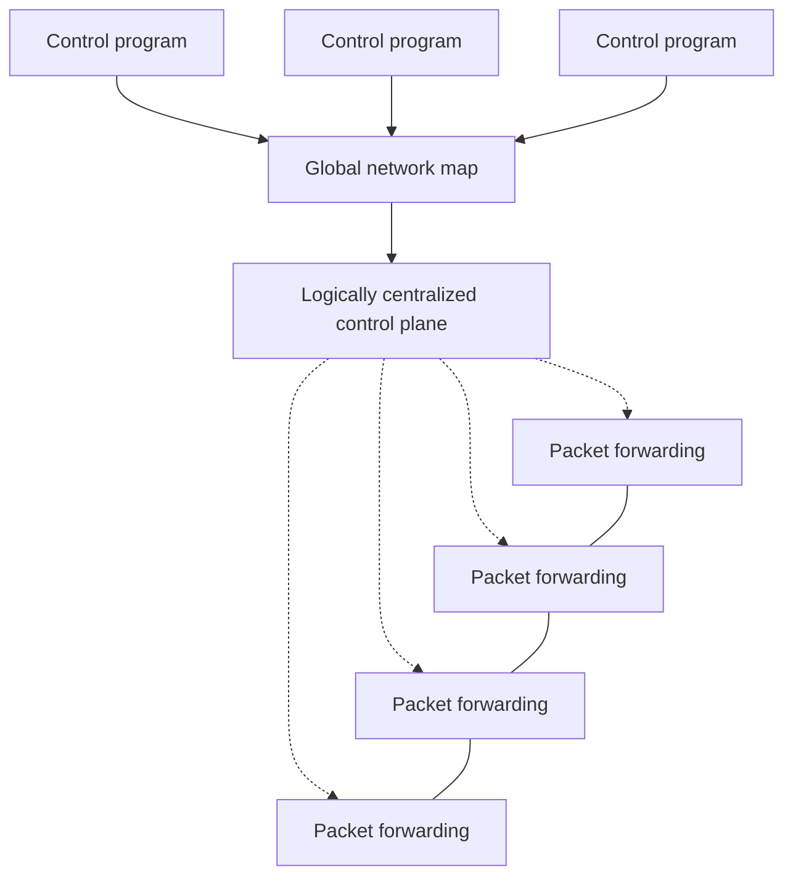

Why this matters: the controller makes **global decisions based on network-wide objectives and policies**, talks to the devices through **well-defined interfaces**, and lets operators adapt the network **programmatically** (by software) to changing traffic.

> **Kid example.** In an old city, every traffic light decides by itself when to turn green. In an SDN city, one traffic control centre sees a live map of all the roads and tells each light its rules. The lights still switch by themselves every few seconds; the centre only sets the rules.

---

## 2. A major trend in networking

The lecture shows three facts that made SDN "a major trend":

- **Google**: its "entire backbone runs on SDN".
- **Nicira**, an SDN start-up, was **bought for \$1.2 billion (mostly cash)**. Also, the buyer was **VMware**.
- The **Open Networking Foundation (ONF)** is a group of industry leaders that develops open SDN standards (OpenFlow among them).

> **Beyond the slides.** The Google network meant here is called **B4**, Google's private network between its data centres, described in a 2013 SIGCOMM paper. Google has a second, user-facing backbone, so "entire backbone" is best read as "the whole B4 backbone". VMware bought Nicira in 2012; the price was about \$1.26 billion, of which about \$1.05 billion was cash.

---

## 3. The three networking planes

The lecture splits everything a network does into three **planes** (layers of work):

- **Data plane**: processing and delivering packets using **local forwarding state**. The rule is "forwarding state + packet header → forwarding decision". It also does **filtering, buffering and scheduling**.
- **Control plane**: **computing the forwarding state** in routers. It decides how and where packets are forwarded. Tasks: **routing, traffic engineering, failure detection and recovery**, and so on.
- **Management plane**: **configuring and tuning** the network. Tasks: **traffic engineering, ACL configuration, device provisioning** (setting up new devices), and so on.

The lecture cites Nencioni, Helvik and Heegaard (2017), a paper on the availability of an SDN backbone.

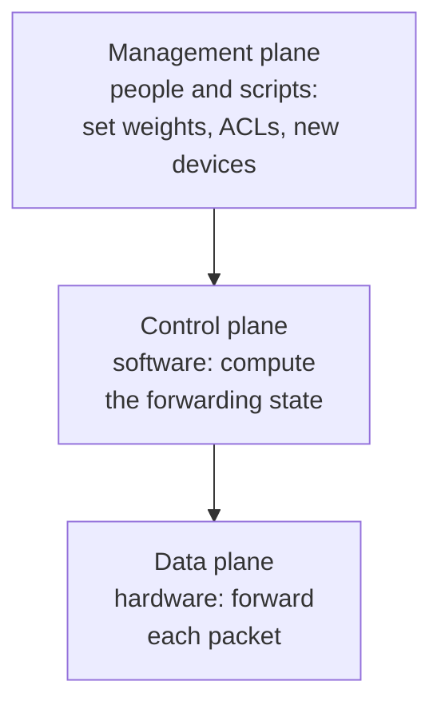

A useful consequence (asked in an old exam): if a router's **control plane fails** but its **data plane keeps working**, packets keep being forwarded for a while, using the forwarding entries that were already installed. Nothing updates those entries any more, so when the network changes, they become wrong ("stale").

> **Kid example.** A train network. The **data plane** is the track switches that flip left or right as each train passes. The **control plane** decides how each switch should be set. The **management plane** is the boss who writes the timetable rules.

---

## 4. Timescales of the planes

The lecture compares the planes in a table. This one is naturally a table:

| | Data | Control | Management |
|---|---|---|---|
| Time-scale | packet (nanoseconds) | event (10 milliseconds to seconds) | human (minutes to hours) |
| Tasks | forwarding, buffering, filtering, scheduling | routing, circuit set-up | analysis, configuration |
| Location | line-card hardware | router software | humans or scripts |

The idea to remember: **each plane is about a million times slower than the one below it**, so each is built differently. The data plane must handle every single packet, so it is special hardware. The control plane reacts to events (a link goes down, a new route appears), so it is software on the router's processor. The management plane follows human decisions.

> **Kid example.** In a restaurant, the cook flips each pancake in seconds (data plane). The head chef changes the menu when an ingredient runs out (control plane). The owner decides once a month what kind of restaurant it is (management plane).

---

## 5. Inside a traditional router

The lecture shows the inside of one router:

- **Line cards** (several, on the left and right): the ports where cables plug in. They do the per-packet work. This is the **data plane**.
- A **switching fabric** in the middle: moves each packet from the line card where it entered to the line card where it must leave.
- A **processor** on top: runs the routing software. This is the **control plane**.

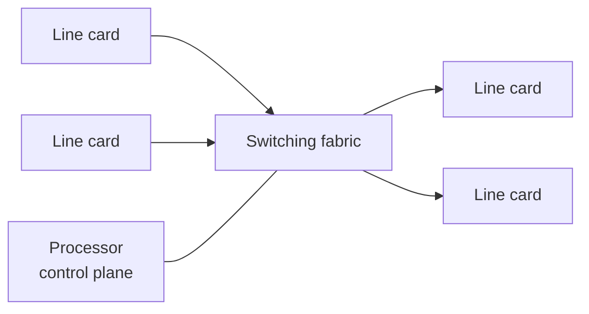

The lecture zooms out to a network of four routers. Each router is drawn as a **Hardware** layer (connected to its neighbours by solid lines: data links) with a **Software** layer on top (connected to the other routers' software by dotted lines: routing protocol messages). In a traditional network, **every router has its own copy of the control software**, and the copies talk to each other to agree on routes.

---

## 6. The data plane at work: IP forwarding

The lecture says the data plane runs **streaming algorithms on packets**: for each packet, it **matches on some header bits** and **performs some actions**.

The example is **IP forwarding**. Two local networks are joined by routers over a WAN:

- **LAN 1** = `1.2.3.0/24`, with hosts `1.2.3.4`, `1.2.3.7`, …, `1.2.3.156`.
- **LAN 2** = `5.6.7.0/24`, with hosts `5.6.7.8`, `5.6.7.9`, ….

The left router's **forwarding table** has two rows: `1.2.3.0/24` → towards LAN 1 (left arrow), and `5.6.7.0/24` → towards the WAN and LAN 2 (right arrow).

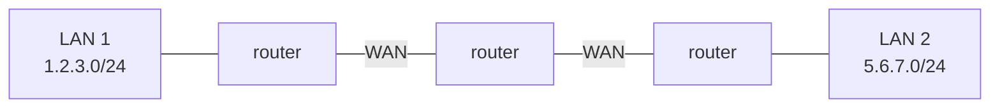

When a packet for `5.6.7.9` arrives at the left router, the router looks only at the destination address, finds that it starts with `5.6.7`, so it matches `5.6.7.0/24`, and sends the packet to the right. That is the whole job: match, then act.

> **Kid example.** A post office worker reads only the first part of the postcode and drops the letter into the right bag. They never open the letter, and they don't decide which bags exist; someone else did that.

---

## 7. The control plane at work: computing paths

The lecture says the control plane **computes the paths** packets will follow and **populates (fills in) the forwarding tables**. Traditionally this is done by a **distributed protocol**. The example is **link-state routing** (OSPF, IS-IS):

1. **Flood** the entire topology to all nodes: every router tells every other router which links it has.
2. **Each node computes shortest paths** using **Dijkstra's algorithm**.

The lecture adds a joke in brackets: "Dijkstra's algorithm (**not** the token ring algorithm)". Edsger Dijkstra invented both a shortest-path algorithm and a famous self-stabilizing token ring algorithm; this course teaches both, so the lecture warns you not to mix them up.

The lecture shows the result: a router learns "**if a packet is going to B, then send it to output 3**". Steps: (1) figure out which routers and links are present; (2) run Dijkstra's algorithm to find shortest paths. The rule is then copied into the data plane, and a packet with destination B is sent out of port 3 at every hop along the red path.

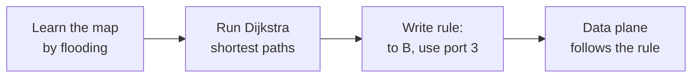

> **Beyond the slides.** For how Dijkstra's algorithm and OSPF work step by step, see the Internet routing guide (10-Internet-Routing.md) in this folder.

---

## 8. The management plane: traffic engineering

The lecture uses **traffic engineering** as the management plane example. In OSPF, every link has a **weight**, and "shortest path" means the path with the smallest total weight. So the operator can steer traffic by **setting the weights**. But how should they choose them? The lecture asks three questions:

- Weights **inversely proportional to link capacity**? (Fast links get small weights, so traffic prefers them. This is Cisco's default for OSPF.)
- Weights **proportional to propagation delay**? (Short links get small weights, so traffic takes the quickest route.)
- **Network-wide optimization based on traffic**? (Measure the traffic and compute weights that spread it best.)

There is no perfect answer, and each weight change can move lots of traffic at once. This leads to the next section.

---

## 9. Why traditional networks are hard to control

The lecture lists four **challenges**:

- **(Too) many task-specific control mechanisms.** One protocol for routing, another for access control, another for quality of service. **No modularity** (you cannot reuse pieces), and limited functionality.
- **Indirect control.** You cannot simply say "send this traffic along that path". You have to **invert the protocol's behaviour** and "**coax**" it into doing what you want. Example: to move traffic, you **change link weights instead of paths**, and hope that the protocol then picks the paths you wanted. One weight change can move lots of other traffic too.
- **Uncoordinated control.** You **cannot control which router updates first**. While routers update one by one, the network is briefly inconsistent (loops, black holes).
- **Interacting protocols and mechanisms.** Routing, addressing, access control and QoS all affect each other.

The result: the network is **hard to reason about, hard to evolve, and expensive**.

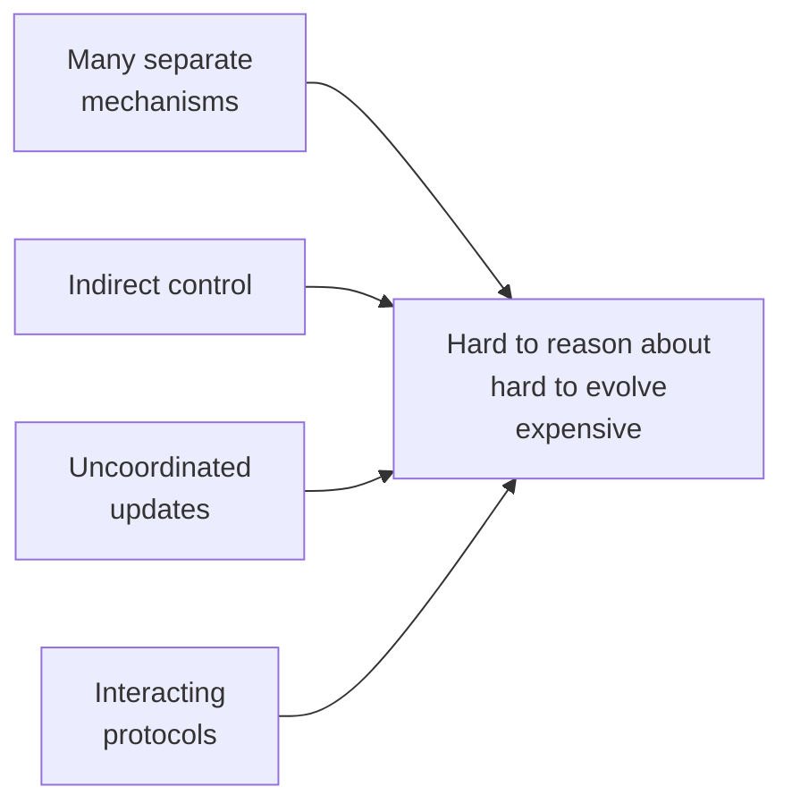

> **Kid example of indirect control.** You want your little brother to walk home by the park road. You are not allowed to tell him the route; you can only tell him "the shop road is very long". He might take the park road, or a third road you never thought of.

---

## 10. Example 1: inter-domain routing with BGP

The lecture says that BGP, today's routing protocol between networks, **artificially constrains routes**:

- It routes **only on destination IP address blocks** (prefixes).
- A network can **only influence its immediate neighbours**.
- It is **very difficult to add other information** to the decision.

Things operators would like to do, but BGP makes hard:

- **Application-specific peering**: route video traffic one way and other traffic another way.
- **Blocking denial-of-service traffic**: drop unwanted traffic further **upstream** (before it reaches you).
- **Inbound traffic engineering**: split *incoming* traffic over several peering links.

The lecture points to **inter-domain software-defined routing** as a fix, citing Chen et al., "Software-defined inter-domain routing revisited", IEEE ICC 2016. Because SDN rules can match on many header fields, not only the destination ([section 19](#19-match-action-primitives)), all three wishes become possible.

> **Kid example.** BGP is like a delivery company that only looks at the town name on a parcel. You cannot tell it "send all the fragile parcels by the smooth road", because it never reads the word "fragile".

---

## 11. Example 2: access control goes wrong

The lecture tells a short story.

**The network.** Two locations, **Chicago (chi)** and **New York (nyc)**. Each has a **Data Center** and a **Front Office**. Routers: R1 (chi data centre), R2 (chi front office), R3 (nyc data centre), R4 (nyc front office), and R5 between R2 and R4. All routers exchange routes over all links.

**The policy.** Each front office may not reach the *other* city's data centre. So there are two **packet filters**:

- On **R1**: "Drop nyc-FO → \*, Permit \*" (drop anything from the New York front office, allow everything else).
- On **R3**: "Drop chi-FO → \*, Permit \*".

Originally, the only way from chi-FO to the nyc data centre is R2 → R5 → R4 → R3, so R3's filter catches it.

**The change.** Someone adds **a new short-cut link between the two data centres** (R1 to R3), intended for backup traffic.

**The problem.** "Oops: the new link lets packets **violate the access control policy**!" Routing changed automatically and now prefers the shorter path R2 → R1 → R3 for chi-FO traffic. R1 does not drop it (R1 only drops nyc-FO). R3's filter was set up on the old way in (from R4), so traffic arriving over the short-cut is never checked. **Routing changed, but packet filters do not update automatically.**

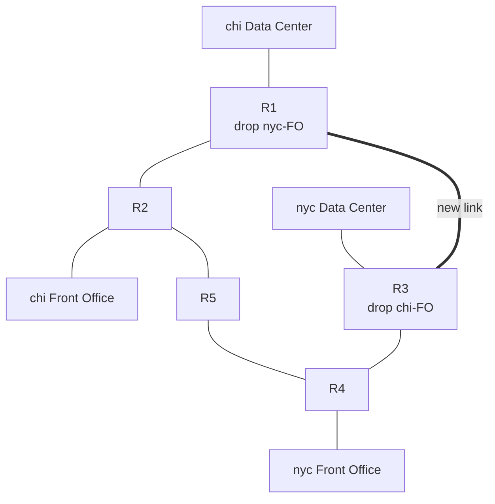

The lesson: in a traditional network, routing and access control are **separate mechanisms that interact** ([section 9](#9-why-traditional-networks-are-hard-to-control)). Nobody reasons about both together. With SDN, one controller knows the topology *and* the policy, so when a link is added it can recompute routes and filters together.

> **Kid example.** A school puts a guard at the front door to keep visitors out. Then a builder adds a back door to make deliveries faster. Nobody tells the guard, so visitors simply walk in through the back.

---

## 12. How SDN changes the network

**Before.** Every box is a vertical stack: **custom hardware**, its own **OS**, and its own **features** on top. Five boxes means five separate brains, each from a vendor, each configured by hand.

**After (top).** The features become **programs** that run on one **Network OS**, which controls all the boxes.

The lecture lists three things SDN needs:

1. **An open interface to packet forwarding** (so software can tell any switch what to do).
2. **At least one Network OS**, probably many, both open-source and closed-source.
3. **A consistent, up-to-date global network view.**

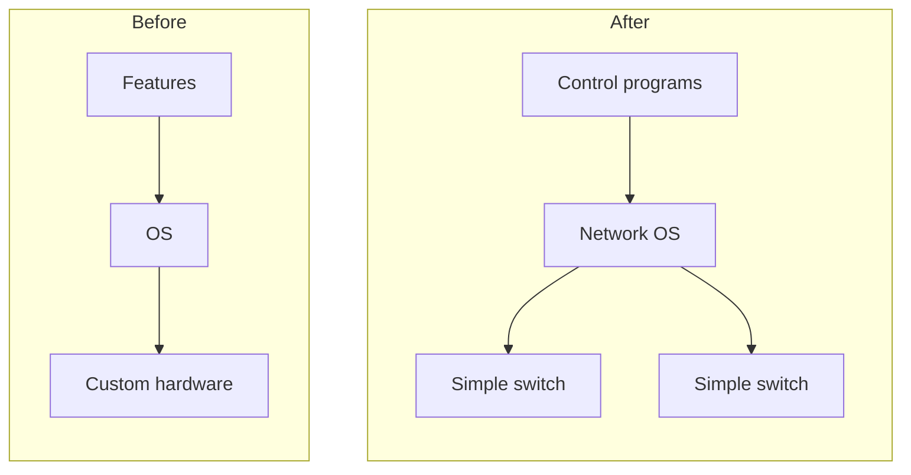

> **Kid example.** Before: every phone maker wrote its own system and all its own apps. After: one operating system (like Android) runs on many phones, and anyone can write apps for it.

---

## 13. The network OS

The lecture defines it:

- The **Network OS** is **a distributed system that creates a consistent, up-to-date network view**.
- It **runs on servers (controllers)** in the network.
- Examples: **NOX, ONIX, Floodlight, Trema, OpenDaylight, HyperFlow, Kandoo, Beehive, Beacon, Maestro**, and more.
- It uses the forwarding abstraction ([section 15](#15-the-forwarding-abstraction)) in two directions: to **get state information** from the forwarding elements (switches), and to **give control directives** to them.

The lecture shows the layering: **Control Program A** and **Control Program B** on top, the **Network OS** (with its small network graph) in the middle, and plain **Packet Forwarding** boxes at the bottom, linked to the network OS by dotted control connections.

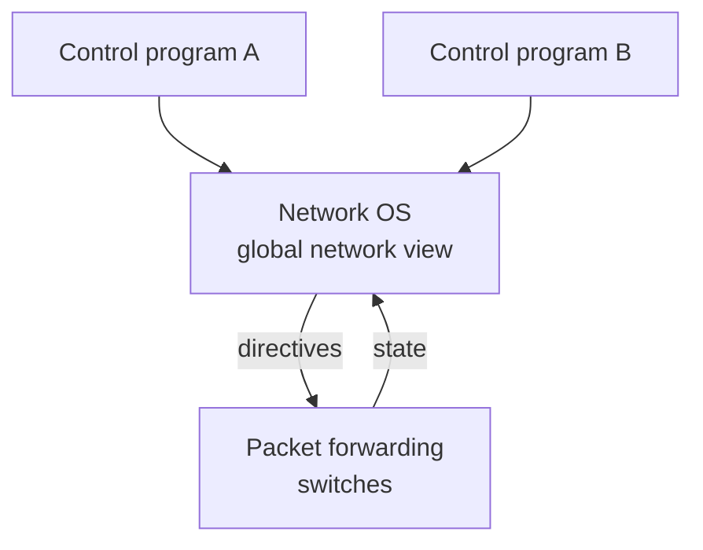

---

## 14. Control programs

The lecture describes a **control program** (an SDN "app"):

- It **operates on a view of the network**.
- **Input**: the **global network view** (a graph or a database).
- **Output**: the **configuration of each network device**.
- A control program **is not a distributed system**. The abstraction **hides the details of the distributed state**: the control program sees one clean graph, not hundreds of switches sending messages at different times.

This is the main gift of SDN to programmers. Writing a correct distributed protocol (like OSPF) is hard; writing a function "graph in, rules out" is much easier. For example, a routing control program can simply run Dijkstra's algorithm on the graph and output "to B, use port 3" for every switch.

> **Kid example.** Planning a trip with the whole map spread out on a table is much easier than asking for directions at every crossroads.

---

## 15. The forwarding abstraction

The **purpose** of the forwarding abstraction is a **standard way of defining forwarding state**. It must be:

- **Flexible**: its behaviour is specified by the control plane, and it is built from a **basic set of forwarding primitives**.
- **Minimal**: **streamlined for speed and low power**, so switches stay fast and cheap.
- So the **control program is not vendor-specific**: the same program works on switches from any company.

**OpenFlow is an example** of such an abstraction ([section 18](#18-openflow-basics-flow-tables)).

> **Kid example.** A USB plug: every brand of computer and every brand of mouse agree on the same simple plug, so any mouse works with any computer.

---

## 16. Virtualization and the network hypervisor

The lecture adds one more layer. From the bottom: the switches; the **Network OS**, which builds the **global network view**; the **network hypervisor**, which turns that view into a **virtual topology**; and the control program on top, which sees only the virtual topology.

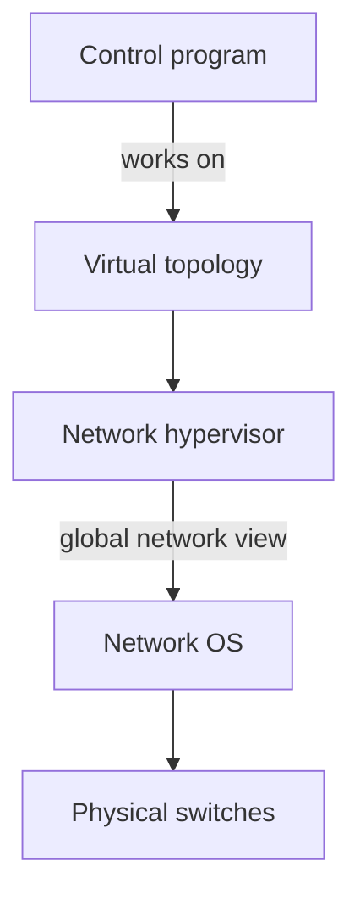

"**Virtualization simplifies the control program**". An example:

- The control program sees an **abstract network view**: hosts **A** and **B** attached to one big switch. Its whole policy is one line: "**A → B drop**".
- The real **global network view** has many switches and many paths between A and B.
- "**Hypervisor then inserts flow entries as needed**": it places "A → B drop" rules on the real switches (the lecture shows the rule on two of them, near A) so that the policy holds whatever path the traffic would take.

> **Kid example.** You tell the building manager "my child may not go into the kitchen". You don't need to know where all the doors are; the manager works out which real doors to lock.

---

## 17. Does SDN simplify the network?

The lecture answers honestly:

- **Abstraction doesn't eliminate complexity.** The **network OS and the hypervisor are still complicated pieces of code**.
- SDN's main achievements:
  - it **simplifies the interface for the control program** (the part each user writes), and
  - it **pushes complexity into reusable code** (the SDN platform),
  - "**just like compilers**".

A compiler is a hard program, but it is written once by experts, and then millions of programmers write easy code on top of it. In the same way, the network OS is hard, but it is written once, and then many simple control programs reuse it.

---

## 18. OpenFlow basics: flow tables

The lecture introduces **OpenFlow**. The picture: control programs A and B on a **Network OS**, which talks to the **packet forwarding** boxes. Inside a switch is a **flow table**. The network OS writes rules into it, for example:

- "If header = **p**, send to port 4"
- "If header = **q**, overwrite header with **r**, add header **s**, and send to ports 5, 6"
- "If header = **?**, send to me"

The first rule is ordinary forwarding. The second rule both **modifies** the packet and sends copies out of **two** ports (multicast). The third rule handles a packet whose header the switch does not recognise: "send to me" means **send it to the controller**, because "me" is the network OS that is speaking.

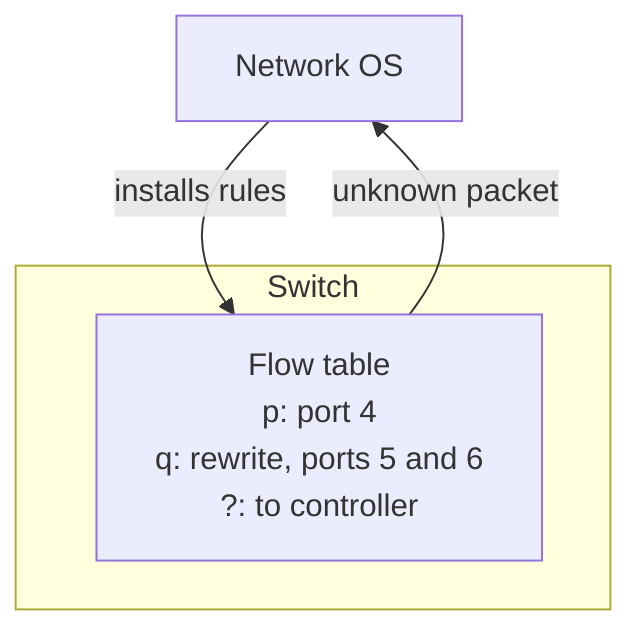

> **Note on the source.** The lecture's explanation reads "send to me" as the switch sending the packet "to itself". That is a misreading. In OpenFlow, a packet that matches no rule (a **table miss**) is sent **to the controller**, which then decides what to do. The SDN quiz uses the same answer: "The switch forwards the packet to the controller for decision-making".

> **Kid example.** A sorting machine at the post office has a rule card: "postcode 412 → bin 4". If a letter has a postcode that is not on the card, the machine puts it in a tray for the supervisor, who decides and writes a new line on the card.

---

## 19. Match-action primitives

The lecture lists the building blocks, written as **<Match, Action>** pairs.

**Match**: match **arbitrary bits in headers**.

- Match on **any header**, or even a **new header** that has not been invented yet.
- This **allows any flow granularity**: a rule can be as broad as "all packets" or as narrow as "this one TCP connection".
- The lecture's example pattern is `1000x01xx0101001x`. Each `x` is a **wildcard** ("don't care"); every other bit must be equal.

For example, with that pattern:

| Header bits | Match? | Why |
|---|---|---|
| `10001010101010010` | yes | every fixed bit is equal; the four `x` positions hold 1, 0, 1, 0, which do not matter |
| `10000010001010011` | yes | same fixed bits; different values under the `x` |
| `00001010101010010` | no | the first bit must be 1 |

**Action**:

- **Forward** to one or more ports, **drop**, or **send to the controller**.
- **Overwrite the header with a mask** (change some fields), **push or pop** a header (add or remove an extra header, such as a tunnel or VLAN tag).
- **Forward at a specific bit-rate** (rate limiting).

> **Kid example.** A normal rule card says only "postcode → bin". A match-action rule card can say "red envelopes from Gothenburg with a gold stamp → put a new label on them and send a copy to bins 5 and 6".

---

## 20. OpenFlow rules and statistics

"**Exploit the flow table in switches, routers, and chipsets**": OpenFlow reuses the tables that switch chips already have (this is why it could run on existing hardware, [section 25](#25-why-sdn-happened-now-the-drivers)). The flow table is a list, Flow 1, Flow 2, … Flow N. Each row has three parts:

| Rule | Action | Statistics |
|---|---|---|
| a match pattern, **exact or wildcard** | what to do with matching packets | counters: how many packets and bytes matched |

The last row (Flow N) holds the **default action**, used when nothing else matches.

The **statistics** let the controller measure the network: it can ask each switch "how much traffic matched each rule?" and use the answer, for example, for traffic engineering.

---

## 21. Execution example: one web connection

The lecture shows this as a step-by-step picture story (with a video: youtu.be/l25Ukkmk6Sk at 2 min 38 s). It has one switch **S1**, one controller **C0**, and four hosts **H1 to H4** on ports eth1 to eth4. Host H1 opens a web (HTTP, port 80) connection to H4. At the start, S1's flow table is empty.

**Step 1, the first packet.** H1 sends a TCP **SYN** to H4 port 80. S1 has no rule, so it stores the packet in a buffer (**buffer ID 250**) and sends a **Packet-IN** to C0. The lecture shows two possible answers from the controller:

- **Packet-OUT**: "for buffer 250: forward to port 4". This handles **only this one packet**.
- **Flow-MOD**: install a rule in the flow table, with: match and mask (H1 → H4, port 80), buffer ID 250, **idle timeout 20**, **hard timeout 60**, **action: forward to port 4**, **priority 5000**. The buffered SYN goes out of port 4, and S1 now has the entry "**H1 → H4 port 80**".

**Step 2, the reply.** H4 answers with **SYN/ACK**. There is no rule for traffic from H4 to H1 yet, so S1 buffers it (**buffer ID 251**) and sends another Packet-IN. Again the lecture shows a Packet-OUT ("forward port 1") and a Flow-MOD (same settings, action forward to port 1). S1 now also has the entry "**H4 → H1 reply**".

**Step 3, everything else.** The final **ACK**, the **HTTP request** and the **HTTP reply** all match the two installed rules. The switch forwards them **by itself**, at full speed, **without asking the controller**.

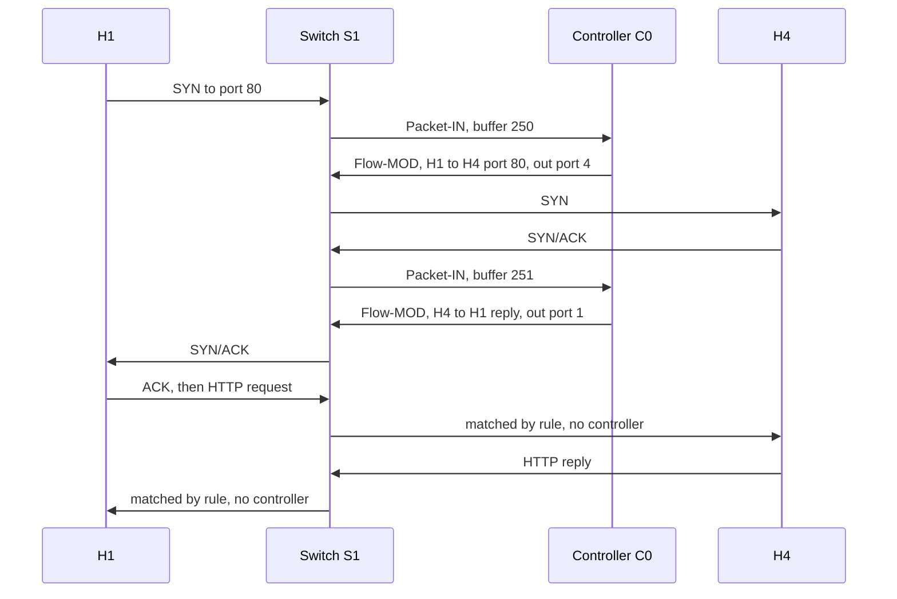

What to learn from it:

- **Only the first packet of each new flow** goes to the controller. That trip adds delay to the first packet (the "flow set-up" latency).
- After that, the **controller is not involved** in each packet. Forwarding stays distributed and fast.
- **Packet-OUT** answers one packet; **Flow-MOD** installs a rule for all later packets.

> **Beyond the slides.** In OpenFlow both timeouts are counted in **seconds**. The **idle timeout (20)** removes the rule when no packet has matched it for 20 seconds; the **hard timeout (60)** removes it 60 seconds after it was installed, even if it is busy. When several rules match one packet, the one with the **highest priority** number wins. Timeouts make old rules clean themselves up: a wrong or stale rule cannot stay in the switch forever, which is exactly the kind of property that the self-stabilization part of this course cares about.

---

## 22. Out-of-band control

This part is about where the controller lives and how it talks to the switches.

- The control plane is **logically centralized**, and **possibly physically distributed** (several controller servers). Being distributed gives:
  - **Reliability**,
  - **Availability**,
  - **Scalability**,
  - **Low latency** (a controller close to each part of the network).
- **Out-of-band SDN control**: a **physically or logically separate network** acts as the controller entity. The figure (image from packetlife.net) shows a **controller** on top, connected by blue dashed lines (the control plane) to every switch, and the switches connected to each other by green solid lines (the forwarding plane).

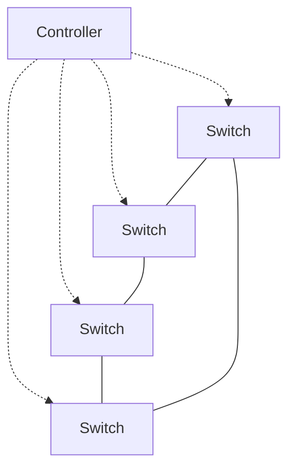

The trade-off: Out-of-band control is clean and isolated (good for **security** and reliability: data traffic cannot block control messages), but it **costs** a second network, adds **complexity**, and the control network itself can break and cut switches off from the controller.

> **Kid example.** The head teacher has a private walkie-talkie to every classroom. It always works, even when the corridors are full, but someone has to buy and charge all those walkie-talkies.

---

## 23. In-band control

In **in-band SDN control**, control traffic goes either

- **Through a dedicated management port** of the switch (**Controller A** in the figure), or
- **Multiplexed with data-plane traffic** (**Controller B**): the controller's messages travel over the **same links as normal data**, through other switches, and reach the switch's control module through an internal link.

**Benefits: less cost, higher redundancy, increased partition tolerance.**

- **Less cost**: no separate control network to build.
- **Higher redundancy**: the data network has many paths, so there are many ways to reach the controller.
- **Increased partition tolerance**: if one link breaks, control messages can go around it.

The figure shows an "abstract SDN switch": a control module with its **forwarding rules**, a switch fabric, data links to hosts and to neighbouring switches, and the two controllers.

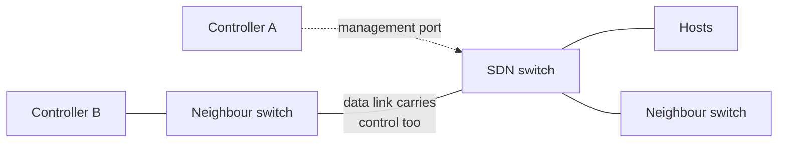

**The catch: a chicken-and-egg problem.** In in-band control, a switch forwards packets, including the controller's own messages, **only according to its rules**, and the rules are installed by the controller. So the controller needs working paths in order to install the paths it needs. After a failure, or when rules are wrong, some switches may be cut off from the controller. This is why the lecture title says "**self-stabilizing** SDN": the course's algorithms (for example the self-stabilizing BFS spanning tree) can rebuild correct in-band paths from any starting state. See the 2020 exam question in [section 29](#29-old-exam-questions-on-sdn).

> **Note on the source.** The lecture lists "network overhead" as a *drawback* of in-band control, while one old exam's answer key gives "reduced network overhead (no separate control network needed)" as its main *benefit*. Both are true in different senses: in-band needs **less infrastructure** (no second network), but control messages **add load to the data links**. In an exam, answer with the lecture's words: less cost, higher redundancy, increased partition tolerance.

> **Beyond the slides.** The abstract-switch figure looks like the one in the research paper "Renaissance: A self-stabilizing distributed SDN control plane" (ICDCS 2018), which the course's introduction slides mention. That paper bootstraps in-band control from any state, with several controllers.

> **Kid example.** In-band is like the head teacher's notes being passed hand to hand through the same corridors the students walk in. It is free and there are many corridors, but if the children don't know which way to pass the notes, the notes get stuck.

---

## 24. The road to SDN

The part "Recent SDN development" starts with "**The Road to SDN**", which follows the paper by N. Feamster et al., "The Road to SDN: An Intellectual History of Programmable Networks", ACM SIGCOMM CCR 2014:

| Period | Step | What it brought |
|---|---|---|
| 1990s | **Active Networking** | First attempt to make networks programmable: demultiplexing packets to software programs, network virtualization, … |
| 2003–2007 | **Control/data plane separation**: ForCES [IETF], RCP, 4D [Princeton, CMU], SANE/Ethane [Stanford/Berkeley] | **Open interfaces between the data and control plane**, and **logically centralized control** |
| 2008 | **OpenFlow API and network OSes**: OpenFlow switch interface [Stanford], NOX network OS [Nicira] | A simple standard interface that existing switches could support |

The middle step **most directly** led to SDN's split of control and data, because it created the **open interfaces** between them.

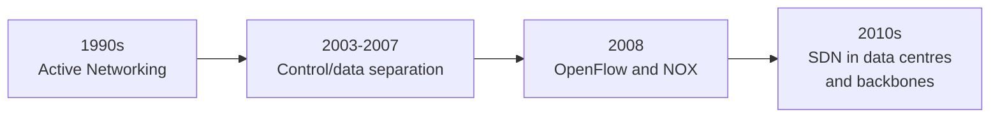

> **Note on the source.** The lecture's explanation contains two mistakes here. (1) They call SANE "Scalable Network Emulation". SANE stands for **Secure Architecture for the Networked Enterprise** (Casado et al., 2006), a security design in which a central controller decides which flows may talk; Ethane (2007) was its practical follow-up. (2) They say RCP (the "Routing Control Platform") came from Princeton and Carnegie Mellon. RCP was built by researchers at **Princeton and AT&T Labs**; it is **4D** that was Princeton and CMU, as the lecture's own timeline says.

> **Note on the source.** The outline promises a "**4D discussion**", but the lecture never covers 4D beyond its name in the timeline. In short: 4D (around 2005) proposed splitting the network into four planes (decision, dissemination, discovery, data) with a central **decision** plane that has a network-wide view and directly sets the data plane; this is the same idea as SDN's logically centralized controller.

---

## 25. Why SDN happened now: the drivers

The lecture lists the **SDN drivers**:

- **Rise of merchant switching silicon**: cheap standard switch chips "**democratized switching**", and new **vendors were eager to unseat the incumbents** (the old big router companies).
- **Cloud and data centres**: their **operators face real network management problems**, are **extremely cost conscious**, and **desire a lot of control**.
- **The right balance between vision and pragmatism**: **OpenFlow is compatible with existing hardware**, so nobody had to buy new chips. (Earlier ideas such as Active Networking or ForCES needed special hardware or deep changes.)
- **A "killer app": network virtualization** ([section 26](#26-virtualization-is-the-killer-app)).

> **Kid example.** Smartphones took off when cheap chips, app stores and a must-have app all arrived at the same time. SDN took off when cheap switch chips, data-centre needs and network virtualization arrived together.

---

## 26. Virtualization is the killer app

Consider a **multi-tenant data centre** (like a cloud provider):

- It wants to let **each tenant specify a virtual topology**. This defines the tenant's own **policies and requirements**.
- The data centre's **network hypervisor compiles these virtual topologies into a set of switch configurations**.
- It **takes 1000s of individual tenant virtual topologies** and **computes configurations to implement all of them simultaneously**.
- "**This is what people are paying money for**."
- It is **enabled by SDN's ability to virtualize the network**.

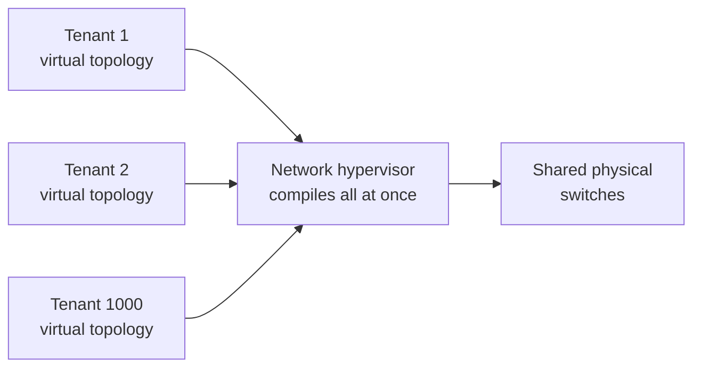

Each tenant gets its own topology, addresses and rules, all on the same shared switches, and tenants cannot see or disturb each other.

> **Kid example.** One big apartment building (the physical network). Each family (tenant) draws its own floor plan. The building manager (hypervisor) works out which real walls and doors to put up so that every family gets what it drew, and no family can walk into another's flat.

---

## 27. Practical challenges

The lecture lists six challenges. The lecture's word "**decision elements**" means the controllers:

| Challenge | Lecture's words | What it means |
|---|---|---|
| **Scalability** | decision elements responsible for many routers | One controller for many switches can become a bottleneck as the network grows. |
| **Reliability** | surviving failures of decision elements and routers | If the controller fails with no backup, switches keep forwarding with their old (**stale**) rules, but nobody can add rules or react to changes. |
| **Response time** | delays between decision elements and routers | The first packet of a new flow waits for the controller's answer ([section 21](#21-execution-example-one-web-connection)). |
| **Consistency** | ensuring multiple decision elements behave consistently | Several controllers must agree, or they install conflicting rules (loops, black holes). Agreeing costs messages and time. |
| **Security** | network vulnerable to attacks on decision elements | Whoever takes over the controller takes over the whole network. |
| **Interoperability** | legacy routers and neighbouring domains | Old routers and other networks don't speak OpenFlow. |

Notice the tension between the first four: **one** controller is simple and consistent but is a bottleneck and a single point of failure; **many** controllers scale and survive failures but must be kept consistent. An old exam names this the key challenge: "balancing scalability and response time" against a consistent network-wide state.

> **Beyond the slides.** Distributed controllers usually keep their copies of the network view the same by **replicating state with a consensus protocol** (for example Paxos or Raft), so that if one controller dies, another takes over with the same knowledge. An old exam question asks exactly this.

---

## 28. Summary

In short:

**Core concepts**

- SDN **separates the control plane from the data plane**.
- Control is **logically centralized but physically distributed**.
- The **management plane defines policies and operator intent**.
- **Motivation**: traditional networks are **complex, inflexible and error-prone**.

**How SDN works**

- The **Network OS maintains a global, consistent view** of the network.
- **Control programs define high-level policies** on this view.
- **Forwarding devices use match-action rules** (for example OpenFlow).
- **Virtualization enables multi-tenancy** via abstract topologies.

**Applications and use cases**

- **Access control**: centralized enforcement, fewer misconfigurations.
- **Network virtualization**: the key SDN use case in multi-tenant data centres.
- **Traffic engineering**: flexible, programmable path selection.
- **Benefits**: programmability, rapid innovation, cloud-scale efficiency.

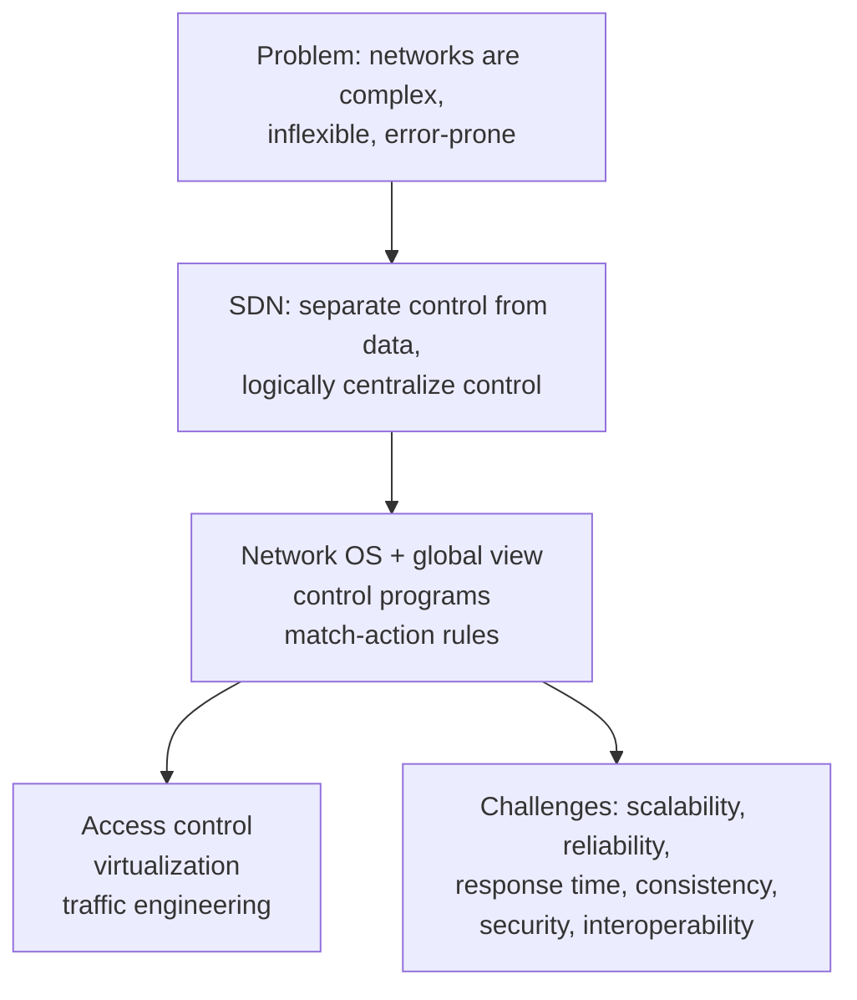

---

## 29. Old exam questions on SDN

> **Beyond the slides.** These come from the course's old exams. The model answers below are built from the lectures and the exam guides in this project.

**August 2020, question 1.b (8 points).**

*1.b.i (2 points): "Explain what is the functionality that packet forwarding rules serve in SDNs."*

Model answer: in SDN the control plane (the controller) is separated from the data plane (the switches). The controller computes the forwarding state and installs it in each switch as **forwarding rules ⟨match, action⟩** in the flow table. A rule matches header fields of a packet and gives the action: forward to some port(s), drop, rewrite a header, or send to the controller. So the rules **are** the data plane's instructions: every packet, including the controller's own packets in the in-band case, is moved only according to them.

*1.b.ii (6 points): "Can any of the algorithms of item 1.a [spanning tree and routing algorithms] help to construct in-band routing in SDNs? If yes, how?"*

Model answer: yes, the **self-stabilizing BFS spanning tree** can help.

1. Make each controller the **root of a BFS spanning tree** over the switches. Each switch gets a parent (its next hop towards the controller) and a distance.
2. **Turn the tree into rules**: in every switch, install "packets addressed to controller c → forward to my parent's port in c's tree", and rules for the opposite direction (to the child whose subtree holds the destination switch).
3. In plain OpenFlow the switches cannot compute, so the controller runs the BFS logic itself: it learns its direct neighbours, installs rules to reach them, uses those rules to discover the next layer, and so on, layer by layer.
4. **Self-stabilization**: repeat the construction forever and remove rules that do not fit the current tree (for example with timeouts). Then, from any starting state (wrong rules, missing rules, failed links), the in-band paths become correct within O(d) rounds after the last fault, where d is the network diameter.

Benefits to mention: less cost, higher redundancy, increased partition tolerance.

**October 2021, question 1.l (true or false).** "The success of SDN happened because it made the management of layer 2 protocols much more cost-efficient." Official answer: **True**. Reason (the SDN drivers, section 25): cheap merchant switching silicon, cost-conscious data-centre operators who want control, and network virtualization as the killer app. (The statement is a bit loose, because SDN rules match many header fields, not only layer 2; still answer True.)

**Multiple-choice traps seen in old exams and the quiz.**

- OpenFlow switches do **not** run Dijkstra's algorithm; they **match headers against flow-table entries and execute actions**. Path computation is in the controller.
- **In-band** = control and data share the **same** physical network. A dedicated separate link is **out-of-band**.
- Routing changes can break security because **packet filters may not update automatically** (section 11). SDN controllers *can* push filter updates; that is SDN's fix.
- Controller fails with no backup → packets **keep flowing on stale rules**; nobody takes over.
- What made SDN succeed where Active Networking and ForCES did not: a **vendor-neutral open interface** that worked on **existing hardware**.
- The SDN feature that fixes the "lack of modularity": **separation of control and data planes**.
- The management plane works on the **human timescale** (minutes to hours): long-term analysis and configuration.

---

## 30. Related quiz topics not in the lectures

> **Beyond the slides.** The course's pre-lecture SDN quiz (29 questions) also asks about a few details that the lecture only hints at. Short explanations:

- **Controller is not on the per-packet path.** Separating the planes gives **centralized control while forwarding stays distributed**: every switch forwards its own packets at full speed. Only the first packet of a new flow may visit the controller.
- **Table miss in newer OpenFlow.** In OpenFlow 1.0 a packet that matches nothing goes to the controller. From OpenFlow 1.3 the behaviour is set by a lowest-priority "table-miss" rule (often "send to controller"); with no such rule the packet is dropped. The classic answer, and the lecture's answer, is "send to the controller".
- **Flow set-up latency.** "Per-packet controller intervention in initial flow set-up" is the factor that adds latency in SDN decision-making.
- **Dynamic traffic engineering.** Because one controller sees everything and can reprogram every switch, an operator can move traffic by changing **one global policy**.
- **Abstract views.** A tenant's abstract view (for example "A and B on one big switch") lets the tenant define a **logical topology** over the shared physical network; the hypervisor **compiles** it into flow-table entries. The hypervisor does not tune MTUs, assign MAC addresses or start a virtual machine per rule.
- **Interoperability.** The common problem is that **traditional routers do not support OpenFlow**. Controller logic is software on servers, not switch firmware.
- **Consistency between controllers.** Controllers must **synchronize their updates** so that they do not install conflicting rules, and this coordination **adds communication overhead**.
