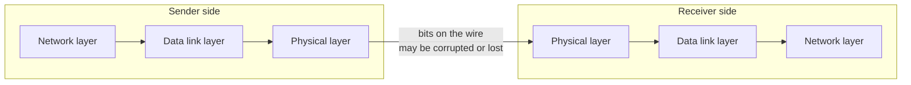
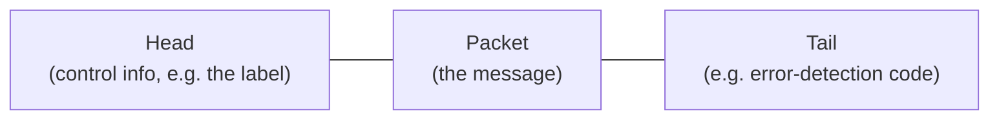
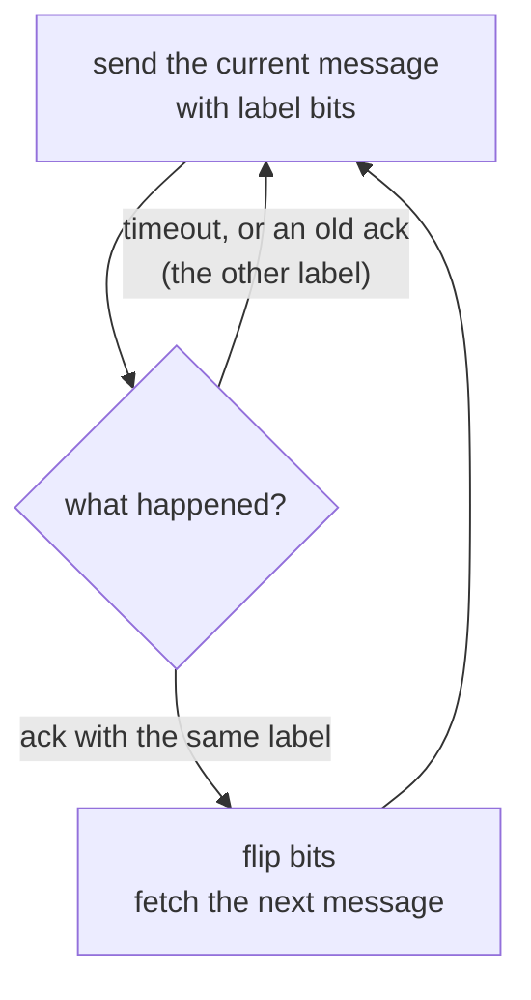
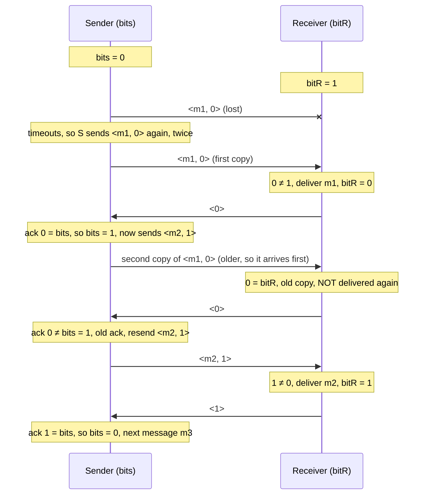
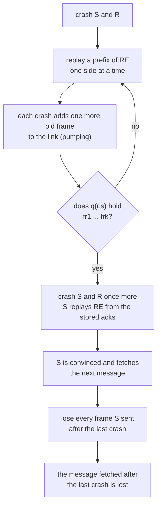
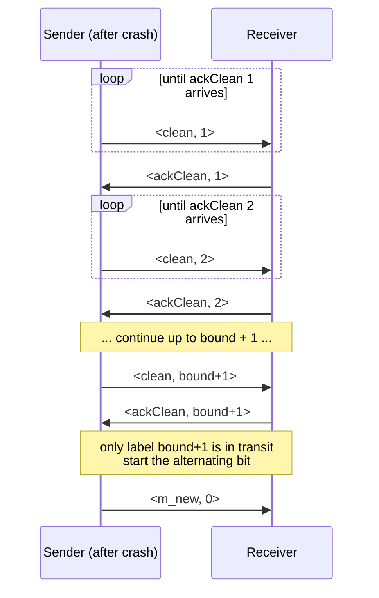
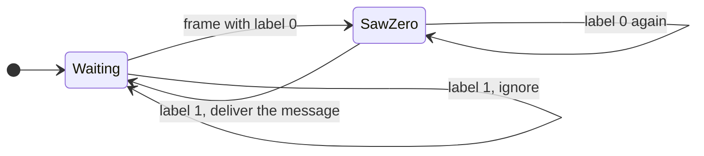

# Self-Stabilizing Data Link: Why Crashes Force Us to Self-Stabilize

**Course:** EDA387/DIT663 Computer Networks, part 2 (Fault-tolerant Algorithms for Computer Networks), lecture "Self-Stabilizing Data-Link (Ch. 3)". The lecture follows chapter 3 of Dolev, *Self-Stabilization*: §3.1 "Initialization of a Data-Link Algorithm in the Presence of Faults" and §3.2 "Arbitrary Configuration Because of Crashes". The self-stabilizing data-link *algorithms* themselves (unbounded counter, bounded labels, random labels) are taught in the next lecture and have their own guide, *13 Model Conversions*.

**Revised:** 21 October 2026

**† Supplementary material:** content that comes only from hidden PowerPoint slides. It may not be part of this year's examinable material. More than half of this short lecture is hidden material, and the lecture also says that the details of two proofs were "skipped this year". So the visible, examinable core is: the data-link task, the alternating-bit algorithm, its run example, and the two **statements** (no crash-tolerant data link exists; crashes can create any configuration). The proofs and the crash-resilient algorithm are †.

**Notes in the text.** Paragraphs that begin with **Technical clarification** mark places where the lecture material is wrong, inconsistent or imprecise, and give the correct statement. Paragraphs that begin with **Additional context** add material from outside the lecture, such as the course book (Dolev), old exams, the pre-lecture quizzes or general knowledge.

---

## Glossary

| Term | Expansion or category | Meaning |
|---|---|---|
| Acknowledgement (ack) | — | A frame the receiver sends back to say "I got it". In the alternating-bit algorithm the ack is just the receiver's current bit. |
| After-crash state | — | The special state a processor is put in by a crash. Everything it knew before the crash is lost. |
| Alternating-bit algorithm | — | A data-link algorithm that labels each message with one bit, 0 or 1, and flips the bit for every new message. |
| Asynchrony | — | There is no bound on how long a step or a frame delivery can take, so "it is late" never proves "it is lost". |
| At-most-once delivery | — | No message is delivered twice (but a message may be missed). |
| bound | — | In the crash-resilient algorithm: the largest number of frames that can be in transit in both links together. |
| Channel capacity | — | How many frames a link can hold "in flight" at the same time. The impossibility result assumes it is **unlimited**. |
| Configuration | — | A snapshot of the whole system: the state of every processor plus the contents of every link. |
| CrashS / CrashR | — | A crash step of the sender / of the receiver. It moves that processor to its after-crash state. |
| Data-link layer | — | The layer that delivers messages between two **directly connected** computers over an unreliable wire. |
| Error-detection code | — | Extra bits (for example a checksum) that let the receiver notice and throw away a corrupted frame. |
| Exactly-once delivery | — | Every message is delivered, and none is delivered twice. |
| FIFO | First In, First Out | Frames leave a link in the same order they entered it. Dolev's links are FIFO queues. |
| Frame | — | One unit sent by the data-link layer: a head, the packet (the message), and a tail. |
| Frame loss | — | A frame disappears on the link and never arrives. |
| Initialization procedure | — | Code run after a crash to put the algorithm back in a correct starting state. |
| Label (sequence number) | — | A small number attached to a frame so the receiver can tell new frames from old copies. |
| Missing-label concept | — | If there are more possible labels than frames that can exist, at least one label is missing from the system, and it can be used as a "fresh" label. |
| Network layer | — | The layer above the data link; it hands messages down to be sent and receives delivered messages. |
| Packet | — | The message from the network layer, carried inside a frame. |
| Physical layer | — | The layer below the data link: it moves raw bits over the wire. |
| Pumping technique | — | Dolev's proof method: crash S and R again and again and replay parts of a normal run, so that old frames pile up in the links. |
| q(s,r) / q(r,s) | — | The queue of frames in transit from the sender to the receiver / from the receiver to the sender. |
| Reference execution (RE) | — | A normal, loss-free "ping-pong" run after both processors crash, used as the raw material for the pumping technique. |
| Self-stabilizing | — | Starting from **any** configuration, the system eventually behaves correctly by itself. |
| Timeout | — | A timer that fires when no answer came for a while; the sender then sends the frame again. |
| Undetectable crash/resume | — | A processor crashes and restarts, and the other side has no way to notice that it happened. |

## Contents

- [1. The data-link task and the alternating-bit algorithm](#1-the-data-link-task-and-the-alternating-bit-algorithm)
  - [1.1 Where this lecture fits](#11-where-this-lecture-fits)
  - [1.2 The data-link task](#12-the-data-link-task)
  - [1.3 The alternating-bit algorithm](#13-the-alternating-bit-algorithm)
  - [1.4 A run of the alternating-bit algorithm](#14-a-run-of-the-alternating-bit-algorithm)
- [2. Crashes and the impossibility of initialization](#2-crashes-and-the-impossibility-of-initialization)
  - [2.1 Theorem: there is no crash-tolerant data-link algorithm](#21-theorem-there-is-no-crash-tolerant-data-link-algorithm)
  - [2.2 † The pumping technique (the proof)](#22--the-pumping-technique-the-proof)
  - [2.3 Crashes can create an arbitrary configuration](#23-crashes-can-create-an-arbitrary-configuration)
  - [2.4 † A crash-resilient data link when the number of frames is bounded](#24--a-crash-resilient-data-link-when-the-number-of-frames-is-bounded)
  - [2.5 † Duplicates after a receiver crash, and exactly-once delivery](#25--duplicates-after-a-receiver-crash-and-exactly-once-delivery)
  - [2.6 The lesson: why we need self-stabilization](#26-the-lesson-why-we-need-self-stabilization)
- [3. Summary and review](#3-summary-and-review)
  - [3.1 Recap](#31-recap)
  - [3.2 Old exam questions on this lecture](#32-old-exam-questions-on-this-lecture)
  - [3.3 Related topics not on these slides](#33-related-topics-not-on-these-slides)
- [Revision notes and references](#revision-notes-and-references)

## 1. The data-link task and the alternating-bit algorithm

### 1.1 Where this lecture fits

The lecture has a two-part roadmap:

- **3.1 Initialization of a Data-Link Algorithm in the Presence of Faults**: can a simple link protocol survive crashes? (Answer: no.)
- **3.2 Arbitrary Configuration Because of Crashes**: crashes plus lost frames can push the system into *any* state at all.

The whole chapter is a **motivation** chapter. It shows that even the simplest network protocol, sending messages over one wire, cannot be protected by "restart and re-initialize" when crashes happen. The only design that still works is one that recovers from *any* state: a self-stabilizing one.

### 1.2 The data-link task

"The task of delivering a message is sophisticated, and may cause message corruption or even loss." Three layers are involved:

- the **network layer** hands a message (a *packet*) down;
- the **data-link layer** wraps it into a **frame**: a **head**, the **packet**, and a **tail**;
- the **physical layer** moves the frame as a sequence of bits: "The sender sends sequences of bits to the receiver."

Also, the data-link layer is the one "which concerns us".





**Additional context.** Dolev §3.1 adds how the two kinds of damage are handled. **Corruption**: "Error-detection codes are used to identify and discard corrupted frames", so a corrupted frame simply turns into a lost frame. **Loss**: "Frame retransmission is used to cope with the possibility of frame corruption or loss". The alternating-bit algorithm is one such retransmission strategy. Dolev also defines the job exactly (§2.10): the sender has an input queue of messages im1, im2, ...; the receiver has an output queue om1, om2, ...; the output must always be a **prefix** of the input (no duplicates, no reordering, no omissions), and new messages must be added to the output again and again.

### 1.3 The alternating-bit algorithm

The alternating-bit algorithm "is used to cope with possibility of frame corruption or loss". Its one-sentence idea, from the lecture: **"Every message from the sender is repeatedly sent in a frame to the receiver until acknowledges arrives."**

#### The code

The lecture shows the code side by side. Here it is with the comments in plain words. `im_i` is the i-th input message the sender fetched from its network layer; `om_j` is the j-th output message the receiver delivers.

```text
Sender                                         Receiver
01 initialization                              01 initialization
02 begin                                       02 begin
03   i := 1                                    03   j := 1
04   bits := 0                                 04   bitr := 1
05   send(bits, im_i)  (* im_i is fetched *)   05 end
06 end                                         06 upon frame arrival
07 upon a timeout                              07 begin
08   send(bits, im_i)                          08   receive(FrameBit, msg)
09 upon frame arrival                          09   if FrameBit ≠ bitr then
10 begin                                       10   begin
11   receive(FrameBit)                         11     bitr := FrameBit
12   if FrameBit = bits then                   12     j := j + 1
13   begin                                     13     om_j := msg  (* deliver *)
14     bits := (bits + 1) mod 2                14   end
15     i := i + 1                              15   send(bitr)
16   end                                       16 end
17   send(bits, im_i)  (* im_i is fetched *)
18 end
```

Two lines are the key ones: sender line 12 is where an **acknowledgement** is recognised, and receiver line 15 is where the receiver **sends the acknowledgement**.

#### What each side does, in words

**The sender** keeps one bit, `bits`, starting at 0.

1. It sends the current message with its bit: `<im_i, bits>`.
2. If a timer runs out (lines 07–08), it sends the same frame again. This handles lost frames.
3. When an ack arrives (lines 09–17):
   - if the ack carries **the same bit** as `bits`, the receiver has the message. The sender flips the bit (0 → 1 or 1 → 0), moves on to the next message (`i := i + 1`, which fetches it), and sends the new frame;
   - if the ack carries the **other** bit, it is an old ack; the sender just sends the current frame again.

**The receiver** keeps one bit, `bitr`, starting at 1 (the opposite of the sender, so the very first frame, labelled 0, looks new).

1. When a frame `<msg, FrameBit>` arrives:
   - if `FrameBit` is **different** from `bitr`, this is a **new** message: copy the bit, and deliver the message to the network layer;
   - if it is the **same**, it is an old copy: do not deliver it again.
2. In both cases it answers with its current bit, `send(bitr)`.

| Variable | Who | Starts at | Meaning |
|---|---|---|---|
| `bits` | sender | 0 | label of the message being sent now |
| `i` | sender | 1 | which input message is being sent |
| `bitr` | receiver | 1 | label of the last message delivered |
| `j` | receiver | 1 | counts deliveries |



**Technical clarification.** In the lecture's receiver code the comparison on line 09 is "FrameBit ≠ bitr" (the ≠ sign is lost when the text is copied, but it is visible in the lecture and in Dolev's Figure 2.14). Also, the counter `j` starts at 1 and is increased **before** `om_j` is written, so taken literally the first delivered message lands in `om_2`. Dolev explains that `i` and `j` "are used only to describe the interface with the network layer"; read line 13 simply as "deliver the next message". Finally, Dolev's chapter 3 text describes the same algorithm with the opposite starting values (`bits = 1`, `bitr = 0`); the lecture follows Dolev's Figure 2.14 (`bits = 0`, `bitr = 1`). Both work, because only "same" or "different" matters.

### 1.4 A run of the alternating-bit algorithm

The lecture animates one run. S starts with `bits = 0`, R with `bitR = 1`. Some frames are lost, and one old frame arrives late.



The lecture's labels say "R received m1", "S received ack.", "R received m1 again" and "R received m2". "Received again" means the frame arrived, **not** that m1 was delivered twice: the receiver ignores it because its bit equals `bitR`.

The lecture ends with the key fact: **"Once the sender receives an acknowledgment <1>, no frame with sequence number 0 exists in the system."** This is why one bit is enough: at every moment there are at most two "generations" of frames around, and the bit tells them apart.

**Additional context.** Why is that fact true? Two reasons that the lecture does not spell out. (1) The links are **FIFO** (Dolev's queues q(s,r) and q(r,s)), so when R received `<m2, 1>`, every older `<m1, 0>` copy ahead of it in the same link had already arrived or been lost; and when S receives `<1>`, every older `<0>` ack ahead of it is gone too. (2) After flipping to 1, S never sends label 0 again until it sees ack 1. Dolev §2.10 turns this into a picture: write down the labels in the order `bits`, q(s,r), `bitr`, q(r,s). In a safe configuration this list looks like 000…111 or 111…000: **one single border** between zeros and ones, which "slides from the sender to the receiver and back to the sender".

**Additional context.** The alternating-bit algorithm is **not self-stabilizing**. It works only if it starts from the right configuration (bits 0 and 1 and no stray frames). If it starts with garbage, for example several old frames with mixed labels sitting in the links, the receiver can deliver a wrong or duplicate message, because an old frame can carry "the right bit". Dolev shows it is only **pseudo-self-stabilizing**: it can make a bounded number of mistakes and then works forever. This is exactly what an old exam asked (see section 3.2).

## 2. Crashes and the impossibility of initialization

### 2.1 Theorem: there is no crash-tolerant data-link algorithm

**How a crash is modelled.** "It is usually assumed that a crash causes the sender/receiver to reach an initial state." The crash wipes the processor's memory, and the other side cannot notice it (an **undetectable** crash/resume).

**The statement, word for word:** "Assuming asynchrony, unlimited channel capacity, and an undetectable crash/resume fault model with frame losses, there is no initialization procedure exists such that we can guarantee that every message fetched by the sender, following the last crash, will arrive at its destination."

So four ingredients together make it impossible:

| Ingredient | Why it matters |
|---|---|
| **Asynchrony** | A late frame cannot be told apart from a lost one, and there is no time bound to wait out old frames. |
| **Unlimited channel capacity** | Any number of old frames can still be sitting in the link. |
| **Undetectable crash/resume** | After a crash a processor forgets everything, and the other side is not told. |
| **Frame losses** | The adversary can throw away exactly the frames that would have helped. |

The lecture says "The details are skipped this year". The proof is hidden material, summarised in section 2.2 †.

**Additional context.** Dolev §3.1 points out which messages are being talked about. A crash right after the sender fetched a message, before sending anything, obviously loses that message, since "no information concerning m is available". That is unavoidable and not the point. The question is only about messages fetched **after the last crash**. One would hope that an initialization procedure (for the alternating bit: set `bits` and `bitr` and make sure no labelled frame is in transit) could guarantee this. Dolev: "Surprisingly, as we now show, no such initialization procedure exists."

### 2.2 † The pumping technique (the proof)

**Notation.** CrashR is a receiver crash, CrashS a sender crash; "CrashX causes X to perform an initialization procedure".

**The reference execution.** Start with both processors crashed and empty links, then let them play a perfect "ping-pong" with no losses:

RE = CrashS, CrashR, sendS(fs1), receiveR(fs1), sendR(fr1), receiveS(fr1), sendS(fs2), …, receiveS(frk)

Here fs1, fs2, … are the frames the sender sends and fr1, fr2, … the receiver's answers. The last answer, frk, is the one that **convinces the sender** that its first message arrived, so the sender fetches the next message. The goal: reach a state where "pS is about to send message k and pR expects to receive message k′, such that k ≠ k′", that is, the two sides disagree about which message is current.

**The idea:** "repeatedly crash the sender and the receiver and to replay parts of the RE in order to construct a new execution E′". Because both processors are deterministic, after a crash they repeat exactly what they did in RE whenever they see the same frames. Each crash lets one side add **one more** frame to the pile in a link.

The steps (Dolev Figure 3.1):

| Step | What happens | q(s,r) afterwards | q(r,s) afterwards |
|---|---|---|---|
| 1 | CrashS; S sends fs1 | fs1 | — |
| 2 | R receives fs1, sends fr1; then CrashR | — | fr1 |
| 3 | CrashS; S sends fs1, receives fr1, sends fs2 | fs1, fs2 | — |
| 4 | CrashR; R receives fs1, sends fr1, receives fs2, sends fr2 | — | fr1, fr2 |
| 5 | CrashS; S sends fs1, receives fr1, sends fs2, receives fr2, sends fs3 | fs1, fs2, fs3 | — |
| … | keep alternating | grows by one | grows by one |
| end | q(r,s) holds fr1, fr2, …, frk | | |

Then: "Now S and R crash". S restarts and replays RE using the stored answers: it sends fs1, receives fr1, sends fs2, …, receives frk. Since frk is the frame that convinced it in RE, **S now believes the message was delivered and fetches a new one**. But "If these k frames are lost, no information about the message exists in the system": the adversary drops every frame S sent after the last crash, and R never heard of the message.



**Conclusions.** "It is possible to show that there is no guarantee that the kth message will be received", for any k. Therefore: "We want to require that eventually every message fetched by the sender reaches the receiver, thus requiring a Self-Stabilizing Data-Link Algorithm."

**Technical clarification.** One explanation in the hidden part is garbled: "it is possible for the network layer to use the services for the data link layer to use the services of the data-link layer". Dolev's sentence is: "it is possible for the network layer to use the services of the data-link layer to deliver several identical messages in a row." That is why the proof may let the sender fetch "several messages that are identical to m" during the replay. (The same part also has the typo "recive".)

### 2.3 Crashes can create an arbitrary configuration

"A combination of: asynchrony, unlimited channel capacity, and undetectable crash-resume fault model with frame losses can bring a system to any arbitrary states of processors and an arbitrary configuration." The lecture says "The details are skipped this year".

This is stronger than section 2.1. Not only can a message be lost: crashes plus losses can produce **any** combination of processor states and frames in the links. So, from the algorithm's point of view, crashes are as bad as a **transient fault that corrupts memory arbitrarily**.

**Additional context.** "Any" here has a precise meaning in Dolev §3.2: the sender may be in any state it ever had in the reference execution RE, the receiver in any state it ever had in RE, and each link may hold any finite sequence of frames that were sent in RE. Dolev also notes that this happens "even if we assume that no undetected frame corruption is possible": crashes and losses alone are enough.

**† How it is done (Dolev Figure 3.2).**

- "The pumping technique is used to reach any arbitrary configuration starting with the reference execution. The technique is used to accumulate a long sequence of frames."
- **first goal: many copies of RE in a row.** Write FsE for the whole sequence of sender frames in RE (fs1 … fsk) and FrE for the receiver's (fr1 … frk). First pump until FrE sits in q(r,s). Then crash S, let it send fs1, crash it again and let it replay all of RE using the stored FrE. Now q(s,r) holds fs1 followed by FsE. Do the same on the receiver side, and so on. Each round adds one more full copy. Writing F^i_sE for "FsE repeated i times", "for any finite i, the technique can be extended to reach a configuration in which F^i_sE appears in q(s,r)".
- **second goal: the target configuration ca.** Let k1 and k2 be the number of frames in q(s,r) and q(r,s) in ca, and set **i = k1 + k2 + 2**. Accumulate F^i_sE. Let R replay RE k2 + 1 times, which leaves F^(k1+1)_sE and F^(k2+1)_rE in the links. Then let S replay using the first FrE copy until S reaches its target state, "losing the frames sent by it and the leftovers" of that copy; do the same for R with the first FsE copy. Finally, each remaining copy is used to provide **one** wanted frame of the target link content, and the rest of that copy is lost.

**Technical clarification.** The hidden part writes "loosing the frames"; it means "losing".

### 2.4 † A crash-resilient data link when the number of frames is bounded

The impossibility depends on **unlimited** channel capacity. If we know **bound**, "the maximal number of frames that can be in transit", a crash-resilient algorithm exists. The lecture adds: "Crashes are not considered severe type of faults" (Byzantine faults are worse), and "The algorithm uses the initialization procedure, following the crashes of S and R".

**The clean procedure.** When S is in its after-crash state:

1. it sends `<clean, 1>` repeatedly until `<ackClean, 1>` arrives;
2. then `<clean, 2>` repeatedly until `<ackClean, 2>` arrives;
3. … and so on, up to `<clean, bound+1>` and `<ackClean, bound+1>`.

"When the sender receives the first <ackClean, bound+1> it can be sure that the only label in transit is bound+1, and can initialize the alternating bit algorithm (similarly R can initialize as well)." Then S starts the real work with `<m_new, 0>`.



**Why bound + 1 labels?** This is the **missing-label** idea (Dolev §2.6). At most `bound` frames exist in the links, but there are `bound + 1` labels, so at least one label x is **missing** at the start. S does not know which one, but it does not need to:

- when S gets the first `<ackClean, x>`, that ack must be a reply to S's own `<clean, x>` (no old frame had label x), and by FIFO every older frame has already been received or lost. So at that moment no other label is in transit;
- from then on, for every y ≥ x, when the first `<ackClean, y>` arrives, the only label in transit is y;
- `bound + 1` ≥ x always, so after the last step only label `bound + 1` is in transit.

**Additional context.** Dolev also says a crash-resilient data link exists when "a bound on the transmission time is known": then you can just wait long enough for every old frame to arrive or vanish.

### 2.5 † Duplicates after a receiver crash, and exactly-once delivery

**The problem.** What should R do with its first frame after a crash? First try: when `<msg, FrameBit>` arrives, set `bitR = FrameBit` and deliver msg. "The Problem: extra copy of msg in the output queue." The sender sends the same frame many times, so several copies can sit in the link. R may have delivered msg before the crash, and now delivers the next copy again: a **duplicate**.

**Second try (Dolev).** Do not deliver the first frame after a crash, only copy its bit. Then a message that S fetched after R's crash might never be delivered, which breaks "every message after the last crash arrives".

**The question.** "Can we guarantee at most one delivery, and exactly-once delivery after the last crash?" The lecture notes that "bitR initialization should assure that a message fetched after the crash will be delivered".

**The solution.**

- S sends **each** message twice over: first in frames with **label 0** until an ack arrives, then the **same message** in frames with **label 1** until an ack arrives.
- R delivers a message **only** when it arrives with **label 1 immediately after it arrived with label 0**.



Why it works (Dolev): if S fetches msg after R crashed, a frame `<0, msg>` must reach R before S starts sending `<1, msg>`, so R sees 0 and then 1 and delivers msg. A message is delivered only on a 0-then-1 change, so stale copies of the same label cannot cause a second delivery.

### 2.6 The lesson: why we need self-stabilization

The chain of reasoning of the chapter:

1. Real links lose frames, and processors crash.
2. With asynchrony and unlimited capacity, **no initialization procedure** can make a data link reliable after crashes (section 2.1).
3. Worse, crashes and losses can push the system into **any configuration** (section 2.3).
4. So "start in a good state and keep it good" cannot work. The only realistic guarantee is: **eventually**, every message fetched by the sender reaches the receiver, starting from any configuration. That is the definition of a **self-stabilizing data-link algorithm**.

**Additional context.** Dolev ends §3.2 with: "One approach to proving correctness of a distributed algorithm is to show that consistency can be preserved by starting in a consistent configuration (a safe configuration) and proving that any step preserves the consistency. The above technique shows that this approach is doomed to failure when crashes are possible." Dolev §3.3 then answers three "frequently asked questions" about self-stabilization:

- **Why may memory be corrupted but not the program?** The program can be reloaded from a safe copy (a disk, or read-only memory); and with a corrupted program you cannot reason about the processor at all.
- **Isn't it bad that safety can be violated for a while?** No algorithm can stop bad things after faults that put it in an arbitrary state; a self-stabilizing one at least recovers, while a normal one has no defined behaviour.
- **What use is it if a processor never knows the configuration is safe?** If it starts correctly and no fault happens, it is as good as a normal algorithm; after a fault it eventually becomes correct again.

## 3. Summary and review

### 3.1 Recap

- The **data-link layer** moves messages between two neighbours over a wire that loses and corrupts frames.
- The **alternating-bit algorithm** labels messages 0, 1, 0, 1, …; the sender retransmits until the ack with the same bit returns; the receiver delivers only frames whose bit differs from its own. It is correct from a clean start, but **not self-stabilizing**.
- **Impossibility:** with asynchrony, unlimited channel capacity, undetectable crash/resume and frame loss, no initialization procedure guarantees delivery of messages fetched after the last crash.
- **Arbitrary configuration:** the same assumptions let crashes reach any configuration.
- † Proofs use the **pumping technique**. † With a known **bound** on frames in transit, the **clean** procedure with bound + 1 labels gives a crash-resilient link; † a 0-then-1 double send gives exactly-once delivery.
- The conclusion: we need **self-stabilizing** data-link algorithms (next lecture).

### 3.2 Old exam questions on this lecture

Data-link questions appeared in the **Oct 2022** and **2018** exams (true/false items).

**October 2018, Q3c.** *"In the presence of faults (and in the context of asynchronous self-stabilizing networks), it is impossible to design a procedure for initializing a data-link that has an unbounded number of packets that can reside in the link (and sending/receiving buffers)."*
**TRUE.** This is exactly the theorem of section 2.1 (Dolev §3.1). A crash-resilient data link exists only when a bound on the frames in transit (or on the transmission time) is known.

**October 2022, Q1e.** *"There is no self-stabilizing deterministic data-link protocol with bounded memory and bounded message size when channel capacity is unbounded. One way to overcome this is the alternating bit protocol where the sender uses a random bit, 0 or 1, for each new message."*
**FALSE.** The first sentence is true; the fix is wrong. The randomized solution needs **at least three labels** {0, 1, 2}: after an ack with label L, the sender picks the next label at random among the *other* labels. With only two labels, "pick a different label" is not random at all (after 0 you must take 1), which is just the alternating bit again. (The random-label algorithm is in guide 13.)

**October 2021, Q1b.** *"End-to-end protocols and link-layer protocols solve different problems using completely different algorithms."*
**FALSE.** Both give reliable delivery over an unreliable channel, with the same tools: acks, timeouts, retransmission and sequence numbers (alternating bit, stop-and-wait, sliding windows).

**January 2025, Q2a (design question).** The model answer treats a TCP connection as a reliable FIFO channel and uses timeouts plus a fresh three-way handshake as the "reset". It states as an assumption that TCP is not proven self-stabilizing, because of this chapter's result: a deterministic data link with bounded memory cannot be self-stabilizing when channel capacity is unbounded.

**Exam tip.** If a true/false sentence combines "crashes" (or "faults"), "asynchronous" and "unbounded" packets in the link with "it is impossible to initialize", the answer is almost always TRUE.

### 3.3 Related topics not on these slides

This lecture has no pre-lecture quiz of its own. The exam cheat sheet, though, lists three data-link algorithms, and they are taught in the **Model Conversions** lecture (Dolev §4.2). In short (details in guide 13):

| Cheat sheet | Algorithm | Self-stabilizing? | Memory |
|---|---|---|---|
| Algorithm 7 | Alternating bit (this lecture) | No, only pseudo-self-stabilizing | 1 bit |
| Algorithm 8 | Token passing with an **unbounded counter**: the sender sends `counter`; when an answer ≥ counter arrives it sets counter := answer + 1. It eventually uses a number bigger than any garbage label. | Yes | unbounded |
| — | Same with counter **mod (cap + 1)**, when the channel capacity `cap` is known (missing-label idea again) | Yes | bounded |
| Algorithm 9 | **Random labels** from at least 3 values; after label L returns, choose a different label at random | Yes, with probability 1 | bounded |

The safe configuration of the counter algorithm (Dolev Lemma 4.1) is the one where the sender's counter, the receiver's counter and the labels of all messages in transit are all equal.

## Revision notes and references

Technical clarifications, where the lecture material is corrected or made precise, appear in sections [1.3](#13-the-alternating-bit-algorithm), [2.2](#22--the-pumping-technique-the-proof), [2.3](#23-crashes-can-create-an-arbitrary-configuration). Where the slides and the course book differ, this guide follows the book and says so at that point.

- S. Dolev, *Self-Stabilization*, MIT Press, 2000: §3.1 initialization of a data-link algorithm in the presence of faults and §3.2 arbitrary configuration because of crashes.
- K. A. Bartlett, R. A. Scantlebury and P. T. Wilkinson, "A Note on Reliable Full-Duplex Transmission over Half-Duplex Links", *Communications of the ACM* 12(5), 1969: the alternating-bit protocol.
