# Self-Stabilizing Algorithms for Model Conversions

**Course:** EDA387/DIT663 Computer Networks, part 2 (Fault-tolerant Algorithms for Computer Networks), lecture "Self-Stabilizing Algorithms for Model Conversions (Ch. 4)". The lecture follows chapter 4 of Dolev, *Self-Stabilization*: §4.1 token passing, §4.2 data-link algorithms, §4.3 ranking, §4.4 update, and (hidden) §4.5 synchronizers.

**Generated:** 2026-10-21

**† Supplementary material:** content that comes only from hidden PowerPoint slides. It may not be part of this year's examinable material. In this lecture the hidden material is: the lower-bound proof (section 7, which the lecture also says was skipped this year), one ranking example, counting in a non-rooted tree (section 13) and all of §4.5, the synchronizers (sections 21 to 24). The lecture's roadmap also **strikes through** §4.5 "Stabilizing Synchronizers" and §4.6 "Self-Stabilizing Naming in Uniform Systems", so §4.6 is not covered at all and §4.5 appears only as hidden material.

**How to read the boxes.** Text that starts with **Beyond the slides** adds context from the course book (Dolev), from old exams, from the course's pre-lecture quiz on this chapter (quiz 13), or a short check of reasoning that the lecture leaves implicit. **Note on the source** marks a place where the lecture material is wrong, garbled or incomplete. **Kid example** retells an idea with an everyday picture.

---

## Glossary

| Term | Full name | Meaning |
|---|---|---|
| Adaptive algorithm (time / memory / communication) | — | An algorithm whose stabilization time, memory, or number of bits sent grows with the **actual** size of the system (for example its real diameter d), not with an upper bound N. |
| Alpha (α) synchronizer | — | † A synchronizer for message passing: each processor keeps a phase number and moves to the next phase only when no neighbour is behind. |
| Asynchronous cycle | — | The shortest stretch of an execution in which every processor completes at least one full iteration of its do-forever loop. |
| Beta (β) synchronizer | — | † A synchronizer that uses a rooted spanning tree: the root "colours" the tree again and again, and each new colour is one pulse. |
| BFS tree | Breadth-First Search tree | A tree of shortest paths from a root: every node's parent is one hop closer to the root. |
| Broadcast | — | Information flows **down** a tree, from the root to everyone. |
| cap | — | In the bounded-link data link: the bound on the number of messages in transit in both directions. |
| Central daemon | — | A scheduler that lets exactly **one** processor take a step (read neighbours, then write) at a time. |
| Communication register r(i,j) | — | A shared variable that processor Pi writes and its neighbour Pj reads. |
| Compiler (conversion) | — | A method that takes an algorithm designed for one model and produces an algorithm for another model that solves the same task. |
| ConPrefix | Consecutive prefix | In the update algorithm: keeps only tuples with distances 0, 1, 2, … up to the first missing distance, and drops everything after the gap. |
| Convergecast | — | Information flows **up** a tree, from the leaves to the root, combining on the way. |
| Counting algorithm | — | Computes, for each node, the number of nodes in its subtree. |
| Distributed daemon | — | A scheduler that picks a **set** of processors; all of them read, then all of them write. |
| Euler tour | — | A walk around a tree that goes down and up every edge once in each direction; it turns the tree into a virtual ring. |
| Fair composition | — | Running a "server" self-stabilizing algorithm and a "client" that relies on it side by side; the result is self-stabilizing (Dolev §2.7, Theorem 2.2). |
| Floating tuple | — | A tuple ⟨id, distance⟩ about a processor that does **not exist**, left over from the arbitrary start. |
| ID-based system | — | Every processor has a unique identifier. |
| Linearizable | — | Simulated reads and writes can be put in one order that respects each processor's own order, with every read returning the latest write. |
| Missing-label concept | — | If there are more possible labels than places where labels can be stored, some label is missing, and using it proves that old garbage is gone. |
| Mutual exclusion (ME) | — | At most one processor is in the critical section at a time, and every processor gets in infinitely often. |
| Naming algorithm | — | Uses the counts to give every node a unique ID from 1 to n. |
| Phase | — | † In the α synchronizer: a processor's current pulse number. |
| Processors(i) | — | In the update algorithm: Pi's set of tuples ⟨id, distance⟩. |
| Ranking task | — | Give each of the n processors a unique identifier in the range 1 to n. |
| Read/write atomicity | — | The realistic model: one atomic step is just **one** read or **one** write of a register. |
| readSet(i) | — | In the update algorithm: the tuples Pi collected from its neighbours in this iteration. |
| Reset wave | — | † In the bounded α synchronizer: a wave of small "reset" values that spreads from a processor that found an error and forces all phases back to 0. |
| Silent algorithm | — | After stabilization, the registers (or repeated messages) never change. |
| Special processor | — | One processor that runs a different program from the others (for example the root, or Dijkstra's "bottom" processor). |
| Synchronizer | — | † An algorithm that lets a synchronous algorithm run on an asynchronous system. |
| Token passing (TP) task | — | No more than one of sender and receiver holds the token, and each holds it infinitely often. |
| UP (update task) | — | Every processor learns the identifier of every processor in its connected component. |
| Weak-exclusion (WE) task | — | † A task with a pair of steps (one per processor) that are never applicable at the same time. TP is one. |

---

## Table of contents

1. [The idea: compilers between models](#1-the-idea-compilers-between-models)
2. [4.1 From a central daemon to read/write atomicity](#2-41-from-a-central-daemon-to-readwrite-atomicity)
3. [4.2 Why message passing is harder](#3-42-why-message-passing-is-harder)
4. [The self-stabilizing data-link task as token passing](#4-the-self-stabilizing-data-link-task-as-token-passing)
5. [The unbounded-counter solution](#5-the-unbounded-counter-solution)
6. [Can the counter be bounded? No](#6-can-the-counter-be-bounded-no)
7. [† The lower bound, proof sketch](#7--the-lower-bound-proof-sketch)
8. [Two practical bounded solutions](#8-two-practical-bounded-solutions)
9. [Simulating shared memory over message passing](#9-simulating-shared-memory-over-message-passing)
10. [4.3 Ranking: from IDs to one special processor](#10-43-ranking-from-ids-to-one-special-processor)
11. [The counting algorithm](#11-the-counting-algorithm)
12. [The naming algorithm](#12-the-naming-algorithm)
13. [† Counting in a non-rooted tree](#13--counting-in-a-non-rooted-tree)
14. [4.4 Update: from a special processor to IDs](#14-44-update-from-a-special-processor-to-ids)
15. [Why special processors matter: Dijkstra's symmetry proof](#15-why-special-processors-matter-dijkstras-symmetry-proof)
16. [The update algorithm](#16-the-update-algorithm)
17. [Floating tuples and ConPrefix](#17-floating-tuples-and-conprefix)
18. [Correctness of the update algorithm](#18-correctness-of-the-update-algorithm)
19. [Topology update: convergecast and broadcast](#19-topology-update-convergecast-and-broadcast)
20. [Adaptive self-stabilizing algorithms](#20-adaptive-self-stabilizing-algorithms)
21. [† 4.5 Synchronizers: what and why](#21--45-synchronizers-what-and-why)
22. [† The unbounded α synchronizer](#22--the-unbounded-α-synchronizer)
23. [† The bounded α synchronizer](#23--the-bounded-α-synchronizer)
24. [† The β synchronizer](#24--the-β-synchronizer)
25. [Recap](#25-recap)
26. [Old exam questions on this lecture](#26-old-exam-questions-on-this-lecture)
27. [Related quiz topics not on the slides](#27-related-quiz-topics-not-on-the-slides)

---

## 1. The idea: compilers between models

Chapter 4 is about **conversions**. An algorithm is often easiest to design in a comfortable, unrealistic model (for example "only one processor moves at a time"). A **compiler** then turns it into an algorithm for a harder, realistic model, and the result is still self-stabilizing.

The roadmap of the chapter:

| Section | Conversion | In this lecture? |
|---|---|---|
| 4.1 Token Passing | central daemon → read/write atomicity | yes |
| 4.2 Data-Link Algorithms | shared memory → message passing | yes |
| 4.3 Self-Stabilizing Ranking | ID-based system → special-processor system | yes |
| 4.4 Update | special processor → ID-based dynamic system | yes |
| 4.5 Stabilizing Synchronizers | synchronous → asynchronous | struck out; only hidden material † |
| 4.6 Self-Stabilizing Naming in Uniform Systems | ID-based → uniform dynamic systems | struck out; not covered |

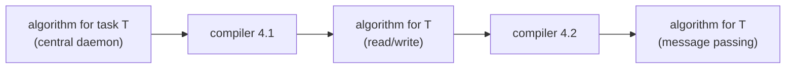

> **Note on the source.** The direction words in the 4.3 and 4.4 titles can be confusing. "Converting an Id-based System to a Special-processor System" means: take an algorithm that **needs** IDs and make it **run on** a system that only has one special processor (by creating IDs). "Converting a Special Processor to an Id-based Dynamic System" means: take an algorithm that **needs** a special processor (a leader) and make it **run on** an ID-based system (by electing a leader).

> **Kid example.** A recipe written for a fancy kitchen with a helper who hands you one ingredient at a time. A "compiler" rewrites it so it also works in a busy home kitchen where everyone grabs things at once.

---

## 2. 4.1 From a central daemon to read/write atomicity

### 2.1 The motivation

The compiler, in one picture: **AL for T (daemon)** goes in, **AL for T (read/write)** comes out. It states one key fact: **"An algorithm designed to stabilize in the presence of distributed daemon must stabilize in a system with central daemon."** The reason (Dolev §4.1): one possible choice of a distributed daemon is to activate just one processor at a time, so an algorithm that works for every choice must work for that one too. So it is enough to build a compiler for the **central** daemon.

> **Beyond the slides.** The three schedulers, from Dolev §4.1 and quiz 13:
>
> | Scheduler | One step means |
> |---|---|
> | Distributed daemon | a chosen set of processors all read their neighbours, then all write |
> | Central daemon | the set has exactly one processor |
> | Synchronous system | the set is all processors, every time |
> | Read/write atomicity | one single read or one single write; others can act in between |
>
> Why do papers assume daemons? They let the designer "consider only a subset of the possible execution set", and you need no internal variables for values read (which could also be corrupted). Why convert? An algorithm for read/write atomicity works under any daemon, but not the other way round, and real systems only offer read/write atomicity.

### 2.2 How the compiler works

**How does the compiler work?**

1. **Compose a spanning tree** using the Spanning Tree Construction algorithm (Dolev §2.5).
2. **Construct an Euler tour** on the tree to create a **virtual ring** for the **Mutual Exclusion** algorithm (Dijkstra's algorithm, with the root as the special processor).
3. **A processor that enters the critical section reads the state of its neighbors, changes state and writes, then it exits the critical section.**

In one formula: **AL for T (read/write) = AL for T (daemon) ∘ Mutual Exclusion**, where ∘ is fair composition.

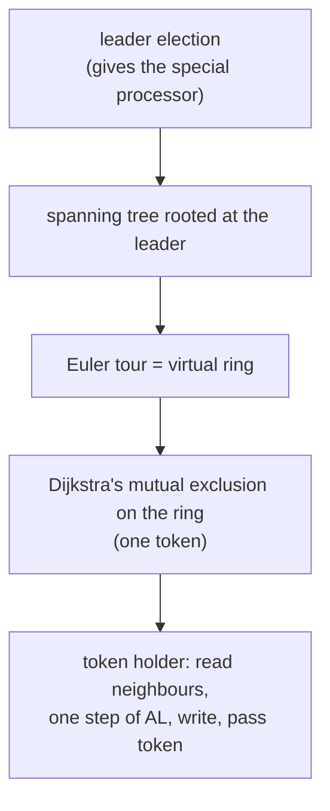

An Euler tour walks around the tree, down and back up every edge. For a root r with children a and b, where a has a child c, the virtual ring is r → a → c → a → r → b → r:

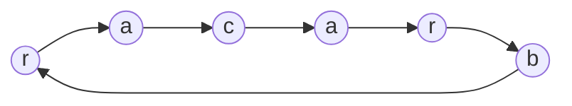

### 2.3 Why the composition is self-stabilizing

From an arbitrary start the mutual-exclusion part may have several tokens, so several processors, even neighbours, may change state at once. During that time AL (the task algorithm) may misbehave. That does not matter: AL does not interfere with the mutual-exclusion algorithm, and once mutual exclusion is safe, exactly one processor moves at a time, which **is** a central daemon. AL's own variables are arbitrary at that moment, but AL was designed to converge from any configuration under a central daemon. Every time a processor holds the token it does only a constant number of steps, so the mutual exclusion algorithm still converges.

> **Kid example.** The class wants "one kid talks at a time". Pick a captain (leader election), seat everyone along a path that walks around the playground tree (Euler tour), and pass one talking stick. At first there may be two sticks and some chaos, but the stick rules fix themselves, and then the discussion fixes itself too.

---

## 3. 4.2 Why message passing is harder

**"Designing a self-stabilization algorithm for asynchronous message-passing systems is more subtle than the same task in asynchronous shared memory systems."** The **main challenge is the messages stored in the communication links**:

- **No bound on the message delivery time;**
- **No bound on the number of messages that can be in a link.**

So **"There are infinitely many initial configurations from which the system must stabilize."** (With shared memory, a register holds one value; a link can hold any number of old messages.)

The goal is a second compiler, **AL for T (read/write) → AL for T (message passing)**, and **"First goal in designing of such a compiler is a self-stabilizing data-link algorithm"**: something that cleans the unknown garbage out of a link.

> **Kid example.** A whiteboard (a register) holds one message; you just overwrite it. A mail chute (a link) can be stuffed with any number of old letters, and you never know how many.

---

## 4. The self-stabilizing data-link task as token passing

First, the job.

- **Data-link algorithm:** messages fetched by the sender from the network layer should be delivered by the receiver to the network layer **without duplications, omissions or reordering**.
- **One implementation of the data-link task is the token-passing algorithm.**
- The **token-passing task TP** is a set of executions. A legal execution of TP is a sequence of configurations in which:
  1. **No more than one processor holds the token;**
  2. **Both the sender and the receiver hold the token in infinitely many configurations.**

> **Beyond the slides.** Dolev explains why data link and token passing are "the same" job. In stop-and-wait, each message is acknowledged before the next is sent, which looks like one token going back and forth: when the sender fetches a new message it "holds the token", and when the receiver delivers a message it "holds the token". In the other direction, attach the current message to every frame that carries the token; the receiver delivers the attached message when the token arrives. Either way, the sender and the receiver never hold the token at the same time.

---

## 5. The unbounded-counter solution

### 5.1 The code

```text
Sender:                                    Receiver:
01 upon timeout                            13 upon message arrival
02   send(counter)                         14 begin
03 upon message arrival                    15   receive(MsgCounter)
04 begin                                   16   if MsgCounter ≠ counter then  (* token arrives *)
05   receive(MsgCounter)                   17     counter := MsgCounter
06   if MsgCounter ≥ counter then          18   send(counter)              (* token released *)
     (* token arrives *)                   19 end
07   begin
08     counter := MsgCounter + 1
09     send(counter)                       (* token released *)
10   end
11   else send(counter)
12 end
```

In words:

- **Each message has an integer label called MsgCounter.**
- **The sender (and the receiver) keeps an unbounded local variable called counter.**
- **A timeout mechanism is used to ensure that the system will not enter a communication-deadlock state** (no message anywhere, and both sides waiting).

**What each side does.**

- The **sender** keeps sending its counter. When a message comes back with a value **at least as big** as its counter, it takes the token, sets counter := that value + 1 (a brand-new number), and sends it (releasing the token). Smaller values are old garbage: it just sends its counter again.
- The **receiver** echoes every message. When the value is **different** from its own counter, it takes the token and copies the value.

### 5.2 The safe configuration (Lemma 4.1)

**In a safe configuration, the counter values of all messages and the counters of the sender and the receiver all have the same value.**

Why it is safe (Dolev): from such a configuration the sender eventually gets its own value back (it is already in a link, or a timeout resends it), takes the token, and sends value + 1. That new value must reach the receiver (the receiver takes the token) before it can come back to the sender. When it comes back, all counters are equal again. So the token alternates forever: exactly the TP task.

### 5.3 Self-stabilization (Theorem 4.1)

**"For any configuration c, every fair execution that starts in c reaches a safe configuration with relation to TP."**

The proof idea (Dolev): the sender's counter increases infinitely often (timeouts keep a message moving, and the receiver always echoes). Let **max** be the biggest counter value anywhere in the first configuration. When the sender sets its counter to max + 1, it introduces a value that **exists nowhere else**. When max + 1 comes back, every older value has been flushed, and the configuration is safe.

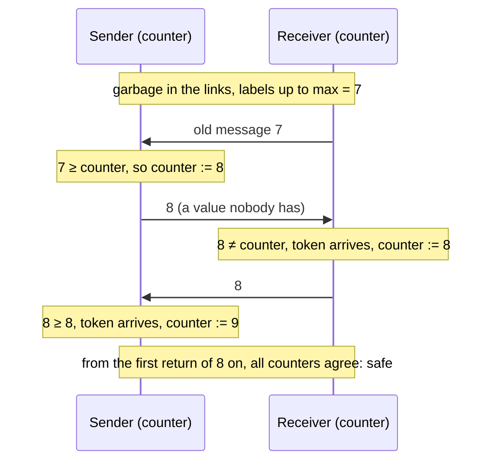

> **Kid example.** Everybody in the room shouts numbers. You pick a number bigger than anything anyone has ever said. When that number comes back to you, you know it is your answer and not some old echo.

---

## 6. Can the counter be bounded? No

The lecture asks: **"Whether bounded counters can replace the algorithm's unbounded counter and label?"** **Answer: NO**, **"assuming asynchrony and unbounded channels"**.

> **Beyond the slides.** Dolev's practical remark: "It is customarily assumed that a sixty-four-bit counter can implement an unbounded counter for every possible application ... However, in the context of self-stabilizing algorithms, a single transient fault may cause the counter to reach its upper limit instantly." So "64 bits is enough" is not a valid argument in a self-stabilization exam answer.

---

## 7. † The lower bound, proof sketch

*The lecture says this proof was skipped this year.*

**Definitions.**

- The **memory of the system** in configuration c is the number of bits needed to encode the state of the sender, the receiver, and all messages in transit.
- **Weak-exclusion task (WE):** in every legal execution there is a pair of steps, one for each processor, that are **never executed concurrently**. TP is such a task (the two sides never hold the token at once).
- Claim: there is **no bound** on the system memory for WE.

**Theorem (Dolev Theorem 4.2).** For any self-stabilizing message-driven protocol for a WE task, in every execution **all configurations are distinct**. Hence, for any t > 0, at least one of the first t configurations has size at least **log₂(t)** bits.

The log₂(t) part is simple counting: with b bits you can write only 2^b different configurations, so t different configurations need some configuration of at least log₂(t) bits.

**Proof idea.**

1. Suppose some configuration repeats. Then there is a **circular sub-execution** E = (c1, a2, …, cm) with c1 = cm.
2. Build a new start **c_init**: same processor states as c1, but add to each link all messages that will be sent on it during E (a "padding layer" of messages).
3. Now the sender's steps (a1, a2, …) and the receiver's steps (b1, b2, …) of E can be **merged in any order** (keeping each side's own order), and every merge is again circular. This set is called CE.
4. For **every** pair ⟨ai, bj⟩ there is a merge that reaches a configuration where ai and bj are **both applicable**, so that configuration is not safe.
5. Repeating such merges forever gives an infinite fair execution in which **no** configuration is safe: if some c1 were safe, extend it with executions E1, E2, …, Ek from CE that make every pair ⟨ai, bj⟩ concurrently applicable, which contradicts weak exclusion. "The proof is complete!"

So a self-stabilizing algorithm for TP cannot let configurations repeat, and its memory must keep growing.

> **Beyond the slides.** Dolev's conclusion: "no token-passing or stop-and-wait data-link algorithm exists with bounded memory resources. The memory of at least one of the system components must grow, either the memory of a processor or the number of bits in a message queue."

---

## 8. Two practical bounded solutions

The lower bound assumes a completely asynchronous system with unbounded links. Relax one assumption and bounded solutions exist.

### 8.1 Bounded-link solution

- Let **cap** be the bound on the number of messages in transit.
- The algorithm is the same, but the counter is incremented **modulo cap + 1**: line 08 becomes `counter := (MsgCounter + 1) mod (cap + 1)`.
- Why it works: **"Sender must eventually introduce a counter value that not existing in any message in transit"** (the missing-label idea again).

### 8.2 Randomized solution

- Same algorithm, but the next label is **chosen randomly**: line 08 becomes `label := ChooseLabel(MsgLabel)`.
- **At least three labels** should be used.
- The sender repeatedly sends a message with label L until a message with the **same** label L arrives.
- Then it chooses the next label L′ **randomly from the remaining labels**, so L′ ≠ L.

> **Note on the source.** The lecture says the algorithm is "the same as original one", but one more line must change: with labels instead of growing numbers, the sender's test on line 06 is **MsgLabel = label** (Dolev Figure 4.2), not "≥", because labels like 0, 1, 2 have no meaningful order.

> **Beyond the slides.** Why three labels and not two? With two labels, "choose a different label" is not random at all (after 0 always 1), which is just the alternating bit, and an adversary with old messages can fool it forever. With three or more, each choice has a fair chance of not matching the old garbage that follows. Dolev: the algorithm stabilizes **with probability 1**, but "there can exist executions E of any finite length such that no safe configuration is reached in E", and more labels make the expected time shorter. This exact point was a true/false exam item (October 2022, see section 26).

| Solution | Assumption | Memory | Stabilizes |
|---|---|---|---|
| Unbounded counter | none | grows forever | always (Theorem 4.1) |
| Counter mod (cap + 1) | at most cap messages in transit | bounded | always |
| Random labels, ≥ 3 values | a random-number device | bounded | with probability 1 |

---

## 9. Simulating shared memory over message passing

Now the data-link (token-passing) algorithm is used to **simulate shared registers** with messages.

**Setup.**

- The heart of the simulation is a self-stabilizing implementation of **read** and **write**.
- It uses a self-stabilizing **token-passing** algorithm, run on the two links between **every pair of neighbours**.
- On each link, the processor with the **larger ID acts as the sender**, the other as the receiver. ("NB: all processors have distinct IDs.")

**The operations.** Register r_ij (written by Pi, read by Pj) is emulated by Pi's local variable R_ij.

- **Every time Pi receives a token from Pj, Pi writes the current value of R_ij into the token's payload.**
- **Write** by Pi into r_ij: just write locally into R_ij.
- **Read** by Pi from r_ji:
  1. Pi receives the token from Pj;
  2. Pi receives the token **again** from Pj;
  3. return the value attached to this (second) token.

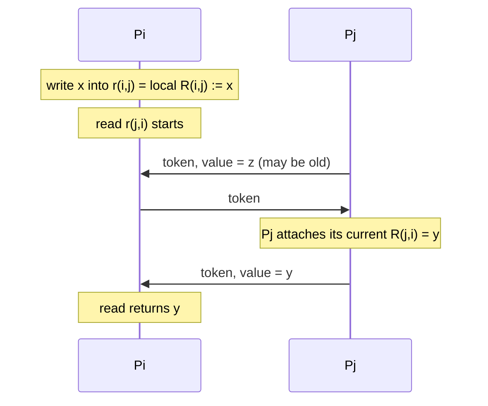

Why wait for the **second** token? The first one may carry a value that Pj attached long before the read started. The second token was filled in by Pj **after** the read began, so its value is a value that R_ji really had during the read. (Dolev uses this to show that, once each link has a single token, all simulated reads and writes are **linearizable**.)

> **Kid example.** You ask your neighbour "what is on your board?" The first note they pass you might have been written before you asked. So you pass the note back and wait for the next one: that one was surely written after your question.

---

## 10. 4.3 Ranking: from IDs to one special processor

The goal is a compiler that converts a self-stabilizing algorithm for a **unique-ID system** to work in a **special-processor system** (one special processor, everyone else identical). The way: create the IDs. **The ranking task is to assign each of the n processors a unique identifier in the range 1 to n.**

Ranking = three self-stabilizing algorithms run together (fair composition):

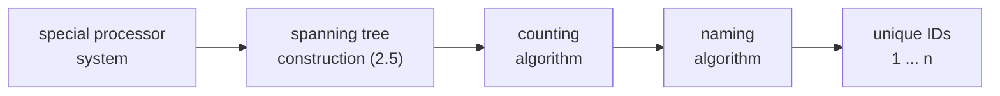

---

## 11. The counting algorithm

**Assumption:** a rooted spanning tree in which **every processor knows its parent and children**. Each pi has a variable **count_i** that holds the number of processors in the subtree rooted at pi (including pi itself). The proof is by induction on the height of a processor.

**The code:**

```text
01 Root: do forever                         09 Other: do forever
02   sum := 0                               10   sum := 0
03   forall pj ∈ children(i) do             11   forall pj ∈ children(i) do
04     lr_ji := read(r_ji)                  12     lr_ji := read(r_ji)
05     sum := sum + lr_ji.count             13     sum := sum + lr_ji.count
06   od                                     14   od
07   count_i := sum + 1                     15   count_i := sum + 1
08 od                                       16   write r_i,parent.count := count_i
                                            17 od
```

In words: **count = (sum of the children's counts) + 1 (myself)**, and every non-root writes its count into the register its parent reads. A leaf has no children, so it always computes 1.

**Correctness.** Induction on the height h of the subtree; **stabilization time O(h) asynchronous cycles**.

- **Base:** a leaf runs no loop iterations (lines 3–6, 11–14 are skipped), so lines 2, 7 (or 10, 15) give count = 1, correct within one cycle.
- **Step:** if all subtrees of height h are correct, a node of height h + 1 adds up correct children's counts plus 1, correct within one more cycle.
- So O(h) cycles in total, and h ≤ d (the diameter).

This is the **convergecast** pattern: correct values flow from the leaves up to the root.

> **Note on the source.** The lecture defines tree height as "the length of the longest path from the root to any leaf" (so a one-node tree has height 0) but then calls the base case "h = 1". The idea is unchanged: the base case is a single leaf, and each level up costs one more cycle. The same definition also has the typo "tee" for "tree".

> **Kid example.** In a family tree, everyone tells their parent "my branch has k people, me included". Babies say 1. Parents add up their kids' numbers plus 1. Grandma ends up knowing the size of the whole family.

---

## 12. The naming algorithm

The naming algorithm uses the **count** fields to give unique identifiers, stored in **ID_i**. The proof is by induction on the **distance from the root**.

**The code:**

```text
01 Root: do forever                               10 Other: do forever
02   ID_i := 1                                    11   sum := 0
03   sum := 0                                     12   lr_parent,i := read(r_parent,i)
04   forall pj ∈ children(i) do                   13   ID_i := lr_parent,i.identifier
05     lr_ji := read(r_ji)                        14   forall pj ∈ children(i) do
06     write r_ij.identifier := ID_i + 1 + sum    15     lr_ji := read(r_ji)
07     sum := sum + lr_ji.count                   16     write r_ij.identifier := ID_i + 1 + sum
08   od                                           17     sum := sum + lr_ji.count
09 od                                             18   od
                                                  19 od
```

In words: the root is 1. A node with ID x gives its children, in a fixed order:

- first child: x + 1;
- second child: x + 1 + (count of the first child);
- third child: x + 1 + (counts of the first two children); and so on.

So each child gets a **block of numbers exactly as big as its subtree**. This is the order of a **pre-order walk** (me, then all of my first subtree, then all of my second subtree, …).

**† Example.** A tree of 8 processors. Each box shows count and ID.

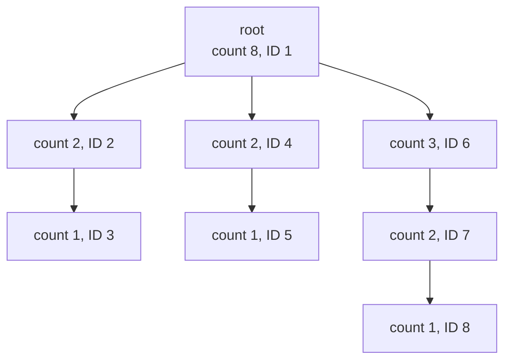

Check: the root gives its children 1 + 1 + 0 = **2**, 1 + 1 + 2 = **4** and 1 + 1 + 4 = **6**; the counts add up to 2 + 2 + 3 + 1 = **8**.

**Correctness.** Induction on the distance dis from the root, with two invariants:

1. the node at distance dis is named uniquely;
2. a sufficient number of identifiers remains for its children.

- **Dis = 0:** line 2 gives the root ID 1, and {2, …, n} remain.
- **Dis + 1:** a node is named "x + 1 + the sizes of the earlier children of the parent", where x is the parent's ID. Each child gets as many IDs as its subtree has nodes. This relies on the induction hypothesis, on the correctness of the counting algorithm, and on **the theorem of fair composition** (naming runs on top of counting).

> **Kid example.** Grandma is number 1. Her first child's branch has 2 people, so it gets the numbers 2 and 3. The next branch starts at 4, and so on. Like reserving a row of seats for each family, as long as the family.

---

## 13. † Counting in a non-rooted tree

Without a root, nobody knows which neighbour is the "parent". So each processor keeps **one count per neighbour**: **count_i[j] is the number of processors in the part of the tree that contains pi when the edge between pi and pj is cut**.

```text
01 do forever
02   forall Pj ∈ N(i) do lr_ji := read(r_ji)
03   sum_i := 0
04   forall Pj ∈ N(i) do
05     sum_j := 0
06     forall Pk ∈ N(i) do
07       if Pj ≠ Pk then
08         sum_j := sum_j + lr_ki.count
09     od
10     count_i[j] := sum_j + 1
11     sum_i := sum_i + sum_j
12     write r_ij.count := count_i[j]
13   od
14   count_i := sum_i + 1
15 od
```

In words: what I tell neighbour j = 1 (me) + what all my **other** neighbours told me. A leaf has no other neighbours, so it always tells 1. The proof is by induction on the **height of the registers** (the depth of pi's side when the edge to pj is cut).

**Our own example** (not from the slides): the tree A–B, B–C, B–D, D–E.

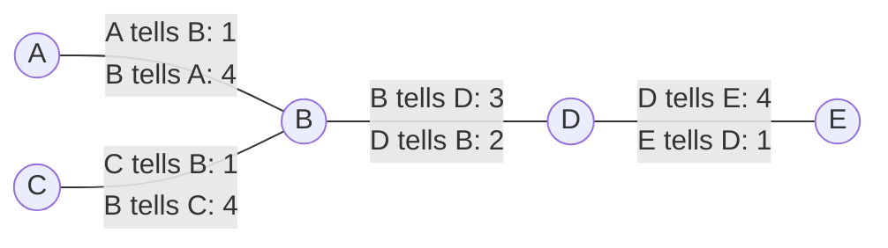

Check one edge: cut B–D, and B's side is {A, B, C} = 3 while D's side is {D, E} = 2. The two numbers on each edge always add up to n = 5.

> **Note on the source.** Lines 11 and 14 (copied from Dolev's Figure 4.5) do not compute the size of the whole tree: sum_i adds each neighbour's value several times (for example, in our example B would get count = 1 + (2+1) + (2+1) + (1+1) = 9, not 5). The per-edge values count_i[j] are what the algorithm is about, and those are correct. If you need the total, use n = 1 + Σ lr_ji.count over all neighbours j. The course's cheat sheet (Algorithm 20) has the same issue in its output line.

> **Beyond the slides.** Dolev: the height of a register is at most the diameter d, so a safe configuration is reached within **O(d)** cycles, and the counting algorithm "can be used to elect a leader (or two leaders if symmetry cannot be broken)". For example the middle node of a tree, where no side has more than half the nodes; on a path with an even number of nodes, the two middle nodes look exactly alike. This pattern (with "height" instead of "count") is how the exams of Oct 2019, Oct 2024 and Oct 2025 find the **centers** of an anonymous tree.

---

## 14. 4.4 Update: from a special processor to IDs

- **The task of the update algorithm** in an ID-based system: **inform each processor of the other processors in its connected component.**
- Then **every processor knows the maximal ID**, so **a single leader is elected**.
- So the update algorithm is a **self-stabilizing leader election within O(d) cycles (pulses)**, where d is the network diameter.
- Why insist on an ID-based system? Look at Dijkstra's mutual exclusion on a ring (next section).

> **Beyond the slides.** Dolev §4.4 explains why O(d) matters. The leader election of §2.9 needs O(N) cycles, where N is an upper bound on the size of the **whole** system. After failures split the network into small pieces, each piece should recover in time proportional to its own diameter d, not to N; otherwise the network may change again before it finishes.

---

## 15. Why special processors matter: Dijkstra's symmetry proof

**"Dijkstra proved that without a special processor, it is impossible to achieve ME in a self-stabilizing manner."** The proof is for a **composite (non-prime) number of identical processors in a ring, activated by a central daemon**. ME requires that pi may execute the critical section **if and only if it is the only processor that can change its state** at that point.

**The 4-ring example.** All processors are identical, so they share one transition function f(left state, own state, right state).

- p1 and p3 start in the same state s0; p2 and p4 start in the same state s′0.
- The daemon activates them in the order **p1, p3, p2, p4, …**
- p1 sees (s′0, s0, s′0) and moves to s1. p3 sees exactly the same and moves to s1 too.
- p2 sees (s1, s′0, s1) and moves to s′1, and so does p4.
- **The state symmetry is preserved**, forever.

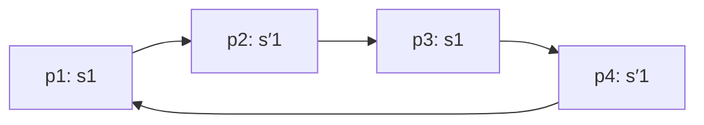

**Conclusions.**

- Whenever p1 has permission to execute the critical section, so does p3 (and the same for p2 and p4). So mutual exclusion fails.
- **With no central daemon, the impossibility holds also for a ring with a prime number of identical processors**: start with all processors in the same state and all registers identical, and let every processor read all its neighbours' registers before anyone writes. Symmetry is then kept forever.
- Therefore the motivation for designing the update algorithm in an **ID-based (non-anonymous)** system is clear.

> **Kid example.** Two pairs of identical twins sit in a circle and follow the same rule. If you always let twin 1, then twin 1's twin, then the other pair act, they stay mirror images forever, so whenever one twin gets the "speak" ticket, the other twin gets one too.

---

## 16. The update algorithm

**Outline.**

- The algorithm builds **n directed BFS trees**: each processor pi holds a BFS tree **rooted at pi**.
- If a node pj at distance k + 1 from pi has more than one neighbour at distance k, pj connects to the one (the parent) with the **maximal ID**.
- Each pi reads, from its δi neighbours, their sets of tuples **⟨k, x⟩**: processor ID k, at distance x from that neighbour.
- pi keeps, for each ID, the tuple with the **smallest x**, and adds 1 to x.
- pi also adds **⟨i, 0⟩** (itself, distance 0).
- At the end of the iteration, pi removes the **floating** (false) tuples.

**The code.** Variables: **Processors_i**, a shared set of tuples ⟨identifier, distance⟩ ("NB: adding the 'nextHop' field is straightforward"); **readSet_i**, a local helper set.

```text
01 do forever
02   readSet_i := ∅
03   forall pj ∈ N(i) do
04     readSet_i := readSet_i ∪ read(Processors_j)
05   readSet_i := readSet_i \ <i,*>     // drop tuples about myself
06   readSet_i := readSet_i ++ <*,1>    // add 1 to every distance
07   readSet_i := readSet_i ∪ {<i,0>}   // add myself at distance 0
08   forall pj ∈ processors(readSet_i) do      // keep only shortest paths
09     readSet_i := readSet_i \ NotMinDist(pj, readSet_i)
10   write Processors_i := ConPrefix(readSet_i) // remove floating tuples
11 od
```

Note that line 4 reads only the **neighbours'** sets: Pi's own old Processors_i is never used, so its old garbage cannot keep itself alive.

**Run example.** A graph of six processors with edges 1–2, 2–3, 2–5, 3–5, 3–4, 4–6, 5–6. Every processor starts knowing only itself; each round adds one more distance. After the **third round** every table is complete (the diameter is 3):

| Processor | Tuples ⟨id, distance⟩ after round 3 |
|---|---|
| 1 | ⟨1,0⟩ ⟨2,1⟩ ⟨3,2⟩ ⟨5,2⟩ ⟨4,3⟩ ⟨6,3⟩ |
| 2 | ⟨2,0⟩ ⟨1,1⟩ ⟨3,1⟩ ⟨5,1⟩ ⟨4,2⟩ ⟨6,2⟩ |
| 3 | ⟨3,0⟩ ⟨2,1⟩ ⟨4,1⟩ ⟨5,1⟩ ⟨1,2⟩ ⟨6,2⟩ |
| 4 | ⟨4,0⟩ ⟨3,1⟩ ⟨6,1⟩ ⟨2,2⟩ ⟨5,2⟩ ⟨1,3⟩ |
| 5 | ⟨5,0⟩ ⟨2,1⟩ ⟨3,1⟩ ⟨6,1⟩ ⟨1,2⟩ ⟨4,2⟩ |
| 6 | ⟨6,0⟩ ⟨4,1⟩ ⟨5,1⟩ ⟨2,2⟩ ⟨3,2⟩ ⟨1,3⟩ |

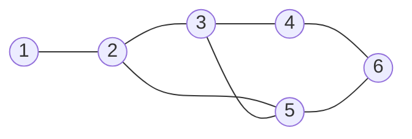

(We re-computed these tables round by round; they match the lecture's third-round tables.)

> **Kid example.** Every child keeps a list "child's name, how many seats away". Each round you copy your neighbours' lists, add 1 to every number, keep the smallest number for each name, and write yourself in with 0.

---

## 17. Floating tuples and ConPrefix
- **A floating tuple in readSet is a tuple with an identifier of a processor that does not exist.**
- **Let y be the minimal missing distance value in readSet_i.**
- **We remove every tuple with distance greater than y in readSet_i.** **ConPrefix(readSet_i)** removes these tuples.

**Why does this work?** Real processors exist at every distance 0, 1, 2, … up to d with no gaps (a shortest path to a far node passes through nodes at every smaller distance). A fake tuple has no real path behind it, so nothing keeps its distance small: every time it is copied, its distance grows by 1 (line 6). Soon it is beyond every real distance, a gap opens below it, and ConPrefix cuts it.

**Example.** Processor 4 after the second round, plus two fake tuples with IDs −1 and −2:

| id | distance | distance (one copy later) |
|---|---|---|
| 4 | 0 | 0 |
| 6 | 1 | 1 |
| 3 | 1 | 1 |
| 2 | 2 | 2 |
| 5 | 2 | 2 |
| −1 | 3 | **4** |
| −2 | 4 | **5** |

In the first column the distances 0, 1, 2, 3, 4 have no gap, so nothing is removed yet. One copy later the fake distances have grown to 4 and 5, distance 3 is missing, and ConPrefix **removes all tuples from this point** on.


---

## 18. Correctness of the update algorithm

**Safe configuration.** For every pi:

- **Processors_i includes n tuples, a tuple ⟨j, y⟩ for every processor pj in the system, where y is the distance of pj from pi;**
- **The tuples in readSet_i will rewrite exactly the same contents to Processors_i.**

**Lemma 4.6, tuple addition.** In every execution, after the k-th cycle, for all pi and pj at distance ℓ < min(k, d + 1):

- **Invariant 1 (inclusion):** the tuple ⟨j, ℓ⟩ is in Processors_i;
- **Invariant 2 (constant value):** if a tuple ⟨x, y⟩ with **y ≤ ℓ** is in Processors_i, a processor px at distance y from pi really exists.

Proof by induction on k:

- **Base (k = 1):** line 7 adds ⟨i, 0⟩, and line 6 makes every other tuple's distance greater than 0. So ⟨i, 0⟩ is there (inclusion) and it is the only distance-0 tuple (constant value).
- **Step:** after k cycles, everything is correct up to distance ℓ − 1. In cycle k + 1, each processor reads those correct tuples, so it computes every distance-ℓ tuple correctly.

**Lemma 4.7.** After **d + 2** cycles, every tuple ⟨x, y⟩ in every Processors_i names a processor that exists. Proof: after d + 1 cycles, all tuples with distance up to d are real (Lemma 4.6), so a floating tuple has y > d. The next cycle increments it beyond d + 1. No real tuple has distance d + 1, so that distance is a gap, and ConPrefix removes the floating tuple.

**Corollary 4.1, stabilization.** **Any configuration that follows the first d + 3 cycles is safe.** After d + 1 cycles all real tuples up to distance d are present and correct (Lemma 4.6); after d + 2 cycles no floating tuple is left (Lemma 4.7); during cycle d + 3 a safe configuration is reached.

> **Note on the source.** The lecture says "every tuple with a distance **smaller than** d is not a floating tuple". Dolev says "distance **d or less**", and the argument needs that (it concludes that a floating tuple has y > d). The lecture's "y ℓ" and "ℓ d" are "y ≤ ℓ" and "ℓ ≤ d" with the symbol lost.

---

## 19. Topology update: convergecast and broadcast

Once the update algorithm runs, every processor knows the leader (maximal ID) and, in the leader's BFS tree, its parent and children (in O(d) cycles). Now the whole map can be collected and shared.

**Convergecast.** The information collected is the **local topology** (the identities of each descendant's neighbours). Every pi writes into a variable **up_i** for its parent: its own local topology plus, if it is not a leaf, its children's up values. Stabilization rests on **correct information at the leaves and the direction of collection, from the leaves up**.

**Broadcast.** To tell everyone the topology the leader collected:

- root x: **Down_x = Up_x**;
- everyone else i: **Down_i = Down_j**, where j = parent(i).

This takes **O(d)**.

The lecture's example ("a.b" means "there is a link between a and b"):

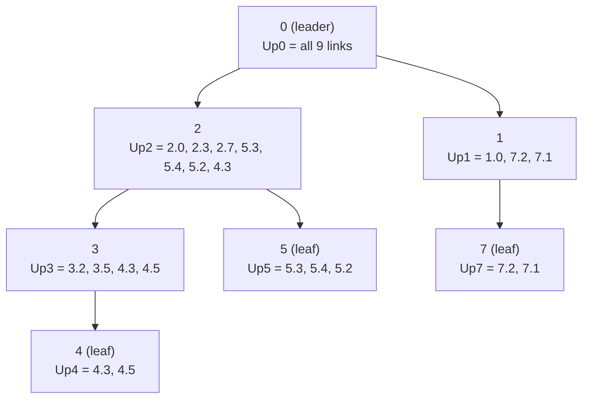

The leader ends with Up0 = {2.0, 2.3, 2.7, 5.3, 5.4, 5.2, 1.0, 7.1, 4.3}: every one of the 9 links once (duplicates such as 3.2 = 2.3 are dropped). Then Down0 = Up0, Down2 = Down0, Down1 = Down0, and so on down the tree.

> **Beyond the slides.** Dolev's timing: after one cycle every leaf's up value is fixed; after h cycles every processor of height h − 1 or less has the correct topology of its subtree. For broadcast, after the i-th cycle every processor within distance i of the root has the right information. Old exams used exactly "update + convergecast + broadcast" for link-state routing (Oct 2023) and for collecting inputs (Jan 2025): total O(d) + O(d) + O(d) = O(d).

---

## 20. Adaptive self-stabilizing algorithms
- **Time-adaptive:** the number of cycles until convergence is proportional to the system's (actual) parameters.
- **Memory-adaptive:** the memory used in a safe configuration is proportional to the system's parameters.
- **Communication-adaptive** (for a **silent** algorithm): the number of bits communicated is proportional to the system's parameters.
- **The update algorithm** stabilizes within **O(d)** cycles, so it is **time-adaptive**; it reads and writes **O(n)** tuples, so it is **memory-adaptive** and **communication-adaptive**.
- In dynamic systems, the parameters (diameter, number of processors) are **not fixed**.

> **Beyond the slides.** Dolev contrasts this with the leader election of §2.9, which takes O(N) cycles, where N is an upper bound: that algorithm is **not** time-adaptive.

---

## 21. † 4.5 Synchronizers: what and why

*Everything from here to section 24 is hidden material, and §4.5 is struck out on the lecture's roadmap.*

- **What:** a synchronizer converts a synchronous algorithm so it can run in an asynchronous system; it emulates a synchronous execution in a distributed way.
- **Why:** asynchronous algorithms are hard because one configuration can continue in many ways (any order of steps). In a synchronous system all processors change state together, so a configuration determines the whole execution. So: design for the synchronous system, then use a synchronizer.
- **Why not always:** it slows the fastest processors down to the speed of the slowest. Without it, fast processors could make progress and help the slow ones. Efficiency.
- **Which ones:** the unbounded α synchronizer, the bounded α synchronizer, and the β synchronizer.

---

## 22. † The unbounded α synchronizer

**Setup.** The α synchronizer uses a **self-stabilizing data-link algorithm**: every message is received and acknowledged; P waits for the ack of m before sending a new m′ to Q; the ack can carry Q's current state.

**The task.** Every pi has an integer **phase_i**. Legal executions:

1. the phases of any two neighbours differ by **at most one**;
2. every phase is incremented **infinitely often**.

**The code:**

```text
1  do forever
2    forall Pj ∈ N(i) do received_j := false
3    do
4      DLsend(phase_i)                     // to all neighbours
5      upon DLreceive(ack_j, phase_j)
6        received_j := true
7        phase_ji := phase_j
8      upon DLreceive(phase_j)
9        phase_ji := phase_j
10   until ∀ Pj ∈ N(i): received_j = true
11   if ∀ Pj ∈ N(i): phase_i ≤ phase_ji then
12     phase_i := phase_i + 1               // "if it is ok, increase the phase"
13 od
```

In words: tell every neighbour your phase and learn theirs; move to the next phase only if **nobody is behind you**.

**Correctness.** Lemma 1: eventually every two neighbours differ by at most one. Lemma 2: some phase (and then, by Lemma 1, every phase) is incremented infinitely often.

**Using it.** In a synchronous system, the state at time t + 1 depends on the neighbours' states at time t. With the α synchronizer, a processor with phase t computes the emulated state for pulse t. It attaches its **previous and current** state to every message, so a neighbour with phase t can always find the state for pulse t, even if the sender is already one phase ahead.

> **Kid example.** Hikers on a trail tied together by short ropes: you may take the next step only if none of your neighbours is behind you. Nobody gets more than one step ahead of a neighbour, and the group keeps moving.

---

## 23. † The bounded α synchronizer

**Idea.**

- Same task, but phases are counted **modulo M**. The lecture says M ≥ n.
- Each pi also holds a **reset_i** variable.
- When two neighbours' phases differ by more than one (0 and M − 1 count as differing by one), set all phases to 0.
- **Reset wave:** the processor that finds the error sets reset_i := 0; its neighbours are forced to reset ≤ 1, their neighbours to ≤ 2, and so on. The wave sets the phases to 0, and counting resumes only after all phases were reset.

**The code** in short:

- Send (phase_i, reset_i) to all neighbours and collect theirs, calling **UpdatePhase()** for each received value.
- **UpdatePhase():** if reset_i > reset_ji then reset_i := min(2N, reset_ji + 1). If phase_ji is not in {phase_i − 1, phase_i, phase_i + 1} (mod M), then reset_i := 0. If reset_i ≠ 2N, then phase_i := 0.
- After the round, if nothing was updated: if no neighbour has a smaller reset, reset_i := min(2N, reset_i + 1); and if every neighbour's phase is phase_i or phase_i − 1, then phase_i := (phase_i + 1) mod M.

**Observation.** While a reset wave is spreading, no processor that already lowered its reset can climb past 2N (N is a bound on the number of processors). Since a phase is forced to 0 whenever reset < 2N, a configuration with **all phases 0** is reached; then all resets climb to 2N and normal counting starts.

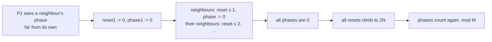

**Demonstration** on a chain P1 – P2 – P3: P1 has phase 1 and sees phase 3, which is not in {0, 1, 2}, so reset1 := 0 and phase1 := 0. P2 receives reset 0 < its 2, so reset2 := 1 and phase2 := 0. P3 gets reset 1 < its 5, so reset3 := 2, then sees phase 0 not in {3, 4, 5}, so reset3 := 0 and phase3 := 0. Then all resets increase up to 2N, and then all phases increase.

**Correctness**, three lemmas: (1) if nobody assigns reset := 0, eventually every reset is 2N forever; (2) if nobody assigns reset := 0, a safe configuration is reached; (3) if somebody assigns reset := 0, a safe configuration is reached.

> **Note on the source.** The lecture says M ≥ n; Dolev says M is "any constant greater than n" (and adds that "greater than" between phases is well defined for M ≥ 3). The code has the typo "RsetUpdate" for ResetUpdate.

---

## 24. † The β synchronizer

**Idea.** Use a **rooted spanning tree** (from leader election plus spanning tree construction) and shared memory. One pulse has three stages:

1. the root **broadcasts a "pulse"** down the tree;
2. when pi gets the pulse from its parent, it passes it to its children and **reads the registers of its neighbours in the original graph**;
3. when pi has finished reading, it is "safe" and waits for "safe" messages from all its children; then it **writes** to its neighbours' registers and sends "safe" to its parent.

**The code**, using colours instead of messages:

```text
1  Root: do forever
2    forall Pj ∈ children(i) do lr_ji := read(r_ji)
3    if ∀ Pj ∈ children(i): lr_ji.color = color_i then
4      color_i := (color_i + 1) mod (5n − 3)
5    forall Pj ∈ children(i) do write r_ij.color := color_i
6  od
7  Other: do forever
8    forall Pj ∈ children(i) ∪ {parent} do lr_ji := read(r_ji)
9    if color_i ≠ lr_parent,i.color then
10     color_i := lr_parent,i.color
11   else if ∀ Pj ∈ children(i): lr_ji.color = color_i then
12     write r_i,parent.color := color_i
13   forall Pj ∈ children(i) do write r_ij.color := color_i
14 od
```

In words: the root's colour is **broadcast** towards the leaves (this is the "pulse"), and "my whole subtree has your colour" is **convergecast** back to the root (this is the "safe" message). When the root hears that the whole tree has its colour, it picks the next colour.

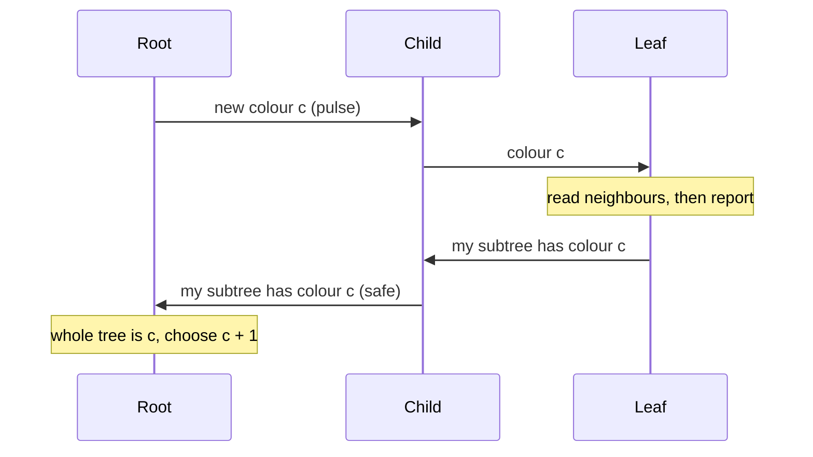

**Observations.** The algorithm assumes a rooted spanning tree, so the full β synchronizer is a **fair composition** of the colouring algorithm with rooted spanning tree construction (itself spanning tree + leader election).

**Lemmas.**

- The root changes colour at least once in every **2d + 1** successive cycles.
- A configuration where all processors have the same colour is reached within **O(dn)** cycles.
- So the algorithm reaches a safe configuration within **O(dn)** cycles.

**A synchronous step:** just before each time pi changes its colour, it reads its neighbours' registers, as in the synchronous step.

> **Beyond the slides.** Why 5n − 3 colours? The missing-label idea again (Dolev Lemma 4.14): there are n colour variables, 2n − 2 colour fields in the registers and 2n − 2 local copies, at most 5n − 4 colours in total, so with 5n − 3 values at least one colour is missing. The root, stepping through all colours, eventually picks a colour that exists nowhere, and when that colour comes back from the whole tree, all old garbage is gone.

---

## 25. Recap

- **Compilers** let you design in an easy model and run in a hard one, keeping self-stabilization.
- **4.1:** central daemon → read/write = spanning tree + Euler-tour ring + Dijkstra's mutual exclusion, glued by fair composition. Only the token holder takes a step.
- **4.2:** message passing is harder because links can hold unboundedly many old messages. The data link is a **token-passing** task.
  - **Unbounded counter:** safe when all counters are equal (Lemma 4.1); always stabilizes (Theorem 4.1).
  - **No bounded solution** with asynchrony and unbounded channels († lower bound: configurations never repeat, so memory grows like log t).
  - **Bounded:** counter mod (cap + 1) when the link capacity is known; or random labels from at least 3 values (stabilizes with probability 1).
  - **Shared-memory simulation:** a token on every link; a read waits for the token's **second** arrival.
- **4.3 Ranking** = spanning tree + counting (convergecast, O(h)) + naming (pre-order blocks of IDs).
- **4.4 Update:** every processor learns all IDs and distances (n BFS trees); **ConPrefix** kills floating tuples; safe after **d + 3** cycles; time-, memory- and communication-adaptive. Plus convergecast and broadcast for the full topology.
- **Dijkstra's symmetry proof:** without a special processor (or IDs), identical processors can stay identical forever.
- † **Synchronizers:** α (phases, neighbours differ by at most one; bounded version with a reset wave) and β (colouring a rooted tree, O(dn)).

---

## 26. Old exam questions on this lecture

The exam cheat sheet contains several algorithms from this lecture: **Algorithm 8** (unbounded counter), **Algorithm 9** (random labels), **Algorithm 10** (counting), **Algorithm 11** (naming), **Algorithm 12** (update) and **Algorithm 20** (counting in a non-rooted tree, a home-assignment version of section 13 †). You may cite them ("we use Algorithm 10") instead of copying code.

**October 2018, Q4a (6 points).** *Convert a maximal-independent-set algorithm designed for a central daemon to a network with a distributed daemon and one distinguished node.*
The teacher's answer: "The solution appears in Chapter 4.1 in the book." Use the distinguished node as root of a self-stabilizing spanning tree (Algorithm 2); run Dijkstra's token passing on the Euler tour (Algorithm 3); only the token holder runs one step of the MIS algorithm; fair composition makes the whole thing self-stabilizing. Why it is needed: two neighbours that move at the same time can keep joining and leaving together forever (0,0 → 1,1 → 0,0).

**October 2022, Q1e (true/false).** *"There is no self-stabilizing deterministic data-link protocol with bounded memory and bounded message size when channel capacity is unbounded. One way to overcome this is the alternating bit protocol where the sender uses a random bit, 0 or 1, for each new message."*
**FALSE.** The first sentence is right (section 6), but the randomized fix needs **at least three labels** (section 8.2).

**October 2024, Q3a (reconstructed).** *Once one center of a tree has been selected, give every node a unique name.*
One center makes the tree a special-processor system, so use **ranking**: spanning tree (Algorithm 2) → counting (Algorithm 10) → naming (Algorithm 11). In Q3b the names were used for **packet forwarding**: the subtree of a node with ID x and count c uses exactly the IDs x … x + c − 1, so a node forwards a packet down to the child whose block contains the destination, or up to its parent otherwise.

**October 2019, October 2024, October 2025.** *Find the center(s) of an anonymous tree.* Use the **non-rooted counting** pattern (Algorithm 20, section 13 †) with heights instead of counts; a tree has one or two centers, and two centers cannot be told apart deterministically (symmetry).

**October 2023, Q2.** *Solve the link-state routing problem (every node knows the whole map) in a self-stabilizing way in shared memory.*
Use the **update algorithm** (Algorithm 12) with one extra field per tuple: the node's local topology (neighbours and link costs). Then every node runs Dijkstra's shortest-path algorithm locally.

**January 2025, Q2.** *Collect every node's input, compute f(I), and spread the result, in a self-stabilizing way.*
Update algorithm (leader and BFS tree) + **convergecast** of the inputs to the leader + **broadcast** of the result, all glued with fair composition: O(d) + O(d) + O(d) = O(d) cycles.

> **Kid example (exam tip).** "One special node, no IDs" → think **ranking** (tree, count, name). "IDs, need a fast leader or the whole map" → think **update**. "Central daemon algorithm, real system" → think **4.1 token passing**.

---

## 27. Related quiz topics not on the slides

The course's pre-lecture quiz on this chapter (quiz 13, 53 questions on §4.1, 4.3 and 4.4) also asks about the following. Answers follow the quiz key and Dolev.

**Daemons (Q1–Q4).**

- A distributed daemon activates **several** processors concurrently; a central daemon activates **one** at a time.
- Daemons are assumed because they **simplify reasoning by serializing executions** (fewer executions to consider).
- Converting to read/write atomicity makes algorithms **more applicable in realistic systems**.
- If an algorithm stabilizes under a distributed daemon, **it also stabilizes under a central daemon** (not necessarily faster).

**The 4.1 compiler (Q5–Q15).**

- Mutual exclusion emulates a central daemon because **only one processor can be in the critical section at a time**.
- **Leader election** gives the unique processor that the construction needs (the root of the tree and the special processor of the ring).
- **Fair composition** lets the spanning tree and the mutual exclusion run together and both stabilize; both run all the time.
- Before mutual exclusion stabilizes, **several processors may change state at the same time**, so A's convergence is delayed until mutual exclusion stabilizes; what A does meanwhile does not matter.

**Ranking, counting and naming (Q16–Q33).** Covered in sections 10–13. Two extra points from the quiz: counting can elect **one leader, or two if symmetry cannot be broken**; and the leader (the root) is what starts the numbering.

**Update and symmetry (Q34–Q46).** Covered in sections 14–15. Extra points:

- **Randomization** helps anonymous systems: coin tosses can make twins different, which no deterministic rule can.
- Its drawback: convergence is only **with probability 1**. There is a bound on the expected time, but no fixed maximum for a single run; the quiz key words this as "may require unbounded expected time".

**Token circulation (Q47–Q53)**, which builds on Dijkstra's ring:

| Question | Answer |
|---|---|
| Why use a token? | Only the token holder enters the critical section, so one token means one at a time. |
| Risk of a **lost** token | Nobody can ever enter the critical section. |
| Risk of **duplicate** tokens | Several processors may be in the critical section at once. |
| Recovery | A self-stabilizing ring (like Dijkstra's) always returns to exactly one token. |
| Time | O(n): in the worst case the token visits the n processors one by one. |
| Role of fairness | Keeps the token moving, so every processor eventually gets it. |
