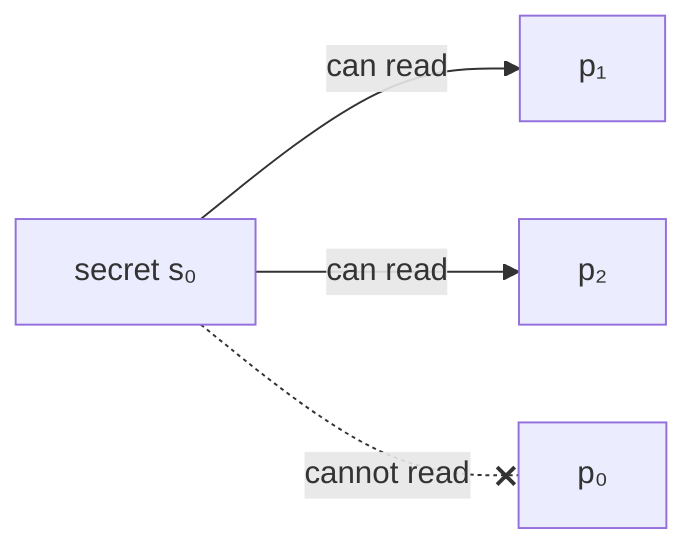
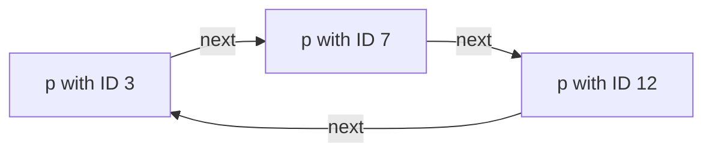
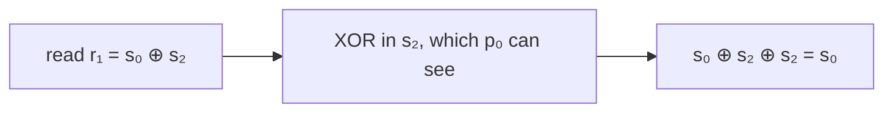

# Practical Session 1: Value Discovery in Complete Graphs (Home Assignment 1)

**Course:** EDA387/DIT663 Computer Networks, part 2 (Fault-tolerant Algorithms for Computer Networks), Practical Session 1 (2026).

**Revised:** 21 October 2026

**† Supplementary material:** content that comes only from hidden PowerPoint slides. It may not be part of this year's examinable material. *This session has no hidden slides, so nothing in this guide carries the † mark.*

**How to read this guide.** Every part starts with **In one sentence**, the whole idea in one line. Then comes the explanation in small steps, a **Kid example** (the same idea told with everyday things), pictures, and a **Remember** list with what you must know for the exam. **Technical clarification** marks a place where the slides are wrong or unclear, and gives the correct version. **Additional context** adds something useful that is not on the slides.

---

## Glossary

| Term | Full name | Meaning in simple words |
|---|---|---|
| Complete graph | — | A network where every processor is directly connected to every other processor. |
| Globally unique identifier | — | A name (number) that belongs to exactly one processor in the whole system and is the same no matter who looks at it, like a MAC address. |
| ids[] | — | In Algorithm 1, the sorted list of all identifiers a processor has read. |
| Local identifier | — | A name that a processor gives to its neighbours privately, for example its own port numbers. Two processors may give the same neighbour different names. |
| lr[k] | local read | A local variable where a processor keeps the value it read from processor *k*. |
| MAC address | Media Access Control address | A 48-bit hardware address that is assumed to be globally unique. |
| prev, next | — | The positions just before and just after a processor in the virtual ring. |
| Register *rᵢ* | — | A shared variable that *pᵢ* can read and write and every other processor can only read. |
| Register *sᵢ* (secret) | — | A shared variable holding *pᵢ*'s secret; every processor **except** *pᵢ* can read it. |
| Synchrony assumption | — | An assumption that processors move at the same pace. Algorithm 1 does not need one. |
| Virtual ring | — | An imaginary circle of processors that everybody agrees on, built here by sorting identifiers. |
| XOR (⊕) | exclusive or | A bit operation: 1 if the two bits differ, 0 if they are equal. It has the "undo" property *a* ⊕ *b* ⊕ *b* = *a*. |

## Contents

- [Before you start: the words you need](#before-you-start-the-words-you-need)
- [1. The value-discovery problem](#1-the-value-discovery-problem)
  - [1.1 What the session covers](#11-what-the-session-covers)
  - [1.2 The problem: discovering your own secret](#12-the-problem-discovering-your-own-secret)
- [2. Two solutions](#2-two-solutions)
  - [2.1 Question 1: a solution with globally unique identifiers](#21-question-1-a-solution-with-globally-unique-identifiers)
  - [2.2 Question 2: a solution with only local identifiers](#22-question-2-a-solution-with-only-local-identifiers)
- [3. Summary](#3-summary)
  - [3.1 Recap](#31-recap)
- [Revision notes and references](#revision-notes-and-references)

## Before you start: the words you need

- **Processor:** one computer in the network. We call them *p*₀, *p*₁, *p*₂, and so on.
- **Register:** a small box of memory, like a little whiteboard. Some processors may write on it, others may only read it.
- **Secret *sᵢ*:** a value that belongs to *pᵢ*, but *pᵢ* itself **cannot** read it. Everybody else can.
- **Complete graph:** every processor can talk directly to every other processor.
- **Identifier (ID):** a name for a processor. A **global** ID is the same for everyone (like a passport number). A **local** ID is a private nickname (like "the friend on my left").
- **XOR (⊕):** a way to mix two values that can be undone by mixing in the same value again.

**The problem in one picture** (for *p*₀: everyone can see its secret except *p*₀ itself):



> **Kid example.** At a party, everyone has a sticker with a number on their forehead. You can see everybody's number except your own. Everyone also has a small whiteboard that only they can write on, but anyone can read. The game: everyone must find out their own number, and nobody is allowed to just say it out loud. This guide shows two clever ways to win the game.

## 1. The value-discovery problem

**What this chapter is about:** what the practical session covered and the exact puzzle of Home Assignment 1: how can every processor learn its own secret, which only the others can see?

### 1.1 What the session covers

**In one sentence:** the session reviewed earlier quizzes and student solutions, and then presented the proposed solution to Home Assignment 1.

The session plan was:

1. Review of the pre-lecture questions for **Analytical Framework**, **Dijkstra's algorithm** and **spanning-tree construction** (see guides 07, 08 and 09).
2. Discussion of student solutions.
3. **Home Assignment 1:** a student solution and the proposed solution.
4. Home Assignments 2 and 3 (introduced).

The lecture contains the proposed solution to Home Assignment 1, which is what this guide explains.

> **Kid example.** It is like a homework review lesson: first the teacher goes through the quiz answers, then a few students show their own homework, and finally the teacher shows the model answer.

**Remember:**

- The main content is the **proposed solution to Home Assignment 1** (value discovery).

### 1.2 The problem: discovering your own secret

**In one sentence:** every processor must output its own secret, which only the other processors can read, by using the helper registers that everyone can read.

**Additional context.** The slides show only the solution, so here is the problem as stated in the 2026 home assignment ("Value discovery in complete graphs").

There are *n* processors *p*₀, …, *p*ₙ₋₁ (with *n* > 2 and known), connected as a **complete graph**. Each processor *pᵢ* has two registers:

- ***sᵢ*, the secret.** Its size is a constant. **Every processor except *pᵢ* can read *sᵢ*.** *pᵢ* itself cannot.
- ***rᵢ*, a helper register.** *pᵢ* can read and write it; all others can only read it.

The goal: **every processor must find out (output) its own secret *sᵢ*.**

Think of a party game where everyone has a sticker with a number on their forehead. You can see everybody's sticker except your own. Everyone also has a small whiteboard that only they can write on, but everyone can read. How can the others help you learn your own number?

With *n* = 2 it is easy: the other player reads your sticker and writes it on their whiteboard, and you read their whiteboard. With more players, the difficulty is **who writes whose secret**. A processor reaches the others only through its own private port numbers 0 … *n* − 2, so "the processor on my port 3" may be a different processor from "the processor on your port 3".

The two questions differ in one thing:

- **Question 1:** processors have **globally unique identifiers** (like MAC addresses), and *rᵢ* may hold the identifier plus one secret.
- **Question 2:** processors have **only local identifiers** (their port numbers), and *rᵢ* may hold only one secret-sized value.

The answer to both is **yes, there is a solution**.

> **Kid example (why the private names are a problem).** In the sticker game, imagine you can only point at people as "the person on my left" or "the person on my right". If you say "the person on my left will write my number", your friend sitting opposite may think of a totally different person as "the person on my left". So the hard part is not reading numbers; it is agreeing **who helps whom**.

**The two questions side by side:**

| | Question 1 | Question 2 |
|---|---|---|
| Names | Globally unique IDs (like MAC addresses) | Only local port numbers |
| What fits in *rᵢ* | The ID plus one secret | Only one secret-sized value |
| Solution idea | Virtual ring | XOR trick |

**Remember:**

- *pᵢ* **cannot** read *sᵢ*; all others can.
- *rᵢ*: only *pᵢ* writes it, everybody reads it.
- Goal: every *pᵢ* **outputs its own secret**. The answer to both questions is **yes**.

## 2. Two solutions

**What this chapter is about:** two ways to solve the puzzle: with global names, line up in a ring and pass secrets along; with only private names, use the XOR trick.

### 2.1 Question 1: a solution with globally unique identifiers

**In one sentence:** sort the IDs into an agreed circle; each processor copies the secret of the one before it, so the one after you holds your secret.

#### Algorithm 1

The idea: **use the order of the identifiers to build a virtual ring** that everyone agrees on. Then each processor copies the secret of the processor **before** it in the ring onto its own whiteboard, so the processor **after** you in the ring is holding your secret.

```text
Algorithm 1: Using globally unique identifiers, code for processor pi
1  do forever begin
2      foreach pk ∈ P do lr[k] := read(ID(k));
3      let ids[] := sort({lr[k] | 0 ≤ k ≤ n−1})      /* ids is a sorted identifier array */
4      let (prev, next) := (k−1 mod n, k+1 mod n), where ids[k] = ID(i);
5      write (read(s_ids[prev])) to ri;
6      output(read(r_ids[next]));
```

Step by step:

1. **Line 2:** read the identifier of every processor.
2. **Line 3:** sort the identifiers into the list `ids[]`.
3. **Line 4:** find your own position *k* in the sorted list. Your ring neighbours are position *k* − 1 (`prev`) and position *k* + 1 (`next`), wrapping around modulo *n*.
4. **Line 5:** read the secret of `prev` and write it into your own register *rᵢ*.
5. **Line 6:** read the register *r* of `next` and output it. Since `next` copied the secret of **its** previous processor, which is you, this is your own secret.



The picture above is the virtual ring, sorted by identifier.

The arrows show the agreed order "who comes next" in the virtual ring; the ring is only a shared agreement, not a new physical link.

#### Why Algorithm 1 is correct

The proof given in the session:

- **The same ring for everyone.** Because identifiers are globally unique, lines 2 to 4 make **all processors eventually store the same values** in `ids[]`, `prev` and `next`. So all processors eventually use an **identical virtual ring**.
- **The right secrets get copied.** Each processor reads the secret of its previous processor in the ring (line 5) and writes it into its own register.
- **Everyone outputs their own secret.** Each processor reads from its next processor in the ring (line 6), which holds the previous processor's secret, that is, its own. So all processors **eventually output their own secrets**.
- **No synchrony needed.** We only care about the value that is **eventually** output. All processors eventually write the right values to their registers, whatever their speeds, so no assumption about timing is needed.

The register *rᵢ* holds this processor's identifier (⌈log₂ *M*⌉ bits) plus one secret value, which is exactly the space Question 1 allows.

#### A small example

**Additional context.** A worked example of Algorithm 1.

Three processors with identifiers 12, 3 and 7 and secrets ★, ● and ▲:

| Processor | ID | Its secret | Position in sorted ids = (3, 7, 12) | prev | next | Writes into its *r* | Reads *r* of next and outputs |
|---|---|---|---|---|---|---|---|
| A | 3 | ● | 0 | ID 12 | ID 7 | ★ (secret of ID 12) | *r* of ID 7 = ● |
| B | 7 | ▲ | 1 | ID 3 | ID 12 | ● (secret of ID 3) | *r* of ID 12 = ▲ |
| C | 12 | ★ | 2 | ID 7 | ID 3 | ▲ (secret of ID 7) | *r* of ID 3 = ★ |

Each processor outputs exactly its own secret, and none of them ever read their own *s*.

> **Kid example.** The children stand in a circle, ordered by their shirt numbers. Each child looks at the forehead of the child **before** them and copies that number onto their own whiteboard. Now look at the whiteboard of the child **after** you: they copied the number of the child before them, and that is you! So their whiteboard shows your own number.

**Who copies whose secret** (with the IDs 3, 7 and 12 from the example):


Then ID 3 reads the whiteboard of ID 7 (its next), ID 7 reads the whiteboard of ID 12, and ID 12 reads the whiteboard of ID 3 (the ring wraps around).

**Remember:**

- Sort the global IDs: everyone gets the **same virtual ring**.
- Write the secret of **prev** into your own *r*; output the *r* of **next**.
- Correct because all processors **eventually** agree on the ring; **no synchrony** is needed.

### 2.2 Question 2: a solution with only local identifiers

**In one sentence:** each processor writes the XOR of all the secrets it sees; you take any other processor's register and XOR away the secrets you know, and your own secret is left.

Without global identifiers, the processors cannot agree on a ring. The trick is to use **XOR (⊕)**, which works like a lock you can open again with the same key: *a* ⊕ *b* ⊕ *b* = *a*.

**Additional context.** XOR in one line: 1 ⊕ 1 = 0, 0 ⊕ 0 = 0, 1 ⊕ 0 = 1, 0 ⊕ 1 = 1, done bit by bit. For example 0110 ⊕ 0011 = 0101, and 0101 ⊕ 0011 = 0110 again. XOR-ing two values gives a result of the **same size**, so it fits in a constant-size register.

#### The XOR trick, first for n = 3

Let every processor write into its register the XOR of **all the secrets it can see**:

- *r*₀ := *s*₁ ⊕ *s*₂
- *r*₁ := *s*₀ ⊕ *s*₂
- *r*₂ := *s*₀ ⊕ *s*₁

Processor *p*₀ can read *r*₁ and *r*₂, and also *s*₁ and *s*₂. So:

*r*₁ ⊕ *s*₂ = *s*₀ ⊕ *s*₂ ⊕ *s*₂ = ***s*₀**.

*p*₀ "removes" *s*₂ from *r*₁ and is left with its own secret.

#### The general case and Algorithm 2

For any *n*: *r*₀ := *s*₁ ⊕ … ⊕ *s*ₙ₋₁, *r*₁ := *s*₀ ⊕ *s*₂ ⊕ … ⊕ *s*ₙ₋₁, …, *r*ₙ₋₁ := *s*₀ ⊕ … ⊕ *s*ₙ₋₂. Then

*r*₁ ⊕ *s*₂ ⊕ … ⊕ *s*ₙ₋₁ = *s*₀.

In general, for **any** other processor *pⱼ*:

**sᵢ = rⱼ ⊕ ( ⊕ over k ∉ {i, j} of sₖ )**,

where the processor ordering is **local to *pᵢ*** (its own port numbers). This works because *rⱼ* contains every secret except *sⱼ*; XOR-ing in all the secrets except *sᵢ* and *sⱼ* cancels all of them, leaving *sᵢ*.

```text
Algorithm 2: Using local identifiers, code for processor pi
1  do forever begin
2      foreach pk ∈ P \ {pi} do lr[k] := read(sk);
3      write ( ⊕ over pk ∈ P \ {pi} of lr[k] ) to ri;
4      let rJ := read(rj) where pj ∈ P \ {pi};
5      output rj ⊕ ( ⊕ over pk ∈ P \ {pi, pj} of lr[k] );
```

Step by step:

1. **Line 2:** read the secrets of all the other processors.
2. **Line 3:** write the XOR of all of them into your own register.
3. **Line 4:** read the register of **any one** other processor *pⱼ*. It does not matter which one, so local port numbers are enough.
4. **Line 5:** XOR that register with all the secrets you read, except *pⱼ*'s, and output the result: your own secret.

The session states that **Algorithm 2's correctness proof follows the same arguments as Algorithm 1's**: once every processor has written the XOR of the secrets it sees, every processor's output is its own secret. Each register holds just one secret-sized value, as Question 2 requires.

#### A small example with numbers

**Additional context.** A worked example of Algorithm 2 with 4-bit secrets.

Let *n* = 4 with *s*₀ = 0101, *s*₁ = 0011, *s*₂ = 1000, *s*₃ = 1111.

- *p*₁ writes *r*₁ = *s*₀ ⊕ *s*₂ ⊕ *s*₃ = 0101 ⊕ 1000 ⊕ 1111 = 0010.
- *p*₀ picks *pⱼ* = *p*₁ (any choice works). It computes *r*₁ ⊕ *s*₂ ⊕ *s*₃ = 0010 ⊕ 1000 ⊕ 1111 = 0101.
- 0101 is exactly *s*₀. ✔

> **Kid example.** Think of XOR as a magic light switch: flipping it twice brings it back to how it was. Your friend's whiteboard shows "all the numbers except my friend's own number, mixed together". That mix contains your number. You can see every other number in the mix, so you "flip them out" one by one. The only number left in the mix is yours!

**The XOR trick for *p*₀ with *n* = 3:**



**Remember:**

- Each *pᵢ* writes *rᵢ* = XOR of **all secrets it can see**.
- *sᵢ* = *rⱼ* ⊕ (XOR of all *sₖ* with *k* not *i* and not *j*), for **any** other *pⱼ*.
- Works with **local** names, because **any** *pⱼ* can be chosen.
- XOR keeps the same size, so the register holds **one secret-sized value**.

## 3. Summary

**What this chapter is about:** both solutions on one page.

### 3.1 Recap

**In one sentence:** global IDs give a ring where secrets are passed along; local IDs use XOR to cancel out every secret except your own.

- **Question 1 (global identifiers):** sort the identifiers into a virtual ring; copy your predecessor's secret; read your own secret from your successor. Works because everyone eventually agrees on the same ring.
- **Question 2 (local identifiers only):** write the XOR of all secrets you can see; recover your own secret from any other processor's register by XOR-ing away the secrets you know. No agreement on names is needed, and registers stay constant-size.
- In both, only the **eventual** output matters, so no synchrony assumptions are needed.

> **Kid example.** Way 1: stand in a circle and pass numbers along. Way 2: mix all the numbers you see with the magic switch, and let each friend flip out what they know.

**Remember:**

- Global IDs: **virtual ring** (copy prev's secret, read next's register).
- Local IDs: **XOR** (write the XOR of all visible secrets, cancel the known ones).
- Only the **eventual** output matters, so **no synchrony** is needed.

## Revision notes and references

This guide found no errors in the lecture material that needed a technical clarification. Where the slides and the course book differ in presentation, this guide follows the lecture and notes the book's version.

- S. Dolev, *Self-Stabilization*, MIT Press, 2000: chapter 2, for the model and the proof techniques the solutions use.
