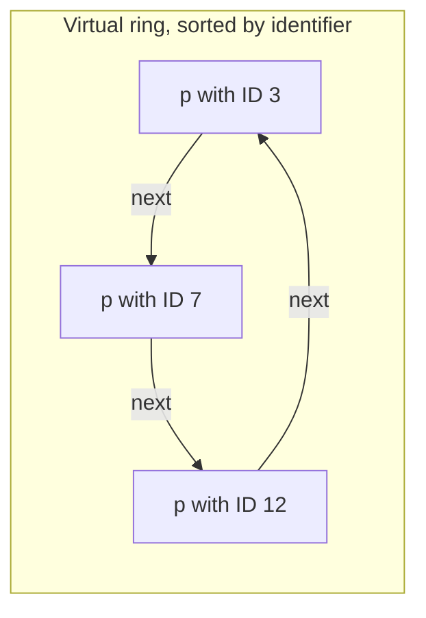

# Practical Session 1: Value Discovery in Complete Graphs (Home Assignment 1)

**Course:** EDA387/DIT663 Computer Networks, part 2 (Fault-tolerant Algorithms for Computer Networks), Practical Session 1 (2026).

**Revised:** 21 October 2026

**† Supplementary material:** content that comes only from hidden PowerPoint slides. It may not be part of this year's examinable material. *This session has no hidden slides, so nothing in this guide carries the † mark.*

**Notes in the text.** Paragraphs that begin with **Technical clarification** mark places where the lecture material is wrong, inconsistent or imprecise, and give the correct statement. Paragraphs that begin with **Additional context** add material from outside the lecture, such as the course book (Dolev), old exams, the pre-lecture quizzes or general knowledge.

---

## Glossary

| Term | Expansion or category | Meaning |
|---|---|---|
| Complete graph | — | A network where every processor is directly connected to every other processor. |
| Globally unique identifier | — | A name (number) that belongs to exactly one processor in the whole system and is the same no matter who looks at it, like a MAC address. |
| ids[] | — | In Algorithm 1, the sorted list of all identifiers a processor has read. |
| Local identifier | — | A name that a processor gives to its neighbours privately, for example its own port numbers. Two processors may give the same neighbour different names. |
| lr[k] | local read | A local variable where a processor keeps the value it read from processor *k*. |
| MAC address | Media Access Control address | A 48-bit hardware address that is assumed to be globally unique. |
| prev, next | — | The positions just before and just after a processor in the virtual ring. |
| Register *rᵢ* | — | A shared variable that *pᵢ* can read and write and every other processor can only read. |
| Register *sᵢ* (secret) | — | A shared variable holding *pᵢ*'s secret; every processor **except** *pᵢ* can read it. |
| Synchrony assumption | — | An assumption that processors move at the same pace. Algorithm 1 does not need one. |
| Virtual ring | — | An imaginary circle of processors that everybody agrees on, built here by sorting identifiers. |
| XOR (⊕) | exclusive or | A bit operation: 1 if the two bits differ, 0 if they are equal. It has the "undo" property *a* ⊕ *b* ⊕ *b* = *a*. |

## Contents

- [1. The value-discovery problem](#1-the-value-discovery-problem)
  - [1.1 What the session covers](#11-what-the-session-covers)
  - [1.2 The problem: discovering your own secret](#12-the-problem-discovering-your-own-secret)
- [2. Two solutions](#2-two-solutions)
  - [2.1 Question 1: a solution with globally unique identifiers](#21-question-1-a-solution-with-globally-unique-identifiers)
  - [2.2 Question 2: a solution with only local identifiers](#22-question-2-a-solution-with-only-local-identifiers)
- [3. Summary](#3-summary)
  - [3.1 Recap](#31-recap)
- [Revision notes and references](#revision-notes-and-references)

## 1. The value-discovery problem

### 1.1 What the session covers

The session plan was:

1. Review of the pre-lecture questions for **Analytical Framework**, **Dijkstra's algorithm** and **spanning-tree construction** (see guides 07, 08 and 09).
2. Discussion of student solutions.
3. **Home Assignment 1:** a student solution and the proposed solution.
4. Home Assignments 2 and 3 (introduced).

The lecture contains the proposed solution to Home Assignment 1, which is what this guide explains.

### 1.2 The problem: discovering your own secret

**Additional context.** The slides show only the solution, so here is the problem as stated in the 2026 home assignment ("Value discovery in complete graphs").

There are *n* processors *p*₀, …, *p*ₙ₋₁ (with *n* > 2 and known), connected as a **complete graph**. Each processor *pᵢ* has two registers:

- ***sᵢ*, the secret.** Its size is a constant. **Every processor except *pᵢ* can read *sᵢ*.** *pᵢ* itself cannot.
- ***rᵢ*, a helper register.** *pᵢ* can read and write it; all others can only read it.

The goal: **every processor must find out (output) its own secret *sᵢ*.**

Think of a party game where everyone has a sticker with a number on their forehead. You can see everybody's sticker except your own. Everyone also has a small whiteboard that only they can write on, but everyone can read. How can the others help you learn your own number?

With *n* = 2 it is easy: the other player reads your sticker and writes it on their whiteboard, and you read their whiteboard. With more players, the difficulty is **who writes whose secret**. A processor reaches the others only through its own private port numbers 0 … *n* − 2, so "the processor on my port 3" may be a different processor from "the processor on your port 3".

The two questions differ in one thing:

- **Question 1:** processors have **globally unique identifiers** (like MAC addresses), and *rᵢ* may hold the identifier plus one secret.
- **Question 2:** processors have **only local identifiers** (their port numbers), and *rᵢ* may hold only one secret-sized value.

The answer to both is **yes, there is a solution**.

## 2. Two solutions

### 2.1 Question 1: a solution with globally unique identifiers

#### Algorithm 1

The idea: **use the order of the identifiers to build a virtual ring** that everyone agrees on. Then each processor copies the secret of the processor **before** it in the ring onto its own whiteboard, so the processor **after** you in the ring is holding your secret.

```text
Algorithm 1: Using globally unique identifiers, code for processor pi
1  do forever begin
2      foreach pk ∈ P do lr[k] := read(ID(k));
3      let ids[] := sort({lr[k] | 0 ≤ k ≤ n−1})      /* ids is a sorted identifier array */
4      let (prev, next) := (k−1 mod n, k+1 mod n), where ids[k] = ID(i);
5      write (read(s_ids[prev])) to ri;
6      output(read(r_ids[next]));
```

Step by step:

1. **Line 2:** read the identifier of every processor.
2. **Line 3:** sort the identifiers into the list `ids[]`.
3. **Line 4:** find your own position *k* in the sorted list. Your ring neighbours are position *k* − 1 (`prev`) and position *k* + 1 (`next`), wrapping around modulo *n*.
4. **Line 5:** read the secret of `prev` and write it into your own register *rᵢ*.
5. **Line 6:** read the register *r* of `next` and output it. Since `next` copied the secret of **its** previous processor, which is you, this is your own secret.



The arrows show the agreed order "who comes next" in the virtual ring; the ring is only a shared agreement, not a new physical link.

#### Why Algorithm 1 is correct

The proof given in the session:

- **The same ring for everyone.** Because identifiers are globally unique, lines 2 to 4 make **all processors eventually store the same values** in `ids[]`, `prev` and `next`. So all processors eventually use an **identical virtual ring**.
- **The right secrets get copied.** Each processor reads the secret of its previous processor in the ring (line 5) and writes it into its own register.
- **Everyone outputs their own secret.** Each processor reads from its next processor in the ring (line 6), which holds the previous processor's secret, that is, its own. So all processors **eventually output their own secrets**.
- **No synchrony needed.** We only care about the value that is **eventually** output. All processors eventually write the right values to their registers, whatever their speeds, so no assumption about timing is needed.

The register *rᵢ* holds this processor's identifier (⌈log₂ *M*⌉ bits) plus one secret value, which is exactly the space Question 1 allows.

#### A small example

**Additional context.** A worked example of Algorithm 1.

Three processors with identifiers 12, 3 and 7 and secrets ★, ● and ▲:

| Processor | ID | Its secret | Position in sorted ids = (3, 7, 12) | prev | next | Writes into its *r* | Reads *r* of next and outputs |
|---|---|---|---|---|---|---|---|
| A | 3 | ● | 0 | ID 12 | ID 7 | ★ (secret of ID 12) | *r* of ID 7 = ● |
| B | 7 | ▲ | 1 | ID 3 | ID 12 | ● (secret of ID 3) | *r* of ID 12 = ▲ |
| C | 12 | ★ | 2 | ID 7 | ID 3 | ▲ (secret of ID 7) | *r* of ID 3 = ★ |

Each processor outputs exactly its own secret, and none of them ever read their own *s*.

### 2.2 Question 2: a solution with only local identifiers

Without global identifiers, the processors cannot agree on a ring. The trick is to use **XOR (⊕)**, which works like a lock you can open again with the same key: *a* ⊕ *b* ⊕ *b* = *a*.

**Additional context.** XOR in one line: 1 ⊕ 1 = 0, 0 ⊕ 0 = 0, 1 ⊕ 0 = 1, 0 ⊕ 1 = 1, done bit by bit. For example 0110 ⊕ 0011 = 0101, and 0101 ⊕ 0011 = 0110 again. XOR-ing two values gives a result of the **same size**, so it fits in a constant-size register.

#### The XOR trick, first for n = 3

Let every processor write into its register the XOR of **all the secrets it can see**:

- *r*₀ := *s*₁ ⊕ *s*₂
- *r*₁ := *s*₀ ⊕ *s*₂
- *r*₂ := *s*₀ ⊕ *s*₁

Processor *p*₀ can read *r*₁ and *r*₂, and also *s*₁ and *s*₂. So:

*r*₁ ⊕ *s*₂ = *s*₀ ⊕ *s*₂ ⊕ *s*₂ = ***s*₀**.

*p*₀ "removes" *s*₂ from *r*₁ and is left with its own secret.

#### The general case and Algorithm 2

For any *n*: *r*₀ := *s*₁ ⊕ … ⊕ *s*ₙ₋₁, *r*₁ := *s*₀ ⊕ *s*₂ ⊕ … ⊕ *s*ₙ₋₁, …, *r*ₙ₋₁ := *s*₀ ⊕ … ⊕ *s*ₙ₋₂. Then

*r*₁ ⊕ *s*₂ ⊕ … ⊕ *s*ₙ₋₁ = *s*₀.

In general, for **any** other processor *pⱼ*:

**sᵢ = rⱼ ⊕ ( ⊕ over k ∉ {i, j} of sₖ )**,

where the processor ordering is **local to *pᵢ*** (its own port numbers). This works because *rⱼ* contains every secret except *sⱼ*; XOR-ing in all the secrets except *sᵢ* and *sⱼ* cancels all of them, leaving *sᵢ*.

```text
Algorithm 2: Using local identifiers, code for processor pi
1  do forever begin
2      foreach pk ∈ P \ {pi} do lr[k] := read(sk);
3      write ( ⊕ over pk ∈ P \ {pi} of lr[k] ) to ri;
4      let rJ := read(rj) where pj ∈ P \ {pi};
5      output rj ⊕ ( ⊕ over pk ∈ P \ {pi, pj} of lr[k] );
```

Step by step:

1. **Line 2:** read the secrets of all the other processors.
2. **Line 3:** write the XOR of all of them into your own register.
3. **Line 4:** read the register of **any one** other processor *pⱼ*. It does not matter which one, so local port numbers are enough.
4. **Line 5:** XOR that register with all the secrets you read, except *pⱼ*'s, and output the result: your own secret.

The session states that **Algorithm 2's correctness proof follows the same arguments as Algorithm 1's**: once every processor has written the XOR of the secrets it sees, every processor's output is its own secret. Each register holds just one secret-sized value, as Question 2 requires.

#### A small example with numbers

**Additional context.** A worked example of Algorithm 2 with 4-bit secrets.

Let *n* = 4 with *s*₀ = 0101, *s*₁ = 0011, *s*₂ = 1000, *s*₃ = 1111.

- *p*₁ writes *r*₁ = *s*₀ ⊕ *s*₂ ⊕ *s*₃ = 0101 ⊕ 1000 ⊕ 1111 = 0010.
- *p*₀ picks *pⱼ* = *p*₁ (any choice works). It computes *r*₁ ⊕ *s*₂ ⊕ *s*₃ = 0010 ⊕ 1000 ⊕ 1111 = 0101.
- 0101 is exactly *s*₀. ✔

## 3. Summary

### 3.1 Recap

- **Question 1 (global identifiers):** sort the identifiers into a virtual ring; copy your predecessor's secret; read your own secret from your successor. Works because everyone eventually agrees on the same ring.
- **Question 2 (local identifiers only):** write the XOR of all secrets you can see; recover your own secret from any other processor's register by XOR-ing away the secrets you know. No agreement on names is needed, and registers stay constant-size.
- In both, only the **eventual** output matters, so no synchrony assumptions are needed.

## Revision notes and references

This guide found no errors in the lecture material that needed a technical clarification. Where the slides and the course book differ in presentation, this guide follows the lecture and notes the book's version.

- S. Dolev, *Self-Stabilization*, MIT Press, 2000: chapter 2, for the model and the proof techniques the solutions use.
