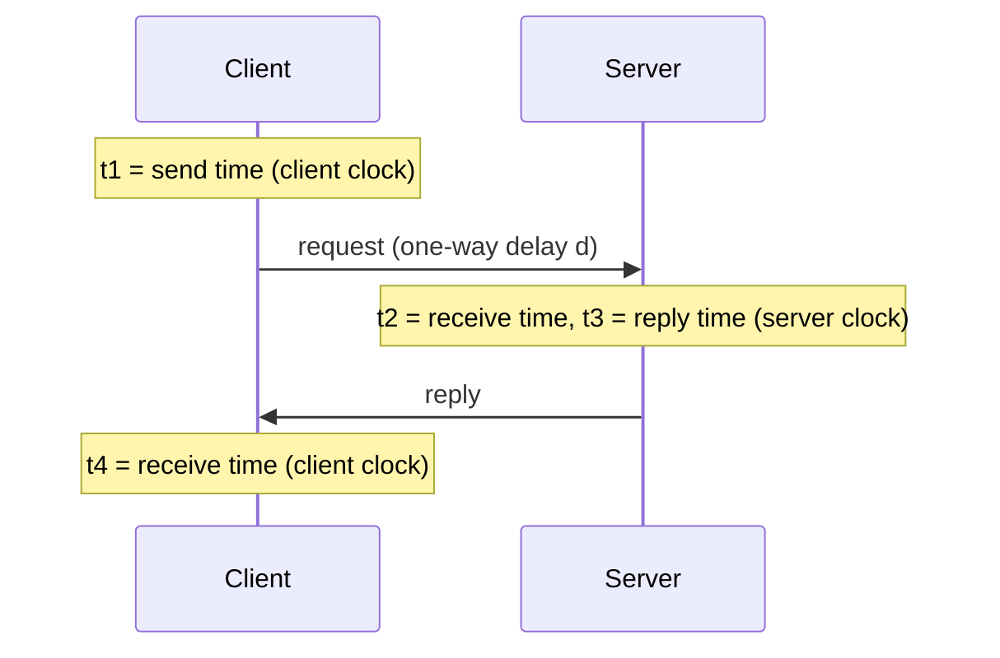
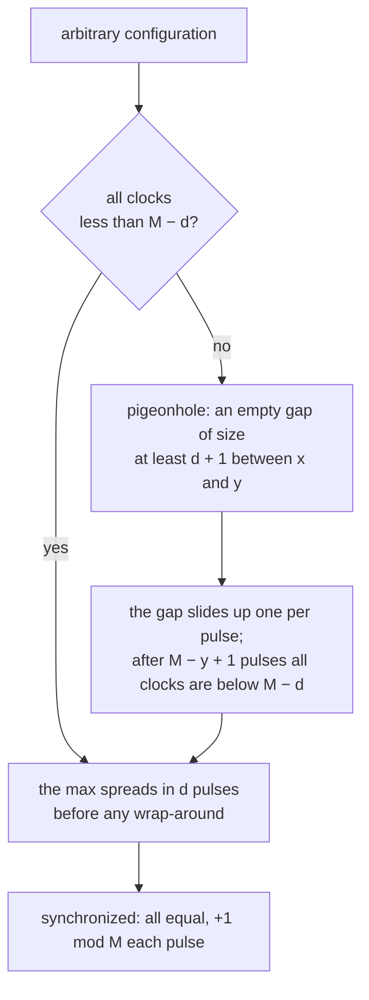
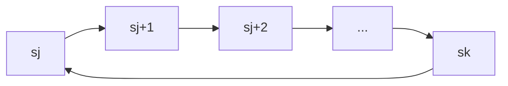
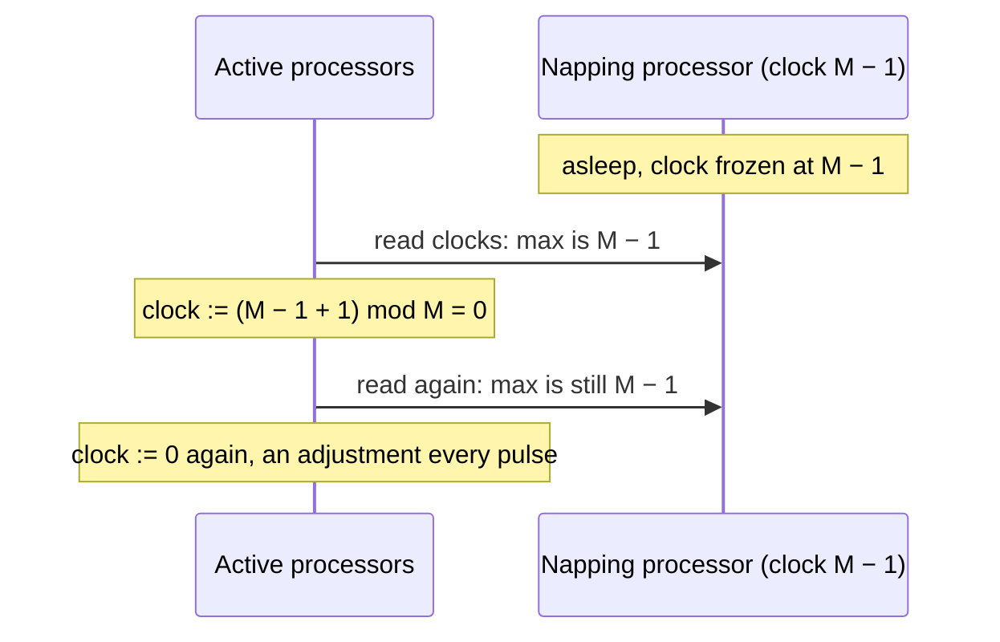
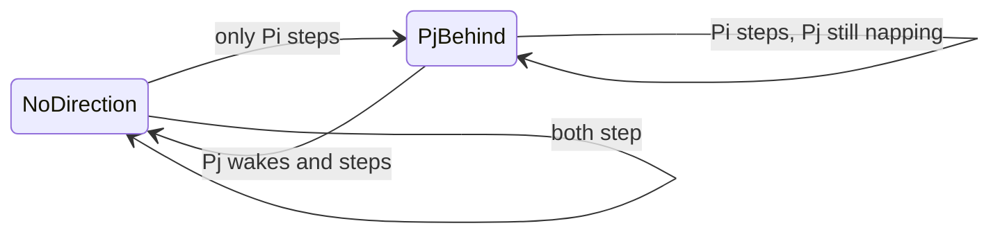

# Convergence in the Presence of Faults: Clock Synchronization

**Course:** EDA387/DIT663 Computer Networks, part 2 (Fault-tolerant Algorithms for Computer Networks), lecture "Convergence in the Presence of Faults (Ch. 6)". The lecture opens with a review of the Network Time Protocol (NTP), whose prelude slides "are based on the ones by Judah Levine" (NIST, Boulder), and then follows Dolev, *Self-Stabilization*, §6.1 "Digital Clock Synchronization" and §6.2 "Stabilization in Spite of Napping".

**Generated:** 2026-10-21

**† Supplementary material:** content that comes only from hidden PowerPoint slides. It may not be part of this year's examinable material. In this lecture the hidden material is the second half of the NTP review: leap seconds, stratum, authentication, the two-way delay measurement, measurement modes and typical performance (sections 4 to 6). The lecture also says that the details of the constant-states lower-bound proof were skipped this year (section 12).

**How to read the boxes.** Text that starts with **Beyond the slides** adds context from the course book (Dolev), from old exams, from the course's pre-lecture quiz on this chapter (quiz 14), or general knowledge, marked as such. **Note on the source** marks a place where the lecture material is wrong, garbled or incomplete. **Kid example** retells an idea with an everyday picture.

---

## Glossary

| Term | Full name | Meaning |
|---|---|---|
| Adjustment | — | A processor "adjusts" its clock in a step if it does **not** simply add 1. The requirement "no adjustment" means: just tick by one. |
| Agreement | — | All (working) processors show the same clock value. |
| Asymmetry error | — | The NTP error caused by the trip to the server and the trip back not taking equally long. |
| Authenticator | — | Extra data added to an NTP packet so the receiver can check who sent it and that it was not changed. |
| Behind | — | In the napping algorithm: P is behind Q when P.count[Q] + 1 (mod 3) = Q.count[P]; it means Q has been active more recently than P. |
| Byzantine fault | — | A faulty processor may do anything, even lie differently to different neighbours. |
| Clock pulse | — | A global "tick" that makes all processors take one step at the same moment (lock-step). |
| Crash failure | — | A processor stops and never comes back. |
| Diameter (d) | — | The largest number of hops between two processors. |
| Digital clock | — | An integer counter kept by each processor, meant to go up by one every pulse. |
| Hybrid faults | — | Transient faults (arbitrary start) **plus** faults that keep happening during and after convergence, such as napping. |
| Leap second | — | An extra second occasionally added to UTC to keep it in step with the Earth's rotation. |
| M | — | The bound on clock values: clocks are counted modulo M (0 … M − 1). |
| MD5 | Message Digest 5 | A hash function that NTP's (older) authentication uses. |
| Napping fault | — | A processor stops for a while and may later resume. A crash is a nap that never ends. |
| NB | Not Behind | The set of processors that are not behind any other processor (called R on one slide, A in quiz 14). |
| NTP | Network Time Protocol | The Internet protocol that synchronizes computer clocks with UTC. |
| Offset | — | How far one clock is ahead of another. |
| Pigeonhole principle | — | If more items than boxes, some box has two items; equally, few items in many boxes leave a large empty stretch. |
| PTP | Precision Time Protocol (IEEE 1588) | Another clock-synchronization protocol, mentioned on a hidden NTP slide. |
| Round-trip delay (Δ) | — | Total time for the request to go to the server and the reply to come back, minus the server's own processing time. |
| Slewing | — | Correcting a clock gradually (running it a bit fast or slow) instead of jumping. |
| SNTP | Simple Network Time Protocol | A simplified NTP client (a single query). |
| Stratum | — | In NTP: the number of links between a server and a UTC reference. |
| Transient fault | — | A short fault that corrupts memory and then stops; it leaves the system in an arbitrary configuration. |
| UDP | User Datagram Protocol | A connectionless transport protocol with no delivery guarantee. NTP runs over UDP port 123. |
| Uniform algorithm | — | All processors run the same program and have no IDs. |
| UTC | Coordinated Universal Time | The world's reference time scale; it replaced Greenwich Mean Time (GMT). |
| Wait-free | — | A working processor makes progress no matter what the others do, even if all n − 1 others are faulty. |

---

## Table of contents

1. [What this lecture is about](#1-what-this-lecture-is-about)
2. [NTP: message format and transport](#2-ntp-message-format-and-transport)
3. [NTP: the time datum](#3-ntp-the-time-datum)
4. [† NTP: other parameters, authentication](#4--ntp-other-parameters-authentication)
5. [† NTP: the two-way protocol and its error](#5--ntp-the-two-way-protocol-and-its-error)
6. [† NTP: measurement modes and performance](#6--ntp-measurement-modes-and-performance)
7. [Digital clock synchronization: the problem](#7-digital-clock-synchronization-the-problem)
8. [The unbounded algorithm (max + 1)](#8-the-unbounded-algorithm-max--1)
9. [Why unbounded clocks are a problem](#9-why-unbounded-clocks-are-a-problem)
10. [Bounded version I: max, modulo (n + 1)d + 1](#10-bounded-version-i-max-modulo-n--1d--1)
11. [Bounded version II: min, modulo 2d + 1](#11-bounded-version-ii-min-modulo-2d--1)
12. [A constant number of states is impossible](#12-a-constant-number-of-states-is-impossible)
13. [Napping faults: wait-free self-stabilization](#13-napping-faults-wait-free-self-stabilization)
14. [The unbounded algorithm with k = 1](#14-the-unbounded-algorithm-with-k--1)
15. [The bounded algorithm: rock, paper, scissors](#15-the-bounded-algorithm-rock-paper-scissors)
16. [Theorem 6.1: the algorithm works with k = 2](#16-theorem-61-the-algorithm-works-with-k--2)
17. [Summary and review questions](#17-summary-and-review-questions)
18. [Recap](#18-recap)
19. [Old exam questions on this lecture](#19-old-exam-questions-on-this-lecture)
20. [Related quiz topics not on the slides](#20-related-quiz-topics-not-on-the-slides)

---

## 1. What this lecture is about

The plan of the lecture:

- review the **Network Time Protocol (NTP)**;
- then study **simpler clock synchronization algorithms**;
- the focus: **integrating self-stabilization with other fault models, such as crash failures, that can occur during the execution and not only before the first configuration.**

Until now, "self-stabilizing" meant: faults happen, then stop, and the system recovers from whatever state they left. This chapter adds faults that **keep happening** (here, processors that stop and resume) while the system must still converge.

The chapter roadmap:

- **6.1 Digital Clock Synchronization**
- **6.2 Stabilization in Spite of Napping**

> **Kid example.** Before, the game was "someone messes up the board once, then the kids fix it". Now some kids also fall asleep and wake up again in the middle of the game, and the others must keep playing correctly anyway.

---

## 2. NTP: message format and transport

**Message format and parameters.**

- The format is defined in **RFC 1305**.
- **Packets are UDP/IP**:
  - checksum-based error detection;
  - simple connectionless service;
  - **No guarantee of delivery**;
  - **No detection of lost packets**;
  - "Like mailing a letter to a recipient who does not expect it".
- **Message authentication is optional**: an **authenticator** is added to the message.

This is fine for time: NTP does not need every packet. It relies on **repeated exchanges** and statistics, and a fresh time value matters more than a retransmitted old one.

**Transport.**

- **Independent of the physical layer in principle**, but **performance depends on the physical layer in practice** (speed, delay and loss of the network affect accuracy).
- **All versions of NTP can use IPv4; newer versions also support IPv6.**

> **Note on the source.** The lecture's explanation says "NTP employs a checksum mechanism ... calculated over the entire NTP packet". The checksum belongs to **UDP** (and IP), not to NTP itself; the lecture's own list correctly puts it under "Packets are UDP/IP". NTP's own integrity check is the optional authenticator.

> **Beyond the slides.** RFC 1305 is NTP version 3 (1992). The current version, NTPv4, is defined in RFC 5905 (2010). NTP uses UDP port 123 (section 6 † says so too).

---

## 3. NTP: the time datum

**The NTP time datum:**

- The reference scale is **UTC** (it used to be called Greenwich Mean Time).
- Time values are **64 bits** long:
  - **Seconds since 1900.0**: 32 bits, unsigned;
  - **Fraction of a second**: 32 bits, unsigned.
- **Dynamic range: 136+ years**, so there is a **rollover in 2036**.
- **Resolution: 2⁻³² s ≈ 232 picoseconds (ps).** For comparison, a common 3.0 GHz CPU needs about 330 ps for one cycle.
- A time of **0.0** is usually treated as an **error**.
- "What can go wrong?"

| Field | Bits | Range or step |
|---|---|---|
| Seconds since 1 January 1900 | 32 | 2³² s ≈ 136 years, so it wraps in 2036 |
| Fraction of a second | 32 | step 2⁻³² s ≈ 0.23 ns |

**What can go wrong:** after the **2036 rollover**, software that does not handle it would think it is 1900 again (wrong time order, expired certificates, broken logs). A time of **0.0** would mean "exactly 1 January 1900", which is never a real timestamp, so it is used as "no valid time".

> **Kid example.** A car's odometer with only six digits. After 999,999 km it shows 000,000 again. The NTP seconds counter has the same problem in 2036.

> **Beyond the slides (arithmetic check).** 2³² s = 4,294,967,296 s ≈ 136.1 years, and 1900 + 136.1 ≈ 2036 (the exact date is 7 February 2036). 2⁻³² s ≈ 0.233 ns = 233 ps. One cycle at 3.0 GHz = 1/3,000,000,000 s ≈ 333 ps.

---

## 4. † NTP: other parameters, authentication

**Some other parameters.**

- **Advance notice of a leap second**: "leap second at end of today" when the flag is set.
- **Positive leap second in progress**: transmit 23:59:59 **twice**, which effectively **stops the system clock** for one second.
- **Slewing methods (Google)**: spread the extra second out instead of repeating one.
- **Clock unsynchronized flag**: "don't trust the time message".
- Health and leap-second information **use the same bits**.

**More parameters.**

- message authenticator (optional);
- **Stratum**, precision and reference signal of the server (reference IP or local clock type). **The stratum is the number of links to UTC, not the quality of the oscillator**;
- administrative data, not completely defined in the specification, which can usually be ignored.

**Authentication: the idea.**

- Keys are identified by an index number into a local file that has the key value (`<Key Number> M <key value>`); the configuration names a `trustedkey`.
- The sender computes the **MD5 hash of key + packet** and appends the result and the key index.
- The receiver detects the additional data, computes the hash with the key with that number, and compares.
- There is no decryption: MD5 has no known inverse.
- **Distribution of keys is a headache.**

**Authentication: how it works.**

- Authentication **only identifies the server** and **guarantees integrity**.
- It does **not** affect accuracy or traceability.
- A "man in the middle" can still **delay** a valid message or **replay** an old one.

> **Beyond the slides.** Leap seconds are inserted as an extra second, 23:59:60, usually at the end of 30 June or 31 December. MD5 is no longer considered collision-resistant, so modern NTP deployments prefer stronger hashes or Network Time Security (NTS, RFC 8915). Delay attacks matter because NTP's accuracy depends on measuring the delay (section 5).

---

## 5. † NTP: the two-way protocol and its error

The client sends a request at **t1** (client clock). The server receives it at **t2** and answers at **t3** (server clock). The client receives the answer at **t4** (client clock). The one-way delay is **d**.



The formulas:

- **Round-trip delay:** Δ = (t4 − t1) − (t3 − t2). (Total time minus the time the server held the request.)
- **Offset:** the lecture writes t(server) − t(client) = (t1 + d) − t2. When the request arrives, the client's clock shows t1 + d and the server's shows t2.
- **Assume** the delay is the same both ways: d = Δ/2. Then the estimate is (t1 + Δ/2) − t2.
- **If the truth is** d = kΔ with 0 ≤ k ≤ 1, the **error** is (t1 + kΔ − t2) − (t1 + Δ/2 − t2) = **Δ(k − 0.5)**.
- So **MaxError = ±0.5Δ** (k = 1 gives +Δ/2, k = 0 gives −Δ/2).
- The error is at most half the round trip, so **"Smaller delay has smaller asymmetry error."**

> **Note on the source.** With the usual meaning (positive when the server is ahead), the server-minus-client offset is t2 − (t1 + d); the lecture's expression is the client-minus-server difference. Only the sign differs, so the size of the error, ±Δ/2, is unchanged.

> **Beyond the slides (worked example).** t1 = 100.000 s, t2 = 100.060, t3 = 100.061, t4 = 100.041 (client clock). Δ = (100.041 − 100.000) − (100.061 − 100.060) = 0.041 − 0.001 = 0.040 s. Estimated one-way delay Δ/2 = 0.020 s. Server ahead by t2 − (t1 + 0.020) = 100.060 − 100.020 = **0.040 s**. The same as the standard NTP formula ((t2 − t1) + (t3 − t4)) / 2 = (0.060 + 0.020) / 2 = 0.040 s. Whatever the real split of the delay, the error is at most ±0.020 s.

> **Kid example.** You shout to a friend across a field and they shout back. You know how long the whole echo took, but not whether the wind made one direction slower. Guessing "half each way" can be wrong by at most half the echo time.

---

## 6. † NTP: measurement modes and performance

**Measurement protocols.**

| Mode | How it works |
|---|---|
| Two-way daemon with measured delay | UDP port 123 on server and client; periodic queries to **multiple** servers; client-server or peer-to-peer |
| Broadcast mode | **no measured delay**; one server, many clients; local LAN or Internet multicast |
| Single-shot client (ntpdate, SNTP) | server port UDP 123, any client port; measures the delay with the usual two-way method |

**Typical performance.**

- Typical asymmetry: a few percent of the delay.
- Small LAN: "10 milliseconds best case ever on 2-node LAN", "220 ms on real-world small LAN".
- Typical large-building LAN: 2 ms RMS.
- Internet with few hops: 10–20 ms.
- Long distance and/or slow or busy link: 100 ms – 1 s.
- **Accuracy is set by the accuracy of the network delay measurement**, not by the message format. **PTP/1588 is not better on the same network.** Accuracy degrades on networks with **asymmetric** delays (for example web servers).

> **Note on the source.** The two "small LAN" numbers in the lecture cannot be right as written: a small LAN cannot be worse (220 ms) than a large building LAN (2 ms) or an Internet path (10–20 ms). They were very probably **microseconds** (10 µs and 220 µs) in the original source, and the unit was changed by mistake.

> **Beyond the slides.** PTP (IEEE 1588) usually reaches much better accuracy than NTP in practice, but only because it uses hardware timestamps and PTP-aware switches that remove the delay uncertainty. That fits the lecture's point: what limits you is how well you can measure the network delay.

---

## 7. Digital clock synchronization: the problem

**Motivation.** Multi-processor computers need synchronization for coordination, that is, clocks. Possible setups:

- a global clock pulse and a global clock value;
- **A global clock pulse and individual clock values** (this chapter);
- individual clock pulses and individual clock values;
- fault-tolerant clock synchronization.

Such systems can be resilient to faults, but the number of faults grows with the number of processors, so fault tolerance is vitally important.

**The problem.** In every pulse, each processor **reads the clocks of its neighbours** and uses these values to compute its **new clock value**. The goal:

1. **Identical clock values;**
2. **The clock values are incremented by one in every pulse.**

There are n **identical** processors, all connected to a **global common clock pulse**, each keeping a digital clock value.

> **Beyond the slides.** Identical processors are no obstacle here, because the goal (everybody equal) is itself symmetric. That is unlike leader election, where symmetry must be broken (Dolev §6.1).

> **Kid example.** Every kid in class has a watch. On each drum beat, everyone looks at their neighbours' watches, decides on the new time and sets their own. Goal: all watches show the same time and tick together.

---

## 8. The unbounded algorithm (max + 1)
```text
01 upon a pulse
02   forall Pj ∈ N(i) do send(j, clock_i)
03   max := clock_i
04   forall Pj ∈ N(i) do
05     receive(clock_j)
06     if clock_j > max then max := clock_j
07   od
08   clock_i := max + 1
```

In words: **take the biggest clock you can see (yours or a neighbour's) and add 1.**

**Why it works.** "A simple induction can prove that this version of the algorithm is correct: if Pm holds the max clock value, by the i-th pulse every processor of distance i from Pm holds the maximal clock value." After **d** pulses (d = diameter), everyone has the same value, and from then on everyone adds 1 to the same number.


> **Kid example.** The biggest number spreads like a rumour, one hop per drum beat. After d beats everybody has heard it.

---

## 9. Why unbounded clocks are a problem

**"Unbounded clocks is a drawback in self-stabilizing systems."** Using 2⁶⁴ possible values does **not** create the illusion of "unbounded": **a single transient fault may cause the clock to reach the maximal clock value.** Then the next "+1" overflows, and "take the maximum" no longer works.

> **Kid example.** A prankster can turn your six-digit odometer to 999,999 in one second. "It takes forever to get there" does not help against a prankster.

---

## 10. Bounded version I: max, modulo (n + 1)d + 1

The same algorithm, only line 8 changes:

```text
08   clock_i := (max + 1) mod ((n + 1)d + 1)
```

So the bound is **M = (n + 1)d + 1**. "For ease of description the values we choose for M are not the minimal possible value." This is **converge-to-the-max**, and the key fact is: **the number of different clock values can only decrease, and it is reduced to a single clock value** (every new value is some existing value + 1, so no new distinct value can appear).

**Example.** Three processors on a line p1 – p2 – p3, so n = 3 and d = 2, and M = (3 + 1)·2 + 1 = **9**. The lecture animates the rounds on a dial 0…8; here is a run we computed with the same rule (our own starting values):

| Pulse | p1 | p2 | p3 | What happened |
|---|---|---|---|---|
| 0 | 4 | 5 | 8 | arbitrary start |
| 1 | 6 | 0 | 0 | p2 and p3 saw 8, and 8 + 1 = 9 wraps to 0 |
| 2 | 7 | 7 | 1 | p1 and p2 saw 6; p3 only sees 0s |
| 3 | 8 | 8 | 8 | all equal |
| 4 | 0 | 0 | 0 | they wrap together |

**Why it is correct.** Two cases.

1. **All clock values are less than M − d.** Then synchronization happens **before** the modulo is ever applied: after d pulses there must be convergence, and the max value is still less than M.
2. **Not all values are less than M − d**.
   - **Pigeonhole:** in any configuration there are two clock values x and y with **y − x ≥ d + 1** and **no clock value between them**. (There are only n clocks on a dial of M = (n + 1)d + 1 values, so somewhere there is a big empty stretch.)
   - **After i pulses, no clock value is in (x + i, y + i)**: everyone copies an existing value and adds 1, so the empty stretch just slides up by one per pulse.
   - **After M − y + 1 pulses**, the values above the gap have wrapped around, and all clock values are less than M − d. Now case 1 applies.



> **Beyond the slides.** Once synchronized, all clocks show M − 1 at the same pulse and become 0 together at the next pulse (Dolev, quiz 14 Q10), so the wrap-around does not break agreement.

---

## 11. Bounded version II: min, modulo 2d + 1

Use the **minimum** instead of the maximum:

```text
03   min := clock_i
06   if clock_j < min then min := clock_j
08   clock_i := (min + 1) mod (2d + 1)
```

The bound is **M = 2d + 1**, much smaller, and it does not depend on n.

**Why it works.**

- **If no processor assigns 0 during the first d pulses**, synchronization is reached (simple induction: the minimum spreads one hop per pulse).
- **Otherwise**, some processor assigns 0 during the first d pulses. **d pulses after that**, a configuration c is reached in which **no clock value is greater than d**. From c, nobody wraps to 0 for at least d pulses, so the first case applies.

Example (our own run, line p1 – p2 – p3, d = 2, M = 5):

| Pulse | p1 | p2 | p3 | What happened |
|---|---|---|---|---|
| 0 | 4 | 4 | 1 | arbitrary start |
| 1 | 0 | 2 | 2 | p1 only sees 4s, and 4 + 1 wraps to 0 |
| 2 | 1 | 1 | 3 | the 0 spreads to p2 |
| 3 | 2 | 2 | 2 | all equal |

> **Kid example.** Instead of "follow the fastest watch", everybody follows the **slowest** one they can see. A small dial is enough because the slowest value cannot run away.

---

## 12. A constant number of states is impossible

**"There is no uniform digital clock-synchronization algorithm that uses only a constant number of states per processor"** (for deterministic algorithms). The question is: can the number of clock values be a fixed constant, related to neither the diameter nor the number of processors? No. The proof uses rings: a lower bound for this special case is a lower bound for general graphs.

**The setting.** (The lecture skipped the details of this proof this year.)

- A processor can read the clock of only a **subset** of its neighbours.
- In a **unidirected ring** every processor has a left and a right neighbour and reads the state of its **left** neighbour: **s_i(t+1) = f(s_(i−1)(t), s_i(t))**, where f is the transition function.
- |S| is the constant number of states.

**The idea.** Choose a **big enough ring** in which the algorithm never stabilizes: the states just **rotate**. In every step, each processor takes on the state of its right neighbour.

**The construction.**

1. Take two states s1 and s2 and build an infinite sequence with **s(l+2) = f(s(l), s(l+1))**.
2. There are only |S|² possible pairs, so in any |S|² + 1 pairs some pair **repeats** (pigeonhole). So there is a piece s_j, s_(j+1), …, s_k with **f(s_(k−1), s_k) = s_j** and **f(s_k, s_j) = s_(j+1)**, with k > j + 2 (equivalently s_(k+1) = s_j and s_(k+2) = s_(j+1)). Any 2(|S|² + 1) consecutive states contain such a piece.
3. Build a ring from s_j … s_k, with the processor in state s_k as the **left neighbour** of the processor in state s_j.
4. Each processor computes from its left neighbour and itself, so s_(j+i) becomes s_(j+i+1), and s_k becomes s_j: **in each pulse the states rotate one place to the left.**



**The contradiction.** The set of states never changes; it only rotates. If the system were synchronized, every state would have to show the same clock value. But the clock must **increase** every pulse, and the same set of states cannot keep showing a bigger value. So it never stabilizes. "In the more complicated case of bidirectional rings, the lower-bound proof uses a similar approach."

Two natural follow-up questions, which Dolev answers:

- **"Do we have to assume that the ring is unidirectional?"** No. For bidirectional rings, f depends on three states, so a repeat appears within O(|S|³) states, and the same rotation argument works.
- **"Does a probabilistic algorithm exist for this ring?"** Yes. At each pulse, each processor randomly picks **its own clock or a neighbour's** and sets clock := (that + 1) mod M. The number of distinct values can only shrink, and it stabilizes **with probability 1** (if every processor happened to pick the neighbour on a shortest path to one fixed processor, all would agree within d pulses).

> **Note on the source.** The lecture once says "In a undirected ring"; it should be "unidirected" (one-way) ring, as the lecture says elsewhere and as in Dolev.

> **Kid example.** Kids in a circle each copy a rule that looks only at the kid on their left. With few possible "faces", you can seat the kids so that every beat the faces just pass one seat along the circle, like a merry-go-round. The pattern never settles, so the clocks never agree.

---

## 13. Napping faults: wait-free self-stabilization

**Stabilizing in spite of napping:**

- A **wait-free self-stabilizing clock-synchronization algorithm** copes with **transient** and **napping** faults.
- **Each non-faulty operating processor ignores the faulty processors and increments its clock value by one in every pulse.**
- For a fixed integer **k**: once pi has worked correctly for at least k time units and keeps working, then:
  - **Adjustment:** pi does not adjust its clock (it just adds 1);
  - **Agreement:** pi's clock agrees with every other processor that has also worked correctly for at least k time units.

> **Beyond the slides.** Dolev §6.2 (and quiz 14):
> - **Napping is worse than crashing**: a crashed processor is a napping one that never wakes, but a napping one can come back at any moment with an old value.
> - **"Wait-free"**: a working processor synchronizes even if **all n − 1 others are faulty**; it never waits for anyone.
> - Each requirement alone is trivial: "add 1 every pulse without talking to anyone" gives adjustment but not agreement; "always show 0" gives agreement but not adjustment. The challenge is both together.
> - The setting is a **complete graph**: every processor can read every other processor.

---

## 14. The unbounded algorithm with k = 1

A simple example with **k = 1**, using unbounded clocks:

- **In every step, each processor reads the clocks of all the other processors, takes the maximum x, and sets its clock to x + 1.**
- After one step of P1, P1's clock holds the maximal value, and **it does not adjust its clock as long as it does not crash**.
- A napping processor's clock does not change while it naps, so when it wakes it is behind the maximum and does no harm.
- **"Note that this approach won't work using bounded clock values."**

Why not (Dolev): with clocks mod M, a napping processor stuck at **M − 1** is always the maximum, so every active processor keeps computing (M − 1 + 1) mod M = **0**. That is an adjustment at every step, for every k.



> **Kid example.** A sleeping kid holds a sign "59 minutes". If everybody always copies the biggest sign and adds one minute, they keep jumping back to "0", forever. You need a way to ignore the sleeper.

---

## 15. The bounded algorithm: rock, paper, scissors

**The idea:** **identify the crashed (napping) processors and ignore their values.** Each processor P has:

- **P.clock ∈ {0, …, M − 1}**;
- for every other processor Q, **P.count[Q] ∈ {0, 1, 2}**.

**P is behind Q if P.count[Q] + 1 (mod 3) = Q.count[P].**

| P.count[Q] | Q.count[P] | Result |
|---|---|---|
| 0 | 1 | P is behind Q |
| 1 | 2 | P is behind Q |
| 2 | 0 | P is behind Q |
| equal values | equal values | no direction: neither is behind |

**Rock, paper, scissors.** Like the children's game, the three values beat each other in a circle (2 beats 1, 1 beats 0, 0 beats 2), so there is always a well-defined "who is ahead" between two different values, without needing bigger numbers.

**The program for P:**

```text
do forever (* executed by processor pi *)
  for each pj ∈ P do read count_j and clock_j
  let NB be the set of processors that are not behind any other processor
  if NB ≠ ∅ then
    let pk be a processor with the maximal clock in NB
    clock_i := clock_k + 1 (mod M)
  for each pj ∈ P do
    if pj is not behind pi then
      count_i[j] := count_i[j] + 1 (mod 3)
```

In words: take the maximum clock only among the processors that are **not behind anyone** (the recently active ones), add 1. Then "push the arrow towards yourself" for every processor that is not already behind you. If NB is empty, the clock is not changed.

**How the arrow behaves** (Dolev; checked with the rule above):

| Situation | count_i[j], count_j[i] | Meaning |
|---|---|---|
| start | 0, 0 | no direction |
| both step | 1, 1 | still no direction |
| only Pi steps (Pj naps) | 2, 1 | Pj is behind Pi, so Pj's clock is ignored |
| Pi steps again, Pj still naps | 2, 1 | Pi does not increment (Pj is already behind) |
| Pj wakes and steps | 2, 2 | Pj catches up, no direction again |



**Run sample.** Four processors P1 to P4 in a complete graph with k = 2; the figure marks the active processors, the "behind" connections and which processors are in NB, and shows their clocks converging.

> **Note on the source.** The variable names change during the lecture: **count** in the first version of the code, **order** (order_ij) in the proof and in Dolev, **R** for the set NB in an older hidden version of the code, and **A** in quiz 14. They all mean the same things. One line of the code ends with a stray word "processors", and its "if NB ∅" has lost the "≠" sign.

> **Kid example.** Every pair of kids shares a little arrow. Each time you act, you turn the arrow towards yourself. If both of you act, the arrow points nowhere. If your friend falls asleep, the arrow ends up pointing at you, and everyone knows to ignore the sleeper's watch.

---

## 16. Theorem 6.1: the algorithm works with k = 2

**Theorem 6.1:** the algorithm is a **wait-free self-stabilizing clock-synchronization algorithm with k = 2**.

**Proof** (starting with **any** values in the count/order and clock variables):

1. **Same view.** All processors that take a step in the same pulse see the same view (they can read all fields of all registers), so they compute the **same NB**.
2. **NB is not empty after pi's first step**, and while pi keeps taking steps it **stays in NB**: in each step it increments every order_ij for which pj is not behind pi, so pi is never behind anyone.
3. **Same clock after pi's second step.** Since NB is not empty and everyone who steps sees the same NB, all of them choose the same clock value. So after pi's second step (and while pi keeps going), all processors in NB have the same clock.
4. **Agreement:** every processor that executes a step belongs to NB, and all clocks in NB are equal.
5. **Adjustment:** every processor picks the maximal clock m in NB and sets m + 1 mod M; pi is in NB with that clock, so it just ticks by one.
6. The proof assumed an **arbitrary starting configuration**, so the algorithm is **both wait-free and self-stabilizing**. ■

| Pi's steps | What is guaranteed |
|---|---|
| 1st step | NB ≠ ∅ and pi ∈ NB |
| 2nd step | all processors in NB (and everyone who steps) have the same clock |
| later steps | agreement and adjustment hold, so k = 2 |

> **Note on the source.** The lecture (like Dolev) writes "the maximal clock value m of a processor in NB" and "increments m by 1 modulo M"; Dolev's printed text even uses the same letter M for both the value and the modulus. They are two different things: m is a clock value, M is the bound.

> **Beyond the slides.** Compared with the unbounded k = 1 algorithm, this one needs one more step (k = 2) but uses only bounded memory (clocks mod M and counters mod 3). That is its main point (quiz 14 Q44, Q49).

---

## 17. Summary and review questions

**Summary:** we looked at some common fault models and saw how self-stabilizing clock synchronization can take them into account.

**Review questions:**

1. Can a number smaller than (n + 1)d + 1 be used in line 8 of Figure 6.2 without changing anything else? Prove stabilization or give a counterexample.
2. On a line P1, P2, …, Pn with **no sense of direction**, will Figure 6.2 stabilize if the increments are **modulo 3**? Prove it or give a counterexample.
3. Will the unbounded algorithm of Figure 6.1 stabilize if the **minimal** clock value plus one is assigned? What if the **average** (integer part) is used?

> **Beyond the slides (hints, not official answers).**
> - For question 1, the lecture already says that M = (n + 1)d + 1 was chosen "for ease of description" and is "not the minimal possible value", so smaller values can work; the min version of section 11 shows that 2d + 1 suffices for the min rule.
> - For question 3 with the minimum, yes: let m be the smallest clock at the start. No clock ever goes below the current minimum, and after t pulses every processor within distance t of a processor holding m has m + t (it sees that value and nothing smaller). After d pulses all clocks equal m + d. This is the same induction as for the max rule.

---

## 18. Recap

- **NTP** runs over UDP (port 123), uses 64-bit timestamps (seconds since 1900 + fraction, wrap in 2036, ~232 ps resolution). † Its two-way exchange measures the round-trip Δ; assuming equal halves gives an error of at most ±Δ/2, so smaller delay means smaller error.
- **Digital clock synchronization:** common pulse; goal = identical clocks that go up by one per pulse.
  - **Max + 1** (unbounded): synchronized after d pulses, but unbounded clocks are fragile.
  - **Max + 1 mod (n + 1)d + 1**: correct by the pigeonhole gap argument.
  - **Min + 1 mod 2d + 1**: correct, smaller M.
  - **Constant states are impossible** (deterministic, uniform): the rotating-ring argument. Randomization fixes it (probability 1).
- **Napping:** wait-free self-stabilization = adjustment + agreement after k steps.
  - **Max + 1 with k = 1** works with unbounded clocks, but mod M fails because of a napping M − 1.
  - **Bounded:** count/order variables mod 3 ("behind", rock-paper-scissors), take the max over **NB**; **Theorem 6.1: k = 2**.

---

## 19. Old exam questions on this lecture

On the exam cheat sheet these are **Algorithm 13** (unbounded max), **Algorithm 14** (max mod (n + 1)d + 1), **Algorithm 15** (min mod 2d + 1) and **Algorithm 16** (the wait-free bounded algorithm).

**October 2018, Q3d (true/false).** *"It is impossible to design self-stabilizing algorithms for digital clock synchronization in synchronous and anonymous networks … when each node can have only a constant number of states."*
**TRUE** (Dolev §6.1, section 12): in a large enough ring the states just rotate forever.

**October 2021, Q1j and October 2022 (true/false).** *"In class, we showed that there is no uniform digital clock-synchronization algorithm that uses only a constant number of states per processor. NTP uses a constant number of 64 bits to represent the clock values. Such contradictions can exist between theory and practice."*
**FALSE.** There is no contradiction: the lower bound is for **uniform** algorithms (identical processors, no special ones). NTP is **hierarchical**, with distinguished servers (strata) connected to reference clocks, so the lower bound does not apply.

**October 2019, Q3 (8 points).** The unbounded algorithm (clock_i := 1 + max of own and neighbours' clocks).
- (a) Fill in the task: **agreement:** identical clock values; **progress:** the clock values are incremented by one every pulse.
- (b) Why is it not self-stabilizing in practice? The variable is really bounded (say 64 bits); one transient fault can set it to the maximum, it overflows, and "take the max" no longer gives agreement.
- (c) Prove that the task holds within O(d) pulses: induction on t, "no clock is larger than M + t, and every processor within distance t of Pm has exactly M + t", where M is the largest value at the start.

**August 2020, Q2 (26 points).** A self-stabilizing "firing squad" in a synchronous network, built on **Algorithm 15** (min mod 2d + 1): once the clocks agree, they all reach 0 at the same pulse, which starts a common epoch.

**October 2025, Q3 (reconstructed).** Build a mechanism that tells each processor which others were recently active, in an asynchronous anonymous network with napping. The teacher: the **count variables and the set NB** of Algorithm 16 are the right tool, but **not** its global clock (a common clock does not fit the model); use a local counter ("local stopper") instead.

> **Kid example (exam tip).** "Constant number of states" + "uniform/anonymous" → impossible (TRUE). "NTP contradicts the lower bound" → FALSE, because NTP has special servers. "Why is the unbounded clock not self-stabilizing?" → one transient fault can jump straight to the maximum.

---

## 20. Related quiz topics not on the slides

The course's pre-lecture quiz on this chapter (quiz 14, 56 questions on §6.1 and §6.2) follows the lecture closely. Points it asks that the lecture leaves implicit:

| Question | Answer (quiz key, Dolev) |
|---|---|
| What happens in one pulse? (Q1) | Read the neighbours, compute the next value, then update the clock (lock-step: all reads finish before anyone writes). |
| How many pulses for the unbounded max + 1? (Q3) | At least d, the diameter. |
| How many pulses for bounded version I after finding the gap x, y? (Q9) | M − y + 1 pulses to get every clock below M − d, then d more for the max to spread. |
| What bound on M suffices for the min version? (Q11) | M > 2d (the code uses 2d + 1). |
| Why can the number of distinct values never grow? (Q12, Q53) | Every new value is an existing value + 1, so values can only merge. |
| Bidirectional rings? (Q19) | The same argument with triples of states, sequences of length O(\|S\|³). |
| How does the randomized constant-state algorithm work? (Q20, Q52–Q56) | Pick your own or a neighbour's clock at random, add 1 mod M; stabilizes with probability 1. In the scheduler-luck argument, luck makes every processor pick the neighbour on a shortest path to a fixed Pl, which synchronizes everyone within d pulses. |
| What are hybrid faults? (Q21) | Transient faults plus permanent faults during and after convergence. |
| If NB (A) is empty? (Q36) | The processor does not change its clock in that pulse. |
| Trade-off of the bounded wait-free algorithm? (Q44) | k = 2 instead of k = 1, but bounded memory. |
