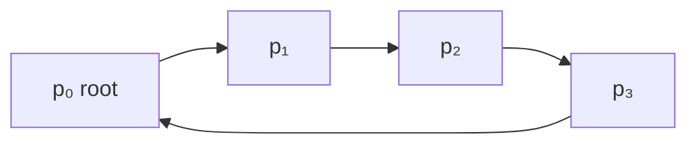
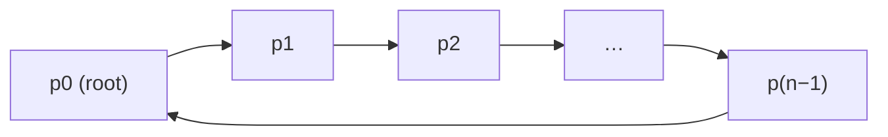
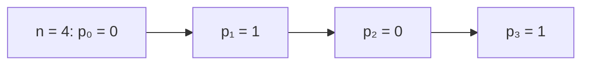
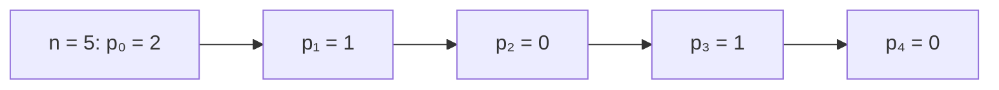
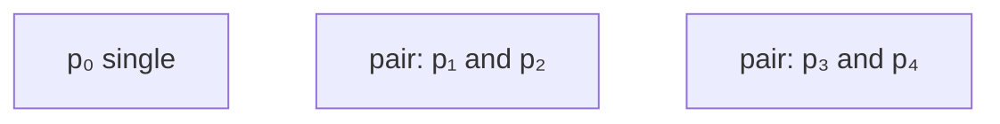
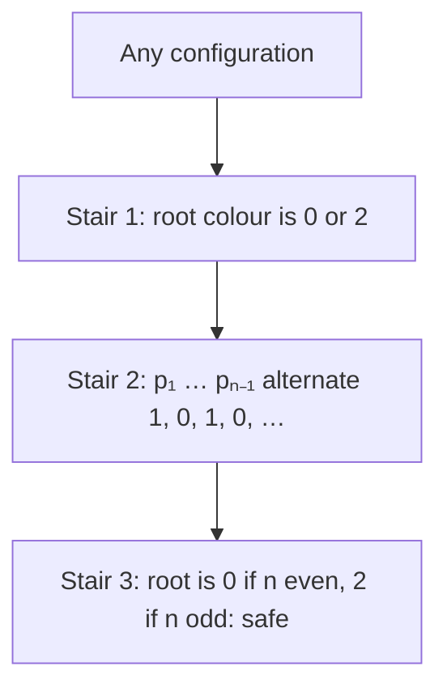

# Practical Session 2: Ring Coloring, Ring Matching and Leader-Election Review

**Course:** EDA387/DIT663 Computer Networks, part 2 (Fault-tolerant Algorithms for Computer Networks), Practical Session 2 (2025 edition).

**Revised:** 21 October 2026

**† Supplementary material:** content that comes only from hidden PowerPoint slides. It may not be part of this year's examinable material.

**How to read this guide.** Every part starts with **In one sentence**, the whole idea in one line. Then comes the explanation in small steps, a **Kid example** (the same idea told with everyday things), pictures, and a **Remember** list with what you must know for the exam. **Technical clarification** marks a place where the slides are wrong or unclear, and gives the correct version. **Additional context** adds something useful that is not on the slides.

**Numbering warning.** The "Theorem 2.1", "Claim 2.2", "Claim 2.3" and "Lemma 2.4" in this guide are the numbers used **inside this homework solution**. They are **not** the theorems with the same numbers in Dolev's book (where Theorem 2.1 is about Dijkstra's algorithm). Likewise, "Question 1/2/3" are the 2025 home-assignment numbers; in the 2026 assignment the same problems are Home Assignment 2, Questions 1 and 2.

---

## Glossary

| Term | Full name | Meaning in simple words |
|---|---|---|
| altOneZero(*k*) | alternating one-zero | The sequence (1, 0, 1, 0, …) of length *k*, starting with 1. |
| Asynchronous cycle | — | A stretch of an execution in which every processor runs its code at least once. |
| Chromatic number | — | The smallest number of colours that can colour a graph so that no two neighbours share a colour. |
| Concatenation (∘) | — | Joining two sequences: (0) ∘ (1, 0) = (0, 1, 0). |
| Convergence stairs | — | A proof technique: prove the system reaches and keeps a first property, then a stronger one, and so on, until the last one describes safe configurations. |
| Directed ring | — | Processors in a circle where each *pᵢ* can read only its predecessor *p*₍ᵢ₋₁₎ mod *n*. |
| Distributed fair scheduler | — | A scheduler that may activate several processors at once but never ignores any processor forever. |
| evenOdd(*n*) | — | The one-element sequence (0) if *n* is even and (2) if *n* is odd. |
| Floating identifier | — | An identifier left in the state by a fault that belongs to no real processor. |
| Matching | — | A set of neighbour pairs (edges) in which no processor appears in two pairs. |
| Maximum matching | — | A matching with the largest possible number of pairs. |
| Semi-anonymous (semi-uniform) ring | — | A ring with no identifiers, where only one special processor *p*₀ runs a different program. |
| seqWithoutRoot(*k*) | — | The values (*x*₁, …, *xₖ*) of the ring registers, leaving out the root *x*₀. |
| Single processor | — | A processor that is not part of any pair in the matching. |
| SL-game | Scheduler-luck game | The game used to analyse randomized self-stabilizing algorithms: an adversary scheduler against "luck". |
| Vertex coloring | — | Giving every processor a colour so that neighbours have different colours. |

## Contents

- [Before you start: the words you need](#before-you-start-the-words-you-need)
- [1. The setting](#1-the-setting)
  - [1.1 What the session covers](#11-what-the-session-covers)
  - [1.2 The setting: Dijkstra's directed ring](#12-the-setting-dijkstras-directed-ring)
- [2. Colouring and matching on the ring](#2-colouring-and-matching-on-the-ring)
  - [2.1 Optimal vertex coloring of the ring (Question 1)](#21-optimal-vertex-coloring-of-the-ring-question-1)
  - [2.2 Maximum matching on the ring (Questions 2 and 3)](#22-maximum-matching-on-the-ring-questions-2-and-3)
- [3. Leader-election review](#3-leader-election-review)
  - [3.1 Pre-lecture review questions: leader election](#31-pre-lecture-review-questions-leader-election)
- [4. Summary](#4-summary)
  - [4.1 Recap](#41-recap)
- [Revision notes and references](#revision-notes-and-references)

## Before you start: the words you need

- **Ring:** processors standing in a circle. In a **directed** ring each one can only look at the one just **before** it.
- **Root *p*₀:** the one special processor that runs a different program. All the others run the same program and have no names.
- **Colour:** a small number (0, 1 or 2) that each processor stores. **Vertex colouring** means neighbours must never have the same colour.
- **Matching:** pairing up neighbours, like dancing partners, where nobody may be in two pairs at once.
- **Self-stabilizing:** starting from any messed-up values, the processors fix them by themselves and then stay correct.
- **Asynchronous cycle:** a stretch of time in which every processor has had at least one turn.
- **Convergence stairs:** a way to prove recovery step by step: first one thing becomes true and stays true, then the next, until everything is correct.

**The ring in one picture** (each processor reads the colour of the one before it):



> **Kid example.** Children sit in a circle and each one may only peek at the shirt colour of the child on their left. They must pick shirt colours so that no two neighbours look the same. One child, the leader, follows a slightly different rule. This session shows a simple rule that always works, even if everyone starts with random shirts, and then uses the same colours to make dancing pairs.

## 1. The setting

**What this chapter is about:** what the session covered, and the ring where each processor can only see the processor before it.

### 1.1 What the session covers

**In one sentence:** the session reviewed the leader-election quizzes and presented the solution to the ring colouring and ring matching homework.

The session plan was:

1. Review of the pre-lecture questions on **deterministic and randomized leader election**.
2. **Home Assignment 2:** a student solution and the proposed solution (ring coloring and ring matching).
3. Home Assignment 3 (introduced).
4. A repetition of the lecture on **leader election in general graphs**.

> **Kid example.** Like a homework review lesson: first the quiz answers, then a student's homework, then the teacher's model answer.

**Remember:**

- Home Assignment 2 = **ring colouring** + **ring matching**.

### 1.2 The setting: Dijkstra's directed ring

**In one sentence:** processors sit in a circle, each can read only the small variable of the processor before it, nobody has a name, and only the root p₀ runs a different program.

**Additional context.** The setting below comes from the home-assignment text, which the solution builds on.

The processors *p*₀, …, *p*ₙ₋₁ sit on the **directed ring** that Dijkstra used for his token-circulation algorithm:

- Each *pᵢ* can read only the shared variable of its predecessor *p*₍ᵢ₋₁₎ mod *n*.
- Shared variables have **constant size**.
- The ring is **semi-uniform** (semi-anonymous): there are no identifiers, but one distinguished processor, *p*₀ (the "root"), runs a different program from the others.
- *n* is known.



Each arrow points from a processor to the processor that **reads** its variable: *p*₁ reads *x*₀, *p*₂ reads *x*₁, and *p*₀ reads *x*ₙ₋₁.

> **Kid example.** Children sit in a circle with their backs turned so each can see only the child on their left. Nobody wears a name tag, but one child wears a crown (the root) and follows a special rule. Each child has a tiny card that can hold only one small number.

**Remember:**

- **Directed** ring: *pᵢ* reads only *p*₍ᵢ₋₁₎ mod *n*; *p*₀ reads *p*ₙ₋₁.
- **Constant-size** variables, **no identifiers**, only *p*₀ is special (**semi-uniform**), *n* is known.

## 2. Colouring and matching on the ring

**What this chapter is about:** how to colour a ring with the fewest colours, and how the same colours tell processors who their partner is, with the proof that it always recovers.

### 2.1 Optimal vertex coloring of the ring (Question 1)

**In one sentence:** everyone except the root takes the opposite bit of the processor before it, and the root picks 0 or 2 from the last one, giving 2 colours for an even ring and 3 for an odd ring.

#### How many colours are needed?

The **chromatic number** of a graph is the smallest *k* such that the graph can be coloured correctly with *k* colours (no two neighbours with the same colour). For a ring:

- **If *n* is even, the chromatic number is 2:** (*x*₀, *x*₁, *x*₂, *x*₃, *x*₄, …) = (0, 1, 0, 1, 0, …) works all the way round, because the last processor (odd index) has colour 1 and its neighbour *p*₀ has colour 0.
- **If *n* is odd, the chromatic number is 3:** with only two colours, alternating around an odd circle would force the last processor to have the same colour as *p*₀. So *p*₀ gets a third colour: (*x*₀, *x*₁, *x*₂, *x*₃, *x*₄, …) = (2, 1, 0, 1, 0, …).

An **optimal** algorithm must therefore use 2 colours on even rings and 3 colours on odd rings.

#### Algorithm 3

```text
Algorithm 3: Self-stabilizing vertex-coloring for networks with the
             topology of semi-anonymous directed rings
1  shared variables: x ∈ {0, 1, 2} stores a color
2  Code for processor pi : i = 0
3      xi ← x(n−1) + 2 mod 3
4  Code for processor pi : i ≠ 0
5      xi ← x(i−1) + 1 mod 2
```

Read "*x*₍ᵢ₋₁₎ + 1 mod 2" as (*x*₍ᵢ₋₁₎ + 1) mod 2: the opposite bit of your predecessor. So:

- **Every non-root processor** takes the opposite of its predecessor, using only colours 0 and 1.
- **The root** looks at the last processor: if *x*ₙ₋₁ = 1 it takes (1 + 2) mod 3 = **0**; if *x*ₙ₋₁ = 0 it takes (0 + 2) mod 3 = **2**.

Why this gives the right answer: once the root holds 0 or 2, *p*₁ gets 1 in both cases, then *p*₂ gets 0, *p*₃ gets 1, and so on: *xₖ* = 1 for odd *k* and 0 for even *k* ≥ 2. The last processor *p*ₙ₋₁ therefore has colour 1 when *n* is even (its index *n* − 1 is odd), so the root takes 0; and colour 0 when *n* is odd, so the root takes 2. This is exactly the optimal colouring described above.

#### A worked execution

**Additional context.** A simulation with *n* = 5, starting from the corrupted configuration (*x*₀, …, *x*₄) = (1, 2, 2, 0, 2). In each cycle the processors run in the order *p*₀, *p*₁, …, *p*₄.

| After | *x*₀ | *x*₁ | *x*₂ | *x*₃ | *x*₄ | What happened |
|---|---|---|---|---|---|---|
| Start | 1 | 2 | 2 | 0 | 2 | arbitrary state |
| Cycle 1 | 1 | 0 | 1 | 0 | 1 | *p*₀ read the old *x*₄ = 2, so (2 + 2) mod 3 = 1; the others alternate |
| Cycle 2 | 0 | 1 | 0 | 1 | 0 | *x*₄ = 1, so *p*₀ took 0 |
| Cycle 3 | 2 | 1 | 0 | 1 | 0 | *x*₄ = 0, so *p*₀ took 2: **stable** |

The final state (2, 1, 0, 1, 0) is the optimal 3-colouring of an odd ring, and running the algorithm again changes nothing.

> **Kid example.** Each child looks left and says "you have black, so I take white" (or the other way round). This works all around the circle, except where the circle closes. If the number of children is even, the last child and the crowned child already differ. If it is odd, they would clash, so the crowned child takes a third colour, red. The crowned child's rule ("look at the last child and pick 0 or 2") makes this happen automatically.

**The root's rule as a table:**

| Last colour *x*ₙ₋₁ | Root computes (*x*ₙ₋₁ + 2) mod 3 | Root's colour |
|---|---|---|
| 1 | (1 + 2) mod 3 | 0 |
| 0 | (0 + 2) mod 3 | 2 |

**The stable colours for an even and an odd ring:**





**Remember:**

- Chromatic number of a ring: **2 if *n* is even, 3 if *n* is odd**.
- Non-root: *xᵢ* ← (*x*₍ᵢ₋₁₎ + 1) mod 2, the **opposite bit**.
- Root: *x*₀ ← (*x*ₙ₋₁ + 2) mod 3, so **0** after a 1 and **2** after a 0.
- From any start it settles to (0, 1, 0, 1, …) or (2, 1, 0, 1, 0, …).

### 2.2 Maximum matching on the ring (Questions 2 and 3)

**In one sentence:** the same colours are read as "0 = partner behind me, 1 = partner in front of me, 2 = single", which gives the biggest possible number of pairs within O(n) cycles.

#### The problem †

† The formal statement appears only in the hidden material; the solution itself (Algorithm 4 and its proof below) is visible.

The **maximum matching** problem matters for resource allocation, communication and network design. It asks for the largest set of pairs of neighbouring processors (edges) such that no two pairs share a processor. Formally, a matching *M* ⊆ {(*pᵢ*, *p*₍ᵢ₋₁₎ mod *n*) : *pᵢ* ∈ *P*} is a subset of neighbouring pairs such that, for any two pairs (*pᵢ*, *p*₍ᵢ₋₁₎ mod *n*) and (*pⱼ*, *p*₍ⱼ₋₁₎ mod *n*) in *M*, *p*₍ᵢ₋₁₎ mod *n* ≠ *pⱼ* and *p*₍ⱼ₋₁₎ mod *n* ≠ *pᵢ*. The goal is a matching with the maximum number of pairs. The task: design a **deterministic self-stabilizing** maximum matching algorithm that is always optimal after stabilization, assuming *n* is known.

#### Algorithm 4

The trick is to **reuse the colouring of Algorithm 3** and read the colours as matching instructions.

```text
Algorithm 4: Self-stabilizing maximum matching for networks with the
             topology of semi-anonymous directed rings
1  shared variables: x ∈ {0, 1, 2} stores a color
2  Code for processor pi : i = 0
3      xi ← x(n−1) + 2 mod 3
4  Code for processor pi : i ≠ 0
5      xi ← x(i−1) + 1 mod 2
6  function output() begin
7      switch xi do
8          case xi = 0 do print 'pi and p(i−1 mod n) are matched';
9          case xi = 1 do print 'pi and p(i+1 mod n) are matched';
10         case xi = 2 do print 'pi is single';
```

So colour **0** means "I am paired with the processor before me", colour **1** means "I am paired with the processor after me", and colour **2** means "I am single".

**Additional context.** Checking the stable outputs.

- **Even *n*, colours (0, 1, 0, 1, …, 1):** *p*₀ (0) pairs with *p*ₙ₋₁, and *p*ₙ₋₁ (1) pairs with *p*ₙ mod ₙ = *p*₀: they agree. *p*₁ (1) pairs with *p*₂ and *p*₂ (0) pairs with *p*₁: they agree, and so on. Every processor is matched: *n*/2 pairs.
- **Odd *n*, colours (2, 1, 0, 1, 0, …, 0):** *p*₀ is single; *p*₁–*p*₂, *p*₃–*p*₄, …, *p*ₙ₋₂–*p*ₙ₋₁ are pairs. That is (*n* − 1)/2 pairs, the most possible, because in an odd ring one processor must stay single.

The session summarizes the proof idea: **by induction on *n*, *x*₀ ends up 0 when *n* is even and 2 otherwise**, and the rest follows from the definition of the function `output()`.

#### Correctness with convergence stairs

**Theorem 2.1 (homework numbering).** Algorithm 4 is a self-stabilizing solution to the maximum matching problem that **stabilizes within O(*n*) asynchronous cycles**.

The proof follows from **Lemma 2.4**, which uses **Claims 2.2 and 2.3**. It uses the **convergence stairs** technique to handle the challenges of a **distributed fair scheduler**. The stairs are:

1. Invariant (i) of Claim 2.2,
2. Claim 2.3,
3. Invariant (ii) of Claim 2.2.


**Claim 2.2.**
(i) Starting in any configuration, within one asynchronous cycle the network reaches a configuration *c*₁ in which *x*₀ ∈ {0, 2}.
(ii) Moreover, if *x*ₙ₋₁ = 0 throughout the execution then *x*₀ = 2, and if *x*ₙ₋₁ = 1 throughout the execution then *x*₀ = 0.

*Proof.* By line 5, *x*ₙ₋₁ can only hold 0 or 1. So, starting in any configuration and within one asynchronous cycle, the claim holds by line 3. □

**Technical clarification.** Line 5 guarantees *x*ₙ₋₁ ∈ {0, 1} only **after** *p*ₙ₋₁ has run once. A transient fault can leave *x*ₙ₋₁ = 2, and if *p*₀ reads it before *p*ₙ₋₁ runs, *p*₀ computes (2 + 2) mod 3 = 1. The worked execution in §2.1 shows exactly this: after cycle 1, *x*₀ = 1. So, strictly, Stair 1 is reached within **two** cycles, not one. This changes the count in Lemma 2.4 by one cycle (*n* + 2 instead of *n* + 1) and does **not** affect the O(*n*) result of Theorem 2.1.

**Claim 2.3.** Let altOneZero(*k*) = (1, 0, 1, 0, …) be the alternating sequence of length *k* starting with 1. For *k* ∈ {1, …, *n* − 1} let seqWithoutRoot(*k*) = (*x*₁, …, *xₖ*). Starting in *c*₁, within *n* − 1 asynchronous cycles the network reaches a configuration *c*ₙ in which seqWithoutRoot(*n* − 1) = altOneZero(*n* − 1).

*Proof.* By induction on *k*: show seqWithoutRoot(*k*) = altOneZero(*k*).

- **Base case *k* = 1:** follows from Claim 2.2 and line 5 (*x*₀ is 0 or 2, so *x*₁ becomes 1).
- **Step:** assume the claim holds for every *k* ∈ {1, …, *n* − 2}. Then it holds for *k* + 1 by the induction hypothesis and line 5 (*x*ₖ₊₁ becomes the opposite of *xₖ*). □

**Lemma 2.4.** Let evenOdd(*n*) return (0) when *n* is even and (2) otherwise, and let seq = (*x*₀, *x*₁, …, *x*ₙ₋₁).
(i) Starting in any configuration, within *n* + 1 asynchronous cycles the network reaches a configuration *c*ₙ₊₁ in which seq = evenOdd(*n*) ∘ altOneZero(*n* − 1), where ∘ joins two sequences.
(ii) Moreover, *c*ₙ₊₁ is safe with respect to Algorithm 4 and the maximum matching problem.

*Proof.* Invariant (i) uses Invariant (i) of Claim 2.2, then Claim 2.3, then Invariant (ii) of Claim 2.2. Invariant (ii) follows from lines 8 to 10 together with two facts: when *n* is even, **every processor can have a match**; when *n* is odd, **exactly one processor (for example the root) must be single**. Thus Algorithm 4 is a self-stabilizing solution. □ (Lemma 2.4 and Theorem 2.1)

> **Kid example.** After the shirts are settled, the colour tells each child what to do at the dance. White (0): "hold hands with the child behind me". Black (1): "hold hands with the child in front of me". Red (2): "I sit this one out". Because white and black alternate, every white child and the black child next to it point at each other, so they agree. In an odd circle one child (the crowned one in red) must sit out, because you cannot split an odd number into pairs.

**The matching for *n* = 5** (colours 2, 1, 0, 1, 0):



**The proof, as stairs:**



**Remember:**

- Colour **0** = matched with *p*₍ᵢ₋₁₎, **1** = matched with *p*₍ᵢ₊₁₎, **2** = single.
- **n/2** pairs if *n* is even; **(n − 1)/2** pairs if *n* is odd (the maximum).
- Proof by **convergence stairs** under a **distributed fair scheduler**: stabilizes within **O(*n*) asynchronous cycles**.
- Careful: the root may need **two** cycles for Stair 1 (see the Technical clarification).

## 3. Leader-election review

**What this chapter is about:** the quiz questions and answers on leader election in general graphs and in complete graphs.

### 3.1 Pre-lecture review questions: leader election

**In one sentence:** the elected leader is the minimal identifier, the distance variable removes fake (floating) identifiers, and randomization breaks symmetry when processors have no names.

The session reviewed these pre-lecture quiz questions. The answers below are the ones the course quiz accepts; guides 11 and 12 explain them in full.

#### Leader election in general graphs

| # | Question | Answer |
|---|---|---|
| 8 | What is the main task of leader election? | To ensure that **exactly one** processor has the leadership property (and every processor knows the leader's identifier). |
| 9 | Which processor is eventually elected? | The processor with the **minimal identifier**. |
| 10 | In the non-stabilizing algorithm, how does a processor choose its candidate? | Based on the **smallest identifier it receives**: it starts with itself and switches whenever it hears a smaller one. |
| 12 | What are floating identifiers? | Identifiers that appear in the system state but **belong to no real processor** (left by a transient fault). |
| 13 | What does *pᵢ* store in the general-graph algorithm? | The identifier of its chosen leader **and the distance** to that leader. |
| 14 | What is the distance variable for? | To **eliminate floating identifiers**. |
| 15 | What happens when *pᵢ* reads a neighbour's identifier? | The quiz answer is "none of the other options". What *pᵢ* actually does: it starts from its own ⟨ID, 0⟩, adopts a neighbour's candidate if it is smaller (or equal with a shorter distance), sets its distance to that neighbour's distance + 1, and ignores every neighbour whose distance has already reached *N* (guide 11, section 2.3). |
| 16 | What is the first convergence stair? | A predicate saying **no floating identifiers exist**. |
| 17 | What does the second stair ensure? | Every processor chooses the **minimal identifier of a real processor** as its leader. |
| 19 | How does the minimal distance of a floating identifier grow? | Processors copy it from neighbours with a distance **one greater**. |
| 20 | What happens when that distance reaches *N*? | The floating identifier is **eliminated**. |
| 21 | What does Lemma 2.5 state? | Every fair execution from any configuration has a **suffix with no floating identifier**. |
| 22 | What does Theorem 2.3 conclude? | **Every fair execution reaches a safe configuration.** |

#### Leader election in complete graphs

| # | Question | Answer |
|---|---|---|
| 2 | How is the scheduler treated in randomized self-stabilizing algorithms? | As an **adversary** with unlimited resources (the SL-game). |
| 5 | What is often needed to break symmetry in anonymous systems? | **Randomization.** |
| 6 | What topology does the randomized example use? | A **complete graph**. |
| 8 | What makes uniform algorithms more subtle than non-uniform ones? | The **absence of unique identifiers**. |
| 10 | What is assumed in the complete-graph algorithm? | Each step is **a single read or a single write** operation. |

> **Kid example.** In a class vote for the "smallest number" leader, everyone keeps shouting the smallest number they have heard so far. A fake number that nobody really has (a floating identifier) keeps travelling further away, and every time it is passed on, its distance grows by one. When the distance becomes too large (*N*), everyone knows it cannot be real and throws it away.

**Remember:**

- Leader = processor with the **minimal identifier**.
- Store **leader ID + distance**; the distance removes **floating identifiers** when it reaches *N*.
- Stair 1: **no floating IDs**; stair 2: everyone picks the **minimal real ID**.
- Without identifiers, **randomization** breaks symmetry; the scheduler is an **adversary** (SL-game).

## 4. Summary

**What this chapter is about:** colouring, matching and the proof on one page.

### 4.1 Recap

**In one sentence:** alternate 0 and 1 around the ring, let the root fix the joint, and read the colours as partners.

- **Ring coloring (Algorithm 3):** non-root processors alternate 0/1; the root picks 0 or 2 from the last processor's colour. Result: 2 colours for even *n*, 3 for odd *n*, which is optimal.
- **Ring matching (Algorithm 4):** the same variables, read as "0 = matched backwards, 1 = matched forwards, 2 = single". Result: *n*/2 pairs for even *n*, (*n* − 1)/2 for odd *n*.
- **Proof:** convergence stairs (root in {0, 2}; the rest alternates; root settles) give stabilization in O(*n*) asynchronous cycles.

> **Kid example.** Black, white, black, white around the circle; the crowned child fixes the place where the circle closes; then the colours tell everyone who their dance partner is.

**Remember:**

- Algorithm 3 = **optimal colouring**; Algorithm 4 = same variables + `output()` = **maximum matching**.
- Stabilization within **O(*n*) asynchronous cycles**.

## Revision notes and references

Technical clarifications, where the lecture material is corrected or made precise, appear in sections [2.2](#22-maximum-matching-on-the-ring-questions-2-and-3). Where the slides and the course book differ, this guide follows the book and says so at that point.

- S. Dolev, *Self-Stabilization*, MIT Press, 2000: §2.6 (Dijkstra's ring) and §2.9 (convergence stairs), which the solutions build on.
