# Superstabilization: Graph Colouring in Dynamic Systems

**Course:** EDA387/DIT663 Computer Networks, part 2 (Fault-tolerant Algorithms for Computer Networks), lecture "Super-stabilization (Ch. 7)". The lecture follows Dolev, *Self-Stabilization*, §7.1 "Superstabilization", and its reading is Dolev & Herman, "Superstabilizing Protocols for Dynamic Distributed Systems" (1997).

**Generated:** 2026-10-21

**† Supplementary material:** content that comes only from hidden PowerPoint slides. It may not be part of this year's examinable material. This lecture has no hidden material, so nothing in this guide carries the † mark.

**How to read the boxes.** Text that starts with **Beyond the slides** adds context from the course book (Dolev), from old exams, from the course's pre-lecture quiz on this chapter (quiz 15), or general knowledge, marked as such. **Note on the source** marks a place where the lecture material is wrong, garbled or incomplete. **Kid example** retells an idea with an everyday picture.

---

## Glossary

| Term | Full name | Meaning |
|---|---|---|
| AColors | All Colors | In Figure 7.2: the set of colours of **all** of Pi's neighbours. |
| Adjustment measure | — | The largest number of processors that must change their state after **one** topology change (starting from a legitimate state) before the system is legitimate again. |
| Asynchronous cycle | — | The shortest stretch of an execution in which every processor completes at least one full iteration of its "do forever" loop. Time is counted in cycles. |
| Bottom (⊥) | — | A special value meaning "no colour". It is never equal to a real colour, so it never clashes with a neighbour. |
| choose(\\ S) | — | Pick any colour from the palette that is **not** in the set S. "\\ S" means "the palette minus S" (the complement of S). |
| Delta (Δ) | — | An upper bound on how many neighbours any processor has. The colouring algorithms use Δ + 1 colours. |
| Dynamic algorithm | — | An algorithm for a network whose links and processors fail and recover during normal operation. It starts in a predefined state and gives guarantees at all times, under some restrictions on the failures. |
| GColors | Greater Colors | The set of colours of Pi's neighbours that have a **greater** ID than Pi. |
| Graph colouring | Vertex colouring | Give every processor a colour so that no two neighbours have the same colour. |
| ID | Identifier | A unique number of each processor. Here the IDs decide who must give way in a clash. |
| Interrupt section | — | Code that runs right away when an event (here: a link recovers) happens, instead of waiting for the next loop iteration. |
| Legitimate state | Safe configuration | A state from which the system behaves correctly (here: neighbours have different colours and no colour changes any more). |
| Number of neighbours (δ) | — | Small delta: how many neighbours Pi has right now. The loop "for m := 1 to δ" reads every neighbour. |
| Palette | — | The set of Δ + 1 colours the processors may use. |
| Passage predicate | — | A safety rule that is weaker than legitimacy but still useful, and that a superstabilizing algorithm keeps true **during** the recovery from a topology change. |
| recover(i,j) | — | The interrupt Pi receives when the link between Pi and Pj starts working (again). |
| Register (r_i) | — | Pi's shared variable that the neighbours read. Pi publishes its colour in r_i.color. |
| Self-stabilizing algorithm | — | An algorithm that reaches a legitimate state from **any** starting state, but promises nothing about behaviour before that. |
| Superstabilizing algorithm | Super-self-stabilizing | A self-stabilizing algorithm that, starting from a legitimate state and hit by one topology change, keeps a passage predicate and recovers fast. |
| Superstabilizing time | — | The largest number of rounds (cycles) from a legitimate state, through one topology change, back to a legitimate state. |
| Token ring | — | A ring network where a single "token" moves around; only the processor holding it may act. |
| Topology change | — | A link or processor is added to the network or removed from it. |
| Transient fault | — | A short fault that corrupts memory and then stops, leaving an arbitrary state. |

---

## Table of contents

1. [What this lecture is about](#1-what-this-lecture-is-about)
2. [Dynamic algorithms vs self-stabilizing algorithms](#2-dynamic-algorithms-vs-self-stabilizing-algorithms)
3. [What makes an algorithm superstabilizing](#3-what-makes-an-algorithm-superstabilizing)
4. [The passage predicate: the token ring example](#4-the-passage-predicate-the-token-ring-example)
5. [How we measure a superstabilizing algorithm](#5-how-we-measure-a-superstabilizing-algorithm)
6. [Why bother: the motivation](#6-why-bother-the-motivation)
7. [The graph colouring task](#7-the-graph-colouring-task)
8. [The self-stabilizing colouring algorithm (Figure 7.1)](#8-the-self-stabilizing-colouring-algorithm-figure-71)
9. [Watching Figure 7.1 run](#9-watching-figure-71-run)
10. [Trouble after a topology change: the cascade](#10-trouble-after-a-topology-change-the-cascade)
11. [The superstabilizing colouring algorithm (Figure 7.2)](#11-the-superstabilizing-colouring-algorithm-figure-72)
12. [The same example with Figure 7.2](#12-the-same-example-with-figure-72)
13. [Proof that Figure 7.2 is self-stabilizing](#13-proof-that-figure-72-is-self-stabilizing)
14. [Passage predicate, time and adjustment for colouring](#14-passage-predicate-time-and-adjustment-for-colouring)
15. [Reading](#15-reading)
16. [Recap](#16-recap)
17. [Old exam questions on this lecture](#17-old-exam-questions-on-this-lecture)
18. [Related quiz topics not on the slides](#18-related-quiz-topics-not-on-the-slides)

---

## 1. What this lecture is about

Real networks change all the time: a cable is plugged in, a router reboots, a wireless link comes and goes. Earlier in the course, such a change was treated like a **transient fault**: the self-stabilizing algorithm simply sees a strange new state and converges again "eventually", with no promise about what happens on the way.

This lecture asks for more. If the network was in a perfect state and only **one** small change happened, the algorithm should:

- **Stay well-behaved during the repair** (keep a safety rule called the *passage predicate*), and
- **Repair quickly**, touching as few processors as possible.

An algorithm that does this, and is still self-stabilizing, is called **superstabilizing**. The lecture shows the idea with one task, **graph colouring**, and compares two algorithms: a plain self-stabilizing one (Figure 7.1) and a superstabilizing one (Figure 7.2).

> **Kid example.** A class sits in rows so that no two friends who chat sit side by side. If the whole room gets mixed up (a transient fault), the teacher re-seats everyone, and it takes a while. If only **one** new child walks in, a good teacher moves just one child, and never lets two chatty friends sit together, even for a minute. That good teacher is "superstabilizing".

---

## 2. Dynamic algorithms vs self-stabilizing algorithms

Two traditions deal with networks that change.

**Dynamic algorithms** are designed to cope with failures of processors (and links) **without a global re-initialization** (without restarting everything). They:

- consider only states that can be reached from a **predefined initial state**, under a **restricted sequence of failures**;
- try to cope with each failure using **as few adjustments as possible**.

**Self-stabilizing algorithms** are designed to guarantee a particular behaviour **finally** (eventually), from any state. Traditionally, changes in the communication graph were modelled as **transient faults**.

**Superstabilizing algorithms combine the benefits of both**.

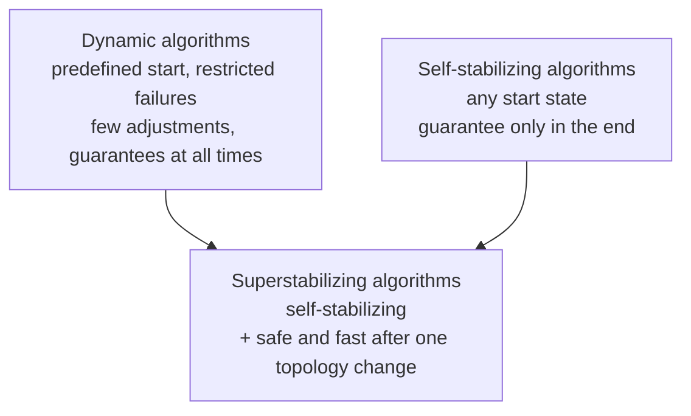

> **Beyond the slides (Dolev §7.1, quiz 15 Q1, Q5, Q7).** The differences in more detail:
>
> | | Dynamic algorithms | Self-stabilizing algorithms |
> |---|---|---|
> | Starting point | A predefined initial state | Any state at all |
> | A topology change is… | An **event** signal; a processor that joins initializes its state | Just a new **state** to converge from (no event signals) |
> | Behaviour during recovery | Specified at all times, so services continue predictably | No restriction; only eventual convergence is promised |
> | Hidden assumptions | Not all combinations of crashes; every corrupted message is detected and discarded; bounded link capacity | None of these |
>
> Those assumptions do not always hold in practice. Dolev recalls his §3.2 result: when crashes are possible and the link capacity is not known, an **arbitrary** configuration can be reached, which only a self-stabilizing algorithm can handle.

---

## 3. What makes an algorithm superstabilizing

A **super-self-stabilizing** algorithm:

1. **Must be self-stabilizing** (it still recovers from any state);
2. **Must preserve a "passage predicate"**;
3. **Should exhibit a fast convergence rate**.

The **passage predicate** is defined with respect to a **class of topology changes** (for example "one link is added or removed"). A topology change usually makes the current configuration **not legitimate** any more. So the passage predicate must be **weaker than legitimacy** (it must survive the change) but **strong enough to be useful**.

> **Beyond the slides (Dolev §7.1).** Dolev's words: when started in a safe configuration and a topology change occurs, a superstabilizing algorithm "converges to a new safe configuration in a graceful manner". Ideally the passage predicate is "the strongest predicate that holds when a legitimate state undergoes a topology change event".

> **Kid example.** "Must be self-stabilizing" is the basic promise: whatever mess happens, the class will be seated correctly in the end. The two extra promises only cover the gentle case: one child comes or goes while everything was fine.

---

## 4. The passage predicate: the token ring example

The standard example is a **token ring**:

| | Statement |
|---|---|
| Legitimate state | **Exactly one** token exists in the system. |
| Passage predicate | **At most one** token exists in the system (for example, two tokens are not allowed). |

A processor crash can **lose** the token (zero tokens), which breaks legitimacy, but it does **not** break the passage predicate, because zero is still "at most one".

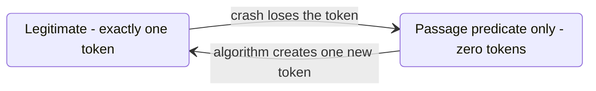

> **Beyond the slides (Dolev §7.1, quiz 15 Q3).** The same idea for **leader election**: the passage predicate is "**no more than one** leader exists". If the leader crashes there may briefly be zero leaders, but there must never be two. A common wrong answer is "at least one leader": a crash of the leader breaks that rule at once.

> **Kid example.** A team may have no captain for a minute while it chooses a new one. That is fine. Two captains shouting opposite orders would be chaos. So the rule that must always hold is "at most one captain".

---

## 5. How we measure a superstabilizing algorithm

Two measures are added, on top of the usual time to stabilize from any state:

- **Time complexity (superstabilizing time):** the maximal number of **rounds** from a legitimate state, through a **single** topology change, until a legitimate state again.
- **Adjustment measure:** the maximal number of **processors that must change their local state** after a topology change, in order to reach legitimacy.

> **Beyond the slides (Dolev §7.1, quiz 15 Q13).** Speed and keeping the passage predicate are **orthogonal** (independent): an algorithm can be fast but break the passage predicate on the way, or keep the predicate but be slow. A superstabilizing algorithm needs both.

> **Kid example.** A new road opens in town. Superstabilizing time: how many days until the town map is correct again. Adjustment measure: how many houses had to change something.

---

## 6. Why bother: the motivation

There are three reasons.

1. A self-stabilizing algorithm that **does not ignore** topology changes ("events") can be initialized in a predefined way and **react better** to dynamic changes during execution.
2. The key question: when a fault is **detected** as it happens, can the algorithm keep a **"nearly legitimate" state** during convergence? (Superstabilization answers yes.)
3. **Transient faults are rare (but harmful), while topology changes may be frequent.** So it pays to have a **lower worst-case time** to reach a legitimate state again after a topology change.

The next slides present a self-stabilizing and a superstabilizing algorithm for **graph colouring**.

> **Beyond the slides (Dolev §7.1, quiz 15 Q9).** Dolev's motivating example is a **spanning tree** used for virtual circuits (fixed paths between pairs of processors). When a tree link fails, the tree splits into two parts, but the circuits that lie entirely inside one part keep working. A superstabilizing repair just picks **one link** to join the two parts, so the existing circuits are not disturbed. A plain self-stabilizing algorithm might rebuild the whole tree.

---

## 7. The graph colouring task

The **colouring task** is to assign a colour to each processor so that **no two neighbouring processors have the same colour**.

- Using as few colours as possible is **not** required.
- The algorithm uses **Δ + 1 colours**, where **Δ is an upper bound on a processor's number of neighbours**.

Why Δ + 1? A processor has at most Δ neighbours, so they use at most Δ different colours. With Δ + 1 colours in the palette, **at least one colour is always free**.

> **Beyond the slides (Dolev §7.1).** The exact goal of a **self-stabilizing** colouring algorithm: for every two neighbours Pi and Pj, **eventually colour_i ≠ colour_j, and no colour variable changes value** any more. Dolev also assumes that adding a link or a processor never gives anyone **more than Δ neighbours**; otherwise Δ + 1 colours might run out (quiz 15 Q21).

> **Kid example.** Kids at a party sit around tables wearing T-shirts. Rule: no two kids sitting next to each other may wear the same colour. If every kid has at most 3 neighbours, 4 shirt colours are always enough: whatever the neighbours wear, at least one colour is left.

---

## 8. The self-stabilizing colouring algorithm (Figure 7.1)

Here is the code that processor Pi runs (Dolev's Figure 7.1; Algorithm 17 on the exam cheat sheet):

```text
01 Do forever
02     GColors := ∅
03     For m := 1 to δ do
04         lr_m := read(r_m)
05         If ID(m) > i then
06             GColors := GColors ∪ {lr_m.color}
07     od
08     If color_i ∈ GColors then
09         color_i := choose(\\ GColors)
10     Write r_i.color := color_i
11 od
```

Line by line, in plain words:

- **Line 2:** start with an empty set GColors.
- **Lines 3–4:** read the register of every neighbour m (Pi has δ neighbours).
- **Lines 5–6:** if that neighbour has a **greater ID** than Pi, add its colour to GColors. Neighbours with a smaller ID are ignored.
- **Lines 8–9:** if Pi's colour equals the colour of a greater-ID neighbour, pick a colour that **none of the greater-ID neighbours** has.
- **Line 10:** publish the colour in Pi's register.

In one sentence: **"If Pi has the color of one of its neighbors with a higher ID, it chooses another color and writes it."**

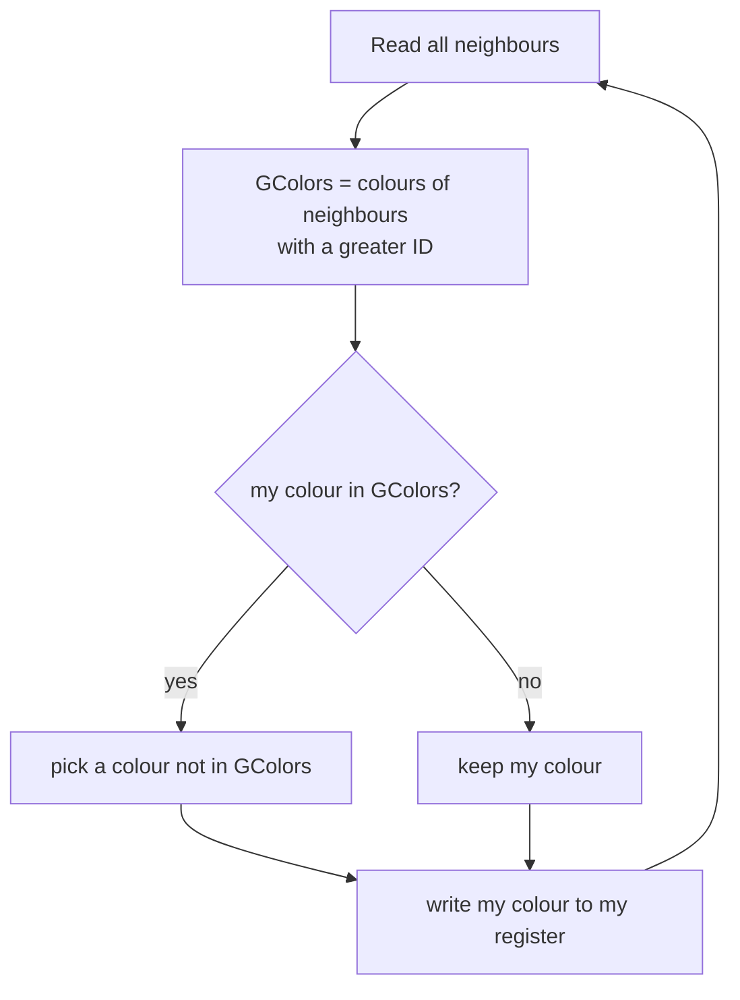

**Why look only at greater IDs?** The IDs **break symmetry**. When two neighbours clash, only the one with the **smaller ID** moves; the other one stays. So the processor with the **largest ID never changes** its colour at all, and two neighbours can never keep "chasing" each other.

> **Note on the source.** The lecture shows line 2 as "GColors := 0"; it means the empty set ∅ (Dolev writes ∅). "choose(\\ GColors)" means "choose a colour from the palette minus GColors".

> **Kid example.** Rule for the party: "If you wear the same colour as an **older** kid next to you, you change. Never change because of a younger kid." The oldest kid never has to change; everyone else only has to dodge older neighbours.

---

## 9. Watching Figure 7.1 run

The lecture animates the algorithm on this graph of five processors. **All processors start blue.**

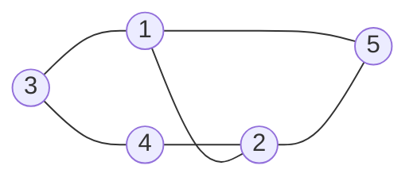

Processors 1 and 2 have three neighbours each, so Δ = 3 and the palette has Δ + 1 = **4 colours**: blue, red, green and yellow.

The animation goes through Phase I, Phase II and Phase III ("Stabilized"). Its final colouring is:

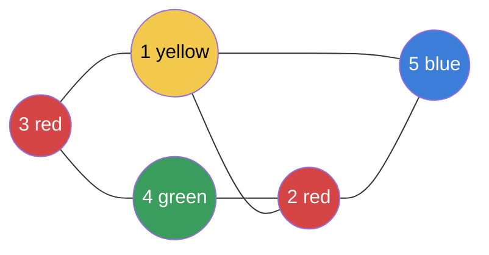

Every edge joins two different colours, so this is a correct colouring.

> **Note on the source.** Two details of the animation do not match the code.
> - In Phase I the animation labels processor 4 with "GColors = { Blue }". But processor 4's neighbours are 2 and 3, both with **smaller** IDs, so its GColors is always **empty** (Phase II correctly shows "GColors = {}" for it).
> - For the same reason processor 4 can **never** change colour under Figure 7.1, yet the animation turns it green. With the code as written, processor 4 stays blue. The final colouring of the animation is still a correct colouring; it just is not the one the code produces from "all blue".

> **Beyond the slides (our own run, checked with a small program).** Here is what the code really does, if all processors move together in rounds (everyone reads, then everyone writes) and choose() takes the first free colour in the order blue, red, green, yellow:
>
> | Round | P1 | P2 | P3 | P4 | P5 | Correct colouring? |
> |---|---|---|---|---|---|---|
> | Start | blue | blue | blue | blue | blue | no |
> | 1 | red (GColors {blue}) | red (GColors {blue}) | red (GColors {blue}) | blue (GColors {}) | blue (GColors {}) | no: 1 and 2 are both red |
> | 2 | green (GColors {red, blue}) | red | red | blue | blue | **yes** |
>
> In round 2, P2's GColors is {blue} (from 4 and 5), so P2 keeps red; P1 sees red among its bigger neighbours 2 and 3, so P1 moves to green. After that no processor clashes with a bigger-ID neighbour, so nothing changes any more. The real algorithm is asynchronous, so other orders give other (also correct) final colourings.

---

## 10. Trouble after a topology change: the cascade

Now the key question: **what happens when the topology changes?** If a new neighbour is added, two processors that just became neighbours may have **the same colour**. During the repair, **every processor may change its colour**.

The lecture's example is a chain of five processors. The link between 4 and 5 was not working and now **recovers**, while 4 and 5 are both blue:

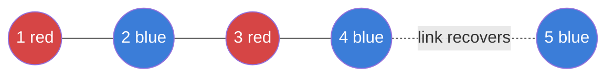

Now Figure 7.1 runs, and the animation shows a **cascade** (a chain reaction):

1. **P4:** GColors = {blue} (from P5), and P4 is blue, so it changes, say to **red**. Now P4 clashes with P3 (red).
2. **P3:** GColors = {red} (from P4), so it changes, say to **blue**. Now it clashes with P2 (blue).
3. **P2:** GColors = {blue} (from P3), so it changes to **red**. Now it clashes with P1 (red).
4. **P1:** GColors = {red} (from P2), so it changes to **blue**.
5. **P5** has the largest ID: GColors = ∅, so it never changes.

Final: 1 blue, 2 red, 3 blue, 4 red, 5 blue. Four processors changed colour.

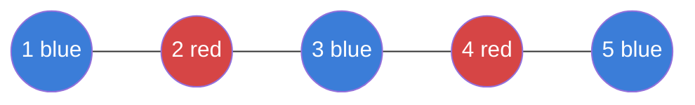

The lecture asks: **"But in what cost?"** The answer: **every processor changed its colour, but only one really needed to.** If we could **notice** the topology change, we could keep the changes in its neighbourhood.

> **Note on the source.** The lecture says "**every** processor" may change; Dolev says "**almost** every processor". In the example P5 never changes (it has the largest ID), so "almost every" is the exact statement.

> **Beyond the slides (Dolev §7.1, quiz 15).** The cascade is only **possible**, not certain: choose() may pick any free colour. In the chain Δ = 2, so there are 3 colours; if P4 had picked the third colour (say yellow) instead of red, the repair would have stopped at once. Figure 7.1 cannot guarantee that, because it only avoids the colours of **greater-ID** neighbours (GColors), not of all neighbours. That is why one local fix can create a new clash further down the chain (quiz 15 Q12).

> **Kid example.** Kids stand in a line. The youngest of two kids who now stand together in the same shirt changes, but grabs a shirt that matches the kid on the other side, who then changes, and so on down the whole line, like falling dominoes.

---

## 11. The superstabilizing colouring algorithm (Figure 7.2)

We add three things to the algorithm:

- **AColors:** a variable that collects the colours of **all** of the processor's neighbours.
- An **interrupt section:** it identifies the problem area when a topology change happens.
- **⊥** (bottom): a symbol that flags a **non-existing colour**.

Here is the code (Dolev's Figure 7.2; Algorithm 18 on the exam cheat sheet).

```text
01 Do forever
02     AColors := {}
03     GColors := {}
04     For m := 1 to δ do
05         lr_m := read(r_m)
06         AColors := AColors ∪ {lr_m.color}
07         If ID(m) > i then GColors := GColors ∪ {lr_m.color}
08     od
09     If color_i = ⊥ or color_i ∈ GColors then
10         color_i := choose(\\ AColors)
11     Write r_i.color := color_i
12 od
13 Interrupt section
14     If recover_ij and j > i then
15         color_i := ⊥
16         Write r_i.color := ⊥
```

What is new, compared with Figure 7.1:

- **Line 6:** AColors collects the colours of **all** neighbours (line 7 still builds GColors from the greater-ID ones).
- **Line 9:** Pi chooses a new colour if it has **no colour (⊥)** or it clashes with a greater-ID neighbour.
- **Line 10:** the new colour avoids **all** neighbours' colours (AColors), not only the greater ones. So the new choice can never start a cascade.
- **Lines 13–16:** **recover_ij** is the interrupt Pi gets when the communication between Pi and Pj changes (the link recovers). If the other end Pj has the **greater** ID, Pi immediately sets its colour to **⊥** and publishes ⊥. The greater-ID end does nothing.

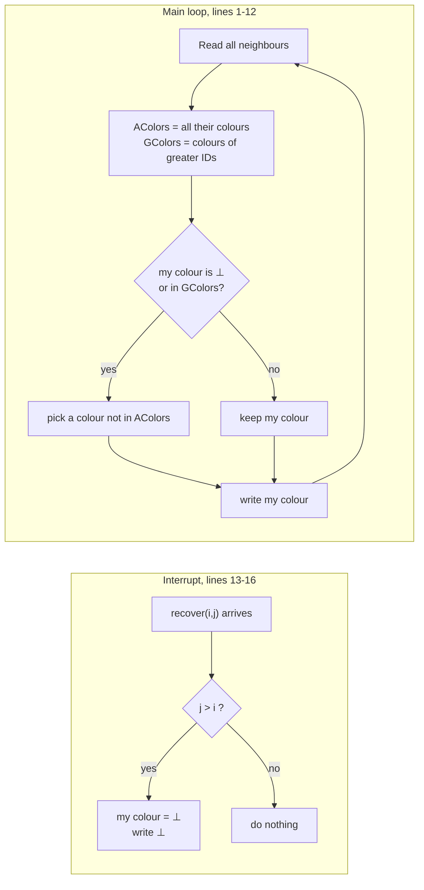

> **Note on the source.** In the lecture, line 11 reads "Write r_i.color := color" with the subscript i missing; it means color_i. Dolev's printed Figure 7.2 (and even Figure 7.1) has the same slip. The 2017 exam printed this code too and also called δ "the number of nodes"; δ is the number of Pi's **neighbours**.

> **Kid example.** When two kids in the same shirt suddenly stand next to each other, the **younger** one takes the shirt off right away (⊥ = "no shirt", which matches nobody). Then that kid looks at **everyone** nearby and puts on a colour none of them wears. One kid changes, and nobody matches a neighbour even for a moment.

---

## 12. The same example with Figure 7.2

Let us rerun the chain example with the new algorithm. **The new algorithm stabilizes faster than the previous one (in some cases).**

1. The link 4–5 recovers. P4 gets the interrupt **recover_4,5**, and 5 > 4, so P4 sets **color_4 = ⊥** and **r_4.color = ⊥**. (P5 gets recover_5,4, but 4 < 5, so P5 does nothing.)
2. Now nobody clashes: ⊥ is not a colour.
3. In its next loop, P4 reads its neighbours: **GColors = {blue}** (from P5) and **AColors = {blue, red}** (from P5 and P3). Its colour is ⊥, so it picks a colour **not in AColors**: **yellow**.
4. Done, **in O(1)**: only P4 changed.

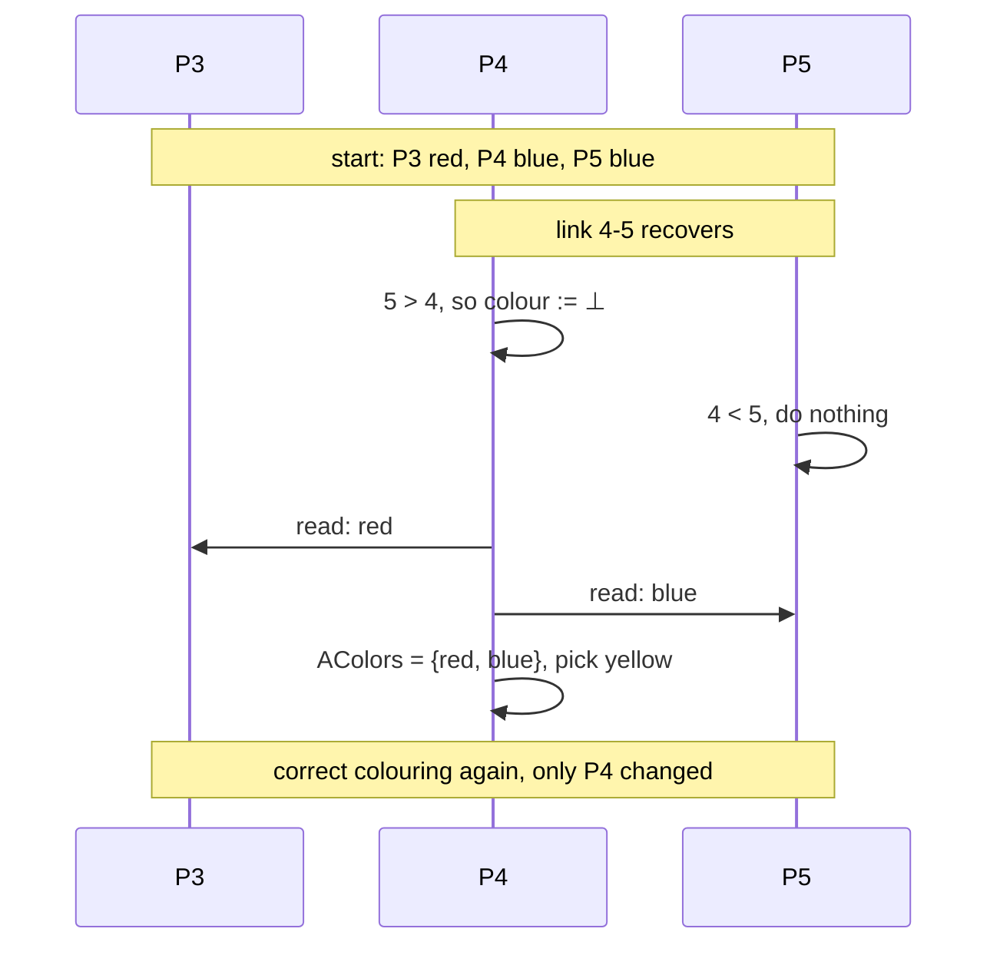

Final: 1 red, 2 blue, 3 red, **4 yellow**, 5 blue.

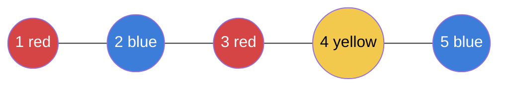

> **Beyond the slides.** In the chain Δ = 2, so the palette has 3 colours, and yellow is the only one left after removing red and blue. A free colour always exists, because AColors holds at most Δ colours and the palette has Δ + 1.

---

## 13. Proof that Figure 7.2 is self-stabilizing

To be superstabilizing, an algorithm must first be **self-stabilizing**, so we prove that first.

**Lemma 1.** The algorithm of Figure 7.2 is self-stabilizing.

**Proof by induction** (assume no further topology changes, so the interrupt never runs again):

1. **After the first iteration** (cycle), the value **⊥ no longer exists** in the system: every processor whose colour was ⊥ picks a real colour (line 10) and writes a real colour (line 11), and only the interrupt ever writes ⊥.
2. **Pn**, the processor with the largest ID, now has a **fixed** colour: it has no greater-ID neighbour, so GColors is always empty and line 9 is false.
3. **Assume** every Pk with k greater than i already has a fixed colour.
4. If Pi has such a neighbour Pk, Pi does **not** take Pk's colour; it chooses a different one (line 10 avoids all neighbours' colours). Since Pk's colour no longer changes, Pi's choice no longer needs to change either.
5. So Pi's colour becomes fixed, for every 1 ≤ i ≤ n, and the system stabilizes.

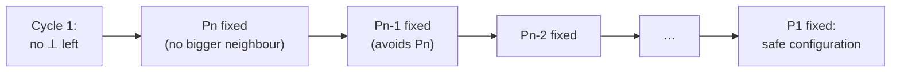

> **Note on the source.** The lecture writes the induction hypothesis as "Pk has a fixed value ∀ i<k<n". It should be **i < k ≤ n**: Pn itself is one of the fixed processors. "After the first iteration" means after the first **asynchronous cycle**, the time in which every processor completes one loop.

> **Beyond the slides (Dolev §7.1, 2017 exam Q3).** Dolev states the timing: the processor with the j-th largest ID is fixed within about j cycles, so the whole system is safe within **O(n) cycles** from any starting state. This is the same order as Figure 7.1. Figure 7.2 is **not** faster from a garbage start; it is faster only after one topology change from a safe state.

> **Kid example.** The oldest kid never changes shirt. The second oldest only has to dodge the oldest, so after one change they are done too. Then the third oldest, and so on, like dominoes falling in order of age.

---

## 14. Passage predicate, time and adjustment for colouring

Now the three superstabilization ideas, applied to Figure 7.2.

**Passage predicate:** the colours of neighbouring processors are **always different**, in every execution that starts in a safe configuration and in which **only a single topology change** happens before the next safe configuration is reached.

Why it holds: the moment the link recovers, the smaller-ID end shows ⊥, and ⊥ equals no colour. Its next real colour avoids every neighbour (AColors). So there is never a moment with two neighbours in the same colour.

**Superstabilizing time:** the number of cycles needed to reach a safe configuration after a topology change.

| | Figure 7.2 (superstabilizing) | Figure 7.1 (self-stabilizing) |
|---|---|---|
| Superstabilizing time | **O(1)**: one cycle | **O(n)** |

**Adjustment measure:** the number of processors that change colour after a topology change. The superstabilizing algorithm changes **one** processor's colour: the one at the end of the changed link (the smaller-ID end).

> **Beyond the slides (Dolev §7.1).** Dolev's exact statements: the passage predicate covers executions "in which only a single **edge** may fail or recover"; the superstabilizing time is "**one cycle** (while the stabilizing complexity is O(n) cycles)"; the adjustment measure is "only one processor, when the topology changes considered are link addition or removal". When a link is **removed**, no clash can appear, so in fact no colour needs to change at all; "one processor" is the worst case.

> **Beyond the slides (an assumption worth saying in the exam).** The argument needs the interrupt to run **before** the two new neighbours read each other through the new link, so that ⊥ is already there when they look. Exam model answers state this as "the interrupt is executed as part of the topology change".

---

## 15. Reading

The reading for this lecture is Shlomi Dolev and Ted Herman, *Superstabilizing Protocols for Dynamic Distributed Systems*, Chicago Journal of Theoretical Computer Science, 1997 (cjtcs.cs.uchicago.edu/articles/1997/4/cj97-04.pdf).

---

## 16. Recap

- **Dynamic algorithms:** predefined start, restricted failures, guarantees at all times. **Self-stabilizing:** any start, guarantee only in the end. **Superstabilizing:** both.
- **Definition:** must be self-stabilizing, must preserve a **passage predicate**, should converge fast. The passage predicate is **weaker than legitimacy** but still useful (token ring: at most one token; leader election: at most one leader).
- **Measures:** **superstabilizing time** (rounds from legitimate, through one topology change, back to legitimate) and **adjustment measure** (how many processors must change state).
- **Colouring** with Δ + 1 colours:
  - **Figure 7.1 (Algorithm 17):** only dodge **greater-ID** neighbours (GColors). Self-stabilizing in O(n) cycles, but after a new link a **cascade** can recolour almost every processor.
  - **Figure 7.2 (Algorithm 18):** AColors + **⊥** + **interrupt**. The smaller-ID end of a recovered link sets ⊥, then picks a colour outside AColors. Passage predicate "neighbours always differ" holds; **1 cycle**, **1 processor**. From an arbitrary state it is still O(n).
- **Why:** transient faults are rare, topology changes are frequent.

---

## 17. Old exam questions on this lecture

On the exam cheat sheet, **Algorithm 17** is Figure 7.1 and **Algorithm 18** is Figure 7.2.

**October 2021, Q1k (true/false).** *"The fact the problem X does not have a self-stabilizing solution implies that it does not have a super-self-stabilizing solution."*
**TRUE.** By definition every superstabilizing algorithm is self-stabilizing, so no self-stabilizing solution means no superstabilizing one.

**August 2020, Q1e (8 points).** (i) In what sense is a super-self-stabilizing solution better than a self-stabilizing one? (ii) Should we just focus on super-self-stabilization instead?
- (i) It is still self-stabilizing, **and** after one topology change from a legal state it keeps a **passage predicate** during the repair, recovers **fast** (1 cycle instead of O(n) for colouring) and changes **few processors** (one for colouring). Topology changes are frequent, so this matters.
- (ii) **No.** It is built **on top of** self-stabilization (it must be self-stabilizing; no self-stabilizing solution means no superstabilizing one). Its extra promises cover only one kind of event (a single topology change from a legal state); after arbitrary transient faults only self-stabilization helps. And it costs more: extra variables, ⊥, and a way to detect topology changes (the interrupt).

**October 2017, Q3 (12 points)**, printed Figures 7.1 and 7.2:
- (a) Define vertex colouring: every processor gets a colour from Δ + 1 colours; eventually neighbours differ and no colour changes.
- (b) Recovery time of Figure 7.1 from an arbitrary state: **O(n) cycles**, by induction from the largest ID down (section 13).
- (c) Recovery time of Figure 7.2 from an arbitrary state: **also O(n)**. After cycle 1 no ⊥ is left, then the same induction. It is **not** faster from garbage.
- (d) Advantages of Figure 7.2: passage predicate, 1-cycle recovery, one processor adjusts, versus a possible cascade in Figure 7.1. The price: ⊥, AColors and the interrupt signal.

**October 2019, Q4 (18 points): super-self-stabilizing colouring on a ring.**
- (a) Define vertex colouring (for every edge, the two colours differ).
- (c) Self-stabilizing vs super-self-stabilizing: section 3 and section 5 of this guide.
- (d) Make a ring colouring superstabilizing when one node can be removed. The teacher's idea copies Figure 7.2: the distinguished processor P0 keeps a colour (3) no one else uses; a processor changes only if it clashes with its **left** neighbour or holds ⊥, and then picks from {0, 1, 2} a colour different from **both** neighbours; when a node is removed, the processor on its right sets its colour to **⊥**. Figure 7.2 itself needs unique IDs, which the ring does not have, so the ring's direction plays the role of the IDs.

**January 2025, Q3 (12 points).** Fill in the blanks of the correctness proof of **Algorithm 17**: a processor is "in conflict" if a neighbour has the **same** colour (the greater-ID neighbour, by line 180 of the cheat sheet); a safe configuration has no conflicts and every register equals its colour; the bound is **O(n)** cycles; base case: the largest ID never changes; induction step: the next largest ID dodges fixed colours.

**October 2022, Q2 (20 points).** Colouring a "balloon" graph with **no IDs**: there is no deterministic self-stabilizing colouring for anonymous general graphs (two identical neighbours stay identical forever), so the solution first builds IDs and then uses the ID-based rule of Figure 7.1.

> **Kid example (exam tip).** "Superstabilizing" = self-stabilizing + passage predicate + fast. If a question asks whether it is faster "from an arbitrary state", the answer is **no** (both O(n)); it is faster only after **one** topology change from a legal state.

---

## 18. Related quiz topics not on the slides

The course's pre-lecture quiz on this chapter (quiz 15, 30 questions on Dolev §7.1) follows the lecture closely. Points it asks that the lecture leaves implicit:

| Question | Answer (quiz key, Dolev) |
|---|---|
| What do dynamic algorithms promise between a failure and the end of the adjustments? (Q1) | Specified behaviour throughout, so services continue predictably. |
| Which assumption of dynamic algorithms is not guaranteed in practice? (Q5) | That corrupted messages are always detected and discarded (also: not all crash combinations, bounded link capacity). |
| How do the two kinds of algorithms model a topology change? (Q7) | Dynamic: an event signal, and joining processors initialize their state. Self-stabilizing: just a new state to converge from. |
| What does the spanning-tree example show? (Q9) | A failed tree link splits the tree, circuits inside each part keep working, and the least-impact fix adds one link. |
| Why does Pi collect only greater-ID colours in GColors? (Q11) | To break symmetry: in a clash the smaller ID moves. (The quiz key says "lower-ID processors decide first", which is loosely worded: in the book the **higher** IDs settle first and the lower IDs adapt.) |
| How are speed and the passage predicate related? (Q13) | They are orthogonal: fast does not imply safe. |
| Why does the largest ID stabilize first? (Q15) | No greater-ID neighbour can force it to change. |
| What holds after the first asynchronous cycle without topology changes? (Q19) | No color_i or r_i.color equals ⊥, and only lines 1 to 12 run. |
| Why assume a new link never exceeds the degree bound? (Q21) | Δ + 1 colours rely on that bound, or the free colour might not exist. |
| What is the role of ⊥? (Q25) | It marks "no colour", removes the clash at once, and signals "choose a new colour" after a link recovers. |
| Why measure time from a legitimate state? (Q30) | Transient faults are rare, topology changes may be frequent. |
