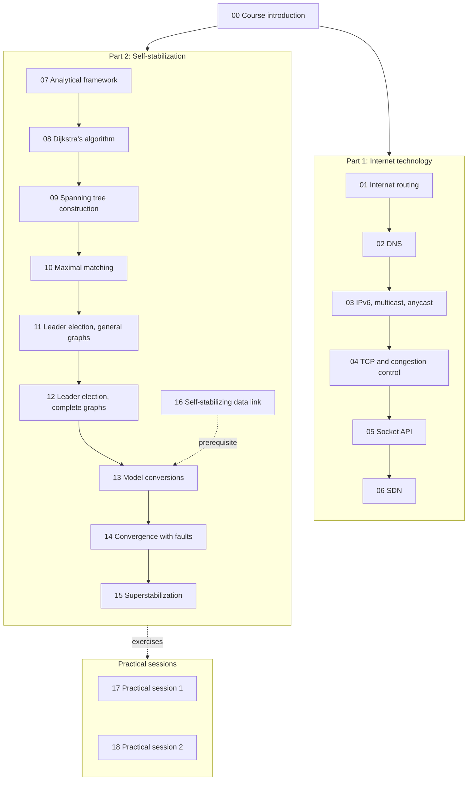

# EDA387 / DIT663 Computer Networks — Study Guides

**Revised:** 21 October 2026

One study guide per lecture, numbered in the order of the course's pre-lecture quizzes. Every guide is written in simple words for beginners, so you can understand it on the first reading and explain it to someone else. Each guide starts with a glossary and a **Before you start: the words you need** section, and each chapter starts with **What this chapter is about**. Every part then gives the idea **in one sentence**, the full explanation step by step, a **Kid example** with everyday things, pictures, and a **Remember** list for the exam. Diagrams are Mermaid and render directly on GitHub.

**† Supplementary material:** Content originating exclusively from hidden PowerPoint slides. It may not be included in this year's examinable material.

**How to read the guides.** **Technical clarification** marks a place where the slides are wrong or unclear, and gives the correct version. **Additional context** adds something useful that is not on the slides.

**Exam:** 29 October 2026, 08:00–12:00. Question 1 is a set of multiple-choice questions on Internet technology (guides 01–06). The remaining questions concern self-stabilizing algorithms (guides 07–16).

---

## Contents

- [Course map](#course-map)
- [Part 1: Internet technology](#part-1-internet-technology)
- [Part 2: Self-stabilizing algorithms](#part-2-self-stabilizing-algorithms)
- [Course introduction and practical sessions](#course-introduction-and-practical-sessions)

## Course map

Guides 01–15 follow the numbering of the fifteen pre-lecture quizzes. Guide 16 covers the data-link lecture, which has no quiz of its own. In the lecture order it comes just before guide 13: the data-link lecture shows why crashes require self-stabilization, and the self-stabilizing data-link algorithms themselves are taught in Model Conversions.

## Part 1: Internet technology

| # | Guide | Topics |
|---|---|---|
| 01 | [Internet routing](01-Internet-Routing.md) | IPv4 header and fragmentation; addressing, CIDR, ARP, ICMP and DHCP; forwarding; link-state and distance-vector routing; BGP; routing security |
| 02 | [DNS](02-DNS.md) | Delegation and resolution; resource records and glue; DNS messages; DNSSEC and the root KSK rollover; encrypted DNS; anycast and failure |
| 03 | [IPv6, multicast and anycast](03-IPv6.md) | Address notation and types; dynamic addressing and interface identifiers; subnetting; the IPv6 header; tunnelling; deployment |
| 04 | [TCP](04-TCP.md) | Multiplexing; reliable transfer and sliding windows; RTT estimation; flow control; congestion control from Tahoe to CUBIC; bufferbloat, BBR, L4S and QUIC |
| 05 | [Socket API](05-Socket-API.md) | Client-server model; elementary socket calls; connection establishment and TIME_WAIT; byte order and address structures; I/O models and `select`; scalable servers |
| 06 | [SDN](06-SDN.md) | Data, control and management planes; network OS and control programs; OpenFlow flow tables and match-action rules; history and drivers |

## Part 2: Self-stabilizing algorithms

| # | Guide | Topics |
|---|---|---|
| 07 | [Analytical framework](07-Analytical-Framework.md) | Models and settings; states, configurations and executions; fairness; transient faults; legal executions and safe configurations; rounds and cycles |
| 08 | [Dijkstra's algorithm](08-Dijkstra-Algorithm.md) | Mutual exclusion on a ring; Dijkstra's token-ring algorithm and its proof of self-stabilization |
| 09 | [Spanning tree construction](09-Spanning-Tree-Construction.md) | Switching loops and STP; the self-stabilizing BFS spanning tree; fair composition |
| 10 | [Maximal matching](10-Maximal-Matching.md) | Matchings; the variant-function technique; the Hsu–Huang algorithm under central and distributed daemons |
| 11 | [Leader election, general graphs](11-Leader-Election-General-Graphs.md) | Floating identifiers; the convergence-stairs technique; leader election in ID-based systems |
| 12 | [Leader election, complete graphs](12-Leader-Election-Complete-Graphs.md) | Anonymous systems; randomized self-stabilization; the scheduler-luck game |
| 13 | [Model conversions](13-Model-Conversions.md) | Token passing; self-stabilizing data-link algorithms; ranking; update; † synchronizers |
| 14 | [Convergence in the presence of faults](14-Convergence-in-the-Presence-of-Faults.md) | NTP; digital clock synchronization; stabilization in spite of napping faults |
| 15 | [Superstabilization](15-Superstabilization.md) | Dynamic systems; passage predicates; self-stabilizing and superstabilizing graph colouring |
| 16 | [Self-stabilizing data link](16-Self-Stabilizing-Data-Link.md) | The alternating-bit algorithm; impossibility of crash-tolerant initialization; why crashes require self-stabilization |

## Course introduction and practical sessions

| # | Guide | Topics |
|---|---|---|
| 00 | [Course introduction](00-Course-Introduction.md) | Why networks must be dependable; restart on failure; self-stabilizing networks; course organization |
| 17 | [Practical session 1](17-Practical-Session-1.md) | Value discovery in complete graphs (home assignment 1) |
| 18 | [Practical session 2](18-Practical-Session-2.md) | Ring colouring, ring matching and a leader-election review |
