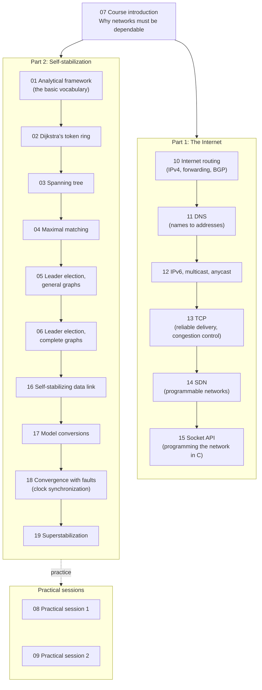

# EDA387 / DIT663 Computer Networks: Study Guides

These are 19 easy-to-read study guides, one for each lecture of the course. Each guide explains its lecture step by step, with diagrams, everyday examples and a word list (glossary).

> **Exam:** 29 October 2026, 08:00–12:00. The first question is a set of multiple-choice questions about Internet technology (mostly guides 10–14). The rest are self-stabilization design and proof questions (guides 01–06 and 16–19).

---

## How to read these guides on GitHub

- **Click a guide** in the list below to open it. GitHub draws all diagrams and math formulas for you automatically.
- **Jump around inside a guide:** every guide starts with a clickable table of contents. You can also click the **list icon (☰)** at the top right of an open file to see all its headings.
- **The boxes inside each guide:**

  | Box | What it means |
  |---|---|
  | **Kid example** / *Everyday example* | The same idea told with a picture from daily life. Start here if a part feels hard. |
  | **Beyond the slides** | Extra background that helps you understand, but is not on the slides. |
  | **Note on the source** | A place where the slides contain a mistake or are unclear, and what is actually correct. |
  | **†** (dagger) | Content that only appears on hidden slides. It may not be examinable. |

---

## The course at a glance

The course has two big halves. The first explains how the real Internet works. The second explains **self-stabilization**: how a network can repair itself after any kind of fault, without anyone resetting it.

---

## All guides

### Part 1: How the Internet works

| # | Guide | What you learn |
|---|---|---|
| 07 | [Course introduction](07-Course-Introduction.md) | Why today's networks are not dependable enough, and what the course is about. |
| 10 | [Internet routing](10-Internet-Routing.md) | IPv4 addresses and packets, ARP, ICMP, DHCP, how routers forward packets, distance-vector and link-state routing, BGP between networks, and routing security. |
| 11 | [DNS](11-DNS.md) | How names like `www.chalmers.se` become IP addresses: records, glue, caching, DNS security and DNS failures. |
| 12 | [IPv6, multicast and anycast](12-IPv6.md) | Why IPv6 exists, its addresses and header, how IPv4 and IPv6 live together, and sending to many or to the nearest. |
| 13 | [TCP](13-TCP.md) | How TCP delivers data reliably and in order, and how it avoids overloading the network (congestion control). |
| 14 | [SDN](14-SDN.md) | Software Defined Networks: one central program controls many switches (OpenFlow). |
| 15 | [Socket API](15-Socket-API.md) | How programs talk over the network in C: sockets, clients, servers, and debugging tools. |

### Part 2: Self-stabilizing algorithms

| # | Guide | What you learn |
|---|---|---|
| 01 | [Analytical framework](01-Analytical-Framework.md) | The basic vocabulary: networks as graphs, states, configurations, executions, faults, what "self-stabilizing" means, and how speed is measured (rounds). |
| 02 | [Dijkstra's token ring](02-Dijkstra-Algorithm.md) | The first self-stabilizing algorithm: one token circulating in a ring (mutual exclusion). |
| 03 | [Spanning tree](03-Spanning-Tree-Construction.md) | Building a BFS spanning tree that repairs itself, and combining algorithms (fair composition). |
| 04 | [Maximal matching](04-Maximal-Matching.md) | Pairing up neighbours, and the variant-function proof technique. |
| 05 | [Leader election, general graphs](05-Leader-Election-General-Graphs.md) | Electing one leader when every node has an ID. |
| 06 | [Leader election, complete graphs](06-Leader-Election-Complete-Graphs.md) | Electing a leader without IDs, using randomization. |
| 16 | [Self-stabilizing data link](16-Self-Stabilizing-Data-Link.md) | Sending messages reliably over a link, and why crashes force us to self-stabilize. |
| 17 | [Model conversions](17-Model-Conversions.md) | Turning an algorithm written for one model into one that works in another. |
| 18 | [Convergence with faults](18-Convergence-in-the-Presence-of-Faults.md) | Real clock synchronization (NTP) and digital clocks that agree again after faults, even when processors stop for a while (napping faults). |
| 19 | [Superstabilization](19-Superstabilization.md) | Graph colouring that recovers quickly when the network changes. |

### Practical sessions

| # | Guide | What you learn |
|---|---|---|
| 08 | [Practical session 1](08-Practical-Session-1.md) | Value discovery in complete graphs (home assignment 1). |
| 09 | [Practical session 2](09-Practical-Session-2.md) | Ring colouring, ring matching and a leader-election review. |

---

## Suggested study order

1. Start with **07** to see the big picture.
2. For the multiple-choice part of the exam, read **10 → 11 → 12 → 13 → 14**. Read **15** if you have time.
3. For the self-stabilization part, read **01** first, since every later guide uses its words. Then read **02 → 06** in order, and finish with **16 → 19**.
4. Use **08** and **09** to practise the kind of reasoning the exam asks for.
